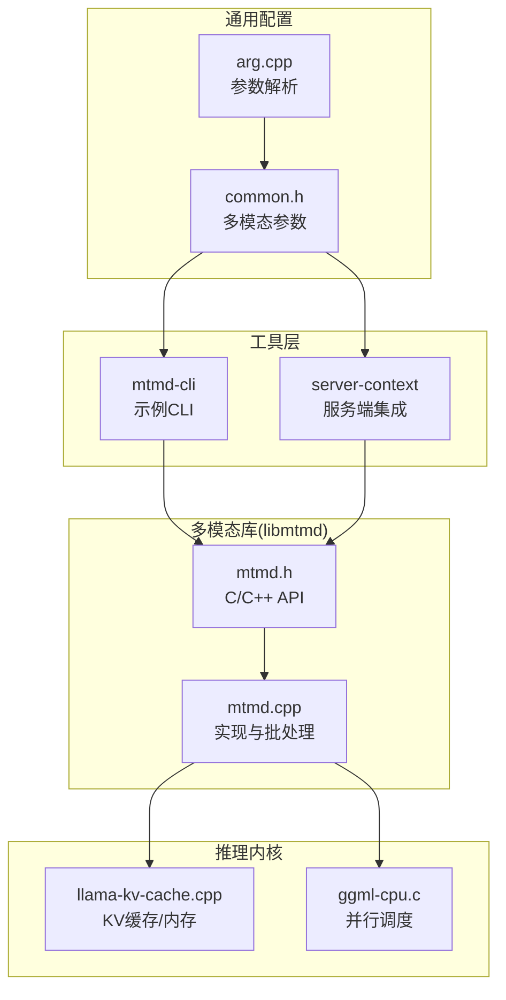
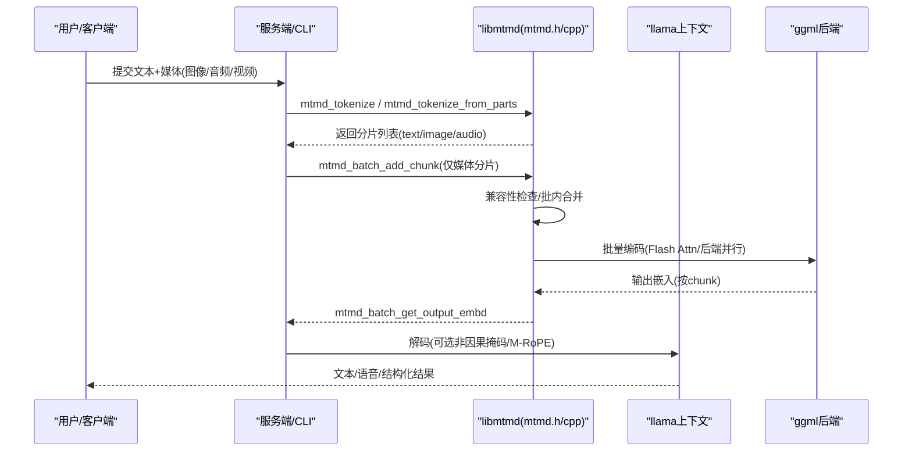
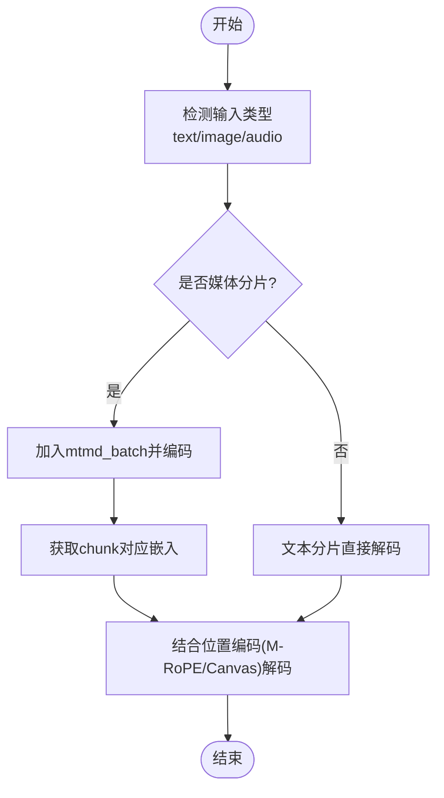
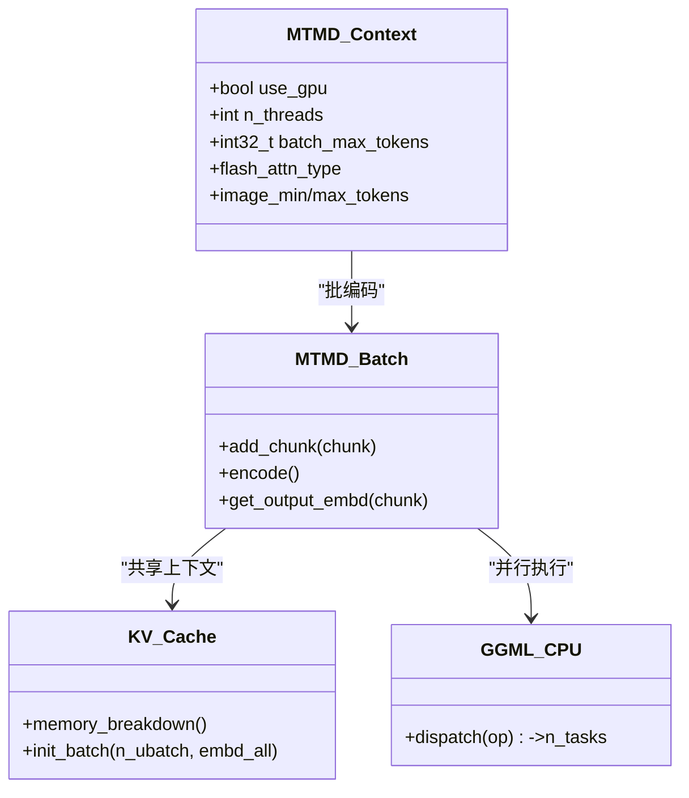
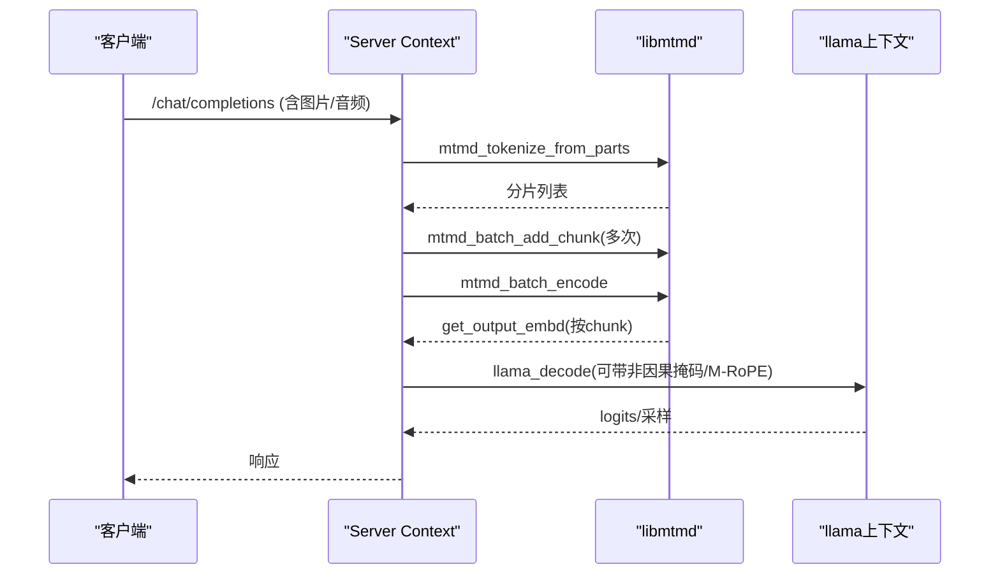
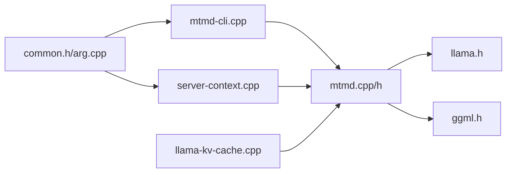

# 多模态推理

<cite>
**本文引用的文件**   
- [README.md](file://README.md)
- [multimodal.md](file://docs/multimodal.md)
- [mtmd.h](file://tools/mtmd/mtmd.h)
- [mtmd.cpp](file://tools/mtmd/mtmd.cpp)
- [mtmd-cli.cpp](file://tools/mtmd/mtmd-cli.cpp)
- [common.h](file://common/common.h)
- [arg.cpp](file://common/arg.cpp)
- [server-context.cpp](file://tools/server/server-context.cpp)
- [llama-kv-cache.cpp](file://src/llama-kv-cache.cpp)
- [ggml-cpu.c](file://ggml/src/ggml-cpu/ggml-cpu.c)
</cite>

## 目录
1. [简介](#简介)
2. [项目结构](#项目结构)
3. [核心组件](#核心组件)
4. [架构总览](#架构总览)
5. [详细组件分析](#详细组件分析)
6. [依赖关系分析](#依赖关系分析)
7. [性能与优化](#性能与优化)
8. [故障排查指南](#故障排查指南)
9. [结论](#结论)
10. [附录：开发示例与最佳实践](#附录开发示例与最佳实践)

## 简介
本文件面向希望在 llama.cpp 上构建“统一多模态推理引擎”的开发者，系统阐述以下主题：
- 统一的推理接口设计：输入类型检测、动态路由与结果聚合机制
- 多模态批处理优化：内存管理、计算图融合与并行执行策略
- 推理性能调优：量化加速、缓存策略与硬件适配
- 应用开发指南：API 使用模式、错误处理与资源管理最佳实践
- 复杂场景示例：跨模态查询、检索增强生成（RAG）与多轮对话

llama.cpp 通过 libmtmd 提供图像、音频与视频的统一接入能力，并在 CLI 与服务端（OpenAI 兼容 API）中暴露一致的使用方式。

**章节来源**
- [README.md:60-74](file://README.md#L60-L74)
- [multimodal.md:1-18](file://docs/multimodal.md#L1-L18)

## 项目结构
围绕多模态推理的关键目录与文件如下：
- tools/mtmd：libmtmd 实现与示例 CLI
- common：通用参数解析与多模态相关开关
- tools/server：服务端对多模态批处理的集成
- src：KV 缓存与内存分配等底层能力
- ggml：后端算子与并行调度

**图表来源**
- [mtmd.h:19-34](file://tools/mtmd/mtmd.h#L19-L34)
- [mtmd.cpp:458-516](file://tools/mtmd/mtmd.cpp#L458-L516)
- [common.h:600-610](file://common/common.h#L600-L610)
- [arg.cpp:893-900](file://common/arg.cpp#L893-L900)
- [llama-kv-cache.cpp:707-740](file://src/llama-kv-cache.cpp#L707-L740)
- [ggml-cpu.c:2360-2404](file://ggml/src/ggml-cpu/ggml-cpu.c#L2360-L2404)

**章节来源**
- [mtmd.h:19-34](file://tools/mtmd/mtmd.h#L19-L34)
- [mtmd.cpp:458-516](file://tools/mtmd/mtmd.cpp#L458-L516)
- [common.h:600-610](file://common/common.h#L600-L610)
- [arg.cpp:893-900](file://common/arg.cpp#L893-L900)
- [llama-kv-cache.cpp:707-740](file://src/llama-kv-cache.cpp#L707-L740)
- [ggml-cpu.c:2360-2404](file://ggml/src/ggml-cpu/ggml-cpu.c#L2360-L2404)

## 核心组件
- libmtmd C/C++ API：定义上下文、位图、分片、批处理等抽象，屏蔽模型差异
- mtmd_context_params：控制 GPU 卸载、线程数、Flash Attention、图像 token 预算、批大小等
- mtmd_batch：将多个媒体分片合并编码，提升吞吐
- 上层集成：CLI 与服务端通过统一 API 完成分词、编码、解码与结果聚合

关键要点：
- 输入类型检测：通过 mtmd_input_chunk_type 区分文本、图像、音频
- 动态路由：根据模型能力（vision/audio）、投影器类型与位置编码策略选择预处理与解码路径
- 结果聚合：mtmd_batch_get_output_embd 按 chunk 返回嵌入向量，供后续解码或 RAG 使用

**章节来源**
- [mtmd.h:54-93](file://tools/mtmd/mtmd.h#L54-L93)
- [mtmd.h:97-125](file://tools/mtmd/mtmd.h#L97-L125)
- [mtmd.h:335-351](file://tools/mtmd/mtmd.h#L335-L351)
- [mtmd.cpp:458-516](file://tools/mtmd/mtmd.cpp#L458-L516)

## 架构总览
下图展示从用户请求到多模态编码与文本解码的整体流程，体现“输入检测→动态路由→批处理→结果聚合”。

**图表来源**
- [mtmd.h:286-318](file://tools/mtmd/mtmd.h#L286-L318)
- [mtmd.h:335-351](file://tools/mtmd/mtmd.h#L335-L351)
- [mtmd.cpp:2208-2306](file://tools/mtmd/mtmd.cpp#L2208-L2306)
- [mtmd-cli.cpp:315-417](file://tools/mtmd/mtmd-cli.cpp#L315-L417)

## 详细组件分析

### 统一推理接口设计（输入检测、动态路由、结果聚合）
- 输入检测
  - 通过 mtmd_input_chunk_type 识别文本/图像/音频
  - 支持懒加载位图（lazy bitmap），用于长视频流式读取与 KV 追踪
- 动态路由
  - 根据模型能力（vision/audio）与投影器类型（LLaVA/Qwen2VL/MiniCPM/Gemma 等）选择不同预处理与切片模板
  - 根据解码器的 RoPE 类型（NORMAL/MROPE/HUNYUANVL/CANVAS）决定位置索引策略与非因果掩码
- 结果聚合
  - 批编码后通过 mtmd_batch_get_output_embd 按 chunk 取回嵌入，供下游解码或检索模块复用

**图表来源**
- [mtmd.h:54-93](file://tools/mtmd/mtmd.h#L54-L93)
- [mtmd.h:139-157](file://tools/mtmd/mtmd.h#L139-L157)
- [mtmd.cpp:518-667](file://tools/mtmd/mtmd.cpp#L518-L667)
- [mtmd.cpp:669-800](file://tools/mtmd/mtmd.cpp#L669-L800)

**章节来源**
- [mtmd.h:54-93](file://tools/mtmd/mtmd.h#L54-L93)
- [mtmd.h:139-157](file://tools/mtmd/mtmd.h#L139-L157)
- [mtmd.h:190-217](file://tools/mtmd/mtmd.h#L190-L217)
- [mtmd.cpp:518-667](file://tools/mtmd/mtmd.cpp#L518-L667)
- [mtmd.cpp:669-800](file://tools/mtmd/mtmd.cpp#L669-L800)

### 多模态批处理优化（内存管理、计算图融合、并行执行）
- 内存管理
  - mtmd_context_params.batch_max_tokens 控制批内最大输出 token 预算
  - 非因果注意力模型需限制 image_max_tokens ≤ n_ubatch
  - KV 缓存按后端 buffer type 统计内存占用，便于容量规划
- 计算图融合
  - 通过 Flash Attention 与后端特定 kernel（Metal/CPU SIMD）减少中间张量与同步开销
- 并行执行
  - CPU 侧按操作类型分发任务（如 MUL_MAT/ROPE/SOFT_MAX 等）
  - 批编码在 libmtmd 内部组织为 batch，调用 ggml 后端并行执行

**图表来源**
- [mtmd.h:97-125](file://tools/mtmd/mtmd.h#L97-L125)
- [mtmd.h:335-351](file://tools/mtmd/mtmd.h#L335-L351)
- [llama-kv-cache.cpp:707-740](file://src/llama-kv-cache.cpp#L707-L740)
- [ggml-cpu.c:2360-2404](file://ggml/src/ggml-cpu/ggml-cpu.c#L2360-L2404)

**章节来源**
- [mtmd.h:97-125](file://tools/mtmd/mtmd.h#L97-L125)
- [mtmd.h:335-351](file://tools/mtmd/mtmd.h#L335-L351)
- [llama-kv-cache.cpp:707-740](file://src/llama-kv-cache.cpp#L707-L740)
- [ggml-cpu.c:2360-2404](file://ggml/src/ggml-cpu/ggml-cpu.c#L2360-L2404)

### 服务端与 CLI 的集成模式
- CLI（mtmd-cli）
  - 负责聊天模板格式化、媒体加载、分片构造、批编码与逐 token 解码
  - 演示了如何使用 mtmd_tokenize_from_parts 与 mtmd_batch_* API
- 服务端（server-context）
  - 将 OpenAI 兼容请求映射为 libmtmd 的分片与批处理调用
  - 复用 mtmd_batch 以聚合同一 slot 内的媒体分片

**图表来源**
- [mtmd-cli.cpp:315-417](file://tools/mtmd/mtmd-cli.cpp#L315-L417)
- [server-context.cpp:799-843](file://tools/server/server-context.cpp#L799-L843)
- [server-context.cpp:4123-4130](file://tools/server/server-context.cpp#L4123-L4130)

**章节来源**
- [mtmd-cli.cpp:315-417](file://tools/mtmd/mtmd-cli.cpp#L315-L417)
- [server-context.cpp:799-843](file://tools/server/server-context.cpp#L799-L843)
- [server-context.cpp:4123-4130](file://tools/server/server-context.cpp#L4123-L4130)

## 依赖关系分析
- 外部依赖
  - ggml 后端（CPU/Metal/CUDA/Vulkan/SYCL/WebGPU 等）
  - 第三方解码库（stb 图像、miniaudio 音频）
- 内部耦合
  - mtmd 依赖 llama.h 与 ggml.h
  - CLI/Server 依赖 common 参数体系与 chat 模板
  - KV 缓存与内存分配由 src 层提供

**图表来源**
- [mtmd.h:1-17](file://tools/mtmd/mtmd.h#L1-L17)
- [mtmd-cli.cpp:1-11](file://tools/mtmd/mtmd-cli.cpp#L1-L11)
- [server-context.cpp:799-843](file://tools/server/server-context.cpp#L799-L843)
- [common.h:600-610](file://common/common.h#L600-L610)
- [arg.cpp:893-900](file://common/arg.cpp#L893-L900)
- [llama-kv-cache.cpp:707-740](file://src/llama-kv-cache.cpp#L707-L740)

**章节来源**
- [mtmd.h:1-17](file://tools/mtmd/mtmd.h#L1-L17)
- [mtmd-cli.cpp:1-11](file://tools/mtmd/mtmd-cli.cpp#L1-L11)
- [server-context.cpp:799-843](file://tools/server/server-context.cpp#L799-L843)
- [common.h:600-610](file://common/common.h#L600-L610)
- [arg.cpp:893-900](file://common/arg.cpp#L893-L900)
- [llama-kv-cache.cpp:707-740](file://src/llama-kv-cache.cpp#L707-L740)

## 性能与优化
- 量化加速
  - 项目支持多种整数量化（1.5/2/3/4/5/6/8-bit），降低显存占用并提升吞吐
- 缓存策略
  - KV 缓存按后端 buffer type 统计内存；合理设置 n_ubatch 与 batch_max_tokens
  - 非因果注意力模型需限制 image_max_tokens，避免超出 ubatch 上限
- 硬件适配
  - 后端覆盖 BLAS/CUDA/HIP/MUSA/Metal/OpenCL/Vulkan/SYCL/WebGPU/ZenDNN/RPC 等
  - CPU 侧按操作类型并行化，GPU 侧利用专用 kernel（如 Metal 小批 mat-mv）

建议：
- 优先启用 Flash Attention（若后端支持）
- 调整 threads 与 threads-batch 平衡批处理与生成阶段
- 针对大模型使用 CPU+GPU 混合推理，充分利用 VRAM 与 RAM

**章节来源**
- [README.md:69-96](file://README.md#L69-L96)
- [llama-kv-cache.cpp:707-740](file://src/llama-kv-cache.cpp#L707-L740)
- [ggml-cpu.c:2360-2404](file://ggml/src/ggml-cpu/ggml-cpu.c#L2360-L2404)

## 故障排查指南
常见问题与定位思路：
- 媒体标记数量不匹配
  - 现象：提示 marker 数量与 bitmaps 数量不一致
  - 定位：检查 prompt 中的媒体占位符与传入 bitmaps 数量
- 非因果注意力导致图像 token 超限
  - 现象：日志提示需要限制 image_max_tokens
  - 解决：增大 n_ubatch 或降低 image_max_tokens
- mmproj 维度不匹配
  - 现象：文本模型与 mmproj 的 n_embd 不一致
  - 解决：确认使用的 mmproj 与文本模型匹配
- 批编码失败
  - 现象：mtmd_batch_encode 返回错误
  - 排查：检查 batch_max_tokens、chunk 兼容性、后端可用内存

参考定位点：
- CLI 中对 marker 数量的校验与错误打印
- mtmd_context 初始化时对 n_embd 的校验
- mtmd_batch 添加与编码的错误码说明

**章节来源**
- [mtmd-cli.cpp:293-324](file://tools/mtmd/mtmd-cli.cpp#L293-L324)
- [mtmd.cpp:632-660](file://tools/mtmd/mtmd.cpp#L632-L660)
- [mtmd.h:341-351](file://tools/mtmd/mtmd.h#L341-L351)

## 结论
llama.cpp 的多模态推理通过 libmtmd 提供了统一的输入抽象、灵活的动态路由与高效的批处理能力，配合 ggml 后端与多层缓存策略，可在多种硬件平台上稳定运行。对于生产环境，建议结合 Flash Attention、量化与合理的批大小/ubatch 配置，以获得最佳吞吐与延迟表现。

## 附录：开发示例与最佳实践

### API 使用模式（CLI 与服务端）
- CLI 典型流程
  - 初始化上下文与采样器
  - 加载媒体文件，构造 bitmaps
  - 使用 mtmd_tokenize_from_parts 将文本与媒体交错分片
  - 将媒体分片加入 mtmd_batch 并批量编码
  - 通过 mtmd_batch_get_output_embd 取回嵌入，送入 llama_decode
- 服务端典型流程
  - 将 OpenAI 请求解析为 parts/chunks
  - 复用 mtmd_batch 聚合同槽位的媒体分片
  - 解码后返回 JSON 响应

**章节来源**
- [mtmd-cli.cpp:154-191](file://tools/mtmd/mtmd-cli.cpp#L154-L191)
- [mtmd-cli.cpp:315-417](file://tools/mtmd/mtmd-cli.cpp#L315-L417)
- [server-context.cpp:799-843](file://tools/server/server-context.cpp#L799-L843)

### 错误处理与资源管理最佳实践
- 错误处理
  - 严格校验 marker 与 bitmaps 数量一致性
  - 捕获 mtmd_batch_* 的错误码并给出明确提示
  - 对 n_embd 不匹配进行早期拦截
- 资源管理
  - 使用 mtmd::context_ptr/bitmap_ptr/input_chunks_ptr/batch_ptr 自动释放资源
  - 合理设置 batch_max_tokens 与 n_ubatch，避免 OOM
  - 对非因果注意力模型限制 image_max_tokens

**章节来源**
- [mtmd.h:469-494](file://tools/mtmd/mtmd.h#L469-L494)
- [mtmd.h:341-351](file://tools/mtmd/mtmd.h#L341-L351)
- [mtmd-cli.cpp:293-324](file://tools/mtmd/mtmd-cli.cpp#L293-L324)

### 复杂场景示例（跨模态查询、RAG、多轮对话）
- 跨模态查询
  - 将图像/音频作为检索键，文本作为查询，通过 mtmd_tokenize_from_parts 组合
  - 批编码媒体得到嵌入，再与文本嵌入拼接进入解码器
- RAG（检索增强生成）
  - 先检索文档片段，将其作为文本分片插入 prompt
  - 媒体分片与检索到的文本一起进入解码阶段
- 多轮对话
  - 维护聊天历史与 KV 状态，必要时清理历史（/clear）
  - 每轮消息经模板格式化后，再次分片与批编码

注意：
- 对于长视频，建议使用 lazy bitmap 流式读取帧，避免一次性载入全部数据
- 对 OCR 类模型，遵循其特定的 prompt 与输入结构约定

**章节来源**
- [mtmd.h:190-217](file://tools/mtmd/mtmd.h#L190-L217)
- [multimodal.md:35-42](file://docs/multimodal.md#L35-L42)
- [mtmd-cli.cpp:518-595](file://tools/mtmd/mtmd-cli.cpp#L518-L595)