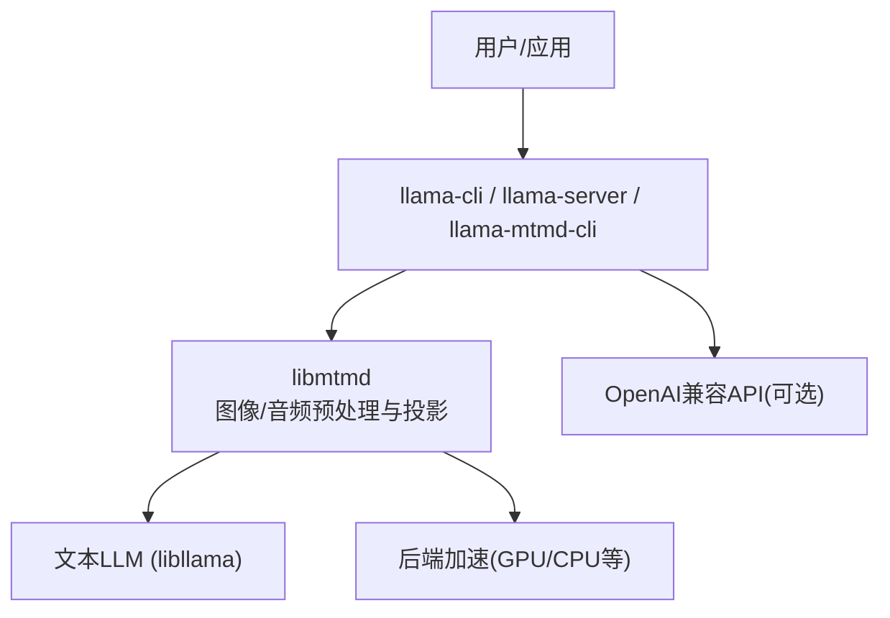
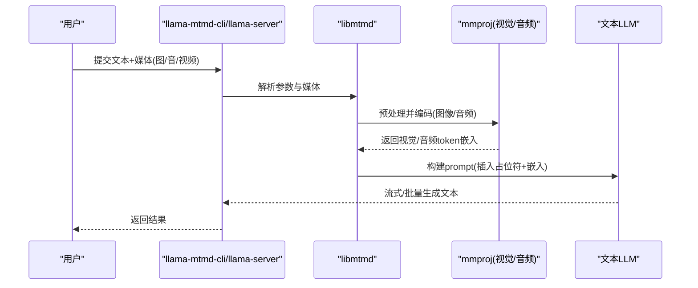
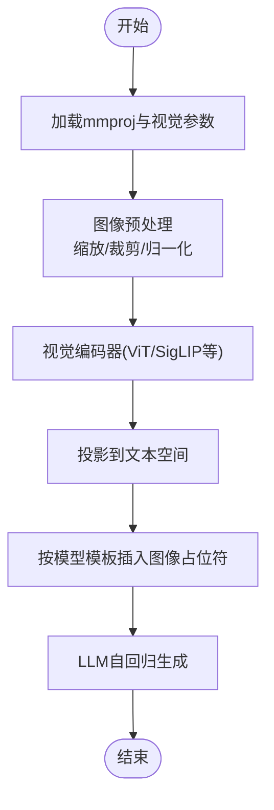
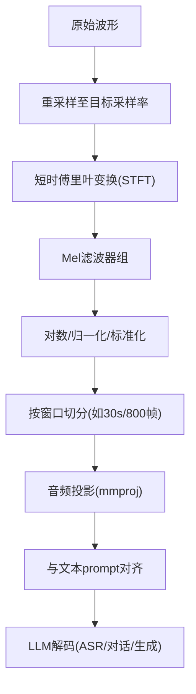
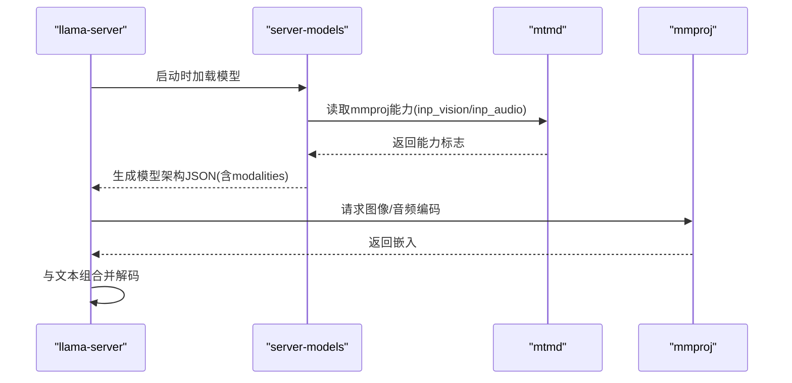
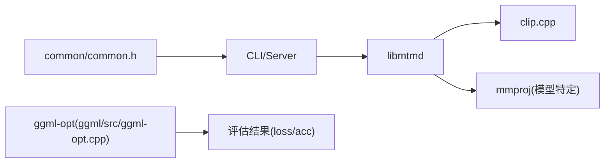
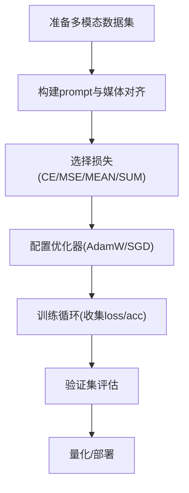

# 多模态支持

<cite>
**本文引用的文件**   
- [docs/multimodal.md](file://docs/multimodal.md)
- [tools/mtmd/README.md](file://tools/mtmd/README.md)
- [docs/multimodal/llava.md](file://docs/multimodal/llava.md)
- [docs/multimodal/gemma3.md](file://docs/multimodal/gemma3.md)
- [docs/multimodal/minicpmv4.7.md](file://docs/multimodal/minicpmv4.7.md)
- [common/common.h](file://common/common.h)
- [tools/server/server-models.cpp](file://tools/server/server-models.cpp)
- [tools/mtmd/mtmd.cpp](file://tools/mtmd/mtmd.cpp)
- [tools/mtmd/mtmd-audio.cpp](file://tools/mtmd/mtmd-audio.cpp)
- [tools/mtmd/clip.cpp](file://tools/mtmd/clip.cpp)
- [ggml/src/ggml-opt.cpp](file://ggml/src/ggml-opt.cpp)
- [ggml/include/ggml-opt.h](file://ggml/include/ggml-opt.h)
</cite>

## 目录
1. [简介](#简介)
2. [项目结构](#项目结构)
3. [核心组件](#核心组件)
4. [架构总览](#架构总览)
5. [详细组件分析](#详细组件分析)
6. [依赖关系分析](#依赖关系分析)
7. [性能与优化](#性能与优化)
8. [训练与微调指南](#训练与微调指南)
9. [故障排查](#故障排查)
10. [结论](#结论)

## 简介
本文件系统性梳理 llama.cpp 的多模态能力，覆盖视觉语言模型（VLM）的图像编码、文本-图像对齐与推理流程；音频处理（语音识别、特征提取、音频-文本联合建模）；以及多模态模型的训练/微调方法与评估指标。同时提供面向应用开发的输入预处理、输出后处理与性能优化建议。

## 项目结构
多模态相关代码主要分布在以下位置：
- 文档与使用说明：docs/multimodal.md 与各模型子文档
- 统一多模态库与工具：tools/mtmd/*（libmtmd、CLI、音频/图像预处理）
- 通用参数与命令行：common/common.h
- 服务端集成：tools/server/server-models.cpp
- 训练/优化接口：ggml/src/ggml-opt.cpp 与 ggml/include/ggml-opt.h

图表来源
- [docs/multimodal.md:1-33](file://docs/multimodal.md#L1-L33)
- [tools/mtmd/README.md:1-19](file://tools/mtmd/README.md#L1-L19)

章节来源
- [docs/multimodal.md:1-33](file://docs/multimodal.md#L1-L33)
- [tools/mtmd/README.md:1-19](file://tools/mtmd/README.md#L1-L19)

## 核心组件
- libmtmd：统一的视觉/音频多模态前端，负责图像/音频预处理、分块与投影，对接不同模型架构的 mmproj。
- 文本LLM：标准 Llama/Qwen/Gemma 等架构，通过 token 序列接收文本与视觉/音频嵌入。
- 工具链：llama-mtmd-cli、llama-server（OpenAI 兼容）、llama-cli，均支持传入图像/音频/视频路径。
- 参数系统：common/common.h 中定义 mmproj、图像/视频参数、批大小等。
- 训练接口：ggml-opt 提供数据集、损失、优化器与评估结果收集的高层 API。

章节来源
- [tools/mtmd/README.md:21-39](file://tools/mtmd/README.md#L21-L39)
- [common/common.h:600-616](file://common/common.h#L600-L616)

## 架构总览
多模态推理的关键路径：
- 输入：文本 + 图像/音频/视频
- 预处理：图像缩放/裁剪/归一化；音频重采样/Mel谱图/分帧
- 投影：mmproj 将视觉/音频特征映射为文本空间的 token 嵌入
- 对齐：在 prompt 模板中插入占位符，将嵌入注入到文本序列
- 解码：LLM 自回归生成文本

图表来源
- [tools/mtmd/mtmd.cpp:956-984](file://tools/mtmd/mtmd.cpp#L956-L984)
- [tools/mtmd/clip.cpp:1858-1880](file://tools/mtmd/clip.cpp#L1858-L1880)

## 详细组件分析

### 视觉语言模型（VLM）支持
- 支持的模型族：Gemma 3、Qwen2-VL/Qwen2.5-VL、MiniCPM-V、InternVL、SmolVLM、Pixtral、GLM-Edge、Granite Vision、LLaVA 等。
- 图像编码：通过 clip.cpp 中的 projector type 分支加载对应视觉塔参数（如 patch_size、image_size、resize/pad策略、空间合并 n_merge、注意力窗口等）。
- 文本-图像对齐：mtmd.cpp 根据模型类型设置图像占位符（如 <｜hy_place▁holder▁no▁100｜>、<vision>...</vision> 等），并将图像嵌入插入到 prompt 中。
- 推理流程：图像经预处理→投影→与文本拼接→LLM 解码。

图表来源
- [tools/mtmd/clip.cpp:1829-1850](file://tools/mtmd/clip.cpp#L1829-L1850)
- [tools/mtmd/mtmd.cpp:956-984](file://tools/mtmd/mtmd.cpp#L956-L984)

章节来源
- [docs/multimodal.md:44-141](file://docs/multimodal.md#L44-L141)
- [docs/multimodal/llava.md:1-144](file://docs/multimodal/llava.md#L1-L144)
- [docs/multimodal/gemma3.md:1-52](file://docs/multimodal/gemma3.md#L1-L52)
- [docs/multimodal/minicpmv4.7.md:1-56](file://docs/multimodal/minicpmv4.7.md#L1-L56)
- [tools/mtmd/README.md:40-67](file://tools/mtmd/README.md#L40-L67)
- [tools/mtmd/clip.cpp:1829-1850](file://tools/mtmd/clip.cpp#L1829-L1850)
- [tools/mtmd/mtmd.cpp:956-984](file://tools/mtmd/mtmd.cpp#L956-L984)

### 音频处理能力
- 音频预处理：实现 Mel 谱图计算、STFT、Hann 窗、预加重、归一化、分块（通常以 30s 或模型指定窗口切分），并提供多种预处理器适配不同模型（Whisper、Qwen3-A、Dots3Note、Gemma4A/U、Granite Speech、MIMO Audio、PaddleOCR 等）。
- 音频-文本联合建模：通过 mmproj 将音频特征映射为文本空间 token，再与文本 prompt 对齐，由 LLM 进行 ASR/对话/生成。
- 关键参数：采样率（常见 16kHz/24kHz）、n_fft、hop_length、mel bins、chunk_len、窗口大小等，均在 clip.cpp 中按 PROJECTOR_TYPE_* 分支配置。

图表来源
- [tools/mtmd/mtmd-audio.cpp:17-130](file://tools/mtmd/mtmd-audio.cpp#L17-L130)
- [tools/mtmd/mtmd-audio.cpp:542-622](file://tools/mtmd/mtmd-audio.cpp#L542-L622)
- [tools/mtmd/mtmd-audio.cpp:624-726](file://tools/mtmd/mtmd-audio.cpp#L624-L726)
- [tools/mtmd/clip.cpp:1858-1880](file://tools/mtmd/clip.cpp#L1858-L1880)

章节来源
- [tools/mtmd/mtmd-audio.cpp:17-130](file://tools/mtmd/mtmd-audio.cpp#L17-L130)
- [tools/mtmd/mtmd-audio.cpp:542-622](file://tools/mtmd/mtmd-audio.cpp#L542-L622)
- [tools/mtmd/mtmd-audio.cpp:624-726](file://tools/mtmd/mtmd-audio.cpp#L624-L726)
- [tools/mtmd/clip.cpp:1858-1880](file://tools/mtmd/clip.cpp#L1858-L1880)

### 多模态推理流程与服务端集成
- 命令行入口：llama-mtmd-cli、llama-server、llama-cli 均可接受 -m/--mmproj 与 --image/--audio/--video 参数。
- 能力探测：server-models.cpp 通过 mtmd_get_cap_from_file 读取 mmproj 的能力（是否支持 vision/audio），用于离线发现与架构描述。
- 默认行为：mmproj 默认卸载到 GPU，可通过 --no-mmproj-offload 关闭。

图表来源
- [tools/server/server-models.cpp:576-590](file://tools/server/server-models.cpp#L576-L590)
- [docs/multimodal.md:10-33](file://docs/multimodal.md#L10-L33)

章节来源
- [tools/server/server-models.cpp:576-590](file://tools/server/server-models.cpp#L576-L590)
- [docs/multimodal.md:10-33](file://docs/multimodal.md#L10-L33)

## 依赖关系分析
- 上层工具（CLI/Server）依赖 common/common.h 的参数结构与 mtmd 接口。
- libmtmd 依赖 clip.cpp（视觉/音频参数解析与预处理）与具体模型 mmproj。
- 训练侧依赖 ggml-opt 提供的数据集、损失、优化器与评估结果收集。

图表来源
- [common/common.h:600-616](file://common/common.h#L600-L616)
- [tools/mtmd/clip.cpp:1858-1880](file://tools/mtmd/clip.cpp#L1858-L1880)
- [ggml/src/ggml-opt.cpp:836-897](file://ggml/src/ggml-opt.cpp#L836-L897)

章节来源
- [common/common.h:600-616](file://common/common.h#L600-L616)
- [tools/mtmd/clip.cpp:1858-1880](file://tools/mtmd/clip.cpp#L1858-L1880)
- [ggml/src/ggml-opt.cpp:836-897](file://ggml/src/ggml-opt.cpp#L836-L897)

## 性能与优化
- 批处理与上下文长度：
  - 图像/音频可产生大量 token，需合理设置上下文长度（例如长视频/高分辨率图像需要更大的 -c）。
  - 使用批处理提示词提升吞吐（部分模型如 llava-1.6 受益于批处理）。
- 设备卸载：
  - mmproj 默认卸载到 GPU，若显存不足可使用 --no-mmproj-offload。
- 预处理优化：
  - 音频 Mel 谱图计算采用多线程并行（log_mel_spectrogram_worker_thread），注意线程数与内存占用平衡。
  - 图像 resize/pad 策略影响视觉 token 数量与质量，按模型推荐选择。
- 量化与精度：
  - 多数多模态模型提供 Q4_K_M 等量化版本，可在保持效果的同时降低显存占用。

章节来源
- [docs/multimodal.md:44-141](file://docs/multimodal.md#L44-L141)
- [docs/multimodal/llava.md:105-108](file://docs/multimodal/llava.md#L105-L108)
- [tools/mtmd/mtmd-audio.cpp:464-478](file://tools/mtmd/mtmd-audio.cpp#L464-L478)

## 训练与微调指南
- 数据准备：
  - 多模态数据包含文本与媒体（图像/音频/视频），需确保媒体与文本对齐，并按模型模板组织 prompt。
  - 对于 OCR/ASR 任务，需遵循模型特定的 prompt 与输入结构（参考各模型文档）。
- 损失函数设计：
  - ggml-opt 提供内置损失类型：均值、总和、交叉熵、均方误差，可根据任务选择。
  - 分类/ASR/OCR 常用交叉熵；回归类任务可用均方误差。
- 评估指标：
  - 训练过程中可收集 loss 与 accuracy（若任务有标签），ggml_opt_result_loss/accuracy 提供统计。
- 优化器与调度：
  - 支持 AdamW、SGD 等优化器，可配置学习率、权重衰减等超参。
- 实践建议：
  - 先在小规模数据上验证 pipeline，逐步扩大 batch size 与上下文长度。
  - 针对多模态任务，优先固定媒体预处理参数（采样率、分辨率、patch size 等），再调优 LLM 侧参数。

图表来源
- [ggml/include/ggml-opt.h:26-35](file://ggml/include/ggml-opt.h#L26-L35)
- [ggml/src/ggml-opt.cpp:836-897](file://ggml/src/ggml-opt.cpp#L836-L897)

章节来源
- [ggml/include/ggml-opt.h:26-35](file://ggml/include/ggml-opt.h#L26-L35)
- [ggml/src/ggml-opt.cpp:836-897](file://ggml/src/ggml-opt.cpp#L836-L897)

## 故障排查
- 无法加载 mmproj 或多模态能力未识别：
  - 检查 mmproj 路径与格式是否正确；确认模型是否支持 vision/audio。
  - server-models.cpp 会尝试读取 mmproj 能力，失败时会回退到 GGUF 元数据。
- 音频质量下降或识别错误：
  - 确认音频采样率与预处理参数（n_fft/hop/window）与模型匹配。
  - 长音频需正确分块（30s 或模型指定窗口），避免截断或填充不当。
- 显存不足：
  - 关闭 mmproj GPU 卸载（--no-mmproj-offload）。
  - 减小图像分辨率或音频窗口长度，降低视觉/音频 token 数量。
- 上下文溢出：
  - 增大 -c（上下文长度），尤其是长视频或高分辨率图像场景。

章节来源
- [tools/server/server-models.cpp:576-590](file://tools/server/server-models.cpp#L576-L590)
- [tools/mtmd/mtmd-audio.cpp:542-622](file://tools/mtmd/mtmd-audio.cpp#L542-L622)
- [docs/multimodal.md:10-33](file://docs/multimodal.md#L10-L33)

## 结论
llama.cpp 通过 libmtmd 提供了统一且可扩展的多模态能力，支持广泛的视觉与音频模型，并在 CLI/Server 层面提供一致的使用体验。其模块化设计使图像/音频预处理与文本 LLM 解耦，便于快速适配新模型。结合 ggml-opt 的训练接口，用户可完成从数据准备、损失设计到评估优化的完整多模态工作流。实际应用中，建议根据模型文档调整预处理参数，并结合批处理与设备卸载策略优化性能。