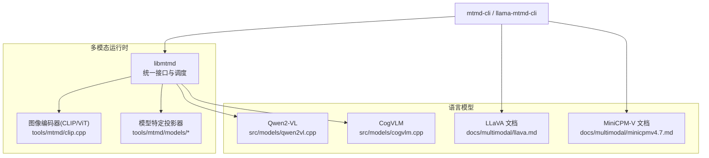
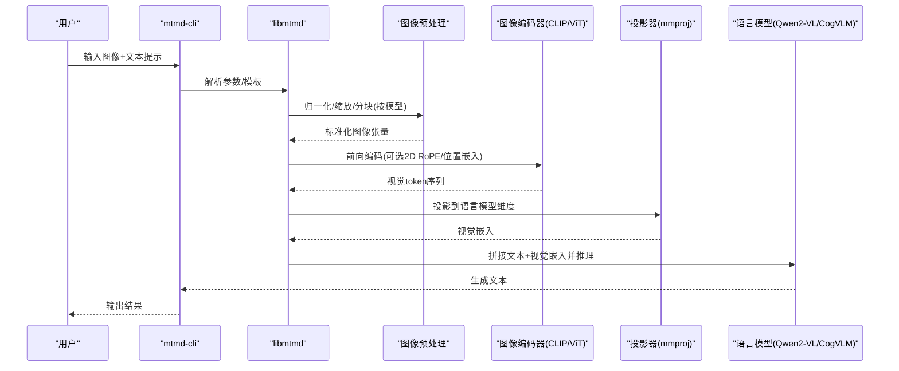
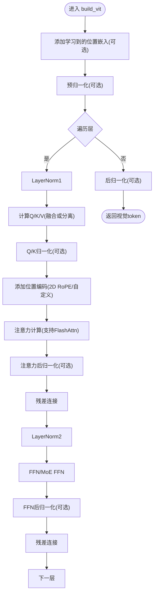
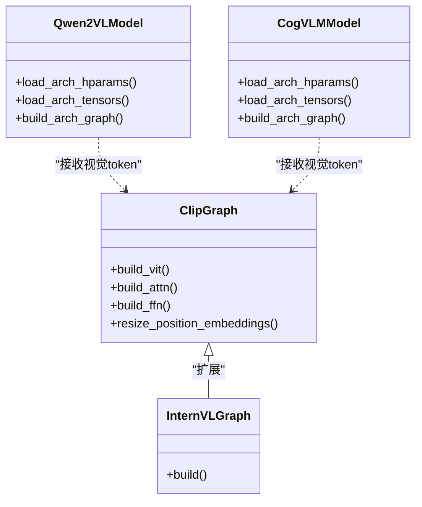
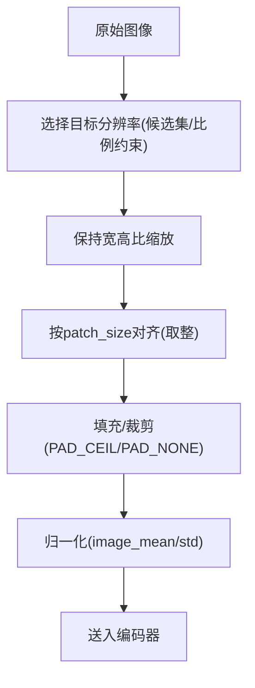
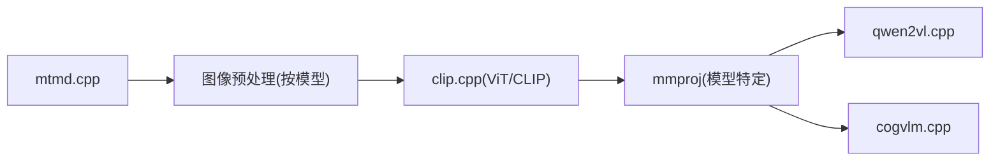

# 视觉语言模型

<cite>
**本文引用的文件**   
- [tools/mtmd/README.md](file://tools/mtmd/README.md)
- [tools/mtmd/clip.cpp](file://tools/mtmd/clip.cpp)
- [tools/mtmd/mtmd.cpp](file://tools/mtmd/mtmd.cpp)
- [tools/mtmd/models/internvl.cpp](file://tools/mtmd/models/internvl.cpp)
- [src/models/clip.cpp](file://src/models/clip.cpp)
- [src/models/qwen2vl.cpp](file://src/models/qwen2vl.cpp)
- [src/models/cogvlm.cpp](file://src/models/cogvlm.cpp)
- [docs/multimodal/llava.md](file://docs/multimodal/llava.md)
- [docs/multimodal/minicpmv4.7.md](file://docs/multimodal/minicpmv4.7.md)
</cite>

## 目录
1. [简介](#简介)
2. [项目结构](#项目结构)
3. [核心组件](#核心组件)
4. [架构总览](#架构总览)
5. [详细组件分析](#详细组件分析)
6. [依赖关系分析](#依赖关系分析)
7. [性能考虑](#性能考虑)
8. [故障排查指南](#故障排查指南)
9. [结论](#结论)
10. [附录](#附录)

## 简介
本文件面向视觉语言模型（VLM）在 llama.cpp 中的实现与使用，重点覆盖：
- 图像编码器集成（CLIP、ViT 等）
- 文本-图像对齐机制（注意力融合、特征投影、跨模态交互）
- 支持的 VLM 架构（LLaVA、Qwen2-VL、MiniCPM-V 等）及其优化与配置
- 图像预处理与后处理最佳实践（分辨率调整、格式转换、性能优化）
- 推理示例（通过命令行工具加载 mmproj 与主模型进行多模态推理）

## 项目结构
llama.cpp 的多模态支持以 tools/mtmd 为核心，提供统一的 libmtmd 接口与 mtmd-cli 工具；同时保留 src/models 下的各 LLM 架构实现。mmproj（多模态投影器）与主语言模型分离，便于独立开发与部署。

图表来源
- [tools/mtmd/README.md:1-68](file://tools/mtmd/README.md#L1-L68)
- [tools/mtmd/clip.cpp:1-800](file://tools/mtmd/clip.cpp#L1-L800)
- [src/models/qwen2vl.cpp:1-142](file://src/models/qwen2vl.cpp#L1-L142)
- [src/models/cogvlm.cpp:1-159](file://src/models/cogvlm.cpp#L1-L159)

章节来源
- [tools/mtmd/README.md:1-68](file://tools/mtmd/README.md#L1-L68)

## 核心组件
- libmtmd 与 mtmd-cli：统一多模态输入（文本、音频、图像），封装不同模型的 chat template 与预处理流程。
- 图像编码器（CLIP/ViT）：负责将图像编码为视觉 token 序列，支持多种 ViT 变体与 RoPE 策略。
- 投影器（mmproj）：将视觉特征映射到语言模型嵌入空间，包含像素重排、DownsampleMLP、窗口注意力等。
- 语言模型后端：如 Qwen2-VL、CogVLM 等，接收视觉 token 并参与自注意力计算。

章节来源
- [tools/mtmd/README.md:21-39](file://tools/mtmd/README.md#L21-L39)
- [tools/mtmd/clip.cpp:147-242](file://tools/mtmd/clip.cpp#L147-L242)

## 架构总览
多模态推理的典型数据流如下：

图表来源
- [tools/mtmd/mtmd.cpp:643-770](file://tools/mtmd/mtmd.cpp#L643-L770)
- [tools/mtmd/clip.cpp:334-568](file://tools/mtmd/clip.cpp#L334-L568)
- [src/models/qwen2vl.cpp:38-141](file://src/models/qwen2vl.cpp#L38-L141)
- [src/models/cogvlm.cpp:49-158](file://src/models/cogvlm.cpp#L49-L158)

## 详细组件分析

### 图像编码器（CLIP/ViT）
- 通用 ViT 构建：支持预/后 LayerNorm/RMSNorm、MoE FFN、可插拔位置嵌入、注意力掩码与 Flash Attention。
- 动态尺寸与插值：支持 SigLIP2 风格的位置嵌入插值，适配不同 patch 网格。
- 批处理与调度：基于 ggml_backend_sched 管理 CPU/GPU 后端，支持评估回调与内存统计。

图表来源
- [tools/mtmd/clip.cpp:334-568](file://tools/mtmd/clip.cpp#L334-L568)
- [tools/mtmd/clip.cpp:311-332](file://tools/mtmd/clip.cpp#L311-L332)

章节来源
- [tools/mtmd/clip.cpp:147-242](file://tools/mtmd/clip.cpp#L147-L242)
- [tools/mtmd/clip.cpp:334-568](file://tools/mtmd/clip.cpp#L334-L568)
- [tools/mtmd/clip.cpp:603-716](file://tools/mtmd/clip.cpp#L603-L716)
- [tools/mtmd/clip.cpp:718-760](file://tools/mtmd/clip.cpp#L718-L760)

### 文本-图像对齐机制
- 注意力融合：视觉 token 与文本 token 在同一上下文窗口内参与自注意力，部分模型对视觉分支使用专用权重（如 CogVLM 的 visexp_*）。
- 特征投影：mmproj 将视觉特征映射至语言模型嵌入维度，常见操作包括像素重排（pixel shuffle）、DownsampleMLP、窗口注意力等。
- 跨模态交互：根据模型类型选择不同模板与占位符（如 <image>、<|image_start|> 等），并在预处理阶段插入对应标记。

图表来源
- [tools/mtmd/clip.cpp:334-568](file://tools/mtmd/clip.cpp#L334-L568)
- [tools/mtmd/models/internvl.cpp:1-74](file://tools/mtmd/models/internvl.cpp#L1-L74)
- [src/models/qwen2vl.cpp:1-142](file://src/models/qwen2vl.cpp#L1-L142)
- [src/models/cogvlm.cpp:1-159](file://src/models/cogvlm.cpp#L1-L159)

章节来源
- [tools/mtmd/models/internvl.cpp:1-74](file://tools/mtmd/models/internvl.cpp#L1-L74)
- [src/models/qwen2vl.cpp:1-142](file://src/models/qwen2vl.cpp#L1-L142)
- [src/models/cogvlm.cpp:1-159](file://src/models/cogvlm.cpp#L1-L159)

### 支持的 VLM 架构与配置
- LLaVA（1.5/1.6）
  - 使用 vicuna 聊天模板，1.6 需要更长上下文（建议 -c 4096），受益于批量提示处理。
  - 通过 mmproj 加载 CLIP/ViT 与 projector。
- Qwen2-VL
  - 使用 rope_sections 配置，支持多段 RoPE；图构建中显式应用 multi-rope。
- MiniCPM-V（4.6/4.7）
  - 标准 transformers 检查点直接转换；默认 16x 合并，可通过 downsample_mode 控制视觉 token 密度。
  - 支持思考模式开关（enable_thinking）。

章节来源
- [docs/multimodal/llava.md:13-108](file://docs/multimodal/llava.md#L13-L108)
- [docs/multimodal/llava.md:127-144](file://docs/multimodal/llava.md#L127-L144)
- [src/models/qwen2vl.cpp:1-10](file://src/models/qwen2vl.cpp#L1-L10)
- [docs/multimodal/minicpmv4.7.md:28-56](file://docs/multimodal/minicpmv4.7.md#L28-L56)

### 图像预处理与后处理最佳实践
- 分辨率选择
  - LLaVA-UHD：根据候选分辨率选择有效面积最大且浪费最小的目标尺寸，保持宽高比并按 patch_size 对齐。
  - DeepSeek4V：根据 max_n_token 与宽高比求解最佳高宽，避免超出 token 预算。
- 填充与裁剪
  - 支持 PAD_CEIL/PAD_NONE 等填充策略，以及自定义填充颜色。
- 归一化与均值/方差
  - 通过 image_mean/image_std 配置，确保与训练时一致。
- 动态尺寸与热身
  - warmup_image_size/warmup_audio_size 用于避免首次加载 OOM。

图表来源
- [tools/mtmd/mtmd-image.cpp:643-693](file://tools/mtmd/mtmd-image.cpp#L643-L693)
- [tools/mtmd/mtmd-image.cpp:1298-1330](file://tools/mtmd/mtmd-image.cpp#L1298-L1330)
- [tools/mtmd/clip-model.h:62-91](file://tools/mtmd/clip-model.h#L62-L91)

章节来源
- [tools/mtmd/mtmd-image.cpp:643-693](file://tools/mtmd/mtmd-image.cpp#L643-L693)
- [tools/mtmd/mtmd-image.cpp:1298-1330](file://tools/mtmd/mtmd-image.cpp#L1298-L1330)
- [tools/mtmd/clip-model.h:62-91](file://tools/mtmd/clip-model.h#L62-L91)

## 依赖关系分析
- libmtmd 作为统一入口，根据模型类型选择具体图像预处理与投影器实现。
- 图像编码器（clip.cpp）与模型特定图（如 internvl.cpp）解耦，便于扩展新架构。
- 语言模型侧（qwen2vl.cpp、cogvlm.cpp）仅消费视觉 token 并参与自注意力。

图表来源
- [tools/mtmd/mtmd.cpp:643-770](file://tools/mtmd/mtmd.cpp#L643-L770)
- [tools/mtmd/clip.cpp:334-568](file://tools/mtmd/clip.cpp#L334-L568)
- [src/models/qwen2vl.cpp:38-141](file://src/models/qwen2vl.cpp#L38-L141)
- [src/models/cogvlm.cpp:49-158](file://src/models/cogvlm.cpp#L49-L158)

章节来源
- [tools/mtmd/mtmd.cpp:643-770](file://tools/mtmd/mtmd.cpp#L643-L770)
- [tools/mtmd/clip.cpp:334-568](file://tools/mtmd/clip.cpp#L334-L568)
- [src/models/qwen2vl.cpp:38-141](file://src/models/qwen2vl.cpp#L38-L141)
- [src/models/cogvlm.cpp:49-158](file://src/models/cogvlm.cpp#L49-L158)

## 性能考虑
- 后端选择：优先启用 GPU 后端，CPU 作为回退；合理设置 max_nodes 与调度器大小。
- Flash Attention：在支持的后端上启用 flash attention 以降低显存占用并提升吞吐。
- 批处理：LLaVA-1.6 等模型受益于批量提示处理；合理设置上下文长度（如 -c 4096）。
- 预热尺寸：通过 warmup_image_size 避免首次加载 OOM。
- 量化与 mmproj：使用合适的量化级别与匹配的 mmproj，避免 n_embd 不匹配导致的错误。

[本节为通用指导，无需代码引用]

## 故障排查指南
- 文本与 mmproj 维度不匹配
  - 现象：报错提示 text model (n_embd) 与 mmproj (n_embd) 不一致。
  - 解决：确认使用的 mmproj 与主模型版本匹配。
- CLIP 不可作为主模型运行
  - 现象：尝试将 CLIP 作为主模型会抛出异常。
  - 解决：通过 --mmproj 方式加载 CLIP 作为图像编码器。
- 模板与占位符不匹配
  - 现象：图像 token 未正确注入对话。
  - 解决：根据模型选择正确的 chat template（如 vicuna）并确保占位符与预处理一致。

章节来源
- [tools/mtmd/mtmd.cpp:643-667](file://tools/mtmd/mtmd.cpp#L643-L667)
- [src/models/clip.cpp:1-19](file://src/models/clip.cpp#L1-L19)
- [docs/multimodal/llava.md:127-144](file://docs/multimodal/llava.md#L127-L144)

## 结论
llama.cpp 的多模态能力以 libmtmd 为中心，将图像编码器与语言模型解耦，并通过 mmproj 完成跨模态对齐。该设计既支持广泛的视觉架构（CLIP/ViT/SigLIP 等），也兼容多种 LLM（Qwen2-VL、CogVLM、LLaVA、MiniCPM-V 等）。通过灵活的预处理与投影策略，可在不同硬件与场景下取得良好的性能与质量平衡。

[本节为总结性内容，无需代码引用]

## 附录
- 快速上手（命令行示例）
  - LLaVA：参考文档中的构建与运行步骤，使用 --mmproj 指定投影器，--chat-template vicuna 激活模板。
  - MiniCPM-V 4.7：使用 convert_hf_to_gguf.py 分别导出语言模型与 mmproj，然后使用 llama-mtmd-cli 进行推理。

章节来源
- [docs/multimodal/llava.md:13-108](file://docs/multimodal/llava.md#L13-L108)
- [docs/multimodal/minicpmv4.7.md:28-56](file://docs/multimodal/minicpmv4.7.md#L28-L56)