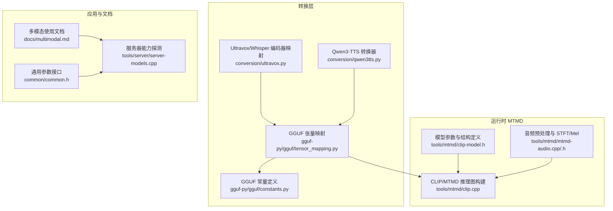
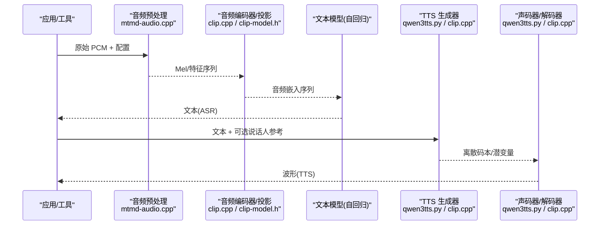
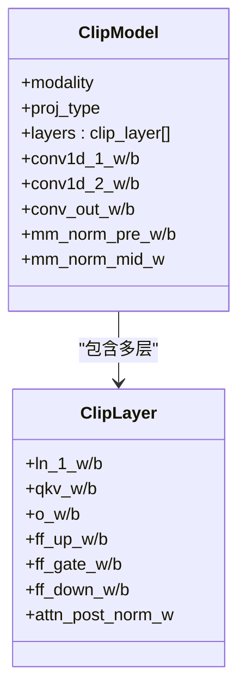
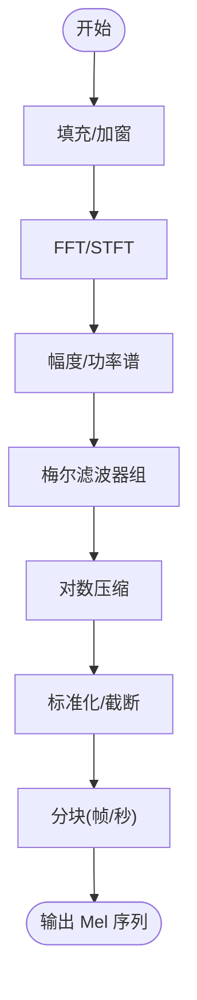
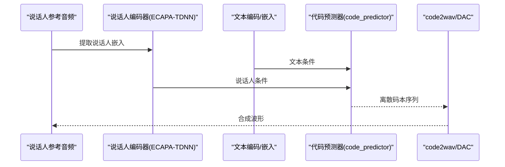
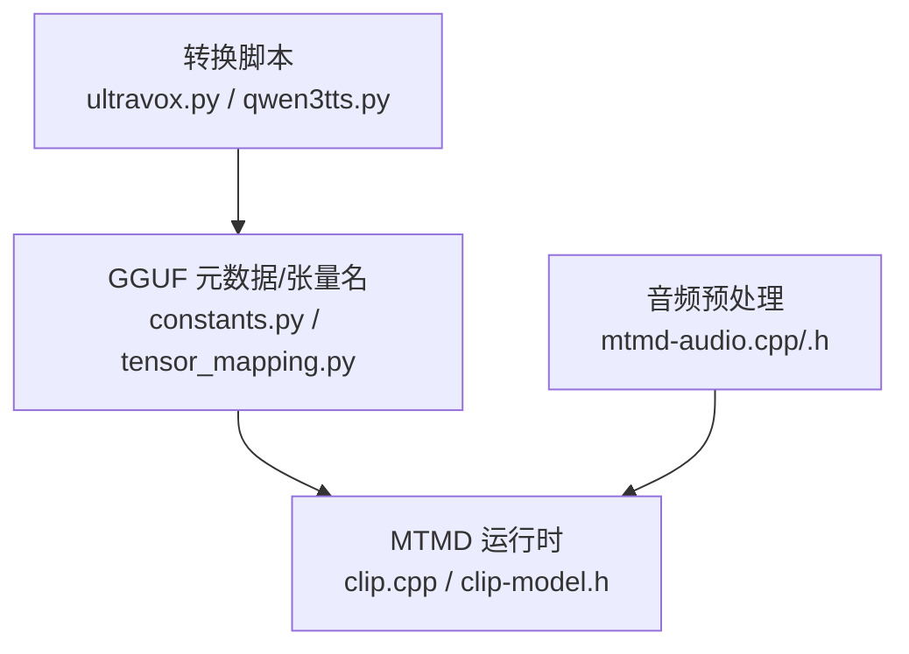

# 音频处理

<cite>
**本文引用的文件**   
- [ultravox.py](file://conversion/ultravox.py)
- [qwen3tts.py](file://conversion/qwen3tts.py)
- [clip.cpp](file://tools/mtmd/clip.cpp)
- [clip-model.h](file://tools/mtmd/clip-model.h)
- [mtmd-audio.cpp](file://tools/mtmd/mtmd-audio.cpp)
- [mtmd-audio.h](file://tools/mtmd/mtmd-audio.h)
- [tensor_mapping.py](file://gguf-py/gguf/tensor_mapping.py)
- [constants.py](file://gguf-py/gguf/constants.py)
- [multimodal.md](file://docs/multimodal.md)
- [common.h](file://common/common.h)
- [server-models.cpp](file://tools/server/server-models.cpp)
</cite>

## 目录
1. [引言](#引言)
2. [项目结构](#项目结构)
3. [核心组件](#核心组件)
4. [架构总览](#架构总览)
5. [详细组件分析](#详细组件分析)
6. [依赖关系分析](#依赖关系分析)
7. [性能与实现要点](#性能与实现要点)
8. [故障排查指南](#故障排查指南)
9. [结论](#结论)
10. [附录：使用示例](#附录使用示例)

## 引言
本文件面向希望在 llama.cpp 生态中使用或扩展“音频处理”能力的工程师与研究者，系统性说明以下能力：
- 语音识别（ASR）相关：Whisper 风格编码器、梅尔频谱特征提取、声学模型集成路径。
- 语音合成（TTS）相关：说话人嵌入、声码器/解码器、代码本到波形的生成流程。
- 音频-文本联合建模：多模态对齐、时序同步、跨模态注意力机制在 MTMD 中的体现。
- 音频数据预处理：采样率、窗函数、FFT、梅尔滤波器组、标准化等。
- 使用示例：语音转文字、文字转语音、多模态音频理解任务。

## 项目结构
本项目将音频能力集中在多模态推理子系统 MTMD 中，并通过转换脚本将不同模型的权重映射为统一的 GGUF 张量命名规范，便于 C++ 侧统一加载与执行。

图表来源
- [ultravox.py:86-125](file://conversion/ultravox.py#L86-L125)
- [qwen3tts.py:39-185](file://conversion/qwen3tts.py#L39-L185)
- [tensor_mapping.py:2405-2442](file://gguf-py/gguf/tensor_mapping.py#L2405-L2442)
- [constants.py:1107-1140](file://gguf-py/gguf/constants.py#L1107-L1140)
- [clip.cpp:147-242](file://tools/mtmd/clip.cpp#L147-L242)
- [clip-model.h:49-178](file://tools/mtmd/clip-model.h#L49-L178)
- [mtmd-audio.cpp:546-622](file://tools/mtmd/mtmd-audio.cpp#L546-L622)
- [mtmd-audio.h:12-62](file://tools/mtmd/mtmd-audio.h#L12-L62)
- [multimodal.md:105-141](file://docs/multimodal.md#L105-L141)
- [common.h:600-610](file://common/common.h#L600-L610)
- [server-models.cpp:576-591](file://tools/server/server-models.cpp#L576-L591)

章节来源
- [ultravox.py:86-125](file://conversion/ultravox.py#L86-L125)
- [qwen3tts.py:39-185](file://conversion/qwen3tts.py#L39-L185)
- [clip.cpp:147-242](file://tools/mtmd/clip.cpp#L147-L242)
- [clip-model.h:49-178](file://tools/mtmd/clip-model.h#L49-L178)
- [mtmd-audio.cpp:546-622](file://tools/mtmd/mtmd-audio.cpp#L546-L622)
- [mtmd-audio.h:12-62](file://tools/mtmd/mtmd-audio.h#L12-L62)
- [tensor_mapping.py:2405-2442](file://gguf-py/gguf/tensor_mapping.py#L2405-L2442)
- [constants.py:1107-1140](file://gguf-py/gguf/constants.py#L1107-L1140)
- [multimodal.md:105-141](file://docs/multimodal.md#L105-L141)
- [common.h:600-610](file://common/common.h#L600-L610)
- [server-models.cpp:576-591](file://tools/server/server-models.cpp#L576-L591)

## 核心组件
- 音频编码器与多模态投影
  - Whisper 风格编码器通过 1D/2D 卷积下采样、归一化与 Transformer 层构成声学表征。
  - 多模态投影将音频特征映射到文本模型的嵌入空间，支持多种 projector 类型（如 Ultravox、MERaLiON、Voxtral 等）。
- 音频预处理
  - 提供 STFT、Hann 窗、梅尔滤波器组、对数压缩、标准化等，支持多种模型前端的差异。
- 语音合成（TTS）
  - 说话人编码器（ECAPA-TDNN）、代码预测器（code_predictor）、声码器/解码器（code2wav/DAC），以及 PocketTTS 的 SEANet/Flow 路径。
- 多模态对齐与时序同步
  - 通过 MTMD 的 clip_graph 构建统一的计算图，支持 Flash Attention、窗口注意力、局部注意力等。
  - 音频分块（chunking）与帧对齐，保证长音频输入可被切分为固定长度片段进行推理。

章节来源
- [clip-model.h:750-800](file://tools/mtmd/clip-model.h#L750-L800)
- [mtmd-audio.cpp:546-622](file://tools/mtmd/mtmd-audio.cpp#L546-L622)
- [qwen3tts.py:188-355](file://conversion/qwen3tts.py#L188-L355)
- [clip.cpp:337-568](file://tools/mtmd/clip.cpp#L337-L568)

## 架构总览
下图展示从音频输入到文本输出（ASR）或从文本到音频（TTS）的整体流程，并标注关键模块所在文件。

图表来源
- [mtmd-audio.cpp:546-622](file://tools/mtmd/mtmd-audio.cpp#L546-L622)
- [clip.cpp:337-568](file://tools/mtmd/clip.cpp#L337-L568)
- [clip-model.h:750-800](file://tools/mtmd/clip-model.h#L750-L800)
- [qwen3tts.py:188-355](file://conversion/qwen3tts.py#L188-L355)

## 详细组件分析

### Whisper 编码器与多模态投影
- 编码器结构
  - 包含 conv1d_1/conv1d_2、conv_out、归一化层与多层 Transformer（含注意力与 FFN）。
  - 支持不同的 projector 类型，用于将音频特征对齐到文本嵌入空间。
- 权重映射
  - 转换脚本将不同仓库的命名规范映射到统一的 A_ENC_* 张量名，便于 C++ 侧统一加载。
- 运行期行为
  - clip.cpp 中构建 ViT/Conformer 风格的层循环，支持预归一化、残差连接、MoE-FFN、Flash Attention 等。

图表来源
- [clip-model.h:561-600](file://tools/mtmd/clip-model.h#L561-L600)
- [clip-model.h:241-361](file://tools/mtmd/clip-model.h#L241-L361)

章节来源
- [clip-model.h:750-800](file://tools/mtmd/clip-model.h#L750-L800)
- [clip.cpp:337-568](file://tools/mtmd/clip.cpp#L337-L568)
- [tensor_mapping.py:2405-2442](file://gguf-py/gguf/tensor_mapping.py#L2405-L2442)

### 音频特征提取与预处理
- 核心步骤
  - 填充与加窗：Hann 窗、反射填充或中心填充。
  - FFT/STFT：内置 Cooley-Tukey FFT 实现，支持实数/复数输入。
  - 梅尔滤波器组：Slaney/HTK 两种尺度，面积归一化可选。
  - 对数压缩与标准化：log10 或自然对数；Whisper 风格截断与缩放。
- 模型适配
  - whisper、qwen3a、dots3note、mimo_audio、parakeet 等前端均有对应 preprocessor。
  - 针对长音频进行分块（例如 3000 帧或按秒切分），保证 cgraph 尺寸限制。

图表来源
- [mtmd-audio.cpp:27-50](file://tools/mtmd/mtmd-audio.cpp#L27-L50)
- [mtmd-audio.cpp:132-271](file://tools/mtmd/mtmd-audio.cpp#L132-L271)
- [mtmd-audio.cpp:290-367](file://tools/mtmd/mtmd-audio.cpp#L290-L367)
- [mtmd-audio.cpp:370-540](file://tools/mtmd/mtmd-audio.cpp#L370-L540)
- [mtmd-audio.cpp:546-622](file://tools/mtmd/mtmd-audio.cpp#L546-L622)

章节来源
- [mtmd-audio.cpp:27-50](file://tools/mtmd/mtmd-audio.cpp#L27-L50)
- [mtmd-audio.cpp:132-271](file://tools/mtmd/mtmd-audio.cpp#L132-L271)
- [mtmd-audio.cpp:290-367](file://tools/mtmd/mtmd-audio.cpp#L290-L367)
- [mtmd-audio.cpp:370-540](file://tools/mtmd/mtmd-audio.cpp#L370-L540)
- [mtmd-audio.cpp:546-622](file://tools/mtmd/mtmd-audio.cpp#L546-L622)
- [mtmd-audio.h:12-62](file://tools/mtmd/mtmd-audio.h#L12-L62)

### 语音合成（TTS）：说话人嵌入、代码预测与声码器
- 说话人编码器
  - ECAPA-TDNN 结构，复用 stem conv 与聚合层，输出说话人向量。
- 代码预测器（code_predictor）
  - 自回归 Transformer，预测离散码本（RVQ codebook）序列。
  - 转换脚本将 per-codebook 的 embedding/head 堆叠为 3D 张量。
- 声码器/解码器（code2wav/DAC）
  - 将离散码本还原为连续波形，包含上采样、Transformer、DAC 残差块等。
  - 部分卷积核强制 F16/F32 以保证 ggml_conv_1d 路径可用。

图表来源
- [qwen3tts.py:188-355](file://conversion/qwen3tts.py#L188-L355)
- [qwen3tts.py:357-480](file://conversion/qwen3tts.py#L357-L480)
- [clip-model.h:783-800](file://tools/mtmd/clip-model.h#L783-L800)

章节来源
- [qwen3tts.py:188-355](file://conversion/qwen3tts.py#L188-L355)
- [qwen3tts.py:357-480](file://conversion/qwen3tts.py#L357-L480)
- [clip-model.h:783-800](file://tools/mtmd/clip-model.h#L783-L800)

### 音频-文本联合建模：对齐、同步与注意力
- 多模态对齐
  - 通过 audio_tower 与 mm_proj 将音频特征映射到文本嵌入维度。
  - 支持多种 projector 类型（Ultravox、MERaLiON、Voxtral、Qwen2A 等）。
- 时序同步
  - 音频分块（chunk）与帧对齐，确保与文本 token 的对齐一致性。
  - 长音频按固定帧数切分（如 3000 帧），尾部补零。
- 跨模态注意力
  - 文本侧可使用局部注意力、窗口注意力、全局注意力等策略。
  - 支持 Flash Attention 加速。

图表来源
- [clip.cpp:337-568](file://tools/mtmd/clip.cpp#L337-L568)
- [clip.cpp:762-800](file://tools/mtmd/clip.cpp#L762-L800)
- [tensor_mapping.py:2405-2442](file://gguf-py/gguf/tensor_mapping.py#L2405-L2442)

章节来源
- [clip.cpp:337-568](file://tools/mtmd/clip.cpp#L337-L568)
- [clip.cpp:762-800](file://tools/mtmd/clip.cpp#L762-L800)
- [tensor_mapping.py:2405-2442](file://gguf-py/gguf/tensor_mapping.py#L2405-L2442)

## 依赖关系分析
- 转换层依赖 GGUF 常量与张量映射，确保不同模型权重能统一写入 GGUF。
- 运行时 MTMD 依赖 clip.cpp 的计算图构建与 clip-model.h 的参数结构。
- 音频预处理模块独立于具体模型，但需根据模型配置选择合适的前端。

图表来源
- [ultravox.py:86-125](file://conversion/ultravox.py#L86-L125)
- [qwen3tts.py:39-185](file://conversion/qwen3tts.py#L39-L185)
- [constants.py:1107-1140](file://gguf-py/gguf/constants.py#L1107-L1140)
- [tensor_mapping.py:2405-2442](file://gguf-py/gguf/tensor_mapping.py#L2405-L2442)
- [clip.cpp:147-242](file://tools/mtmd/clip.cpp#L147-L242)
- [clip-model.h:49-178](file://tools/mtmd/clip-model.h#L49-L178)
- [mtmd-audio.cpp:546-622](file://tools/mtmd/mtmd-audio.cpp#L546-L622)
- [mtmd-audio.h:12-62](file://tools/mtmd/mtmd-audio.h#L12-L62)

章节来源
- [ultravox.py:86-125](file://conversion/ultravox.py#L86-L125)
- [qwen3tts.py:39-185](file://conversion/qwen3tts.py#L39-L185)
- [constants.py:1107-1140](file://gguf-py/gguf/constants.py#L1107-L1140)
- [tensor_mapping.py:2405-2442](file://gguf-py/gguf/tensor_mapping.py#L2405-L2442)
- [clip.cpp:147-242](file://tools/mtmd/clip.cpp#L147-L242)
- [clip-model.h:49-178](file://tools/mtmd/clip-model.h#L49-L178)
- [mtmd-audio.cpp:546-622](file://tools/mtmd/mtmd-audio.cpp#L546-L622)
- [mtmd-audio.h:12-62](file://tools/mtmd/mtmd-audio.h#L12-L62)

## 性能与实现要点
- 音频预处理
  - 多线程并行计算 Mel 频谱，减少端到端延迟。
  - 合理设置 n_fft、hop_length、window_len 以平衡频率分辨率与时间分辨率。
- 编码器与注意力
  - 支持 Flash Attention，降低显存占用并提升吞吐。
  - 局部/窗口注意力适用于长上下文场景。
- 量化与精度
  - 部分卷积核强制 F16/F32，避免 ggml_conv_1d 不支持 BF16 的路径问题。
  - code_predictor 的 FFN 中间层峰值较大，需保持 F32 以避免溢出。

章节来源
- [mtmd-audio.cpp:290-367](file://tools/mtmd/mtmd-audio.cpp#L290-L367)
- [clip.cpp:762-800](file://tools/mtmd/clip.cpp#L762-L800)
- [qwen3tts.py:270-285](file://conversion/qwen3tts.py#L270-L285)

## 故障排查指南
- 空音频或过短音频
  - 预处理会检查最小样本数，不足时返回失败。建议在上游做静音检测与最短时长校验。
- Mel 维度非法或溢出
  - 当 n_mel 或 n_len 不合法时会报错。请检查采样率、n_fft、hop_length 配置是否与模型一致。
- 后端初始化失败
  - GPU/CPU 后端初始化失败会抛出异常。请确认设备可用性与驱动版本。
- 多模态能力探测失败
  - 服务器侧读取 mmproj 能力失败时，会回退到 GGUF 元数据。请检查 mmproj 路径与权限。

章节来源
- [mtmd-audio.cpp:552-568](file://tools/mtmd/mtmd-audio.cpp#L552-L568)
- [mtmd-audio.cpp:444-462](file://tools/mtmd/mtmd-audio.cpp#L444-L462)
- [clip.cpp:181-208](file://tools/mtmd/clip.cpp#L181-L208)
- [server-models.cpp:576-591](file://tools/server/server-models.cpp#L576-L591)

## 结论
llama.cpp 的音频处理能力通过 MTMD 子系统实现了从音频预处理、声学编码到多模态对齐与文本生成的完整链路。转换层将不同模型的权重统一映射为 GGUF 格式，运行时则提供高效、可扩展的计算图与多种注意力策略。对于 ASR 与 TTS，系统分别提供了 Whisper 风格编码器与 Qwen3-TTS 的说话人编码、代码预测与声码器路径，满足多样化应用场景。

## 附录：使用示例
- 语音转文字（ASR）
  - 使用支持音频输入的模型（如 Ultravox、Qwen2-Audio、Voxtral、Qwen3-ASR），通过命令行或 API 传入音频文件，得到转录文本。
  - 参考文档：[multimodal.md:105-141](file://docs/multimodal.md#L105-L141)
- 文字转语音（TTS）
  - 使用 Qwen3-TTS 系列模型，传入文本与可选说话人参考音频，输出合成波形。
  - 参考转换与权重映射：[qwen3tts.py:188-480](file://conversion/qwen3tts.py#L188-L480)
- 多模态音频理解
  - 结合图像与音频输入，进行跨模态问答或内容理解。
  - 参考文档与能力探测：[multimodal.md:124-141](file://docs/multimodal.md#L124-L141), [server-models.cpp:576-591](file://tools/server/server-models.cpp#L576-L591)

章节来源
- [multimodal.md:105-141](file://docs/multimodal.md#L105-L141)
- [qwen3tts.py:188-480](file://conversion/qwen3tts.py#L188-L480)
- [server-models.cpp:576-591](file://tools/server/server-models.cpp#L576-L591)