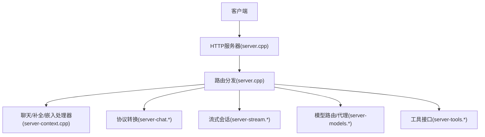
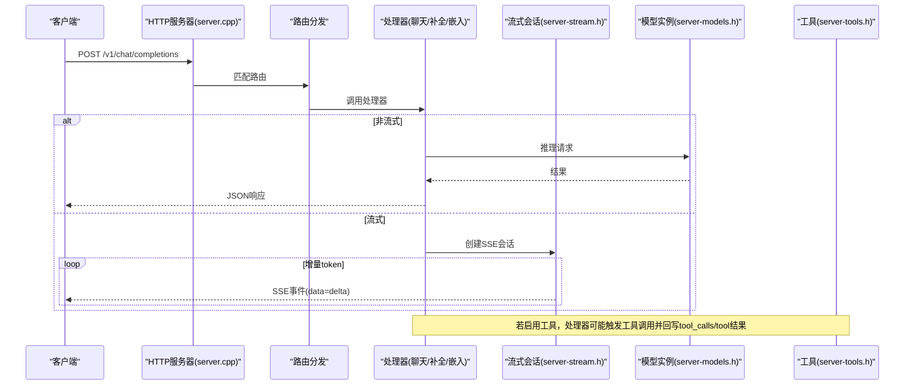
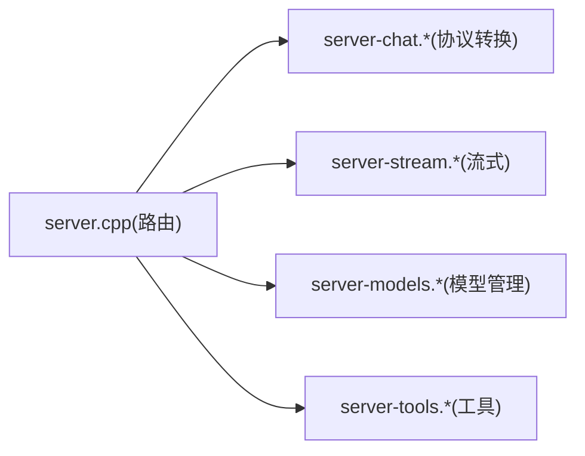
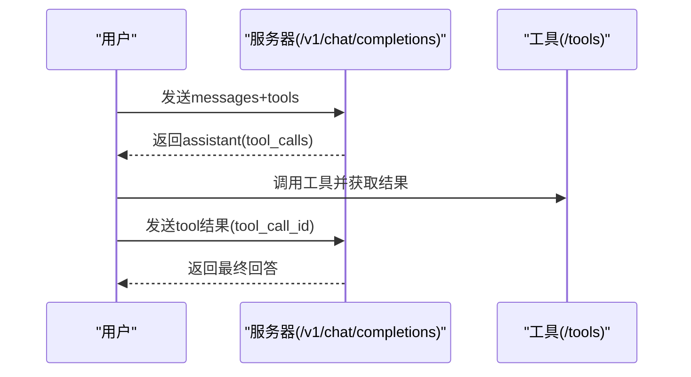

# API端点参考

<cite>
**本文引用的文件**   
- [server.cpp](file://tools/server/server.cpp)
- [README.md](file://tools/server/README.md)
- [server-chat.h](file://tools/server/server-chat.h)
- [server-chat.cpp](file://tools/server/server-chat.cpp)
- [server-stream.h](file://tools/server/server-stream.h)
- [server-models.h](file://tools/server/server-models.h)
- [server-tools.h](file://tools/server/server-tools.h)
- [function-calling.md](file://docs/function-calling.md)
</cite>

## 目录
1. [简介](#简介)
2. [项目结构](#项目结构)
3. [核心组件](#核心组件)
4. [架构总览](#架构总览)
5. [详细端点规范](#详细端点规范)
6. [依赖关系分析](#依赖关系分析)
7. [性能与流式响应](#性能与流式响应)
8. [故障排查指南](#故障排查指南)
9. [结论](#结论)
10. [附录：JSON Schema与示例](#附录json-schema与示例)

## 简介
本文件为 llama.cpp HTTP 服务器的完整API参考，聚焦于OpenAI兼容的聊天完成、补全、嵌入等端点，以及工具调用（Function Calling）、流式响应机制、错误码与处理策略。文档基于源码路由注册与官方服务端文档整理，确保路径、方法、参数、响应结构与行为与实际实现一致。

## 项目结构
llama.cpp 的HTTP服务通过 server.cpp 统一注册路由，将 OpenAI/Anthropic/内部扩展端点映射到具体处理器；server-chat.* 负责协议转换（Responses/Anthropic -> Chat Completions）；server-stream.* 提供可恢复的SSE流会话；server-models.* 在路由器模式下代理模型实例；server-tools.* 暴露工具定义与调用接口。

图表来源
- [server.cpp:204-325](file://tools/server/server.cpp#L204-L325)
- [server-chat.h:1-25](file://tools/server/server-chat.h#L1-L25)
- [server-stream.h:47-59](file://tools/server/server-stream.h#L47-L59)
- [server-models.h:346-384](file://tools/server/server-models.h#L346-L384)
- [server-tools.h:36-55](file://tools/server/server-tools.h#L36-L55)

章节来源
- [server.cpp:204-325](file://tools/server/server.cpp#L204-L325)

## 核心组件
- HTTP上下文与请求/响应对象：统一封装请求解析、响应生成与流式next回调。
- 路由注册器：集中注册所有OpenAI/Anthropic/内部扩展端点。
- 协议转换器：将Responses/Anthropic格式转换为Chat Completions。
- 流式会话管理器：维护SSE会话、断线重连与会话查找。
- 模型路由器：在路由器模式下代理子进程模型实例。
- 工具系统：暴露工具定义与调用接口，支持流式输出。

章节来源
- [server-http.h:15-103](file://tools/server/server-http.h#L15-L103)
- [server.cpp:204-325](file://tools/server/server.cpp#L204-L325)
- [server-chat.h:1-25](file://tools/server/server-chat.h#L1-L25)
- [server-stream.h:11-59](file://tools/server/server-stream.h#L11-L59)
- [server-models.h:346-384](file://tools/server/server-models.h#L346-L384)
- [server-tools.h:12-55](file://tools/server/server-tools.h#L12-L55)

## 架构总览
下图展示从HTTP请求到模型推理与返回的整体流程，包括流式SSE与工具调用路径。

图表来源
- [server.cpp:270-298](file://tools/server/server.cpp#L270-L298)
- [server-stream.h:47-59](file://tools/server/server-stream.h#L47-L59)
- [server-models.h:346-384](file://tools/server/server-models.h#L346-L384)
- [server-tools.h:36-55](file://tools/server/server-tools.h#L36-L55)

## 详细端点规范

### GET /health, GET /v1/health
- 方法：GET
- 路径：/health, /v1/health
- 鉴权：公开（无需API Key）
- 用途：健康检查
- 响应：200 OK（具体字段以实现为准）

章节来源
- [server.cpp:263-265](file://tools/server/server.cpp#L263-L265)

### GET /metrics
- 方法：GET
- 路径：/metrics
- 用途：指标采集

章节来源
- [server.cpp:265-266](file://tools/server/server.cpp#L265-L266)

### GET /props, POST /props
- 方法：GET/POST
- 路径：/props
- 用途：查询/修改服务器全局属性（需启动时开启相应选项）

章节来源
- [server.cpp:266-267](file://tools/server/server.cpp#L266-L267)
- [README.md:921-935](file://tools/server/README.md#L921-L935)

### GET /models, GET /v1/models
- 方法：GET
- 路径：/models, /v1/models
- 用途：获取已加载模型信息（OpenAI兼容）
- 响应结构要点：
  - data[]: { id, object="model", created, owned_by, architecture:{ input_modalities[], output_modalities[] }, meta }
  - router模式返回多个模型元数据

章节来源
- [server.cpp:268-269](file://tools/server/server.cpp#L268-L269)
- [README.md:1248-1306](file://tools/server/README.md#L1248-L1306)

### POST /completion, POST /completions, POST /v1/completions
- 方法：POST
- 路径：/completion, /completions, /v1/completions
- 用途：文本补全（OpenAI兼容）
- 请求体：遵循OpenAI Completions API（支持streaming、mirostat等扩展）
- 响应：非流式返回choices[]；流式返回SSE事件流

章节来源
- [server.cpp:270-272](file://tools/server/server.cpp#L270-L272)
- [README.md:1308-1337](file://tools/server/README.md#L1308-L1337)

### POST /chat/completions, POST /v1/chat/completions
- 方法：POST
- 路径：/chat/completions, /v1/chat/completions
- 用途：聊天完成（OpenAI兼容）
- 关键参数：
  - model, messages, stream, temperature, top_p, top_k, stop, max_tokens
  - response_format: {"type":"json_object"} 或 {"type":"json_schema","schema":...}
  - chat_template_kwargs, reasoning_effort, reasoning_format, reasoning_control
  - parallel_tool_calls
  - 多模态content parts: image_url, input_audio, input_video
- 响应：choices[].message.content；支持reasoning_content；usage/timings
- 工具调用：当启用Jinja模板与工具定义时，返回tool_calls，后续以tool角色消息回填

章节来源
- [server.cpp:273-275](file://tools/server/server.cpp#L273-L275)
- [README.md:1339-1470](file://tools/server/README.md#L1339-L1470)
- [function-calling.md:369-395](file://docs/function-calling.md#L369-L395)

### POST /v1/chat/completions/control
- 方法：POST
- 路径：/v1/chat/completions/control
- 用途：实时控制进行中的聊天完成（如结束reasoning块）
- 请求体：id, action("reasoning_end"), model（路由器模式必需）
- 响应：{ success: bool, message?: string }

章节来源
- [server.cpp:275](file://tools/server/server.cpp#L275)
- [README.md:1472-1486](file://tools/server/README.md#L1472-L1486)

### POST /v1/responses, POST /responses
- 方法：POST
- 路径：/v1/responses, /responses
- 用途：OpenAI Responses API（内部转换为Chat Completions）
- 请求体：input（string或数组），instructions，tools（仅function类型），max_output_tokens等
- 响应：由Chat Completions转换而来

章节来源
- [server.cpp:276-277](file://tools/server/server.cpp#L276-L277)
- [server-chat.cpp:6-309](file://tools/server/server-chat.cpp#L6-L309)
- [README.md:1488-1528](file://tools/server/README.md#L1488-L1528)

### POST /v1/audio/transcriptions, POST /audio/transcriptions
- 方法：POST
- 路径：/v1/audio/transcriptions, /audio/transcriptions
- 用途：语音转文本（OpenAI兼容）
- 输入：form-data file + prompt/language/response_format
- 响应：JSON（仅支持response_format=json）

章节来源
- [server.cpp:278-279](file://tools/server/server.cpp#L278-L279)
- [server-chat.cpp:651-706](file://tools/server/server-chat.cpp#L651-L706)

### POST /v1/messages (Anthropic Messages)
- 方法：POST
- 路径：/v1/messages
- 用途：Anthropic Messages API兼容
- 关键参数：model, messages, system, max_tokens, temperature, top_p, top_k, stop_sequences, stream, tools, tool_choice
- 响应：SSE流式事件

章节来源
- [server.cpp:280](file://tools/server/server.cpp#L280)
- [README.md:1624-1668](file://tools/server/README.md#L1624-L1668)

### POST /v1/messages/count_tokens
- 方法：POST
- 路径：/v1/messages/count_tokens
- 用途：统计Anthropic消息token数（不生成响应）

章节来源
- [server.cpp:298](file://tools/server/server.cpp#L298)
- [README.md:1670-1693](file://tools/server/README.md#L1670-L1693)

### POST /infill
- 方法：POST
- 路径：/infill
- 用途：代码/文本补全（Infill）

章节来源
- [server.cpp:281](file://tools/server/server.cpp#L281)

### POST /embedding, POST /embeddings, POST /v1/embeddings
- 方法：POST
- 路径：/embedding, /embeddings, /v1/embeddings
- 用途：向量嵌入（OpenAI兼容）
- 输入：字符串或字符串数组；多模态模型支持content parts（image_url/input_audio/input_video）
- 响应：OpenAI Embeddings格式（normalized）

章节来源
- [server.cpp:282-284](file://tools/server/server.cpp#L282-L284)
- [README.md:1531-1592](file://tools/server/README.md#L1531-L1592)

### POST /rerank, POST /reranking, POST /v1/rerank, POST /v1/reranking
- 方法：POST
- 路径：/rerank, /reranking, /v1/rerank, /v1/reranking
- 用途：重排序

章节来源
- [server.cpp:285-288](file://tools/server/server.cpp#L285-L288)

### POST /v1/systemone
- 方法：POST
- 路径：/v1/systemone
- 用途：TypeSafe System One API（决策模型）

章节来源
- [server.cpp:289](file://tools/server/server.cpp#L289)
- [README.md:1695-1700](file://tools/server/README.md#L1695-L1700)

### POST /tokenize, POST /detokenize, POST /apply-template
- 方法：POST
- 路径：/tokenize, /detokenize, /apply-template
- 用途：分词/反分词/模板渲染

章节来源
- [server.cpp:290-292](file://tools/server/server.cpp#L290-L292)

### POST /chat/completions/input_tokens, POST /v1/chat/completions/input_tokens
- 方法：POST
- 路径：/chat/completions/input_tokens, /v1/chat/completions/input_tokens
- 用途：统计聊天请求输入token数（非官方OAI端点）
- 响应：{ object:"response.input_tokens", input_tokens:number }

章节来源
- [server.cpp:294-295](file://tools/server/server.cpp#L294-L295)
- [README.md:1607-1620](file://tools/server/README.md#L1607-L1620)

### POST /v1/responses/input_tokens
- 方法：POST
- 路径：/v1/responses/input_tokens
- 用途：统计Responses输入token数

章节来源
- [server.cpp:296-297](file://tools/server/server.cpp#L296-L297)
- [README.md:1594-1605](file://tools/server/README.md#L1594-L1605)

### GET /lora-adapters, POST /lora-adapters
- 方法：GET/POST
- 路径：/lora-adapters
- 用途：查询/设置LoRA适配器列表与scale

章节来源
- [server.cpp:300-301](file://tools/server/server.cpp#L300-L301)
- [README.md:1202-1244](file://tools/server/README.md#L1202-L1244)

### GET /slots, POST /slots/:id_slot
- 方法：GET/POST
- 路径：/slots, /slots/:id_slot
- 用途：保存/加载会话槽位

章节来源
- [server.cpp:303-304](file://tools/server/server.cpp#L303-L304)

### 可恢复流式接口
- GET /v1/stream
- POST /v1/streams/lookup
- DELETE /v1/stream
- 用途：SSE会话管理（断线重连、会话查找、删除）

章节来源
- [server.cpp:306-322](file://tools/server/server.cpp#L306-L322)
- [server-stream.h:47-59](file://tools/server/server-stream.h#L47-L59)

### 工具接口
- GET /tools
- POST /tools
- 用途：列出工具定义与执行工具调用（支持流式输出）

章节来源
- [server.cpp:366-387](file://tools/server/server.cpp#L366-L387)
- [server-tools.h:36-55](file://tools/server/server-tools.h#L36-L55)

## 依赖关系分析
- 路由层：server.cpp 统一注册所有端点，并在路由器模式下将主要端点代理至 models_routes。
- 协议转换层：server-chat.* 将Responses/Anthropic请求转换为Chat Completions，保证统一处理逻辑。
- 流式层：server-stream.* 提供SSE会话生命周期管理与tee管道，支持断线后回放。
- 模型管理层：server-models.* 管理子进程模型实例的生命周期、LRU卸载、状态同步与SSE通知。
- 工具层：server-tools.* 抽象工具IO与执行环境（本地/容器/SSH），并通过统一接口暴露给上层。

图表来源
- [server.cpp:204-325](file://tools/server/server.cpp#L204-L325)
- [server-chat.h:1-25](file://tools/server/server-chat.h#L1-L25)
- [server-stream.h:47-59](file://tools/server/server-stream.h#L47-L59)
- [server-models.h:346-384](file://tools/server/server-models.h#L346-L384)
- [server-tools.h:36-55](file://tools/server/server-tools.h#L36-L55)

章节来源
- [server.cpp:204-325](file://tools/server/server.cpp#L204-L325)

## 性能与流式响应
- 流式响应机制：
  - 使用SSE（Server-Sent Events）增量推送token delta。
  - 支持“tee”管道：即使客户端断开，会话仍存活并可回放。
  - 会话键：conversation_id（X-Conversation-Id头），用于路由到正确的子进程。
- 性能提示：
  - embeddings需保证ubatch一致性（n_batch <= n_ubatch）。
  - KV池自动大小化：根据并行度与kv_unified_per_slot计算。
  - 路由器模式下的模型LRU调度与按需加载。

章节来源
- [server-stream.h:11-79](file://tools/server/server-stream.h#L11-L79)
- [server.cpp:158-186](file://tools/server/server.cpp#L158-L186)
- [server-models.h:269-432](file://tools/server/server-models.h#L269-L432)

## 故障排查指南
- 异常包装与错误码：
  - invalid_argument/common_json_error -> 400（无效请求）
  - 其他异常 -> 500（服务器错误）
  - 错误体包含error.code与error.message
- 常见错误：
  - 未启用功能（如MCP/CORS代理）-> 403
  - 转录仅支持response_format=json
  - Responses不支持previous_response_id
- 诊断建议：
  - 查看/health与/metrics
  - 检查router模式下的模型状态SSE事件
  - 确认工具与Jinja模板是否启用

章节来源
- [server.cpp:53-91](file://tools/server/server.cpp#L53-L91)
- [server.cpp:327-338](file://tools/server/server.cpp#L327-L338)
- [server-chat.cpp:651-706](file://tools/server/server-chat.cpp#L651-L706)
- [server-chat.cpp:6-12](file://tools/server/server-chat.cpp#L6-L12)

## 结论
llama.cpp HTTP服务器提供了完整的OpenAI兼容API集，涵盖聊天、补全、嵌入、重排序、音频转录、工具调用与Token计数等能力。通过统一的协议转换与流式会话管理，既保证了兼容性，也提升了可扩展性与稳定性。在生产环境中，建议结合路由器模式、模型LRU与SSE会话回放，以获得最佳吞吐与用户体验。

## 附录：JSON Schema与示例

### 聊天完成请求体（/v1/chat/completions）
- 必填：model, messages
- 可选：
  - stream: boolean
  - temperature, top_p, top_k, stop, max_tokens
  - response_format: {"type":"json_object"} 或 {"type":"json_schema","schema":...}
  - chat_template_kwargs, reasoning_effort, reasoning_format, reasoning_control
  - parallel_tool_calls
  - messages[i].content: 字符串或多模态parts（image_url/input_audio/input_video）
- 工具定义：tools[{ type:"function", function:{ name, description, parameters(JSON Schema) }}]

章节来源
- [README.md:1339-1470](file://tools/server/README.md#L1339-L1470)
- [function-calling.md:369-395](file://docs/function-calling.md#L369-L395)

### 嵌入请求体（/v1/embeddings）
- 必填：model, input（string|string[]|content_parts[]）
- 可选：encoding_format
- 多模态content_parts同聊天完成

章节来源
- [README.md:1531-1592](file://tools/server/README.md#L1531-L1592)

### 工具调用交互流程

图表来源
- [server-tools.h:36-55](file://tools/server/server-tools.h#L36-L55)
- [README.md:1416-1420](file://tools/server/README.md#L1416-L1420)