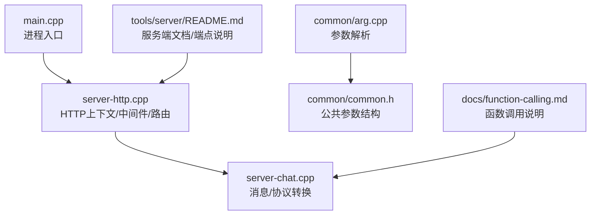
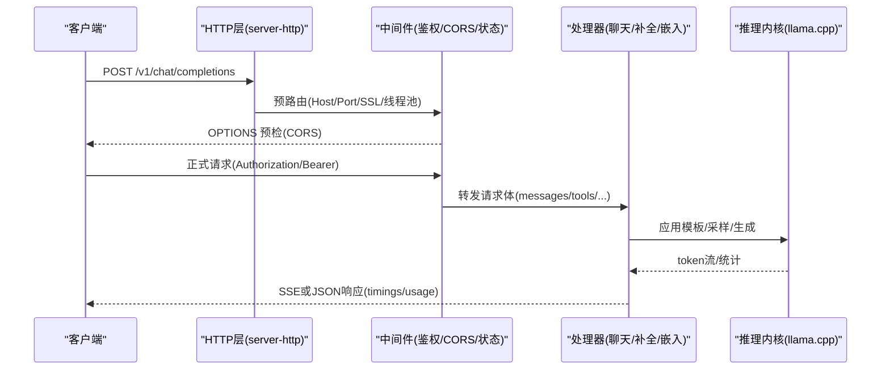
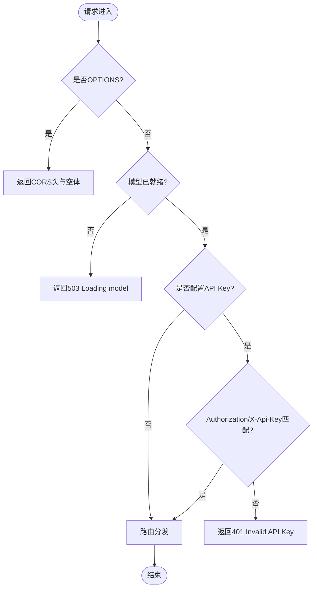
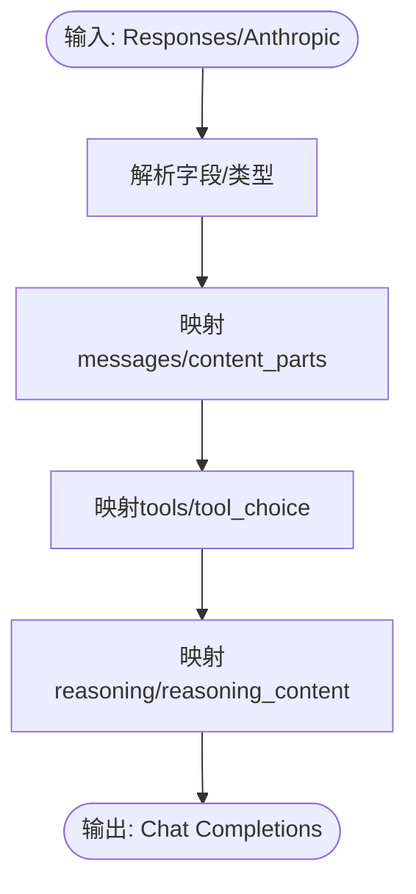
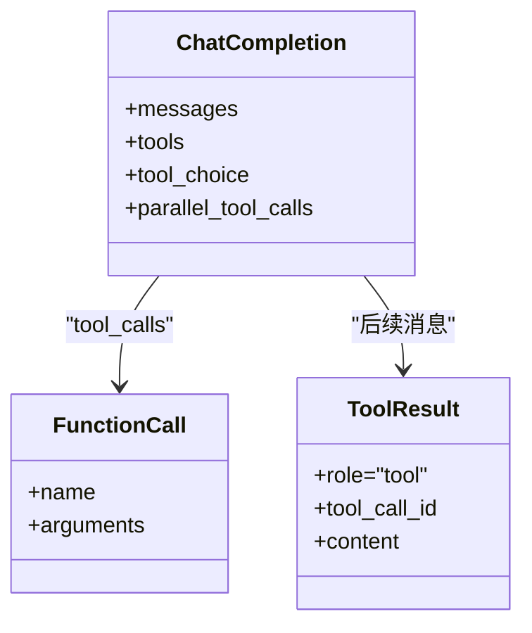
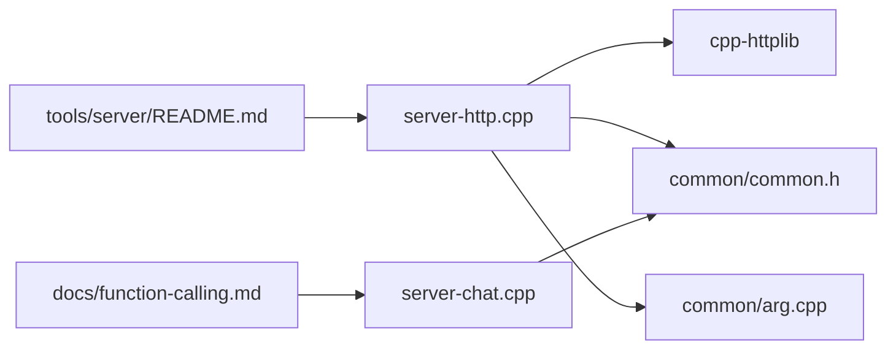

# HTTP服务器

<cite>
**本文引用的文件**   
- [tools/server/README.md](file://tools/server/README.md)
- [tools/server/main.cpp](file://tools/server/main.cpp)
- [tools/server/server-http.cpp](file://tools/server/server-http.cpp)
- [tools/server/server-chat.cpp](file://tools/server/server-chat.cpp)
- [common/arg.cpp](file://common/arg.cpp)
- [common/common.h](file://common/common.h)
- [docs/function-calling.md](file://docs/function-calling.md)
</cite>

## 目录
1. [简介](#简介)
2. [项目结构](#项目结构)
3. [核心组件](#核心组件)
4. [架构总览](#架构总览)
5. [详细组件分析](#详细组件分析)
6. [依赖关系分析](#依赖关系分析)
7. [性能与部署](#性能与部署)
8. [故障排查指南](#故障排查指南)
9. [结论](#结论)
10. [附录：API参考与示例](#附录api参考与示例)

## 简介
本指南面向在本地或云端部署 llama.cpp HTTP 服务器的工程师与运维人员，系统说明 OpenAI 兼容 API（聊天完成、补全、嵌入等）的请求/响应格式，服务器配置项（端口、并发、内存等），认证与安全（CORS、SSL、API Key），Docker 部署与负载均衡，性能调优参数、监控指标与日志，以及函数调用能力与自定义工具开发方法。文档同时提供完整的 API 测试示例与客户端集成要点。

## 项目结构
llama.cpp 的 HTTP 服务位于 tools/server 目录，入口为 main.cpp，HTTP 层基于 cpp-httplib 实现，业务路由与中间件在 server-http.cpp 中注册，聊天消息转换与多协议适配在 server-chat.cpp 中处理，通用命令行参数解析在 common/arg.cpp 与 common/common.h 中定义，函数调用能力在 docs/function-calling.md 中说明。

**图表来源**
- [tools/server/main.cpp:1-6](file://tools/server/main.cpp#L1-L6)
- [tools/server/server-http.cpp:1-120](file://tools/server/server-http.cpp#L1-L120)
- [tools/server/server-chat.cpp:1-30](file://tools/server/server-chat.cpp#L1-L30)
- [common/arg.cpp:3391-3484](file://common/arg.cpp#L3391-L3484)
- [common/common.h:664-691](file://common/common.h#L664-L691)
- [tools/server/README.md:1-30](file://tools/server/README.md#L1-L30)
- [docs/function-calling.md:1-25](file://docs/function-calling.md#L1-L25)

**章节来源**
- [tools/server/main.cpp:1-6](file://tools/server/main.cpp#L1-L6)
- [tools/server/README.md:1-30](file://tools/server/README.md#L1-L30)

## 核心组件
- HTTP 服务上下文与监听器：负责绑定主机/端口、SSL、线程池、超时、CORS、API Key 校验、静态资源与 Web UI 托管。
- 路由与中间件：统一拦截请求，执行状态检查、CORS 预检、鉴权、错误处理与流式响应封装。
- 协议转换：将 Anthropic Messages、OpenAI Responses 等请求转换为内部 Chat Completions 格式，并回写标准字段。
- 参数体系：统一的 CLI 与环境变量映射，涵盖网络、并发、KV缓存、模型加载、推理采样、Speculative Decoding、MCP/Tools、UI 等。
- 函数调用：通过 Jinja 模板引擎与原生/通用工具调用格式支持，配合 /v1/chat/completions 的 tools/tool_choice 参数。

**章节来源**
- [tools/server/server-http.cpp:111-156](file://tools/server/server-http.cpp#L111-L156)
- [tools/server/server-http.cpp:158-227](file://tools/server/server-http.cpp#L158-L227)
- [tools/server/server-http.cpp:260-361](file://tools/server/server-http.cpp#L260-L361)
- [tools/server/server-chat.cpp:6-310](file://tools/server/server-chat.cpp#L6-L310)
- [common/arg.cpp:3391-3484](file://common/arg.cpp#L3391-L3484)
- [common/common.h:664-691](file://common/common.h#L664-L691)

## 架构总览
下图展示从浏览器/客户端到模型推理的关键路径：客户端请求经 HTTP 层进入中间件（CORS、鉴权、状态检查），再交由具体处理器（聊天/补全/嵌入等），最终由推理内核生成结果并通过 SSE 或普通 JSON 返回。

**图表来源**
- [tools/server/server-http.cpp:111-156](file://tools/server/server-http.cpp#L111-L156)
- [tools/server/server-http.cpp:260-361](file://tools/server/server-http.cpp#L260-L361)
- [tools/server/server-chat.cpp:348-619](file://tools/server/server-chat.cpp#L348-L619)

## 详细组件分析

### HTTP 层与中间件
- 监听与线程池：支持多 host（含 UNIX socket）、自动端口分配、SO_REUSEPORT、固定线程+动态线程池。
- SSL：可选 OpenSSL 构建，启用后使用 SSLServer。
- CORS：支持通配符、localhost 反射、显式 origins/methods/headers/credentials；OPTIONS 预检直接返回。
- 鉴权：支持 Authorization: Bearer 与 X-Api-Key，未设置时跳过校验；失败返回 401。
- 状态检查：模型未就绪时返回 503（前端资源除外）。
- 错误处理：404 返回标准 JSON 错误体；异常统一捕获。

**图表来源**
- [tools/server/server-http.cpp:158-227](file://tools/server/server-http.cpp#L158-L227)
- [tools/server/server-http.cpp:260-361](file://tools/server/server-http.cpp#L260-L361)

**章节来源**
- [tools/server/server-http.cpp:111-156](file://tools/server/server-http.cpp#L111-L156)
- [tools/server/server-http.cpp:158-227](file://tools/server/server-http.cpp#L158-L227)
- [tools/server/server-http.cpp:260-361](file://tools/server/server-http.cpp#L260-L361)

### 协议转换（Anthropic/OpenAI Responses → Chat Completions）
- Responses → Chat Completions：将 input/instructions/messages 等字段映射为 messages，并将 function_call 转为 tool_calls，reasoning 内容映射至 reasoning_content。
- Anthropic Messages → OAI：支持 text/thinking/image/tool_use/tool_result 等 content blocks，并正确构造 tool_calls 与 tool 角色消息。
- Transcription：表单上传音频转 chat 提示词，注入媒体标记与语言信息。

**图表来源**
- [tools/server/server-chat.cpp:6-310](file://tools/server/server-chat.cpp#L6-L310)
- [tools/server/server-chat.cpp:348-619](file://tools/server/server-chat.cpp#L348-L619)

**章节来源**
- [tools/server/server-chat.cpp:6-310](file://tools/server/server-chat.cpp#L6-L310)
- [tools/server/server-chat.cpp:348-619](file://tools/server/server-chat.cpp#L348-L619)

### 函数调用与工具
- 模板引擎：启用 --jinja 以支持函数调用；部分模型需指定 --chat-template-file 以获得最佳效果。
- 原生与通用格式：对 Llama 3.x、Functionary、Hermes、Qwen、Command R7B、DeepSeek R1、GPT-OSS 等提供原生格式；其他模型回退到通用格式。
- 并行工具调用：部分模型支持 parallel_tool_calls。
- 内置工具与 MCP：可通过 --tools 启用内置工具，或通过 --mcp-servers-config/--mcp-servers-json 暴露外部 MCP 工具。

**图表来源**
- [docs/function-calling.md:1-25](file://docs/function-calling.md#L1-L25)
- [tools/server/README.md:1416-1420](file://tools/server/README.md#L1416-L1420)

**章节来源**
- [docs/function-calling.md:1-25](file://docs/function-calling.md#L1-L25)
- [tools/server/README.md:1416-1420](file://tools/server/README.md#L1416-L1420)

## 依赖关系分析
- HTTP 层依赖 cpp-httplib 提供 Server/SSLServer、ThreadPool、TaskQueue。
- 参数解析依赖 common/arg.cpp 与 common/common.h 中的公共参数结构。
- 协议转换依赖 server-chat.cpp 中的消息映射逻辑。
- 文档与示例依赖 tools/server/README.md 与 docs/function-calling.md。

**图表来源**
- [tools/server/server-http.cpp:1-20](file://tools/server/server-http.cpp#L1-L20)
- [common/arg.cpp:3391-3484](file://common/arg.cpp#L3391-L3484)
- [common/common.h:664-691](file://common/common.h#L664-L691)
- [tools/server/server-chat.cpp:1-30](file://tools/server/server-chat.cpp#L1-L30)
- [tools/server/README.md:1-30](file://tools/server/README.md#L1-L30)
- [docs/function-calling.md:1-25](file://docs/function-calling.md#L1-L25)

**章节来源**
- [tools/server/server-http.cpp:1-20](file://tools/server/server-http.cpp#L1-L20)
- [common/arg.cpp:3391-3484](file://common/arg.cpp#L3391-L3484)
- [common/common.h:664-691](file://common/common.h#L664-L691)

## 性能与部署

### 端口与并发
- 监听地址与端口：--host、--port、--reuse-port。
- HTTP 线程数：--threads-http；默认根据并行槽位与硬件并发计算。
- 并发槽位与批处理：--parallel、--cont-batching（连续批处理）。
- KV 缓存与内存：--kv-unified、--cache-ram、--kv-unified-per-slot、--cache-idle-slots、--ctx-size、--n-predict、--batch-size、--ubatch-size。

**章节来源**
- [tools/server/README.md:193-221](file://tools/server/README.md#L193-L221)
- [tools/server/README.md:168-178](file://tools/server/README.md#L168-L178)
- [tools/server/server-http.cpp:111-156](file://tools/server/server-http.cpp#L111-L156)

### 安全与认证
- API Key：--api-key、--api-key-file；支持 Authorization: Bearer 与 X-Api-Key。
- CORS：--cors-origins、--cors-methods、--cors-headers、--cors-credentials。
- SSL：--ssl-key-file、--ssl-cert-file（需 OpenSSL 构建）。
- 代理与工具安全：--tools、--agent、--mcp-servers-* 会限制 CORS 默认值为 localhost。

**章节来源**
- [tools/server/README.md:213-216](file://tools/server/README.md#L213-L216)
- [tools/server/README.md:197-200](file://tools/server/README.md#L197-L200)
- [tools/server/server-http.cpp:260-361](file://tools/server/server-http.cpp#L260-L361)

### Docker 部署与负载均衡
- Docker 镜像：ghcr.io/ggml-org/llama.cpp:server 与 server-cuda。
- 环境变量：LLAMA_ARG_MODEL、LLAMA_ARG_CTX_SIZE、LLAMA_ARG_N_PARALLEL、LLAMA_ARG_ENDPOINT_METRICS、LLAMA_ARG_PORT。
- 反向代理：Nginx/Apache 可结合 X-Accel-Buffering=no 进行流式转发。
- 多实例：通过 --reuse-port 与容器编排（K8s Service/Ingress）实现水平扩展。

**章节来源**
- [tools/server/README.md:451-458](file://tools/server/README.md#L451-L458)
- [tools/server/README.md:321-338](file://tools/server/README.md#L321-L338)
- [tools/server/server-http.cpp:635-673](file://tools/server/server-http.cpp#L635-L673)

### 监控指标与日志
- Prometheus 指标：--metrics 开启 /metrics 端点，包含 prompt/predicted tokens、吞吐、busy slots、speculative decoding 计数等。
- 日志：--log-file、--log-jsonl、--log-colors、--log-verbose、--log-prefix、--log-timestamps。
- 插槽监控：--slots 暴露 /slots 端点，查看各槽位运行状态与参数。

**章节来源**
- [tools/server/README.md:1125-1149](file://tools/server/README.md#L1125-L1149)
- [tools/server/README.md:106-114](file://tools/server/README.md#L106-L114)
- [tools/server/README.md:223-226](file://tools/server/README.md#L223-L226)

### 性能调优建议
- 合理设置 --threads、--threads-batch、--threads-http。
- 调整 --batch-size、--ubatch-size、--cont-batching。
- 启用 KV 缓存复用：--cache-prompt、--cache-reuse。
- 使用 Speculative Decoding：--spec-draft-model、--spec-type、--spec-draft-n-max/min。
- 控制上下文长度与保留策略：--ctx-size、--keep、--context-shift。
- 量化与后端优化：--device、--gpu-layers、--split-mode、--tensor-split、--flash-attn。

**章节来源**
- [tools/server/README.md:38-57](file://tools/server/README.md#L38-L57)
- [tools/server/README.md:168-178](file://tools/server/README.md#L168-L178)
- [tools/server/README.md:247-287](file://tools/server/README.md#L247-L287)

## 故障排查指南
- 401 未授权：检查 Authorization 或 X-Api-Key 是否正确，确认 --api-key 配置。
- 503 模型加载中：等待模型加载完成，或检查 --model/-m 路径与权限。
- CORS 预检失败：确认 --cors-origins、--cors-methods、--cors-headers、--cors-credentials 配置。
- 流式响应卡顿：检查 Nginx/Apache 的缓冲设置，确保 X-Accel-Buffering=no。
- 函数调用不生效：确认 --jinja 与合适的 --chat-template-file，检查 tools/tool_choice 与 parallel_tool_calls。

**章节来源**
- [tools/server/server-http.cpp:260-361](file://tools/server/server-http.cpp#L260-L361)
- [tools/server/server-http.cpp:635-673](file://tools/server/server-http.cpp#L635-L673)
- [docs/function-calling.md:283-331](file://docs/function-calling.md#L283-L331)

## 结论
llama.cpp HTTP 服务器提供了开箱即用的 OpenAI 兼容 API，具备完善的认证、CORS、SSL、监控与流式处理能力。通过合理的参数调优与容器化部署，可在多种硬件与云平台上稳定运行。函数调用与 MCP/Tools 生态进一步增强了其在智能体与工作流中的应用价值。

## 附录：API参考与示例

### OpenAI 兼容端点概览
- GET /v1/models：模型信息
- POST /v1/completions：文本补全
- POST /v1/chat/completions：聊天完成（支持 streaming、tools、reasoning）
- POST /v1/responses：Responses API（内部转换为 Chat Completions）
- POST /v1/embeddings：嵌入向量（支持多模态输入）

**章节来源**
- [tools/server/README.md:1246-1599](file://tools/server/README.md#L1246-L1599)

### 请求/响应关键字段
- 聊天完成：
  - 请求：model、messages、tools、tool_choice、stream、max_tokens、temperature、top_p、top_k、response_format、reasoning_effort、reasoning_format、reasoning_control、parallel_tool_calls。
  - 响应：choices、created、id、object、usage、timings、reasoning_content（如启用）。
- 嵌入：
  - 请求：input（字符串/数组/多模态对象）、model、encoding_format。
  - 响应：data（数组，含 embedding 向量）。

**章节来源**
- [tools/server/README.md:1339-1470](file://tools/server/README.md#L1339-L1470)
- [tools/server/README.md:1531-1592](file://tools/server/README.md#L1531-L1592)

### curl 测试示例
- 聊天完成
  - curl http://localhost:9931/v1/chat/completions -H "Content-Type: application/json" -H "Authorization: Bearer no-key" -d '{"model":"gpt-3.5-turbo","messages":[{"role":"system","content":"..."},{"role":"user","content":"..."}]}'
- 嵌入
  - curl http://localhost:9931/v1/embeddings -H "Content-Type: application/json" -H "Authorization: Bearer no-key" -d '{"input":"hello","model":"GPT-4","encoding_format":"float"}'

**章节来源**
- [tools/server/README.md:1395-1414](file://tools/server/README.md#L1395-L1414)
- [tools/server/README.md:1546-1592](file://tools/server/README.md#L1546-L1592)

### Python 客户端集成要点
- 使用 openai 库，设置 base_url 指向 llama-server 的 /v1 前缀，api_key 可为任意值（如 sk-no-key-required）。
- 聊天完成：client.chat.completions.create(...)
- 补全：client.completions.create(...)
- 嵌入：client.embeddings.create(...)

**章节来源**
- [tools/server/README.md:1320-1337](file://tools/server/README.md#L1320-L1337)
- [tools/server/README.md:1374-1393](file://tools/server/README.md#L1374-L1393)