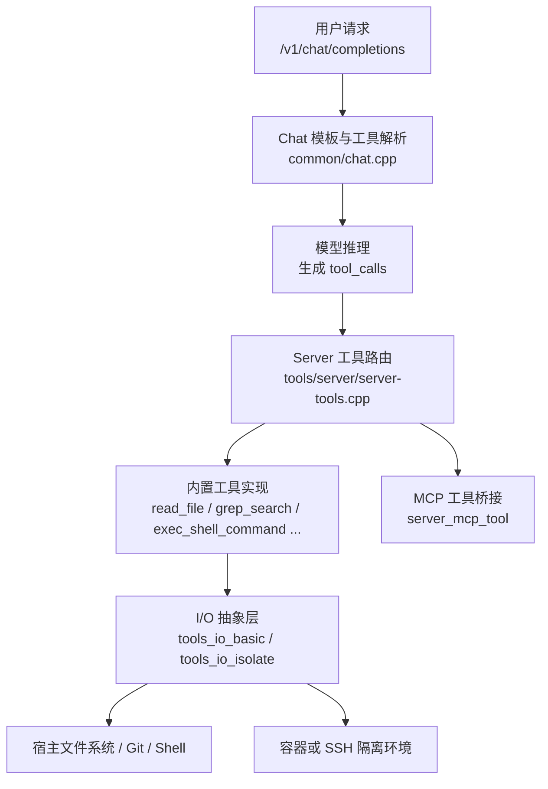
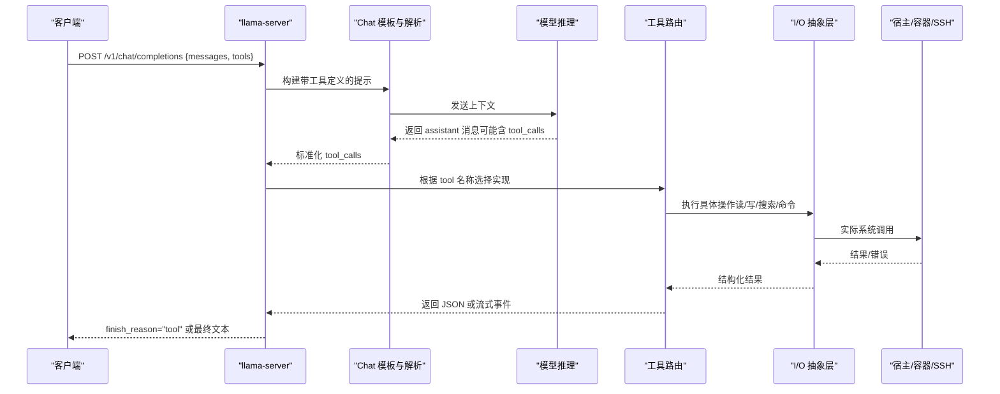
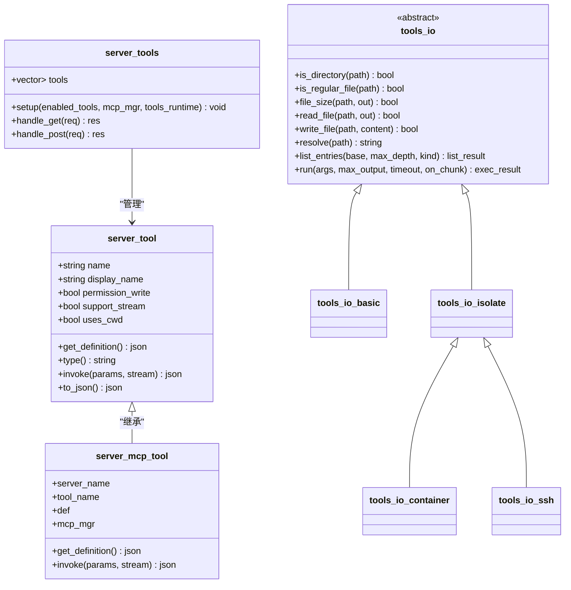
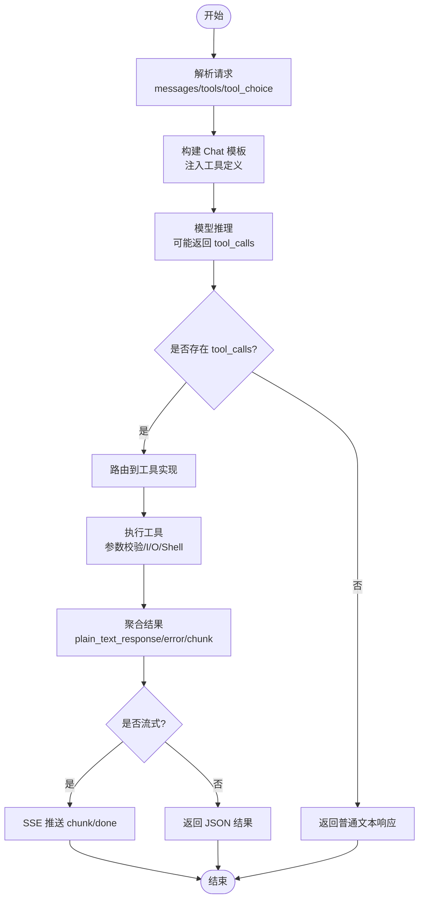

# 函数调用与工具

<cite>
**本文引用的文件**   
- [function-calling.md](file://docs/function-calling.md)
- [server-tools.h](file://tools/server/server-tools.h)
- [server-tools.cpp](file://tools/server/server-tools.cpp)
- [chat.cpp](file://common/chat.cpp)
- [chat-peg-parser.cpp](file://common/chat-peg-parser.cpp)
- [test_tool_call.py](file://tools/server/tests/unit/test_tool_call.py)
</cite>

## 目录
1. [引言](#引言)
2. [项目结构](#项目结构)
3. [核心组件](#核心组件)
4. [架构总览](#架构总览)
5. [详细组件分析](#详细组件分析)
6. [依赖关系分析](#依赖关系分析)
7. [性能与资源控制](#性能与资源控制)
8. [故障排查指南](#故障排查指南)
9. [结论](#结论)
10. [附录：请求到返回的完整生命周期](#附录请求到返回的完整生命周期)

## 引言
本指南面向希望在 llama.cpp 中启用并扩展“函数调用/工具”能力的开发者。内容覆盖：
- 内置工具的用法、参数定义与执行流程
- 自定义工具的开发方法
- 工具定义格式与参数校验
- 从请求解析到结果返回的完整生命周期
- 工具链组合与复杂工作流
- 调试技巧与外部系统集成最佳实践

llama.cpp 通过 chat 模板与 OpenAI 风格的 function calling 协议对接模型，并在 server 层提供可插拔的工具执行框架，支持本地 I/O、容器隔离、SSH 远程以及 MCP（Model Context Protocol）工具集成。

## 项目结构
与函数调用和工具相关的关键位置如下：
- 文档入口：docs/function-calling.md
- Server 工具框架：tools/server/server-tools.h / server-tools.cpp
- Chat 模板与工具解析：common/chat.cpp / common/chat-peg-parser.cpp
- 测试用例：tools/server/tests/unit/test_tool_call.py

**图示来源**
- [function-calling.md:1-25](file://docs/function-calling.md#L1-L25)
- [server-tools.cpp:1951-1964](file://tools/server/server-tools.cpp#L1951-L1964)
- [server-tools.cpp:1802-1839](file://tools/server/server-tools.cpp#L1802-L1839)
- [server-tools.cpp:147-183](file://tools/server/server-tools.cpp#L147-L183)

**章节来源**
- [function-calling.md:1-25](file://docs/function-calling.md#L1-L25)

## 核心组件
- 工具抽象基类与运行时
  - server_tool：统一工具接口，包含 name、display_name、权限标记、是否支持流式输出、是否使用当前工作目录、get_definition()、invoke() 等。
  - server_tools：工具集合、HTTP 处理器、可选的隔离运行时（--tools-runtime）。
- 内置工具
  - read_file：读取文件，支持行范围、行号前缀、base64 响应。
  - file_glob_search：基于 glob 的文件搜索，支持 include/exclude、类型过滤、深度限制与结果上限。
  - grep_search：正则搜索，支持 literal/icase/context_lines 等。
  - exec_shell_command：执行 shell 命令，支持超时、最大输出、流式输出。
  - write_file：写入文件，自动创建父目录。
  - edit_file：精确文本替换，支持模糊匹配与重叠检测。
  - get_info：返回 OS 信息与 cwd。
- I/O 抽象层
  - tools_io_basic：宿主机文件系统访问。
  - tools_io_isolate：在隔离环境中执行 POSIX 命令。
  - tools_io_container：通过 docker/podman exec 进入容器。
  - tools_io_ssh：通过 ssh 连接到远端主机。
- MCP 工具桥接
  - server_mcp_tool：将运行中的 MCP 服务器暴露为 server_tool，名称形如 "<server>_<tool>"。

**章节来源**
- [server-tools.h:12-55](file://tools/server/server-tools.h#L12-L55)
- [server-tools.cpp:869-965](file://tools/server/server-tools.cpp#L869-L965)
- [server-tools.cpp:977-1083](file://tools/server/server-tools.cpp#L977-L1083)
- [server-tools.cpp:1092-1235](file://tools/server/server-tools.cpp#L1092-L1235)
- [server-tools.cpp:1245-1317](file://tools/server/server-tools.cpp#L1245-L1317)
- [server-tools.cpp:1324-1360](file://tools/server/server-tools.cpp#L1324-L1360)
- [server-tools.cpp:1367-1493](file://tools/server/server-tools.cpp#L1367-L1493)
- [server-tools.cpp:1701-1755](file://tools/server/server-tools.cpp#L1701-L1755)
- [server-tools.cpp:147-183](file://tools/server/server-tools.cpp#L147-L183)
- [server-tools.cpp:298-514](file://tools/server/server-tools.cpp#L298-L514)
- [server-tools.cpp:524-714](file://tools/server/server-tools.cpp#L524-L714)
- [server-tools.cpp:718-783](file://tools/server/server-tools.cpp#L718-L783)
- [server-tools.cpp:1802-1839](file://tools/server/server-tools.cpp#L1802-L1839)

## 架构总览
下图展示从 OpenAI 风格请求到工具执行的端到端路径：

**图示来源**
- [function-calling.md:283-331](file://docs/function-calling.md#L283-L331)
- [server-tools.cpp:2061-2171](file://tools/server/server-tools.cpp#L2061-L2171)
- [chat.cpp:718-823](file://common/chat.cpp#L718-L823)

## 详细组件分析

### 工具定义格式与参数验证
- 所有工具对外暴露 OpenAI 风格的 function 定义：
  - type: "function"
  - function.name
  - function.description
  - function.parameters（JSON Schema 风格 object + properties + required）
- 服务端对参数进行强校验：
  - 必填字段缺失会直接报错
  - 数值型参数有上下界保护（例如 grep 结果上限、exec 超时上限）
  - 路径参数经过 resolve() 规范化，避免相对路径逃逸
  - 文件读写大小、输出长度、遍历深度均有预算限制

示例参考路径：
- read_file 定义与参数校验：[server-tools.cpp:877-965](file://tools/server/server-tools.cpp#L877-L965)
- file_glob_search 定义与参数校验：[server-tools.cpp:985-1083](file://tools/server/server-tools.cpp#L985-L1083)
- grep_search 定义与参数校验：[server-tools.cpp:1100-1235](file://tools/server/server-tools.cpp#L1100-L1235)
- exec_shell_command 定义与参数校验：[server-tools.cpp:1254-1317](file://tools/server/server-tools.cpp#L1254-L1317)
- write_file 定义与参数校验：[server-tools.cpp:1332-1360](file://tools/server/server-tools.cpp#L1332-L1360)
- edit_file 定义与参数校验：[server-tools.cpp:1375-1493](file://tools/server/server-tools.cpp#L1375-L1493)
- get_info 定义与参数校验：[server-tools.cpp:1709-1755](file://tools/server/server-tools.cpp#L1709-L1755)

**章节来源**
- [server-tools.cpp:869-965](file://tools/server/server-tools.cpp#L869-L965)
- [server-tools.cpp:977-1083](file://tools/server/server-tools.cpp#L977-L1083)
- [server-tools.cpp:1092-1235](file://tools/server/server-tools.cpp#L1092-L1235)
- [server-tools.cpp:1245-1317](file://tools/server/server-tools.cpp#L1245-L1317)
- [server-tools.cpp:1324-1360](file://tools/server/server-tools.cpp#L1324-L1360)
- [server-tools.cpp:1367-1493](file://tools/server/server-tools.cpp#L1367-L1493)
- [server-tools.cpp:1701-1755](file://tools/server/server-tools.cpp#L1701-L1755)

### 内置工具详解

#### read_file
- 功能：按路径读取文件，支持 start_line/end_line 行范围与 append_loc 行号前缀；可通过 resp_type=base64 返回 base64 编码与大文件 size_bytes。
- 安全与预算：大文件默认拒绝整读，需显式指定行范围；base64 模式有独立大小上限。
- 典型用途：代码阅读、日志片段查看、配置检查。

参考路径：[server-tools.cpp:869-965](file://tools/server/server-tools.cpp#L869-L965)

#### file_glob_search
- 功能：递归搜索符合 glob 模式的文件，支持 include/exclude、type=file/dir/all、max_depth、limit。
- 行为：优先使用 git ls-files（忽略 .gitignore），否则回退到目录遍历；跳过常见垃圾目录。
- 典型用途：定位源码、配置文件、测试脚本。

参考路径：[server-tools.cpp:977-1083](file://tools/server/server-tools.cpp#L977-L1083)

#### grep_search
- 功能：在文件或目录下搜索正则表达式，支持 literal/icase/context_lines/return_line_numbers。
- 行为：单文件直搜；目录则先列出文件再逐行匹配；结果数量有限制。
- 典型用途：快速定位关键字、错误信息、API 调用点。

参考路径：[server-tools.cpp:1092-1235](file://tools/server/server-tools.cpp#L1092-L1235)

#### exec_shell_command
- 功能：执行 shell 命令，合并 stdout/stderr，追加退出码与超时标记。
- 特性：支持流式输出（support_stream=true）、超时与最大输出限制；Windows 下在非隔离环境使用 cmd，其他平台使用 sh。
- 典型用途：编译、运行脚本、查询系统状态。

参考路径：[server-tools.cpp:1245-1317](file://tools/server/server-tools.cpp#L1245-L1317)

#### write_file
- 功能：创建或覆盖文件，自动创建父目录。
- 典型用途：生成报告、保存中间结果、写入配置文件。

参考路径：[server-tools.cpp:1324-1360](file://tools/server/server-tools.cpp#L1324-L1360)

#### edit_file
- 功能：基于 exact text replacement 的多处编辑，支持模糊匹配（智能引号、连字符、空格归一化），并严格检测重复与重叠。
- 典型用途：精准重构代码片段、批量替换固定段落。

参考路径：[server-tools.cpp:1367-1493](file://tools/server/server-tools.cpp#L1367-L1493)

#### get_info
- 功能：返回 OS 信息与 cwd；在隔离环境中通过 uname/pwd 获取。
- 典型用途：诊断环境差异、确认工作目录。

参考路径：[server-tools.cpp:1701-1755](file://tools/server/server-tools.cpp#L1701-L1755)

**章节来源**
- [server-tools.cpp:869-965](file://tools/server/server-tools.cpp#L869-L965)
- [server-tools.cpp:977-1083](file://tools/server/server-tools.cpp#L977-L1083)
- [server-tools.cpp:1092-1235](file://tools/server/server-tools.cpp#L1092-L1235)
- [server-tools.cpp:1245-1317](file://tools/server/server-tools.cpp#L1245-L1317)
- [server-tools.cpp:1324-1360](file://tools/server/server-tools.cpp#L1324-L1360)
- [server-tools.cpp:1367-1493](file://tools/server/server-tools.cpp#L1367-L1493)
- [server-tools.cpp:1701-1755](file://tools/server/server-tools.cpp#L1701-L1755)

### 自定义工具开发方法
- 继承 server_tool，实现：
  - get_definition()：返回 OpenAI 风格的 function 定义
  - invoke(params, stream*)：执行业务逻辑，返回 JSON 或流式数据
  - 可选：重写 type() 以区分 server/mcp 等来源
- 注册方式：
  - 在 build_tools() 中添加 new 实例
  - 或通过 MCP 暴露（见下文）
- 注意事项：
  - 保持最小 I/O 能力，复杂逻辑建议走 MCP 或 UI
  - 合理设置 permission_write、uses_cwd、support_stream
  - 对输入做严格校验，避免注入与越权

参考路径：
- 基类接口：[server-tools.h:12-32](file://tools/server/server-tools.h#L12-L32)
- 内置工具示例：[server-tools.cpp:869-965](file://tools/server/server-tools.cpp#L869-L965)
- 注册入口：[server-tools.cpp:1951-1964](file://tools/server/server-tools.cpp#L1951-L1964)

**章节来源**
- [server-tools.h:12-32](file://tools/server/server-tools.h#L12-L32)
- [server-tools.cpp:1951-1964](file://tools/server/server-tools.cpp#L1951-L1964)

### 工具链组合与复杂工作流
- 组合策略：
  - 先用 file_glob_search/grep_search 定位目标
  - 用 read_file 读取上下文
  - 用 edit_file/write_file 修改代码或配置
  - 用 exec_shell_command 触发构建/测试
  - 用 get_info 诊断环境
- 复杂工作流建议：
  - 将多步操作封装为 MCP 工具，由上层编排
  - 使用 --tools-runtime 将工具执行隔离到容器或 SSH 环境
  - 通过 x-tool-cwd/x-tool-runtime/x-resp-type 头精细控制执行上下文

参考路径：
- 工具链思路：[server-tools.cpp:1951-1964](file://tools/server/server-tools.cpp#L1951-L1964)
- 隔离运行时：[server-tools.cpp:1842-1933](file://tools/server/server-tools.cpp#L1842-L1933)
- 请求头处理：[server-tools.cpp:2085-2113](file://tools/server/server-tools.cpp#L2085-L2113)

**章节来源**
- [server-tools.cpp:1951-1964](file://tools/server/server-tools.cpp#L1951-L1964)
- [server-tools.cpp:1842-1933](file://tools/server/server-tools.cpp#L1842-L1933)
- [server-tools.cpp:2085-2113](file://tools/server/server-tools.cpp#L2085-L2113)

### 与外部系统集成与 API 调用最佳实践
- MCP 集成：
  - 将外部服务作为 MCP 服务器启动
  - 服务端自动将其工具暴露为 server_mcp_tool，名称形如 "<server>_<tool>"
  - 冲突检测：同名工具会被跳过并告警
- HTTP 接口：
  - GET /tools：列出所有可用工具及其 definition
  - POST /tools：执行工具，支持 stream 模式
- 安全与隔离：
  - 使用 --tools-runtime 指定容器或 SSH 目标
  - 通过 x-tool-cwd 限定工作目录
  - 通过 x-tool-runtime 覆盖单次调用的运行环境
  - 通过 x-resp-type 控制特定工具的输出格式（如 read_file 的 base64）

参考路径：
- MCP 工具桥接：[server-tools.cpp:1802-1839](file://tools/server/server-tools.cpp#L1802-L1839)
- 工具列表与执行处理器：[server-tools.cpp:2061-2171](file://tools/server/server-tools.cpp#L2061-L2171)
- 隔离运行时解析：[server-tools.cpp:821-849](file://tools/server/server-tools.cpp#L821-L849)

**章节来源**
- [server-tools.cpp:1802-1839](file://tools/server/server-tools.cpp#L1802-L1839)
- [server-tools.cpp:2061-2171](file://tools/server/server-tools.cpp#L2061-L2171)
- [server-tools.cpp:821-849](file://tools/server/server-tools.cpp#L821-L849)

## 依赖关系分析

**图示来源**
- [server-tools.h:12-55](file://tools/server/server-tools.h#L12-L55)
- [server-tools.cpp:147-183](file://tools/server/server-tools.cpp#L147-L183)
- [server-tools.cpp:298-514](file://tools/server/server-tools.cpp#L298-L514)
- [server-tools.cpp:524-714](file://tools/server/server-tools.cpp#L524-L714)
- [server-tools.cpp:718-783](file://tools/server/server-tools.cpp#L718-L783)
- [server-tools.cpp:1802-1839](file://tools/server/server-tools.cpp#L1802-L1839)

**章节来源**
- [server-tools.h:12-55](file://tools/server/server-tools.h#L12-L55)
- [server-tools.cpp:147-183](file://tools/server/server-tools.cpp#L147-L183)
- [server-tools.cpp:298-514](file://tools/server/server-tools.cpp#L298-L514)
- [server-tools.cpp:524-714](file://tools/server/server-tools.cpp#L524-L714)
- [server-tools.cpp:718-783](file://tools/server/server-tools.cpp#L718-L783)
- [server-tools.cpp:1802-1839](file://tools/server/server-tools.cpp#L1802-L1839)

## 性能与资源控制
- 输出与大小限制
  - read_file：默认 16KB 文本上限；base64 模式 32MB 上限
  - grep_search：最多 100 条匹配结果
  - file_glob_search：最多 100 条搜索结果
  - exec_shell_command：默认 16KB 输出，最大超时 60s
- 遍历与时间预算
  - 目录列举使用超时与“垃圾目录”剪枝，避免无限遍历
  - 子进程执行具备超时与截断机制
- KV 量化影响
  - 极端 KV 量化（如 q4_0）可能显著降低工具调用质量

参考路径：
- 常量与预算：[server-tools.cpp:88-90](file://tools/server/server-tools.cpp#L88-L90)
- read_file 限制：[server-tools.cpp:866-867](file://tools/server/server-tools.cpp#L866-L867)
- grep_search 限制：[server-tools.cpp:1090-1090](file://tools/server/server-tools.cpp#L1090-L1090)
- file_glob_search 限制：[server-tools.cpp:972-972](file://tools/server/server-tools.cpp#L972-L972)
- exec_shell_command 限制：[server-tools.cpp:1242-1243](file://tools/server/server-tools.cpp#L1242-L1243)
- 文档提示：[function-calling.md:333-334](file://docs/function-calling.md#L333-L334)

**章节来源**
- [server-tools.cpp:88-90](file://tools/server/server-tools.cpp#L88-L90)
- [server-tools.cpp:866-867](file://tools/server/server-tools.cpp#L866-L867)
- [server-tools.cpp:1090-1090](file://tools/server/server-tools.cpp#L1090-L1090)
- [server-tools.cpp:972-972](file://tools/server/server-tools.cpp#L972-L972)
- [server-tools.cpp:1242-1243](file://tools/server/server-tools.cpp#L1242-L1243)
- [function-calling.md:333-334](file://docs/function-calling.md#L333-L334)

## 故障排查指南
- 常见问题
  - 工具未生效：确认已启用 --jinja 且使用了支持 tool_use 的模板
  - 工具名不存在：检查 enabled_tools 配置或 MCP 工具命名冲突
  - 路径问题：确认 x-tool-cwd 与工作目录一致，避免相对路径歧义
  - 输出过大：调整 limit/max_output_size/start_line/end_line
  - 超时：缩短命令耗时或提高 timeout
- 调试技巧
  - 使用 get_info 确认环境与 cwd
  - 使用 grep_search/file_glob_search 缩小问题范围
  - 使用 exec_shell_command 复现问题
  - 开启流式输出观察长任务进度
  - 查看 /tools 返回的 definition，核对 schema 与 required 字段

参考路径：
- 工具列表与执行：[server-tools.cpp:2061-2171](file://tools/server/server-tools.cpp#L2061-L2171)
- 环境变量与头处理：[server-tools.cpp:2085-2113](file://tools/server/server-tools.cpp#L2085-L2113)
- 文档使用说明：[function-calling.md:283-331](file://docs/function-calling.md#L283-L331)

**章节来源**
- [server-tools.cpp:2061-2171](file://tools/server/server-tools.cpp#L2061-L2171)
- [server-tools.cpp:2085-2113](file://tools/server/server-tools.cpp#L2085-L2113)
- [function-calling.md:283-331](file://docs/function-calling.md#L283-L331)

## 结论
llama.cpp 的函数调用与工具体系以 OpenAI 风格协议为基础，结合灵活的 chat 模板与可扩展的工具框架，既支持开箱即用的内置工具，也支持通过 MCP 接入外部服务。通过 I/O 抽象层与隔离运行时，可在宿主机、容器或 SSH 环境中安全执行工具。配合严格的参数校验与资源预算，能够在保证稳定性的同时支撑复杂的工具链工作流。

## 附录：请求到返回的完整生命周期

**图示来源**
- [function-calling.md:283-331](file://docs/function-calling.md#L283-L331)
- [server-tools.cpp:2061-2171](file://tools/server/server-tools.cpp#L2061-L2171)
- [chat.cpp:718-823](file://common/chat.cpp#L718-L823)

**章节来源**
- [function-calling.md:283-331](file://docs/function-calling.md#L283-L331)
- [server-tools.cpp:2061-2171](file://tools/server/server-tools.cpp#L2061-L2171)
- [chat.cpp:718-823](file://common/chat.cpp#L718-L823)