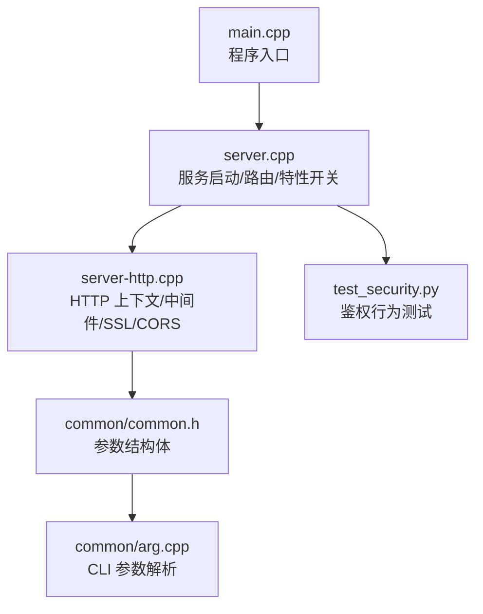
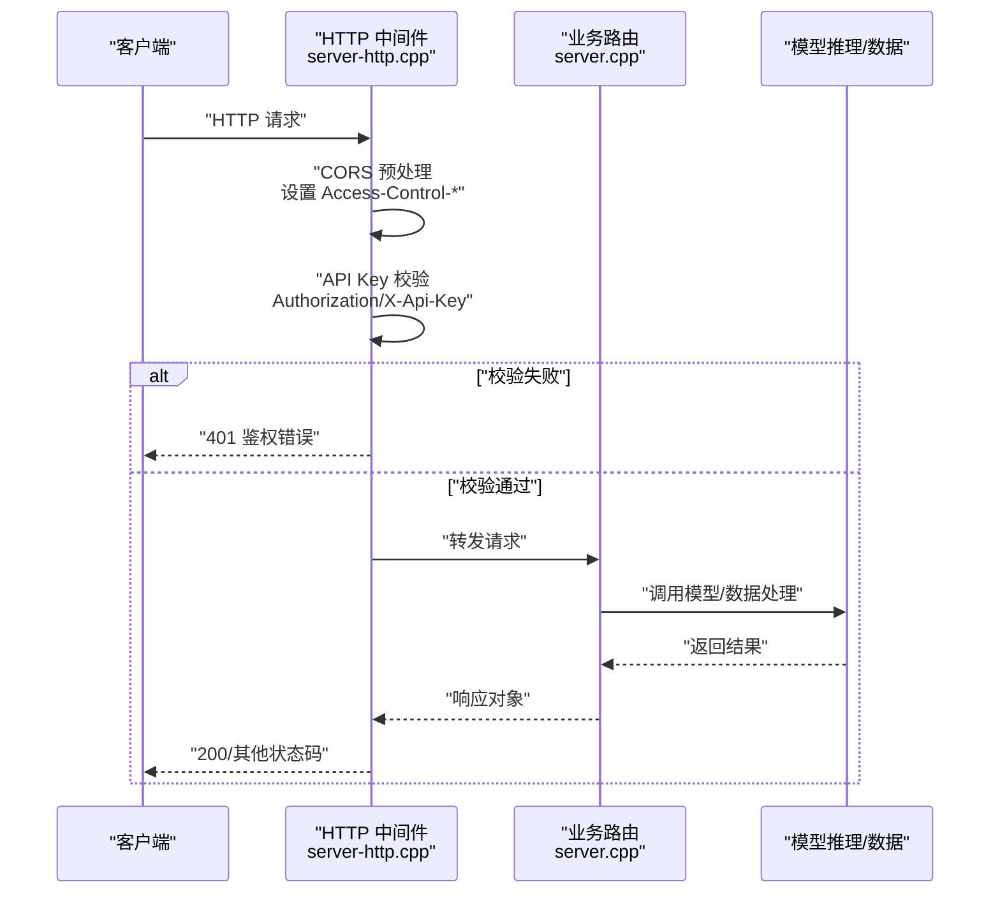
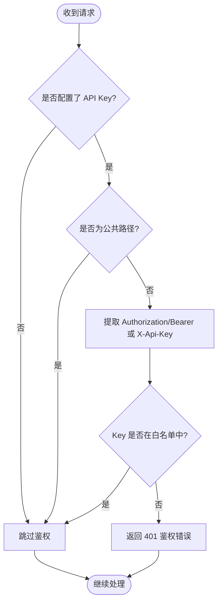
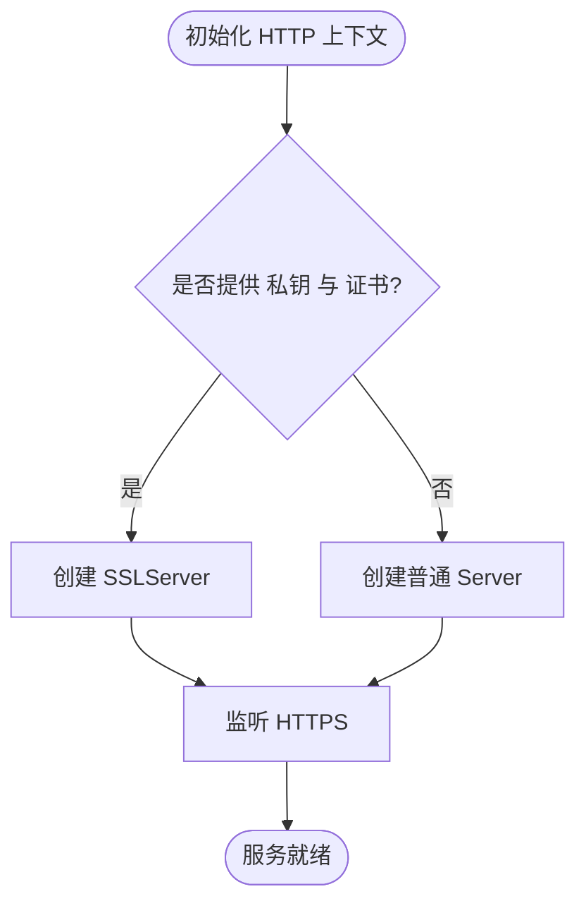
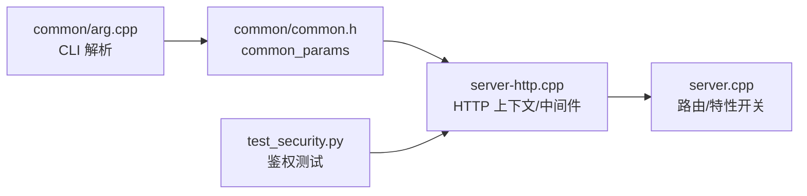

# 安全与认证

<cite>
**本文引用的文件**   
- [tools/server/main.cpp](file://tools/server/main.cpp)
- [tools/server/server.cpp](file://tools/server/server.cpp)
- [tools/server/server-http.h](file://tools/server/server-http.h)
- [tools/server/server-http.cpp](file://tools/server/server-http.cpp)
- [common/common.h](file://common/common.h)
- [common/arg.cpp](file://common/arg.cpp)
- [tests/server/tests/unit/test_security.py](file://tests/server/tests/unit/test_security.py)
</cite>

## 目录
1. [简介](#简介)
2. [项目结构与安全相关入口](#项目结构与安全相关入口)
3. [核心安全组件](#核心安全组件)
4. [架构总览](#架构总览)
5. [详细组件分析](#详细组件分析)
6. [依赖关系分析](#依赖关系分析)
7. [性能与可用性考虑](#性能与可用性考虑)
8. [故障排查指南](#故障排查指南)
9. [结论](#结论)
10. [附录：配置项速查](#附录配置项速查)

## 简介
本文面向 llama.cpp HTTP 服务器的安全与认证机制，聚焦以下主题：
- 支持的认证方式：API 密钥验证（Bearer / X-Api-Key）
- CORS 跨域配置的详细方法与注意事项
- 请求速率限制、IP 白名单、请求大小限制等防护现状与建议
- SSL/TLS 配置指南与安全最佳实践
- 常见安全风险与审计日志建议

需要特别说明的是：当前代码库未内置 JWT 令牌校验或 OAuth 集成；如需这些能力，应通过前置网关或反向代理实现。

## 项目结构与安全相关入口
llama.cpp 的 HTTP 服务器由 tools/server 下的若干模块组成，其中与安全直接相关的核心文件如下：
- server.cpp：服务启动、路由注册、功能开关与安全警告
- server-http.cpp：HTTP 上下文、中间件（CORS、API Key）、SSL 初始化、请求处理
- common/common.h：通用参数定义，包括 CORS、API Key、SSL 等字段
- common/arg.cpp：命令行参数解析，包含 --cors-*、--api-key*、--ssl-* 等
- tests/server/tests/unit/test_security.py：API Key 鉴权行为测试



**图表来源** 
- [tools/server/main.cpp:1-6](file://tools/server/main.cpp#L1-L6)
- [tools/server/server.cpp:93-124](file://tools/server/server.cpp#L93-L124)
- [tools/server/server-http.cpp:111-156](file://tools/server/server-http.cpp#L111-L156)
- [common/common.h:629-667](file://common/common.h#L629-L667)
- [common/arg.cpp:3370-3552](file://common/arg.cpp#L3370-L3552)
- [tests/server/tests/unit/test_security.py:1-46](file://tests/server/tests/unit/test_security.py#L1-L46)

**章节来源**
- [tools/server/main.cpp:1-6](file://tools/server/main.cpp#L1-L6)
- [tools/server/server.cpp:93-124](file://tools/server/server.cpp#L93-L124)
- [tools/server/server-http.cpp:111-156](file://tools/server/server-http.cpp#L111-L156)
- [common/common.h:629-667](file://common/common.h#L629-L667)
- [common/arg.cpp:3370-3552](file://common/arg.cpp#L3370-L3552)
- [tests/server/tests/unit/test_security.py:1-46](file://tests/server/tests/unit/test_security.py#L1-L46)

## 核心安全组件
- API 密钥鉴权中间件：支持 Authorization: Bearer <key> 与 X-Api-Key 两种头部；当未设置 API Key 时跳过校验；公共端点（如 /health、/v1/health 及前端静态资源）无需鉴权。
- CORS 中间件：根据 --cors-origins、--cors-methods、--cors-headers、--cors-credentials 生成响应头；对 OPTIONS 预检请求进行特殊处理；当启用 credentials 且 origins 为 * 时回显 Origin。
- SSL/TLS：当提供 --ssl-key-file 与 --ssl-cert-file 时，使用 OpenSSL 构建的 SSLServer；否则运行明文 HTTP。
- 功能开关与安全警告：当同时允许所有 CORS 且未设置 API Key 时输出安全告警；工具/MCP 代理等高风险特性默认关闭并附带警告。

**章节来源**
- [tools/server/server-http.cpp:229-361](file://tools/server/server-http.cpp#L229-L361)
- [tools/server/server.cpp:340-396](file://tools/server/server.cpp#L340-L396)
- [common/common.h:650-667](file://common/common.h#L650-L667)
- [common/arg.cpp:3370-3552](file://common/arg.cpp#L3370-L3552)

## 架构总览
下图展示了从客户端到服务端的安全处理流程：浏览器/客户端发起请求，经过 HTTP 层中间件（CORS、API Key），再进入业务路由处理器。



**图表来源**
- [tools/server/server-http.cpp:229-361](file://tools/server/server-http.cpp#L229-L361)
- [tools/server/server.cpp:263-304](file://tools/server/server.cpp#L263-L304)

## 详细组件分析

### API 密钥鉴权
- 支持方式
  - Authorization: Bearer <key>
  - X-Api-Key: <key>
- 生效范围
  - 当未配置任何 API Key 时，跳过鉴权
  - 公共端点（/health、/v1/health 以及前端静态资源）不要求鉴权
- 失败响应
  - 返回 401，错误类型为 authentication_error
- 测试覆盖
  - 单元测试覆盖了无 Key、无效 Key 等场景



**图表来源**
- [tools/server/server-http.cpp:260-305](file://tools/server/server-http.cpp#L260-L305)
- [tests/server/tests/unit/test_security.py:36-46](file://tests/server/tests/unit/test_security.py#L36-L46)

**章节来源**
- [tools/server/server-http.cpp:260-305](file://tools/server/server-http.cpp#L260-L305)
- [tests/server/tests/unit/test_security.py:1-46](file://tests/server/tests/unit/test_security.py#L1-L46)

### CORS 跨域配置
- 关键参数
  - --cors-origins：允许的源，支持 "*"、"localhost" 或具体域名列表
  - --cors-methods：允许的 HTTP 方法
  - --cors-headers：允许的请求头
  - --cors-credentials：是否允许携带凭据
- 行为说明
  - 对 OPTIONS 预检请求直接返回空体并设置相应 CORS 头
  - 当启用 credentials 且 origins 为 "*" 时，会回显 Origin 以允许任意来源携带凭据
  - 当 origins 为 "localhost" 时，仅反射 localhost 来源
- 安全提示
  - 若同时允许所有来源且未设置 API Key，将输出安全告警

```mermaid
flowchart TD
Start(["CORS 预处理"]) --> SetOrigin{"--cors-origins 值"}
SetOrigin --> |"*" 且启用凭据"| EchoOrigin["回显 Origin 头"]
SetOrigin --> |"localhost"| LocalhostCheck{"Origin 是否本地地址?"}
LocalhostCheck --> |是| ReflectOrigin["反射 Origin 头"]
LocalhostCheck --> |否| SkipOrigin["忽略非本地来源"]
SetOrigin --> |其他| SetStaticOrigin["设置固定 Allow-Origin"]
EchoOrigin --> Options{"是否为 OPTIONS 预检?"}
ReflectOrigin --> Options
SkipOrigin --> Options
SetStaticOrigin --> Options
Options --> |是| ReturnPreflight["返回空体 + CORS 头"]
Options --> |否| Next["继续后续中间件"]
```

**图表来源**
- [tools/server/server-http.cpp:331-361](file://tools/server/server-http.cpp#L331-L361)
- [common/arg.cpp:3370-3405](file://common/arg.cpp#L3370-L3405)

**章节来源**
- [tools/server/server-http.cpp:331-361](file://tools/server/server-http.cpp#L331-L361)
- [common/arg.cpp:3370-3405](file://common/arg.cpp#L3370-L3405)
- [tools/server/server.cpp:340-342](file://tools/server/server.cpp#L340-L342)

### SSL/TLS 配置
- 启用条件
  - 必须同时提供 --ssl-key-file 与 --ssl-cert-file
  - 编译需启用 OpenSSL 支持（CPPHTTPLIB_OPENSSL_SUPPORT）
- 行为
  - 满足条件时使用 SSLServer 监听 HTTPS
  - 未启用 OpenSSL 但提供了证书/私钥则报错退出
- 建议
  - 生产环境务必启用 TLS，并通过反向代理管理证书生命周期
  - 避免在公网暴露未加密的 HTTP 端口



**图表来源**
- [tools/server/server-http.cpp:161-178](file://tools/server/server-http.cpp#L161-L178)
- [common/arg.cpp:3540-3552](file://common/arg.cpp#L3540-L3552)

**章节来源**
- [tools/server/server-http.cpp:161-178](file://tools/server/server-http.cpp#L161-L178)
- [common/arg.cpp:3540-3552](file://common/arg.cpp#L3540-L3552)

### 速率限制、IP 白名单、请求大小限制
- 现状
  - 代码库未内置请求速率限制、IP 白名单或请求体大小限制
- 建议方案
  - 使用反向代理（Nginx、Envoy、Traefik）或 API 网关实现：
    - 基于 IP/用户/租户维度的速率限制
    - 白名单/黑名单访问控制
    - 请求体大小限制（例如 Nginx client_max_body_size）
  - 结合负载均衡与健康检查，配合服务发现做细粒度限流

[本节为通用建议，不涉及具体源码]

### JWT 与 OAuth 集成
- 现状
  - 未内置 JWT 校验或 OAuth 流程
- 建议方案
  - 在反向代理/API 网关层完成 JWT 签发/校验与 OAuth 授权码流程
  - 将已认证的主体信息透传到后端（例如通过自定义 Header），由业务逻辑消费
  - 若需要在应用内扩展，可在中间件层增加统一鉴权拦截器

[本节为通用建议，不涉及具体源码]

### 审计日志与可观测性
- 现有日志
  - 中间件层记录请求摘要（方法、路径、远端地址、状态码）
  - 异常与错误响应会被记录
- 建议增强
  - 结构化日志（JSON）便于接入集中式日志系统
  - 记录鉴权结果、CORS 决策、TLS 版本与密码套件
  - 对敏感字段脱敏（如 Authorization、Cookie）

**章节来源**
- [tools/server/server-http.cpp:53-71](file://tools/server/server-http.cpp#L53-L71)

## 依赖关系分析
- server.cpp 负责启动服务、注册路由、开启可选功能（MCP、Tools、CORS Proxy），并在特定组合下输出安全告警
- server-http.cpp 实现 HTTP 上下文、中间件链（CORS、API Key）、SSL 初始化与线程池
- common/common.h 定义通用参数结构体，承载 CORS、API Key、SSL 等配置
- common/arg.cpp 解析 CLI 参数，映射到 common_params
- 测试用例验证 API Key 鉴权行为



**图表来源**
- [common/arg.cpp:3370-3552](file://common/arg.cpp#L3370-L3552)
- [common/common.h:629-667](file://common/common.h#L629-L667)
- [tools/server/server-http.cpp:111-156](file://tools/server/server-http.cpp#L111-L156)
- [tools/server/server.cpp:263-304](file://tools/server/server.cpp#L263-L304)
- [tests/server/tests/unit/test_security.py:1-46](file://tests/server/tests/unit/test_security.py#L1-L46)

**章节来源**
- [common/arg.cpp:3370-3552](file://common/arg.cpp#L3370-L3552)
- [common/common.h:629-667](file://common/common.h#L629-L667)
- [tools/server/server-http.cpp:111-156](file://tools/server/server-http.cpp#L111-L156)
- [tools/server/server.cpp:263-304](file://tools/server/server.cpp#L263-L304)
- [tests/server/tests/unit/test_security.py:1-46](file://tests/server/tests/unit/test_security.py#L1-L46)

## 性能与可用性考虑
- 线程模型
  - HTTP 层使用线程池处理请求，默认根据并行度与硬件并发自动计算线程数
- 超时控制
  - 支持读/写超时配置，防止长连接占用资源
- 健康检查
  - /health 与 /v1/health 为公开端点，用于健康检查与负载均衡探测
- 资源隔离
  - 前端静态资源与 API 路由分离，避免鉴权误伤 UI 加载

**章节来源**
- [tools/server/server-http.cpp:149-155](file://tools/server/server-http.cpp#L149-L155)
- [common/common.h:630-635](file://common/common.h#L630-L635)
- [tools/server/server-http.cpp:250-258](file://tools/server/server-http.cpp#L250-L258)

## 故障排查指南
- 401 鉴权失败
  - 确认是否正确传递 Authorization: Bearer 或 X-Api-Key
  - 确认该端点不在公共路径白名单中
  - 参考测试用例中的断言行为
- CORS 预检失败
  - 检查 --cors-origins、--cors-methods、--cors-headers、--cors-credentials 配置
  - 注意 credentials 与 "*" 的组合会回显 Origin
- SSL 无法启动
  - 确认编译启用了 OpenSSL 支持
  - 确认同时提供了私钥与证书文件路径
- 功能安全告警
  - 当允许所有 CORS 且未设置 API Key 时会输出告警
  - 启用 Tools/MCP 代理等高风险特性时会输出告警

**章节来源**
- [tests/server/tests/unit/test_security.py:36-46](file://tests/server/tests/unit/test_security.py#L36-L46)
- [tools/server/server-http.cpp:331-361](file://tools/server/server-http.cpp#L331-L361)
- [tools/server/server-http.cpp:161-178](file://tools/server/server-http.cpp#L161-L178)
- [tools/server/server.cpp:340-396](file://tools/server/server.cpp#L340-L396)

## 结论
- 当前 llama.cpp HTTP 服务器提供基础的 API Key 鉴权与 CORS 控制，并支持通过 OpenSSL 启用 TLS
- 未内置 JWT/OAuth、速率限制、IP 白名单与请求大小限制，建议通过反向代理或 API 网关补齐
- 生产部署应强制启用 TLS、严格限定 CORS 来源、开启鉴权，并结合外部网关实现更完善的安全策略与审计日志

[本节为总结性内容，不涉及具体源码]

## 附录：配置项速查
- API 密钥
  - --api-key：逗号分隔的多 Key 列表
  - --api-key-file：从文件读取 Key（每行一个，支持注释）
- CORS
  - --cors-origins：允许的来源
  - --cors-methods：允许的方法
  - --cors-headers：允许的请求头
  - --cors-credentials：是否允许凭据
- SSL/TLS
  - --ssl-key-file：PEM 私钥文件
  - --ssl-cert-file：PEM 证书文件

**章节来源**
- [common/arg.cpp:3512-3552](file://common/arg.cpp#L3512-L3552)
- [common/arg.cpp:3370-3405](file://common/arg.cpp#L3370-L3405)