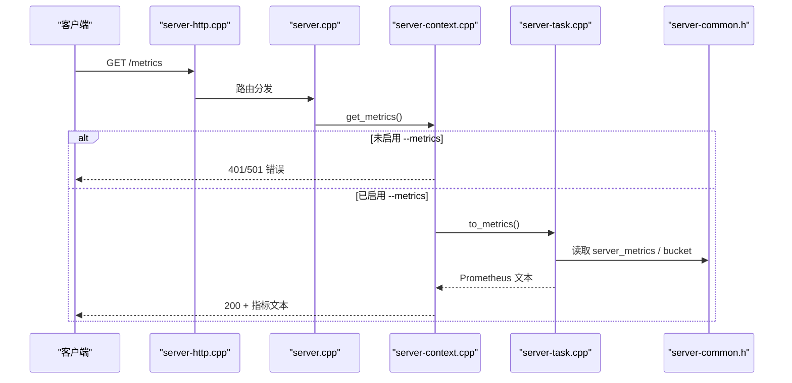
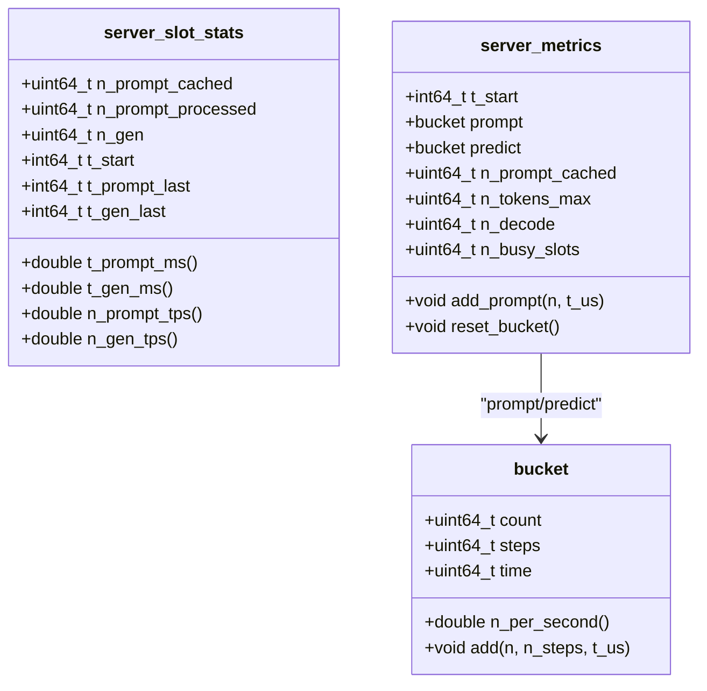
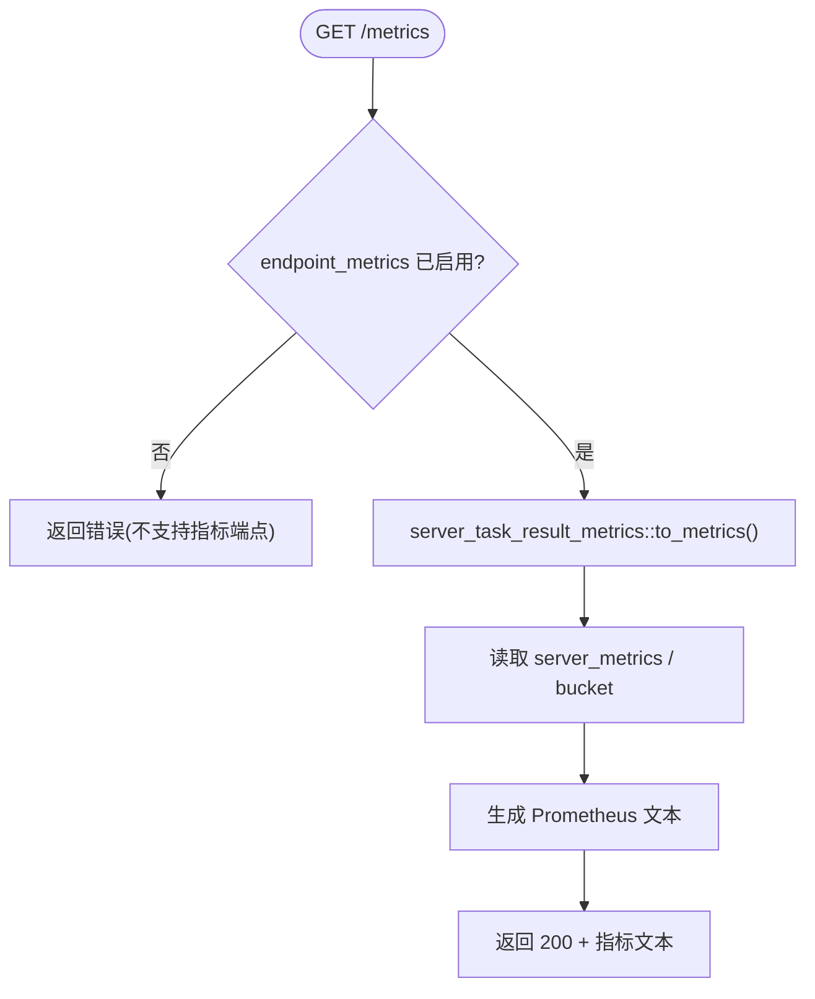
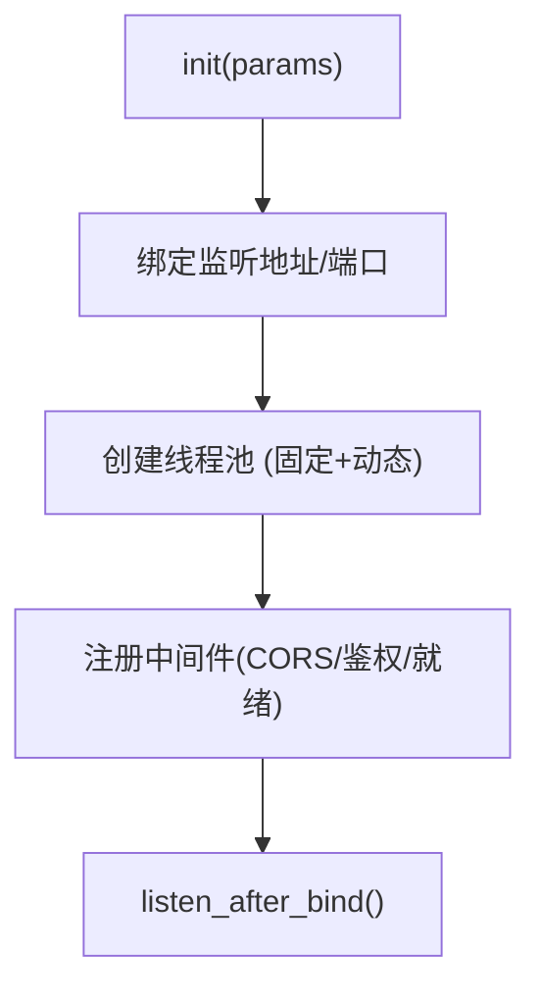
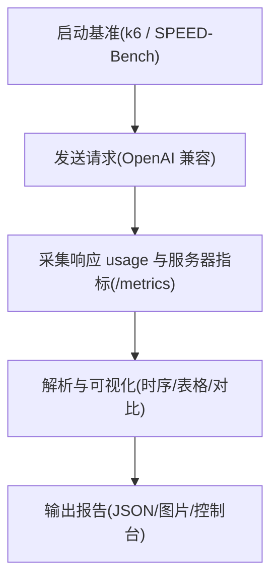
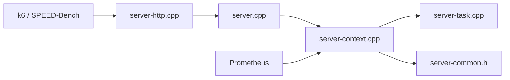

# 性能监控

<cite>
**本文引用的文件**   
- [server-task.cpp](file://tools/server/server-task.cpp)
- [server-common.h](file://tools/server/server-common.h)
- [server-http.cpp](file://tools/server/server-http.cpp)
- [common.h](file://common/common.h)
- [server.cpp](file://tools/server/server.cpp)
- [server-context.cpp](file://tools/server/server-context.cpp)
- [bench.py](file://tools/server/bench/bench.py)
- [README.md（服务器基准）](file://tools/server/bench/README.md)
- [speed-bench README.md](file://tools/server/bench/speed-bench/README.md)
- [test_metrics.py](file://tools/server/tests/unit/test_metrics.py)
- [test_sleep.py](file://tools/server/tests/unit/test_sleep.py)
</cite>

## 目录
1. [简介](#简介)
2. [项目结构](#项目结构)
3. [核心组件](#核心组件)
4. [架构总览](#架构总览)
5. [详细组件分析](#详细组件分析)
6. [依赖关系分析](#依赖关系分析)
7. [性能考量与调优](#性能考量与调优)
8. [故障排查指南](#故障排查指南)
9. [结论](#结论)
10. [附录：指标清单与用法](#附录指标清单与用法)

## 简介
本指南聚焦 llama.cpp HTTP 服务器的性能监控与优化，覆盖以下主题：
- 内置性能指标收集：请求延迟、吞吐量、内存使用、GPU 利用率等关键指标的获取与解读
- Prometheus 集成与自定义指标导出
- 性能基准测试工具与结果分析方法
- 负载均衡配置与多实例部署策略
- 性能调优参数、缓存策略与资源分配建议
- 故障排查与瓶颈识别方法

## 项目结构
与性能监控相关的代码主要位于 tools/server 与 common 模块中：
- server-task.cpp：Prometheus 指标文本生成与任务级统计
- server-common.h：槽位与全局指标数据结构定义
- server-http.cpp：HTTP 层实现、线程池与中间件
- common.h：通用参数（含服务端开关与缓存相关参数）
- server.cpp：路由注册（包含 /metrics）
- server-context.cpp：指标端点处理逻辑与快照机制
- bench.py、bench/README.md、speed-bench README.md：基准测试脚本与说明
- tests：单元测试验证指标行为与休眠场景

```mermaid
graph TB
A["HTTP 客户端"] --> B["server-http.cpp<br/>HTTP 层与线程池"]
B --> C["server.cpp<br/>路由注册 /metrics"]
C --> D["server-context.cpp<br/>指标端点处理"]
D --> E["server-task.cpp<br/>to_metrics() 输出 Prometheus 文本"]
D --> F["server-common.h<br/>server_metrics / bucket 结构"]
D --> G["common.h<br/>参数与开关"]
H["基准测试脚本<br/>bench.py / k6 / speed-bench"] --> A
```

**图表来源**
- [server-http.cpp:111-156](file://tools/server/server-http.cpp#L111-L156)
- [server.cpp:263-266](file://tools/server/server.cpp#L263-L266)
- [server-context.cpp:5194-5212](file://tools/server/server-context.cpp#L5194-L5212)
- [server-task.cpp:1525-1619](file://tools/server/server-task.cpp#L1525-L1619)
- [server-common.h:483-542](file://tools/server/server-common.h#L483-L542)
- [common.h:629-642](file://common/common.h#L629-L642)

**章节来源**
- [server-http.cpp:111-156](file://tools/server/server-http.cpp#L111-L156)
- [server.cpp:263-266](file://tools/server/server.cpp#L263-L266)
- [server-context.cpp:5194-5212](file://tools/server/server-context.cpp#L5194-L5212)
- [server-task.cpp:1525-1619](file://tools/server/server-task.cpp#L1525-L1619)
- [server-common.h:483-542](file://tools/server/server-common.h#L483-L542)
- [common.h:629-642](file://common/common.h#L629-L642)

## 核心组件
- 指标数据结构
  - server_slot_stats：单槽统计（时间戳、步数、吞吐衍生指标）
  - server_metrics：全局累计指标与桶（bucket）速率统计，支持 reset_bucket()
- 指标导出
  - server_task_result_metrics::to_metrics()：将 server_metrics 转换为 Prometheus 文本格式
- HTTP 与路由
  - server_http_context：HTTP 服务初始化、线程池、中间件
  - server.cpp：注册 /metrics 路由
  - server-context.cpp：get_metrics 处理器，控制是否启用指标端点并返回 Prometheus 文本
- 参数与开关
  - common_params.endpoint_metrics：是否启用 /metrics
  - 其他与服务端性能相关的参数（端口、超时、SSE ping、HTTP 线程数、KV 缓存、上下文检查点、RAM 缓存大小等）

**章节来源**
- [server-common.h:394-542](file://tools/server/server-common.h#L394-L542)
- [server-task.cpp:1525-1619](file://tools/server/server-task.cpp#L1525-L1619)
- [server-http.cpp:111-156](file://tools/server/server-http.cpp#L111-L156)
- [server.cpp:263-266](file://tools/server/server.cpp#L263-L266)
- [server-context.cpp:5194-5212](file://tools/server/server-context.cpp#L5194-L5212)
- [common.h:629-642](file://common/common.h#L629-L642)

## 架构总览
下图展示从 HTTP 请求到 Prometheus 指标导出的完整流程。

**图表来源**
- [server-http.cpp:111-156](file://tools/server/server-http.cpp#L111-L156)
- [server.cpp:263-266](file://tools/server/server.cpp#L263-L266)
- [server-context.cpp:5194-5212](file://tools/server/server-context.cpp#L5194-L5212)
- [server-task.cpp:1525-1619](file://tools/server/server-task.cpp#L1525-L1619)
- [server-common.h:483-542](file://tools/server/server-common.h#L483-L542)

## 详细组件分析

### 指标数据模型与计算
- server_slot_stats
  - 记录 prompt/gen 阶段的时间戳与步数，提供 t_prompt_ms/t_gen_ms、n_prompt_tps/n_gen_tps 等衍生指标
- server_metrics
  - 维护累计计数（prompt/predict）、最大序列长度、decode 调用次数、忙槽数、草稿 token 统计
  - 通过 bucket 结构计算短期吞吐率（n_per_second），支持 reset_bucket() 重置窗口
- 指标导出
  - to_metrics() 输出 Prometheus 文本，包括 counters 与 gauges，以及按位置标注的草稿接受计数

**图表来源**
- [server-common.h:394-542](file://tools/server/server-common.h#L394-L542)

**章节来源**
- [server-common.h:394-542](file://tools/server/server-common.h#L394-L542)

### Prometheus 指标导出流程
- 路由注册
  - server.cpp 注册 /metrics 路由
- 端点处理
  - server-context.cpp 的 get_metrics 处理器检查 endpoint_metrics 开关，若未启用则返回错误；否则调用 to_metrics() 生成 Prometheus 文本
- 指标文本
  - server-task.cpp 的 to_metrics() 输出 llamacpp:* 系列指标，包括提示词与生成阶段的计数与速率、请求并发、解码调用次数、草稿接受情况等

**图表来源**
- [server.cpp:263-266](file://tools/server/server.cpp#L263-L266)
- [server-context.cpp:5194-5212](file://tools/server/server-context.cpp#L5194-L5212)
- [server-task.cpp:1525-1619](file://tools/server/server-task.cpp#L1525-L1619)

**章节来源**
- [server.cpp:263-266](file://tools/server/server.cpp#L263-L266)
- [server-context.cpp:5194-5212](file://tools/server/server-context.cpp#L5194-L5212)
- [server-task.cpp:1525-1619](file://tools/server/server-task.cpp#L1525-L1619)

### HTTP 层与线程模型
- server_http_context 负责：
  - 监听地址绑定、SSL/TLS 支持、CORS、API Key 校验
  - 线程池初始化（固定线程 + 动态线程上限）
  - 中间件链（健康检查、就绪状态、CORS、鉴权）
- 默认线程数计算
  - 当 n_threads_http < 1 时，根据并行度与硬件并发自动调整，并预留监控/健康/MCP 线程

**图表来源**
- [server-http.cpp:111-156](file://tools/server/server-http.cpp#L111-L156)
- [server-http.cpp:493-546](file://tools/server/server-http.cpp#L493-L546)

**章节来源**
- [server-http.cpp:111-156](file://tools/server/server-http.cpp#L111-L156)
- [server-http.cpp:493-546](file://tools/server/server-http.cpp#L493-L546)

### 基准测试工具与结果分析
- k6 基准
  - 使用 k6（可带 xk6-sse 扩展）对 OpenAI 兼容接口进行压测
  - 环境变量控制 URL、并发、样本数量、最大 token 等
  - 可从 Prometheus 拉取指标并绘制时序图
- SPEED-Bench
  - 轻量客户端，评估不同类别下的吞吐、延迟与草稿接受率
  - 支持基线与推测解码对比，输出 JSON 并通过比较脚本生成加速比

**图表来源**
- [bench.py:121-140](file://tools/server/bench/bench.py#L121-L140)
- [bench/README.md:1-120](file://tools/server/bench/README.md#L1-L120)
- [speed-bench README.md:1-118](file://tools/server/bench/speed-bench/README.md#L1-L118)

**章节来源**
- [bench.py:121-140](file://tools/server/bench/bench.py#L121-L140)
- [bench/README.md:1-120](file://tools/server/bench/README.md#L1-L120)
- [speed-bench README.md:1-118](file://tools/server/bench/speed-bench/README.md#L1-L118)

## 依赖关系分析
- 组件耦合
  - server-context.cpp 依赖 server-task.cpp 的 to_metrics() 与 server-common.h 的数据结构
  - server.cpp 仅负责路由注册，不直接参与指标计算
  - server-http.cpp 提供 HTTP 基础设施，与指标无关但影响整体吞吐与并发
- 外部依赖
  - Prometheus 抓取 /metrics 端点
  - k6/SPEED-Bench 作为压测客户端

**图表来源**
- [server-http.cpp:111-156](file://tools/server/server-http.cpp#L111-L156)
- [server.cpp:263-266](file://tools/server/server.cpp#L263-L266)
- [server-context.cpp:5194-5212](file://tools/server/server-context.cpp#L5194-L5212)
- [server-task.cpp:1525-1619](file://tools/server/server-task.cpp#L1525-L1619)
- [server-common.h:483-542](file://tools/server/server-common.h#L483-L542)

**章节来源**
- [server-http.cpp:111-156](file://tools/server/server-http.cpp#L111-L156)
- [server.cpp:263-266](file://tools/server/server.cpp#L263-L266)
- [server-context.cpp:5194-5212](file://tools/server/server-context.cpp#L5194-L5212)
- [server-task.cpp:1525-1619](file://tools/server/server-task.cpp#L1525-L1619)
- [server-common.h:483-542](file://tools/server/server-common.h#L483-L542)

## 性能考量与调优

### 关键指标解读
- 提示词处理
  - prompt_tokens_total：实际处理的提示词 token 数（不含缓存命中）
  - prompt_seconds_total：提示词处理总耗时
  - prompt_tokens_seconds：平均提示词吞吐（tokens/s）
- 生成阶段
  - tokens_predicted_total：生成的 token 总数
  - tokens_predicted_seconds_total：生成阶段总耗时
  - predicted_tokens_seconds：平均生成吞吐（tokens/s）
- 系统负载
  - requests_processing：正在处理的请求数
  - requests_deferred：被延期的请求数
  - n_busy_slots_per_decode：每次解码的平均忙碌槽数
- 上下文与解码
  - n_tokens_max：观测到的最大上下文长度
  - n_decode_total：llama_decode() 调用次数（不含推测解码与多模态解码）
- 推测解码
  - spec_decode_num_draft_tokens_total：草稿 token 总数
  - spec_decode_num_accepted_tokens_total：目标模型接受的草稿 token 数
  - spec_decode_num_drafts_total：推测解码验证步骤总数
  - spec_decode_num_accepted_tokens_per_pos_total：按位置的接受计数（带 position 标签）

**章节来源**
- [server-task.cpp:1525-1619](file://tools/server/server-task.cpp#L1525-L1619)
- [README.md（服务器基准）:1125-1149](file://tools/server/README.md#L1125-L1149)

### 内存与 GPU 利用
- 指标层面
  - 当前内置指标未直接暴露进程内存或 GPU 利用率
- 实践建议
  - 结合系统工具（如 nvidia-smi、htop、vmstat）与 Prometheus 节点导出器（node_exporter）采集主机与 GPU 指标
  - 通过 n_tokens_max 与 n_busy_slots_per_decode 间接判断上下文与批处理压力
  - 观察 decode 调用次数与吞吐变化，定位热点路径

[本节为通用指导，无需具体文件引用]

### 缓存策略与 KV 管理
- 参数要点
  - cache_prompt：启用提示词缓存
  - cache_idle_slots：空闲槽保存与清理
  - kv_unified_per_slot：每槽统一 KV 上限
  - checkpoint_min_step：上下文检查点最小间隔
  - cache_ram_mib：RAM 缓存大小限制
- 效果评估
  - 关注 prompt_tokens_cached_total 与 prompt_tokens_seconds 的变化
  - 合理设置 kv_unified_per_slot 与 checkpoint_min_step 以平衡命中率与内存占用

**章节来源**
- [common.h:629-642](file://common/common.h#L629-L642)

### 并发与线程配置
- HTTP 线程
  - n_threads_http：HTTP 请求处理线程数；默认根据并行度与硬件并发自动计算
- 推理并行
  - n_parallel：并行解码序列数
- 建议
  - 在高吞吐场景下，适当提高 n_threads_http 与 n_parallel，并结合 CPU/GPU 利用率调优
  - 避免过度线程导致上下文切换开销增大

**章节来源**
- [server-http.cpp:111-156](file://tools/server/server-http.cpp#L111-L156)
- [common.h:629-642](file://common/common.h#L629-L642)

### 推测解码与吞吐提升
- 指标关联
  - 通过 spec_decode_* 系列指标评估草稿生成与接受情况
- 实践建议
  - 开启合适的推测解码类型（draft model、ngram-mod、MTP、EAGLE3 等）
  - 对比基线与推测解码的 avg_pred_t/s 与 latency_speedup

**章节来源**
- [server-task.cpp:1525-1619](file://tools/server/server-task.cpp#L1525-L1619)
- [speed-bench README.md:66-118](file://tools/server/bench/speed-bench/README.md#L66-L118)

### 负载均衡与多实例部署
- 前端负载均衡
  - 使用 Nginx/HAProxy 等将流量分发至多个 llama-server 实例
  - 每个实例独立启用 --metrics，由 Prometheus 统一抓取
- 实例间一致性
  - 确保各实例模型版本与参数一致，避免路由不一致导致的指标差异
- 健康检查
  - 利用 /health 与 /v1/health 进行存活探测

[本节为通用指导，无需具体文件引用]

## 故障排查指南

### 指标端点不可用
- 现象
  - GET /metrics 返回 501 或 401/403
- 原因
  - 未启用 --metrics（endpoint_metrics=false）
- 解决
  - 启动时添加 --metrics 参数

**章节来源**
- [server-context.cpp:5194-5212](file://tools/server/server-context.cpp#L5194-L5212)
- [test_metrics.py:38-43](file://tools/server/tests/unit/test_metrics.py#L38-L43)

### 吞吐率为零或异常
- 现象
  - prompt_tokens_seconds 或 predicted_tokens_seconds 为零
- 可能原因
  - 服务器进入休眠模式，指标快照不再更新
  - 首次抓取后桶重置，后续无新请求导致速率为零
- 解决
  - 触发一次推理请求唤醒服务器
  - 注意首次抓取会重置桶，后续抓取反映窗口内速率

**章节来源**
- [test_sleep.py:87-127](file://tools/server/tests/unit/test_sleep.py#L87-L127)

### 请求被延期或处理缓慢
- 现象
  - requests_deferred 上升，requests_processing 高
- 可能原因
  - 并发过高、KV 缓存不足、GPU/CPU 资源饱和
- 解决
  - 调整 n_parallel、n_threads_http、kv_unified_per_slot
  - 结合系统工具查看 CPU/GPU 利用率与内存占用

**章节来源**
- [server-task.cpp:1525-1619](file://tools/server/server-task.cpp#L1525-L1619)
- [common.h:629-642](file://common/common.h#L629-L642)

### 推测解码效果不佳
- 现象
  - spec_decode_num_draft_tokens_total 高但 accepted 低
- 可能原因
  - 草稿模型质量或参数不合适
- 解决
  - 调整推测解码类型与参数，参考 SPEED-Bench 对比报告

**章节来源**
- [server-task.cpp:1525-1619](file://tools/server/server-task.cpp#L1525-L1619)
- [speed-bench README.md:66-118](file://tools/server/bench/speed-bench/README.md#L66-L118)

## 结论
llama.cpp HTTP 服务器提供了完善的 Prometheus 指标导出能力，涵盖提示词与生成吞吐、请求并发、解码调用、上下文长度与推测解码等关键维度。通过合理的参数调优、缓存策略与并发配置，结合基准测试工具与系统监控，可有效提升服务性能与稳定性。在多实例部署场景中，配合负载均衡与健康检查可实现高可用与水平扩展。

## 附录：指标清单与用法
- 计数器（Counter）
  - llamacpp:prompt_tokens_total
  - llamacpp:prompt_tokens_cached_total
  - llamacpp:prompt_seconds_total
  - llamacpp:tokens_predicted_total
  - llamacpp:tokens_predicted_seconds_total
  - llamacpp:n_decode_total
  - llamacpp:n_tokens_max
  - llamacpp:spec_decode_num_draft_tokens_total
  - llamacpp:spec_decode_num_accepted_tokens_total
  - llamacpp:spec_decode_num_drafts_total
  - llamacpp:spec_decode_num_accepted_tokens_per_pos_total（带 position 标签）
- 仪表盘（Gauge）
  - llamacpp:prompt_tokens_seconds
  - llamacpp:predicted_tokens_seconds
  - llamacpp:requests_processing
  - llamacpp:requests_deferred
  - llamacpp:n_busy_slots_per_decode

**章节来源**
- [server-task.cpp:1525-1619](file://tools/server/server-task.cpp#L1525-L1619)
- [README.md（服务器基准）:1125-1149](file://tools/server/README.md#L1125-L1149)