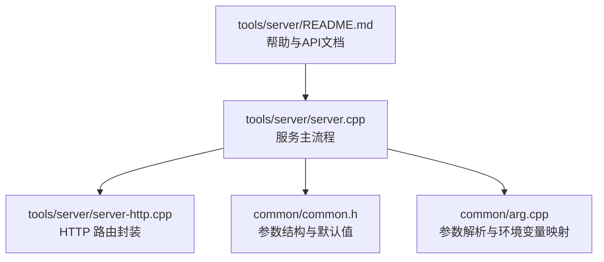
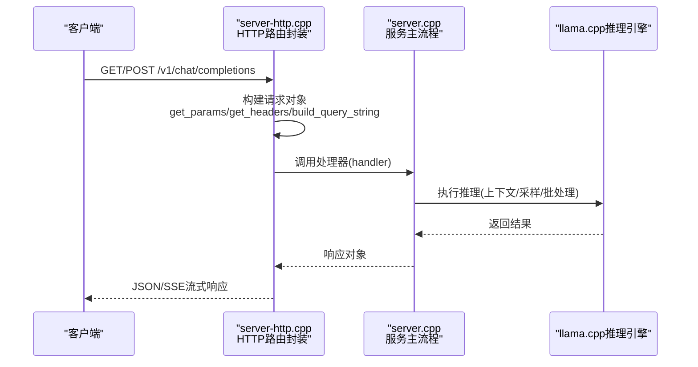
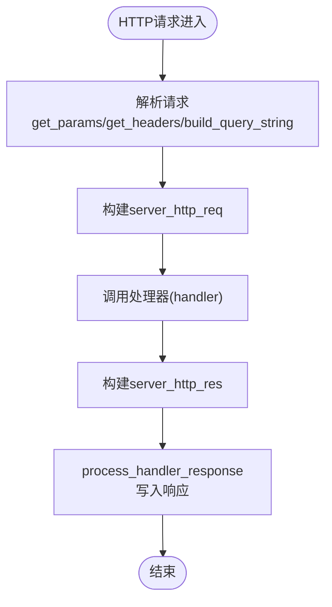
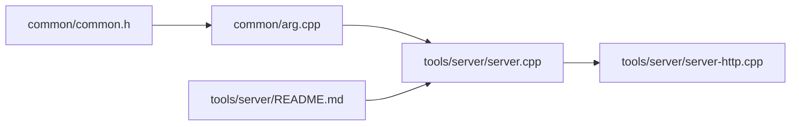

# 服务器配置

<cite>
**本文引用的文件**   
- [tools/server/README.md](file://tools/server/README.md)
- [common/common.h](file://common/common.h)
- [common/arg.cpp](file://common/arg.cpp)
- [tools/server/server-http.cpp](file://tools/server/server-http.cpp)
- [tools/server/server.cpp](file://tools/server/server.cpp)
</cite>

## 目录
1. [简介](#简介)
2. [项目结构](#项目结构)
3. [核心组件](#核心组件)
4. [架构总览](#架构总览)
5. [详细组件分析](#详细组件分析)
6. [依赖关系分析](#依赖关系分析)
7. [性能与并发](#性能与并发)
8. [安全与访问控制](#安全与访问控制)
9. [部署场景与推荐模板](#部署场景与推荐模板)
10. [故障排查](#故障排查)
11. [结论](#结论)

## 简介
本指南面向 llama.cpp HTTP 服务器的配置与使用，覆盖命令行参数、环境变量、配置文件格式、安全相关设置（认证、CORS、访问控制），以及开发、生产与容器化部署的推荐实践。文档内容基于源码与官方服务端说明整理，力求准确、可操作且便于不同技术背景的读者理解。

## 项目结构
llama.cpp 的服务端实现位于 tools/server 目录，核心参数定义与解析逻辑集中在 common/common.h 与 common/arg.cpp；HTTP 路由封装在 tools/server/server-http.cpp；服务主流程入口在 tools/server/server.cpp。服务端帮助文档与 API 说明在 tools/server/README.md。

**图示来源**
- [tools/server/server.cpp:1-50](file://tools/server/server.cpp#L1-L50)
- [tools/server/server-http.cpp:675-766](file://tools/server/server-http.cpp#L675-L766)
- [common/common.h:629-691](file://common/common.h#L629-L691)
- [common/arg.cpp:722-800](file://common/arg.cpp#L722-L800)

**章节来源**
- [tools/server/server.cpp:1-50](file://tools/server/server.cpp#L1-L50)
- [tools/server/server-http.cpp:675-766](file://tools/server/server-http.cpp#L675-L766)
- [common/common.h:629-691](file://common/common.h#L629-L691)
- [common/arg.cpp:722-800](file://common/arg.cpp#L722-L800)
- [tools/server/README.md:1-30](file://tools/server/README.md#L1-L30)

## 核心组件
- 参数结构体：common_params 集中保存所有运行期参数，包括端口、主机、超时、SSE ping、HTTP 线程数、缓存策略、CORS、API Key、SSL、UI、高级端点开关、MCP 与工具等。
- 参数解析器：common_arg 负责将命令行参数与环境变量映射到 common_params，并支持系统级与用户级配置文件加载。
- HTTP 上下文：server_http_context 提供 get/post/del 注册与请求处理封装，统一构建请求对象并调用处理器。
- 服务主循环：server.cpp 初始化信号处理、启动监听、调度任务。

**章节来源**
- [common/common.h:629-691](file://common/common.h#L629-L691)
- [common/arg.cpp:722-800](file://common/arg.cpp#L722-L800)
- [tools/server/server-http.cpp:675-766](file://tools/server/server-http.cpp#L675-L766)
- [tools/server/server.cpp:1-50](file://tools/server/server.cpp#L1-L50)

## 架构总览
下图展示从客户端请求到模型推理的关键路径：客户端通过 HTTP 进入 server-http.cpp 的路由层，交由业务处理器（如聊天、补全、嵌入）处理，最终调用 llama.cpp 推理引擎。

**图示来源**
- [tools/server/server-http.cpp:675-766](file://tools/server/server-http.cpp#L675-L766)
- [tools/server/server.cpp:1-50](file://tools/server/server.cpp#L1-L50)

## 详细组件分析

### 命令行参数与环境变量
- 参数优先级：系统配置文件 < 用户配置文件 < 环境变量 < 命令行参数。
- 配置文件位置：
  - 系统级：/etc/llama.cpp/config.ini（Windows：%PROGRAMDATA%\llama.cpp\config.ini）
  - 用户级：${XDG_CONFIG_HOME:-~/.config}/llama.cpp/config.ini（Windows：%APPDATA%\llama.cpp\config.ini）
- 环境变量命名：LLAMA_ARG_<PARAM_NAME>，例如 LLAMA_ARG_PORT、LLAMA_ARG_THREADS、LLAMA_ARG_MODEL 等。布尔型参数接受 true/false/on/off/enabled/disabled/1/0 等值。

常用参数类别与含义（节选）：
- 网络与监听
  - --host：监听地址或 UNIX socket（.sock），逗号分隔多个 TCP 地址；:: 绑定 IPv6。
  - --port：监听端口，默认 9931。
  - --reuse-port：允许同一端口多套接字绑定。
  - --path：静态资源目录。
  - --api-prefix：API 前缀（不含尾部斜杠）。
- 并发与线程
  - --threads：生成阶段 CPU 线程数。
  - --threads-batch：批处理与提示词处理线程数。
  - --threads-http：HTTP 请求处理线程数。
  - --parallel：并发槽位数（默认 -1 自动）。
  - --cont-batching：启用连续批处理。
- 内存与KV缓存
  - --ctx-size：上下文大小。
  - --kv-unified-per-slot：每槽位上下文上限。
  - --cache-prompt：启用提示词缓存。
  - --cache-reuse：最小重用块大小。
  - --cache-idle-slots：空闲槽位缓存。
  - --cache-ram：RAM 缓存上限（MiB）。
  - --context-shift：无限文本生成时是否上下文移位。
- 模型与设备
  - -m/--model：模型路径。
  - -hf/--hf-repo：Hugging Face 仓库。
  - --device：卸载设备列表。
  - --gpu-layers/--n-gpu-layers：GPU 层数。
  - --split-mode：多卡切分模式。
  - --tensor-split：按 GPU 比例切分。
  - --main-gpu：主 GPU。
  - --fit/--fit-target/--fit-ctx：自适应内存调整。
- 安全与CORS
  - --cors-origins：允许的 Origin 列表（默认 *）。
  - --cors-methods：允许的 HTTP 方法（默认 GET, POST, DELETE, OPTIONS）。
  - --cors-headers：允许的请求头（默认 *）。
  - --cors-credentials：是否允许凭据（默认启用）。
  - --api-key：API Key（可逗号分隔多个）。
  - --api-key-file：API Key 文件路径。
  - --ssl-key-file/--ssl-cert-file：SSL 私钥与证书路径。
- UI 与高级端点
  - --ui/--webui：启用 Web UI。
  - --metrics：Prometheus 指标端点。
  - --props：允许 POST /props 修改全局属性。
  - --slots：暴露槽位监控端点。
- 其他
  - --timeout：读写超时（秒）。
  - --sse-ping-interval：SSE ping 间隔（秒）。
  - --jinja/--no-jinja：Jinja 模板引擎开关。
  - --reasoning-format：思考标签处理格式。
  - --sleep-idle-seconds：空闲后休眠秒数。

注意：当启用 --tools 或 --agent 时，出于安全考虑，--cors-origins 默认会被限制为 localhost，除非显式指定。

**章节来源**
- [common/arg.cpp:722-800](file://common/arg.cpp#L722-L800)
- [common/arg.cpp:3371-3540](file://common/arg.cpp#L3371-L3540)
- [common/common.h:629-691](file://common/common.h#L629-L691)
- [tools/server/README.md:159-305](file://tools/server/README.md#L159-L305)

### 配置文件格式
- 格式：INI 风格，支持全局段与预设段（COMMON_PRESET_DEFAULT_NAME）。
- 加载顺序：系统级 config.ini → 用户级 config.ini，后者覆盖前者。
- 字段映射：与命令行参数一致，例如 port、host、threads、model、cors_origins 等。
- 示例片段（示意）：
  - [global]
    - port = 8080
    - host = 0.0.0.0
    - threads = 4
  - [default]
    - model = ./models/model.gguf
    - ctx_size = 4096
    - cors_origins = http://localhost:3000

**章节来源**
- [common/arg.cpp:722-766](file://common/arg.cpp#L722-L766)

### HTTP 路由与请求处理
- server_http_context 提供统一的 get/post/del 注册接口，内部封装 httplib 请求对象，提取查询参数、头部、路径与 body，构造 server_http_req 并调用处理器。
- 处理器返回 server_http_res，再由 process_handler_response 统一写入响应。

**图示来源**
- [tools/server/server-http.cpp:675-766](file://tools/server/server-http.cpp#L675-L766)

**章节来源**
- [tools/server/server-http.cpp:675-766](file://tools/server/server-http.cpp#L675-L766)

### 服务主流程与信号处理
- server.cpp 定义信号处理函数，捕获中断信号以优雅关闭服务；二次中断强制退出。
- 初始化日志、参数解析、启动监听、注册路由、调度任务。

**章节来源**
- [tools/server/server.cpp:1-50](file://tools/server/server.cpp#L1-L50)

## 依赖关系分析
- common/common.h：定义 common_params 结构体，集中管理所有运行期参数与默认值。
- common/arg.cpp：实现参数解析、环境变量读取、配置文件加载与合并。
- tools/server/server-http.cpp：封装 HTTP 路由与请求处理。
- tools/server/server.cpp：服务主流程与生命周期管理。
- tools/server/README.md：帮助文档与 API 规范。

**图示来源**
- [common/common.h:629-691](file://common/common.h#L629-L691)
- [common/arg.cpp:722-800](file://common/arg.cpp#L722-L800)
- [tools/server/server.cpp:1-50](file://tools/server/server.cpp#L1-L50)
- [tools/server/server-http.cpp:675-766](file://tools/server/server-http.cpp#L675-L766)
- [tools/server/README.md:1-30](file://tools/server/README.md#L1-L30)

**章节来源**
- [common/common.h:629-691](file://common/common.h#L629-L691)
- [common/arg.cpp:722-800](file://common/arg.cpp#L722-L800)
- [tools/server/server.cpp:1-50](file://tools/server/server.cpp#L1-L50)
- [tools/server/server-http.cpp:675-766](file://tools/server/server-http.cpp#L675-L766)
- [tools/server/README.md:1-30](file://tools/server/README.md#L1-L30)

## 性能与并发
- 线程与批处理
  - --threads：生成阶段 CPU 线程数。
  - --threads-batch：批处理与提示词处理线程数。
  - --threads-http：HTTP 请求处理线程数。
  - --parallel：并发槽位数（影响 KV 缓存与批处理容量）。
  - --cont-batching：启用连续批处理以提升吞吐。
- KV 缓存与复用
  - --ctx-size：上下文大小。
  - --kv-unified-per-slot：每槽位上下文上限。
  - --cache-prompt：启用提示词缓存。
  - --cache-reuse：最小重用块大小。
  - --cache-idle-slots：空闲槽位缓存。
  - --cache-ram：RAM 缓存上限（MiB）。
  - --context-shift：无限文本生成时上下文移位。
- 设备与内存适配
  - --device/--gpu-layers/--split-mode/--tensor-split/--main-gpu：设备与切分策略。
  - --fit/--fit-target/--fit-ctx：自适应内存调整，避免 OOM。
- SSE 与超时
  - --sse-ping-interval：SSE ping 间隔。
  - --timeout：读写超时（秒）。

建议：
- 高并发场景下增大 --parallel 与 --threads，同时合理设置 --ctx-size 与 --cache-ram。
- 使用 --cont-batching 提升吞吐，结合 --cache-prompt 减少重复计算。
- 根据硬件选择 --device 与 --split-mode，必要时启用 --fit 自动适配。

**章节来源**
- [common/common.h:629-691](file://common/common.h#L629-L691)
- [tools/server/README.md:159-305](file://tools/server/README.md#L159-L305)

## 安全与访问控制
- API Key 认证
  - --api-key：支持多个 Key（逗号分隔）。
  - --api-key-file：Key 文件路径，每行一个 Key，注释以 # 开头。
- CORS 设置
  - --cors-origins：允许的 Origin 列表（默认 *）。
  - --cors-methods：允许的 HTTP 方法（默认 GET, POST, DELETE, OPTIONS）。
  - --cors-headers：允许的请求头（默认 *）。
  - --cors-credentials：是否允许凭据（默认启用）。
  - 注意：启用 --tools 或 --agent 时，--cors-origins 默认被限制为 localhost，除非显式指定。
- SSL/TLS
  - --ssl-key-file：PEM 私钥路径。
  - --ssl-cert-file：PEM 证书路径。
- 高级端点保护
  - --metrics：Prometheus 指标端点（默认禁用）。
  - --props：允许 POST /props 修改全局属性（默认禁用）。
  - --slots：槽位监控端点（默认启用，可通过 --no-slots 禁用）。
- 访问控制清单（ACL）
  - 当前实现未提供内置 ACL；建议通过反向代理（Nginx、Traefik、Cloudflare）进行 IP 白名单、速率限制与身份校验。

最佳实践：
- 生产环境务必启用 --api-key 或 --api-key-file，并结合反向代理进行 TLS 终止与访问控制。
- 明确设置 --cors-origins 为前端域名，避免使用 *。
- 谨慎启用 --tools 与 --agent，仅在可信环境中开启。

**章节来源**
- [common/arg.cpp:3371-3540](file://common/arg.cpp#L3371-L3540)
- [common/common.h:629-691](file://common/common.h#L629-L691)
- [tools/server/README.md:392-406](file://tools/server/README.md#L392-L406)

## 部署场景与推荐模板

### 开发环境
- 目标：快速验证功能，本地调试。
- 推荐配置：
  - --host 127.0.0.1
  - --port 9931
  - --threads 4
  - --ctx-size 2048
  - --parallel -1（自动）
  - --cont-batching on
  - --cache-prompt on
  - --cors-origins localhost
  - --ui on
  - --metrics off
  - --props off
  - --slots on
- 说明：仅本机访问，启用 Web UI 便于调试，关闭不必要的高级端点。

**章节来源**
- [tools/server/README.md:432-458](file://tools/server/README.md#L432-L458)
- [common/common.h:629-691](file://common/common.h#L629-L691)

### 生产环境
- 目标：稳定、安全、高性能。
- 推荐配置：
  - --host 0.0.0.0（由反向代理暴露）
  - --port 8080
  - --threads N（根据CPU核数）
  - --threads-http N（根据QPS）
  - --ctx-size 4096（根据模型与需求）
  - --parallel M（根据内存与GPU）
  - --cont-batching on
  - --cache-prompt on
  - --cache-ram 8192（MiB）
  - --cors-origins https://your-domain.com
  - --cors-credentials false（如需跨域凭据则按需开启）
  - --api-key-file /etc/llama.cpp/api_keys.txt
  - --ssl-key-file /etc/llama.cpp/privkey.pem
  - --ssl-cert-file /etc/llama.cpp/fullchain.pem
  - --metrics on（配合Prometheus）
  - --props off
  - --slots on
- 说明：通过反向代理进行 TLS 终止与访问控制，启用指标监控，严格限制 CORS。

**章节来源**
- [tools/server/README.md:432-458](file://tools/server/README.md#L432-L458)
- [common/arg.cpp:3371-3540](file://common/arg.cpp#L3371-L3540)
- [common/common.h:629-691](file://common/common.h#L629-L691)

### 容器化部署（Docker）
- 镜像：ghcr.io/ggml-org/llama.cpp:server 或 server-cuda。
- 端口映射：-p 8080:8080。
- 卷挂载：-v /path/to/models:/models。
- 环境变量：
  - LLAMA_ARG_MODEL=/models/model.gguf
  - LLAMA_ARG_CTX_SIZE=4096
  - LLAMA_ARG_N_PARALLEL=2
  - LLAMA_ARG_ENDPOINT_METRICS=1
  - LLAMA_ARG_PORT=8080
  - LLAMA_API_KEY=sk-your-key
- 示例命令：
  - docker run -p 8080:8080 -v /path/to/models:/models ghcr.io/ggml-org/llama.cpp:server -m models/model.gguf -c 4096 --host 0.0.0.0 --port 8080
  - docker run -p 8080:8080 -v /path/to/models:/models --gpus all ghcr.io/ggml-org/llama.cpp:server-cuda -m models/model.gguf -c 4096 --host 0.0.0.0 --port 8080 --n-gpu-layers 99

**章节来源**
- [tools/server/README.md:451-458](file://tools/server/README.md#L451-L458)
- [tools/server/README.md:321-338](file://tools/server/README.md#L321-L338)

## 故障排查
- 无法启动监听
  - 检查 --host 与 --port 是否正确，端口是否被占用。
  - 确认 --reuse-port 是否需要启用。
- 模型加载失败
  - 检查 --model 路径或 --hf-repo 是否正确。
  - 查看日志级别 --log-verbosity 与 --log-jsonl。
- 并发不足或OOM
  - 调整 --parallel、--threads、--ctx-size、--cache-ram。
  - 启用 --fit 自动适配内存。
- CORS 错误
  - 检查 --cors-origins 是否包含前端域名。
  - 若启用 --tools 或 --agent，确认是否显式设置 --cors-origins。
- API Key 无效
  - 检查 --api-key 或 --api-key-file 配置。
  - 确认客户端 Authorization 头是否正确。
- SSL 握手失败
  - 检查 --ssl-key-file 与 --ssl-cert-file 路径与权限。
  - 确保证书链完整。

**章节来源**
- [common/arg.cpp:3371-3540](file://common/arg.cpp#L3371-L3540)
- [common/common.h:629-691](file://common/common.h#L629-L691)
- [tools/server/README.md:392-406](file://tools/server/README.md#L392-L406)

## 结论
llama.cpp HTTP 服务器提供了丰富的命令行参数与环境变量配置，支持灵活的模型加载、并发控制、内存管理与安全设置。通过合理的参数组合与反向代理集成，可在开发、生产与容器化环境中获得稳定高效的推理服务。建议在生产环境中严格配置 API Key、CORS 与 SSL，并启用指标监控以便运维与优化。