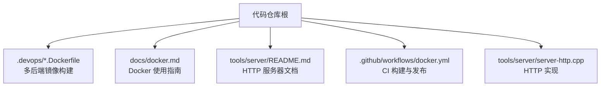
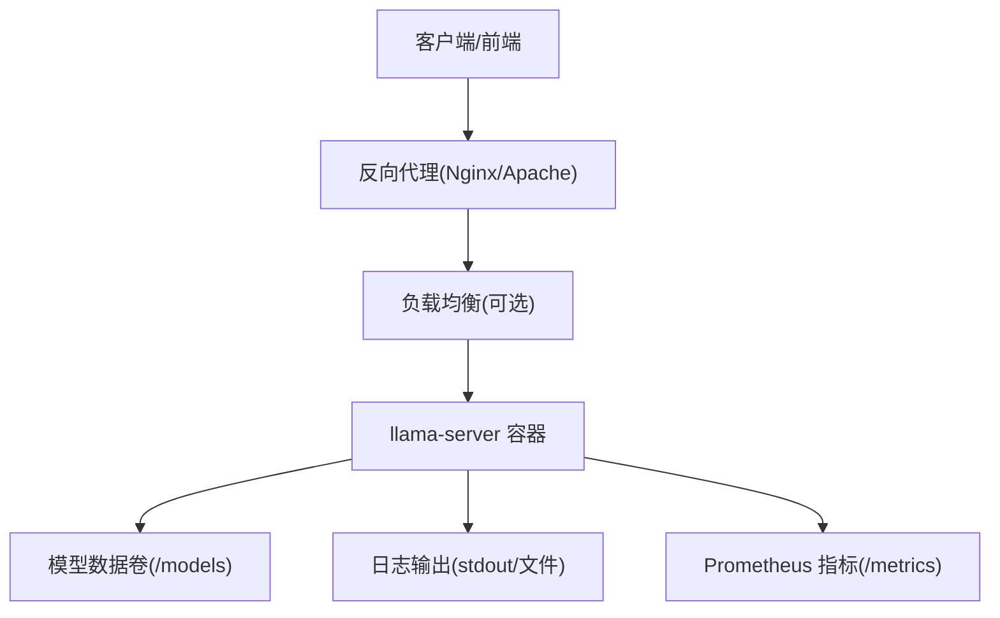
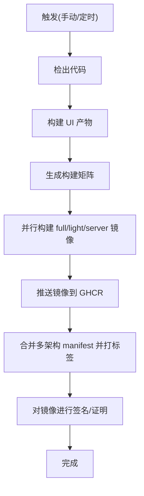
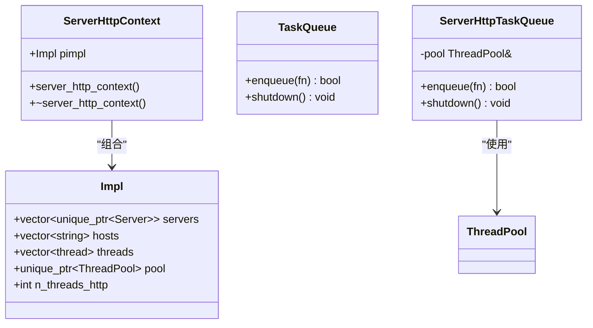
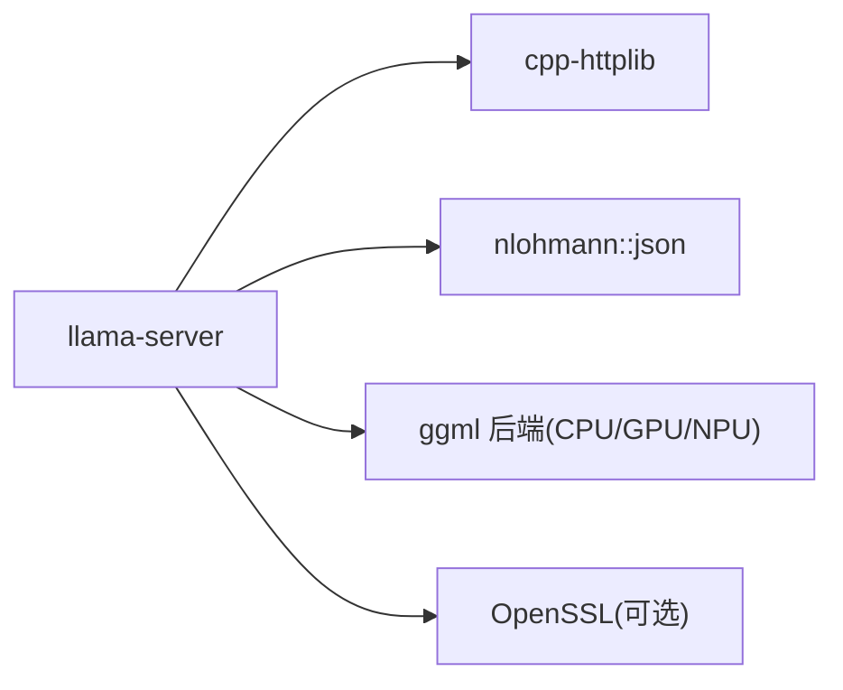

# 部署指南

<cite>
**本文引用的文件**   
- [README.md](file://README.md)
- [docs/docker.md](file://docs/docker.md)
- [.devops/cpu.Dockerfile](file://.devops/cpu.Dockerfile)
- [.devops/cuda.Dockerfile](file://.devops/cuda.Dockerfile)
- [.github/workflows/docker.yml](file://.github/workflows/docker.yml)
- [tools/server/README.md](file://tools/server/README.md)
- [tools/server/server-http.cpp](file://tools/server/server-http.cpp)
</cite>

## 目录
1. [简介](#简介)
2. [项目结构](#项目结构)
3. [核心组件](#核心组件)
4. [架构总览](#架构总览)
5. [详细组件分析](#详细组件分析)
6. [依赖关系分析](#依赖关系分析)
7. [性能与容量规划](#性能与容量规划)
8. [故障排查指南](#故障排查指南)
9. [结论](#结论)
10. [附录：生产化清单](#附录生产化清单)

## 简介
本指南面向需要在容器、Kubernetes、云服务以及反向代理环境下部署 llama.cpp HTTP 服务器的工程师与运维人员。文档覆盖镜像构建、环境变量配置、数据卷挂载、CI/CD 流水线、反向代理与负载均衡、监控告警与日志收集等生产级主题，并给出可操作的步骤与参考路径。

llama.cpp 提供轻量、高性能的 C/C++ LLM 推理能力，其内置 HTTP 服务器支持 OpenAI 兼容 API、Anthropic Messages API、多模态、函数调用、连续批处理、SSE 流式输出、Prometheus 指标端点等特性，适合在多种硬件后端（CPU/GPU/NPU）上运行。

**章节来源**
- [README.md:20-45](file://README.md#L20-L45)

## 项目结构
从部署视角，关键目录与文件如下：
- .devops/*.Dockerfile：多架构、多后端（CPU/CUDA/MUSA/SYCL/Vulkan/OpenVINO/ROCm 等）的 Docker 镜像构建定义
- docs/docker.md：官方 Docker 使用说明与示例
- tools/server/README.md：HTTP 服务器参数、API 与用法说明
- .github/workflows/docker.yml：GitHub Actions 多矩阵构建与发布镜像的 CI 流程
- tools/server/server-http.cpp：HTTP 服务实现（基于 cpp-httplib）

**图示来源**
- [.devops/cpu.Dockerfile:1-126](file://.devops/cpu.Dockerfile#L1-L126)
- [.devops/cuda.Dockerfile:1-135](file://.devops/cuda.Dockerfile#L1-L135)
- [docs/docker.md:1-179](file://docs/docker.md#L1-L179)
- [tools/server/README.md:1-800](file://tools/server/README.md#L1-L800)
- [.github/workflows/docker.yml:1-576](file://.github/workflows/docker.yml#L1-L576)
- [tools/server/server-http.cpp:1-51](file://tools/server/server-http.cpp#L1-L51)

**章节来源**
- [docs/docker.md:1-179](file://docs/docker.md#L1-L179)
- [tools/server/README.md:1-800](file://tools/server/README.md#L1-L800)

## 核心组件
- HTTP 服务器进程：llama-server，暴露 REST API 与 Web UI
- 模型加载器：根据 GGUF 权重与元数据初始化上下文、KV Cache、采样器等
- 后端执行引擎：ggml 抽象层 + 具体后端（CPU/GPU/NPU），通过 CMake 选项启用
- 工具链与脚本：tools.sh、Python 转换脚本、UI 构建产物
- 监控与可观测性：健康检查 /health、Prometheus 指标端点、JSONL 日志

**章节来源**
- [tools/server/README.md:1-800](file://tools/server/README.md#L1-L800)
- [tools/server/server-http.cpp:1-51](file://tools/server/server-http.cpp#L1-L51)

## 架构总览
下图展示典型部署拓扑：客户端通过反向代理访问 llama-server；模型权重与中间文件通过数据卷持久化；可选地开启 Prometheus 指标采集与结构化日志。

[此图为概念性拓扑，不直接映射到具体源码文件]

## 详细组件分析

### Docker 镜像与构建
- 预构建镜像族：full/light/server，以及带 CUDA/MUSA/SYCL/Vulkan/OpenVINO/ROCm 变体
- 多架构支持：linux/amd64、linux/arm64、linux/s390x
- 构建目标：full（含 CLI 与转换工具）、light（仅 CLI）、server（仅 HTTP 服务）
- GPU 运行时：CUDA 需 nvidia-container-toolkit；MUSA 需 mthreads runtime；SYCL 需设备节点映射

关键要点：
- server 镜像默认监听 0.0.0.0:8080，并提供 HEALTHCHECK
- 可通过 --gpus all 或 --device 将 GPU 资源透传到容器
- 模型与中间产物建议挂载到宿主目录以复用

**章节来源**
- [docs/docker.md:1-179](file://docs/docker.md#L1-L179)
- [.devops/cpu.Dockerfile:113-126](file://.devops/cpu.Dockerfile#L113-L126)
- [.devops/cuda.Dockerfile:122-135](file://.devops/cuda.Dockerfile#L122-L135)

### 环境变量与启动参数
- 常用环境变量（对应命令行参数）：LLAMA_ARG_HOST、LLAMA_ARG_PORT、LLAMA_ARG_MODEL、LLAMA_ARG_CTX_SIZE、LLAMA_ARG_N_PARALLEL、LLAMA_ARG_ENDPOINT_METRICS、LLAMA_API_KEY 等
- 布尔型与环境变量映射遵循统一约定（true/false/on/off/enabled/1/0）
- 推荐通过 docker-compose 管理环境变量与数据卷

示例（compose 片段）：
- 设置 LLAMA_ARG_MODEL=/models/my_model.gguf
- 设置 LLAMA_ARG_ENDPOINT_METRICS=1 以启用 Prometheus 指标
- 设置 LLAMA_API_KEY 用于鉴权

**章节来源**
- [tools/server/README.md:30-338](file://tools/server/README.md#L30-L338)

### 数据卷与模型管理
- 模型目录：/models（容器内路径），宿主机路径按需映射
- 中间缓存：prompt cache、slot KV 缓存等可按需启用与落盘
- 媒体文件：--media-path 指定本地媒体目录，供多模态请求使用

**章节来源**
- [tools/server/README.md:159-229](file://tools/server/README.md#L159-L229)

### Kubernetes 部署与 Helm
- 官方未提供 Helm Chart，但可使用标准 Deployment/Service/ConfigMap/Secret/PersistentVolumeClaim 进行编排
- 建议：
  - 使用 Secret 存储 LLAMA_API_KEY
  - 使用 ConfigMap 注入启动参数或配置文件
  - 使用 PVC 挂载模型目录
  - 使用 Service 暴露端口（如 8080）
  - 使用 Ingress 接入反向代理
  - 使用 HorizontalPodAutoscaler 按 CPU/内存/QPS 扩缩容
  - 使用 PodDisruptionBudget 保障滚动更新

[本节为通用实践指导，不直接引用源码文件]

### 云服务部署（AWS/GCP/Azure）
- AWS
  - EC2/EKS：挂载 EBS/EFS 作为模型盘；EKS 使用 NodeGroup 选择 GPU 实例类型；ALB/NGINX Ingress 暴露服务
  - ECS/Fargate：Fargate 不支持 GPU，建议使用 EC2 或 EKS
- GCP
  - GKE：使用 GPU 节点池；GCS 挂载或通过 CSI 驱动挂载模型盘；Ingress 暴露
- Azure
  - AKS：GPU 节点池；Azure Files/Managed Disks 挂载模型盘；Application Gateway/NGINX Ingress 暴露

[本节为通用实践指导，不直接引用源码文件]

### 反向代理与负载均衡
- Nginx
  - 转发 /v1/*、/completion、/chat/completions 等至 llama-server
  - 配置超时、缓冲、SSE 支持（proxy_buffering off;）
  - 可选 TLS 终止与 CORS 头
- Apache
  - 使用 mod_proxy_http 与 mod_headers 转发请求
  - 注意长连接与 SSE 场景下的超时与缓冲设置

[本节为通用实践指导，不直接引用源码文件]

### CI/CD 流水线与自动化
- GitHub Actions 工作流 .github/workflows/docker.yml
  - 触发方式：手动触发、定时任务（每日重建）
  - 矩阵构建：CPU/CUDA/MUSA/SYCL/Vulkan/ROCm/OpenVINO 多平台
  - 产物：full/light/server 三种镜像，按 digest 推送并创建多架构 manifest
  - 签名与注解：OCI 注解、Attestation（完整/精简/服务端镜像）

**图示来源**
- [.github/workflows/docker.yml:10-31](file://.github/workflows/docker.yml#L10-L31)
- [.github/workflows/docker.yml:71-144](file://.github/workflows/docker.yml#L71-L144)
- [.github/workflows/docker.yml:246-355](file://.github/workflows/docker.yml#L246-L355)
- [.github/workflows/docker.yml:400-576](file://.github/workflows/docker.yml#L400-L576)

**章节来源**
- [.github/workflows/docker.yml:1-576](file://.github/workflows/docker.yml#L1-L576)

### HTTP 服务器实现概览
- 基于 cpp-httplib 的多线程 HTTP 服务器
- 每个监听地址一个 httplib::Server，共享 ThreadPool
- 优雅关闭：析构时尝试 stop() 与 join()，避免线程泄漏

**图示来源**
- [tools/server/server-http.cpp:19-35](file://tools/server/server-http.cpp#L19-L35)
- [tools/server/server-http.cpp:37-51](file://tools/server/server-http.cpp#L37-L51)

**章节来源**
- [tools/server/server-http.cpp:1-51](file://tools/server/server-http.cpp#L1-L51)

## 依赖关系分析
- 运行时依赖
  - CPU：libgomp1、curl、ffmpeg（部分功能）
  - GPU：nvidia-container-toolkit（CUDA）、mthreads runtime（MUSA）、Intel GPU 驱动（SYCL）
- 构建依赖
  - CMake、GCC/Clang、OpenSSL（可选 SSL）、Python（转换工具）
- 外部库
  - cpp-httplib（HTTP 服务器）
  - nlohmann/json（JSON 解析）
  - ggml（底层张量计算）

**图示来源**
- [README.md:128-135](file://README.md#L128-L135)
- [.devops/cpu.Dockerfile:24-27](file://.devops/cpu.Dockerfile#L24-L27)
- [.devops/cuda.Dockerfile:34-37](file://.devops/cuda.Dockerfile#L34-L37)

**章节来源**
- [README.md:128-135](file://README.md#L128-L135)
- [.devops/cpu.Dockerfile:24-27](file://.devops/cpu.Dockerfile#L24-L27)
- [.devops/cuda.Dockerfile:34-37](file://.devops/cuda.Dockerfile#L34-L37)

## 性能与容量规划
- 并发与吞吐
  - 调整 --threads、--threads-batch、--threads-http、--parallel、--cont-batching
  - 合理设置 --ctx-size、--ubatch-size、--batch-size
- 显存与内存
  - 使用 --n-gpu-layers、--tensor-split、--split-mode 控制 GPU 卸载
  - 启用 KV 缓存优化：--kv-unified、--cache-idle-slots、--cache-prompt、--cache-reuse
- NUMA 与亲和性
  - 使用 --numa、--cpu-mask、--cpu-range 绑定 CPU 核
- 量化与格式
  - 优先使用 GGUF 量化模型（Q4_K_M 等）以降低内存占用
- 监控与调优
  - 启用 --metrics 暴露 Prometheus 指标
  - 使用 JSONL 日志（--log-jsonl）便于集中采集与分析

[本节为通用实践指导，不直接引用源码文件]

## 故障排查指南
- 健康检查失败
  - 确认容器内 curl 可达 /health，端口与 host 绑定正确
  - 检查模型是否成功加载（/health 返回 503 表示加载中）
- 无法访问模型
  - 校验数据卷挂载路径与权限
  - 若使用 HF 下载，检查网络与 HF_TOKEN
- GPU 不可用
  - CUDA：确认 nvidia-container-toolkit 安装与 --gpus all
  - MUSA：确认 mthreads runtime 与 --n-gpu-layers
  - SYCL：确认 /dev/dri 设备映射与主机驱动
- 反向代理问题
  - 确保代理开启 SSE 支持（Nginx proxy_buffering off）
  - 检查超时与缓冲配置，避免中断长响应
- 指标与日志
  - 确认 --metrics 已启用，/metrics 可访问
  - 使用 --log-jsonl 输出结构化日志，配合日志系统（ELK/Loki）

**章节来源**
- [tools/server/README.md:471-484](file://tools/server/README.md#L471-L484)
- [docs/docker.md:75-108](file://docs/docker.md#L75-L108)
- [.devops/cpu.Dockerfile:123-126](file://.devops/cpu.Dockerfile#L123-L126)

## 结论
通过容器化与 CI/CD 流水线，llama.cpp HTTP 服务器可在多种硬件与云平台稳定运行。结合反向代理、负载均衡、监控与日志体系，可实现高可用、可扩展的生产环境。建议在上线前完成容量规划、压测与回滚演练，并持续优化参数与资源配额。

[本节为总结性内容，不直接引用源码文件]

## 附录：生产化清单
- 镜像与版本
  - 固定镜像标签或 digest，启用 OCI 注解与 Attestation
- 安全与鉴权
  - 设置 LLAMA_API_KEY，限制 CORS 来源
  - 通过反向代理启用 TLS 与访问控制
- 数据与缓存
  - 模型盘使用高性能存储（SSD/NVMe），启用 prompt cache 与 slot KV 缓存
- 可观测性
  - 启用 /metrics 与 JSONL 日志，接入 Prometheus 与日志系统
- 弹性与高可用
  - HPA/HSM 自动扩缩容，PDB 保证可用性，滚动更新策略
- 备份与恢复
  - 定期备份模型与缓存，制定灾难恢复流程

[本节为通用实践指导，不直接引用源码文件]