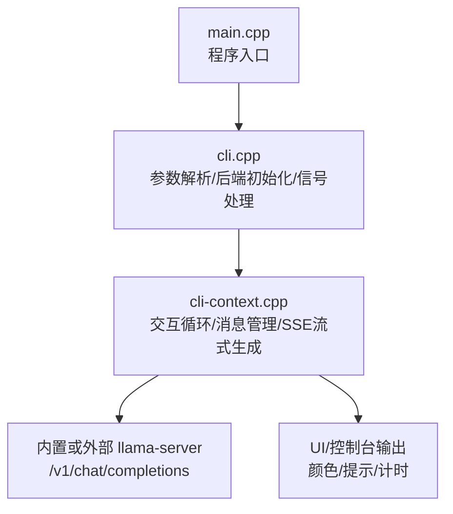
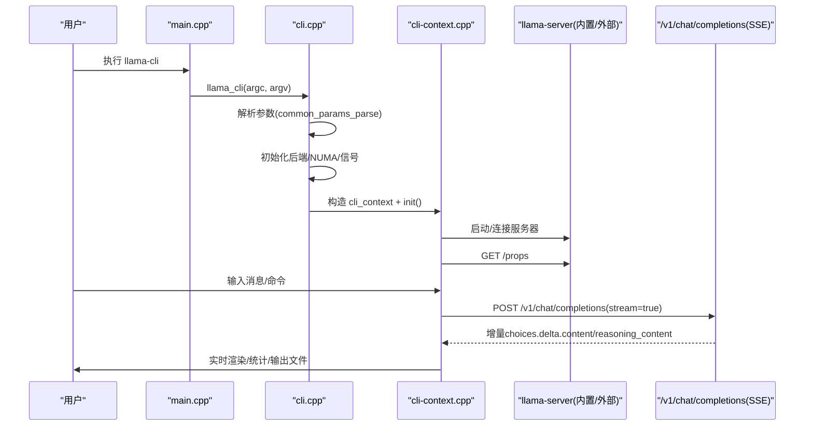
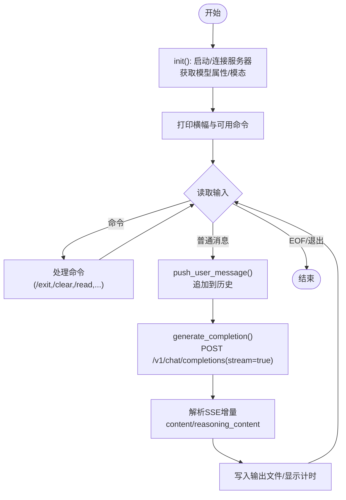
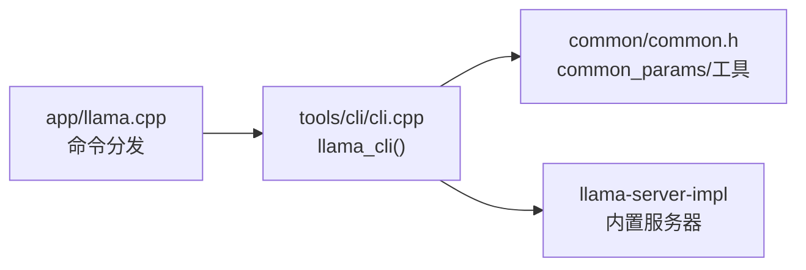

# 命令行工具

<cite>
**本文引用的文件**   
- [README.md](file://README.md)
- [tools/cli/README.md](file://tools/cli/README.md)
- [tools/cli/main.cpp](file://tools/cli/main.cpp)
- [tools/cli/cli.cpp](file://tools/cli/cli.cpp)
- [tools/cli/cli-context.cpp](file://tools/cli/cli-context.cpp)
- [common/common.h](file://common/common.h)
- [app/llama.cpp](file://app/llama.cpp)
</cite>

## 目录
1. [简介](#简介)
2. [项目结构](#项目结构)
3. [核心组件](#核心组件)
4. [架构总览](#架构总览)
5. [详细组件分析](#详细组件分析)
6. [依赖关系分析](#依赖关系分析)
7. [性能与参数调优](#性能与参数调优)
8. [故障排除指南](#故障排除指南)
9. [结论](#结论)
10. [附录：常用命令速查](#附录常用命令速查)

## 简介
本文件面向 llama.cpp 的命令行工具，重点围绕 llama-cli 的使用与原理，覆盖以下主题：
- 交互式对话模式（聊天、多轮、单轮）
- 批量文本生成（批处理大小、上下文窗口等）
- 参数配置选项（采样、设备、KV缓存、推理加速等）
- 输出格式控制（流式输出、计时信息、日志、JSONL 等）
- 输入输出处理机制（分词器、模板、媒体附件、流式响应）
- 常见问题与性能优化建议

llama-cli 是“命令行的交互接口”，默认会启动一个内置服务器并与其通信；也可以连接外部已运行的 llama-server。

**章节来源**
- [README.md:20-45](file://README.md#L20-L45)

## 项目结构
与 llama-cli 直接相关的代码位于 tools/cli 目录，主入口 main.cpp 仅转发到实现函数；cli.cpp 负责参数解析、后端初始化、信号处理与上下文创建；cli-context.cpp 实现交互循环、消息管理、SSE 流式生成、多媒体附件与命令解析。

**图示来源**
- [tools/cli/main.cpp:1-5](file://tools/cli/main.cpp#L1-L5)
- [tools/cli/cli.cpp:33-67](file://tools/cli/cli.cpp#L33-L67)
- [tools/cli/cli-context.cpp:94-183](file://tools/cli/cli-context.cpp#L94-L183)

**章节来源**
- [tools/cli/main.cpp:1-5](file://tools/cli/main.cpp#L1-L5)
- [tools/cli/cli.cpp:33-67](file://tools/cli/cli.cpp#L33-L67)
- [tools/cli/cli-context.cpp:94-183](file://tools/cli/cli-context.cpp#L94-L183)

## 核心组件
- 参数体系 common_params：集中定义线程、批大小、上下文、RoPE/YaRN、KV缓存类型、GPU层数、拆分策略、LoRA、控制向量、采样、推测解码、视频/图像参数、服务器参数、CLI特有开关等。
- CLI 生命周期：main -> llama_cli -> 解析参数 -> 初始化后端/NUMA -> 注册信号 -> 构造 cli_context -> init() -> run()。
- 交互上下文 cli_context：负责选择/连接服务器、获取模型属性、维护消息历史、处理用户命令（/exit, /clear, /read, /glob, /image, /audio, /video）、通过 SSE 调用 /v1/chat/completions 进行流式生成、写入输出文件、显示计时。

**章节来源**
- [common/common.h:455-770](file://common/common.h#L455-L770)
- [tools/cli/cli.cpp:33-67](file://tools/cli/cli.cpp#L33-L67)
- [tools/cli/cli-context.cpp:94-183](file://tools/cli/cli-context.cpp#L94-L183)

## 架构总览
llama-cli 的运行流程如下：

**图示来源**
- [tools/cli/main.cpp:1-5](file://tools/cli/main.cpp#L1-L5)
- [tools/cli/cli.cpp:33-67](file://tools/cli/cli.cpp#L33-L67)
- [tools/cli/cli-context.cpp:350-411](file://tools/cli/cli-context.cpp#L350-L411)
- [tools/cli/cli-context.cpp:413-670](file://tools/cli/cli-context.cpp#L413-L670)

## 详细组件分析

### 参数解析与运行入口
- main.cpp 将 argc/argv 交给 llama_cli。
- cli.cpp 中：
  - 设置默认日志级别为错误级，减少噪音。
  - 调用 common_init 初始化公共子系统。
  - 调用 common_params_parse 解析所有命令行参数到 common_params。
  - 初始化后端与 NUMA。
  - 注册 SIGINT/SIGTERM 处理器，支持 Ctrl+C 中断。
  - 构造 cli_context 并调用 init()/run()。

**章节来源**
- [tools/cli/main.cpp:1-5](file://tools/cli/main.cpp#L1-L5)
- [tools/cli/cli.cpp:33-67](file://tools/cli/cli.cpp#L33-L67)

### 交互上下文与对话循环
- init()：
  - 若指定 --server-base，则连接外部服务器；否则启动内置服务器并等待就绪。
  - 校验健康状态，必要时列出可用模型供选择。
  - 获取 /props 以了解模型别名、ftype、构建信息与模态能力（vision/audio/video）。
  - 打开可选的输出文件。
- run()：
  - 打印横幅（构建信息、模型名、模态、系统提示、可用命令）。
  - 进入主循环：读取用户输入（支持多行），处理命令（/exit, /regen, /clear, /read, /glob, /image, /audio, /video），将用户消息加入历史。
  - 调用 generate_completion 发起流式请求，解析 delta 中的 content 与 reasoning_content，更新 UI 与输出文件。
  - 根据 show_timings 显示 prompt/generation 速度。
  - single_turn 模式下只处理一轮即退出。

**图示来源**
- [tools/cli/cli-context.cpp:94-183](file://tools/cli/cli-context.cpp#L94-L183)
- [tools/cli/cli-context.cpp:413-670](file://tools/cli/cli-context.cpp#L413-L670)
- [tools/cli/cli-context.cpp:350-411](file://tools/cli/cli-context.cpp#L350-L411)

**章节来源**
- [tools/cli/cli-context.cpp:94-183](file://tools/cli/cli-context.cpp#L94-L183)
- [tools/cli/cli-context.cpp:413-670](file://tools/cli/cli-context.cpp#L413-L670)

### 输入输出处理机制
- 分词与模板：
  - 通过 common_chat_templates_init 初始化聊天模板（Jinja 引擎可启用/禁用）。
  - 系统提示通过 system_prompt 注入为 system 角色消息。
  - 用户消息可为纯文本或多模态内容（图片/音频/视频），媒体先 base64 编码后作为 content 的一部分发送。
- 流式输出：
  - 使用 stream=true 和 timings_per_token=true 获取增量内容与每 token 计时。
  - 对 reasoning_content 与 content 分别累积，并在 UI 上区分显示。
- 输出文件：
  - 支持 -o/--output-file 将用户与助手消息写入文件，包含思考块标记与换行。
- 日志与 JSONL：
  - 支持 --log-jsonl 将日志输出为 JSONL 到 stdout，同时禁用彩色日志。
  - 支持 --log-colors、--log-prefix、--log-timestamps 控制日志样式。

**章节来源**
- [tools/cli/cli-context.cpp:278-341](file://tools/cli/cli-context.cpp#L278-L341)
- [tools/cli/cli-context.cpp:350-411](file://tools/cli/cli-context.cpp#L350-L411)
- [tools/cli/cli-context.cpp:640-653](file://tools/cli/cli-context.cpp#L640-L653)
- [tools/cli/README.md:89-97](file://tools/cli/README.md#L89-L97)

### 交互式对话模式
- 多轮对话：默认开启，维护 messages 历史，支持 /clear 清空、/regen 重生成上一条。
- 单轮对话：-st/--single-turn 一次交互后退出。
- 反向提示：-r/--reverse-prompt 可在生成时遇到特定字符串返回交互模式（在通用示例中常见；CLI 内部主要基于消息历史驱动）。
- 多模态输入：
  - 支持 --image/--audio/--video 传入媒体文件，自动识别类型并 base64 编码。
  - 也可在交互中使用 /image /audio /video 命令添加媒体。
- 思维/推理：
  - 支持 --reasoning-format、--reasoning、--reasoning-budget 等控制推理标签的解析与预算。

**章节来源**
- [tools/cli/cli-context.cpp:413-670](file://tools/cli/cli-context.cpp#L413-L670)
- [tools/cli/README.md:152-184](file://tools/cli/README.md#L152-L184)

### 批量文本生成与上下文
- 上下文大小：-c/--ctx-size 控制上下文长度；n_ctx_train 来自模型训练上下文。
- 批处理：
  - -b/--batch-size 逻辑最大批大小（用于 prompt 处理）。
  - -ub/--ubatch-size 物理最大批大小。
- 并行序列：-np/--parallel 控制并行解码数量。
- KV 缓存：
  - -kvo/--kv-offload 控制是否启用 KV offload。
  - -ctk/--cache-type-k 与 -ctv/--cache-type-v 控制 K/V 数据类型。
- RoPE/YaRN：
  - --rope-scaling、--rope-scale、--rope-freq-base、--rope-freq-scale。
  - --yarn-orig-ctx、--yarn-ext-factor、--yarn-attn-factor、--yarn-beta-slow、--yarn-beta-fast。

**章节来源**
- [common/common.h:455-510](file://common/common.h#L455-L510)
- [tools/cli/README.md:29-50](file://tools/cli/README.md#L29-L50)

### 采样参数与输出格式控制
- 采样链：--samplers 指定采样器顺序；--sampler-seq 提供简化序列。
- 温度与核采样：--temperature、--top-k、--top-p、--min-p、--typical、--xtc-*、--adaptive-*。
- 重复惩罚：--repeat-last-n、--repeat-penalty、--presence-penalty、--frequency-penalty。
- DRY：--dry-multiplier、--dry-base、--dry-allowed-length、--dry-penalty-last-n、--dry-sequence-breaker。
- Mirostat：--mirostat、--mirostat-lr、--mirostat-ent。
- Logit bias 与语法约束：-l/--logit-bias、--grammar、--grammar-file、-j/--json-schema、-jf/--json-schema-file。
- 输出控制：
  - -co/--color 控制颜色。
  - -sp/--special 输出特殊 token。
  - --show-timings 显示每次响应的计时。
  - --simple-io 提升子进程/受限控制台兼容性。

**章节来源**
- [tools/cli/README.md:102-140](file://tools/cli/README.md#L102-L140)
- [tools/cli/README.md:142-184](file://tools/cli/README.md#L142-L184)
- [common/common.h:227-303](file://common/common.h#L227-L303)

### 设备、内存与加载模式
- 设备与 GPU：
  - -dev/--device 指定设备列表。
  - -ngl/--gpu-layers 指定 GPU 层数。
  - -sm/--split-mode 多卡拆分模式（none/layer/row/tensor）。
  - -ts/--tensor-split 按 GPU 分配比例。
  - -mg/--main-gpu 主 GPU。
- 内存与加载：
  - -lm/--load-mode 加载模式（auto/none/mmap/mlock/dio）。
  - -lzm/--lazy-mode 按需读取张量。
  - --op-offload/--no-op-offload 主机算子是否 offload。
  - --fit/--fit-target/--fit-ctx 自动适配显存。
- MoE/FFN：
  - -cmoe/--cpu-moe、-ncmoe/--n-cpu-moe、-ncffn/--n-cpu-ffn。
  - --moe-cache-mib 控制 CPU 侧专家缓存大小。

**章节来源**
- [tools/cli/README.md:58-77](file://tools/cli/README.md#L58-L77)
- [tools/cli/README.md:61-74](file://tools/cli/README.md#L61-L74)
- [common/common.h:477-510](file://common/common.h#L477-L510)

### 推测解码（Speculative Decoding）
- 类型：--spec-type 支持 draft-simple/eagle3/mtp/dflash/dspark/ngram-simple/map-k/map-k4v/mod/cache 等。
- Draft 模型：--spec-draft-model、--spec-draft-hf、--spec-draft-ngl、--spec-draft-device 等。
- ngram 系列：--spec-ngram-mod-n-min/max/match、--spec-ngram-simple-size-n/m/min-hits、--spec-ngram-map-k* 等。
- 合成指标（基准）：--spec-synth-len、--spec-synth-rates。

**章节来源**
- [tools/cli/README.md:186-226](file://tools/cli/README.md#L186-L226)

### 多模态与媒体处理
- 投影器：-mm/--mmproj、-mmu/--mmproj-url、--mmproj-auto/--no-mmproj、--mmproj-offload、-mmdev/--mmproj-device。
- 媒体输入：--image/--audio/--video，支持逗号分隔多个文件。
- 视觉动态分辨率：--image-min-tokens、--image-max-tokens。
- 视频：--video-fps、--video-timestamp-interval、--video-ffmpeg-dir。

**章节来源**
- [tools/cli/README.md:161-171](file://tools/cli/README.md#L161-L171)
- [tools/cli/cli-context.cpp:306-341](file://tools/cli/cli-context.cpp#L306-L341)

## 依赖关系分析
- app/llama.cpp 将“cli”命令映射到 llama_cli 函数，作为统一入口分发。
- tools/cli/CMakeLists.txt 定义 llama-cli 可执行目标与 llama-cli-impl 库，后者链接 llama-server-impl 与 llama-common。
- common/common.h 提供统一的参数结构与工具函数，被 CLI 与服务端共享。

**图示来源**
- [app/llama.cpp:64-75](file://app/llama.cpp#L64-L75)
- [tools/cli/CMakeLists.txt:1-27](file://tools/cli/CMakeLists.txt#L1-L27)
- [common/common.h:455-770](file://common/common.h#L455-L770)

**章节来源**
- [app/llama.cpp:64-75](file://app/llama.cpp#L64-L75)
- [tools/cli/CMakeLists.txt:1-27](file://tools/cli/CMakeLists.txt#L1-L27)
- [common/common.h:455-770](file://common/common.h#L455-L770)

## 性能与参数调优
- 线程与亲和性：
  - -t/--threads、-tb/--threads-batch、-C/--cpu-mask、-Cr/--cpu-range、--cpu-strict、--prio、--poll。
  - 批处理亲和性与优先级：-Cb/-Crb/--cpu-strict-batch/--prio-batch/--poll-batch。
- 批大小与上下文：
  - -b/--batch-size、-ub/--ubatch-size、-c/--ctx-size。
  - 合理增大 batch/ubatch 可提升吞吐，但需匹配显存与上下文。
- Flash Attention：
  - -fa/--flash-attn on/off/auto，通常开启可显著提升速度。
- KV 缓存与 offload：
  - -kvo/--kv-offload、-ctk/--cache-type-k、-ctv/--cache-type-v。
  - 降低 KV 精度可节省显存，但可能影响质量。
- GPU 层数与拆分：
  - -ngl/--gpu-layers、-sm/--split-mode、-ts/--tensor-split、-mg/--main-gpu。
  - 尽量将更多层放入 VRAM，或使用 row/tensor 拆分提高吞吐。
- 自适应与拟合：
  - --fit/--fit-target/--fit-ctx 自动调整未设置的参数以适应显存。
- 推测解码：
  - 选择合适的 spec-type 与 draft 模型，平衡速度与质量。
- 日志与计时：
  - --show-timings 观察 prompt/generation 速度，定位瓶颈。

**章节来源**
- [tools/cli/README.md:17-37](file://tools/cli/README.md#L17-L37)
- [tools/cli/README.md:58-77](file://tools/cli/README.md#L58-L77)
- [tools/cli/README.md:152-154](file://tools/cli/README.md#L152-L154)

## 故障排除指南
- 未指定模型：
  - 现象：启动时报错“no model specified”。
  - 解决：使用 -m <file.gguf> 或 -hf <user/repo>，或 --server-base <url> 连接已有服务。
- 服务器不可用：
  - 现象：wait_health 失败或 /props 不可用。
  - 解决：检查 server-base URL 是否正确；确认服务端已启动且端口可达。
- 媒体文件无法打开：
  - 现象：/image /audio /video 报错“file does not exist or cannot be opened”。
  - 解决：确认路径正确、权限足够；确保扩展名与类型匹配。
- 上下文溢出：
  - 现象：生成过程中提示上下文不足。
  - 解决：增大 -c/--ctx-size，或减少输入长度；启用 context shift（--context-shift）。
- 输出乱码或兼容性问题：
  - 现象：在受限控制台或子进程中显示异常。
  - 解决：使用 --simple-io 关闭高级 IO；必要时禁用颜色 --color off。
- 日志过多或过少：
  - 现象：调试困难或日志缺失。
  - 解决：调整 -v/--verbose 或 --log-verbosity；启用 --log-jsonl 便于解析；--log-prefix/--log-timestamps 辅助定位。

**章节来源**
- [tools/cli/cli-context.cpp:109-133](file://tools/cli/cli-context.cpp#L109-L133)
- [tools/cli/cli-context.cpp:185-207](file://tools/cli/cli-context.cpp#L185-L207)
- [tools/cli/cli-context.cpp:306-341](file://tools/cli/cli-context.cpp#L306-L341)
- [tools/cli/README.md:147-184](file://tools/cli/README.md#L147-L184)

## 结论
llama-cli 提供了从简单文本生成到复杂多模态对话的一站式命令行体验。通过丰富的参数体系，用户可以灵活控制上下文、批处理、采样、设备与内存、推测解码与输出格式。结合内置/外部服务器与 SSE 流式响应，既能满足交互式对话，也能支撑批量生成与自动化流水线。建议在真实场景中依据硬件条件与任务需求，逐步调优线程、批大小、Flash Attention、KV 缓存与 GPU 层数，以获得最佳性能与稳定性。

## 附录：常用命令速查
- 基础运行
  - llama cli -hf <user/repo[:quant]>
  - llama cli -m <model.gguf> -p "<prompt>"
- 交互与对话
  - llama cli -m <model.gguf> -sys "<system prompt>"
  - llama cli -m <model.gguf> -st （单轮）
  - llama cli -m <model.gguf> -r "<reverse prompt>"
- 批量与上下文
  - llama cli -m <model.gguf> -c <ctx> -b <batch> -ub <ubatch>
- 采样与输出
  - llama cli -m <model.gguf> --temperature <T> --top-p 
 --top-k <K>
  - llama cli -m <model.gguf> --show-timings --color auto
- 设备与加速
  - llama cli -m <model.gguf> -ngl all -fa on
  - llama cli -m <model.gguf> -dev 0,1 -sm layer -ts 1,1
- 多模态
  - llama cli -m <model.gguf> --image img1.jpg --audio a.wav
- 推测解码
  - llama cli -m <model.gguf> --spec-type draft-simple --spec-draft-model <draft.gguf>

**章节来源**
- [README.md:37-45](file://README.md#L37-L45)
- [tools/cli/README.md:29-184](file://tools/cli/README.md#L29-L184)