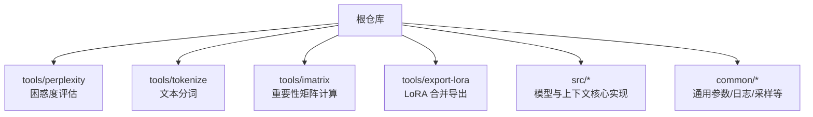
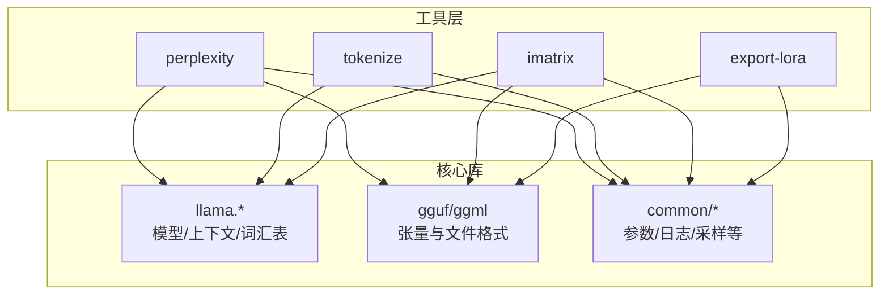
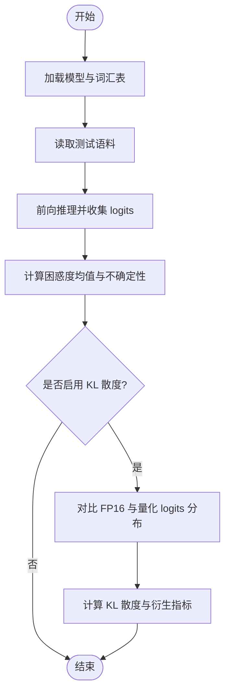
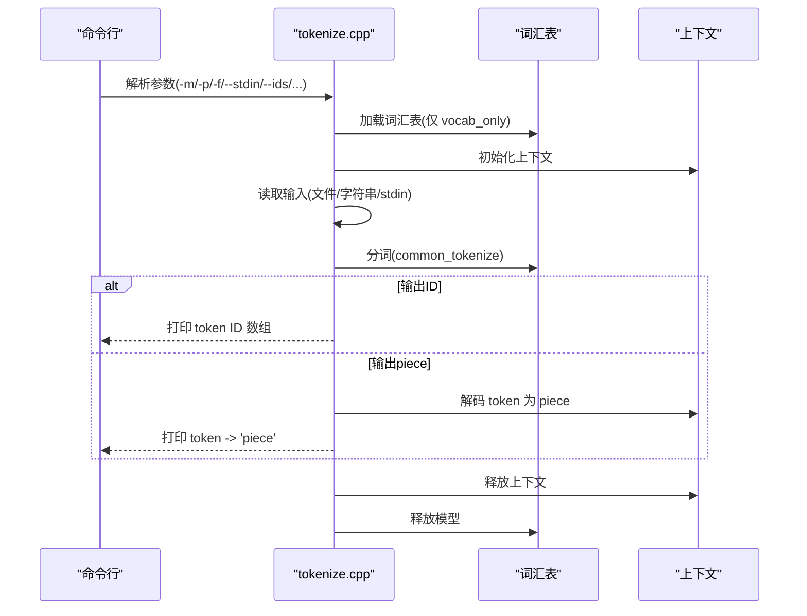
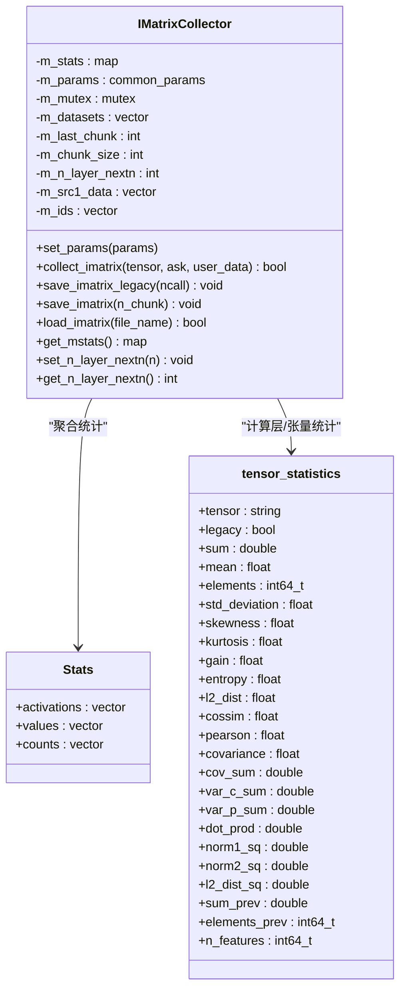
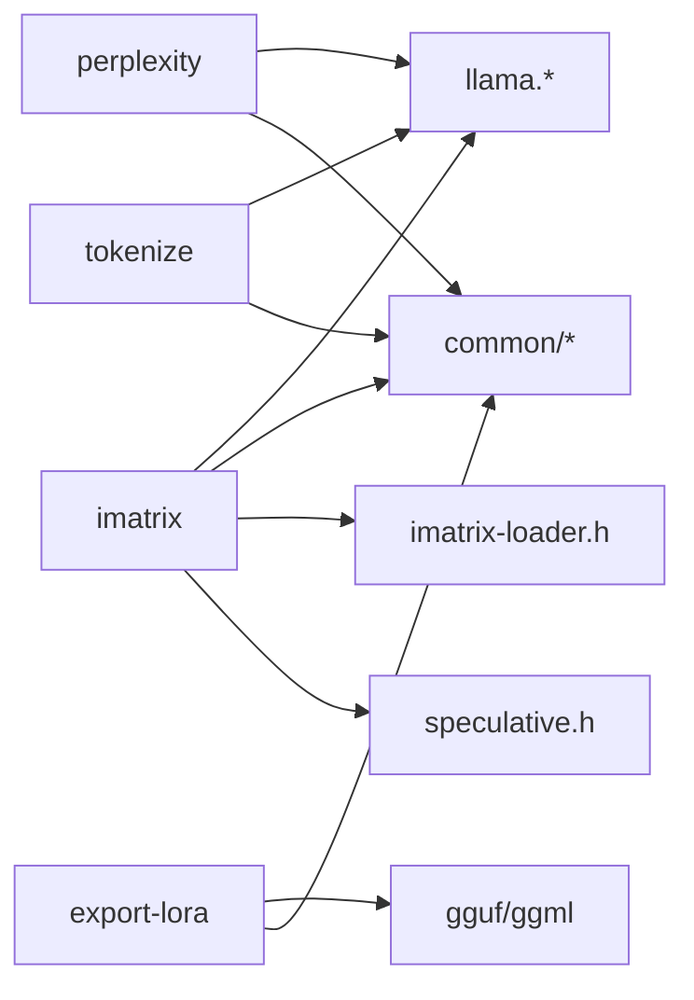

# 实用工具

<cite>
**本文引用的文件**   
- [README.md](file://README.md)
- [tools/perplexity/README.md](file://tools/perplexity/README.md)
- [tools/perplexity/main.cpp](file://tools/perplexity/main.cpp)
- [tools/tokenize/tokenize.cpp](file://tools/tokenize/tokenize.cpp)
- [tools/imatrix/README.md](file://tools/imatrix/README.md)
- [tools/imatrix/imatrix.cpp](file://tools/imatrix/imatrix.cpp)
- [tools/export-lora/README.md](file://tools/export-lora/README.md)
- [tools/export-lora/export-lora.cpp](file://tools/export-lora/export-lora.cpp)
</cite>

## 目录
1. [简介](#简介)
2. [项目结构](#项目结构)
3. [核心工具总览](#核心工具总览)
4. [架构概览](#架构概览)
5. [详细组件分析](#详细组件分析)
6. [依赖关系分析](#依赖关系分析)
7. [性能与使用建议](#性能与使用建议)
8. [故障排查指南](#故障排查指南)
9. [结论](#结论)
10. [附录：参数速查](#附录参数速查)

## 简介
本文件面向使用者，系统介绍 llama.cpp 仓库中的四类实用工具：困惑度评估（perplexity）、分词器（tokenize）、重要性矩阵（imatrix）以及 LoRA 导出（export-lora）。文档涵盖各工具的用途、输入准备、关键参数、执行流程、结果解读，以及跨工具的组合工作流与自动化建议。

## 项目结构
本仓库将工具集中在 tools 目录下，每个工具拥有独立的子目录与说明文档；核心推理与通用能力由 src 与 common 提供支撑。



图表来源
- [README.md:100-105](file://README.md#L100-L105)

章节来源
- [README.md:100-105](file://README.md#L100-L105)

## 核心工具总览
- perplexity：在给定语料上评估语言模型的困惑度，支持 KL 散度对比 FP16 与量化版本，输出多种统计指标。
- tokenize：对文本进行分词，支持从字符串、文件或标准输入读取，输出 token ID 或对应的 piece 文本，并可选显示计数。
- imatrix：基于校准语料计算模型张量的重要性矩阵，用于指导量化过程，提升量化后模型质量。
- export-lora：将 LoRA 适配器权重合并到基础模型中，导出为 GGUF 格式，便于后续推理或进一步处理。

章节来源
- [tools/perplexity/README.md:1-24](file://tools/perplexity/README.md#L1-L24)
- [tools/tokenize/tokenize.cpp:20-28](file://tools/tokenize/tokenize.cpp#L20-L28)
- [tools/imatrix/README.md:1-37](file://tools/imatrix/README.md#L1-L37)
- [tools/export-lora/README.md:1-13](file://tools/export-lora/README.md#L1-L13)

## 架构概览
四个工具共享底层能力：GGUF/GGML 张量读写、模型加载、词汇表与上下文管理、通用参数解析与日志。下图展示工具与核心库的交互关系。



图表来源
- [tools/perplexity/main.cpp:1-6](file://tools/perplexity/main.cpp#L1-L6)
- [tools/tokenize/tokenize.cpp:1-14](file://tools/tokenize/tokenize.cpp#L1-L14)
- [tools/imatrix/imatrix.cpp:1-10](file://tools/imatrix/imatrix.cpp#L1-L10)
- [tools/export-lora/export-lora.cpp:1-12](file://tools/export-lora/export-lora.cpp#L1-L12)

## 详细组件分析

### perplexity（困惑度评估）
- 功能要点
  - 计算给定语料的平均困惑度及其不确定性。
  - 支持通过 KL 散度比较 FP16 与量化版本的 logits 分布差异，并提供多项统计指标（如概率变化百分位、RMS、Top-p 一致性等）。
  - 默认使用 Wikitext-2 作为测试集（可通过脚本获取），不同实现间数值不可直接横向比较。
- 典型用法
  - 仅计算困惑度：指定模型与测试数据路径运行。
  - 记录 FP16 logits 作为基线：首次运行以 FP16 模型生成 logit 二进制文件；随后用量化模型与 --kl-divergence-base 指向该文件，再启用 --kl-divergence 计算 KL 散度及相关指标。
- 关键参数（概念性说明）
  - 模型路径、测试数据路径、是否开启 KL 散度对比、基线 logits 文件路径、是否输出更多统计信息。
- 结果解读
  - 困惑度越低越好；KL 散度越小表示量化前后 logits 分布越接近；概率变化百分位可判断噪声与质量损失；Top-p 一致性越高说明决策更稳定。
- 流程图（概念）



图表来源
- [tools/perplexity/README.md:1-24](file://tools/perplexity/README.md#L1-L24)

章节来源
- [tools/perplexity/README.md:1-24](file://tools/perplexity/README.md#L1-L24)
- [tools/perplexity/main.cpp:1-6](file://tools/perplexity/main.cpp#L1-L6)

### tokenize（分词器）
- 功能要点
  - 支持从命令行字符串、文件或标准输入读取文本。
  - 调用模型词汇表进行分词，可选择输出 token ID 列表或 token 对应的 piece 文本。
  - 支持控制是否添加 BOS、是否解析特殊 token、是否转义序列、是否显示 token 数量。
- 典型用法
  - 对字符串分词：传入模型路径与提示文本。
  - 对文件分词：指定文件路径，必要时启用转义处理。
  - 管道输入：从 stdin 读取文本并分词。
- 关键参数（概念性说明）
  - 模型路径、输入源（--prompt/--file/--stdin）、是否输出 ID、是否显示总数、是否解析特殊 token、是否添加 BOS、是否转义。
- 处理流程（代码级）



图表来源
- [tools/tokenize/tokenize.cpp:95-222](file://tools/tokenize/tokenize.cpp#L95-L222)

章节来源
- [tools/tokenize/tokenize.cpp:20-28](file://tools/tokenize/tokenize.cpp#L20-L28)
- [tools/tokenize/tokenize.cpp:95-222](file://tools/tokenize/tokenize.cpp#L95-L222)

### imatrix（重要性矩阵）
- 功能要点
  - 基于校准语料计算模型张量的重要性矩阵，用于指导量化过程，提升量化后模型质量。
  - 支持 GGUF 与旧版 dat 格式，支持 NextN/MTP 层、外部草稿模型、多数据集合并、统计分析与可视化。
- 典型用法
  - 生成重要性矩阵：指定模型与校准文本，选择输出格式与频率，可开启 GPU 加速。
  - 与量化结合：使用生成的 imatrix 文件进行 Q4_K_M 等量化。
  - 合并多个 imatrix：从多次运行/多数据集合并。
  - 转换格式：在 GGUF 与 dat 之间互相转换。
  - 统计分析：查看 imatrix 文件的统计摘要。
- 关键参数（概念性说明）
  - 模型路径、校准数据路径、输出文件与格式、是否计算困惑度、是否采集 output.weight/token_embd.weight、NextN 相关参数、分块与保存频率、合并已有 imatrix、解析特殊 token、跳过初始分块、最大分块数、显示统计。
- 内部数据结构与统计（类图）



图表来源
- [tools/imatrix/imatrix.cpp:36-93](file://tools/imatrix/imatrix.cpp#L36-L93)
- [tools/imatrix/imatrix.cpp:150-289](file://tools/imatrix/imatrix.cpp#L150-L289)
- [tools/imatrix/imatrix.cpp:319-449](file://tools/imatrix/imatrix.cpp#L319-L449)

章节来源
- [tools/imatrix/README.md:1-37](file://tools/imatrix/README.md#L1-L37)
- [tools/imatrix/imatrix.cpp:26-34](file://tools/imatrix/imatrix.cpp#L26-L34)
- [tools/imatrix/imatrix.cpp:36-93](file://tools/imatrix/imatrix.cpp#L36-L93)
- [tools/imatrix/imatrix.cpp:150-289](file://tools/imatrix/imatrix.cpp#L150-L289)
- [tools/imatrix/imatrix.cpp:319-449](file://tools/imatrix/imatrix.cpp#L319-L449)

### export-lora（LoRA 导出）
- 功能要点
  - 将 LoRA 适配器权重合并到基础模型中，输出 GGUF 格式模型（强制 F16）。
  - 支持单个或多个适配器，支持按用户定义缩放比例合并。
  - 自动校验元数据（general.type/adapter.type/architecture），确保基础模型与适配器匹配。
- 典型用法
  - 合并单个适配器：指定基础模型、适配器路径与输出文件。
  - 合并多个适配器：使用逗号分隔的适配器路径或带缩放比例的列表。
- 关键参数（概念性说明）
  - 基础模型路径、适配器路径（--lora）、带缩放的适配器（--lora-scaled）、输出文件路径。
- 合并流程（代码级）

```mermaid
sequenceDiagram
participant CLI as "命令行"
participant LORA as "export-lora.cpp"
participant Base as "基础模型(GGUF)"
participant Adapters as "适配器(GGUF)"
participant Out as "输出GGUF"
CLI->>LORA : 解析参数(-m/--lora/--lora-scaled/-o)
LORA->>Base : 加载基础模型元数据与张量
LORA->>Adapters : 加载一个或多个适配器元数据与张量
LORA->>LORA : 校验适配器类型与架构匹配
LORA->>LORA : 构建计算图(逐适配器 delta = B^T * A; scale; add)
LORA->>Out : 写入合并后的张量与元数据
LORA-->>CLI : 输出合并完成信息
```

图表来源
- [tools/export-lora/export-lora.cpp:115-272](file://tools/export-lora/export-lora.cpp#L115-L272)
- [tools/export-lora/export-lora.cpp:282-397](file://tools/export-lora/export-lora.cpp#L282-L397)

章节来源
- [tools/export-lora/README.md:1-32](file://tools/export-lora/README.md#L1-L32)
- [tools/export-lora/export-lora.cpp:407-439](file://tools/export-lora/export-lora.cpp#L407-L439)
- [tools/export-lora/export-lora.cpp:115-272](file://tools/export-lora/export-lora.cpp#L115-L272)
- [tools/export-lora/export-lora.cpp:282-397](file://tools/export-lora/export-lora.cpp#L282-L397)

## 依赖关系分析
- 共同依赖
  - GGUF/GGML：用于张量与文件格式读写。
  - llama.*：模型加载、上下文与词汇表操作。
  - common/*：通用参数解析、日志、采样等。
- 工具耦合
  - perplexity 与 imatrix 均依赖模型推理与日志；imatrix 额外依赖 imatrix-loader 与 speculative。
  - export-lora 主要依赖 gguf/ggml 与 common 参数解析。
  - tokenize 轻量，主要依赖 llama 词汇表与 common 参数解析。



图表来源
- [tools/perplexity/main.cpp:1-6](file://tools/perplexity/main.cpp#L1-L6)
- [tools/tokenize/tokenize.cpp:1-14](file://tools/tokenize/tokenize.cpp#L1-L14)
- [tools/imatrix/imatrix.cpp:1-10](file://tools/imatrix/imatrix.cpp#L1-L10)
- [tools/export-lora/export-lora.cpp:1-12](file://tools/export-lora/export-lora.cpp#L1-L12)

章节来源
- [tools/perplexity/main.cpp:1-6](file://tools/perplexity/main.cpp#L1-L6)
- [tools/tokenize/tokenize.cpp:1-14](file://tools/tokenize/tokenize.cpp#L1-L14)
- [tools/imatrix/imatrix.cpp:1-10](file://tools/imatrix/imatrix.cpp#L1-L10)
- [tools/export-lora/export-lora.cpp:1-12](file://tools/export-lora/export-lora.cpp#L1-L12)

## 性能与使用建议
- perplexity
  - 若仅需困惑度，关闭 KL 散度以减少 IO 与计算开销。
  - 使用合适的批次大小与后端（CPU/GPU）以获得稳定结果。
- tokenize
  - 大文件建议使用 --file 而非 --prompt，避免命令行长度限制。
  - 如需精确字节级分词，注意转义与换行符的处理策略。
- imatrix
  - 使用 GPU 卸载（--n-gpu-layers）显著提升速度。
  - 合理设置 --output-frequency 与 --save-frequency，平衡磁盘 IO 与断点续跑需求。
  - 对于 MoE 模型，确保校准数据覆盖足够专家，避免未激活专家导致统计缺失。
- export-lora
  - 输出固定为 F16，便于后续推理；如需量化，可在合并后再进行量化步骤。
  - 多适配器合并时，确保所有适配器的张量集合一致，否则需逐个合并。

[本节为通用建议，不直接分析具体文件]

## 故障排查指南
- perplexity
  - 困惑度异常偏高：检查测试语料是否与模型训练域匹配；确认 tokenizer 一致。
  - KL 散度文件过大：FP16 logits 文件可能达数十 GiB，请预留足够空间。
- tokenize
  - 无法打开输入文件：检查路径与权限；Windows 下注意 UTF-8 控制台输出问题。
  - 输出乱码：确认终端编码与转义处理选项。
- imatrix
  - 统计中出现 NaN：某些张量无有效统计值时返回 NaN，属正常现象。
  - 合并失败：检查输入 imatrix 文件是否为同一模型架构与版本。
- export-lora
  - 架构不匹配：基础模型与适配器 general.architecture 不一致会报错。
  - 量化 LoRA 不支持：当前不支持量化适配器，请使用 F16/F32 适配器。

章节来源
- [tools/tokenize/tokenize.cpp:117-151](file://tools/tokenize/tokenize.cpp#L117-L151)
- [tools/export-lora/export-lora.cpp:161-177](file://tools/export-lora/export-lora.cpp#L161-L177)
- [tools/export-lora/export-lora.cpp:304-307](file://tools/export-lora/export-lora.cpp#L304-L307)
- [tools/imatrix/README.md:89-131](file://tools/imatrix/README.md#L89-L131)

## 结论
本仓库提供了完善的模型评估、文本处理、量化辅助与适配器合并工具链。通过 perplexity 评估质量、tokenize 统一分词、imatrix 指导量化、export-lora 合并适配器，用户可以构建端到端的模型优化与部署流程。建议根据任务规模与硬件条件选择合适的参数与后端，并结合脚本实现自动化流水线。

[本节为总结性内容，不直接分析具体文件]

## 附录：参数速查
- perplexity
  - 模型路径、测试数据路径、KL 散度基线文件、是否启用 KL 散度、是否输出更多统计。
- tokenize
  - 模型路径、输入源（--prompt/--file/--stdin）、--ids、--show-count、--parse-special、--no-bos、--escape/--no-escape。
- imatrix
  - 模型路径、校准数据路径、输出文件与格式、--no-ppl、--process-output、--nextn、--model-draft、--chunk、--chunks、--output-frequency、--save-frequency、--in-file（合并）、--parse-special、--show-statistics。
- export-lora
  - 基础模型路径、--lora（多适配器逗号分隔）、--lora-scaled（FNAME:SCALE,...）、-o/--output-file。

章节来源
- [tools/perplexity/README.md:1-24](file://tools/perplexity/README.md#L1-L24)
- [tools/tokenize/tokenize.cpp:20-28](file://tools/tokenize/tokenize.cpp#L20-L28)
- [tools/imatrix/README.md:6-37](file://tools/imatrix/README.md#L6-L37)
- [tools/export-lora/README.md:5-13](file://tools/export-lora/README.md#L5-L13)