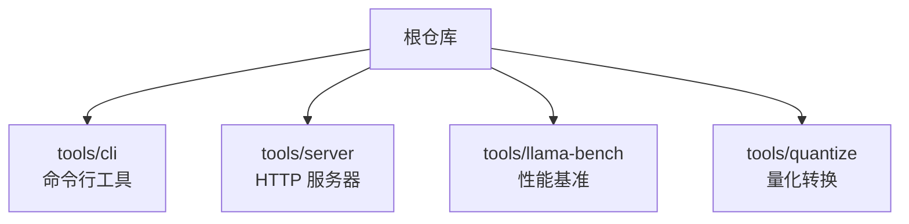
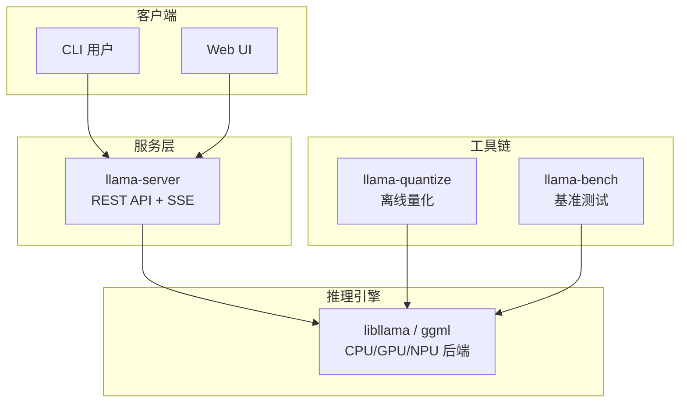
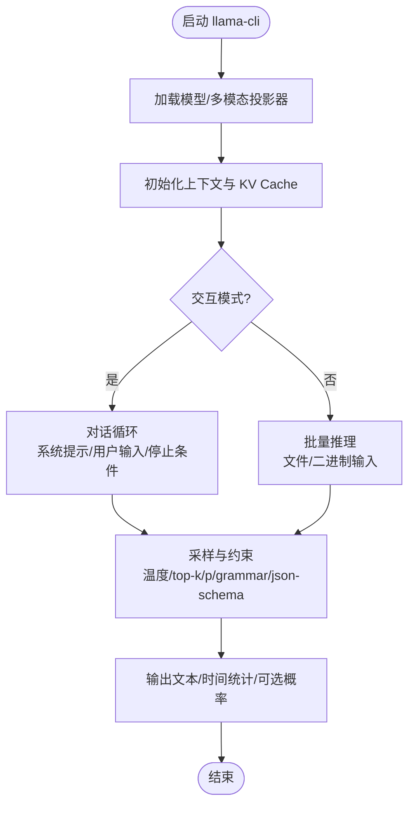
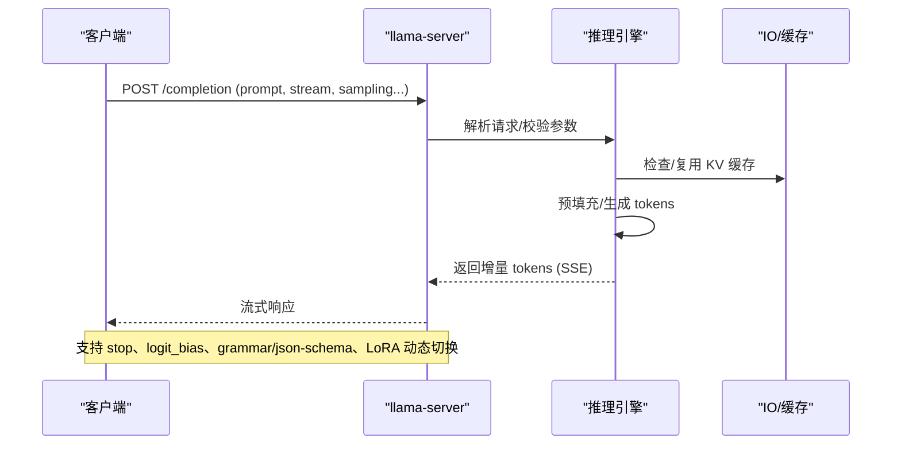
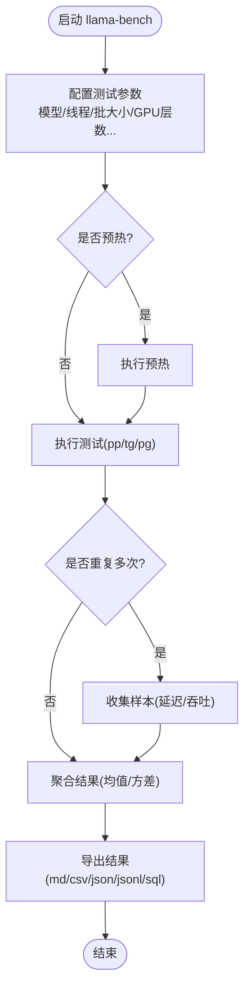
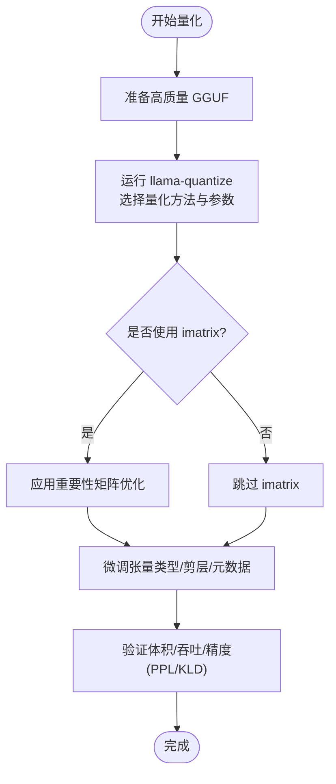
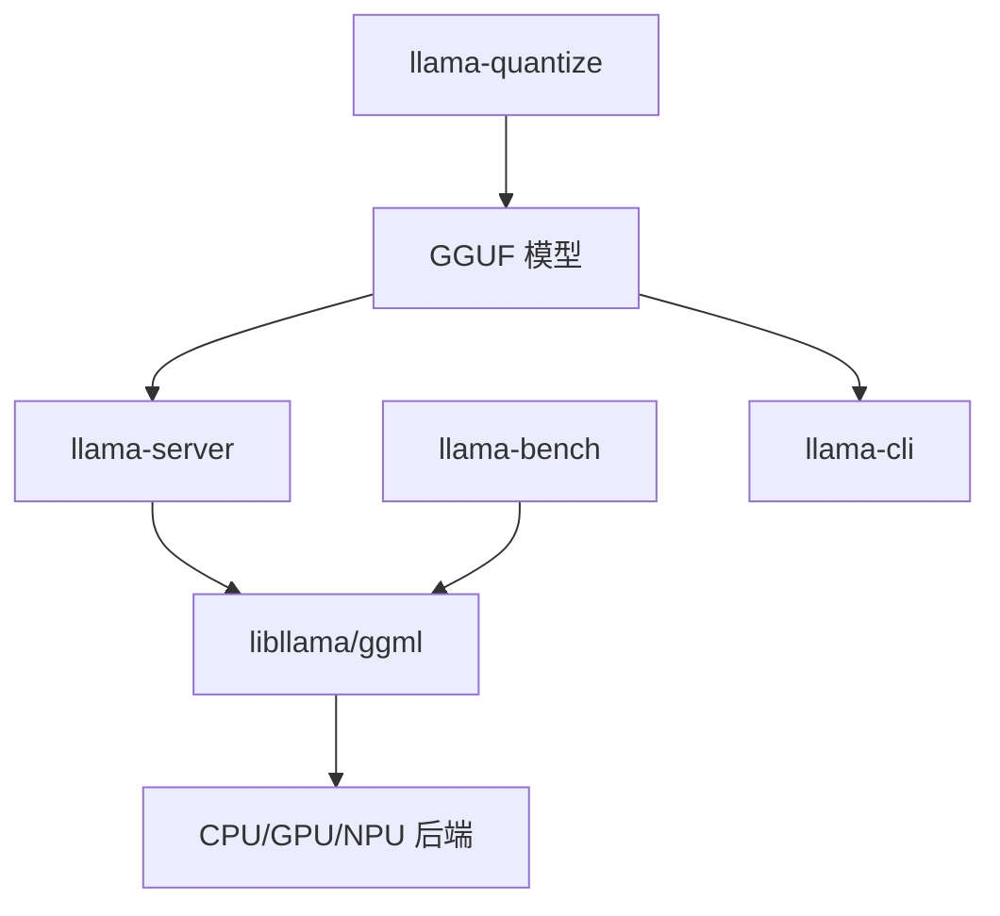

# 工具生态系统

<cite>
**本文引用的文件**   
- [README.md](file://README.md)
- [tools/cli/README.md](file://tools/cli/README.md)
- [tools/server/README.md](file://tools/server/README.md)
- [tools/llama-bench/README.md](file://tools/llama-bench/README.md)
- [tools/quantize/README.md](file://tools/quantize/README.md)
</cite>

## 目录
1. [简介](#简介)
2. [项目结构](#项目结构)
3. [核心组件](#核心组件)
4. [架构总览](#架构总览)
5. [详细组件分析](#详细组件分析)
6. [依赖关系分析](#依赖关系分析)
7. [性能考量](#性能考量)
8. [故障排除指南](#故障排除指南)
9. [结论](#结论)
10. [附录](#附录)

## 简介
本指南面向使用 llama.cpp 工具生态的工程师与运维人员，系统介绍以下工具的用法与最佳实践：
- llama-cli：交互式对话、批量推理、参数配置与多模态输入。
- llama-server：HTTP API 服务部署、OpenAI/Anthropic 兼容接口、鉴权、CORS、监控与性能调优。
- llama-bench：吞吐量与延迟基准测试、不同硬件与后端对比、结果导出与分析。
- llama-quantize：GGUF 模型量化、精度权衡与质量优化（imatrix）。

本指南基于仓库内各工具的官方 README 文档整理，确保内容与实际实现一致，并提供生产环境部署建议与常见问题排查思路。

## 项目结构
llama.cpp 的工具生态位于 tools 目录下，主要包含：
- cli：命令行交互与批处理入口。
- server：HTTP 服务器与 REST API。
- llama-bench：性能基准测试工具。
- quantize：模型量化转换工具。

图表来源
- [README.md:100-105](file://README.md#L100-L105)

章节来源
- [README.md:100-105](file://README.md#L100-L105)

## 核心组件
本节概述四大工具的职责与典型使用场景：
- llama-cli：提供交互式聊天、单轮/多轮对话、批量推理、采样控制、语法约束、多模态输入等能力。
- llama-server：提供 OpenAI/Anthropic 兼容的 chat completions、embeddings、reranking 等端点，支持流式输出、SSE、监控指标、Web UI。
- llama-bench：对 prompt 处理、文本生成、组合任务进行吞吐与延迟测量，支持多种输出格式。
- llama-quantize：将高精度 GGUF 模型转换为低比特量化格式，支持重要性矩阵、按张量类型量化、剪层等高级选项。

章节来源
- [tools/cli/README.md:1-235](file://tools/cli/README.md#L1-L235)
- [tools/server/README.md:1-305](file://tools/server/README.md#L1-L305)
- [tools/llama-bench/README.md:1-100](file://tools/llama-bench/README.md#L1-L100)
- [tools/quantize/README.md:1-68](file://tools/quantize/README.md#L1-L68)

## 架构总览
下图展示工具之间的协作关系与数据流向：用户通过 CLI 或 Web UI 发起请求，server 暴露 REST API；bench 用于评估不同配置下的吞吐与延迟；quantize 在离线阶段准备量化模型供推理使用。

图表来源
- [tools/server/README.md:1-23](file://tools/server/README.md#L1-L23)
- [tools/llama-bench/README.md:86-98](file://tools/llama-bench/README.md#L86-L98)
- [tools/quantize/README.md:10-16](file://tools/quantize/README.md#L10-L16)

## 详细组件分析

### llama-cli：交互模式、批量处理与参数配置
- 交互模式
  - 支持系统提示、多轮对话、反向提示词停止、单轮模式、多行输入、特殊 token 输出、时间统计显示等。
  - 可连接已有 server 作为客户端，或直接本地加载模型运行。
- 批量处理
  - 通过逻辑/物理 batch size、线程数、设备分配、KV cache 类型等参数调节吞吐与内存占用。
- 参数配置要点
  - 通用参数：线程、CPU 亲和性、NUMA、设备选择、KV offload、权重重打包、LoRA/控制向量、模型加载模式、Lazy 读取、Flash Attention、RoPE/YaRN 扩展等。
  - 采样参数：温度、top-k/p/min-p、XTC、DRY、Mirostat、Typical、重复惩罚、Logit bias、Grammar/JSON Schema 约束、后端采样开关等。
  - CLI 专属：上下文检查点、RAM 缓存、上下文滑动、系统提示文件、图像/音频/视频输入、Jinja 模板、思维标签解析、推测解码（draft/ngram）等。

图表来源
- [tools/cli/README.md:10-235](file://tools/cli/README.md#L10-L235)

章节来源
- [tools/cli/README.md:10-235](file://tools/cli/README.md#L10-L235)

### llama-server：API 端点、认证机制与性能调优
- API 端点
  - 健康检查：GET /health。
  - 非 OAI 兼容补全：POST /completion（支持流式、多模态、停词、采样参数、LoRA 动态切换等）。
  - Tokenize/Detokenize：POST /tokenize、/detokenize。
  - 模板应用：POST /apply-template。
  - Embedding/Reranking：POST /embedding、/reranking（需启用相应功能）。
  - 其他：/infill、/v1/* 兼容路由等。
- 认证与安全
  - API Key：--api-key、--api-key-file。
  - SSL：--ssl-key-file、--ssl-cert-file。
  - CORS：--cors-origins/methods/headers/credentials，默认行为与 --tools/--agent 的安全限制。
- 并发与资源
  - 并行槽位：--parallel/-np。
  - 连续批处理：--cont-batching/-cb。
  - HTTP 线程：--threads-http。
  - KV 统一缓冲与空闲槽缓存：--kv-unified、--cache-idle-slots。
  - Prompt 缓存与复用：--cache-prompt、--cache-reuse。
  - 监控与指标：--metrics（Prometheus）、--slots、/props、/health。
- 多模态与工具
  - 多模态投影器：--mmproj、--mmproj-offload、--mmproj-device。
  - 内置工具与 MCP：--tools、--mcp-servers-config/json、--ui-mcp-proxy。
  - Agent 模式：--agent（自动开启代理与工具，安全限制更严格）。

图表来源
- [tools/server/README.md:471-606](file://tools/server/README.md#L471-L606)

章节来源
- [tools/server/README.md:1-305](file://tools/server/README.md#L1-L305)
- [tools/server/README.md:471-800](file://tools/server/README.md#L471-L800)

### llama-bench：吞吐量测试、延迟分析与资源监控
- 测试类型
  - Prompt 处理（pp）、文本生成（tg）、组合（pg）。
  - 支持多次重复、预热、不同上下文深度、不同线程/批大小/GPU 层数等组合实验。
- 关键参数
  - 模型来源：本地路径或 Hugging Face 仓库/文件。
  - 硬件与后端：设备列表、split-mode、tensor-split、main-gpu、no-kv-offload、flash-attn、load-mode/lazy-mode。
  - 性能相关：n-prompt、n-gen、batch-size、ubatch-size、threads、cpu-mask/cpu-strict/poll。
- 输出格式
  - Markdown、CSV、JSON、JSONL、SQL，便于自动化分析与入库。

图表来源
- [tools/llama-bench/README.md:20-98](file://tools/llama-bench/README.md#L20-L98)
- [tools/llama-bench/README.md:192-392](file://tools/llama-bench/README.md#L192-L392)

章节来源
- [tools/llama-bench/README.md:1-392](file://tools/llama-bench/README.md#L1-L392)

### llama-quantize：参数选择与精度权衡
- 流程
  - 先将 HF 模型转为高质量 GGUF（F32/BF16），再使用 llama-quantize 进行量化。
  - 多模态模型需单独转换并量化 mmproj（视觉/音频编码器与投影器）。
- 关键参数
  - 基础：允许重新量化、保留输出张量不量化、纯量化（禁用混合 k-quants）。
  - 重要性矩阵：--imatrix，配合 --include-weights/--exclude-weights 控制哪些张量受益。
  - 张量级控制：--output-tensor-type、--token-embedding-type、--tensor-type（正则匹配）。
  - 结构与元数据：--keep-split、--prune-layers、--override-kv。
- 精度与性能权衡
  - 不同量化方法（IQx/Qx_K/F16）在 bits/weight、体积、pp/tg 吞吐上差异明显。
  - 使用 imatrix 可降低精度损失，但需要额外准备数据与计算成本。

图表来源
- [tools/quantize/README.md:10-68](file://tools/quantize/README.md#L10-L68)
- [tools/quantize/README.md:137-178](file://tools/quantize/README.md#L137-L178)

章节来源
- [tools/quantize/README.md:1-197](file://tools/quantize/README.md#L1-L197)

## 依赖关系分析
- 工具间耦合
  - llama-server 依赖 libllama/ggml 进行推理，支持多种后端（CUDA/HIP/Metal/Vulkan/SYCL/OpenVINO/WebGPU 等）。
  - llama-bench 直接调用底层推理内核以测量 pp/tg 吞吐与延迟。
  - llama-quantize 输出 GGUF 供 llama-cli/server 使用。
- 外部依赖
  - HTTP 服务器基于 cpp-httplib 与 nlohmann::json。
  - 多模态子系统依赖 stb/miniaudio 等单头库。
  - JSON 解析与模板引擎（Jinja）用于聊天模板与结构化输出。

图表来源
- [README.md:60-97](file://README.md#L60-L97)
- [tools/server/README.md:1-23](file://tools/server/README.md#L1-L23)

章节来源
- [README.md:60-97](file://README.md#L60-L97)
- [tools/server/README.md:1-23](file://tools/server/README.md#L1-L23)

## 性能考量
- 线程与批大小
  - 合理设置 threads、batch-size、ubatch-size 以平衡吞吐与延迟。
  - CPU 亲和性与 NUMA 优化可减少跨节点访问开销。
- GPU 卸载与分层
  - 调整 n-gpu-layers、split-mode、tensor-split 以充分利用显存与带宽。
  - Flash Attention 与 KV cache 类型（K/V）影响速度与内存。
- 缓存与复用
  - 启用 prompt 缓存与 KV 共享，减少重复前缀计算。
  - 使用 context shift 与 checkpoint 管理长上下文。
- 量化与精度
  - 选择合适的量化方法（Q4_K_M/IQ3_S 等）在体积、速度、精度之间取得平衡。
  - 使用 imatrix 针对关键张量优化，降低 PPL/KLD 损失。
- 服务端并发
  - 调整 parallel slots、continuous batching、HTTP 线程数以提升吞吐。
  - 启用 metrics/slots 监控，观察队列长度、slot 利用率与延迟分布。

[本节为通用指导，无需具体文件引用]

## 故障排除指南
- 模型加载失败
  - 检查模型路径、HF 仓库/令牌、网络与离线模式。
  - 确认 load-mode/lazy-mode 与设备支持（mmap/mlock/dio）。
- 显存不足
  - 降低 n-gpu-layers、启用 kv-offload、调整 tensor-split。
  - 使用 --fit/--fit-target/--fit-ctx 自动适配。
- 吞吐低或延迟高
  - 增大 batch-size/ubatch-size，调整 threads/cpu-affinity。
  - 启用 flash-attn、优化 RoPE/YaRN 参数。
  - 使用 llama-bench 定位瓶颈（pp/tg 分离）。
- API 鉴权与 CORS
  - 正确配置 api-key/api-key-file，避免未授权访问。
  - 根据部署环境设置 cors-origins/methods/headers/credentials。
- 多模态异常
  - 确认 mmproj 文件存在且与模型匹配。
  - 检查媒体输入格式与标记占位符数量一致。

章节来源
- [tools/server/README.md:193-227](file://tools/server/README.md#L193-L227)
- [tools/llama-bench/README.md:20-98](file://tools/llama-bench/README.md#L20-L98)
- [tools/quantize/README.md:125-135](file://tools/quantize/README.md#L125-L135)

## 结论
llama.cpp 工具生态提供了从模型准备（量化）、推理（CLI/Server）到性能评估（Bench）的一体化解决方案。通过合理配置线程、批大小、GPU 卸载、缓存与量化策略，可在不同硬件平台上获得稳定高效的推理性能。在生产环境中，建议结合监控指标与安全策略（API Key、CORS、SSL）进行部署，并使用 llama-bench 持续评估与优化。

[本节为总结性内容，无需具体文件引用]

## 附录
- 快速入门命令参考
  - CLI：llama cli -hf <repo>:<quant>
  - Server：llama serve -hf <repo>:<quant>
  - Bench：llama-bench -m <model> -p <n_prompt> -n <n_gen>
  - Quantize：llama-quantize <input.gguf> <output.gguf> <method>

章节来源
- [README.md:37-45](file://README.md#L37-L45)