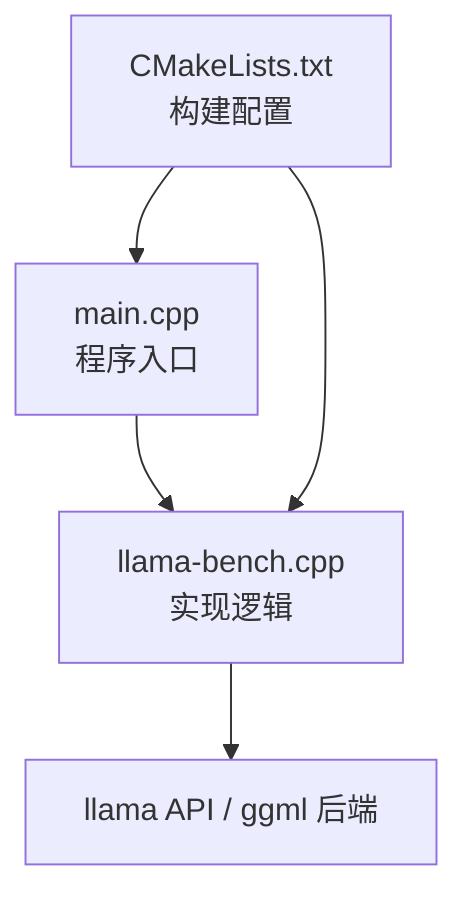
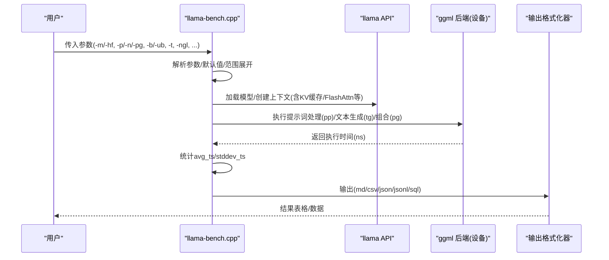
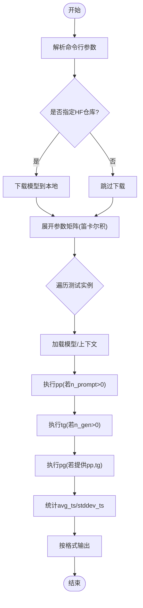
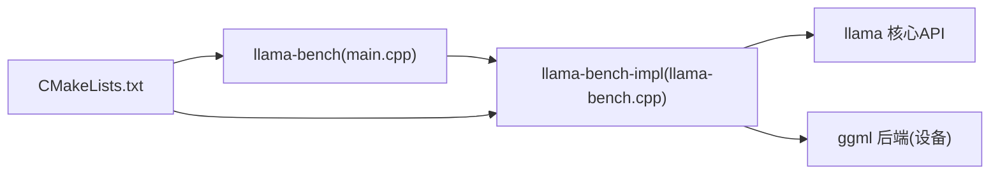

# 性能基准测试

<cite>
**本文引用的文件**   
- [tools/llama-bench/README.md](file://tools/llama-bench/README.md)
- [tools/llama-bench/llama-bench.cpp](file://tools/llama-bench/llama-bench.cpp)
- [tools/llama-bench/main.cpp](file://tools/llama-bench/main.cpp)
- [tools/llama-bench/CMakeLists.txt](file://tools/llama-bench/CMakeLists.txt)
- [scripts/compare-llama-bench.py](file://scripts/compare-llama-bench.py)
- [common/fit.cpp](file://common/fit.cpp)
- [src/llama-context.h](file://src/llama-context.h)
</cite>

## 目录
1. [简介](#简介)
2. [项目结构](#项目结构)
3. [核心组件](#核心组件)
4. [架构总览](#架构总览)
5. [详细组件分析](#详细组件分析)
6. [依赖关系分析](#依赖关系分析)
7. [性能考量与优化建议](#性能考量与优化建议)
8. [故障排查指南](#故障排查指南)
9. [结论](#结论)
10. [附录](#附录)

## 简介
本文件面向使用 llama.cpp 的开发者与评测工程师，系统性介绍 llama-bench 性能基准测试工具的使用方法、参数配置、结果解读与自动化流程。重点覆盖：
- 吞吐量（t/s）与延迟（ns/token）测量
- 提示词处理（pp）、文本生成（tg）与组合模式（pg）
- 批量、微批、线程数、GPU 层数、KV 缓存类型等关键参数的影响
- 多后端（CPU/GPU/RPC 等）对比分析方法
- 自动化脚本与结果汇总（CSV/JSON/JSONL/SQL/Markdown）
- 内存使用监控与定位瓶颈的实践建议

## 项目结构
llama-bench 由可执行入口与实现库组成，并通过 CMake 构建为独立工具与可复用库：
- main.cpp：程序入口，调用实现函数
- llama-bench.cpp：参数解析、测试矩阵展开、指标统计与输出
- CMakeLists.txt：定义 llama-bench-impl 库与 llama-bench 可执行目标

图表来源
- [tools/llama-bench/main.cpp:1-6](file://tools/llama-bench/main.cpp#L1-L6)
- [tools/llama-bench/CMakeLists.txt:1-25](file://tools/llama-bench/CMakeLists.txt#L1-L25)

章节来源
- [tools/llama-bench/main.cpp:1-6](file://tools/llama-bench/main.cpp#L1-L6)
- [tools/llama-bench/CMakeLists.txt:1-25](file://tools/llama-bench/CMakeLists.txt#L1-L25)

## 核心组件
- 命令行参数解析与默认值管理：支持模型路径/HF仓库、n_prompt/n_gen/pg、batch/ubatch、threads、ngl、split-mode、load-mode、lazy-mode、tensor_split、override-tensor、no-op-offload、no-host、repack、fit-target/fit-ctx、numa/prio/delay/repetitions/output 等
- 测试矩阵展开：将多个参数值进行笛卡尔积组合，生成待执行的测试实例
- 指标采集与统计：记录每轮耗时（ns），计算平均 t/s 与标准差；支持多次重复（-r）
- 设备与后端探测：自动枚举 CPU/GPU/RPC 等设备并报告 backends
- 输出格式：md/csv/json/jsonl/sql，便于后续分析与入库

章节来源
- [tools/llama-bench/llama-bench.cpp:218-494](file://tools/llama-bench/llama-bench.cpp#L218-L494)
- [tools/llama-bench/llama-bench.cpp:525-1209](file://tools/llama-bench/llama-bench.cpp#L525-L1209)
- [tools/llama-bench/llama-bench.cpp:1323-1472](file://tools/llama-bench/llama-bench.cpp#L1323-L1472)
- [tools/llama-bench/llama-bench.cpp:1474-1599](file://tools/llama-bench/llama-bench.cpp#L1474-L1599)

## 架构总览
llama-bench 的工作流如下：
- 解析命令行参数，合并 HF 模型下载（可选）
- 展开参数矩阵，生成测试实例列表
- 对每个实例加载模型与上下文，执行 pp/tg/pg 测试，记录时间样本
- 计算均值与标准差，按指定格式输出

图表来源
- [tools/llama-bench/llama-bench.cpp:525-1209](file://tools/llama-bench/llama-bench.cpp#L525-L1209)
- [tools/llama-bench/llama-bench.cpp:1323-1472](file://tools/llama-bench/llama-bench.cpp#L1323-L1472)
- [tools/llama-bench/llama-bench.cpp:1474-1599](file://tools/llama-bench/llama-bench.cpp#L1474-L1599)

## 详细组件分析

### 参数解析与测试矩阵
- 支持多值与范围语法（如 -n 16,32 或 -ngl 10-35+2）
- 关键参数类别：
  - 模型与HF：-m, -hf/-hfr, -hff, -hft, --offline
  - 测试模式：-p (n_prompt), -n (n_gen), -pg (pp,tg), -d (n_depth)
  - 批处理：-b (n_batch), -ub (n_ubatch)
  - 线程与调度：-t, --cpu-mask, --cpu-strict, --poll, --prio, --delay, --numa
  - GPU/设备：-ngl, -ncmoe, -sm, -mg, -nkvo, -fa, -dev, -ts, -ot, -nopo, --no-host, --repack
  - 内存拟合：-fitt/--fit-target, -fitc/--fit-ctx
  - 输出：-o, -oe, --list-devices, -v, --progress, --no-warmup

图表来源
- [tools/llama-bench/llama-bench.cpp:525-1209](file://tools/llama-bench/llama-bench.cpp#L525-L1209)
- [tools/llama-bench/llama-bench.cpp:1323-1472](file://tools/llama-bench/llama-bench.cpp#L1323-L1472)

章节来源
- [tools/llama-bench/README.md:20-84](file://tools/llama-bench/README.md#L20-L84)
- [tools/llama-bench/llama-bench.cpp:525-1209](file://tools/llama-bench/llama-bench.cpp#L525-L1209)
- [tools/llama-bench/llama-bench.cpp:1323-1472](file://tools/llama-bench/llama-bench.cpp#L1323-L1472)

### 指标统计与输出
- 指标字段包含：build_commit/build_number、cpu_info/gpu_info/backends、model_filename/model_type/model_size/model_n_params、n_batch/n_ubatch/n_threads/cpu_mask/cpu_strict/poll/type_k/type_v/n_gpu_layers/n_cpu_moe/split_mode/main_gpu/no_kv_offload/flash_attn/devices/tensor_split/tensor_buft_overrides/use_mmap/use_direct_io/embeddings/no_op_offload/no_host/repack/fit_target/fit_min_ctx、n_prompt/n_gen/n_depth、test_time、avg_ns/stddev_ns、avg_ts/stddev_ts
- 输出格式：
  - Markdown：适合快速阅读
  - CSV/JSON/JSONL：便于脚本处理与可视化
  - SQL：可直接导入 SQLite 数据库，配合 compare-llama-bench.py 进行跨提交对比

章节来源
- [tools/llama-bench/README.md:192-392](file://tools/llama-bench/README.md#L192-L392)
- [tools/llama-bench/llama-bench.cpp:1474-1599](file://tools/llama-bench/llama-bench.cpp#L1474-L1599)

### 设备与后端探测
- 自动枚举 ggml_backend_dev_count() 下的设备，区分 CPU/GPU/IGPU
- 报告 backends 字符串，聚合非 CPU 后端名称，并在启用 RPC 时追加 RPC
- 支持通过 -dev 指定设备序列（auto/none/dev0/dev1...）

章节来源
- [tools/llama-bench/llama-bench.cpp:120-174](file://tools/llama-bench/llama-bench.cpp#L120-L174)
- [tools/llama-bench/llama-bench.cpp:1576-1599](file://tools/llama-bench/llama-bench.cpp#L1576-L1599)

### 内存使用监控与拟合
- 支持 --fit-target/--fit-ctx 以在给定显存余量下自动调整模型加载策略
- 提供 common_memory_breakdown_print 打印各设备内存分布（total/free/self/model/context/compute/unaccounted）
- 结合 fit.cpp 中的设备内存数据收集与打印接口，辅助定位 OOM 或内存热点

章节来源
- [tools/llama-bench/llama-bench.cpp:1059-1076](file://tools/llama-bench/llama-bench.cpp#L1059-L1076)
- [common/fit.cpp:149-177](file://common/fit.cpp#L149-L177)
- [common/fit.cpp:906-970](file://common/fit.cpp#L906-L970)

## 依赖关系分析
- 可执行入口 main.cpp 仅转发至 llama_bench(argc, argv)
- 实现库 llama-bench-impl 链接 llama-common 与 llama 核心库，依赖 ggml 后端抽象
- CMake 构建产物：llama-bench-impl（库）与 llama-bench（可执行）

图表来源
- [tools/llama-bench/main.cpp:1-6](file://tools/llama-bench/main.cpp#L1-L6)
- [tools/llama-bench/CMakeLists.txt:1-25](file://tools/llama-bench/CMakeLists.txt#L1-L25)

章节来源
- [tools/llama-bench/main.cpp:1-6](file://tools/llama-bench/main.cpp#L1-L6)
- [tools/llama-bench/CMakeLists.txt:1-25](file://tools/llama-bench/CMakeLists.txt#L1-L25)

## 性能考量与优化建议

### 关键参数对吞吐与延迟的影响
- n_prompt（提示词长度）：增大通常提升 pp 吞吐，但可能受限于 KV 缓存与批处理能力
- n_gen（生成长度）：决定 tg 阶段的 token 数量，影响整体延迟与吞吐
- n_batch/n_ubatch（批大小/微批大小）：增大可提升并行度，但需平衡显存与访存带宽
- n_threads（线程数）：CPU 侧并行度，过多可能导致争用与调度开销
- n_gpu_layers（GPU 层数）：越大越能利用 GPU 加速，但受显存限制；超过阈值后可能回退 CPU
- split_mode（layer/row/tensor）：不同切分方式影响多卡/多设备的数据布局与通信开销
- load_mode/lazy_mode（mmap/mlock/dio/auto/on/off）：影响加载速度与运行时内存占用
- flash-attn（on/off/auto）：开启可显著提升注意力计算效率（取决于后端支持）
- no-kv-offload（关闭KV offload）：关闭可减少显存占用但可能降低速度
- tensor_split（张量切分）：在多设备上分配权重，合理划分可提升并行效率
- override-tensor（张量缓冲类型覆盖）：精细控制特定张量的存储位置与类型
- no-op-offload/no-host/repack：影响算子卸载与主机内存行为，需根据硬件特性调优

### 不同硬件后端的对比方法
- 使用 -o sql 输出结构化数据，配合 scripts/compare-llama-bench.py 比较不同提交或不同后端的结果
- 关注 backends 列，确认实际使用的后端（CUDA/HIP/Metal/SYCL/Vulkan/WebGPU/BLAS/BLIS/CANN/OpenVINO/RPC 等）
- 通过 n_gpu_layers、split_mode、tensor_split 等参数对齐不同设备的负载分布，确保公平对比

章节来源
- [tools/llama-bench/README.md:20-84](file://tools/llama-bench/README.md#L20-L84)
- [tools/llama-bench/README.md:192-392](file://tools/llama-bench/README.md#L192-L392)
- [scripts/compare-llama-bench.py:25-44](file://scripts/compare-llama-bench.py#L25-L44)
- [scripts/compare-llama-bench.py:62-97](file://scripts/compare-llama-bench.py#L62-L97)

## 故障排查指南
- 参数错误：当参数不合法或未提供必要值时，会打印 usage 并退出
- 设备无效：-dev 指定的设备不存在或为 CPU 设备时会报错
- RPC 注册失败：未找到 RPC 后端或 add_server 函数缺失时报错
- HF 下载失败：网络或权限问题导致无法下载模型时退出
- 内存不足：可使用 --fit-target 与 common_memory_breakdown_print 分析各设备内存分布，调整 n_gpu_layers/split_mode/tensor_split 等参数

章节来源
- [tools/llama-bench/llama-bench.cpp:1088-1114](file://tools/llama-bench/llama-bench.cpp#L1088-L1114)
- [tools/llama-bench/llama-bench.cpp:144-196](file://tools/llama-bench/llama-bench.cpp#L144-L196)
- [common/fit.cpp:906-970](file://common/fit.cpp#L906-L970)

## 结论
llama-bench 提供了全面且灵活的基准测试能力，覆盖从提示词处理到文本生成的全链路性能评估。通过合理的参数设计与输出格式选择，并结合 compare-llama-bench.py 进行跨提交/后端对比，能够快速识别性能瓶颈与优化机会。建议在真实工作负载场景下，结合 n_prompt/n_gen/batch/threads/ngl/flash-attn 等参数进行系统化扫描，并以 SQL/JSON 形式沉淀结果，形成可复用的性能基线。

## 附录

### 常用命令示例
- 多模型文本生成：-m model1.gguf -m model2.gguf -p 0 -n 128,256,512
- 不同批大小的提示词处理：-n 0 -p 1024 -b 128,256,512,1024
- 不同线程数：-n 0 -n 16 -p 64 -t 1,2,4,8,16,32
- 不同 GPU 层数：-ngl 10,20,30,31,32,33,34,35
- 预填充上下文深度：-d 0,512

章节来源
- [tools/llama-bench/README.md:103-191](file://tools/llama-bench/README.md#L103-L191)

### 自动化测试与结果汇总
- 使用 -o sql 输出 SQL，导入 SQLite 数据库
- 运行 scripts/compare-llama-bench.py 比较不同提交或不同后端的结果，支持表格与绘图输出

章节来源
- [tools/llama-bench/README.md:335-392](file://tools/llama-bench/README.md#L335-L392)
- [scripts/compare-llama-bench.py:105-126](file://scripts/compare-llama-bench.py#L105-L126)