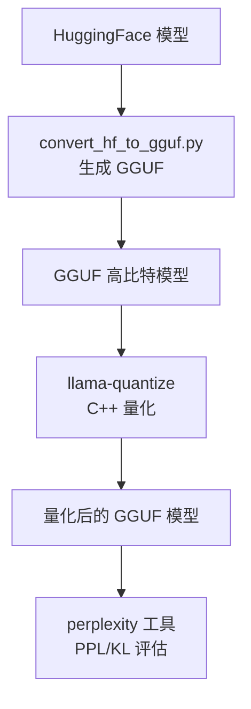
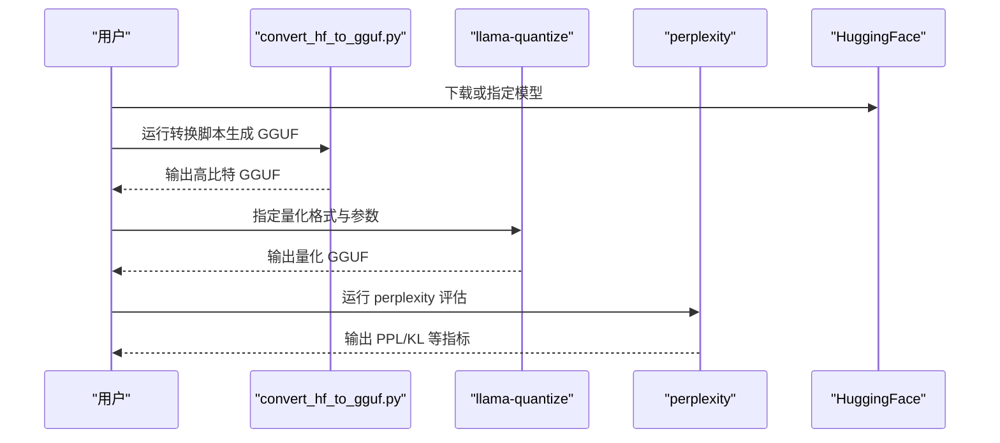
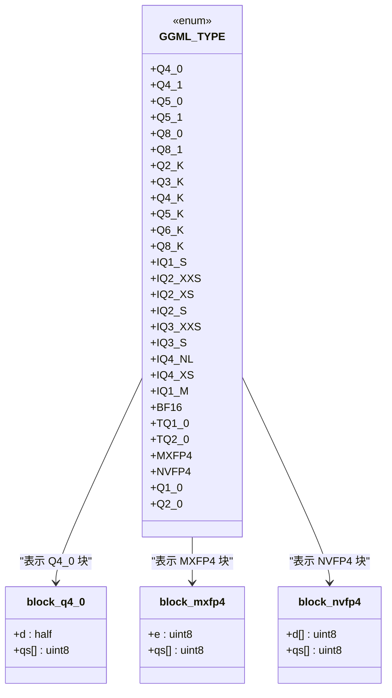
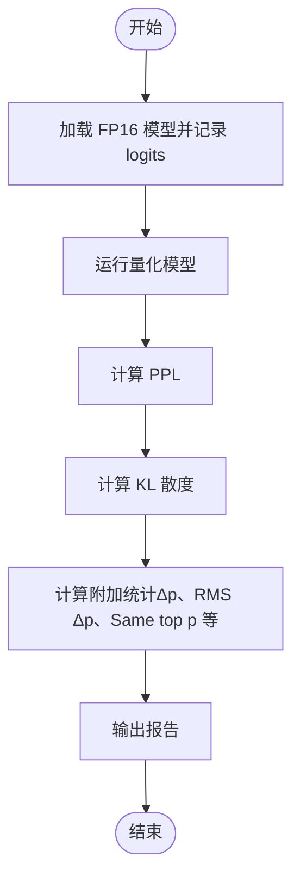
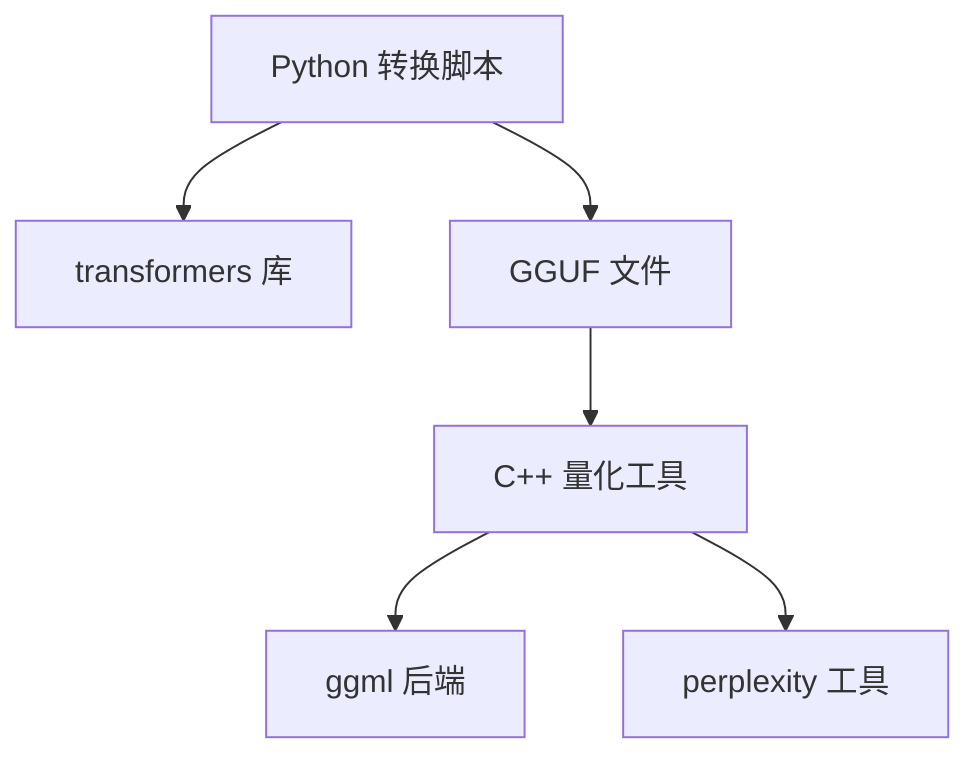

# 量化工具

<cite>
**本文引用的文件**   
- [tools/quantize/main.cpp](file://tools/quantize/main.cpp)
- [tools/quantize/README.md](file://tools/quantize/README.md)
- [ggml/include/ggml.h](file://ggml/include/ggml.h)
- [ggml/src/ggml-common.h](file://ggml/src/ggml-common.h)
- [gguf-py/gguf/constants.py](file://gguf-py/gguf/constants.py)
- [tools/perplexity/README.md](file://tools/perplexity/README.md)
- [tools/perplexity/perplexity.cpp](file://tools/perplexity/perplexity.cpp)
- [common/arg.cpp](file://common/arg.cpp)
- [app/download.cpp](file://app/download.cpp)
- [conversion/base.py](file://conversion/base.py)
- [examples/model-conversion/README.md](file://examples/model-conversion/README.md)
</cite>

## 目录
1. [简介](#简介)
2. [项目结构](#项目结构)
3. [核心组件](#核心组件)
4. [架构总览](#架构总览)
5. [详细组件分析](#详细组件分析)
6. [依赖关系分析](#依赖关系分析)
7. [性能与精度权衡](#性能与精度权衡)
8. [常见问题与排障](#常见问题与排障)
9. [结论](#结论)
10. [附录：参数速查与最佳实践](#附录参数速查与最佳实践)

## 简介
本指南面向希望在 llama.cpp 生态中使用量化能力的工程师与研究者，系统讲解：
- 量化基本原理与不同量化格式（Q4_K、Q8_0、NF4 等）的精度与速度权衡
- 量化工具的参数配置（目标精度、量化策略、重要性矩阵 imatrix、张量级控制等）
- 量化前后模型质量评估方法（困惑度 PPL、KL 散度、概率分布对比等）
- 不同模型的量化最佳实践与参数调优建议
- 如何选择量化格式以平衡模型大小与推理性能

## 项目结构
llama.cpp 的量化工具链由“Python 转换 + C++ 量化 + 评测工具”组成：
- Python 侧负责将 HuggingFace 或其他格式的模型转换为 GGUF（支持多模态编码器/投影器）
- C++ 侧提供 llama-quantize 工具对 GGUF 进行量化
- 配套 perplexity 工具用于量化质量评估（PPL、KL 散度、概率分布统计）

图表来源
- [tools/quantize/README.md:10-49](file://tools/quantize/README.md#L10-L49)
- [tools/perplexity/README.md:1-23](file://tools/perplexity/README.md#L1-L23)

章节来源
- [tools/quantize/README.md:10-49](file://tools/quantize/README.md#L10-L49)
- [tools/perplexity/README.md:1-23](file://tools/perplexity/README.md#L1-L23)

## 核心组件
- 量化入口程序：tools/quantize/main.cpp 仅作为入口，实际逻辑在 llama_quantize
- 量化文档与选项说明：tools/quantize/README.md
- 数据类型定义：ggml/include/ggml.h 中定义了所有量化类型枚举（如 Q4_K、Q8_0、NVFP4、MXFP4 等）
- 块结构体定义：ggml/src/ggml-common.h 中定义了各量化类型的 block 结构（如 block_q4_0、block_mxfp4、block_nvfp4）
- GGUF 常量映射：gguf-py/gguf/constants.py 中维护了量化类型到块大小的映射
- 量化质量评估：tools/perplexity/README.md 与 tools/perplexity/perplexity.cpp 实现 PPL 与 KL 散度计算

章节来源
- [tools/quantize/main.cpp:1-6](file://tools/quantize/main.cpp#L1-L6)
- [tools/quantize/README.md:10-67](file://tools/quantize/README.md#L10-L67)
- [ggml/include/ggml.h:390-433](file://ggml/include/ggml.h#L390-L433)
- [ggml/src/ggml-common.h:194-227](file://ggml/src/ggml-common.h#L194-L227)
- [gguf-py/gguf/constants.py:6234-6249](file://gguf-py/gguf/constants.py#L6234-L6249)
- [tools/perplexity/README.md:1-33](file://tools/perplexity/README.md#L1-L33)
- [tools/perplexity/perplexity.cpp:181-235](file://tools/perplexity/perplexity.cpp#L181-L235)

## 架构总览
量化流程从输入 GGUF 开始，经过量化策略选择、重要性矩阵优化、张量级控制，最终输出量化 GGUF。评测阶段通过 perplexity 工具对比 FP16 与量化模型的分布差异。

图表来源
- [tools/quantize/README.md:30-49](file://tools/quantize/README.md#L30-L49)
- [tools/perplexity/README.md:16-23](file://tools/perplexity/README.md#L16-L23)

## 详细组件分析

### 量化入口与工具说明
- 入口 main.cpp 调用 llama_quantize，完成参数解析、GGUF 读取、量化执行与保存
- README 提供了完整的使用示例与高级选项，包括：
  - --allow-requantize：允许对已量化张量再次量化（可能显著降低质量）
  - --leave-output-tensor：保留 output.weight 不量化，提升质量但增大体积
  - --pure：禁用 k-quant 混合，统一为单一量化类型
  - --imatrix：使用重要性矩阵优化关键张量
  - --include-weights/--exclude-weights：按张量名选择性应用 imatrix
  - --output-tensor-type/--token-embedding-type：针对特定张量设置量化类型
  - --keep-split：保持分片结构
  - --tensor-type：正则表达式匹配张量并指定量化类型
  - --prune-layers：裁剪指定层
  - --override-kv：覆盖元数据键值

章节来源
- [tools/quantize/main.cpp:1-6](file://tools/quantize/main.cpp#L1-L6)
- [tools/quantize/README.md:53-67](file://tools/quantize/README.md#L53-L67)

### 量化类型与数据结构
- ggml.h 中定义了所有量化类型枚举，包括：
  - Q4_0、Q4_1、Q5_0、Q5_1、Q8_0、Q8_1
  - Q2_K、Q3_K、Q4_K、Q5_K、Q6_K、Q8_K
  - IQ1_S、IQ2_XXS、IQ2_XS、IQ2_S、IQ3_XXS、IQ3_S、IQ4_NL、IQ4_XS、IQ1_M
  - MXFP4、NVFP4、Q1_0、Q2_0 等
- ggml-common.h 中定义了具体块结构体，例如：
  - block_q4_0：包含缩放因子 d 与压缩后的 qs
  - block_mxfp4：E8M0 指数 e 与 qs
  - block_nvfp4：UE4M3 尺度数组 d 与 E2M1 压缩 qs
- gguf constants.py 维护了量化类型到块尺寸与存储布局的映射

图表来源
- [ggml/include/ggml.h:390-433](file://ggml/include/ggml.h#L390-L433)
- [ggml/src/ggml-common.h:194-227](file://ggml/src/ggml-common.h#L194-L227)
- [gguf-py/gguf/constants.py:6234-6249](file://gguf-py/gguf/constants.py#L6234-L6249)

章节来源
- [ggml/include/ggml.h:390-433](file://ggml/include/ggml.h#L390-L433)
- [ggml/src/ggml-common.h:194-227](file://ggml/src/ggml-common.h#L194-L227)
- [gguf-py/gguf/constants.py:6234-6249](file://gguf-py/gguf/constants.py#L6234-L6249)

### 量化策略与参数配置
- 目标精度：通过命令行参数指定量化类型（如 Q4_K_M、Q8_0），或在 --tensor-type 中为不同张量指定不同精度
- 量化策略：
  - 混合量化（k-quants）：默认启用，自动为不同张量选择合适类型；--pure 可关闭
  - 重要性矩阵（imatrix）：通过 --imatrix 引入训练数据的重要性统计，优先保护关键张量
  - 张量级控制：--include-weights/--exclude-weights 精确控制哪些张量受 imatrix 影响
  - 特殊张量处理：--output-tensor-type 与 --token-embedding-type 分别控制输出与词嵌入的量化类型
  - 裁剪与元数据：--prune-layers 与 --override-kv 支持裁剪层与覆盖元数据
- 重新量化：--allow-requantize 允许对已量化张量再次量化，但会显著降低质量

章节来源
- [tools/quantize/README.md:53-67](file://tools/quantize/README.md#L53-L67)

### 质量评估方法
- 困惑度（Perplexity, PPL）：越低越好，衡量模型预测下一个 token 的能力
- KL 散度（Kullback–Leibler Divergence）：比较 FP16 与量化模型的 logits 分布差异，值为 0 表示完全一致
- 附加统计：
  - PPL 比值与差值
  - “正确” token 概率的平均变化、Pearson 相关系数、百分位数变化
  - 概率变化的均方根（RMS Δp）
  - Same top p：两个模型对同一 token 赋予最高概率的一致性比例

图表来源
- [tools/perplexity/README.md:16-33](file://tools/perplexity/README.md#L16-L33)
- [tools/perplexity/perplexity.cpp:181-235](file://tools/perplexity/perplexity.cpp#L181-L235)

章节来源
- [tools/perplexity/README.md:1-33](file://tools/perplexity/README.md#L1-L33)
- [tools/perplexity/perplexity.cpp:181-235](file://tools/perplexity/perplexity.cpp#L181-L235)

### 多模态组件与量化注意事项
- 多模态编码器/投影器通常较小且对 LLM 质量影响直接，建议使用较高精度（如 BF16 或 Q8_0）
- 可通过 convert_hf_to_gguf.py 的 --mmproj 参数单独生成多模态组件的 GGUF 文件

章节来源
- [tools/quantize/README.md:69-79](file://tools/quantize/README.md#L69-L79)

### NF4/MXFP4 支持与后端适配
- NVFP4 与 MXFP4 是较新的低比特格式，已在 ggml.h 中定义并在部分后端（如 Vulkan、WebGPU）有内核支持
- conversion/base.py 中包含对 NVFP4 量化配置的检测逻辑，便于从 HuggingFace 导入时识别

章节来源
- [ggml/include/ggml.h:429-430](file://ggml/include/ggml.h#L429-L430)
- [conversion/base.py:1127-1137](file://conversion/base.py#L1127-L1137)

## 依赖关系分析
- Python 转换脚本依赖 transformers 库，用于解析 HuggingFace 模型结构与权重
- C++ 量化工具依赖 ggml 底层算子与后端（CPU/GPU/Vulkan/WebGPU 等）
- perplexity 工具依赖模型加载与日志/概率统计模块

图表来源
- [tools/quantize/README.md:18-28](file://tools/quantize/README.md#L18-L28)
- [tools/perplexity/README.md:1-23](file://tools/perplexity/README.md#L1-L23)

章节来源
- [tools/quantize/README.md:18-28](file://tools/quantize/README.md#L18-L28)
- [tools/perplexity/README.md:1-23](file://tools/perplexity/README.md#L1-L23)

## 性能与精度权衡
- 不同量化格式在 bits/weight、模型体积、提示处理吞吐（t/s @ 512）、文本生成吞吐（t/s @ 128）上存在明显差异
- 典型趋势：
  - Q8_0：体积较大，但速度与质量接近 FP16，适合对延迟敏感的场景
  - Q4_K_M/Q4_K_S：体积适中，质量损失可控，适合通用场景
  - IQ4_NL/IQ4_XS：更低的体积，质量略降，适合资源受限环境
  - 极低比特（IQ1_S、IQ2_XXS）：体积最小，但质量下降明显，适用于边缘设备或离线批处理

参考表格（来自官方 README 中的基准表）展示了不同量化格式在相同模型上的体积与吞吐表现，可作为选型依据。

章节来源
- [tools/quantize/README.md:137-178](file://tools/quantize/README.md#L137-L178)

## 常见问题与排障
- 内存/磁盘不足：大模型量化需要足够空间存储中间文件与最终模型，确保 RAM 与磁盘容量充足
- 重新量化导致质量骤降：避免对已量化张量再次量化，除非确有必要并使用 --allow-requantize
- 多模态组件质量下降：多模态编码器/投影器建议使用 BF16 或 Q8_0，避免因过度压缩影响整体质量
- 量化后 PPL/KL 升高：检查是否使用了合适的 imatrix，或尝试调整 --tensor-type 对不同张量采用不同精度
- 后端兼容性问题：某些后端对极低比特格式支持有限，需确认后端是否支持目标量化类型（如 NVFP4、MXFP4）

章节来源
- [tools/quantize/README.md:125-135](file://tools/quantize/README.md#L125-L135)
- [tools/quantize/README.md:53-67](file://tools/quantize/README.md#L53-L67)
- [tools/quantize/README.md:69-79](file://tools/quantize/README.md#L69-L79)

## 结论
- llama.cpp 提供了完整的量化工具链，涵盖从 GGUF 转换、量化执行到质量评估的全流程
- 选择合适的量化格式需要在模型体积、推理速度与质量之间取得平衡；Q8_0 与 Q4_K_M 是常用起点
- 使用 imatrix 与张量级控制可显著提升关键路径的质量，同时保持整体体积可控
- 对于多模态模型，建议对非 LLM 组件保持较高精度，以确保端到端质量稳定

## 附录：参数速查与最佳实践

### 常用参数速查
- 基础参数
  - 量化类型：Q4_K_M、Q8_0、Q4_K_S、IQ4_NL 等
  - --imatrix：重要性矩阵文件路径
  - --include-weights/--exclude-weights：按张量名控制 imatrix 作用范围
  - --output-tensor-type/--token-embedding-type：输出与词嵌入张量的量化类型
  - --pure：禁用混合量化，统一为单一类型
  - --allow-requantize：允许对已量化张量再次量化
  - --leave-output-tensor：保留 output.weight 不量化
  - --keep-split：保持分片结构
  - --tensor-type：正则表达式匹配张量并指定量化类型
  - --prune-layers：裁剪指定层
  - --override-kv：覆盖元数据键值

章节来源
- [tools/quantize/README.md:53-67](file://tools/quantize/README.md#L53-L67)

### 不同模型的量化最佳实践
- 通用语言模型
  - 首选 Q4_K_M 或 Q8_0 作为基线，再根据 PPL/KL 结果微调
  - 使用 imatrix 基于 Wikitext 或领域语料生成重要性矩阵
  - 对输出与词嵌入张量使用更高精度（Q6_K 或 Q8_0）以提升生成质量
- 多模态模型
  - 多模态编码器/投影器使用 BF16 或 Q8_0
  - 单独生成 mmproj GGUF，并与 LLM 量化模型配合使用
- 极低比特场景
  - 仅在资源极度受限或离线批处理时使用 IQ1_S/IQ2_XXS
  - 结合 imatrix 与张量级控制，尽量保护关键张量

章节来源
- [tools/quantize/README.md:69-79](file://tools/quantize/README.md#L69-L79)
- [examples/model-conversion/README.md:294-301](file://examples/model-conversion/README.md#L294-L301)

### 如何选择量化格式以平衡模型大小与推理性能
- 若追求极致体积：优先 IQ4_NL/IQ4_XS 或更低比特系列
- 若追求速度与质量平衡：Q4_K_M/Q4_K_S 或 Q8_0
- 若后端对极低比特支持有限：优先 Q4_K 系列或 Q8_0
- 若对输出质量敏感：提高 output.weight 与 token embeddings 的量化精度

章节来源
- [tools/quantize/README.md:137-178](file://tools/quantize/README.md#L137-L178)
- [examples/model-conversion/README.md:294-301](file://examples/model-conversion/README.md#L294-L301)