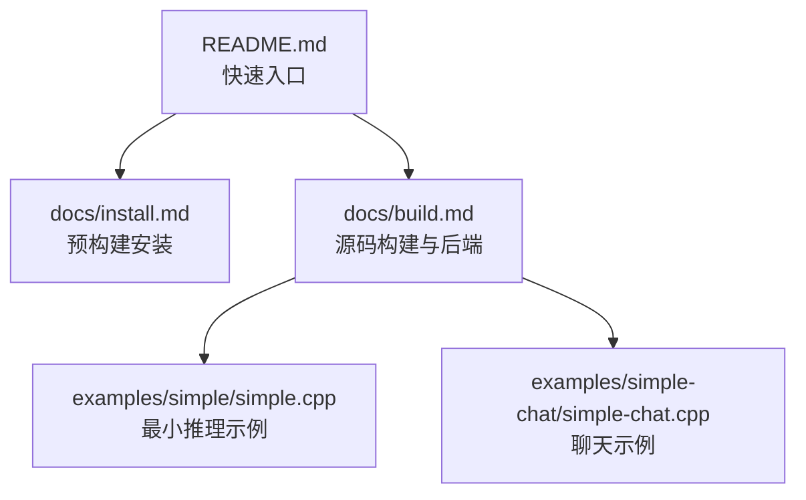
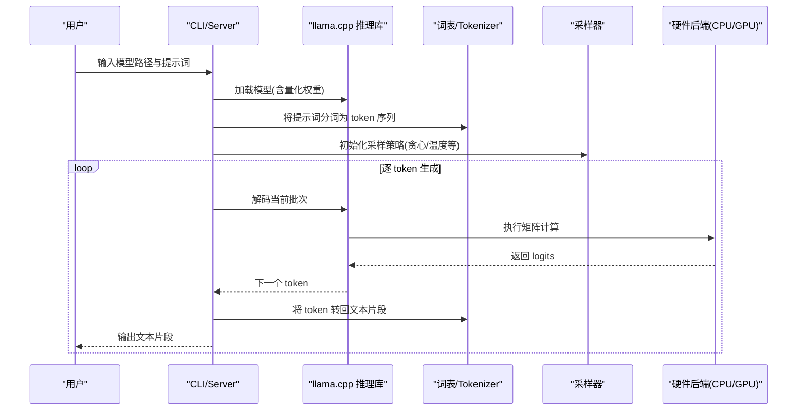
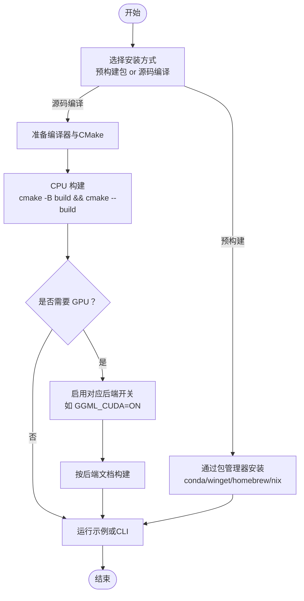
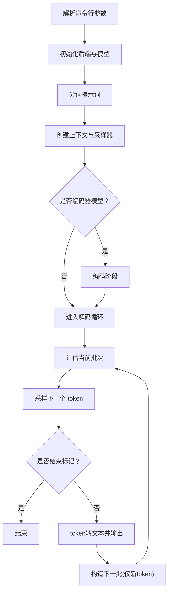
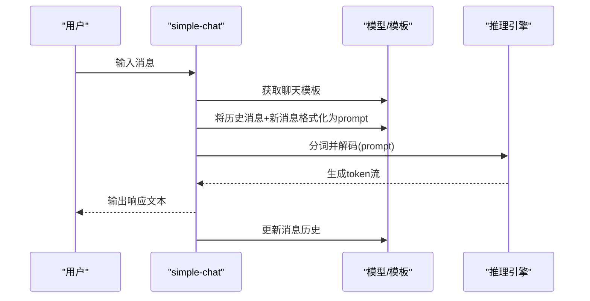

# 快速开始

<cite>
**本文引用的文件**   
- [README.md](file://README.md)
- [docs/build.md](file://docs/build.md)
- [docs/install.md](file://docs/install.md)
- [examples/simple/simple.cpp](file://examples/simple/simple.cpp)
- [examples/simple-chat/simple-chat.cpp](file://examples/simple-chat/simple-chat.cpp)
</cite>

## 目录
1. [简介](#简介)
2. [项目结构](#项目结构)
3. [核心组件](#核心组件)
4. [架构总览](#架构总览)
5. [详细组件分析](#详细组件分析)
6. [依赖与兼容性](#依赖与兼容性)
7. [性能注意事项](#性能注意事项)
8. [故障排查指南](#故障排查指南)
9. [结论](#结论)
10. [附录：常用命令速查](#附录常用命令速查)

## 简介
本指南面向新手，帮助你在最短时间内完成 llama.cpp 的安装、编译与运行，并给出最小推理示例和聊天应用的基本实现思路。你将学会：
- 选择适合你的安装方式（预构建包或源码编译）
- 配置 CPU/GPU 后端
- 下载模型并进行文本生成
- 基于示例代码搭建一个简单聊天程序

## 项目结构
llama.cpp 仓库包含核心推理库、工具链、示例程序与文档。对“快速开始”而言，你最需要关注的是：
- 顶层 README：提供一键安装入口与常用命令
- docs/build.md：详细的本地构建说明与后端选项
- docs/install.md：各平台的预构建包安装方式
- examples/simple：最小推理示例
- examples/simple-chat：基础聊天示例

图表来源
- [README.md:20-45](file://README.md#L20-L45)
- [docs/install.md:1-79](file://docs/install.md#L1-L79)
- [docs/build.md:1-14](file://docs/build.md#L1-L14)
- [examples/simple/simple.cpp:1-239](file://examples/simple/simple.cpp#L1-L239)
- [examples/simple-chat/simple-chat.cpp:1-230](file://examples/simple-chat/simple-chat.cpp#L1-L230)

章节来源
- [README.md:20-45](file://README.md#L20-L45)
- [docs/install.md:1-79](file://docs/install.md#L1-L79)
- [docs/build.md:1-14](file://docs/build.md#L1-L14)

## 核心组件
- 推理库与 API：C/C++ 接口位于 include/llama.h，供示例与工具调用
- CLI 与 Server：tools/cli 与 tools/server 提供命令行与 OpenAI 兼容的 HTTP 服务
- 示例程序：examples/simple 与 examples/simple-chat 展示如何加载模型、分词、采样与生成

章节来源
- [docs/build.md:1-6](file://docs/build.md#L1-L6)
- [examples/simple/simple.cpp:1-239](file://examples/simple/simple.cpp#L1-L239)
- [examples/simple-chat/simple-chat.cpp:1-230](file://examples/simple-chat/simple-chat.cpp#L1-L230)

## 架构总览
下图展示了从用户到推理引擎的关键交互路径，适用于 CLI、Server 与自定义程序。

图表来源
- [examples/simple/simple.cpp:91-235](file://examples/simple/simple.cpp#L91-L235)
- [examples/simple-chat/simple-chat.cpp:79-226](file://examples/simple-chat/simple-chat.cpp#L79-L226)

## 详细组件分析

### 环境要求与依赖
- 操作系统
  - Windows、macOS、Linux 均可
  - Apple Silicon 优先优化（Metal/Accelerate/NEON）
  - x86/x64 支持 AVX/AVX2/AVX512/AMX；RISC-V 支持 RVV/ZVFH/ZFH 等
- 编译器与工具链
  - CMake（推荐 Ninja 以加速并行构建）
  - Windows：Visual Studio 2022（含 C++ 桌面开发、CMake Tools、Git for Windows、Clang 工具集）
  - macOS：Xcode 命令行工具（默认启用 Metal）
  - Linux：GCC/Clang + CMake/Ninja
- 可选依赖
  - OpenSSL（HTTPS/TLS 功能）
  - BLAS 变体（OpenBLAS、Intel oneMKL、AOCL-BLAS）
  - GPU 后端：CUDA、HIP、MUSA、Vulkan、SYCL、OpenCL、WebGPU、ZenDNN、CANN 等

章节来源
- [README.md:60-96](file://README.md#L60-L96)
- [docs/build.md:33-95](file://docs/build.md#L33-L95)
- [docs/build.md:154-167](file://docs/build.md#L154-L167)
- [docs/build.md:169-336](file://docs/build.md#L169-L336)
- [docs/build.md:337-433](file://docs/build.md#L337-L433)
- [docs/build.md:434-587](file://docs/build.md#L434-L587)
- [docs/build.md:589-646](file://docs/build.md#L589-L646)
- [docs/build.md:648-747](file://docs/build.md#L648-L747)

### 安装与编译（从零到可运行）
- 快速安装（预构建）
  - conda-forge / Winget / Homebrew / MacPorts / Nix 等包管理器
  - 一键脚本与 Docker 镜像也可参考 README
- 源码编译（CPU 默认）
  - 基本流程：cmake 配置 -> cmake 构建 -> 运行
  - Windows 使用 VS2022 开发者命令提示符
  - 可选开启 HTTPS/TLS（需 OpenSSL 开发库）
- GPU 加速后端（按需启用）
  - CUDA（NVIDIA）、HIP（AMD）、MUSA（摩尔线程）、Vulkan、SYCL（Intel）、OpenCL、ZenDNN、CANN 等
  - 不同后端有独立的 CMake 开关与环境变量

图表来源
- [docs/install.md:1-79](file://docs/install.md#L1-L79)
- [docs/build.md:33-95](file://docs/build.md#L33-L95)
- [docs/build.md:169-336](file://docs/build.md#L169-L336)
- [docs/build.md:434-587](file://docs/build.md#L434-L587)

章节来源
- [docs/install.md:1-79](file://docs/install.md#L1-L79)
- [docs/build.md:33-95](file://docs/build.md#L33-L95)
- [docs/build.md:169-336](file://docs/build.md#L169-L336)
- [docs/build.md:434-587](file://docs/build.md#L434-L587)

### 最小推理示例（加载模型、处理输入、生成输出）
- 示例位置：examples/simple/simple.cpp
- 关键流程
  - 解析参数：模型路径、生成 token 数、GPU 层数
  - 初始化后端与模型
  - 分词提示词
  - 创建上下文与采样器
  - 循环解码：评估批次 -> 采样下一个 token -> 输出文本片段
  - 释放资源

图表来源
- [examples/simple/simple.cpp:25-235](file://examples/simple/simple.cpp#L25-L235)

章节来源
- [examples/simple/simple.cpp:25-235](file://examples/simple/simple.cpp#L25-L235)

### 聊天应用基本实现（对话轮次、模板格式化）
- 示例位置：examples/simple-chat/simple-chat.cpp
- 关键流程
  - 解析参数：模型路径、上下文大小、GPU 层数
  - 初始化后端、模型、上下文与采样器
  - 维护消息列表，使用模型内置聊天模板进行格式化
  - 对用户输入进行分词、解码、采样，输出响应
  - 将响应追加到消息列表，继续下一轮对话

图表来源
- [examples/simple-chat/simple-chat.cpp:79-226](file://examples/simple-chat/simple-chat.cpp#L79-L226)

章节来源
- [examples/simple-chat/simple-chat.cpp:79-226](file://examples/simple-chat/simple-chat.cpp#L79-L226)

## 依赖与兼容性
- 预构建包平台覆盖
  - conda-forge：Windows/Mac/Linux（含 CUDA/Vulkan/Metal 构建）
  - Winget：Windows
  - Homebrew：Mac/Linux
  - MacPorts：Mac
  - Nix：Mac/Linux
- 源码构建后端概览
  - CPU：默认可用；可结合 BLAS（OpenBLAS/oneMKL/AOCL-BLAS）
  - GPU：CUDA/HIP/MUSA/Vulkan/SYCL/OpenCL/WebGPU
  - 其他：ZenDNN（AMD CPU）、CANN（Ascend NPU）

章节来源
- [docs/install.md:1-79](file://docs/install.md#L1-L79)
- [docs/build.md:96-152](file://docs/build.md#L96-L152)
- [docs/build.md:169-336](file://docs/build.md#L169-L336)
- [docs/build.md:337-433](file://docs/build.md#L337-L433)
- [docs/build.md:434-587](file://docs/build.md#L434-L587)
- [docs/build.md:589-646](file://docs/build.md#L589-L646)
- [docs/build.md:648-747](file://docs/build.md#L648-L747)

## 性能注意事项
- 编译期
  - 使用 Ninja 或多进程构建（-j）
  - 合理选择 BLAS 后端（OpenBLAS/oneMKL/AOCL-BLAS）
  - 针对目标硬件关闭/开启原生指令集（GGML_NATIVE）
- 运行期
  - CUDA：统一内存、P2P、launch queues、cuBLAS 精度等环境变量可调
  - HIP：设备可见性、GFX 版本覆盖
  - Vulkan：多平台驱动切换（MoltenVK/KosmicKrisp）
  - KleidiAI（Arm）：运行时自动选择微内核，注意 SVE/SME 能力检测

章节来源
- [docs/build.md:33-45](file://docs/build.md#L33-L45)
- [docs/build.md:96-152](file://docs/build.md#L96-L152)
- [docs/build.md:289-336](file://docs/build.md#L289-L336)
- [docs/build.md:430-433](file://docs/build.md#L430-L433)
- [docs/build.md:558-587](file://docs/build.md#L558-L587)
- [docs/build.md:648-747](file://docs/build.md#L648-L747)

## 故障排查指南
- 无法找到 CUDA/HIP/MUSA/Vulkan 等后端
  - 确认已安装对应 SDK/驱动，并按文档设置环境变量与路径
  - 在 CMake 中显式指定编译器与路径（例如 CUDA 版本、HIP_PATH、Vulkan SDK）
- 编译时报找不到 ROCm 设备库
  - 查找 oclc_abi_version_400.bc 所在目录，并通过 HIP_DEVICE_LIB_PATH 指定
- 旧版 CUDA 与新 glibc 不兼容
  - 按文档补丁 math_functions.h 中的函数签名
- 未启用 HTTPS/TLS
  - 安装 OpenSSL 开发库后重新构建
- Apple Silicon 上 Metal 未生效
  - 检查是否通过 -DGGML_METAL=OFF 禁用；或通过 --n-gpu-layers 控制 GPU 层数

章节来源
- [docs/build.md:169-336](file://docs/build.md#L169-L336)
- [docs/build.md:387-433](file://docs/build.md#L387-L433)
- [docs/build.md:434-587](file://docs/build.md#L434-L587)
- [docs/build.md:33-95](file://docs/build.md#L33-L95)

## 结论
通过本指南，你可以：
- 选择合适的安装方式（预构建或源码编译）
- 根据硬件启用合适的后端（CPU/GPU）
- 运行最小推理示例与基础聊天程序
- 定位常见安装与配置问题

建议先从预构建包或 CPU 构建入手，验证环境后再逐步启用 GPU 后端以获得更好性能。

## 附录：常用命令速查
- 预构建安装
  - conda-forge：conda install -c conda-forge llama.cpp
  - Winget：winget install llama.cpp
  - Homebrew：brew install llama.cpp
  - Nix：nix profile install nixpkgs#llama-cpp
- 源码构建（CPU）
  - cmake -B build && cmake --build build --config Release
- 启用 CUDA
  - cmake -B build -DGGML_CUDA=ON && cmake --build build --config Release
- 启用 Vulkan
  - cmake -B build -DGGML_VULKAN=ON && cmake --build build --config Release
- 运行 CLI（从 Hugging Face 直接拉取模型）
  - llama cli -hf ggml-org/Qwen3.5-0.8B-GGUF
- 启动 OpenAI 兼容 Server
  - llama serve -hf ggml-org/Qwen3.5-0.8B-GGUF

章节来源
- [docs/install.md:11-79](file://docs/install.md#L11-L79)
- [docs/build.md:33-45](file://docs/build.md#L33-L45)
- [docs/build.md:169-196](file://docs/build.md#L169-L196)
- [docs/build.md:434-462](file://docs/build.md#L434-L462)
- [README.md:37-45](file://README.md#L37-L45)