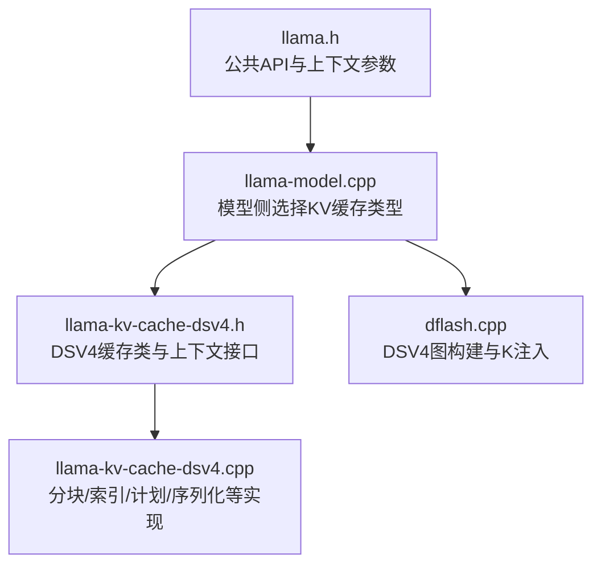
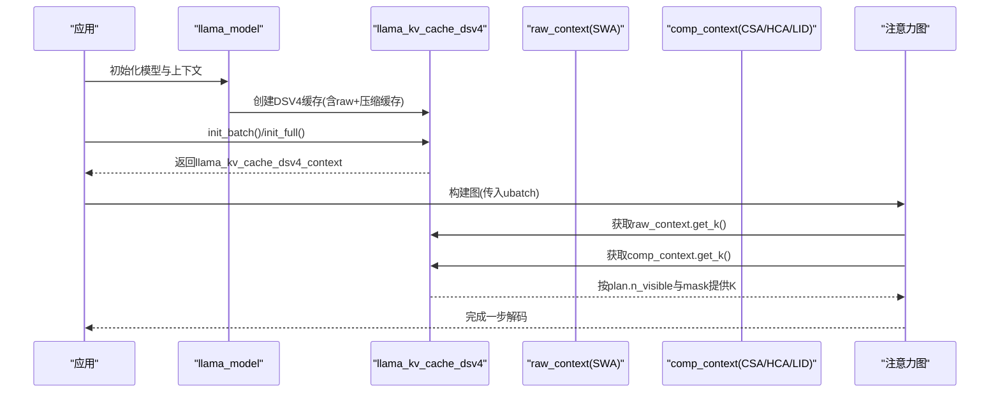
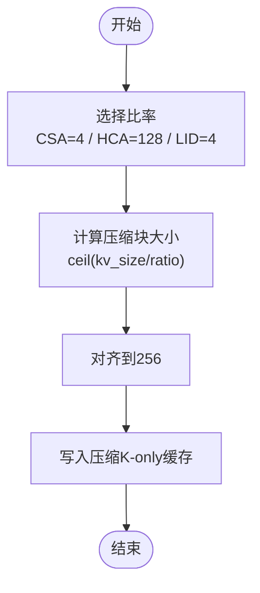
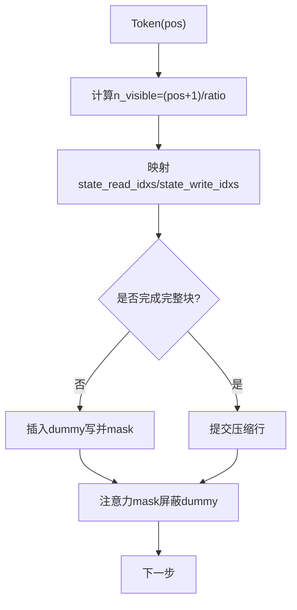
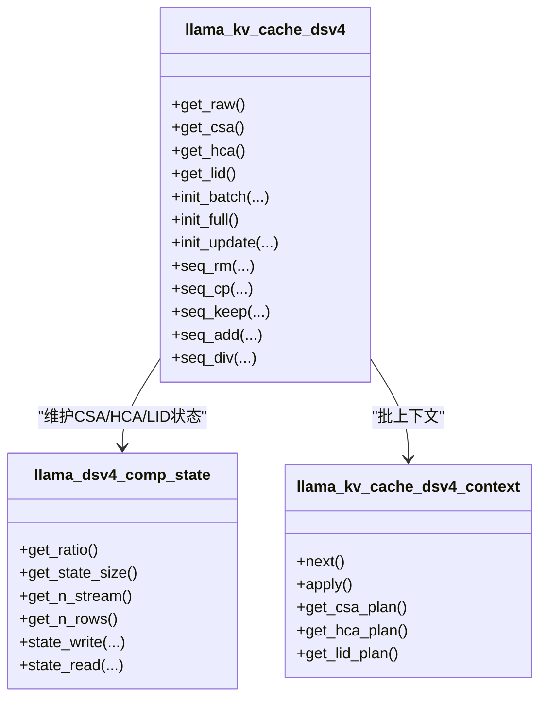
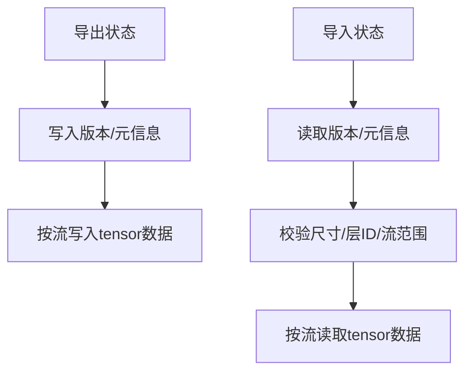
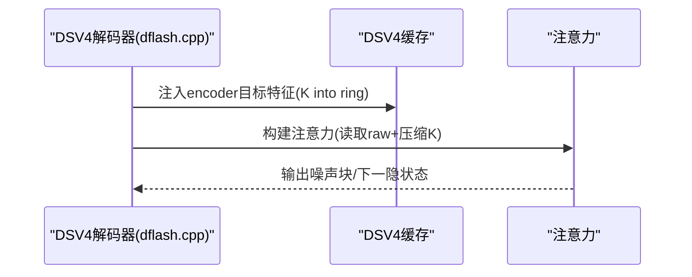
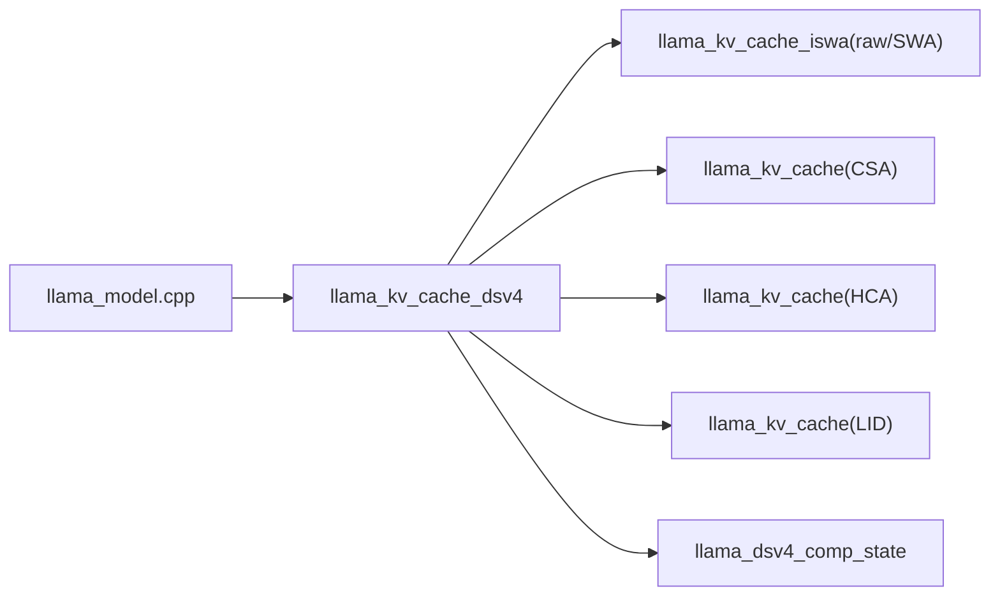

# DSV4缓存后端

<cite>
**本文引用的文件**   
- [llama-kv-cache-dsv4.h](file://src/llama-kv-cache-dsv4.h)
- [llama-kv-cache-dsv4.cpp](file://src/llama-kv-cache-dsv4.cpp)
- [llama-model.cpp](file://src/llama-model.cpp)
- [dflash.cpp](file://src/models/dflash.cpp)
- [llama.h](file://include/llama.h)
</cite>

## 目录
1. [引言](#引言)
2. [项目结构](#项目结构)
3. [核心组件](#核心组件)
4. [架构总览](#架构总览)
5. [详细组件分析](#详细组件分析)
6. [依赖关系分析](#依赖关系分析)
7. [性能与调优](#性能与调优)
8. [故障排查](#故障排查)
9. [结论](#结论)
10. [附录：使用示例与对比](#附录使用示例与对比)

## 引言
DSV4（KV Cache DSV4）是 llama.cpp 中面向 DeepSeek V4/DFlash 系列模型的一种专用 KV 缓存后端。它采用“原始/SWA token 缓存 + 仅 K 的压缩块缓存”的组合设计，通过分块存储、索引优化和访问模式规划，显著降低长上下文推理时的显存占用并提升吞吐。该文档从实现细节出发，解释其算法原理、配置参数、性能特征、适用场景与限制，并提供可操作的调优建议与使用示例。

## 项目结构
DSV4 相关代码主要位于以下位置：
- 头文件定义与类接口：[llama-kv-cache-dsv4.h](file://src/llama-kv-cache-dsv4.h)
- 具体实现与状态管理：[llama-kv-cache-dsv4.cpp](file://src/llama-kv-cache-dsv4.cpp)
- 模型侧选择与构造逻辑：[llama-model.cpp](file://src/llama-model.cpp)
- DFlash/DSpark 解码图构建与注入流程：[dflash.cpp](file://src/models/dflash.cpp)
- 公共上下文参数接口：[llama.h](file://include/llama.h)

**图表来源**
- [llama.h:366-428](file://include/llama.h#L366-L428)
- [llama-model.cpp:3005-3037](file://src/llama-model.cpp#L3005-L3037)
- [llama-kv-cache-dsv4.h:88-175](file://src/llama-kv-cache-dsv4.h#L88-L175)
- [llama-kv-cache-dsv4.cpp:18-29](file://src/llama-kv-cache-dsv4.cpp#L18-L29)
- [dflash.cpp:854-879](file://src/models/dflash.cpp#L854-L879)

**章节来源**
- [llama.h:366-428](file://include/llama.h#L366-L428)
- [llama-model.cpp:3005-3037](file://src/llama-model.cpp#L3005-L3037)
- [llama-kv-cache-dsv4.h:88-175](file://src/llama-kv-cache-dsv4.h#L88-L175)
- [llama-kv-cache-dsv4.cpp:18-29](file://src/llama-kv-cache-dsv4.cpp#L18-L29)
- [dflash.cpp:854-879](file://src/models/dflash.cpp#L854-L879)

## 核心组件
- llama_kv_cache_dsv4：DSV4 缓存主类，封装原始/SWA token 缓存与多个压缩 K-only 缓存（CSA/HCA/LID），并提供统一的内存操作接口。
- llama_dsv4_comp_state：压缩状态的运行时容器，维护每个层的 KV/score 张量、流布局、回滚快照等。
- llama_kv_cache_dsv4_context：批处理上下文，负责为每个 ubatch 生成压缩计划（comp_plan）、协调 raw/SWA 与压缩缓存的可见性与写入。
- llama_kv_cache_dsv4_raw_context：暴露 SWA 半区的 K 视图，用于注意力计算。
- llama_kv_cache_dsv4_comp_context：为压缩输出提供 K 张量视图，不具通用 apply() 语义。

关键职责划分：
- 存储层：raw/SWA token 缓存 + 三个压缩 K-only 缓存（CSA/HCA/LID）。
- 计划层：按 ratio 分块，计算每步可见块数、持久化状态更新、掩码与回滚快照。
- 执行层：在图构建阶段将 K 注入 ring cache，并在注意力分支中按可见性掩码读取压缩 K。

**章节来源**
- [llama-kv-cache-dsv4.h:11-76](file://src/llama-kv-cache-dsv4.h#L11-L76)
- [llama-kv-cache-dsv4.h:88-175](file://src/llama-kv-cache-dsv4.h#L88-L175)
- [llama-kv-cache-dsv4.h:179-266](file://src/llama-kv-cache-dsv4.h#L179-L266)
- [llama-kv-cache-dsv4.h:268-406](file://src/llama-kv-cache-dsv4.h#L268-L406)

## 架构总览
DSV4 的整体数据流如下：
- 输入：token 或 embedding 批次（ubatch），包含序列 ID、位置 pos、可选耦合序列集。
- 原始路径：ISWA 结构的 token 缓存（base+SWA），用于近期上下文与滑动窗口注意力。
- 压缩路径：按 CSA/HCA/LID 三种比率对 K 进行分块压缩，维护环形状态与持久化平面，供注意力分支按需读取。
- 图构建：根据 ubatch 生成 comp_plan，确定 n_visible、state_read_idxs/state_write_idxs、mask 与 RoPE 位置；必要时插入 dummy 块以稳定图拓扑。
- 执行：raw_context 提供 SWA K 视图；comp_context 提供压缩 K 视图；最终由注意力算子融合读取。

**图表来源**
- [llama-model.cpp:3005-3037](file://src/llama-model.cpp#L3005-L3037)
- [llama-kv-cache-dsv4.cpp:2022-2071](file://src/llama-kv-cache-dsv4.cpp#L2022-L2071)
- [dflash.cpp:854-879](file://src/models/dflash.cpp#L854-L879)

## 详细组件分析

### 分块存储与压缩策略
- 两种固定比率：
  - CSA_RATIO = 4：短周期压缩，适合频繁更新的短期记忆。
  - HCA_RATIO = 128：长周期压缩，适合长期历史。
- LID（lightning-indexer）复用 CSA_RATIO，作为额外索引通道。
- 压缩缓存仅保存 K，V 走原始/SWA 路径，减少存储与带宽压力。
- 压缩行大小按 dsv4_comp_size(kv_size, ratio) 向上取整，并按 256 对齐以提升访存效率。

**图表来源**
- [llama-kv-cache-dsv4.cpp:18-29](file://src/llama-kv-cache-dsv4.cpp#L18-L29)
- [llama-kv-cache-dsv4.cpp:1294-1332](file://src/llama-kv-cache-dsv4.cpp#L1294-L1332)

**章节来源**
- [llama-kv-cache-dsv4.cpp:18-29](file://src/llama-kv-cache-dsv4.cpp#L18-L29)
- [llama-kv-cache-dsv4.cpp:1294-1332](file://src/llama-kv-cache-dsv4.cpp#L1294-L1332)

### 索引优化与可见性控制
- 每个 token 的可见压缩行数 n_visible = floor((pos+1)/ratio)。
- 通过 state_read_idxs 与 state_write_idxs 精确映射当前 ubatch 需要读取/写入的压缩行。
- 当某步没有完整块完成时，插入 dummy 写至最后一个槽位并 mask 掉，保证图拓扑稳定。
- 支持 overlap 模式（CSA/LID）：将“上一窗口”和“当前窗口”的索引拼接，便于增量更新。

**图表来源**
- [llama-kv-cache-dsv4.cpp:431-741](file://src/llama-kv-cache-dsv4.cpp#L431-L741)

**章节来源**
- [llama-kv-cache-dsv4.cpp:431-741](file://src/llama-kv-cache-dsv4.cpp#L431-L741)

### 访问模式优化与流布局
- 多序列时，独立序列可并行到不同 graph stream；耦合序列必须共享同一 stream。
- 流偏移 dsv4_stream_offset(n_stream, seq_id, size) 确保跨序列的状态隔离。
- 对于 coupled 序列集，会重写 ubatch 以保证等长与顺序一致，避免状态错乱。

**图表来源**
- [llama-kv-cache-dsv4.h:88-175](file://src/llama-kv-cache-dsv4.h#L88-L175)
- [llama-kv-cache-dsv4.h:268-406](file://src/llama-kv-cache-dsv4.h#L268-L406)

**章节来源**
- [llama-kv-cache-dsv4.h:88-175](file://src/llama-kv-cache-dsv4.h#L88-L175)
- [llama-kv-cache-dsv4.h:268-406](file://src/llama-kv-cache-dsv4.h#L268-L406)
- [llama-kv-cache-dsv4.cpp:200-208](file://src/llama-kv-cache-dsv4.cpp#L200-L208)
- [llama-kv-cache-dsv4.cpp:82-175](file://src/llama-kv-cache-dsv4.cpp#L82-L175)

### 状态序列化与回滚
- 支持 K 缓存与压缩状态的版本化读写（DSV4_STATE_MAGIC/VERSION/K_CACHE_STATE_VER/COMP_STATE_VER）。
- 支持设备端回滚快照：在每个 state_size 平面内维护 restore/snapshot 索引，配合 n_rs_seq 实现多步回滚。
- 全量或部分状态导出/导入，按流维度序列化 tensor streams。

**图表来源**
- [llama-kv-cache-dsv4.cpp:253-334](file://src/llama-kv-cache-dsv4.cpp#L253-L334)
- [llama-kv-cache-dsv4.cpp:336-416](file://src/llama-kv-cache-dsv4.cpp#L336-L416)

**章节来源**
- [llama-kv-cache-dsv4.cpp:253-334](file://src/llama-kv-cache-dsv4.cpp#L253-L334)
- [llama-kv-cache-dsv4.cpp:336-416](file://src/llama-kv-cache-dsv4.cpp#L336-L416)

### 与模型图的集成
- DFlash/DSpark 解码器在 embd 模式下将 encoder 目标特征投影并通过 wkv 注入 ring cache；在 token 模式下经过三阶段（hc + MLA + MoE）生成噪声块。
- 注意力输入通过 ISWA 风格的 attn inp k 接口接入，DSV4 的 raw 与压缩 K 均按 plan 暴露给图。

**图表来源**
- [dflash.cpp:854-879](file://src/models/dflash.cpp#L854-L879)

**章节来源**
- [dflash.cpp:854-879](file://src/models/dflash.cpp#L854-L879)

## 依赖关系分析
- llama_kv_cache_dsv4 依赖：
  - llama_kv_cache_iswa（raw/SWA token 缓存）
  - llama_kv_cache（通用压缩 K-only 缓存）
  - llama_dsv4_comp_state（压缩状态）
- 模型侧通过 llama_model.cpp 根据架构与超参决定实例化 DSV4 或 ISWA 缓存。
- 上下文参数（如 offload_kqv、swa_full、kv_unified、n_ctx_seq、n_seq_max、n_ubatch）影响 DSV4 的构造与行为。

**图表来源**
- [llama-model.cpp:3005-3037](file://src/llama-model.cpp#L3005-L3037)
- [llama-kv-cache-dsv4.cpp:1294-1332](file://src/llama-kv-cache-dsv4.cpp#L1294-L1332)

**章节来源**
- [llama-model.cpp:3005-3037](file://src/llama-model.cpp#L3005-L3037)
- [llama-kv-cache-dsv4.cpp:1294-1332](file://src/llama-kv-cache-dsv4.cpp#L1294-L1332)

## 性能与调优

### 关键配置参数
- 上下文参数（来自 llama_context_params）：
  - n_ctx/n_ctx_seq：上下文长度与每序列长度。
  - n_batch/n_ubatch：逻辑批与物理批大小。
  - n_seq_max：最大序列数。
  - offload_kqv：是否卸载 KQV 与 KV 缓存到设备。
  - swa_full：是否启用 full-size SWA 缓存。
  - kv_unified：是否在注意力计算中使用统一缓冲。
  - type_k/type_v：K/V 数据类型（实验性）。
- DSV4 内部常量：
  - DSV4_CSA_RATIO = 4
  - DSV4_HCA_RATIO = 128
  - 压缩行对齐到 256

建议：
- 长上下文优先开启 offload_kqv 与合适的 swa_full，结合较大的 n_ctx_seq。
- 在高并发多序列场景下，谨慎设置 kv_unified；若序列前缀共享较少，关闭 unified 可能改善性能。
- 调整 n_ubatch 以匹配硬件吞吐峰值，同时避免超出显存上限。

**章节来源**
- [llama.h:366-428](file://include/llama.h#L366-L428)
- [llama-kv-cache-dsv4.cpp:18-29](file://src/llama-kv-cache-dsv4.cpp#L18-L29)

### 性能特点
- 优势：
  - 显著降低长上下文的 KV 显存占用（仅 K 压缩 + 大比率 HCA）。
  - 通过 comp_plan 与 mask 机制，保持图拓扑稳定，减少重编译开销。
  - 支持设备端回滚快照，利于多步推理与探索式采样。
- 限制：
  - 当前实现仅支持非 unified 模式（即使传入 unified 标志）。
  - 耦合序列需等长且同序，否则抛出异常。
  - 压缩缓存与 token_pos 存在概念混用风险（代码注释已标注）。

**章节来源**
- [llama-kv-cache-dsv4.h:82-86](file://src/llama-kv-cache-dsv4.h#L82-L86)
- [llama-kv-cache-dsv4.cpp:82-175](file://src/llama-kv-cache-dsv4.cpp#L82-L175)

### 调优最佳实践
- 合理选择 ratio：
  - CSA_RATIO=4 适合高频更新、短记忆；HCA_RATIO=128 适合长记忆。
  - 若模型架构允许，可通过 hparams.dsv4_compress_ratios 控制各层比率（实现中按层过滤）。
- 批大小与序列数：
  - 增大 n_ubatch 提升吞吐，但需监控显存；n_seq_max 不宜过大以免状态膨胀。
- 流并行：
  - 独立序列尽量分散到不同 stream；耦合序列保持在同一 stream。
- 回滚与快照：
  - 设置 n_rs_seq > 0 启用回滚；注意状态平面大小与显存占用。
- 调试开关：
  - 环境变量 LLAMA_DSV4_COMPRESS_DEBUG 可打印计划细节，辅助定位问题。

**章节来源**
- [llama-kv-cache-dsv4.cpp:1280-1332](file://src/llama-kv-cache-dsv4.cpp#L1280-L1332)
- [llama-kv-cache-dsv4.cpp:722-738](file://src/llama-kv-cache-dsv4.cpp#L722-L738)

## 故障排查
常见问题与定位方法：
- “DSV4 single compressed stream cannot serve multiple sequences”
  - 原因：单流无法服务多序列；检查 n_stream 与 ubatch 的 n_seqs_unq。
  - 解决：确保多序列使用多流或合并为耦合序列集。
- “DSV4 sequence id out of stream range”
  - 原因：序列 ID 超出流范围。
  - 解决：校验 seq_id 与 n_stream 的一致性。
- “DSV4 coupled raw writes require equal sequence lengths”
  - 原因：耦合序列长度不一致。
  - 解决：预处理 ubatch，保证等长。
- “DSV4 CSA sequence positions are not contiguous”
  - 原因：CSA 写入位置不连续。
  - 解决：检查 pos 序列与 ratio 的对齐关系。
- 状态版本/尺寸不匹配
  - 原因：导出的状态与当前缓存尺寸/层数不一致。
  - 解决：确保导出与导入环境一致，或重新初始化缓存。

**章节来源**
- [llama-kv-cache-dsv4.cpp:447-448](file://src/llama-kv-cache-dsv4.cpp#L447-L448)
- [llama-kv-cache-dsv4.cpp:51-60](file://src/llama-kv-cache-dsv4.cpp#L51-L60)
- [llama-kv-cache-dsv4.cpp:108-112](file://src/llama-kv-cache-dsv4.cpp#L108-L112)
- [llama-kv-cache-dsv4.cpp:592-594](file://src/llama-kv-cache-dsv4.cpp#L592-L594)
- [llama-kv-cache-dsv4.cpp:385-397](file://src/llama-kv-cache-dsv4.cpp#L385-L397)

## 结论
DSV4 缓存后端通过“原始/SWA token 缓存 + 仅 K 的压缩块缓存”的分层设计，结合精细的计划与掩码机制，有效缓解长上下文推理中的显存瓶颈，并保持图拓扑稳定。其适用于 DeepSeek V4/DFlash 系列模型的长文本生成与多轮对话场景。使用时应关注比率选择、批大小、流并行与回滚快照的配置，并结合调试开关进行性能分析与问题定位。

## 附录：使用示例与对比

### 使用示例（步骤说明）
- 加载模型并创建上下文：
  - 调用模型加载 API，设置 llama_context_params（n_ctx、n_batch、offload_kqv、swa_full、kv_unified 等）。
- 自动选择 DSV4：
  - 模型侧根据架构与超参自动实例化 llama_kv_cache_dsv4（参见 llama-model.cpp 的选择逻辑）。
- 运行推理：
  - 通过 llama_decode 或等价接口传入 ubatch；DSV4 内部按 comp_plan 暴露 raw 与压缩 K 给注意力图。
- 状态持久化：
  - 使用 state_write/state_read 导出/导入 KV 与压缩状态，注意版本与尺寸一致性。

参考路径：
- [llama-model.cpp:3005-3037](file://src/llama-model.cpp#L3005-L3037)
- [llama-kv-cache-dsv4.cpp:2022-2071](file://src/llama-kv-cache-dsv4.cpp#L2022-L2071)
- [llama-kv-cache-dsv4.cpp:336-416](file://src/llama-kv-cache-dsv4.cpp#L336-L416)

### 与其他缓存后端的对比
- 与 ISWA 缓存对比：
  - ISWA 更通用，适合多种模型；DSV4 针对 DeepSeek V4/DFlash 优化，具备压缩 K-only 与环状状态。
- 与统一 KV 缓存对比：
  - DSV4 当前不支持 unified 模式；在多序列前缀共享较少的场景，关闭 unified 可能更好。
- 与纯 token 缓存对比：
  - DSV4 引入压缩 K-only 缓存，显著降低显存占用，尤其适合长上下文；代价是额外的计划与掩码开销。

**章节来源**
- [llama-kv-cache-dsv4.h:82-86](file://src/llama-kv-cache-dsv4.h#L82-L86)
- [llama-model.cpp:3005-3037](file://src/llama-model.cpp#L3005-L3037)