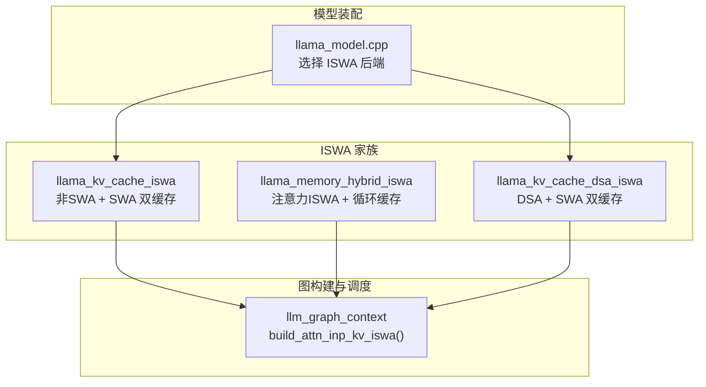
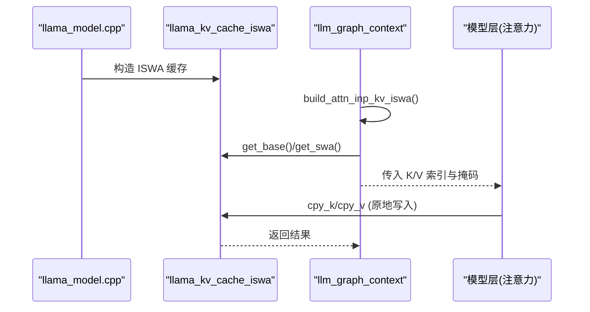
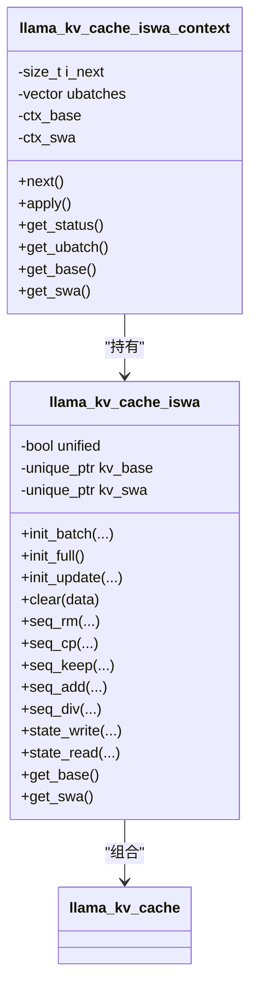
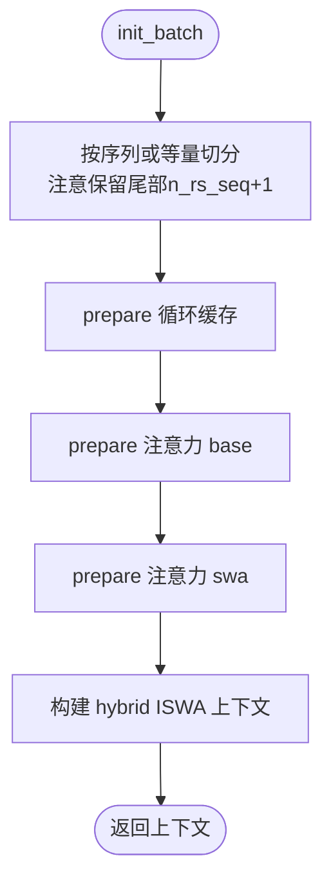
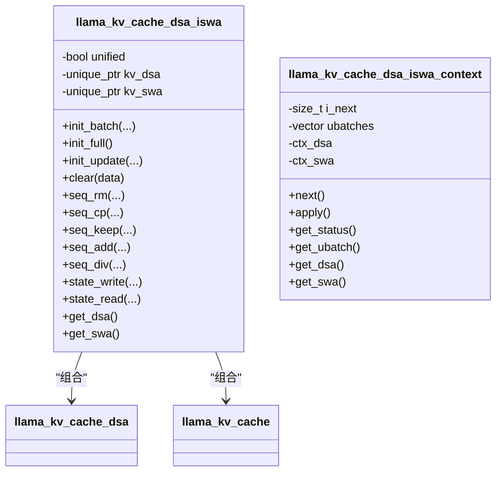
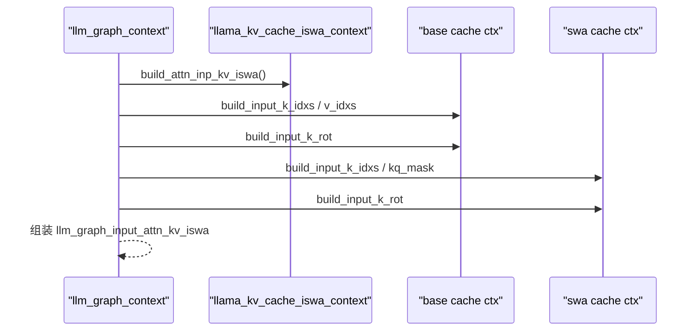
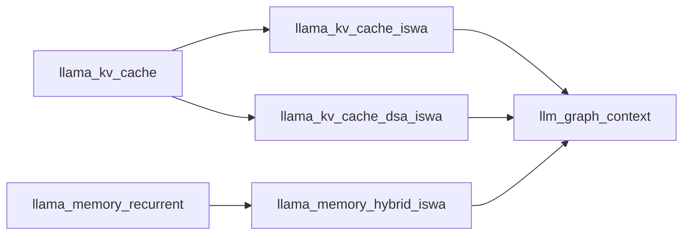

# ISWA缓存后端

<cite>
**本文引用的文件**   
- [llama-kv-cache-iswa.h](file://src/llama-kv-cache-iswa.h)
- [llama-kv-cache-iswa.cpp](file://src/llama-kv-cache-iswa.cpp)
- [llama-memory-hybrid-iswa.h](file://src/llama-memory-hybrid-iswa.h)
- [llama-memory-hybrid-iswa.cpp](file://src/llama-memory-hybrid-iswa.cpp)
- [llama-kv-cache-dsa-iswa.h](file://src/llama-kv-cache-dsa-iswa.h)
- [llama-kv-cache-dsa-iswa.cpp](file://src/llama-kv-cache-dsa-iswa.cpp)
- [llama-graph.cpp](file://src/llama-graph.cpp)
- [llama-model.cpp](file://src/llama-model.cpp)
- [llama-kv-cache.h](file://src/llama-kv-cache.h)
- [llama-hparams.h](file://src/llama-hparams.h)
- [llama.h](file://include/llama.h)
- [common.h](file://common/common.h)
</cite>

## 目录
1. [引言](#引言)
2. [项目结构](#项目结构)
3. [核心组件](#核心组件)
4. [架构总览](#架构总览)
5. [详细组件分析](#详细组件分析)
6. [依赖关系分析](#依赖关系分析)
7. [性能与调优](#性能与调优)
8. [故障排查指南](#故障排查指南)
9. [结论](#结论)
10. [附录：配置选项与使用示例](#附录配置选项与使用示例)

## 引言
ISWA（In-Place Swap Architecture，原地交换架构）是 llama.cpp 中面向滑动窗口注意力（SWA）的 KV 缓存后端实现。其核心思想是将模型层按是否启用 SWA 拆分为两类子缓存：
- 非 SWA 层：使用常规 KV 缓存（或 DSA 变体）。
- SWA 层：使用带滑动窗口语义的 KV 缓存。

通过“原地交换”策略，ISWA 在批处理时直接复用底层内存块，避免额外拷贝；结合统一流（unified stream）和批量切分策略，进一步降低分配与同步开销。该设计兼顾了高吞吐、低延迟与强一致性，适用于混合注意力/循环结构的模型。

## 项目结构
围绕 ISWA 的关键代码位于 src 目录下，主要包含三类实现：
- 纯注意力 ISWA：llama_kv_cache_iswa
- 注意力+循环混合 ISWA：llama_memory_hybrid_iswa
- DSA（多流注意力）ISWA：llama_kv_cache_dsa_iswa

**图表来源**
- [llama-kv-cache-iswa.h:11-15](file://src/llama-kv-cache-iswa.h#L11-L15)
- [llama-memory-hybrid-iswa.h:12-20](file://src/llama-memory-hybrid-iswa.h#L12-L20)
- [llama-kv-cache-dsa-iswa.h:7-13](file://src/llama-kv-cache-dsa-iswa.h#L7-L13)
- [llama-graph.cpp:3677-3734](file://src/llama-graph.cpp#L3677-L3734)
- [llama-model.cpp:3240-3267](file://src/llama-model.cpp#L3240-L3267)

**章节来源**
- [llama-kv-cache-iswa.h:1-156](file://src/llama-kv-cache-iswa.h#L1-L156)
- [llama-memory-hybrid-iswa.h:1-142](file://src/llama-memory-hybrid-iswa.h#L1-L142)
- [llama-kv-cache-dsa-iswa.h:1-135](file://src/llama-kv-cache-dsa-iswa.h#L1-L135)
- [llama-graph.cpp:3677-3734](file://src/llama-graph.cpp#L3677-L3734)
- [llama-model.cpp:3240-3267](file://src/llama-model.cpp#L3240-L3267)

## 核心组件
- llama_kv_cache_iswa：将模型层按 is_swa 过滤为两组，分别维护 kv_base 与 kv_swa 两个缓存实例，对外暴露统一的序列操作接口。
- llama_memory_hybrid_iswa：在 ISWA 基础上叠加循环状态缓存（recurrent），用于支持每层可能是注意力或循环结构的混合模型。
- llama_kv_cache_dsa_iswa：面向 DSA（多流注意力）场景，将 DSA 子缓存与 SWA 缓存组合，提供一致的批处理与状态读写接口。

关键特性：
- 原地交换：批处理时通过 prepare/apply 流程直接写入底层 buffer，避免中间拷贝。
- 内存复用：通过统一流（unified）与等量切分策略，减少跨流复制与对齐开销。
- 一致性保证：对序列删除/复制/保留等操作在 base 与 swa 两侧保持一致；状态读写支持部分/全量模式。

**章节来源**
- [llama-kv-cache-iswa.h:11-98](file://src/llama-kv-cache-iswa.h#L11-L98)
- [llama-memory-hybrid-iswa.h:12-91](file://src/llama-memory-hybrid-iswa.h#L12-L91)
- [llama-kv-cache-dsa-iswa.h:7-78](file://src/llama-kv-cache-dsa-iswa.h#L7-L78)

## 架构总览
ISWA 的整体数据流如下：
- 模型加载阶段：根据模型参数与配置选择 ISWA 后端。
- 图构建阶段：针对 ISWA 上下文构建注意力输入（含 K/V 索引与掩码），区分 base 与 swa 分支。
- 批处理阶段：先尝试简单切分，失败则回退到等量切分；prepare 后得到 slot 信息，执行前向计算，最后 apply 提交更新。

**图表来源**
- [llama-model.cpp:3240-3267](file://src/llama-model.cpp#L3240-L3267)
- [llama-graph.cpp:3677-3734](file://src/llama-graph.cpp#L3677-L3734)
- [llama-kv-cache-iswa.cpp:108-157](file://src/llama-kv-cache-iswa.cpp#L108-L157)

## 详细组件分析

### llama_kv_cache_iswa（纯注意力 ISWA）
职责与要点：
- 构造时根据 model.hparams.is_swa(il) 将层分为两类，分别创建 kv_base 与 kv_swa。
- SWA 缓存大小按 hparams.n_swa 与统一流 n_seq_max 计算，并对齐到 256 以提升性能；可选 swa_full 使 SWA 缓存尺寸等于 base 缓存。
- 批处理 init_batch 优先尝试简单切分，失败回退到等量切分；prepare 成功后生成 ISWA 上下文。
- 序列操作（seq_rm/seq_cp/seq_keep/seq_add/seq_div）在 base 与 swa 两侧一致执行。
- 状态读写 state_write/state_read 支持 PARTIAL_ONLY 标志，仅写/读非 SWA 侧以优化 IO。

**图表来源**
- [llama-kv-cache-iswa.h:14-98](file://src/llama-kv-cache-iswa.h#L14-L98)
- [llama-kv-cache-iswa.h:100-156](file://src/llama-kv-cache-iswa.h#L100-L156)

**章节来源**
- [llama-kv-cache-iswa.cpp:34-106](file://src/llama-kv-cache-iswa.cpp#L34-L106)
- [llama-kv-cache-iswa.cpp:108-157](file://src/llama-kv-cache-iswa.cpp#L108-L157)
- [llama-kv-cache-iswa.cpp:159-241](file://src/llama-kv-cache-iswa.cpp#L159-L241)
- [llama-kv-cache-iswa.cpp:257-279](file://src/llama-kv-cache-iswa.cpp#L257-L279)

### llama_memory_hybrid_iswa（注意力+循环混合 ISWA）
职责与要点：
- 组合 llama_kv_cache_iswa（注意力）与 llama_memory_recurrent（循环状态），按层属性（is_recr）路由。
- 批处理时先准备 recurrent 批次，再准备 attention 的 base 与 swa 两部分；确保尾部 n_rs_seq+1 个 token 不被拆分，以保证回滚快照有效。
- 提供统一的序列操作与状态读写接口，内部转发至两个子缓存。

**图表来源**
- [llama-memory-hybrid-iswa.cpp:66-128](file://src/llama-memory-hybrid-iswa.cpp#L66-L128)

**章节来源**
- [llama-memory-hybrid-iswa.cpp:11-64](file://src/llama-memory-hybrid-iswa.cpp#L11-L64)
- [llama-memory-hybrid-iswa.cpp:66-128](file://src/llama-memory-hybrid-iswa.cpp#L66-L128)
- [llama-memory-hybrid-iswa.cpp:143-203](file://src/llama-memory-hybrid-iswa.cpp#L143-L203)

### llama_kv_cache_dsa_iswa（DSA + SWA 组合）
职责与要点：
- 将 DSA（多流注意力）子缓存与 SWA 缓存组合，同样按 is_swa 过滤层。
- 批处理时分别 prepare MLA/LID（DSA 的两类路径）与 SWA，并合并为统一上下文。
- 支持 get_can_shift 判断是否可整体移位，要求 DSA 与 SWA 尺寸一致。

**图表来源**
- [llama-kv-cache-dsa-iswa.h:13-78](file://src/llama-kv-cache-dsa-iswa.h#L13-L78)
- [llama-kv-cache-dsa-iswa.h:80-135](file://src/llama-kv-cache-dsa-iswa.h#L80-L135)

**章节来源**
- [llama-kv-cache-dsa-iswa.cpp:14-76](file://src/llama-kv-cache-dsa-iswa.cpp#L14-L76)
- [llama-kv-cache-dsa-iswa.cpp:129-219](file://src/llama-kv-cache-dsa-iswa.cpp#L129-L219)
- [llama-kv-cache-dsa-iswa.cpp:236-258](file://src/llama-kv-cache-dsa-iswa.cpp#L236-L258)

### 图构建与调用链（ISWA 注意力输入）
- llm_graph_context::build_attn_inp_kv_iswa 从 ISWA 上下文获取 base 与 swa 的 K/V 索引与掩码，并分别注入到图输入结构中。
- 对于非 SWA 分支，断言 swa_type 应为 NONE；对于 SWA 分支，断言 swa_type 不为 NONE。

**图表来源**
- [llama-graph.cpp:3677-3734](file://src/llama-graph.cpp#L3677-L3734)

**章节来源**
- [llama-graph.cpp:3651-3672](file://src/llama-graph.cpp#L3651-L3672)
- [llama-graph.cpp:3677-3734](file://src/llama-graph.cpp#L3677-L3734)

## 依赖关系分析
- llama_kv_cache_iswa 依赖 llama_kv_cache 作为基础实现，并通过 filter 回调将层路由到 base 或 swa。
- llama_memory_hybrid_iswa 依赖 llama_kv_cache_iswa 与 llama_memory_recurrent，形成注意力与循环状态的组合。
- llama_kv_cache_dsa_iswa 依赖 llama_kv_cache_dsa 与 llama_kv_cache，适配 DSA 与 SWA 的组合。
- 图构建层 llm_graph_context 依赖 ISWA 上下文提供的 K/V 索引与掩码。

**图表来源**
- [llama-kv-cache-iswa.cpp:95-105](file://src/llama-kv-cache-iswa.cpp#L95-L105)
- [llama-kv-cache-dsa-iswa.cpp:65-75](file://src/llama-kv-cache-dsa-iswa.cpp#L65-L75)
- [llama-memory-hybrid-iswa.cpp:34-64](file://src/llama-memory-hybrid-iswa.cpp#L34-L64)
- [llama-graph.cpp:3677-3734](file://src/llama-graph.cpp#L3677-L3734)

**章节来源**
- [llama-kv-cache-iswa.cpp:95-105](file://src/llama-kv-cache-iswa.cpp#L95-L105)
- [llama-kv-cache-dsa-iswa.cpp:65-75](file://src/llama-kv-cache-dsa-iswa.cpp#L65-L75)
- [llama-memory-hybrid-iswa.cpp:34-64](file://src/llama-memory-hybrid-iswa.cpp#L34-L64)
- [llama-graph.cpp:3677-3734](file://src/llama-graph.cpp#L3677-L3734)

## 性能与调优
- 对齐与填充：SWA 缓存大小会按 256 对齐，以提升硬件友好性与吞吐（见注释链接）。
- swa_full：当启用 full-size SWA 缓存时，SWA 缓存尺寸与 base 一致，可减少跨流不一致带来的开销，但会增加内存占用。
- 统一流（unified）：当启用统一流时，SWA 缓存容量可按 n_seq_max 扩展，有利于批内多序列共享。
- 批切分策略：优先尝试简单切分，失败回退到等量切分；在混合 ISWA 中需保留尾部 n_rs_seq+1 个 token 以避免回滚快照失效。
- 内存复用与零拷贝：prepare/apply 流程直接写入底层 buffer，避免中间拷贝；K/V 旋转通过 Hadamard 乘法就地变换。

建议调优点：
- 合理设置 swa_full 与 n_swa，平衡显存与精度。
- 在统一流模式下调整 n_seq_max 与 n_ubatch，提升批吞吐。
- 关注 GPU/CPU 后端对 256 对齐的优化效果，必要时开启 offload_kqv 以利用设备内存。

[本节为通用指导，不直接分析具体文件]

## 故障排查指南
常见问题与定位：
- 批处理失败（FAILED_PREPARE）：检查是否无法找到合适的切分方案；确认 unified 与 n_seq_max 设置是否合理；在混合 ISWA 中确认尾部 n_rs_seq+1 未被拆分。
- 移位不支持（get_can_shift 返回 false）：检查 base 与 swa 尺寸是否一致；若使用 DSA，还需确保 DSA 与 SWA 尺寸一致。
- 状态读写异常：确认 PARTIAL_ONLY 标志是否正确设置；确保 base 与 swa 均被正确读写。

参考实现位置：
- 批处理失败路径与日志输出
- get_can_shift 条件判断
- state_write/state_read 的部分/全量逻辑

**章节来源**
- [llama-kv-cache-iswa.cpp:159-241](file://src/llama-kv-cache-iswa.cpp#L159-L241)
- [llama-kv-cache-iswa.cpp:251-255](file://src/llama-kv-cache-iswa.cpp#L251-L255)
- [llama-kv-cache-iswa.cpp:257-271](file://src/llama-kv-cache-iswa.cpp#L257-L271)
- [llama-kv-cache-dsa-iswa.cpp:230-234](file://src/llama-kv-cache-dsa-iswa.cpp#L230-L234)
- [llama-kv-cache-dsa-iswa.cpp:236-250](file://src/llama-kv-cache-dsa-iswa.cpp#L236-L250)

## 结论
ISWA 通过将模型层按 SWA 属性拆分到不同缓存，并结合原地交换、统一流与批切分策略，实现了高效、可扩展且一致的 KV 缓存后端。它在纯注意力、混合注意力/循环以及 DSA 场景下均提供了统一接口，便于上层图构建与推理管线无缝集成。通过合理配置 swa_full、n_swa、unified 等参数，可在内存与性能之间取得良好平衡。

[本节为总结性内容，不直接分析具体文件]

## 附录：配置选项与使用示例

### 配置选项
- swa_full：是否使用 full-size SWA 缓存（增大 SWA 缓存尺寸至与 base 一致）。
- n_swa：滑动窗口长度。
- swa_type：SWA 类型枚举（NONE 或其他类型）。
- unified：是否启用统一流，影响 SWA 缓存容量与批切分策略。
- offload_kqv：是否将 K/V/Q 卸载到设备内存。
- n_ctx_seq/n_seq_max/n_ubatch：上下文长度、最大序列数与微批次大小。

上述选项在以下头文件中定义或引用：
- [llama.h:412](file://include/llama.h#L412)
- [llama.h:607](file://include/llama.h#L607)
- [llama-hparams.h:24-24](file://src/llama-hparams.h#L24-L24)
- [llama-hparams.h:161-185](file://src/llama-hparams.h#L161-L185)
- [common.h:579](file://common/common.h#L579)

### 使用示例（概念性步骤）
- 初始化模型与上下文时，根据模型参数与配置选择 ISWA 后端（由 llama_model.cpp 内部决定）。
- 构建图时调用 build_attn_inp_kv_iswa，获取 base 与 swa 的 K/V 索引与掩码。
- 批处理时调用 init_batch，进行 prepare 与 apply；在混合 ISWA 中确保尾部 token 不被拆分。
- 如需持久化状态，调用 state_write/state_read，并根据需要设置 PARTIAL_ONLY。

[本节为概念性说明，不直接分析具体文件]