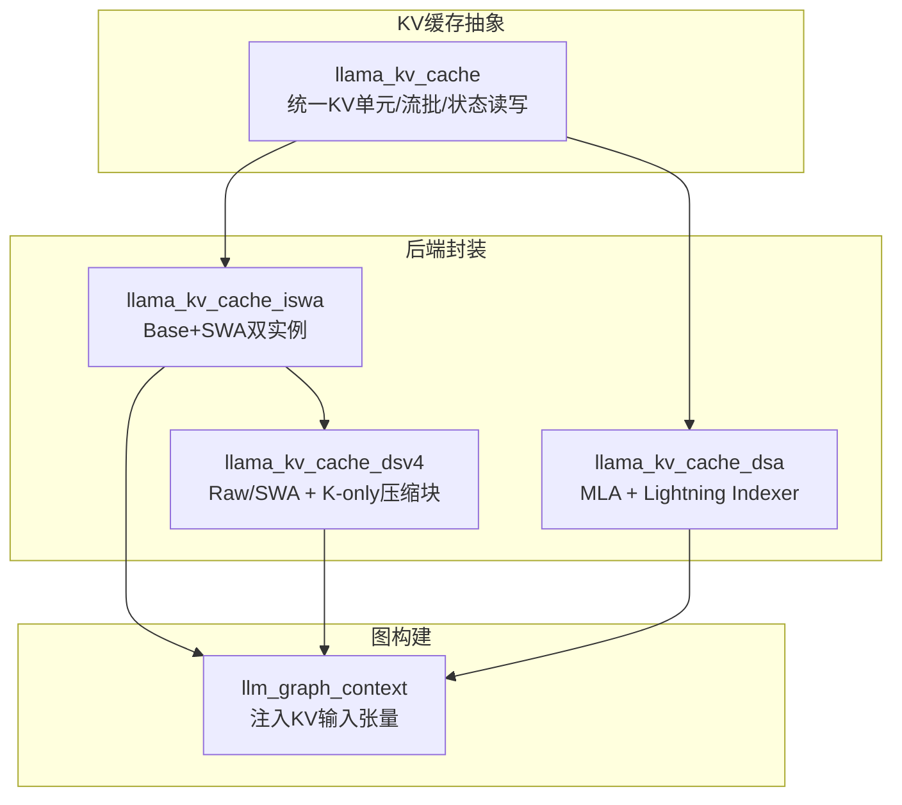
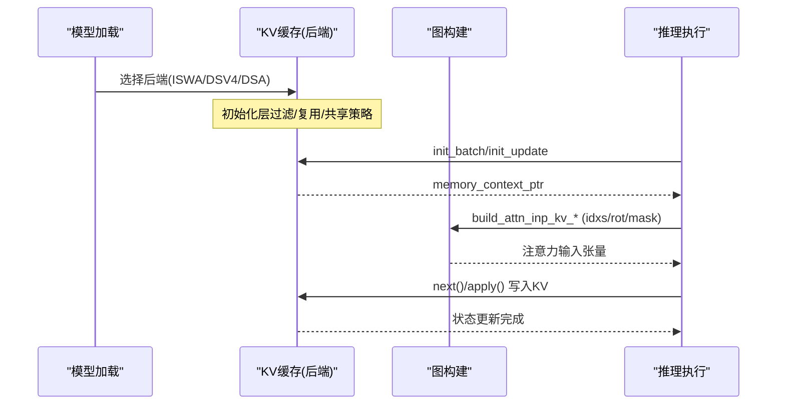
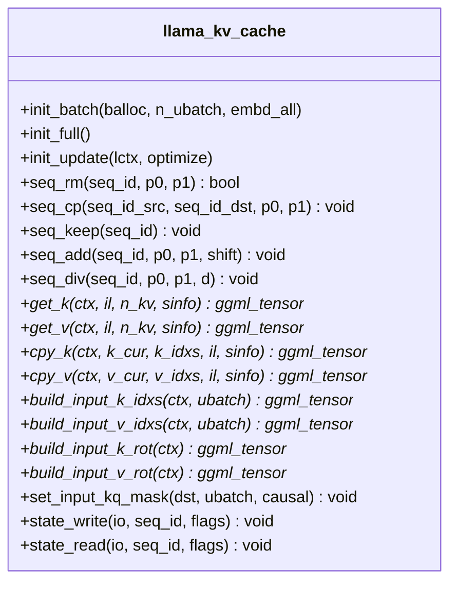
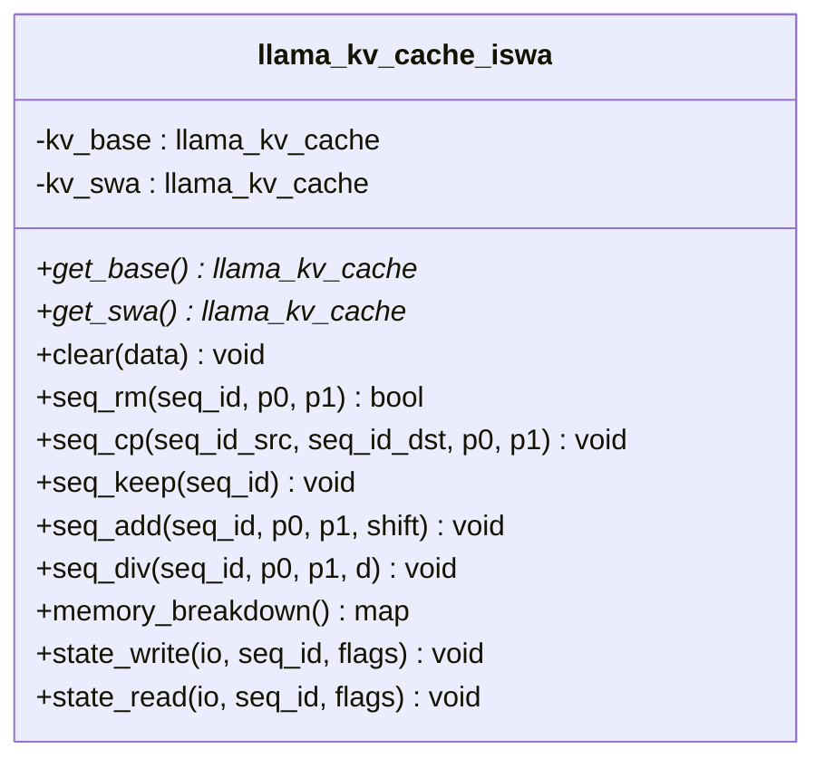
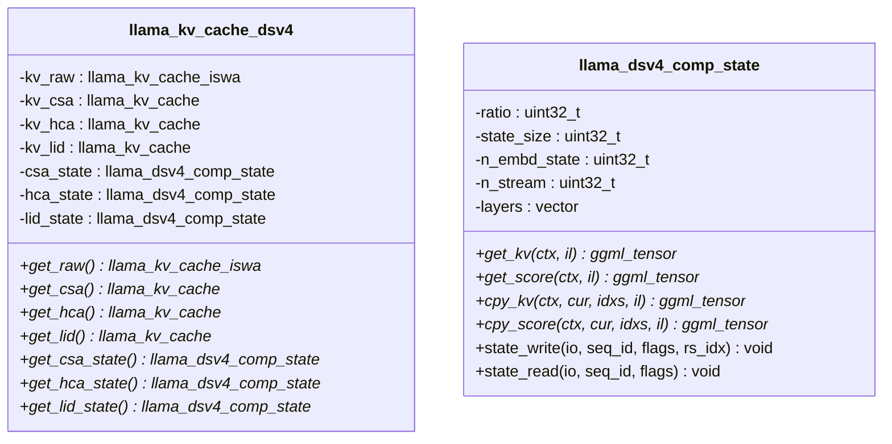
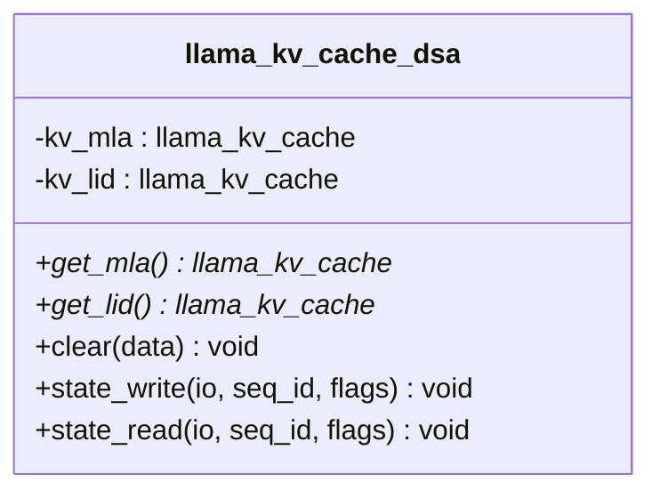
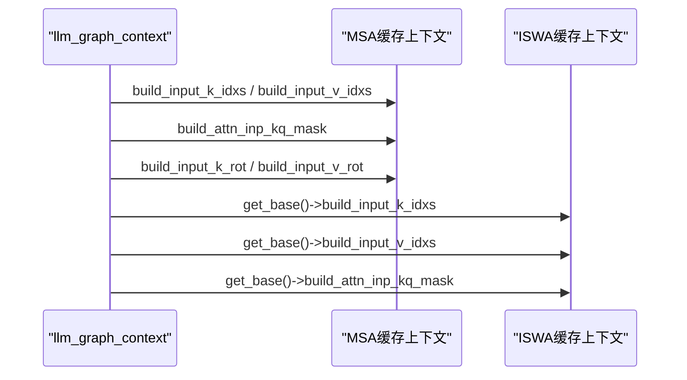
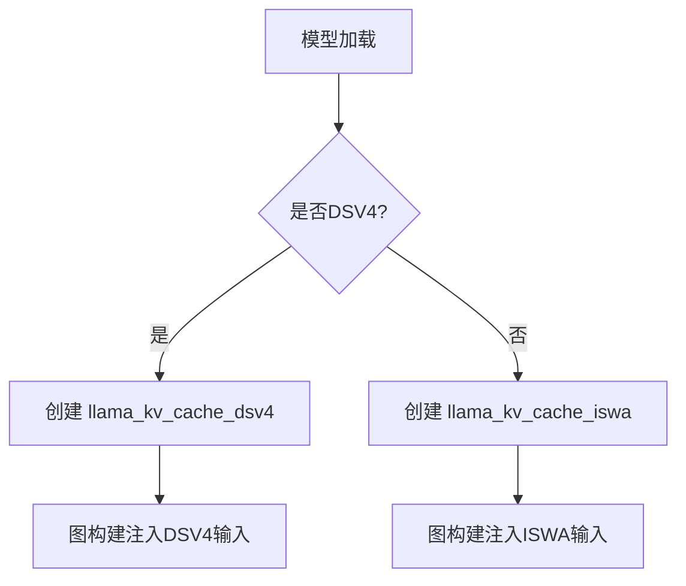

# KV缓存系统

<cite>
**本文引用的文件**   
- [llama-kv-cache.h](file://src/llama-kv-cache.h)
- [llama-kv-cache.cpp](file://src/llama-kv-cache.cpp)
- [llama-kv-cache-iswa.h](file://src/llama-kv-cache-iswa.h)
- [llama-kv-cache-iswa.cpp](file://src/llama-kv-cache-iswa.cpp)
- [llama-kv-cache-dsv4.h](file://src/llama-kv-cache-dsv4.h)
- [llama-kv-cache-dsv4.cpp](file://src/llama-kv-cache-dsv4.cpp)
- [llama-kv-cache-dsa.h](file://src/llama-kv-cache-dsa.h)
- [llama-kv-cache-dsa.cpp](file://src/llama-kv-cache-dsa.cpp)
- [llama-model.cpp](file://src/llama-model.cpp)
- [llama-graph.cpp](file://src/llama-graph.cpp)
- [passkey.cpp](file://examples/passkey/passkey.cpp)
</cite>

## 目录
1. [引言](#引言)
2. [项目结构](#项目结构)
3. [核心组件](#核心组件)
4. [架构总览](#架构总览)
5. [详细组件分析](#详细组件分析)
6. [依赖关系分析](#依赖关系分析)
7. [性能与调优指南](#性能与调优指南)
8. [故障排查指南](#故障排查指南)
9. [结论](#结论)

## 引言
本技术文档聚焦于 llama.cpp 的 KV 缓存子系统，系统性阐述其数据结构、存储后端（ISWA、DSV4、DSA）、生命周期管理（分配、更新、回收、持久化）、长文本优化（滑动窗口、压缩、分层）以及并发与一致性保证。读者可据此理解不同后端在内存布局、访问模式与适用场景上的差异，并掌握面向生产环境的配置与调优方法。

## 项目结构
KV 缓存相关代码集中在 src 目录下，采用“基础抽象 + 多后端实现”的分层组织：
- 基础抽象：llama_kv_cache 提供统一的 KV 单元、流式批处理、索引构建、状态读写等能力
- 后端封装：
  - ISWA：分离 Base/SWA 两个 llama_kv_cache 实例，适配滑动窗口模型
  - DSV4：在 ISWA 基础上引入 K-only 压缩块缓存与压缩状态机，面向超长上下文
  - DSA：为 MLA/Lightning Indexer 等结构提供专用 KV 缓存组合
- 图构建集成：llm_graph_context 将各后端的输入张量（idxs、rot、mask）注入注意力计算图

图表来源
- [llama-kv-cache.h:20-117](file://src/llama-kv-cache.h#L20-L117)
- [llama-kv-cache-iswa.h:14-31](file://src/llama-kv-cache-iswa.h#L14-L31)
- [llama-kv-cache-dsv4.h:88-104](file://src/llama-kv-cache-dsv4.h#L88-L104)
- [llama-kv-cache-dsa.h:15-31](file://src/llama-kv-cache-dsa.h#L15-L31)
- [llama-graph.cpp:3677-3684](file://src/llama-graph.cpp#L3677-L3684)

章节来源
- [llama-kv-cache.h:20-117](file://src/llama-kv-cache.h#L20-L117)
- [llama-kv-cache-iswa.h:14-31](file://src/llama-kv-cache-iswa.h#L14-L31)
- [llama-kv-cache-dsv4.h:88-104](file://src/llama-kv-cache-dsv4.h#L88-L104)
- [llama-kv-cache-dsa.h:15-31](file://src/llama-kv-cache-dsa.h#L15-L31)
- [llama-graph.cpp:3677-3684](file://src/llama-graph.cpp#L3677-L3684)

## 核心组件
- llama_kv_cache：KV 缓存的基础实现，负责：
  - 按层维护 K/V 张量及每流视图
  - 基于 ring buffer 的单元格分配与查找
  - 批量 slot 规划与写入（cpy_k/cpy_v）
  - RoPE 旋转参数与位置掩码构建
  - 序列级操作（seq_rm/seq_cp/seq_keep/seq_add/seq_div）
  - 状态持久化（state_write/state_read）
- llama_kv_cache_iswa：将非 SWA 层与 SWA 层分别用两个 llama_kv_cache 实例承载，支持 full-size SWA 与固定窗口 SWA
- llama_kv_cache_dsv4：在 ISWA 之上增加 K-only 压缩块缓存与压缩状态机，支持 CSA/HCA/LID 三类压缩维度
- llama_kv_cache_dsa：为 MLA 与 Lightning Indexer 提供独立 KV 缓存组合

章节来源
- [llama-kv-cache.h:20-117](file://src/llama-kv-cache.h#L20-L117)
- [llama-kv-cache.cpp:65-100](file://src/llama-kv-cache.cpp#L65-L100)
- [llama-kv-cache-iswa.h:14-31](file://src/llama-kv-cache-iswa.h#L14-L31)
- [llama-kv-cache-dsv4.h:88-104](file://src/llama-kv-cache-dsv4.h#L88-L104)
- [llama-kv-cache-dsa.h:15-31](file://src/llama-kv-cache-dsa.h#L15-L31)

## 架构总览
KV 缓存通过统一的 llama_memory_i 接口暴露给上层，由模型加载阶段根据架构与参数选择具体后端；推理时通过 llama_memory_context_i 迭代 ubatch，完成 KV 读取与写入；图构建阶段将 idxs/rot/mask 等输入注入注意力算子。

图表来源
- [llama-model.cpp:3005-3037](file://src/llama-model.cpp#L3005-L3037)
- [llama-kv-cache.h:125-132](file://src/llama-kv-cache.h#L125-L132)
- [llama-graph.cpp:3677-3684](file://src/llama-graph.cpp#L3677-L3684)

## 详细组件分析

### 基础KV缓存：llama_kv_cache
- 数据布局
  - 每层维护 k/v 张量，支持 v_trans 转置以适配 Flash Attention
  - 每个流（stream）对应一个 ring buffer 的 cells 向量，支持 unified 单流或多流
  - 通过 seq_to_stream 映射序列到流，便于并行批处理
- 分配与查找
  - find_slot 在 ring buffer 中搜索连续或任意位置的可用槽位
  - apply_ubatch 将 ubatch 信息嵌入到已分配的槽位
- 写入与读取
  - cpy_k/cpy_v 将当前步的 K/V 写入指定槽位
  - get_k/get_v 返回注意力所需的 KV 视图
- 旋转与掩码
  - build_input_k_rot/build_input_v_rot 生成 RoPE 旋转参数
  - set_input_kq_mask 生成因果注意力掩码
- 状态持久化
  - state_write/state_read 序列化/反序列化 cells 元信息与数据
  - state_clear 用于回滚未完成的恢复流程

图表来源
- [llama-kv-cache.h:20-117](file://src/llama-kv-cache.h#L20-L117)
- [llama-kv-cache.h:158-243](file://src/llama-kv-cache.h#L158-L243)

章节来源
- [llama-kv-cache.h:20-117](file://src/llama-kv-cache.h#L20-L117)
- [llama-kv-cache.cpp:65-100](file://src/llama-kv-cache.cpp#L65-L100)

### ISWA后端：llama_kv_cache_iswa
- 设计要点
  - 使用两个 llama_kv_cache 实例：kv_base（非SWA层）与 kv_swa（SWA层）
  - SWA 缓存默认按 256 对齐以提升性能；可选 swa_full 使 SWA 与 base 同尺寸
  - 所有序列级操作均转发至两个实例，保持语义一致
- 适用场景
  - 标准滑动窗口模型（如部分 LLaMA 变体）
  - 需要显式区分全局上下文与局部窗口的任务

图表来源
- [llama-kv-cache-iswa.h:14-31](file://src/llama-kv-cache-iswa.h#L14-L31)
- [llama-kv-cache-iswa.h:90-98](file://src/llama-kv-cache-iswa.h#L90-L98)

章节来源
- [llama-kv-cache-iswa.h:14-31](file://src/llama-kv-cache-iswa.h#L14-L31)
- [llama-kv-cache-iswa.cpp:14-106](file://src/llama-kv-cache-iswa.cpp#L14-L106)

### DSV4后端：llama_kv_cache_dsv4
- 设计要点
  - 在 ISWA 的基础上，额外维护 K-only 压缩块缓存（CSA/HCA/LID），仅压缩 K 以降低带宽
  - 压缩比例常量：CSA_RATIO=4，HCA_RATIO=128，决定压缩行密度
  - 压缩状态机 llama_dsv4_comp_state 管理压缩行的可见性、持久化与回滚快照
  - DSV4 raw 路径仅使用 SWA 半区进行注意力，base 半区保留给通用 ISWA 记账
- 适用场景
  - 超长上下文（数十万 token）且对带宽敏感的任务
  - 需要高吞吐的草稿/检索增强场景（结合 HCA/LID）

图表来源
- [llama-kv-cache-dsv4.h:11-76](file://src/llama-kv-cache-dsv4.h#L11-L76)
- [llama-kv-cache-dsv4.h:88-175](file://src/llama-kv-cache-dsv4.h#L88-L175)

章节来源
- [llama-kv-cache-dsv4.h:11-76](file://src/llama-kv-cache-dsv4.h#L11-L76)
- [llama-kv-cache-dsv4.h:88-175](file://src/llama-kv-cache-dsv4.h#L88-L175)
- [llama-kv-cache-dsv4.cpp:18-29](file://src/llama-kv-cache-dsv4.cpp#L18-L29)

### DSA后端：llama_kv_cache_dsa
- 设计要点
  - 使用两个 llama_kv_cache 实例：kv_mla（主模型 MLA 层）与 kv_lid（Lightning Indexer 键）
  - 通过调整 hparams 让 kv_lid 的张量形状符合 indexer key 的需求
- 适用场景
  - 使用 MLA 与 Lightning Indexer 的架构（例如某些检索增强或混合注意力模型）

图表来源
- [llama-kv-cache-dsa.h:15-31](file://src/llama-kv-cache-dsa.h#L15-L31)
- [llama-kv-cache-dsa.h:75-82](file://src/llama-kv-cache-dsa.h#L75-L82)

章节来源
- [llama-kv-cache-dsa.h:15-31](file://src/llama-kv-cache-dsa.h#L15-L31)
- [llama-kv-cache-dsa.cpp:14-41](file://src/llama-kv-cache-dsa.cpp#L14-L41)

### 图构建与KV输入注入
- 对于 MSA（非滑动窗口）：
  - 构建 self_k_idxs/self_v_idxs 与 self_kq_mask，并注入 self_k_rot/self_v_rot
- 对于 ISWA（滑动窗口）：
  - 从 iswa_context 获取 base 与 swa 的 idxs 与 mask，组装注意力输入

图表来源
- [llama-graph.cpp:3651-3671](file://src/llama-graph.cpp#L3651-L3671)
- [llama-graph.cpp:3677-3684](file://src/llama-graph.cpp#L3677-L3684)

章节来源
- [llama-graph.cpp:3651-3671](file://src/llama-graph.cpp#L3651-L3671)
- [llama-graph.cpp:3677-3684](file://src/llama-graph.cpp#L3677-L3684)

## 依赖关系分析
- 模型加载阶段依据架构与参数选择后端：
  - 若启用 DSV4 且满足条件，则创建 llama_kv_cache_dsv4
  - 否则创建 llama_kv_cache_iswa
  - 特定架构（如 DSA）会创建 llama_kv_cache_dsa
- 图构建阶段根据后端类型注入不同的注意力输入

图表来源
- [llama-model.cpp:3005-3037](file://src/llama-model.cpp#L3005-L3037)
- [llama-model.cpp:3240-3267](file://src/llama-model.cpp#L3240-L3267)

章节来源
- [llama-model.cpp:3005-3037](file://src/llama-model.cpp#L3005-L3037)
- [llama-model.cpp:3240-3267](file://src/llama-model.cpp#L3240-L3267)

## 性能与调优指南

### 缓存大小与内存使用
- 合理设置 n_ctx_seq（上下文长度）与 n_seq_max（最大序列数）
  - 增大 n_ctx_seq 直接提升 KV 容量，但显著增加显存占用
  - 多流（unified=false）会增加 stream 数量，需权衡并发度与内存
- SWA 缓存对齐与 full-size
  - SWA 默认按 256 对齐，避免碎片化与提升访存效率
  - swa_full=true 可使 SWA 与 base 同尺寸，适合需要完整历史注意力的场景，但内存开销更大

建议
- 短对话/低延迟：优先较小 n_ctx_seq，关闭 swa_full
- 长文档/检索增强：开启 swa_full 或使用 DSV4 压缩缓存降低带宽压力

章节来源
- [llama-kv-cache-iswa.cpp:71-81](file://src/llama-kv-cache-iswa.cpp#L71-L81)
- [llama-kv-cache-dsv4.h:82-86](file://src/llama-kv-cache-dsv4.h#L82-L86)

### 访问模式优化
- 尽量使用连续槽位写入（is_contiguous=true）以减少 scatter/gather 开销
- 控制 ubatch 大小与批内序列耦合，避免跨流频繁切换
- 对 DSV4，合理使用 CSA/HCA/LID 压缩比例，平衡可见行数与压缩率

章节来源
- [llama-kv-cache.h:76-91](file://src/llama-kv-cache.h#L76-L91)
- [llama-kv-cache-dsv4.cpp:18-29](file://src/llama-kv-cache-dsv4.cpp#L18-L29)

### 长文本处理优化
- 滑动窗口（SWA）
  - 使用 llama_kv_cache_iswa 分离 Base/SWA，限制局部窗口大小，减少热点区域
- 压缩缓存（DSV4）
  - 利用 K-only 压缩块缓存（CSA/HCA/LID）降低带宽，提高长上下文吞吐
- 分层缓存策略
  - Base 缓存保存全局关键信息，SWA 缓存保存近期细节；必要时结合 DSV4 压缩层作为中间层

章节来源
- [llama-kv-cache-iswa.h:11-13](file://src/llama-kv-cache-iswa.h#L11-L13)
- [llama-kv-cache-dsv4.h:82-86](file://src/llama-kv-cache-dsv4.h#L82-L86)

### 并发与一致性
- 流隔离
  - 通过 seq_to_stream 将不同序列映射到不同流，避免写冲突
- 原子更新
  - 通过 llama_memory_context_i 的 next()/apply() 两阶段提交，确保批内写入原子性
- 状态回滚
  - state_clear 用于在恢复失败时清理部分写入的状态，保证一致性

章节来源
- [llama-kv-cache.h:312-317](file://src/llama-kv-cache.h#L312-L317)
- [llama-kv-cache.h:175-187](file://src/llama-kv-cache.h#L175-L187)

## 故障排查指南
- 常见问题
  - 显存不足：检查 n_ctx_seq/n_seq_max 是否过大；考虑关闭 swa_full 或改用 DSV4
  - 长文本丢内容：确认 SWA 窗口大小与 swa_full 配置；必要时启用 DSV4 压缩层
  - 批处理不稳定：检查 ubatch 的序列耦合与流映射；确保连续槽位写入
- 调试手段
  - 使用示例 passkey 中的滑动窗口逻辑验证 seq_rm/seq_add 的正确性
  - 观察 memory_breakdown 定位异常内存分布

章节来源
- [passkey.cpp:172-212](file://examples/passkey/passkey.cpp#L172-L212)
- [llama-kv-cache-iswa.cpp:151-157](file://src/llama-kv-cache-iswa.cpp#L151-L157)

## 结论
llama.cpp 的 KV 缓存系统通过统一抽象与多后端实现，兼顾了通用性与高性能。ISWA 提供滑动窗口支持，DSV4 引入 K-only 压缩与状态机应对超长上下文，DSA 适配 MLA/Lightning Indexer 等特殊结构。在生产环境中，应结合任务特征选择合适的后端与参数，并通过批处理与流隔离优化访问模式，同时利用状态持久化与回滚机制保障一致性。