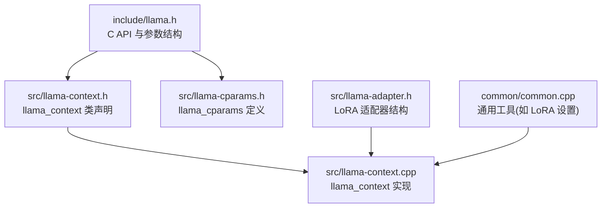
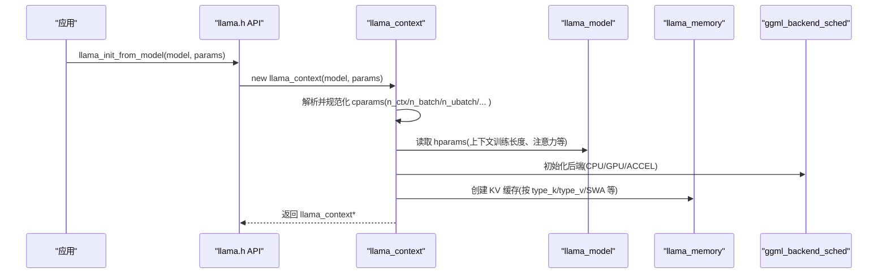
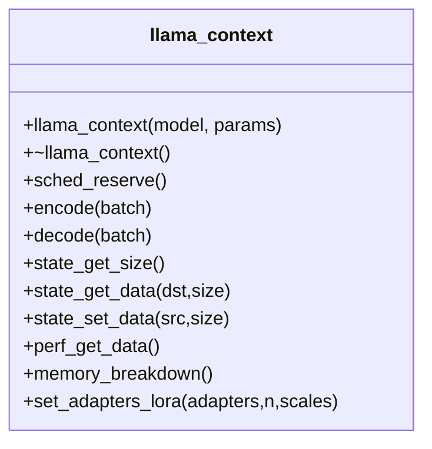
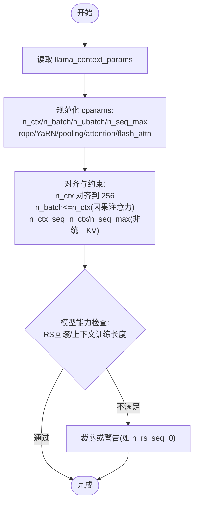
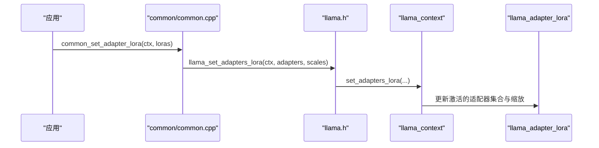
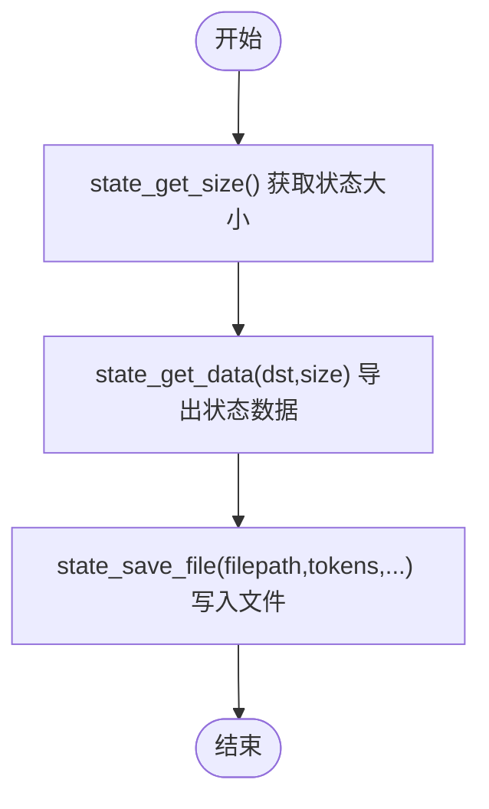
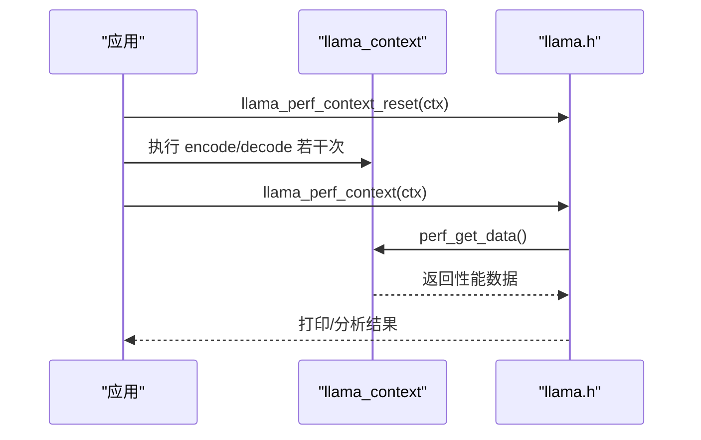
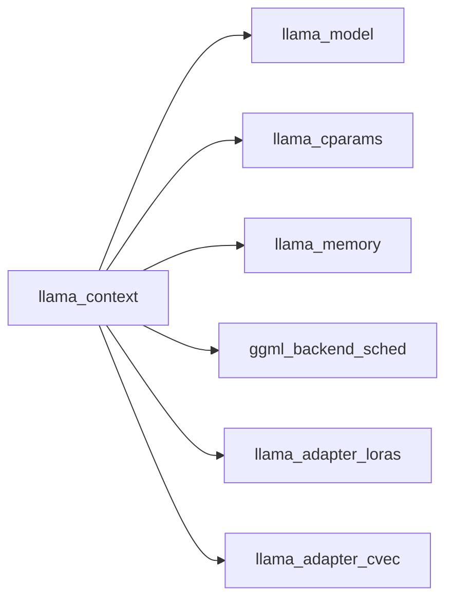
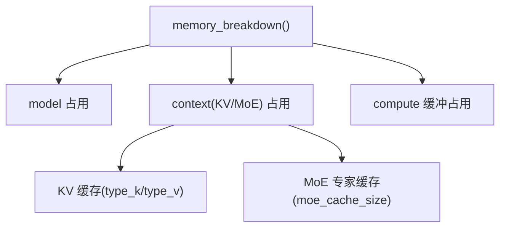

# 上下文管理

<cite>
**本文引用的文件 **
- [include/llama.h](file://include/llama.h)
- [src/llama-context.h](file://src/llama-context.h)
- [src/llama-context.cpp](file://src/llama-context.cpp)
- [src/llama-cparams.h](file://src/llama-cparams.h)
- [src/llama-adapter.h](file://src/llama-adapter.h)
- [common/common.cpp](file://common/common.cpp)
</cite>

## 目录
1. [简介](#简介)
2. [项目结构](#项目结构)
3. [核心组件](#核心组件)
4. [架构总览](#架构总览)
5. [详细组件分析](#详细组件分析)
6. [依赖关系分析](#依赖关系分析)
7. [性能与内存优化](#性能与内存优化)
8. [故障排查指南](#故障排查指南)
9. [结论](#结论)

## 简介
本文面向 llama.cpp 的上下文管理系统，围绕 llama_context 类展开，系统阐述其初始化、生命周期管理、状态保存与加载机制；详解上下文参数配置 llama_cparams（批大小、线程数、注意力类型等）及其优化策略；说明上下文与模型的关系，包括 LoRA 适配器的挂载与切换；给出性能监控接口 perf_get_data 的使用方法与指标解读；并提供上下文内存使用分析与优化建议。

## 项目结构
与上下文管理直接相关的代码主要分布在以下文件：
- include/llama.h：对外 C API，包含 llama_context_params、适配器与性能数据结构定义
- src/llama-context.h：llama_context 类的声明，包含状态保存/加载、性能、内存等接口
- src/llama-context.cpp：llama_context 的实现，涵盖构造、调度、推理流程、状态序列化、性能统计、内存剖析
- src/llama-cparams.h：内部上下文参数结构体 llama_cparams 的定义
- src/llama-adapter.h：LoRA 适配器数据结构
- common/common.cpp：上层工具函数，封装 LoRA 设置等常用操作

图表来源
- [include/llama.h:366-428](file://include/llama.h#L366-L428)
- [src/llama-context.h:45-200](file://src/llama-context.h#L45-L200)
- [src/llama-cparams.h:10-70](file://src/llama-cparams.h#L10-L70)
- [src/llama-context.cpp:168-500](file://src/llama-context.cpp#L168-L500)
- [src/llama-adapter.h:63-91](file://src/llama-adapter.h#L63-L91)
- [common/common.cpp:1659-1669](file://common/common.cpp#L1659-L1669)

章节来源
- [include/llama.h:366-428](file://include/llama.h#L366-L428)
- [src/llama-context.h:45-200](file://src/llama-context.h#L45-L200)
- [src/llama-cparams.h:10-70](file://src/llama-cparams.h#L10-L70)
- [src/llama-context.cpp:168-500](file://src/llama-context.cpp#L168-L500)
- [src/llama-adapter.h:63-91](file://src/llama-adapter.h#L63-L91)
- [common/common.cpp:1659-1669](file://common/common.cpp#L1659-L1669)

## 核心组件
- llama_context：上下文对象，负责图构建、后端调度、KV 缓存、采样输出、状态持久化、性能统计与内存剖析
- llama_cparams：内部上下文参数，由外部 llama_context_params 推导而来，决定推理行为与资源分配
- llama_adapter_lora：LoRA 适配器，用于在推理时动态叠加低秩权重
- 公共 API：llama_init_from_model、llama_set_adapters_lora、llama_perf_context_print、llama_state_save_file/state_load_file 等

章节来源
- [src/llama-context.h:45-200](file://src/llama-context.h#L45-L200)
- [src/llama-cparams.h:10-70](file://src/llama-cparams.h#L10-L70)
- [src/llama-adapter.h:63-91](file://src/llama-adapter.h#L63-L91)
- [include/llama.h:552-562](file://include/llama.h#L552-L562)
- [include/llama.h:728-747](file://include/llama.h#L728-L747)

## 架构总览
下图展示上下文创建、参数处理、后端初始化、KV 缓存与图调度的关键路径。

图表来源
- [src/llama-context.cpp:168-500](file://src/llama-context.cpp#L168-L500)
- [include/llama.h:552-562](file://include/llama.h#L552-L562)

## 详细组件分析

### llama_context 类与生命周期
- 构造函数：
  - 校验与规范化上下文参数（n_seq_max、n_rs_seq、rope/YaRN 参数、pooling_type、attention_type、flash_attn、kv_unified、n_batch/n_ubatch 等）
  - 初始化后端设备（GPU/ACCEL/CPU），注册 set_n_threads 回调
  - 预分配输出缓冲区（logits/embeddings）
  - 创建 KV 缓存模块（基于 llama_memory）
  - 记录性能计时起点 t_start_us/t_load_us
- 析构与释放：
  - 通过 llama_free(ctx) 释放上下文资源
- 线程池：
  - attach_threadpool/detach_threadpool 支持自定义线程池
- 编码器/解码器：
  - encode/decode 提供兼容与扩展批次接口，内部调用 process_ubatch 执行图计算

图表来源
- [src/llama-context.h:45-200](file://src/llama-context.h#L45-L200)
- [src/llama-context.cpp:168-500](file://src/llama-context.cpp#L168-L500)

章节来源
- [src/llama-context.h:45-200](file://src/llama-context.h#L45-L200)
- [src/llama-context.cpp:168-500](file://src/llama-context.cpp#L168-L500)

### 上下文参数配置 llama_cparams
- 关键参数与含义
  - n_ctx/n_ctx_seq：推理上下文长度与单序列上下文长度（受 kv_unified 影响）
  - n_batch/n_ubatch：逻辑批大小与物理批大小（因果注意力下 n_batch 受 n_ctx 限制）
  - n_seq_max：最大并发序列数
  - n_rs_seq：可回滚的循环状态快照数（需模型支持）
  - n_outputs_max/n_outputs_max_per_seq：输出槽位上限
  - n_threads/n_threads_batch：生成与批处理的线程数
  - rope_scaling_type/rope_freq_base/rope_freq_scale/YaRN 相关参数：位置编码缩放
  - pooling_type/attention_type/flash_attn_type：嵌入聚合方式、注意力类型、Flash Attention 开关
  - offload_kqv/op_offload/kv_unified：K/Q/V 与算子卸载、KV 统一缓冲
  - embeddings/embeddings_nextn/embeddings_layer_inp：是否提取嵌入与层输入
  - moe_cache_size：MoE 专家缓存大小
- 默认值与推导
  - llama_context_default_params 提供默认值；构造时对未显式设置的字段进行合理推断与对齐（如 n_ctx 对齐到 256）

图表来源
- [src/llama-context.cpp:186-417](file://src/llama-context.cpp#L186-L417)
- [src/llama-cparams.h:10-70](file://src/llama-cparams.h#L10-L70)
- [include/llama.h:366-428](file://include/llama.h#L366-L428)

章节来源
- [src/llama-cparams.h:10-70](file://src/llama-cparams.h#L10-L70)
- [src/llama-context.cpp:186-417](file://src/llama-context.cpp#L186-L417)
- [include/llama.h:366-428](file://include/llama.h#L366-L428)

### 上下文与模型的关系及 LoRA 适配器
- 模型与上下文绑定：
  - llama_context 持有 const llama_model&，并在构造时读取 hparams 以决定上下文行为
- LoRA 适配器：
  - llama_adapter_lora 存储权重映射、GGUF 元数据、激活 token 列表等
  - 通过 llama_set_adapters_lora 将多个适配器及其缩放系数应用到当前上下文
  - common/common.cpp 提供便捷封装，将用户配置的适配器列表转换为底层调用
- 控制向量：
  - llama_set_adapter_cvec 可将控制向量应用到指定层范围

图表来源
- [src/llama-adapter.h:63-91](file://src/llama-adapter.h#L63-L91)
- [include/llama.h:728-747](file://include/llama.h#L728-L747)
- [common/common.cpp:1659-1669](file://common/common.cpp#L1659-L1669)
- [src/llama-context.cpp:4353-4379](file://src/llama-context.cpp#L4353-L4379)

章节来源
- [src/llama-adapter.h:63-91](file://src/llama-adapter.h#L63-L91)
- [include/llama.h:728-747](file://include/llama.h#L728-L747)
- [common/common.cpp:1659-1669](file://common/common.cpp#L1659-L1669)
- [src/llama-context.cpp:4353-4379](file://src/llama-context.cpp#L4353-L4379)

### 状态保存与加载机制
- 全局状态：
  - state_get_size/state_get_data/state_set_data 提供二进制状态的序列化/反序列化
  - state_save_file/state_load_file 直接读写文件
- 序列级状态：
  - state_seq_get_size/state_seq_get_data/state_seq_set_data 针对特定 seq_id 的状态存取
  - state_seq_save_file/state_seq_load_file 针对特定序列的文件 I/O
- 内部实现要点：
  - 状态写入/读取委托给 IO 抽象，结合 llama_io_read_i/llama_io_write_i
  - 对设备侧内存拷贝与 host 缓冲进行协调，保证快速持久化

图表来源
- [src/llama-context.h:159-190](file://src/llama-context.h#L159-L190)
- [src/llama-context.cpp:3369-3395](file://src/llama-context.cpp#L3369-L3395)
- [src/llama-context.cpp:4486-4525](file://src/llama-context.cpp#L4486-L4525)

章节来源
- [src/llama-context.h:159-190](file://src/llama-context.h#L159-L190)
- [src/llama-context.cpp:3369-3395](file://src/llama-context.cpp#L3369-L3395)
- [src/llama-context.cpp:4486-4525](file://src/llama-context.cpp#L4486-L4525)

### 性能监控接口 perf_get_data
- 接口与数据结构：
  - llama_context::perf_get_data() 返回 llama_perf_context_data，包含启动时间、加载时间、提示评估时间、解码时间、调用次数、图复用与重分配计数等
  - llama_perf_context_print 打印可读的性能摘要
  - llama_perf_context_reset 重置计时器
- 指标解读：
  - t_p_eval_ms/n_p_eval：提示阶段的时间与 token 数
  - t_eval_ms/n_eval：解码阶段的时间与步数
  - n_reused：图复用次数（越高越好）
  - n_reallocs_same/n_reallocs_diff：图重分配次数（相同尺寸/不同尺寸）

图表来源
- [src/llama-context.cpp:3674-3698](file://src/llama-context.cpp#L3674-L3698)
- [src/llama-context.cpp:4651-4668](file://src/llama-context.cpp#L4651-L4668)

章节来源
- [src/llama-context.cpp:3674-3698](file://src/llama-context.cpp#L3674-L3698)
- [src/llama-context.cpp:4651-4668](file://src/llama-context.cpp#L4651-L4668)

## 依赖关系分析
- llama_context 依赖：
  - llama_model：读取模型超参与张量
  - llama_cparams：内部上下文参数
  - llama_memory：KV 缓存与序列状态管理
  - ggml_backend_sched：图调度与后端执行
  - llama_adapter_loras/llama_adapter_cvec：适配器与控制向量
- 外部依赖：
  - ggml 后端（CPU/GPU/ACCEL）
  - GGUF 模型与适配器格式

图表来源
- [src/llama-context.h:299-310](file://src/llama-context.h#L299-L310)
- [src/llama-context.cpp:419-485](file://src/llama-context.cpp#L419-L485)

章节来源
- [src/llama-context.h:299-310](file://src/llama-context.h#L299-L310)
- [src/llama-context.cpp:419-485](file://src/llama-context.cpp#L419-L485)

## 性能与内存优化

### 性能优化建议
- 批大小与物理批大小
  - 合理设置 n_batch 与 n_ubatch，避免过小导致频繁调度开销，过大导致内存压力
  - 因果注意力下 n_batch 会被限制为 min(n_ctx, 用户设定)，注意此约束
- Flash Attention
  - 启用 flash_attn_type=ENABLED/AUTO 以提升吞吐，但需后端支持
- 线程数
  - n_threads/n_threads_batch 根据 CPU/GPU 并行能力调整，避免过度并行造成争用
- 图复用
  - 保持输入形状稳定以提高 n_reused，减少图重分配
- 卸载与统一 KV
  - offload_kqv/op_offload 开启 GPU 卸载；kv_unified 在多序列共享前缀场景提升性能，但在多序列前缀差异大时可关闭

章节来源
- [src/llama-context.cpp:316-338](file://src/llama-context.cpp#L316-L338)
- [src/llama-context.cpp:3674-3698](file://src/llama-context.cpp#L3674-L3698)

### 内存使用分析与优化
- 内存剖析接口
  - memory_breakdown() 返回按后端缓冲类型划分的 model/context/compute 占用
  - llama_get_memory_breakdown 提供 C API 访问
- 典型组成
  - model：模型权重
  - context：KV 缓存与 MoE 缓存
  - compute：后端计算缓冲（由 sched 管理）
- 优化策略
  - 降低 n_ctx/n_seq_max 以减少 KV 缓存
  - 调整 type_k/type_v 量化以降低 KV 缓存占用
  - 关闭不必要的 embeddings/embeddings_nextn/embeddings_layer_inp
  - 合理设置 moe_cache_size 平衡专家缓存命中与内存占用
  - 使用 no_alloc 模式估算 compute 缓冲大小

图表来源
- [src/llama-context.cpp:3700-3729](file://src/llama-context.cpp#L3700-L3729)

章节来源
- [src/llama-context.cpp:3700-3729](file://src/llama-context.cpp#L3700-L3729)

## 故障排查指南
- 上下文创建失败
  - 检查 n_seq_max 是否超过上限；n_ctx_seq 是否为 0；后端初始化是否成功
  - Gemma4Assistant/EAGLE3/DFLASH 等特殊架构需要 ctx_other
- 性能异常
  - 观察 llama_perf_context_print 的输出，关注 t_p_eval_ms/t_eval_ms 与 n_reused
  - 若 n_reallocs_diff 较高，检查输入形状变化与批大小设置
- 内存不足
  - 使用 llama_get_memory_breakdown 分析 model/context/compute 占比
  - 降低 n_ctx/n_seq_max，调整 type_k/type_v，关闭不必要输出
- LoRA 问题
  - 确认适配器路径与缩放系数正确；确保模型未被释放
  - 使用 common_set_adapter_lora 简化设置流程

章节来源
- [src/llama-context.cpp:186-250](file://src/llama-context.cpp#L186-L250)
- [src/llama-context.cpp:3674-3729](file://src/llama-context.cpp#L3674-L3729)
- [common/common.cpp:1659-1669](file://common/common.cpp#L1659-L1669)

## 结论
llama_context 是 llama.cpp 推理系统的核心编排者，负责将模型、上下文参数、KV 缓存、后端调度与适配器有机整合。通过精细化的 llama_cparams 配置，可在吞吐、延迟与内存之间取得平衡；借助 perf_get_data 与 memory_breakdown，可实现端到端的性能与内存观测与优化。LoRA 的动态挂载与切换为多任务推理提供了灵活扩展能力。在实际工程中，建议从批大小、线程数、Flash Attention、KV 量化与图复用等维度入手，逐步优化以获得最佳效果。