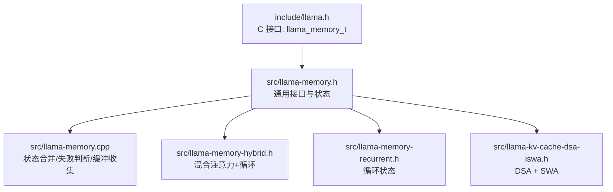
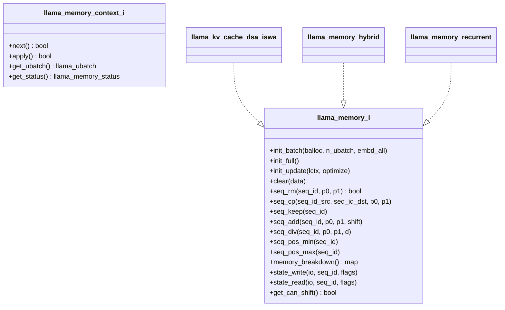
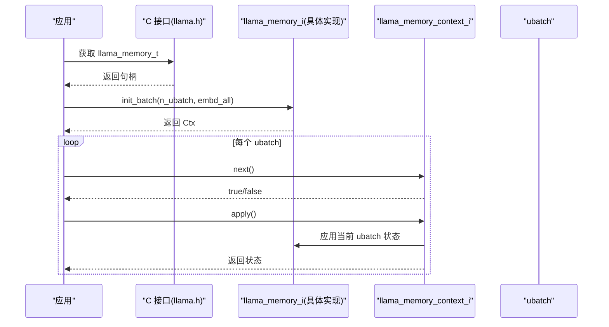
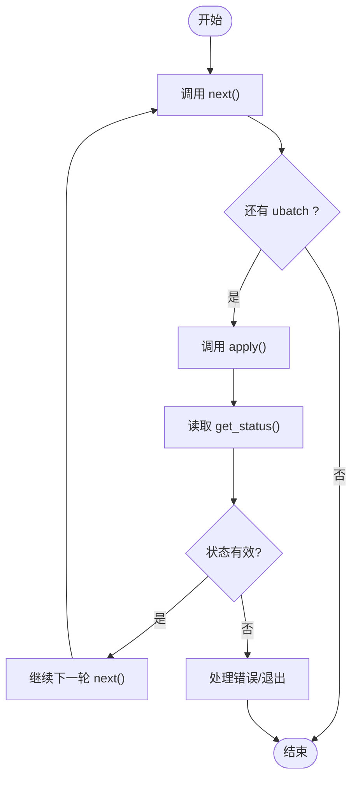
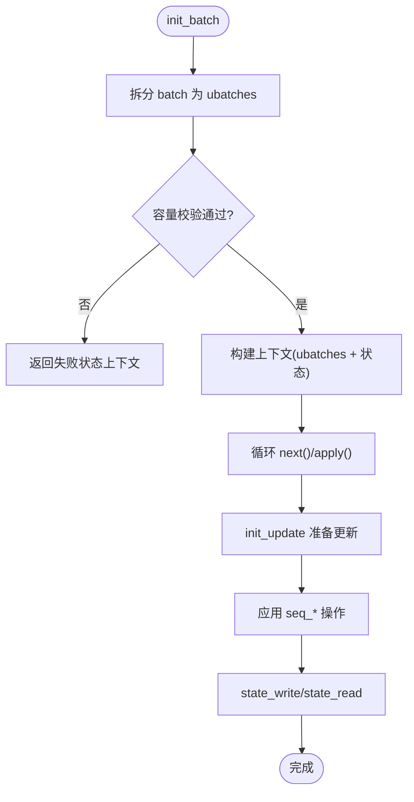
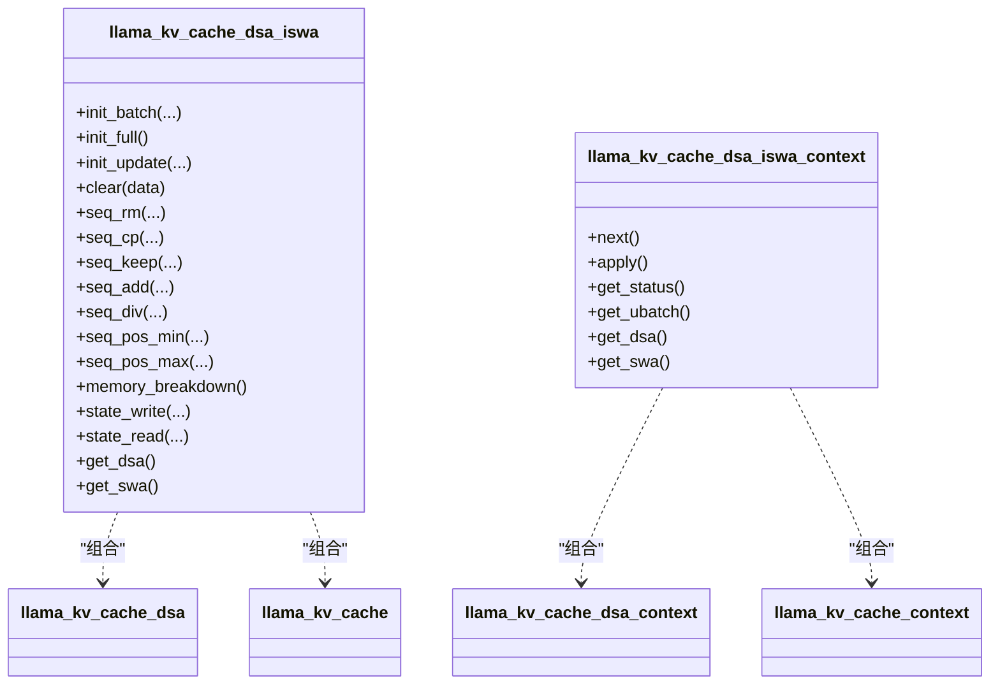
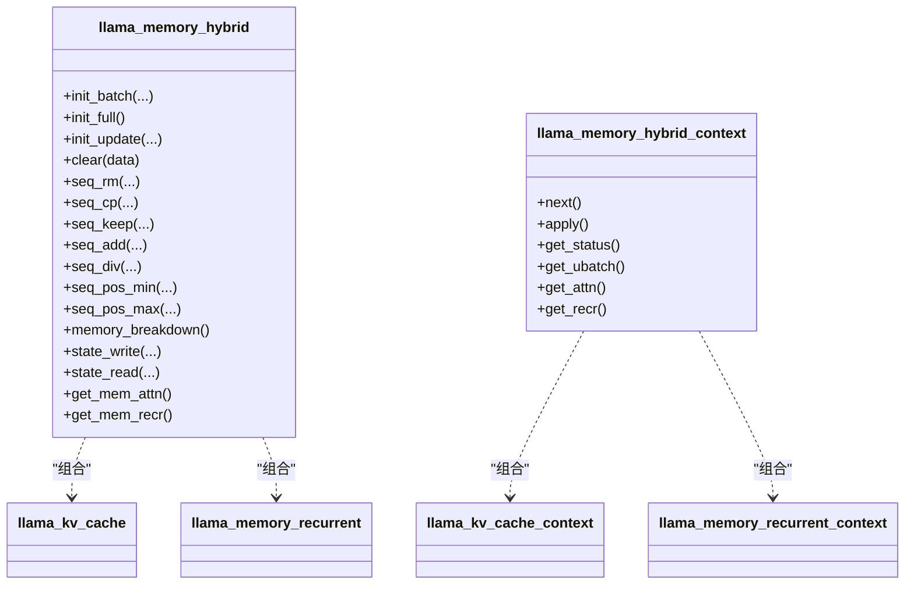
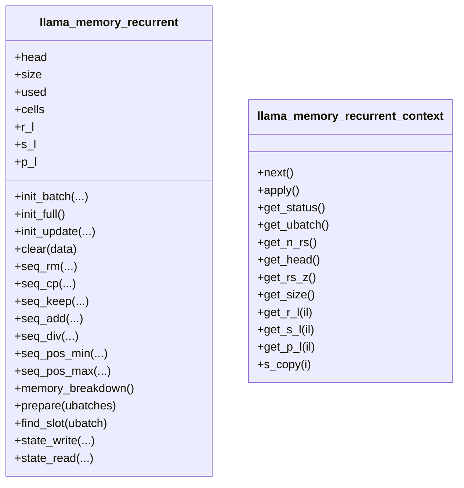
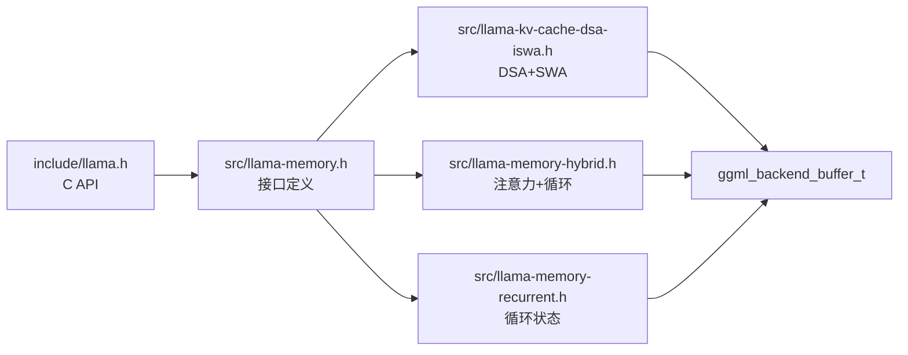

# 内存抽象层

<cite>
**本文引用的文件**   
- [llama-memory.h](file://src/llama-memory.h)
- [llama-memory.cpp](file://src/llama-memory.cpp)
- [llama-memory-hybrid.h](file://src/llama-memory-hybrid.h)
- [llama-memory-recurrent.h](file://src/llama-memory-recurrent.h)
- [llama-kv-cache-dsa-iswa.h](file://src/llama-kv-cache-dsa-iswa.h)
- [llama.h](file://include/llama.h)
</cite>

## 目录
1. [引言](#引言)
2. [项目结构](#项目结构)
3. [核心组件](#核心组件)
4. [架构总览](#架构总览)
5. [详细组件分析](#详细组件分析)
6. [依赖关系分析](#依赖关系分析)
7. [性能与实现要点](#性能与实现要点)
8. [故障排查指南](#故障排查指南)
9. [结论](#结论)
10. [附录：自定义内存类型实现示例](#附录自定义内存类型实现示例)

## 引言
本技术文档聚焦于 llama.cpp 的“内存抽象层”，围绕 llama_memory 接口体系，系统阐述以下主题：
- 核心概念：内存上下文、缓冲区管理与生命周期控制
- 统一接口设计：分配、复制、同步与清理操作
- 状态管理与错误处理机制
- llama_memory_context_i 的 next()/apply() 使用模式
- llama_memory_i 的批处理初始化、序列操作与状态读写
- 如何基于现有实现扩展自定义内存类型（含代码路径指引）

该抽象层将 KV 缓存、循环状态等 LLM 运行时所需的不同内存形态统一为一致的接口，使上层推理流程无需关心底层存储细节。

## 项目结构
内存抽象层相关文件集中在 src/ 下，对外通过 include/llama.h 暴露 C API 句柄类型。关键文件职责如下：
- src/llama-memory.h/.cpp：定义通用接口、状态枚举与工具函数
- src/llama-memory-hybrid.h：混合注意力+循环状态的内存实现
- src/llama-memory-recurrent.h：循环模型的状态内存实现
- src/llama-kv-cache-dsa-iswa.h：DSA（全注意力）+ SWA（滑动窗口注意力）组合内存实现
- include/llama.h：C 接口中 llama_memory_t 句柄类型及内存相关 API

图表来源
- [llama.h:66-66](file://include/llama.h#L66-L66)
- [llama-memory.h:17-128](file://src/llama-memory.h#L17-L128)
- [llama-memory.cpp:9-92](file://src/llama-memory.cpp#L9-L92)
- [llama-memory-hybrid.h:19-140](file://src/llama-memory-hybrid.h#L19-L140)
- [llama-memory-recurrent.h:17-200](file://src/llama-memory-recurrent.h#L17-L200)
- [llama-kv-cache-dsa-iswa.h:13-134](file://src/llama-kv-cache-dsa-iswa.h#L13-L134)

章节来源
- [llama.h:66-66](file://include/llama.h#L66-L66)
- [llama-memory.h:17-128](file://src/llama-memory.h#L17-L128)

## 核心组件
本节从接口层面解释内存抽象的核心概念与职责边界。

- llama_memory_params
  - 描述 kv 缓存的数据类型、SWA 策略、上下文类型以及可选的外部共享内存指针。用于构造具体内存实现时的参数聚合。
- llama_memory_status
  - 统一的内存状态枚举，包括成功、无更新、准备阶段失败、计算阶段失败。提供 combine 与 is_fail 工具函数进行组合与判定。
- llama_memory_context_i
  - 表示一次批处理的“内存上下文”。负责：
    - next(): 消费当前 ubatch 并推进到下一个
    - apply(): 将当前 ubatch 对应的内存状态应用到实际内存对象
    - get_ubatch(): 获取当前 ubatch
    - get_status(): 返回本次上下文的状态
- llama_memory_i
  - 表示一种具体的 LLM 内存类型（如 KV 缓存、循环状态、混合内存）。职责包括：
    - init_batch/init_full/init_update：批处理/全量/更新三种初始化模式
    - clear/seq_rm/seq_cp/seq_keep/seq_add/seq_div：序列级元数据与位置管理
    - seq_pos_min/seq_pos_max：查询序列位置范围
    - memory_breakdown：按后端 buffer type 统计内存占用
    - state_write/state_read：序列化/反序列化状态（支持按序列过滤）
    - get_can_shift：是否支持移位优化

图表来源
- [llama-memory.h:51-128](file://src/llama-memory.h#L51-L128)
- [llama-kv-cache-dsa-iswa.h:13-78](file://src/llama-kv-cache-dsa-iswa.h#L13-L78)
- [llama-memory-hybrid.h:19-91](file://src/llama-memory-hybrid.h#L19-L91)
- [llama-memory-recurrent.h:17-142](file://src/llama-memory-recurrent.h#L17-L142)

章节来源
- [llama-memory.h:17-128](file://src/llama-memory.h#L17-L128)

## 架构总览
下图展示内存抽象层在整体系统中的角色：上层通过 C API 获取 llama_memory_t 句柄，内部指向具体实现的 llama_memory_i；批处理时由上下文对象封装 ubatch 与状态，驱动 next()/apply() 完成内存应用。

图表来源
- [llama.h:593-594](file://include/llama.h#L593-L594)
- [llama-memory.h:89-99](file://src/llama-memory.h#L89-L99)
- [llama-memory.h:51-67](file://src/llama-memory.h#L51-L67)

## 详细组件分析

### llama_memory_context_i 的使用模式
- next()
  - 消费当前 ubatch，推进到下一个；当没有更多 ubatch 时返回 false。
- apply()
  - 将当前 ubatch 对应的内存状态应用到实际的内存对象；失败时返回 false。
- get_ubatch()
  - 返回当前 ubatch，供上层或内核访问。
- get_status()
  - 返回上下文状态，便于上层做错误分支或跳过无效批次。

典型调用顺序：
- 先调用 next() 检查是否有可处理的 ubatch
- 再调用 apply() 执行内存状态应用
- 根据 get_status() 决定是否继续或报错

图表来源
- [llama-memory.h:51-67](file://src/llama-memory.h#L51-L67)

章节来源
- [llama-memory.h:51-67](file://src/llama-memory.h#L51-L67)

### llama_memory_i 的统一接口设计
- 批处理初始化
  - init_batch：将输入 batch 切分为若干 ubatch，并验证是否能放入缓存；返回包含 ubatches 与内存状态的上下文。
  - init_full：模拟完整缓存，用于最坏情况下的计算缓冲分配。
  - init_update：准备待执行的内存更新（如移位、拷贝），返回更新上下文。
- 序列操作
  - seq_rm/seq_cp/seq_keep/seq_add/seq_div：对指定序列的位置区间进行删除、复制、保留、相对位移、整除缩放等操作。
  - seq_pos_min/seq_pos_max：查询序列的最小/最大位置。
- 状态读写
  - state_write/state_read：以流式方式写入/读取状态，支持按序列过滤与标志位控制。
- 资源与诊断
  - clear：清空元数据与可选的数据缓冲区。
  - memory_breakdown：按后端 buffer type 统计内存占用。
  - get_can_shift：是否支持移位优化。

图表来源
- [llama-memory.h:89-128](file://src/llama-memory.h#L89-L128)

章节来源
- [llama-memory.h:89-128](file://src/llama-memory.h#L89-L128)

### 具体实现：llama_kv_cache_dsa_iswa（DSA + SWA）
- 设计目标：将全注意力层（DSA）与滑动窗口注意力层（SWA）分别用不同内存策略管理，并通过统一接口对外暴露。
- 关键能力：
  - 支持 MLA/LID 层过滤与复用回调，灵活选择哪些层走 DSA、哪些走 SWA。
  - 提供 get_dsa()/get_swa() 访问子内存实例。
  - 上下文类封装了 DSA/SWA 两个子上下文，统一驱动 next()/apply()。

图表来源
- [llama-kv-cache-dsa-iswa.h:13-134](file://src/llama-kv-cache-dsa-iswa.h#L13-L134)

章节来源
- [llama-kv-cache-dsa-iswa.h:13-134](file://src/llama-kv-cache-dsa-iswa.h#L13-L134)

### 具体实现：llama_memory_hybrid（注意力 + 循环）
- 设计目标：同一模型中每层可能是注意力型或循环型，需要同时管理 KV 缓存与循环状态。
- 关键能力：
  - 组合 llama_kv_cache 与 llama_memory_recurrent，分别管理注意力与循环部分。
  - 提供 get_mem_attn()/get_mem_recr() 访问子内存。
  - 上下文类封装 attn/recr 两个子上下文，统一驱动 next()/apply()。

图表来源
- [llama-memory-hybrid.h:19-140](file://src/llama-memory-hybrid.h#L19-L140)

章节来源
- [llama-memory-hybrid.h:19-140](file://src/llama-memory-hybrid.h#L19-L140)

### 具体实现：llama_memory_recurrent（循环状态）
- 设计目标：为循环模型（如 RWKV/Mamba 等）维护循环状态 r/s/p 等张量，并提供序列级位置与快照回滚能力。
- 关键能力：
  - 维护 cells 数组与 per-layer 张量 r_l/s_l/p_l，支持 find_slot 分配连续槽位。
  - 提供 rs_idx 与 n_rs_seq 支持多快照回滚。
  - 上下文类封装 head/n/rs_z 等图构建所需状态，并提供 get_r_l/get_s_l/get_p_l 等访问方法。

图表来源
- [llama-memory-recurrent.h:17-200](file://src/llama-memory-recurrent.h#L17-L200)

章节来源
- [llama-memory-recurrent.h:17-200](file://src/llama-memory-recurrent.h#L17-L200)

## 依赖关系分析
- 接口耦合
  - llama_memory_i 与 llama_memory_context_i 解耦：前者负责持久化状态与资源管理，后者负责批处理迭代与状态应用。
- 组合关系
  - llama_kv_cache_dsa_iswa、llama_memory_hybrid 均通过组合子内存实现复杂策略，避免继承链过深。
- 外部依赖
  - 通过 ggml_backend_buffer_type_t 统计内存分布，结合 ggml_tensor 的 buffer 进行状态序列化。
  - 上层通过 llama.h 中的 C API 获取 llama_memory_t 句柄，间接调用 C++ 接口。

图表来源
- [llama.h:593-594](file://include/llama.h#L593-L594)
- [llama-memory.h:17-128](file://src/llama-memory.h#L17-L128)
- [llama-kv-cache-dsa-iswa.h:13-134](file://src/llama-kv-cache-dsa-iswa.h#L13-L134)
- [llama-memory-hybrid.h:19-140](file://src/llama-memory-hybrid.h#L19-L140)
- [llama-memory-recurrent.h:17-200](file://src/llama-memory-recurrent.h#L17-L200)

章节来源
- [llama.h:593-594](file://include/llama.h#L593-L594)
- [llama-memory.h:17-128](file://src/llama-memory.h#L17-L128)

## 性能与实现要点
- 批处理与 ubatch
  - 通过 init_batch 将逻辑 batch 拆分为物理 ubatch，减少单次计算的内存峰值，提高吞吐。
- 状态合并与失败快速返回
  - llama_memory_status_combine 支持多个子上下文的错误传播，尽早失败，避免无效计算。
- 内存统计与可视化
  - memory_breakdown 按后端 buffer type 汇总占用，便于定位热点与优化分配策略。
- 状态序列化
  - state_write/state_read 支持按序列过滤，配合 llama_io_write_i/llama_io_read_i 流式 IO，降低大状态拷贝成本。
- 移位优化
  - get_can_shift 指示是否支持移位，结合 init_update 可批量准备移位/拷贝等更新，减少重复计算。

[本节为通用性能讨论，不直接分析具体文件]

## 故障排查指南
- 常见状态码
  - LLAMA_MEMORY_STATUS_SUCCESS：正常
  - LLAMA_MEMORY_STATUS_NO_UPDATE：无更新，可跳过后续步骤
  - LLAMA_MEMORY_STATUS_FAILED_PREPARE：准备阶段失败（如容量不足、布局非法）
  - LLAMA_MEMORY_STATUS_FAILED_COMPUTE：计算阶段失败（如设备异常、内存不足）
- 诊断建议
  - 使用 llama_memory_status_is_fail 快速判断是否需要中断流程
  - 通过 memory_breakdown 检查各后端 buffer 的占用分布
  - 使用 state_write 收集涉及的 ggml_backend_buffer_t，确认跨设备一致性
  - 针对 seq_* 操作，检查位置区间合法性与序列存在性

章节来源
- [llama-memory.cpp:9-65](file://src/llama-memory.cpp#L9-L65)
- [llama-memory.cpp:67-92](file://src/llama-memory.cpp#L67-L92)

## 结论
llama_memory 抽象层通过统一的接口与上下文模式，将 KV 缓存、循环状态与混合内存策略整合为一套可扩展的内存管理体系。上层仅需关注批处理与序列操作语义，底层实现可自由演进。借助状态合并、失败快速返回与流式状态 IO，系统在正确性与性能之间取得良好平衡。

[本节为总结性内容，不直接分析具体文件]

## 附录：自定义内存类型实现示例
以下给出实现自定义内存类型的步骤与参考路径（不包含具体代码内容）：
- 步骤
  1. 定义一个派生自 llama_memory_i 的类，实现所有虚函数（init_batch/init_full/init_update/clear/seq_*/memory_breakdown/state_write/state_read/get_can_shift）。
  2. 定义一个派生自 llama_memory_context_i 的类，实现 next()/apply()/get_ubatch()/get_status()。
  3. 在 init_batch 中将输入 batch 切分为 ubatches，并构建上下文；在 apply 中将当前 ubatch 的状态应用到内存对象。
  4. 若需组合多种内存策略，采用组合模式（参考 llama_kv_cache_dsa_iswa 与 llama_memory_hybrid）。
  5. 使用 llama_memory_status 表达状态，必要时实现 llama_memory_status_combine 的组合逻辑。
- 参考实现路径
  - 接口定义与状态工具：[llama-memory.h:17-128](file://src/llama-memory.h#L17-L128)、[llama-memory.cpp:9-92](file://src/llama-memory.cpp#L9-L92)
  - 组合实现参考：[llama-kv-cache-dsa-iswa.h:13-134](file://src/llama-kv-cache-dsa-iswa.h#L13-L134)、[llama-memory-hybrid.h:19-140](file://src/llama-memory-hybrid.h#L19-L140)
  - 循环状态实现参考：[llama-memory-recurrent.h:17-200](file://src/llama-memory-recurrent.h#L17-L200)
  - C API 入口：[llama.h:593-594](file://include/llama.h#L593-L594)

章节来源
- [llama-memory.h:17-128](file://src/llama-memory.h#L17-L128)
- [llama-memory.cpp:9-92](file://src/llama-memory.cpp#L9-L92)
- [llama-kv-cache-dsa-iswa.h:13-134](file://src/llama-kv-cache-dsa-iswa.h#L13-L134)
- [llama-memory-hybrid.h:19-140](file://src/llama-memory-hybrid.h#L19-L140)
- [llama-memory-recurrent.h:17-200](file://src/llama-memory-recurrent.h#L17-L200)
- [llama.h:593-594](file://include/llama.h#L593-L594)