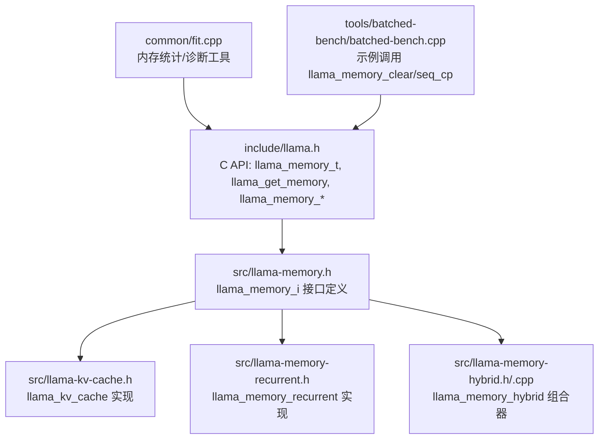
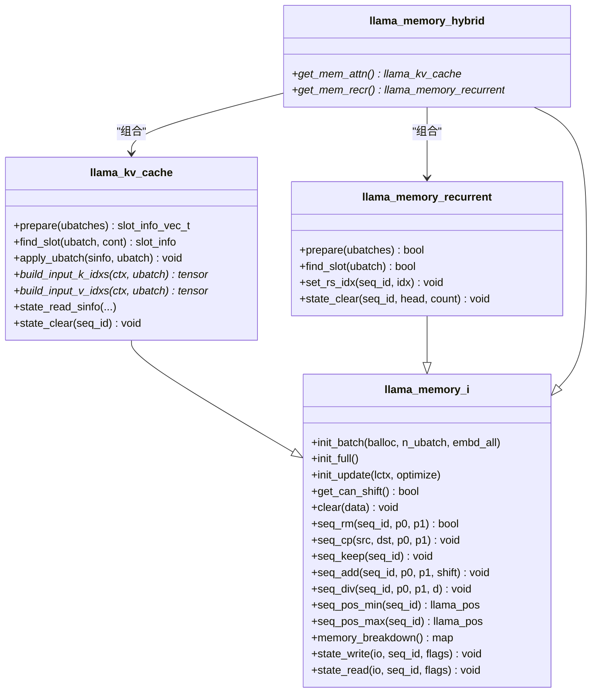
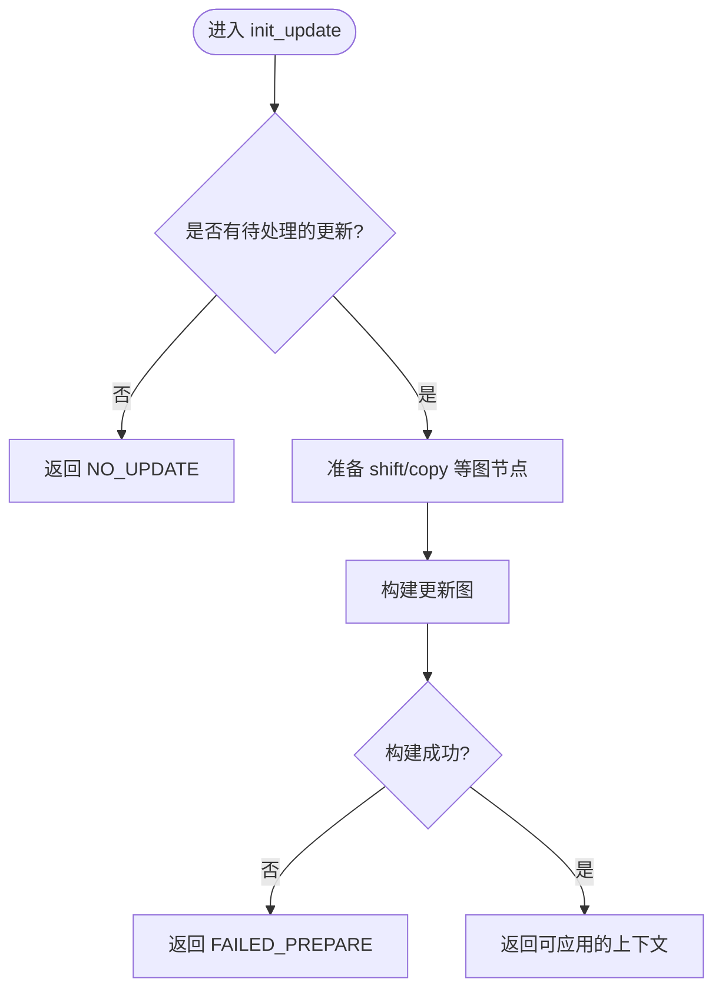
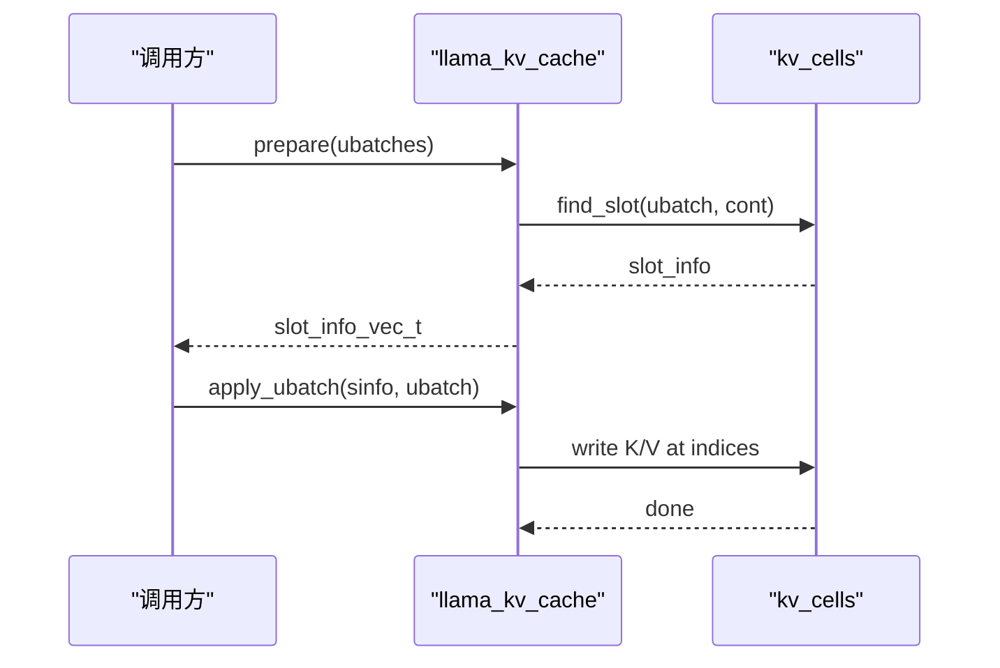
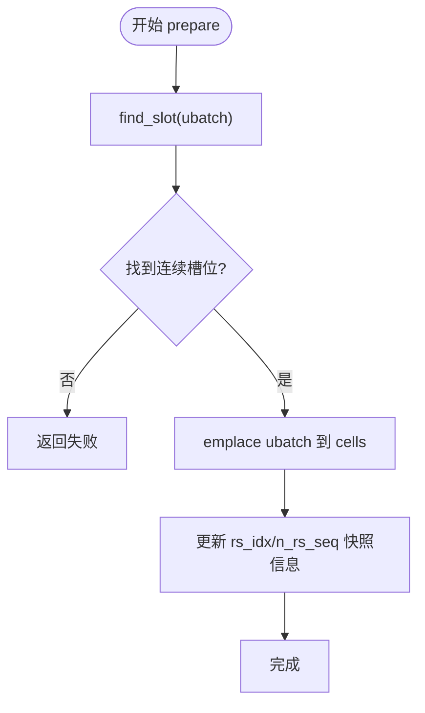
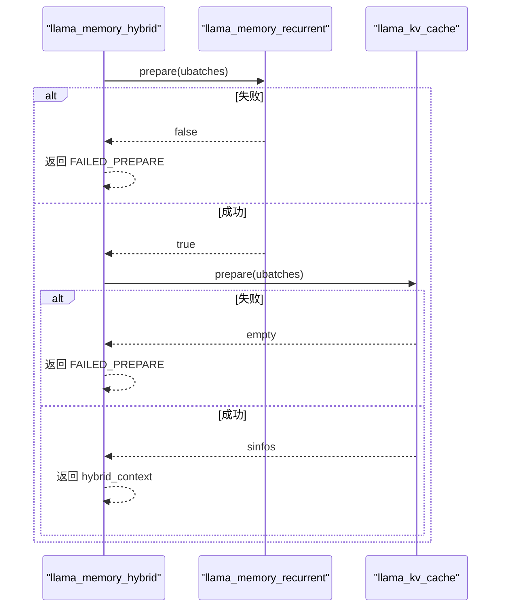
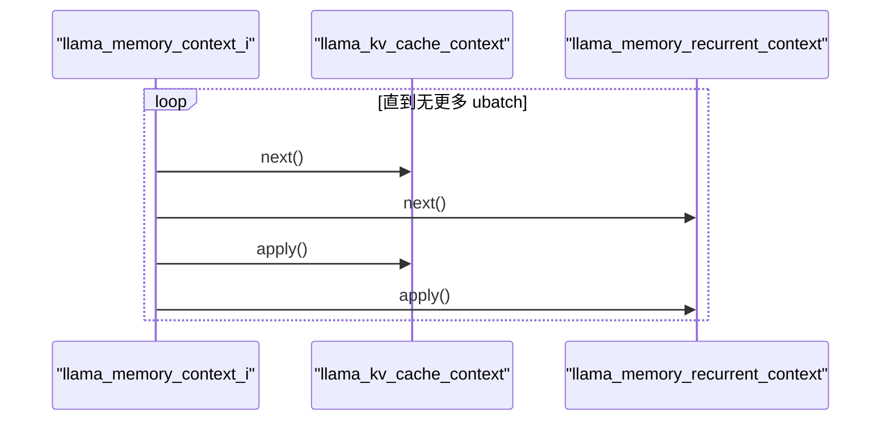
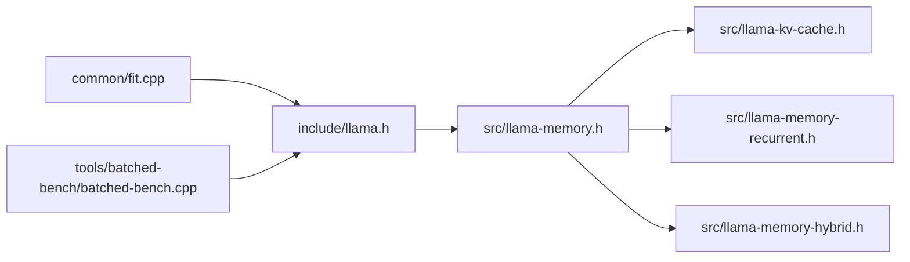

# 内存管理

<cite>
**本文引用的文件**   
- [include/llama.h](file://include/llama.h)
- [src/llama-memory.h](file://src/llama-memory.h)
- [src/llama-memory.cpp](file://src/llama-memory.cpp)
- [src/llama-kv-cache.h](file://src/llama-kv-cache.h)
- [src/llama-memory-hybrid.h](file://src/llama-memory-hybrid.h)
- [src/llama-memory-hybrid.cpp](file://src/llama-memory-hybrid.cpp)
- [src/llama-memory-recurrent.h](file://src/llama-memory-recurrent.h)
- [common/fit.cpp](file://common/fit.cpp)
- [tools/batched-bench/batched-bench.cpp](file://tools/batched-bench/batched-bench.cpp)
</cite>

## 目录
1. [简介](#简介)
2. [项目结构](#项目结构)
3. [核心组件](#核心组件)
4. [架构总览](#架构总览)
5. [详细组件分析](#详细组件分析)
6. [依赖关系分析](#依赖关系分析)
7. [性能与优化](#性能与优化)
8. [故障排除指南](#故障排除指南)
9. [结论](#结论)

## 简介
本技术文档聚焦于 llama.cpp 的内存管理系统，围绕 llama_memory 抽象接口、混合内存管理（llama_memory_hybrid）、KV 缓存与循环状态缓存的实现与协作机制展开。文档解释：
- 内存分配、释放与跟踪的统一抽象
- 主机内存与设备内存的协调策略
- 预分配、重用与“垃圾回收”（通过序列级清理与位置区间操作）
- 内存使用分析与泄漏检测手段
- 碎片化分析与性能瓶颈识别方法
- 最佳实践与常见问题排查

## 项目结构
与内存管理直接相关的代码主要位于 src 层，并通过 include/llama.h 暴露 C API；工具与诊断能力在 common/fit.cpp 中提供。

**图表来源**
- [include/llama.h:593-594](file://include/llama.h#L593-L594)
- [src/llama-memory.h:17-130](file://src/llama-memory.h#L17-L130)
- [src/llama-kv-cache.h:20-152](file://src/llama-kv-cache.h#L20-L152)
- [src/llama-memory-recurrent.h:17-67](file://src/llama-memory-recurrent.h#L17-L67)
- [src/llama-memory-hybrid.h:19-91](file://src/llama-memory-hybrid.h#L19-L91)
- [common/fit.cpp:906-970](file://common/fit.cpp#L906-L970)
- [tools/batched-bench/batched-bench.cpp:143-161](file://tools/batched-bench/batched-bench.cpp#L143-L161)

**章节来源**
- [include/llama.h:593-594](file://include/llama.h#L593-L594)
- [src/llama-memory.h:17-130](file://src/llama-memory.h#L17-L130)

## 核心组件
- llama_memory_i：统一的 LLM 内存抽象接口，封装批处理上下文生命周期、序列操作、状态序列化等。
- llama_kv_cache：注意力 KV 缓存的具体实现，负责 KV cells 的分配、查找、写入与图构建输入生成。
- llama_memory_recurrent：循环模型的状态缓存（R/S/P 等），支持回滚快照与连续槽位分配。
- llama_memory_hybrid：将注意力缓存与循环缓存组合，适配混合架构模型（如 Jamba、Granite）。
- llama_memory_context_i：批处理上下文接口，next/apply 驱动逐 ubatch 推进与应用。

关键职责划分：
- 分配与布局：kv_cache 基于 ring buffer 的 cells 管理；recurrent 维护 cells 数组与 head/used 指针。
- 批处理拆分：根据是否 embd_all、是否 unified stream 决定按序列或等长切分。
- 更新与提交：init_update 准备 shift/copy 等操作，apply 统一提交到后端缓冲。
- 状态持久化：state_write/state_read 支持部分/全量保存与恢复。

**章节来源**
- [src/llama-memory.h:44-130](file://src/llama-memory.h#L44-L130)
- [src/llama-kv-cache.h:20-152](file://src/llama-kv-cache.h#L20-L152)
- [src/llama-memory-recurrent.h:17-67](file://src/llama-memory-recurrent.h#L17-L67)
- [src/llama-memory-hybrid.h:19-91](file://src/llama-memory-hybrid.h#L19-L91)

## 架构总览
llama_memory 抽象将不同内存类型（KV 缓存、循环状态缓存、混合缓存）统一为一致的接口，上层通过 llama_context 持有 llama_memory_t，并在推理流程中调用序列操作与批处理上下文推进。

**图表来源**
- [src/llama-memory.h:71-130](file://src/llama-memory.h#L71-L130)
- [src/llama-kv-cache.h:20-152](file://src/llama-kv-cache.h#L20-L152)
- [src/llama-memory-recurrent.h:17-67](file://src/llama-memory-recurrent.h#L17-L67)
- [src/llama-memory-hybrid.h:19-91](file://src/llama-memory-hybrid.h#L19-L91)

## 详细组件分析

### llama_memory 抽象接口与状态机
- 接口设计要点：
  - init_batch：将输入 batch 拆分为若干 ubatch，并验证可放入缓存；返回上下文对象用于迭代 next/apply。
  - init_full：模拟最坏情况的全缓存上下文，用于计算最大 compute buffer。
  - init_update：准备待提交的更新（如 shift、copy），若无可更新则返回 NO_UPDATE。
  - 序列操作：seq_rm/seq_cp/seq_keep/seq_add/seq_div 提供细粒度位置区间操作。
  - memory_breakdown：按后端缓冲区类型统计内存占用，便于分析与诊断。
  - state_write/state_read：支持部分/全量状态序列化，便于检查点与迁移。

- 状态码与错误处理：
  - LLAMA_MEMORY_STATUS_SUCCESS / NO_UPDATE / FAILED_PREPARE / FAILED_COMPUTE
  - 组合函数 llama_memory_status_combine 用于混合场景下合并子上下文状态。

**图表来源**
- [src/llama-memory.h:30-42](file://src/llama-memory.h#L30-L42)
- [src/llama-memory.cpp:9-65](file://src/llama-memory.cpp#L9-L65)

**章节来源**
- [src/llama-memory.h:30-130](file://src/llama-memory.h#L30-L130)
- [src/llama-memory.cpp:9-93](file://src/llama-memory.cpp#L9-L93)

### KV 缓存（llama_kv_cache）
- 数据结构：
  - slot_info：描述每个 ubatch 应插入的 cells 索引映射，支持多流（stream）与连续性判断。
  - kv_layer：每层的 K/V 张量及按流的视图。
  - v_cells_impl：cells 向量容器，ring buffer 式管理空闲头 v_heads。
- 关键流程：
  - prepare：为 ubatches 寻找合适槽位，返回 slot_info_vec_t。
  - find_slot：在环缓冲中查找连续或不连续的可用区间。
  - apply_ubatch：将当前 ubatch 的 K/V 写入对应 cells。
  - build_input_*：为图构建生成索引、旋转参数、掩码等输入。
  - state_read_sinfo：恢复时回填 layout，避免与其他镜像缓存冲突。

**图表来源**
- [src/llama-kv-cache.h:32-94](file://src/llama-kv-cache.h#L32-L94)
- [src/llama-kv-cache.h:207-219](file://src/llama-kv-cache.h#L207-L219)

**章节来源**
- [src/llama-kv-cache.h:20-251](file://src/llama-kv-cache.h#L20-L251)

### 循环状态缓存（llama_memory_recurrent）
- 数据结构：
  - mem_cell：包含位置 pos、来源索引 src/src0/tail、所属序列集合 seq_id。
  - r_l/s_l/p_l：每层的 R/S/P 张量，p_l 作为必须跨设备复制的卷积历史。
  - rs_idx：每序列的回滚快照索引，n_rs_seq 控制快照组数。
- 关键流程：
  - prepare/find_slot：为 ubatch 在 cells 中寻找连续槽位。
  - set_rs_idx：设置回滚快照索引，配合 n_rs_seq 进行快照分组。
  - state_clear：清除指定区间的状态，用于异常回滚。

**图表来源**
- [src/llama-memory-recurrent.h:88-116](file://src/llama-memory-recurrent.h#L88-L116)
- [src/llama-memory-recurrent.h:57-67](file://src/llama-memory-recurrent.h#L57-L67)

**章节来源**
- [src/llama-memory-recurrent.h:17-142](file://src/llama-memory-recurrent.h#L17-L142)

### 混合内存管理（llama_memory_hybrid）
- 设计目标：同时支持注意力层与循环层，依据模型架构动态选择各层归属。
- 组合策略：
  - 构造时创建 llama_kv_cache（过滤非循环层）与 llama_memory_recurrent（过滤循环层）。
  - init_batch：先准备 recurrent 的 ubatches，再准备 attention 的 heads；任一失败即返回 FAILED_PREPARE。
  - seq_rm：优先尝试 recurrent 的删除（可能失败但不影响 attn），成功后再执行 attn 删除。
  - memory_breakdown：合并 attn 与 recurrent 的按 buft 统计。
  - state_write/state_read：按标志决定是否写/读 attn 部分，并在 read 失败时回滚 attn 已恢复的部分。

**图表来源**
- [src/llama-memory-hybrid.cpp:67-123](file://src/llama-memory-hybrid.cpp#L67-L123)
- [src/llama-memory-hybrid.cpp:143-170](file://src/llama-memory-hybrid.cpp#L143-L170)
- [src/llama-memory-hybrid.cpp:190-214](file://src/llama-memory-hybrid.cpp#L190-L214)

**章节来源**
- [src/llama-memory-hybrid.h:19-91](file://src/llama-memory-hybrid.h#L19-L91)
- [src/llama-memory-hybrid.cpp:11-292](file://src/llama-memory-hybrid.cpp#L11-L292)

### 批处理上下文推进（llama_memory_context_i）
- llama_kv_cache_context 与 llama_memory_recurrent_context 分别实现 next/apply，hybrid_context 组合两者。
- next：推进到下一个 ubatch；apply：将当前 ubatch 的变更应用到后端缓冲。
- hybrid_context::apply 对 attn 与 recr 两个子上下文依次应用，并合并结果。

**图表来源**
- [src/llama-memory-hybrid.cpp:252-274](file://src/llama-memory-hybrid.cpp#L252-L274)
- [src/llama-kv-cache.h:359-474](file://src/llama-kv-cache.h#L359-L474)
- [src/llama-memory-recurrent.h:144-201](file://src/llama-memory-recurrent.h#L144-L201)

**章节来源**
- [src/llama-memory-hybrid.cpp:224-292](file://src/llama-memory-hybrid.cpp#L224-L292)
- [src/llama-kv-cache.h:359-474](file://src/llama-kv-cache.h#L359-L474)
- [src/llama-memory-recurrent.h:144-201](file://src/llama-memory-recurrent.h#L144-L201)

## 依赖关系分析
- 高层依赖：
  - include/llama.h 暴露 llama_memory_t 与 llama_get_memory、llama_memory_* 系列 API。
  - src/llama-memory.h 定义统一接口，被 kv_cache、recurrent、hybrid 实现。
  - common/fit.cpp 提供内存统计与诊断工具，读取 llama_memory_breakdown 数据。
  - tools/batched-bench 示例演示了 llama_memory_clear 与 llama_memory_seq_cp 的使用。

**图表来源**
- [include/llama.h:593-594](file://include/llama.h#L593-L594)
- [src/llama-memory.h:17-130](file://src/llama-memory.h#L17-L130)
- [common/fit.cpp:906-970](file://common/fit.cpp#L906-L970)
- [tools/batched-bench/batched-bench.cpp:143-161](file://tools/batched-bench/batched-bench.cpp#L143-L161)

**章节来源**
- [include/llama.h:593-594](file://include/llama.h#L593-L594)
- [common/fit.cpp:906-970](file://common/fit.cpp#L906-L970)
- [tools/batched-bench/batched-bench.cpp:143-161](file://tools/batched-bench/batched-bench.cpp#L143-L161)

## 性能与优化
- 预分配与重用：
  - KV 缓存采用 ring buffer 与 v_heads 游标加速 find_slot，减少扫描开销。
  - recurrent 缓存维护 head/used 指针，避免频繁分配。
- 批量拆分策略：
  - embd_all 时按序列切分；否则考虑 unified stream 与回滚快照约束（n_rs_seq+1 尾部 token 同属一个 ubatch）。
- 设备与主机内存协调：
  - offload/unified 参数控制 KV 缓存与 recurrent 缓存的设备放置与共享。
  - memory_breakdown 按 ggml_backend_buffer_type_t 统计，便于定位热点设备。
- 性能瓶颈识别：
  - 使用 common/fit.cpp 中的 common_memory_breakdown_print 打印各设备内存分布。
  - 结合 llama_memory_status 判断 prepare/apply 阶段失败原因。

建议：
- 合理设置 n_ctx、n_batch、n_ubatch，避免频繁扩容与碎片化。
- 对多序列场景启用 kv_unified 以提升前缀共享时的效率。
- 针对混合模型，确保 filter_attn/filter_recr 正确划分层，避免无效缓存。

**章节来源**
- [src/llama-kv-cache.h:298-321](file://src/llama-kv-cache.h#L298-L321)
- [src/llama-memory-hybrid.cpp:77-90](file://src/llama-memory-hybrid.cpp#L77-L90)
- [common/fit.cpp:906-970](file://common/fit.cpp#L906-L970)

## 故障排除指南
- 常见错误与定位：
  - FAILED_PREPARE：通常由 recurrent 或 attn 的 prepare 失败引起，检查 ubatch 拆分与缓存容量。
  - FAILED_COMPUTE：apply 阶段失败，检查后端设备与图构建。
  - 内存不足：通过 llama_memory_breakdown 查看各 buft 占用，调整 offload/unified 或减小 n_ctx。
- 泄漏检测与追踪：
  - llama_memory_get_buffers：遍历 state_write 访问的张量缓冲，收集所有后端缓冲句柄，辅助外部工具检测未释放。
  - 结合 common/fit.cpp 的诊断输出，对比进程前后内存变化。
- 碎片化分析：
  - 观察 find_slot 是否频繁返回不连续区间，必要时调整 n_pad 或重新组织序列顺序。
  - 使用 seq_rm/seq_keep 清理无用区间，减少空洞。
- 典型问题与修复：
  - 混合模型状态读写不一致：确认 state_read 中对 attn 部分的回滚逻辑（read 失败时清理 attn）。
  - 多序列拷贝后位置错乱：确保 seq_cp 的 p0/p1 范围一致，必要时使用 seq_add/seq_div 校正位置。

**章节来源**
- [src/llama-memory.cpp:67-93](file://src/llama-memory.cpp#L67-L93)
- [src/llama-memory-hybrid.cpp:197-214](file://src/llama-memory-hybrid.cpp#L197-L214)
- [common/fit.cpp:906-970](file://common/fit.cpp#L906-L970)

## 结论
llama.cpp 的内存管理以 llama_memory_i 为核心抽象，将 KV 缓存、循环状态缓存与混合缓存统一为一致的接口，并通过 llama_memory_hybrid 实现对混合架构模型的灵活支持。系统采用预分配与重用策略、按后端缓冲类型的内存统计、以及严格的序列级位置区间操作，兼顾性能与可维护性。借助 common/fit.cpp 的诊断工具与 llama_memory_get_buffers 的缓冲追踪，可有效进行内存泄漏检测、碎片化分析与性能瓶颈定位。实践中应合理配置上下文与批大小、启用合适的 offload/unified 选项，并遵循序列操作的语义以避免状态不一致。