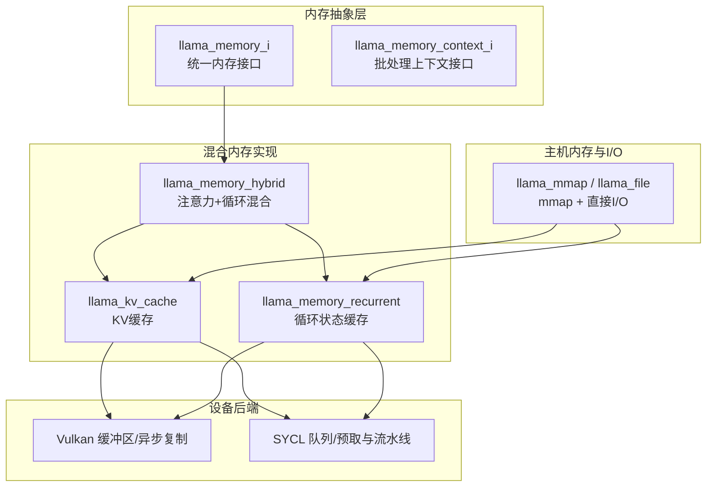
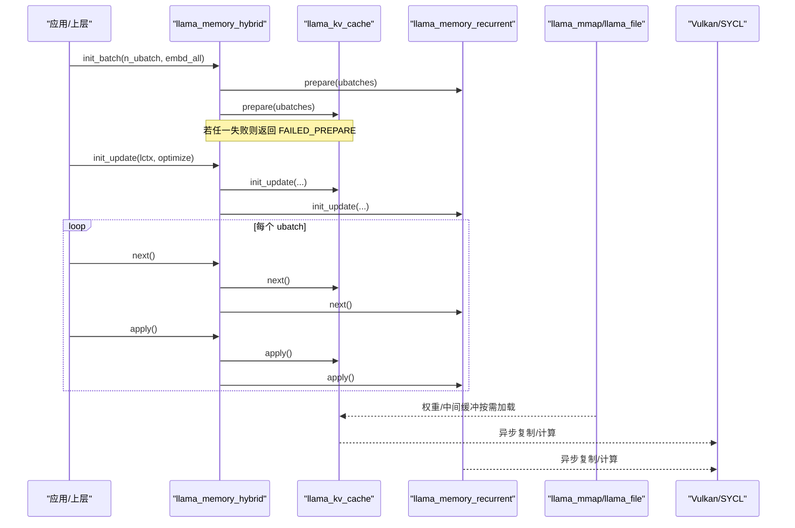
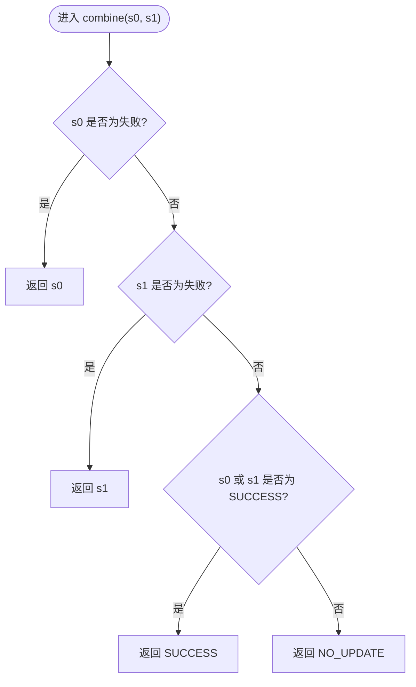
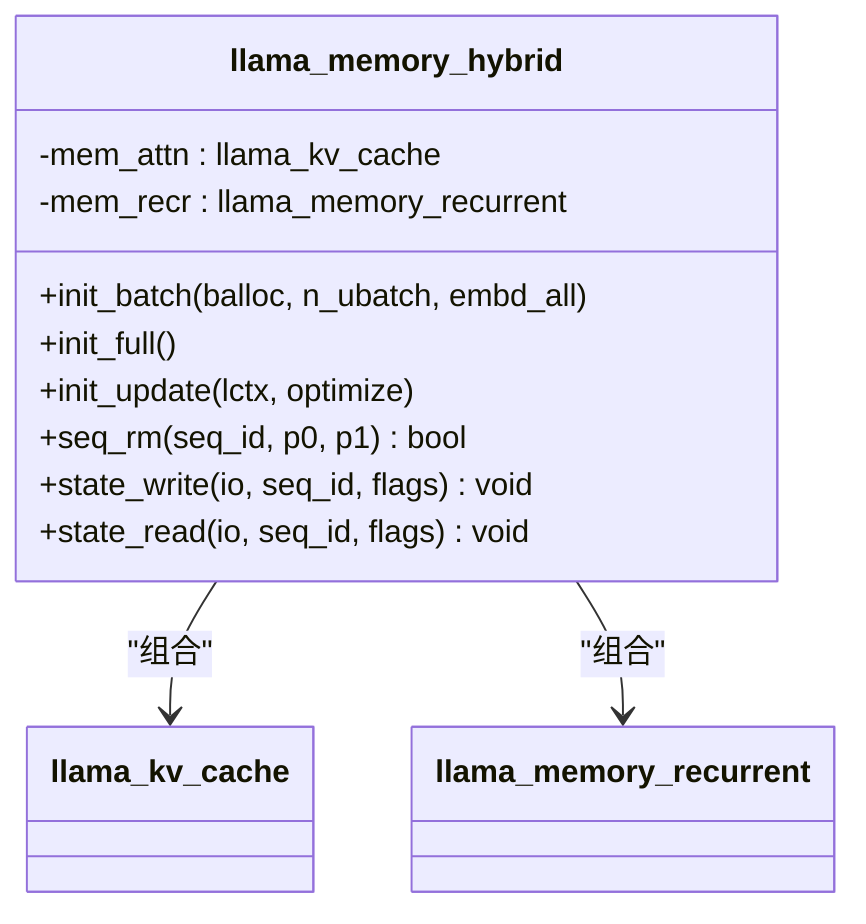
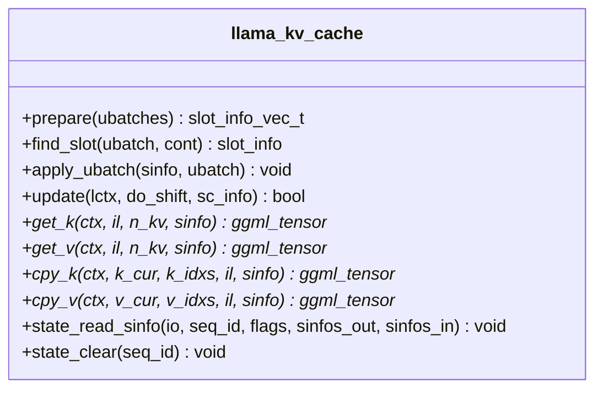
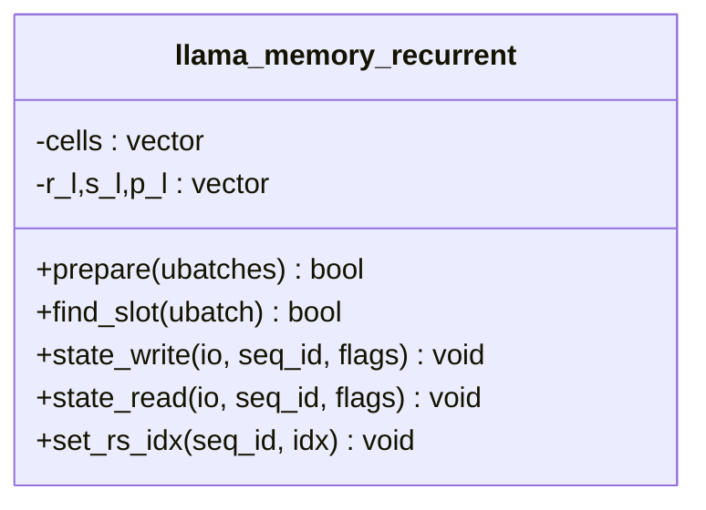
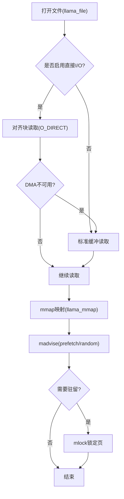
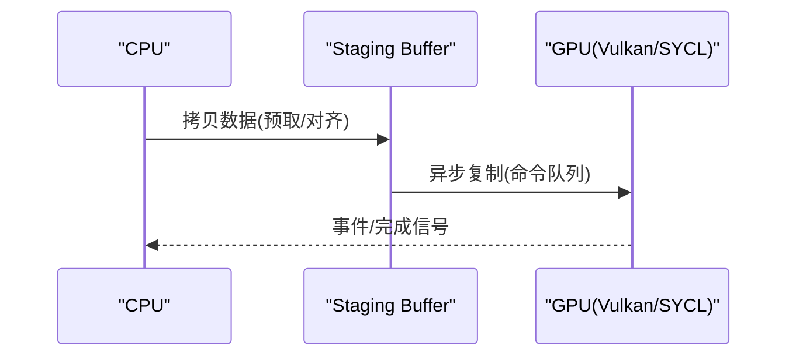
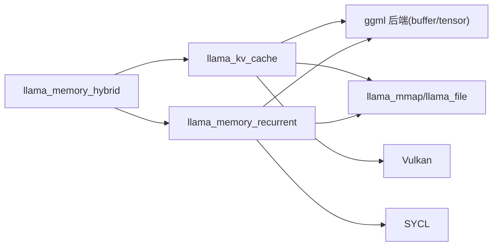

# 混合内存管理

<cite>
**本文引用的文件**   
- [llama-memory.h](file://src/llama-memory.h)
- [llama-memory.cpp](file://src/llama-memory.cpp)
- [llama-memory-hybrid.h](file://src/llama-memory-hybrid.h)
- [llama-memory-hybrid.cpp](file://src/llama-memory-hybrid.cpp)
- [llama-kv-cache.h](file://src/llama-kv-cache.h)
- [llama-memory-recurrent.h](file://src/llama-memory-recurrent.h)
- [llama-mmap.h](file://src/llama-mmap.h)
- [llama-mmap.cpp](file://src/llama-mmap.cpp)
- [ggml-vulkan-buffers.cpp](file://ggml/src/ggml-vulkan/ggml-vulkan-buffers.cpp)
- [ggml-sycl.cpp](file://ggml/src/ggml-sycl/ggml-sycl.cpp)
</cite>

## 目录
1. [引言](#引言)
2. [项目结构](#项目结构)
3. [核心组件](#核心组件)
4. [架构总览](#架构总览)
5. [详细组件分析](#详细组件分析)
6. [依赖关系分析](#依赖关系分析)
7. [性能考量](#性能考量)
8. [故障排查指南](#故障排查指南)
9. [结论](#结论)
10. [附录](#附录)

## 引言
本文件面向混合内存管理系统，系统性阐述主机内存与设备内存的协同机制、数据迁移策略与同步协议、内存映射与零拷贝优化（直接内存访问与异步传输），以及混合内存状态协调机制（重点说明 llama_memory_status_combine 的使用）。同时提供性能调优方法与最佳实践，包括带宽优化与延迟隐藏技术，并给出具体实现示例与性能分析工具使用建议。

## 项目结构
围绕混合内存管理的核心代码主要分布在以下模块：
- 通用内存接口与状态管理：llama-memory.*
- 混合内存适配器（注意力 KV + 循环状态）：llama-memory-hybrid.*
- KV 缓存实现：llama-kv-cache.h
- 循环状态缓存：llama-memory-recurrent.h
- 主机侧内存映射与直接 I/O：llama-mmap.*
- 后端异步传输与零拷贝路径（Vulkan/SYCL）：ggml-vulkan-buffers.cpp, ggml-sycl.cpp

图表来源
- [llama-memory.h:17-128](file://src/llama-memory.h#L17-L128)
- [llama-memory-hybrid.h:19-91](file://src/llama-memory-hybrid.h#L19-L91)
- [llama-kv-cache.h:20-153](file://src/llama-kv-cache.h#L20-L153)
- [llama-memory-recurrent.h:17-67](file://src/llama-memory-recurrent.h#L17-L67)
- [llama-mmap.h:20-90](file://src/llama-mmap.h#L20-L90)
- [ggml-vulkan-buffers.cpp:466-482](file://ggml/src/ggml-vulkan/ggml-vulkan-buffers.cpp#L466-L482)
- [ggml-sycl.cpp:819-850](file://ggml/src/ggml-sycl/ggml-sycl.cpp#L819-L850)

章节来源
- [llama-memory.h:17-128](file://src/llama-memory.h#L17-L128)
- [llama-memory-hybrid.h:19-91](file://src/llama-memory-hybrid.h#L19-L91)
- [llama-kv-cache.h:20-153](file://src/llama-kv-cache.h#L20-L153)
- [llama-memory-recurrent.h:17-67](file://src/llama-memory-recurrent.h#L17-L67)
- [llama-mmap.h:20-90](file://src/llama-mmap.h#L20-L90)

## 核心组件
- llama_memory_i 与 llama_memory_context_i：定义统一的 LLM 内存抽象与批处理生命周期（init_batch/init_full/init_update/apply/next/get_status）。
- llama_memory_hybrid：组合注意力 KV 与循环状态两类子内存，按层过滤分别路由到 KV 或循环缓存，并在批处理时统一调度。
- llama_kv_cache：实现 KV 单元分配、流式索引、移位更新、状态读写等。
- llama_memory_recurrent：维护循环状态（R/S/P）及回滚快照，支持连续槽位查找与应用。
- llama_mmap/llama_file：提供 mmap 映射、直接 I/O、页预取与 mlock 能力，用于模型权重与中间缓冲的高效加载与驻留。
- 后端异步传输：Vulkan 通过 staging buffer 与命令复制实现异步写；SYCL 通过 pinned staging 与 in-order 队列流水线化上传。

章节来源
- [llama-memory.h:17-128](file://src/llama-memory.h#L17-L128)
- [llama-memory-hybrid.h:19-91](file://src/llama-memory-hybrid.h#L19-L91)
- [llama-kv-cache.h:20-153](file://src/llama-kv-cache.h#L20-L153)
- [llama-memory-recurrent.h:17-67](file://src/llama-memory-recurrent.h#L17-L67)
- [llama-mmap.h:20-90](file://src/llama-mmap.h#L20-L90)

## 架构总览
混合内存系统以 llama_memory_i 为统一入口，llama_memory_hybrid 作为“组合器”，将不同层的计算需求分发到 llama_kv_cache（注意力）与 llama_memory_recurrent（循环）两个子系统。批处理阶段由 llama_memory_context_i 驱动，按 ubatch 推进，最终在 apply() 中触发实际的内存更新（如 KV 写入、移位、状态复制）。主机侧通过 llama_mmap/llama_file 提供高效 I/O，设备后端通过 Vulkan/SYCL 完成异步数据传输与执行。

图表来源
- [llama-memory-hybrid.cpp:67-131](file://src/llama-memory-hybrid.cpp#L67-L131)
- [llama-kv-cache.h:125-153](file://src/llama-kv-cache.h#L125-L153)
- [llama-memory-recurrent.h:35-67](file://src/llama-memory-recurrent.h#L35-L67)
- [llama-mmap.h:20-90](file://src/llama-mmap.h#L20-L90)

## 详细组件分析

### 混合内存状态协调机制（llama_memory_status_combine）
- 设计目标：聚合多个子内存上下文的状态，确保错误传播与“是否有更新”语义正确。
- 行为规则：
  - 任一子上下文出现 FAILED_PREPARE/FAILED_COMPUTE，则整体返回该失败状态。
  - 若至少一个子上下文返回 SUCCESS，则合并结果为 SUCCESS（表示有更新）。
  - 否则返回 NO_UPDATE。
- 典型用法：在 llama_memory_hybrid_context 构造时，对注意力与循环两个子上下文的状态进行合并，从而统一对外暴露状态。

图表来源
- [llama-memory.cpp:9-48](file://src/llama-memory.cpp#L9-L48)
- [llama-memory-hybrid.cpp:224-250](file://src/llama-memory-hybrid.cpp#L224-L250)

章节来源
- [llama-memory.cpp:9-65](file://src/llama-memory.cpp#L9-L65)
- [llama-memory-hybrid.cpp:224-250](file://src/llama-memory-hybrid.cpp#L224-L250)

### 混合内存适配器（llama_memory_hybrid）
- 职责：根据模型层属性（注意力 vs 循环）将层路由到对应子内存；统一批处理拆分、状态读写与内存统计。
- 关键流程：
  - init_batch：先准备循环批次，再准备注意力批次；任一失败即返回 FAILED_PREPARE。
  - init_update：委托给子上下文进行移位/复制等更新准备。
  - seq_* 操作：优先尝试循环侧删除，再执行注意力侧，保证一致性。
  - state_read：若循环侧读取异常，会回滚注意力侧已恢复的部分。

图表来源
- [llama-memory-hybrid.h:19-91](file://src/llama-memory-hybrid.h#L19-L91)
- [llama-memory-hybrid.cpp:11-65](file://src/llama-memory-hybrid.cpp#L11-L65)
- [llama-kv-cache.h:20-153](file://src/llama-kv-cache.h#L20-L153)
- [llama-memory-recurrent.h:17-67](file://src/llama-memory-recurrent.h#L17-L67)

章节来源
- [llama-memory-hybrid.cpp:67-131](file://src/llama-memory-hybrid.cpp#L67-L131)
- [llama-memory-hybrid.cpp:138-214](file://src/llama-memory-hybrid.cpp#L138-L214)

### KV 缓存（llama_kv_cache）
- 数据结构：slot_info 描述每个 ubatch 在 KV 单元中的插入位置；stream_copy_info 记录跨流的待复制信息。
- 关键 API：prepare/find_slot/apply_ubatch/update；get_k/get_v/cpy_k/cpy_v；state_read_sinfo/state_clear。
- 特性：支持 SWA、旋转编码（RoPE）、流式索引、移位更新、状态持久化与回滚清理。

图表来源
- [llama-kv-cache.h:20-153](file://src/llama-kv-cache.h#L20-L153)
- [llama-kv-cache.h:193-251](file://src/llama-kv-cache.h#L193-L251)

章节来源
- [llama-kv-cache.h:20-153](file://src/llama-kv-cache.h#L20-L153)
- [llama-kv-cache.h:193-251](file://src/llama-kv-cache.h#L193-L251)

### 循环状态缓存（llama_memory_recurrent）
- 数据结构：mem_cell 描述单元位置、归属序列集合、回滚快照索引等；r_l/s_l/p_l 为每层张量。
- 关键流程：find_slot 寻找连续槽位；prepare 构建批处理布局；state_read/state_write 持久化；set_rs_idx 管理回滚快照。

图表来源
- [llama-memory-recurrent.h:17-67](file://src/llama-memory-recurrent.h#L17-L67)
- [llama-memory-recurrent.h:88-142](file://src/llama-memory-recurrent.h#L88-L142)

章节来源
- [llama-memory-recurrent.h:17-67](file://src/llama-memory-recurrent.h#L17-L67)
- [llama-memory-recurrent.h:88-142](file://src/llama-memory-recurrent.h#L88-L142)

### 主机内存映射与直接 I/O（llama_mmap/llama_file）
- 功能要点：
  - llama_file：封装底层文件句柄，支持 O_DIRECT（Linux）对齐块读取、缓冲回退、对齐缓冲复用。
  - llama_mmap：mmap 映射、分段 unmap、prefetch/madvise 控制、NUMA 提示。
  - llama_mlock：将页锁定到物理内存，避免换页抖动。
- 性能意义：减少拷贝与缺页中断，提升大模型权重加载与中间缓冲吞吐。

图表来源
- [llama-mmap.cpp:184-397](file://src/llama-mmap.cpp#L184-L397)
- [llama-mmap.cpp:478-686](file://src/llama-mmap.cpp#L478-L686)
- [llama-mmap.cpp:696-800](file://src/llama-mmap.cpp#L696-L800)

章节来源
- [llama-mmap.h:20-90](file://src/llama-mmap.h#L20-L90)
- [llama-mmap.cpp:184-397](file://src/llama-mmap.cpp#L184-L397)
- [llama-mmap.cpp:478-686](file://src/llama-mmap.cpp#L478-L686)
- [llama-mmap.cpp:696-800](file://src/llama-mmap.cpp#L696-L800)

### 设备端异步传输与零拷贝优化
- Vulkan：当非 pinned 内存写入不被支持时，通过 staging buffer 与命令复制实现异步传输；必要时触发同步屏障。
- SYCL：通过 pinned staging 与 in-order 队列流水线化上传，避免逐张量 drain，提高带宽利用率。

图表来源
- [ggml-vulkan-buffers.cpp:466-482](file://ggml/src/ggml-vulkan/ggml-vulkan-buffers.cpp#L466-L482)
- [ggml-sycl.cpp:819-850](file://ggml/src/ggml-sycl/ggml-sycl.cpp#L819-L850)

章节来源
- [ggml-vulkan-buffers.cpp:466-482](file://ggml/src/ggml-vulkan/ggml-vulkan-buffers.cpp#L466-L482)
- [ggml-sycl.cpp:819-850](file://ggml/src/ggml-sycl/ggml-sycl.cpp#L819-L850)

## 依赖关系分析
- 耦合性：
  - llama_memory_hybrid 强耦合于 llama_kv_cache 与 llama_memory_recurrent，但通过统一接口解耦上层调用。
  - llama_kv_cache 与 llama_memory_recurrent 均依赖 ggml 后端（buffer/tensor）与 I/O 抽象。
- 外部依赖：
  - 操作系统 I/O（mmap/O_DIRECT/madvise/mlock）。
  - 设备后端（Vulkan/SYCL）的异步复制与队列语义。

图表来源
- [llama-memory-hybrid.h:19-91](file://src/llama-memory-hybrid.h#L19-L91)
- [llama-kv-cache.h:20-153](file://src/llama-kv-cache.h#L20-L153)
- [llama-memory-recurrent.h:17-67](file://src/llama-memory-recurrent.h#L17-L67)
- [llama-mmap.h:20-90](file://src/llama-mmap.h#L20-L90)

章节来源
- [llama-memory-hybrid.h:19-91](file://src/llama-memory-hybrid.h#L19-L91)
- [llama-kv-cache.h:20-153](file://src/llama-kv-cache.h#L20-L153)
- [llama-memory-recurrent.h:17-67](file://src/llama-memory-recurrent.h#L17-L67)
- [llama-mmap.h:20-90](file://src/llama-mmap.h#L20-L90)

## 性能考量
- 内存带宽优化
  - 使用 llama_mmap 的 prefetch 与 madvise 预热热点页，降低缺页开销。
  - 启用 O_DIRECT 对齐块读取，避免内核页缓存抖动，提升 NVMe 吞吐。
  - 利用 Vulkan/SYCL 的 staging 与流水线复制，隐藏 PCIe 传输延迟。
- 延迟隐藏技术
  - 批处理拆分（n_ubatch）与多 ubatch 并行推进，重叠计算与传输。
  - 在 llama_kv_cache.update 中批量处理 stream_copy，减少同步点。
- 资源驻留
  - 对频繁访问的权重与中间缓冲使用 llama_mlock 驻留，避免换页抖动。
- 参数调优建议
  - 合理设置 kv_unified 与 n_streams，平衡多序列场景下的内存碎片与带宽。
  - 调整 n_pad/n_swa 与 swa_type，匹配模型注意力模式以减少无效计算。

[本节为通用指导，不直接分析具体文件]

## 故障排查指南
- 常见错误与定位
  - 初始化失败：检查 llama_memory_hybrid::init_batch 中循环与注意力子上下文的 prepare 返回值，确认是否返回 FAILED_PREPARE。
  - 状态不一致：核查 llama_memory_hybrid::state_read 的回滚逻辑，确保注意力侧在循环侧异常时能撤销。
  - 设备端写入失败：检查 Vulkan/SYCL 的异步复制路径，确认 staging buffer 与队列配置是否正确。
- 诊断步骤
  - 打印各子上下文状态（get_status），结合 llama_memory_status_is_fail 判断失败类型。
  - 使用 memory_breakdown 统计各后端 buffer 类型占用，定位内存瓶颈。
  - 观察日志中的 O_DIRECT 回退与 mlock 警告，评估是否需要调整系统限制或硬件能力。

章节来源
- [llama-memory-hybrid.cpp:67-131](file://src/llama-memory-hybrid.cpp#L67-L131)
- [llama-memory-hybrid.cpp:190-214](file://src/llama-memory-hybrid.cpp#L190-L214)
- [llama-memory.cpp:50-65](file://src/llama-memory.cpp#L50-L65)
- [llama-mmap.cpp:184-397](file://src/llama-mmap.cpp#L184-L397)
- [ggml-vulkan-buffers.cpp:466-482](file://ggml/src/ggml-vulkan/ggml-vulkan-buffers.cpp#L466-L482)
- [ggml-sycl.cpp:819-850](file://ggml/src/ggml-sycl/ggml-sycl.cpp#L819-L850)

## 结论
混合内存管理通过统一接口与组合式架构，将注意力 KV 与循环状态有效协同，配合主机侧 mmap/直接 I/O 与设备端异步传输，实现了高吞吐、低延迟的数据迁移与计算流水线。状态协调函数 llama_memory_status_combine 提供了健壮的错误传播与更新语义。在实际部署中，应结合工作负载特征调优批大小、流数、SWA 策略与 I/O 参数，以获得最佳性能。

[本节为总结性内容，不直接分析具体文件]

## 附录
- 关键 API 速查
  - llama_memory_status_combine：合并两个子内存上下文状态。
  - llama_memory_hybrid::init_batch/init_update：混合内存批处理与更新入口。
  - llama_kv_cache::prepare/find_slot/apply_ubatch/update：KV 缓存布局与更新。
  - llama_memory_recurrent::prepare/find_slot：循环状态布局与槽位查找。
  - llama_mmap/llama_file：主机侧高效 I/O 与内存映射。
  - Vulkan/SYCL 异步复制：设备端零拷贝与流水线传输。

[本节为补充信息，不直接分析具体文件]