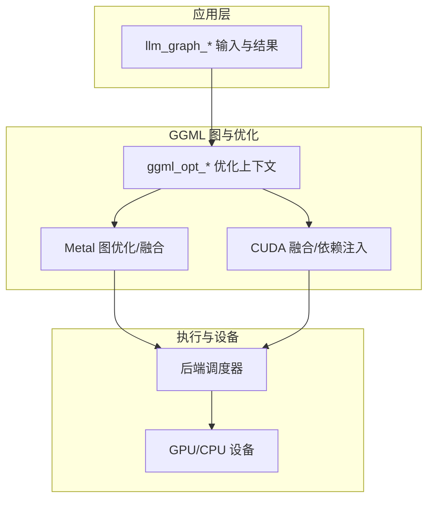
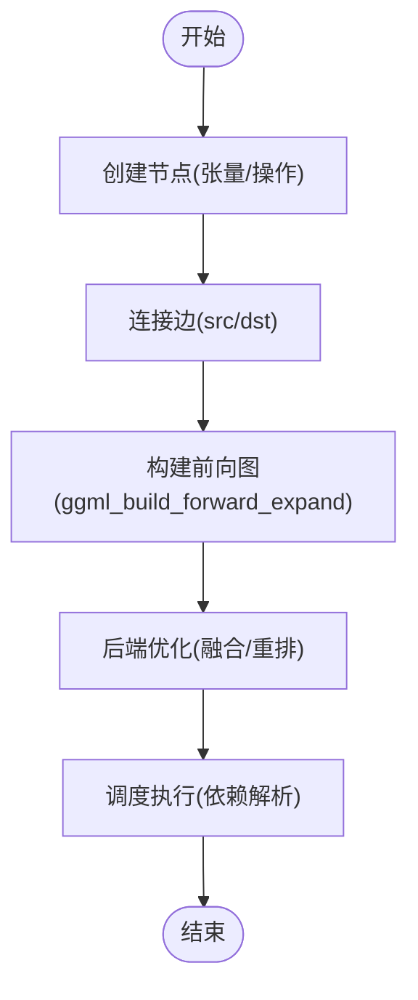
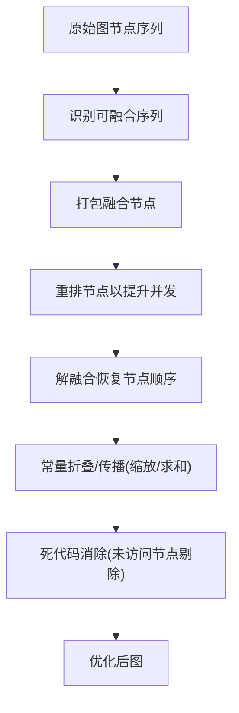
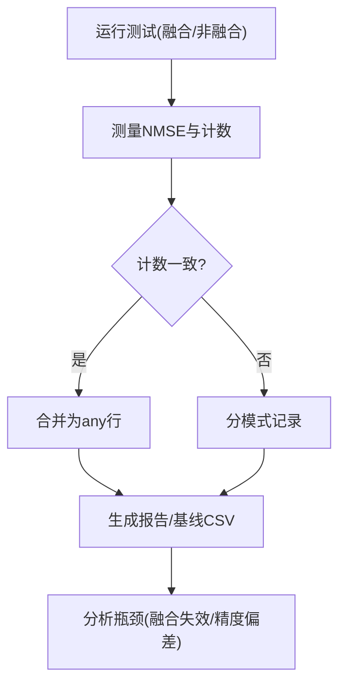
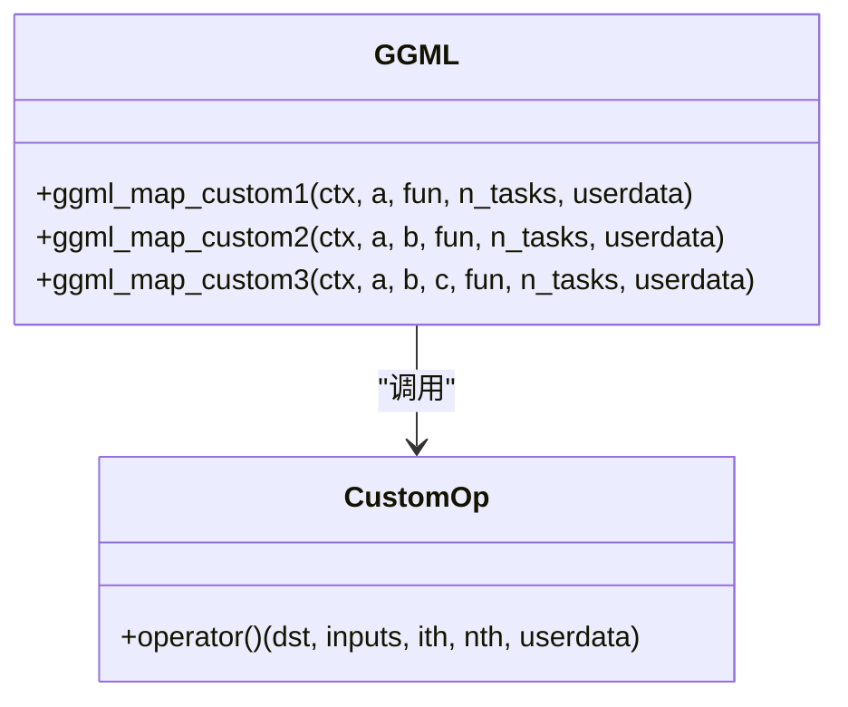
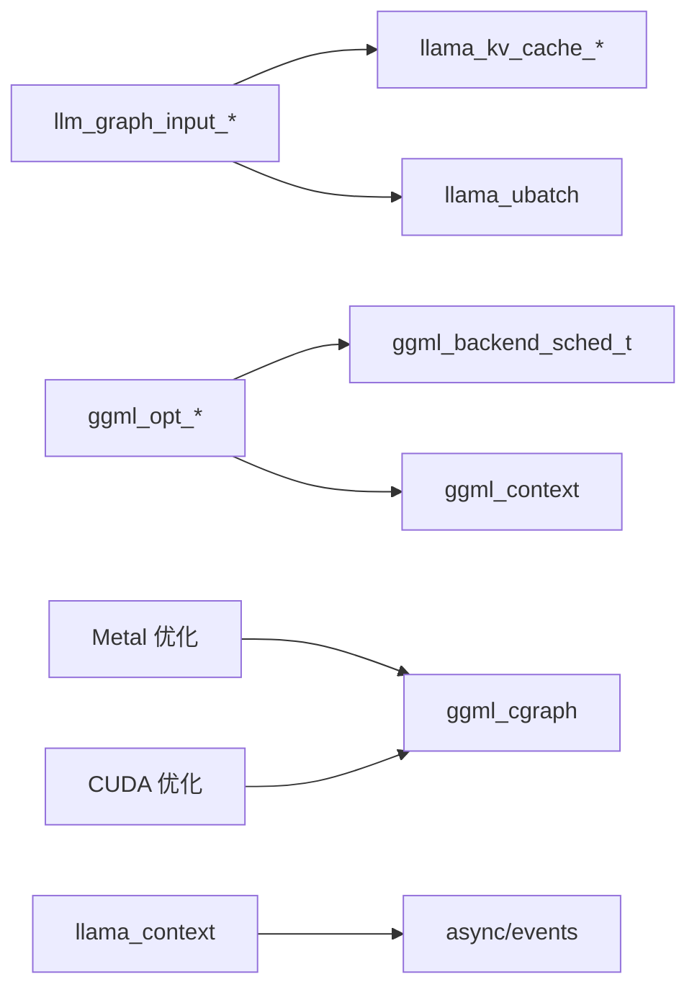

# 图执行引擎

<cite>
**本文引用的文件**   
- [src/llama-graph.h](file://src/llama-graph.h)
- [src/llama-graph.cpp](file://src/llama-graph.cpp)
- [ggml/include/ggml-opt.h](file://ggml/include/ggml-opt.h)
- [ggml/src/ggml-opt.cpp](file://ggml/src/ggml-opt.cpp)
- [tests/test-fusion.cpp](file://tests/test-fusion.cpp)
- [ggml/src/ggml-metal/ggml-metal-common.cpp](file://ggml/src/ggml-metal/ggml-metal-common.cpp)
- [ggml/src/ggml-cuda/ggml-cuda.cu](file://ggml/src/ggml-cuda/ggml-cuda.cu)
- [src/llama-context.cpp](file://src/llama-context.cpp)
- [include/ggml.h](file://include/ggml.h)
</cite>

## 目录
1. [简介](#简介)
2. [项目结构](#项目结构)
3. [核心组件](#核心组件)
4. [架构总览](#架构总览)
5. [详细组件分析](#详细组件分析)
6. [依赖关系分析](#依赖关系分析)
7. [性能考量](#性能考量)
8. [故障排查指南](#故障排查指南)
9. [结论](#结论)
10. [附录](#附录)

## 简介
本技术文档聚焦 llama.cpp 的“图执行引擎”，围绕计算图的构建、优化、异步执行与性能分析展开，并给出自定义算子集成与扩展机制。内容面向希望深入理解图构建流程（节点创建、边连接、执行顺序）、图优化（算子融合、常量折叠、死代码消除）、异步调度（任务调度、依赖解析、并行执行）以及性能分析方法（执行时间、内存统计、瓶颈识别）的读者。

## 项目结构
- 高层图构建与输入绑定：位于 src/llama-graph.*，负责将模型层逻辑映射为 ggml 计算图，管理输入张量、注意力掩码、KV 缓存索引等运行时数据绑定。
- 训练/优化上下文：位于 ggml/include/ggml-opt.h 与 ggml/src/ggml-opt.cpp，提供前向、反向、优化步的图构建与分配能力，支持静态图与动态图两种模式。
- 后端图优化与融合：位于 ggml/src/ggml-metal/ggml-metal-common.cpp 与 ggml/src/ggml-cuda/ggml-cuda.cu，实现设备侧的算子融合、重排与依赖注入。
- 测试与回归：tests/test-fusion.cpp 用于验证不同后端融合行为的一致性，并与基准对比。
- 异步与流水线并行：src/llama-context.cpp 中检测设备是否支持异步与事件，决定是否启用流水线并行。
- 自定义算子接口：include/ggml.h 暴露自定义算子 API，便于扩展新算子。



图表来源
- [src/llama-graph.h:786-800](file://src/llama-graph.h#L786-L800)
- [ggml/include/ggml-opt.h:110-130](file://ggml/include/ggml-opt.h#L110-L130)
- [ggml/src/ggml-metal/ggml-metal-common.cpp:562-616](file://ggml/src/ggml-metal/ggml-metal-common.cpp#L562-L616)
- [ggml/src/ggml-cuda/ggml-cuda.cu:4790-4815](file://ggml/src/ggml-cuda/ggml-cuda.cu#L4790-L4815)

章节来源
- [src/llama-graph.h:786-800](file://src/llama-graph.h#L786-L800)
- [ggml/include/ggml-opt.h:110-130](file://ggml/include/ggml-opt.h#L110-L130)

## 核心组件
- llm_graph_input_i 及其派生类：定义图输入的统一接口，负责从 ubatch 填充 tokens、embd、pos、注意力掩码、KV 索引等张量，并提供 can_reuse 判断以复用已构建的图。
- llm_graph_params / llm_graph_result：封装图构建参数与结果，包括架构、超参、批处理、调度器、后端 CPU、适配器、LoRA 等。
- ggml_opt_context / ggml_opt_dataset：训练优化上下文，管理数据集、损失函数、前向/反向/优化图，支持静态图与动态图分配。
- Metal/CUDA 图优化：在图执行前进行算子融合、节点重排、依赖注入，提升并发与吞吐。
- 异步与流水线并行：根据设备能力（async/events）决定是否启用流水线并行。

章节来源
- [src/llama-graph.h:106-128](file://src/llama-graph.h#L106-L128)
- [src/llama-graph.h:786-800](file://src/llama-graph.h#L786-L800)
- [ggml/include/ggml-opt.h:110-130](file://ggml/include/ggml-opt.h#L110-L130)
- [ggml/src/ggml-metal/ggml-metal-common.cpp:562-616](file://ggml/src/ggml-metal/ggml-metal-common.cpp#L562-L616)
- [ggml/src/ggml-cuda/ggml-cuda.cu:4790-4815](file://ggml/src/ggml-cuda/ggml-cuda.cu#L4790-L4815)
- [src/llama-context.cpp:525-555](file://src/llama-context.cpp#L525-L555)

## 架构总览
llama.cpp 的图执行引擎由三层组成：
- 前端图构建层：llm_graph_input_* 将模型层与批处理数据绑定到 ggml 张量，生成计算图。
- 优化层：ggml_opt_* 提供训练/评估所需的图构建与分配；Metal/CUDA 后端对图进行融合与重排。
- 执行层：后端调度器按依赖关系调度任务，支持多设备并行与流水线并行。

```mermaid
sequenceDiagram
participant App as "应用/模型层"
participant Graph as "llm_graph_input_*"
participant Opt as "ggml_opt_*"
participant Backend as "Metal/CUDA 优化"
participant Sched as "后端调度器"
participant Dev as "设备(GPU/CPU)"
App->>Graph : 设置输入(ubatch)
Graph-->>App : 返回绑定的张量/掩码/KV索引
App->>Opt : 构建前向/反向/优化图
Opt->>Backend : 图优化(融合/重排/依赖注入)
Backend-->>Sched : 提交可执行图
Sched->>Dev : 异步执行(若支持)
Dev-->>Sched : 完成事件/结果
Sched-->>App : 输出(logits/loss/预测)
```

图表来源
- [src/llama-graph.cpp:70-138](file://src/llama-graph.cpp#L70-L138)
- [ggml/src/ggml-opt.cpp:322-547](file://ggml/src/ggml-opt.cpp#L322-L547)
- [ggml/src/ggml-metal/ggml-metal-common.cpp:562-616](file://ggml/src/ggml-metal/ggml-metal-common.cpp#L562-L616)
- [ggml/src/ggml-cuda/ggml-cuda.cu:4790-4815](file://ggml/src/ggml-cuda/ggml-cuda.cu#L4790-L4815)

## 详细组件分析

### 计算图构建：节点创建、边连接与执行顺序
- 节点创建：通过 ggml 张量 API 创建中间张量与操作节点，例如注意力掩码、位置编码、归一化、FFN 等。
- 边连接：张量的 src/dst 指针建立依赖边，形成 DAG。
- 执行顺序：ggml_build_forward_expand 将节点加入图；后端优化阶段可能重排节点以提升并发。



图表来源
- [src/llama-graph.cpp:30-47](file://src/llama-graph.cpp#L30-L47)
- [ggml/src/ggml-metal/ggml-metal-common.cpp:562-616](file://ggml/src/ggml-metal/ggml-metal-common.cpp#L562-L616)

章节来源
- [src/llama-graph.cpp:30-47](file://src/llama-graph.cpp#L30-L47)
- [src/llama-graph.cpp:70-138](file://src/llama-graph.cpp#L70-L138)
- [ggml/src/ggml-metal/ggml-metal-common.cpp:562-616](file://ggml/src/ggml-metal/ggml-metal-common.cpp#L562-L616)

### 图优化：算子融合、常量折叠与死代码消除
- 算子融合：Metal 后端在图优化阶段识别可融合序列，打包节点并重排，随后解融合恢复原节点顺序，以提升并发。
- 常量折叠：ggml_opt_* 在构建损失与优化图时，通过复制/映射张量与操作，隐式进行常量传播与简化（如缩放、求和）。
- 死代码消除：通过访问集与哈希集合标记被访问节点，未访问节点不参与反向或优化图构建，从而避免无用计算。



图表来源
- [ggml/src/ggml-metal/ggml-metal-common.cpp:562-616](file://ggml/src/ggml-metal/ggml-metal-common.cpp#L562-L616)
- [ggml/src/ggml-opt.cpp:262-320](file://ggml/src/ggml-opt.cpp#L262-L320)

章节来源
- [ggml/src/ggml-metal/ggml-metal-common.cpp:562-616](file://ggml/src/ggml-metal/ggml-metal-common.cpp#L562-L616)
- [ggml/src/ggml-opt.cpp:262-320](file://ggml/src/ggml-opt.cpp#L262-L320)

### 异步执行机制：任务调度、依赖解析与并行执行
- 任务调度：后端调度器根据图依赖关系分发任务至设备线程或 GPU 队列。
- 依赖解析：Metal/CUDA 在优化阶段添加分配依赖，确保共享结果不被别名覆盖。
- 并行执行：当设备支持异步与事件时，启用流水线并行，跨设备流水线执行。

```mermaid
sequenceDiagram
participant Opt as "优化器"
participant Meta as "Metal/CUDA 优化"
participant Sched as "调度器"
participant Dev as "设备"
Opt->>Meta : 请求优化(融合/重排)
Meta->>Sched : 添加分配依赖(共享结果保护)
Sched->>Dev : 提交任务(异步)
Dev-->>Sched : 事件回调(完成)
Sched-->>Opt : 结果就绪
```

图表来源
- [ggml/src/ggml-cuda/ggml-cuda.cu:4790-4815](file://ggml/src/ggml-cuda/ggml-cuda.cu#L4790-L4815)
- [src/llama-context.cpp:525-555](file://src/llama-context.cpp#L525-L555)

章节来源
- [ggml/src/ggml-cuda/ggml-cuda.cu:4790-4815](file://ggml/src/ggml-cuda/ggml-cuda.cu#L4790-L4815)
- [src/llama-context.cpp:525-555](file://src/llama-context.cpp#L525-L555)

### 图性能分析：执行时间、内存使用与瓶颈识别
- 执行时间：可通过测试工具在不同模式下（prefill/decode）运行，比较融合与非融合的 logits 差异与耗时。
- 内存使用：Metal/CUDA 优化阶段会调整分配依赖，影响整体 compute buffer 大小；需关注共享结果的别名问题。
- 瓶颈识别：通过融合计数与 NMSE 对比，定位融合失效或精度偏差；结合设备能力（async/events）判断是否启用流水线并行。



图表来源
- [tests/test-fusion.cpp:186-207](file://tests/test-fusion.cpp#L186-L207)
- [tests/test-fusion.cpp:448-504](file://tests/test-fusion.cpp#L448-L504)

章节来源
- [tests/test-fusion.cpp:186-207](file://tests/test-fusion.cpp#L186-L207)
- [tests/test-fusion.cpp:448-504](file://tests/test-fusion.cpp#L448-L504)

### 自定义算子集成与扩展机制
- 接口定义：ggml_map_custom1/2/3 提供单/双/三输入自定义算子，支持多线程 n_tasks 与 userdata。
- 集成方式：在模型层或后端中注册自定义算子，将其纳入图构建；注意与现有融合模式的兼容性。
- 扩展建议：优先复用 ggml 张量与操作语义，确保类型、形状与内存布局一致；必要时在后端优化阶段添加融合规则。



图表来源
- [include/ggml.h:2735-2764](file://include/ggml.h#L2735-L2764)

章节来源
- [include/ggml.h:2735-2764](file://include/ggml.h#L2735-L2764)

## 依赖关系分析
- llm_graph_input_* 依赖 llama_ubatch、llama_kv_cache_context 等上下文对象，提供 set_input/can_reuse 接口。
- ggml_opt_* 依赖 ggml_backend_sched_t 与 ggml_context，管理前向/反向/优化图的构建与分配。
- Metal/CUDA 优化依赖 ggml_cgraph，进行节点重排与依赖注入。
- 异步执行依赖设备能力（async/events），由 llama_context 检测并启用流水线并行。



图表来源
- [src/llama-graph.h:106-128](file://src/llama-graph.h#L106-L128)
- [ggml/include/ggml-opt.h:110-130](file://ggml/include/ggml-opt.h#L110-L130)
- [ggml/src/ggml-metal/ggml-metal-common.cpp:562-616](file://ggml/src/ggml-metal/ggml-metal-common.cpp#L562-L616)
- [src/llama-context.cpp:525-555](file://src/llama-context.cpp#L525-L555)

章节来源
- [src/llama-graph.h:106-128](file://src/llama-graph.h#L106-L128)
- [ggml/include/ggml-opt.h:110-130](file://ggml/include/ggml-opt.h#L110-L130)
- [ggml/src/ggml-metal/ggml-metal-common.cpp:562-616](file://ggml/src/ggml-metal/ggml-metal-common.cpp#L562-L616)
- [src/llama-context.cpp:525-555](file://src/llama-context.cpp#L525-L555)

## 性能考量
- 融合收益：合理融合可减少内核启动开销与中间内存拷贝，但需注意共享结果的别名问题。
- 并发提升：节点重排可提升并行度，但需保证依赖正确性。
- 内存占用：优化阶段可能增加 compute buffer 大小，需平衡融合与内存压力。
- 异步与流水线：仅在设备支持 async/events 时启用，避免回退到同步执行。

[本节为通用指导，不直接分析具体文件]

## 故障排查指南
- 融合计数异常：使用 test-fusion 工具比对设备基线 CSV，检查融合模式是否生效。
- 精度偏差：比较融合与非融合的 logits NMSE，若超过阈值需检查融合规则与数据类型。
- 异步失败：确认设备属性（async/events）是否满足流水线并行要求。
- 内存溢出：检查优化阶段的分配依赖与共享结果别名，必要时禁用部分融合。

章节来源
- [tests/test-fusion.cpp:332-357](file://tests/test-fusion.cpp#L332-L357)
- [tests/test-fusion.cpp:448-504](file://tests/test-fusion.cpp#L448-L504)
- [src/llama-context.cpp:525-555](file://src/llama-context.cpp#L525-L555)

## 结论
llama.cpp 的图执行引擎通过前端图构建、后端优化与异步调度，实现了高效且可扩展的计算图执行。算子融合、常量折叠与死代码消除显著提升了性能；异步与流水线并行进一步挖掘了设备潜力。自定义算子机制为扩展提供了灵活接口。在实际应用中，应结合测试工具与性能分析，持续优化融合策略与执行路径。

[本节为总结，不直接分析具体文件]

## 附录
- 关键 API 参考：
  - 自定义算子：ggml_map_custom1/2/3
  - 优化上下文：ggml_opt_init/alloc/eval
  - 图优化：ggml_graph_optimize（Metal）
  - 融合调试：ggml_backend_fusion_*（测试工具）

章节来源
- [include/ggml.h:2735-2764](file://include/ggml.h#L2735-L2764)
- [ggml/include/ggml-opt.h:138-189](file://ggml/include/ggml-opt.h#L138-L189)
- [ggml/src/ggml-metal/ggml-metal-common.cpp:562-616](file://ggml/src/ggml-metal/ggml-metal-common.cpp#L562-L616)
- [tests/test-fusion.cpp:39-48](file://tests/test-fusion.cpp#L39-L48)