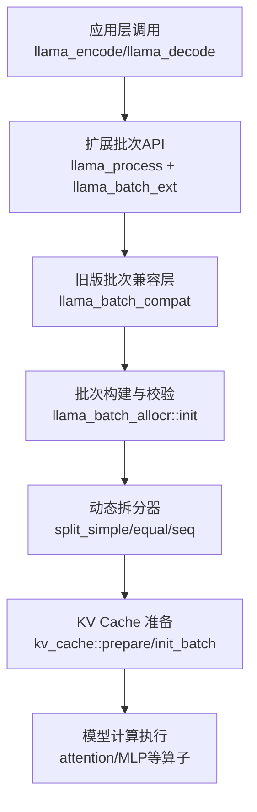
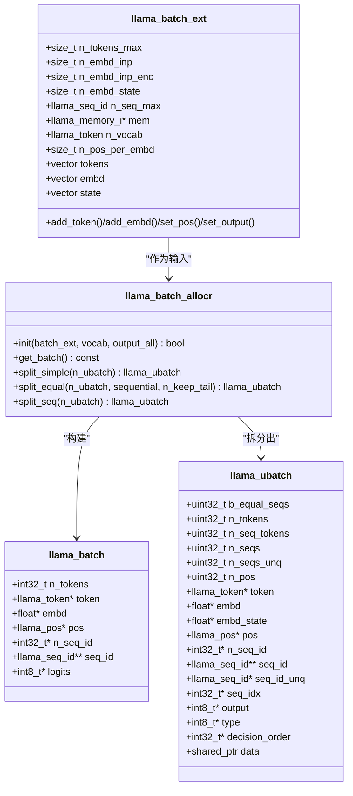
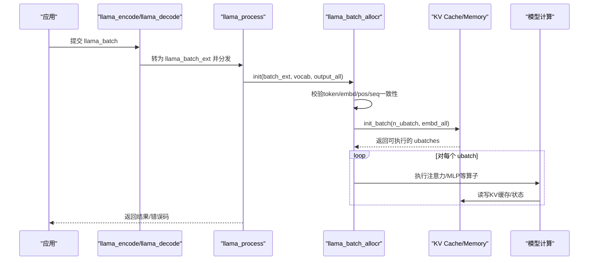
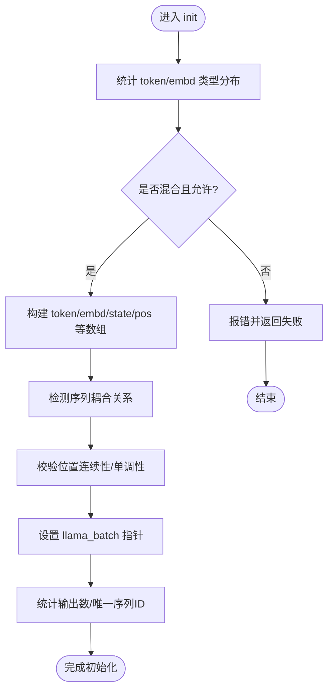
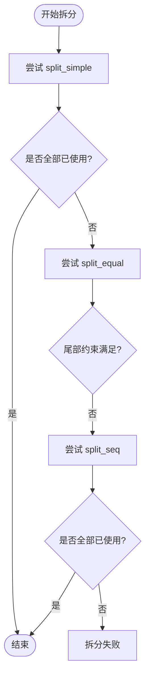
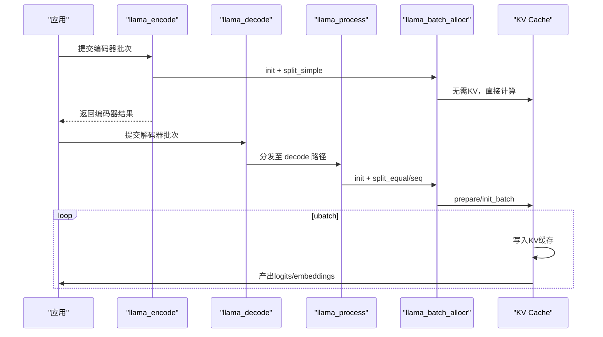
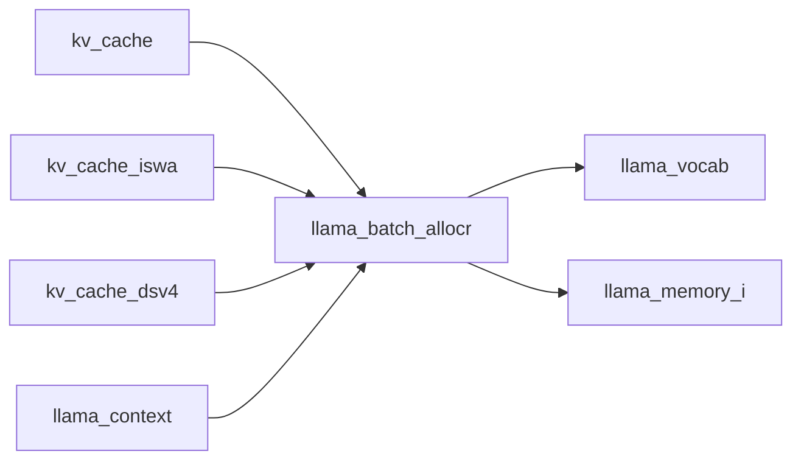
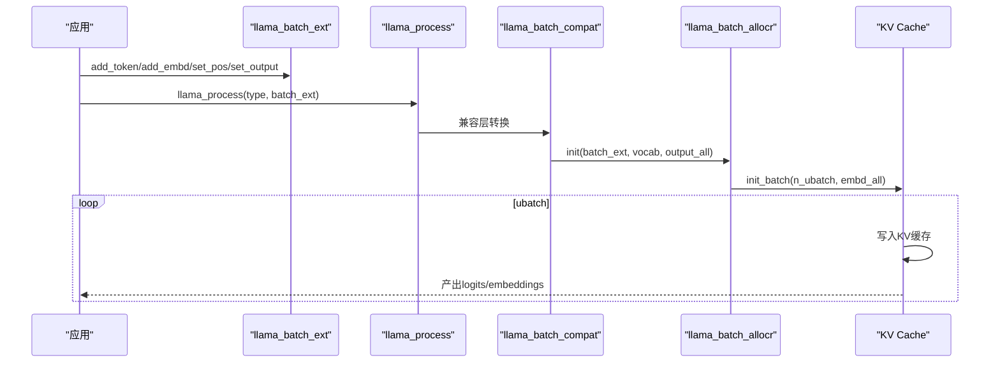

# 批处理机制

<cite>
**本文引用的文件**   
- [include/llama.h](file://include/llama.h)
- [src/llama-batch.h](file://src/llama-batch.h)
- [src/llama-batch.cpp](file://src/llama-batch.cpp)
- [src/llama-memory.h](file://src/llama-memory.h)
- [src/llama-kv-cache.cpp](file://src/llama-kv-cache.cpp)
- [src/llama-kv-cache-iswa.cpp](file://src/llama-kv-cache-iswa.cpp)
- [src/llama-kv-cache-dsv4.cpp](file://src/llama-kv-cache-dsv4.cpp)
- [src/llama-memory-hybrid.cpp](file://src/llama-memory-hybrid.cpp)
- [tests/test-batch-alloc.cpp](file://tests/test-batch-alloc.cpp)
</cite>

## 目录
1. [简介](#简介)
2. [项目结构与定位](#项目结构与定位)
3. [核心数据结构](#核心数据结构)
4. [架构总览](#架构总览)
5. [详细组件分析](#详细组件分析)
6. [依赖关系分析](#依赖关系分析)
7. [性能与调优指南](#性能与调优指南)
8. [错误处理与异常恢复](#错误处理与异常恢复)
9. [结论](#结论)
10. [附录：关键流程时序图](#附录关键流程时序图)

## 简介
本文件面向 llama.cpp 的批处理子系统，系统性解释以下主题：
- llama_batch 与 llama_ubatch 的设计目标、字段语义与使用方式
- 批量编码(encode)与解码(decode)的数据流与调度策略
- 动态批处理（ubatch 拆分）的实现原理与内存分配优化
- 批大小自适应调整、并行化策略与性能调优建议
- 批处理的错误码、异常恢复与状态一致性保障

## 项目结构与定位
批处理相关代码主要位于：
- 公共 C API 定义：include/llama.h
- 内部批处理抽象与实现：src/llama-batch.h / src/llama-batch.cpp
- 内存/KV Cache 与 ubatch 迭代：src/llama-memory*.h/.cpp, src/llama-kv-cache*.cpp
- 单元测试验证拆分逻辑：tests/test-batch-alloc.cpp

图表来源
- [include/llama.h:984-1094](file://include/llama.h#L984-L1094)
- [src/llama-batch.h:97-151](file://src/llama-batch.h#L97-L151)
- [src/llama-batch.cpp:28-496](file://src/llama-batch.cpp#L28-L496)
- [src/llama-kv-cache.cpp:739-756](file://src/llama-kv-cache.cpp#L739-L756)

章节来源
- [include/llama.h:984-1094](file://include/llama.h#L984-L1094)
- [src/llama-batch.h:17-83](file://src/llama-batch.h#L17-L83)
- [src/llama-batch.cpp:28-496](file://src/llama-batch.cpp#L28-L496)

## 核心数据结构
本节聚焦 llama_batch、llama_ubatch、llama_batch_ext 以及 llama_batch_allocr。

- llama_batch（C API 批次）
  - 承载一次 encode/decode 的输入：token/embd、位置 pos、序列映射 seq_id/n_seq_id、输出标志 logits
  - 用于旧版 API；新版推荐通过 llama_batch_ext 构造后由 llama_process 统一处理

- llama_ubatch（物理微批次）
  - 将逻辑批次切分为可被 KV Cache 容纳的微批次
  - 包含 token/embd/pos/seq_id/output/type/decision_order 等指针，以及可选的 owned data_t
  - 支持混合类型（token 与 embd 混用）、多位置（M-RoPE）等场景

- llama_batch_ext（扩展批次）
  - 面向现代 API，提供 add_token/add_embd/set_pos/set_output 等细粒度接口
  - 内部维护 tokens/embd/state 等向量，并计算 n_embd_inp_enc/n_embd_state 等维度

- llama_batch_allocr（批次分配与拆分器）
  - 负责将 llama_batch_ext 转换为内部 llama_batch，并进行一致性校验
  - 提供 split_simple/split_equal/split_seq 三种拆分策略，生成一系列 llama_ubatch

图表来源
- [include/llama.h:248-273](file://include/llama.h#L248-L273)
- [src/llama-batch.h:17-83](file://src/llama-batch.h#L17-L83)
- [src/llama-batch.h:97-151](file://src/llama-batch.h#L97-L151)
- [src/llama-batch.h:154-261](file://src/llama-batch.h#L154-L261)

章节来源
- [include/llama.h:248-273](file://include/llama.h#L248-L273)
- [src/llama-batch.h:17-83](file://src/llama-batch.h#L17-L83)
- [src/llama-batch.h:97-151](file://src/llama-batch.h#L97-L151)
- [src/llama-batch.h:154-261](file://src/llama-batch.h#L154-L261)

## 架构总览
llama.cpp 的批处理采用“逻辑批次 → 物理微批次”的两阶段设计：
- 上层通过 llama_encode/llama_decode 或 llama_process(LLAMA_PROCESS_TYPE_ENCODE/DECODE) 提交逻辑批次
- 内部将逻辑批次标准化为 llama_batch，再由 llama_batch_allocr 拆分为多个 llama_ubatch
- 每个 llama_ubatch 交由 KV Cache 管理器的 init_batch/prepare 进行可行性检查与布局规划
- 最终按 ubatch 顺序执行模型计算，并在需要时更新 KV Cache 或记忆模块

图表来源
- [include/llama.h:984-1094](file://include/llama.h#L984-L1094)
- [src/llama-batch.cpp:28-496](file://src/llama-batch.cpp#L28-L496)
- [src/llama-memory.h:81-109](file://src/llama-memory.h#L81-L109)
- [src/llama-kv-cache.cpp:739-756](file://src/llama-kv-cache.cpp#L739-L756)

## 详细组件分析

### llama_batch 与 llama_ubatch 设计要点
- llama_batch
  - 扁平数组结构，便于底层算子直接访问
  - 支持仅 token、仅 embd、或两者同时存在（需上下文允许）
  - logits 字段控制哪些 token 的输出需要保留

- llama_ubatch
  - 指向外部数据或拥有 data_t 的内存
  - is_mixed()/is_pos_2d()/equal_seqs() 等辅助方法描述批次形态
  - decision_order 支持更灵活的调度顺序（如推测解码中的草稿头）

- llama_batch_ext
  - 提供强类型的 add/set 接口，避免手动维护指针
  - 自动推导 n_embd_inp_enc（编码器输入宽度）和 n_embd_state（跨阶段隐藏态）

章节来源
- [include/llama.h:248-273](file://include/llama.h#L248-L273)
- [src/llama-batch.h:17-83](file://src/llama-batch.h#L17-L83)
- [src/llama-batch.h:97-151](file://src/llama-batch.h#L97-L151)

### 批次构建与校验（llama_batch_allocr::init）
- 内容类型判定：统计仅 token、仅 embd、两者皆有三类条目数量，确保一致性
- 混合批次限制：若允许混合，则记录 is_embd_vec 标记每行是 token 还是 embd
- 扁平数组构建：token_vec/embd_vec/state_vec/pos/n_seq_id/seq_id/output/decision_order
- 序列耦合检测：同一 token 分配给多个 seq_id 时，标记耦合关系，防止非法拆分
- 位置一致性校验：
  - M-RoPE：允许非连续位置，但要求起始位置不落后于 KV 缓存末尾
  - 普通模式：要求位置严格连续且递增
- 序列集合法性：禁止部分序列子集、禁止位置递减

图表来源
- [src/llama-batch.cpp:28-496](file://src/llama-batch.cpp#L28-L496)

章节来源
- [src/llama-batch.cpp:28-496](file://src/llama-batch.cpp#L28-L496)

### 动态批处理与 ubatch 拆分策略
llama_batch_allocr 提供三种拆分策略：

- split_simple(n_ubatch)
  - 简单线性切分，每次取最多 n_ubatch 个未使用的 token
  - 适用于不需要保持序列对齐的场景

- split_equal(n_ubatch, sequential, n_keep_tail)
  - 保证每个序列集的 token 数量一致，适合注意力计算
  - sequential=true 时强制序列ID递增
  - n_keep_tail>0 时，保证尾部若干 token 不被拆分到不同 ubatch（用于回滚快照等）

- split_seq(n_ubatch)
  - 每个 ubatch 只包含一个序列集，适合全输出或非因果注意力

KV Cache 在 init_batch 中循环调用上述拆分器，直到所有 token 都被消费或无法继续拆分。

图表来源
- [src/llama-batch.cpp:585-800](file://src/llama-batch.cpp#L585-L800)
- [src/llama-memory-hybrid.cpp:67-102](file://src/llama-memory-hybrid.cpp#L67-L102)
- [src/llama-kv-cache-iswa.cpp:195-238](file://src/llama-kv-cache-iswa.cpp#L195-L238)
- [src/llama-kv-cache-dsv4.cpp:1409-1436](file://src/llama-kv-cache-dsv4.cpp#L1409-L1436)

章节来源
- [src/llama-batch.cpp:585-800](file://src/llama-batch.cpp#L585-L800)
- [src/llama-memory-hybrid.cpp:67-102](file://src/llama-memory-hybrid.cpp#L67-L102)
- [src/llama-kv-cache-iswa.cpp:195-238](file://src/llama-kv-cache-iswa.cpp#L195-L238)
- [src/llama-kv-cache-dsv4.cpp:1409-1436](file://src/llama-kv-cache-dsv4.cpp#L1409-L1436)

### 编码(encode)与解码(decode)流程
- llama_encode
  - 针对 encoder-only 或 encoder-decoder 模型的编码器部分
  - 不使用 KV Cache，主要用于提取特征或交叉注意力键值

- llama_decode
  - 针对 decoder 部分，依赖 KV Cache 存储历史 token 的状态
  - 内部将 llama_batch 转为 llama_ubatch 序列，逐批执行

- llama_process(LLAMA_PROCESS_TYPE_ENCODE/DECODE)
  - 统一入口，支持扩展批次 API（llama_batch_ext）
  - 返回码与 llama_decode 一致

图表来源
- [include/llama.h:984-1094](file://include/llama.h#L984-L1094)
- [src/llama-batch.cpp:28-496](file://src/llama-batch.cpp#L28-L496)
- [src/llama-kv-cache.cpp:739-756](file://src/llama-kv-cache.cpp#L739-L756)

章节来源
- [include/llama.h:984-1094](file://include/llama.h#L984-L1094)
- [src/llama-batch.cpp:28-496](file://src/llama-batch.cpp#L28-L496)
- [src/llama-kv-cache.cpp:739-756](file://src/llama-kv-cache.cpp#L739-L756)

## 依赖关系分析
- llama_batch_allocr 依赖 llama_vocab 进行 token 范围校验
- llama_batch_allocr 依赖 llama_memory_i 获取序列位置信息以做一致性校验
- KV Cache 各实现（kv_cache/kv_cache_iswa/kv_cache_dsv4）均调用 llama_batch_allocr 的拆分器
- llama_context 通过 llama_set_n_threads 暴露线程配置，影响批处理并行度

图表来源
- [src/llama-batch.cpp:28-496](file://src/llama-batch.cpp#L28-L496)
- [src/llama-kv-cache.cpp:739-756](file://src/llama-kv-cache.cpp#L739-L756)
- [src/llama-kv-cache-iswa.cpp:195-238](file://src/llama-kv-cache-iswa.cpp#L195-L238)
- [src/llama-kv-cache-dsv4.cpp:1409-1436](file://src/llama-kv-cache-dsv4.cpp#L1409-L1436)

章节来源
- [src/llama-batch.cpp:28-496](file://src/llama-batch.cpp#L28-L496)
- [src/llama-kv-cache.cpp:739-756](file://src/llama-kv-cache.cpp#L739-L756)
- [src/llama-kv-cache-iswa.cpp:195-238](file://src/llama-kv-cache-iswa.cpp#L195-L238)
- [src/llama-kv-cache-dsv4.cpp:1409-1436](file://src/llama-kv-cache-dsv4.cpp#L1409-L1436)

## 性能与调优指南
- 最佳批大小选择
  - n_batch：逻辑最大批次，受限于上下文窗口与显存
  - n_ubatch：物理最大批次，通常 n_ubatch ≤ n_batch
  - 建议先以较小 n_ubatch 启动，逐步增大直至显存饱和或吞吐不再提升

- 内存使用优化
  - 合理设置 n_seq_max，避免过多序列导致 KV Cache 碎片化
  - 对于非因果注意力或全输出场景，优先使用 split_seq 减少跨序列干扰
  - 启用 unified KV buffer（kv_unified=false）在多序列前缀差异较大时可改善性能

- 并行化策略
  - n_threads：单 token 生成线程数
  - n_threads_batch：批处理线程数
  - 结合硬件并发能力（CPU/GPU）调整，避免过度并行导致上下文切换开销

- 混合批次与多位置
  - 混合 token/embd 仅在模型支持时启用，注意 is_mixed() 分支路径的性能差异
  - M-RoPE 多位置输入需确保位置展开正确，避免重复计算

章节来源
- [include/llama.h:366-428](file://include/llama.h#L366-L428)
- [include/llama.h:1096-1105](file://include/llama.h#L1096-L1105)
- [src/llama-batch.h:17-83](file://src/llama-batch.h#L17-L83)

## 错误处理与异常恢复
- llama_decode 返回码
  - 0：成功
  - 1：KV 槽位不足（建议减小 batch 或增大 context）
  - 2：中止（已处理的 ubatch 会保留在内存中）
  - -1：无效输入批次
  - < -1：致命错误（已处理的 ubatch 会保留在内存中）

- 状态一致性
  - 致命错误或中止时，需通过 llama_memory_seq_pos_min/max 查询实际进度
  - 其他返回码下，内存状态会恢复到调用前

- 常见错误
  - 序列位置不一致：M-RoPE 要求起始位置不落后于 KV 缓存末尾
  - 序列位置不连续：普通模式下必须严格连续
  - 序列耦合冲突：耦合序列必须在相同位置区间内

章节来源
- [include/llama.h:994-1008](file://include/llama.h#L994-L1008)
- [src/llama-batch.cpp:345-440](file://src/llama-batch.cpp#L345-L440)

## 结论
llama.cpp 的批处理机制通过 llama_batch 与 llama_ubatch 的双层抽象，实现了从逻辑批次到物理微批次的灵活转换。llama_batch_allocr 提供了多种拆分策略以适配不同模型与注意力模式，KV Cache 管理器则负责可行性检查与内存布局。在实际使用中，应结合 n_batch/n_ubatch、线程数与模型特性进行调优，并严格遵循位置与序列一致性约束，以获得稳定高效的推理性能。

## 附录：关键流程时序图

### 扩展批次 API 处理流程

图表来源
- [include/llama.h:1010-1094](file://include/llama.h#L1010-L1094)
- [src/llama-batch.h:263-275](file://src/llama-batch.h#L263-L275)
- [src/llama-batch.cpp:28-496](file://src/llama-batch.cpp#L28-L496)
- [src/llama-kv-cache.cpp:739-756](file://src/llama-kv-cache.cpp#L739-L756)