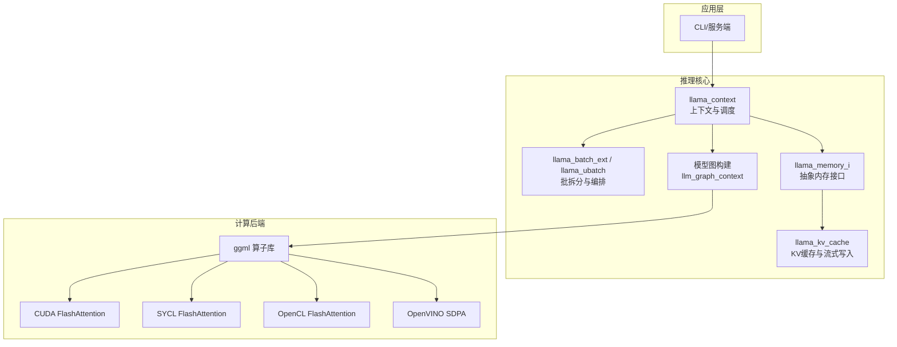
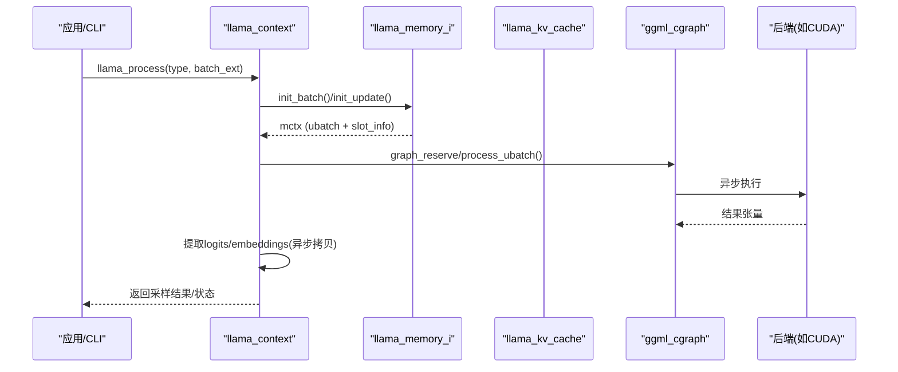
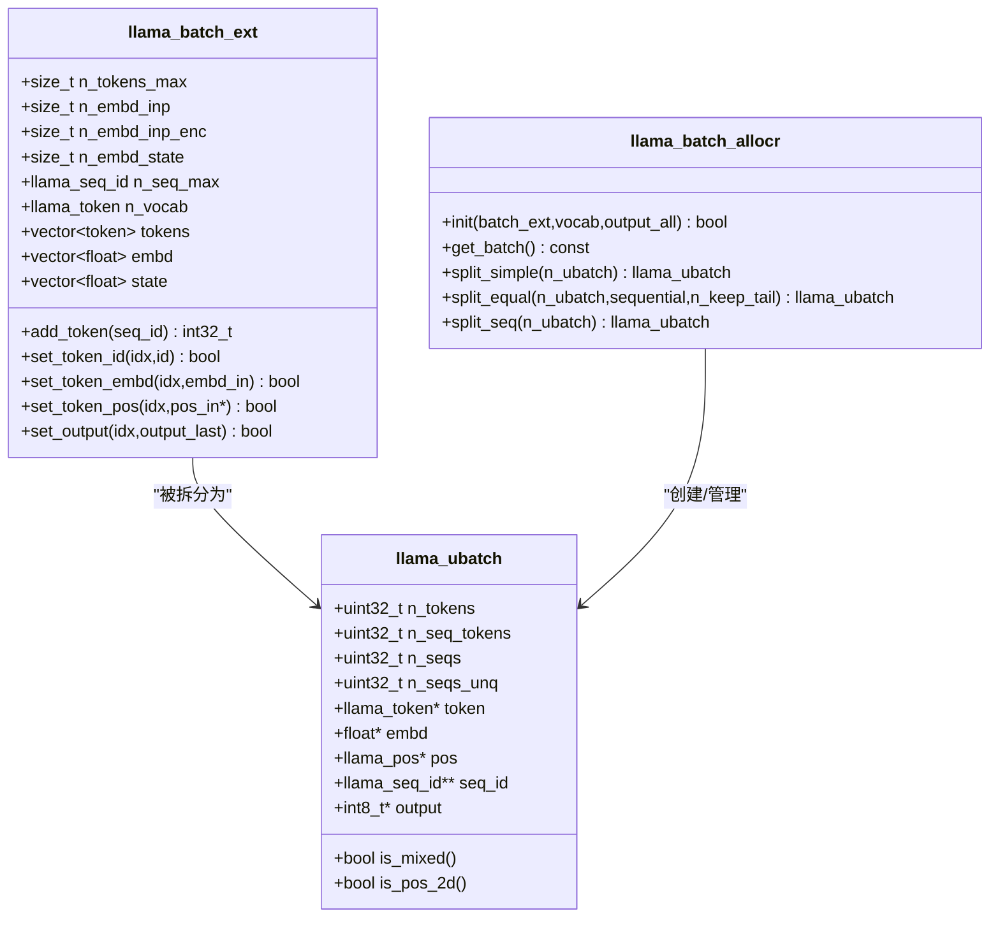
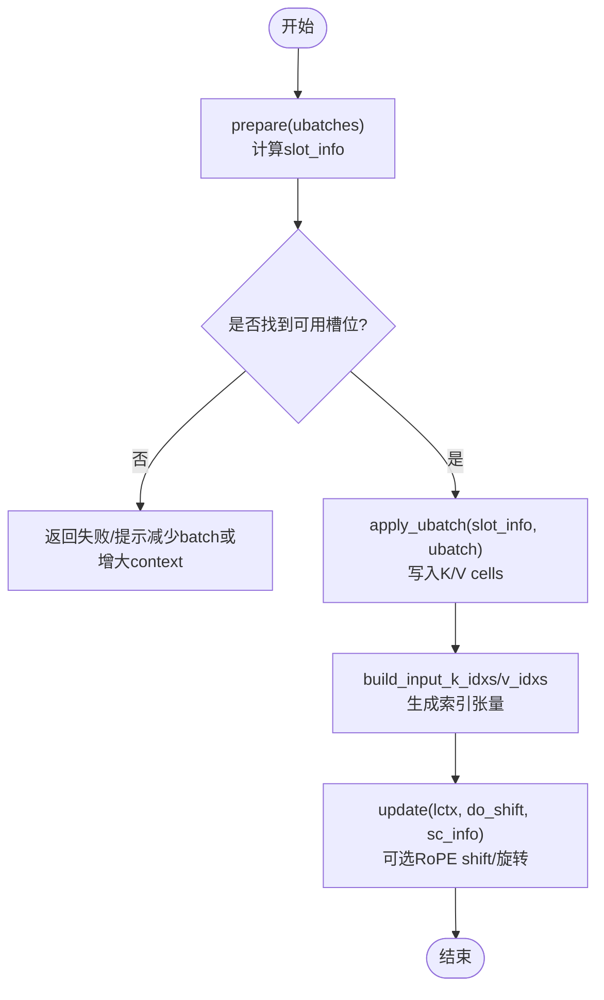
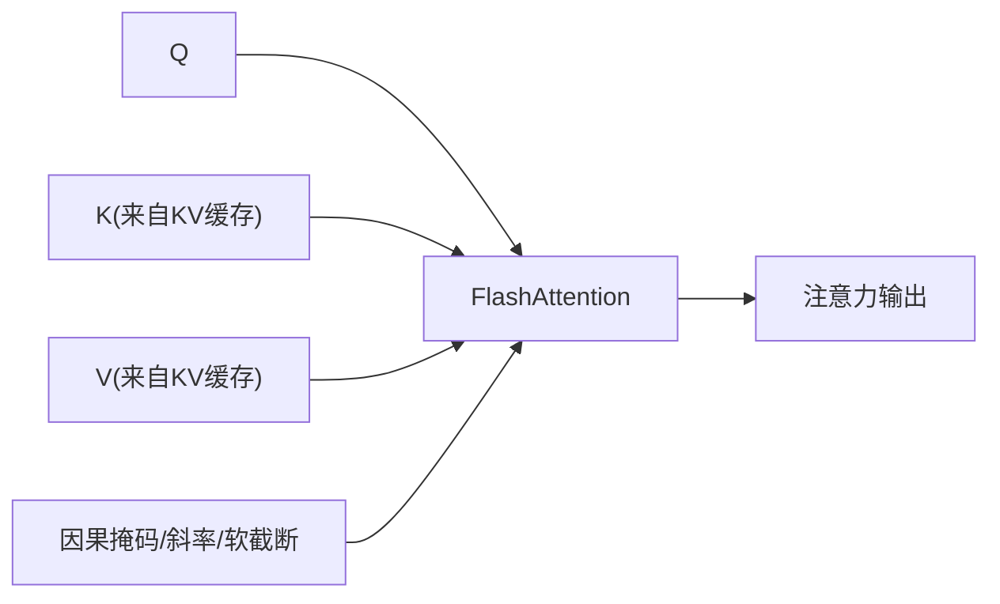
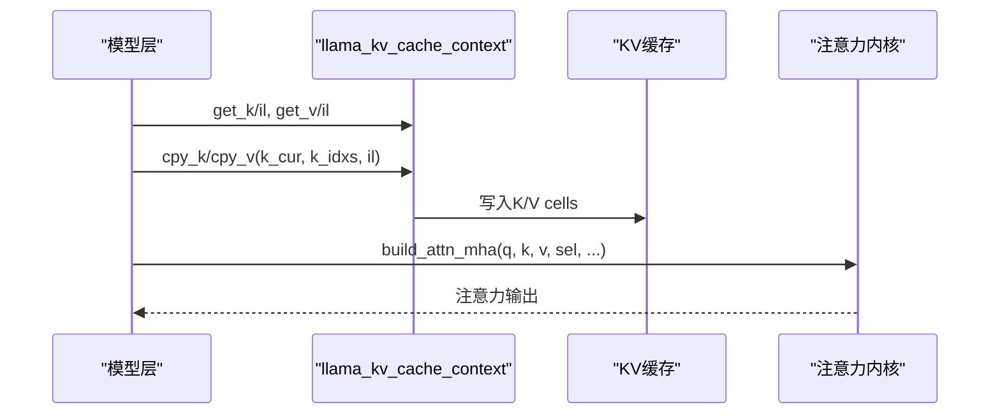
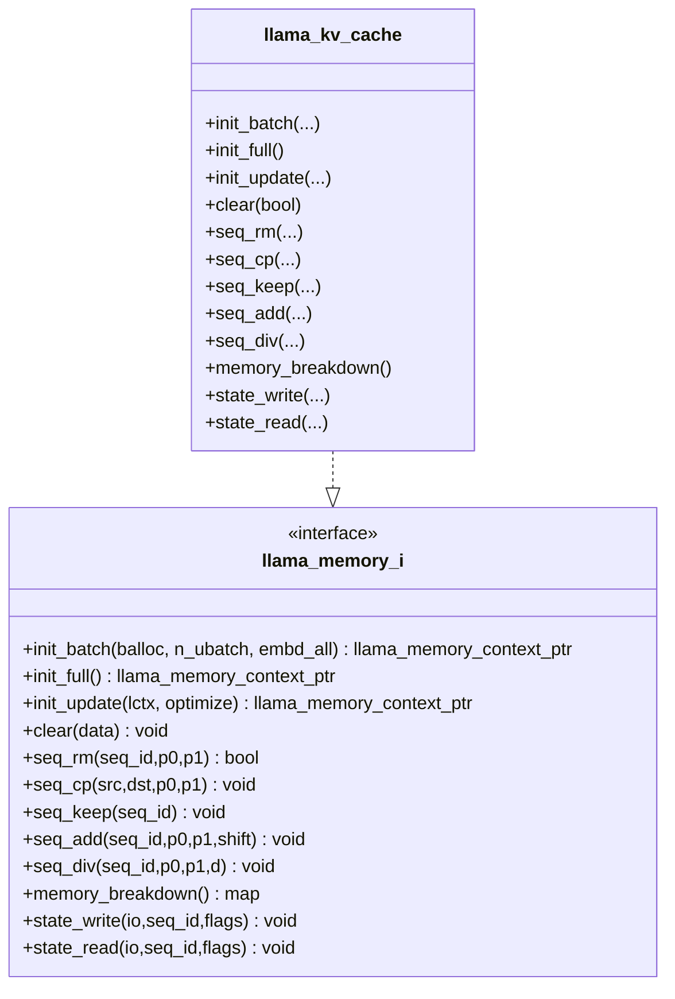
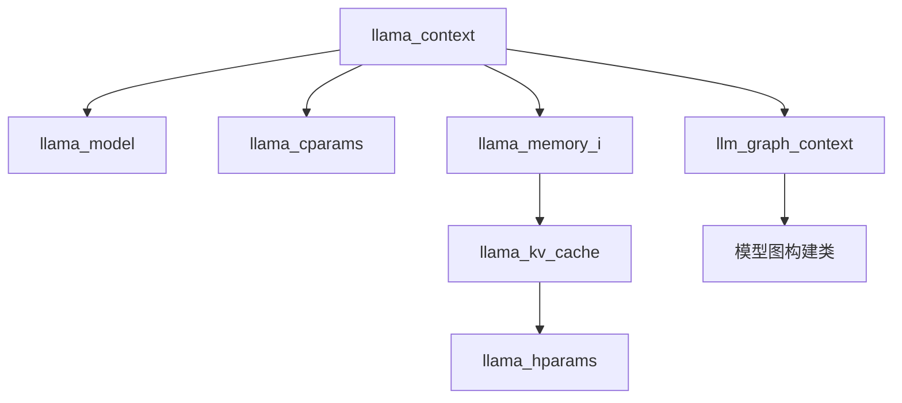

# 推理引擎

<cite>
**本文引用的文件**   
- [README.md](file://README.md)
- [llama-context.h](file://src/llama-context.h)
- [llama-context.cpp](file://src/llama-context.cpp)
- [llama-batch.h](file://src/llama-batch.h)
- [llama-kv-cache.h](file://src/llama-kv-cache.h)
- [llama-kv-cache.cpp](file://src/llama-kv-cache.cpp)
- [llama-memory.h](file://src/llama-memory.h)
- [models.h](file://src/models/models.h)
- [qwen4exp.cpp](file://src/models/qwen4exp.cpp)
- [fattn-tile.cuh](file://ggml/src/ggml-cuda/fattn-tile.cuh)
- [fattn-tile.hpp](file://ggml/src/ggml-sycl/fattn-tile.hpp)
- [flash_attn_f32_f16.cl](file://ggml/src/ggml-opencl/kernels/flash_attn_f32_f16.cl)
- [openvino/op/flash_attn_ext.cpp](file://ggml/src/ggml-openvino/openvino/op/flash_attn_ext.cpp)
- [llama-mmap.h](file://src/llama-mmap.h)
- [cli/README.md](file://tools/cli/README.md)
- [completion/README.md](file://tools/completion/README.md)
</cite>

## 目录
1. [简介](#简介)
2. [项目结构](#项目结构)
3. [核心组件](#核心组件)
4. [架构总览](#架构总览)
5. [详细组件分析](#详细组件分析)
6. [依赖关系分析](#依赖关系分析)
7. [性能与调优](#性能与调优)
8. [故障排查指南](#故障排查指南)
9. [结论](#结论)

## 简介
本技术文档聚焦 llama.cpp 推理引擎的推理执行流程、批处理机制、上下文状态管理、KV 缓存优化、注意力实现细节与长序列处理，以及内存管理与性能调优策略。文档面向希望深入理解并优化推理延迟与吞吐量的工程师与研究者。

## 项目结构
- 推理核心位于 src/ 下，包含上下文、批处理、KV 缓存、模型图构建等关键模块。
- ggml 后端提供多硬件加速（CUDA/SYCL/OpenCL/OpenVINO 等）的 Flash Attention 实现。
- tools/ 提供 CLI 与服务端参数说明，便于进行线程、批大小、设备分配等调优。

图表来源
- [llama-context.h:45-100](file://src/llama-context.h#L45-L100)
- [llama-batch.h:17-83](file://src/llama-batch.h#L17-L83)
- [llama-kv-cache.h:20-118](file://src/llama-kv-cache.h#L20-L118)
- [llama-memory.h:71-128](file://src/llama-memory.h#L71-L128)
- [fattn-tile.cuh:953-971](file://ggml/src/ggml-cuda/fattn-tile.cuh#L953-L971)
- [fattn-tile.hpp:862-885](file://ggml/src/ggml-sycl/fattn-tile.hpp#L862-L885)
- [flash_attn_f32_f16.cl:1296-1313](file://ggml/src/ggml-opencl/kernels/flash_attn_f32_f16.cl#L1296-L1313)
- [openvino/op/flash_attn_ext.cpp:46-68](file://ggml/src/ggml-openvino/openvino/op/flash_attn_ext.cpp#L46-L68)

章节来源
- [README.md:60-74](file://README.md#L60-L74)

## 核心组件
- llama_context：推理上下文，负责图构建、调度、输出收集、采样、性能统计与状态保存/加载。
- llama_batch_ext / llama_ubatch：扩展批 API 与内部 ubatch，支持混合 token/embedding、位置编码、决策顺序等。
- llama_memory_i / llama_kv_cache：抽象内存接口与 KV 缓存实现，支持流式更新、序列操作、状态持久化。
- 模型图构建：各模型在 models.h 中定义图构建类，统一通过 llm_graph_context 接入。

章节来源
- [llama-context.h:45-100](file://src/llama-context.h#L45-L100)
- [llama-batch.h:17-83](file://src/llama-batch.h#L17-L83)
- [llama-memory.h:71-128](file://src/llama-memory.h#L71-L128)
- [llama-kv-cache.h:20-118](file://src/llama-kv-cache.h#L20-L118)
- [models.h:147-158](file://src/models/models.h#L147-L158)

## 架构总览
推理主循环由 llama_context.process_ubatch 驱动，按 ubatch 迭代调用 memory->init_batch/init_update，构建并执行图，异步拷贝 logits/embeddings 到主机侧，最后根据采样器生成下一个 token。

图表来源
- [llama-context.cpp:2000-2200](file://src/llama-context.cpp#L2000-L2200)
- [llama-kv-cache.h:125-152](file://src/llama-kv-cache.h#L125-L152)

章节来源
- [llama-context.cpp:2000-2200](file://src/llama-context.cpp#L2000-L2200)

## 详细组件分析

### 批处理与上下文状态管理
- llama_batch_ext 提供高层批构造接口，支持 token/embedding 混合输入、位置编码、输出标记、决策顺序等。
- llama_ubatch 是内部轻量批结构，包含 token/embd/pos/seq_id 等指针与数据容器 data_t。
- llama_batch_allocr 负责将 llama_batch_ext 转换为内部 llama_batch，并进行清洗、填充与分割为多个 ubatch。
- llama_context 维护 n_batch/n_ubatch、n_seq_max、输出缓冲、采样信息、后端调度器等。

图表来源
- [llama-batch.h:17-83](file://src/llama-batch.h#L17-L83)
- [llama-batch.h:97-151](file://src/llama-batch.h#L97-L151)
- [llama-batch.h:154-261](file://src/llama-batch.h#L154-L261)

章节来源
- [llama-batch.h:17-83](file://src/llama-batch.h#L17-L83)
- [llama-batch.h:97-151](file://src/llama-batch.h#L97-L151)
- [llama-batch.h:154-261](file://src/llama-batch.h#L154-L261)

### KV 缓存与流式更新
- llama_kv_cache 继承自 llama_memory_i，提供 init_batch/init_full/init_update/clear/seq_* 等操作。
- slot_info 描述每个 ubatch 在 KV cells 中的写入位置，支持连续性与流式复制 stream_copy_info。
- prepare/find_slot/apply_ubatch 完成 ubatch 到 KV 单元的定位与写入；build_input_k_idxs/build_input_v_idxs 生成索引张量供图使用。
- state_write/state_read 支持 KV 缓存的状态持久化与恢复，含 cell ranges 压缩与 SWA 掩码处理。

图表来源
- [llama-kv-cache.h:193-251](file://src/llama-kv-cache.h#L193-L251)
- [llama-kv-cache.cpp:2021-2070](file://src/llama-kv-cache.cpp#L2021-L2070)
- [llama-kv-cache.cpp:2073-2140](file://src/llama-kv-cache.cpp#L2073-L2140)

章节来源
- [llama-kv-cache.h:20-118](file://src/llama-kv-cache.h#L20-L118)
- [llama-kv-cache.h:193-251](file://src/llama-kv-cache.h#L193-L251)
- [llama-kv-cache.cpp:2021-2070](file://src/llama-kv-cache.cpp#L2021-L2070)
- [llama-kv-cache.cpp:2073-2140](file://src/llama-kv-cache.cpp#L2073-L2140)

### 注意力机制与长序列处理
- 多头注意力在 ggml 后端以 Flash Attention 形式实现，针对 CUDA/SYCL/OpenCL/OpenVINO 分别优化。
- CUDA/SYCL/OpenCL 的 tile 迭代遍历 KV 缓存，结合 mask/slope/logit_softcap 等参数高效计算 QK^T 与 softmax。
- OpenVINO 通过 SDPA 适配，将 KV 缓存 reshape/transpose 后送入后端优化内核。
- RoPE 旋转与 shift 在 KV 缓存图中构建，支持频率缩放与 YaRN 扩展。

图表来源
- [fattn-tile.cuh:953-971](file://ggml/src/ggml-cuda/fattn-tile.cuh#L953-L971)
- [fattn-tile.hpp:862-885](file://ggml/src/ggml-sycl/fattn-tile.hpp#L862-L885)
- [flash_attn_f32_f16.cl:1296-1313](file://ggml/src/ggml-opencl/kernels/flash_attn_f32_f16.cl#L1296-L1313)
- [openvino/op/flash_attn_ext.cpp:46-68](file://ggml/src/ggml-openvino/openvino/op/flash_attn_ext.cpp#L46-L68)

章节来源
- [fattn-tile.cuh:953-971](file://ggml/src/ggml-cuda/fattn-tile.cuh#L953-L971)
- [fattn-tile.hpp:862-885](file://ggml/src/ggml-sycl/fattn-tile.hpp#L862-L885)
- [flash_attn_f32_f16.cl:1296-1313](file://ggml/src/ggml-opencl/kernels/flash_attn_f32_f16.cl#L1296-L1313)
- [openvino/op/flash_attn_ext.cpp:46-68](file://ggml/src/ggml-openvino/openvino/op/flash_attn_ext.cpp#L46-L68)

### 模型图构建与注意力集成
- 模型图构建类（如 llama_model_llama::graph）在 models.h 中定义，统一通过 llm_graph_context 构建层与注意力。
- qwen4exp.cpp 展示了注意力层的典型流程：从 mctx_cur 获取 K/V，写入新 KV，构建选择掩码，执行 MHA，必要时对 Value 做 Hadamard 逆变换。

图表来源
- [models.h:147-158](file://src/models/models.h#L147-L158)
- [qwen4exp.cpp:899-937](file://src/models/qwen4exp.cpp#L899-L937)

章节来源
- [models.h:147-158](file://src/models/models.h#L147-L158)
- [qwen4exp.cpp:899-937](file://src/models/qwen4exp.cpp#L899-L937)

### 内存管理与动态分配
- llama_memory_i 抽象了 LLM 内存接口，KV 缓存是其一种实现。
- llama_context 持有 memory/moe_cache/backends/buffers，并通过 sched_reserve/graph_reserve 预分配最坏情况图与缓冲区。
- llama_mmap/llama_mlock 提供模型权重的内存映射与锁定能力，配合 load-mode 选项控制加载行为。

图表来源
- [llama-memory.h:71-128](file://src/llama-memory.h#L71-L128)
- [llama-kv-cache.h:20-118](file://src/llama-kv-cache.h#L20-L118)
- [llama-mmap.h:47-92](file://src/llama-mmap.h#L47-L92)

章节来源
- [llama-memory.h:71-128](file://src/llama-memory.h#L71-L128)
- [llama-kv-cache.h:20-118](file://src/llama-kv-cache.h#L20-L118)
- [llama-mmap.h:47-92](file://src/llama-mmap.h#L47-L92)

## 依赖关系分析
- llama_context 依赖 llama_model、llama_cparams、llama_memory、llama_moe_cache、llama_graph 等。
- llama_kv_cache 依赖 llama_model、llama_hparams、llama_memory 与 ggml 后端。
- 模型图构建类依赖 llm_graph_context 与具体模型的 hparams/layers。

图表来源
- [llama-context.h:45-100](file://src/llama-context.h#L45-L100)
- [llama-kv-cache.h:20-118](file://src/llama-kv-cache.h#L20-L118)
- [models.h:147-158](file://src/models/models.h#L147-L158)

章节来源
- [llama-context.h:45-100](file://src/llama-context.h#L45-L100)
- [llama-kv-cache.h:20-118](file://src/llama-kv-cache.h#L20-L118)
- [models.h:147-158](file://src/models/models.h#L147-L158)

## 性能与调优
- 批大小与物理批：
  - 逻辑最大批大小 b 与物理最大批大小 ub 可通过 CLI 参数设置，影响吞吐与延迟。
  - 合理设置 n_threads 与 n_threads_batch，CPU 核数与任务类型匹配可显著提升性能。
- 内存配置：
  - ctx-size 控制上下文长度；kv-offload 控制 KV 缓存 offload；cache-type-k/v 控制 KV 数据类型。
  - load-mode 支持 mmap/mlock/dio 等模式，NUMA 优化可改善非均匀内存访问。
- 并行化策略：
  - split-mode 支持 layer/row/tensor 多 GPU 切分；tensor-split 控制每卡权重比例；main-gpu 指定主设备。
  - op-offload 允许主机张量操作卸载至设备，提升整体吞吐。
- 注意力优化：
  - flash-attn 开关控制 Flash Attention 启用；rope-scaling/rope-scale/rope-freq-base/freq-scale/YaRN 参数用于长上下文扩展。
  - swa-full 启用全尺寸滑动窗口注意力缓存，适合特定模型。

章节来源
- [cli/README.md:9-99](file://tools/cli/README.md#L9-L99)
- [completion/README.md:523-544](file://tools/completion/README.md#L523-L544)

## 故障排查指南
- KV 槽位不足：
  - 当无法为 ubatch 找到 KV 槽位时，返回错误码并建议减小 batch 或增大 context。
  - 检查 llama_decode 返回值与 llama_memory_seq_pos_min/max 以定位问题序列区间。
- 图构建与融合算子：
  - 若后端不支持某些融合算子（如 Flash Attention/Gated Delta Net），会禁用自动融合并回退到通用路径。
  - 可通过日志与 perf_get_data 观察 t_p_eval_us/t_eval_us 等指标定位瓶颈。
- 状态保存/恢复：
  - KV 缓存状态读写需确保 n_stream 一致，镜像缓存需保持 cell 布局一致，否则抛出异常。

章节来源
- [include/llama.h:994-1113](file://include/llama.h#L994-L1113)
- [llama-context.cpp:2000-2200](file://src/llama-context.cpp#L2000-L2200)
- [llama-kv-cache.cpp:2143-2200](file://src/llama-kv-cache.cpp#L2143-L2200)

## 结论
llama.cpp 通过统一的上下文与内存抽象、灵活的批处理与 KV 缓存机制、以及多后端 Flash Attention 实现，提供了高性能、可扩展的 LLM 推理引擎。通过合理调整批大小、线程数、内存与设备配置，并结合长上下文与注意力优化参数，可在不同硬件平台上获得优异的延迟与吞吐量表现。