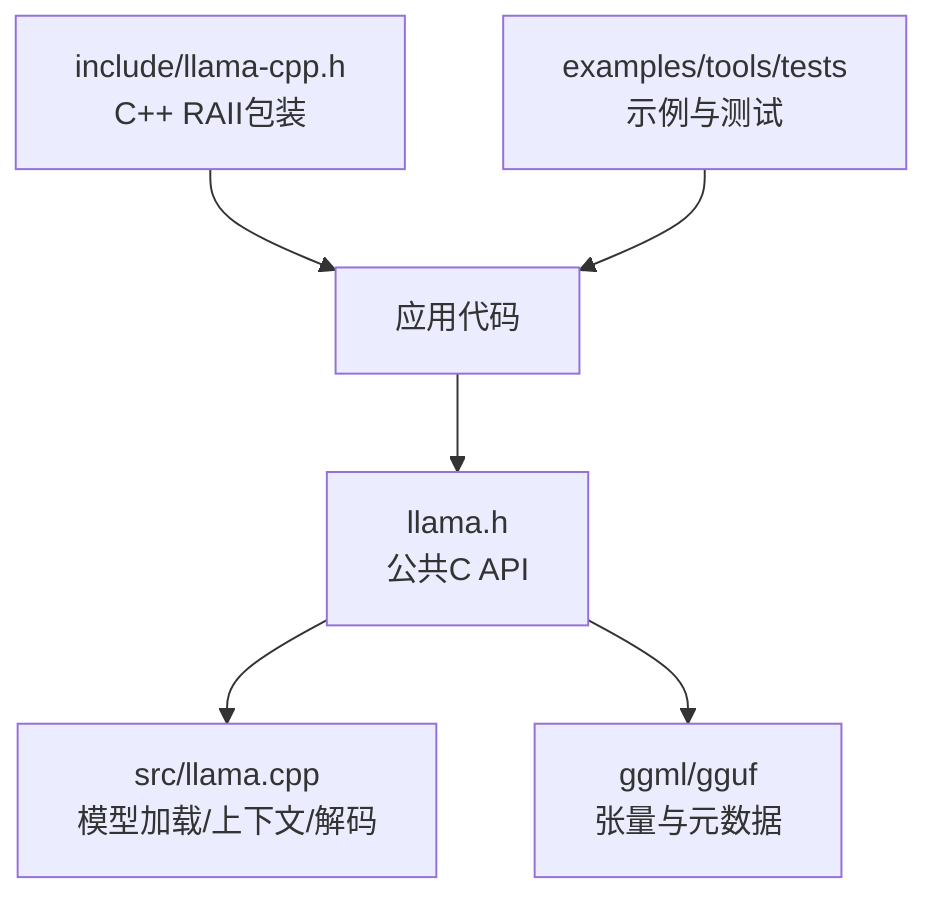
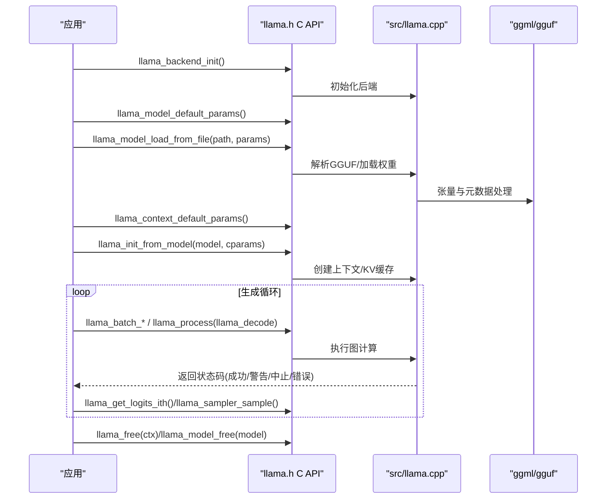
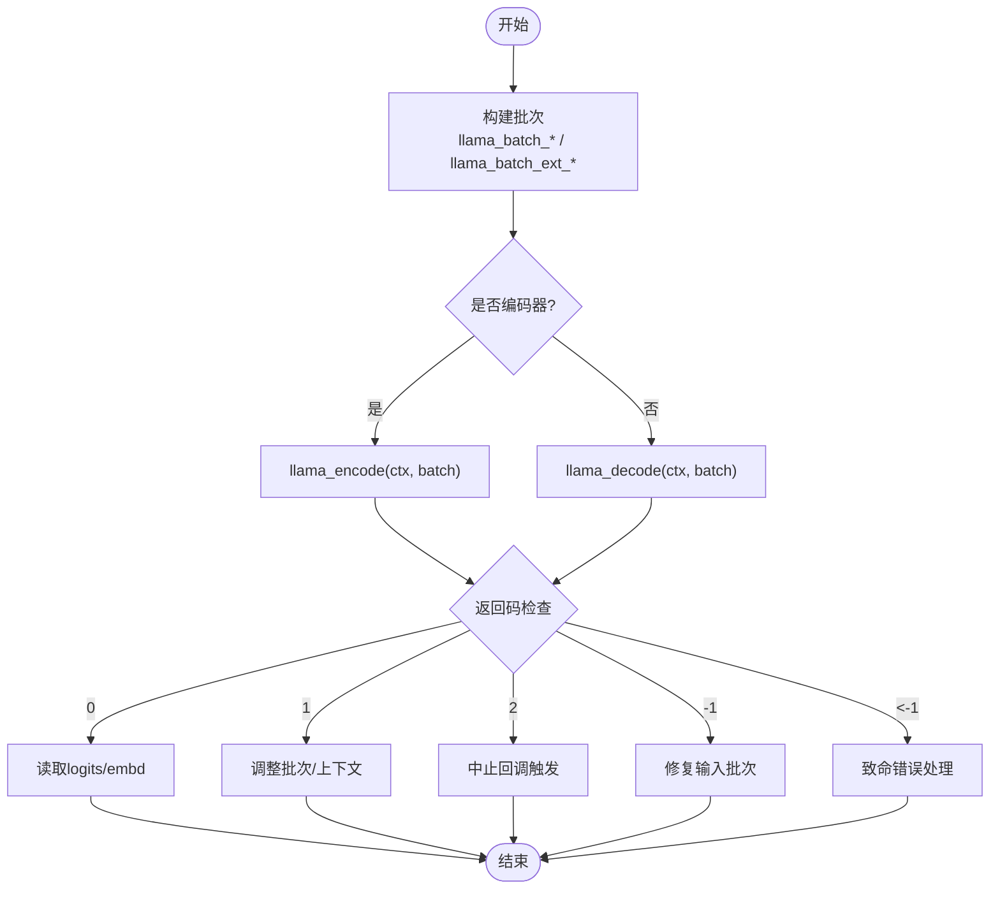
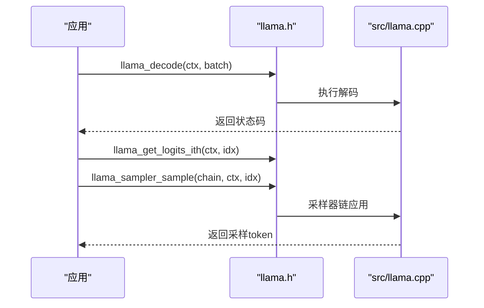
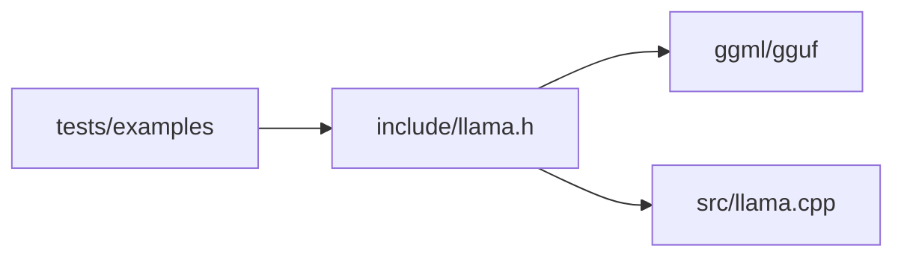

# C API完整参考

<cite>
**本文引用的文件**   
- [include/llama.h](file://include/llama.h)
- [include/llama-cpp.h](file://include/llama-cpp.h)
- [src/llama.cpp](file://src/llama.cpp)
- [tests/test-thread-safety.cpp](file://tests/test-thread-safety.cpp)
- [tools/tokenize/tokenize.cpp](file://tools/tokenize/tokenize.cpp)
</cite>

## 目录
1. [简介](#简介)
2. [项目结构](#项目结构)
3. [核心组件](#核心组件)
4. [架构总览](#架构总览)
5. [详细组件分析](#详细组件分析)
6. [依赖关系分析](#依赖关系分析)
7. [性能与内存优化建议](#性能与内存优化建议)
8. [故障排查指南](#故障排查指南)
9. [结论](#结论)
10. [附录：常用API速查表](#附录常用api速查表)

## 简介
本参考文档面向使用 llama.cpp 的C语言开发者，系统性梳理公共C API，覆盖初始化、模型加载、上下文管理、推理执行、结果读取、采样器、分词与聊天模板、状态持久化、LoRA适配器、性能统计等关键能力。文档以 include/llama.h 中的C接口为核心，结合源码实现与示例工程的使用方式，给出函数签名、参数说明、返回值语义、错误处理要点、内存管理最佳实践以及常见用法模式。

## 项目结构
- 公共C头文件位于 include/llama.h，定义所有对外暴露的结构体、枚举与函数原型。
- C++智能指针封装在 include/llama-cpp.h，提供基于 unique_ptr 的资源自动释放类型别名。
- 核心实现位于 src/llama.cpp，包含模型加载、上下文创建、批处理与解码等逻辑。
- 示例与测试展示了典型调用流程，如仅加载词表进行分词、多线程并发加载模型与上下文等。

**图表来源**
- [include/llama.h:1-120](file://include/llama.h#L1-L120)
- [src/llama.cpp:380-471](file://src/llama.cpp#L380-L471)

**章节来源**
- [include/llama.h:1-120](file://include/llama.h#L1-L120)
- [include/llama-cpp.h:1-36](file://include/llama-cpp.h#L1-L36)

## 核心组件
本节聚焦C API中最重要的对象与流程：后端初始化、模型对象、上下文对象、批处理与解码、采样器链、分词与文本转换、会话状态、LoRA适配器。

- 后端初始化与线程池
  - llama_backend_init：程序启动时调用一次，初始化llama与底层ggml后端。
  - llama_numa_init：可选，启用NUMA优化。
  - llama_attach_threadpool / llama_detach_threadpool：为上下文绑定或解绑线程池。

- 模型加载与保存
  - llama_model_default_params：获取默认模型参数。
  - llama_model_load_from_file / llama_model_load_from_file_ptr / llama_model_load_from_splits：从文件路径、FILE指针或多分片加载模型。
  - llama_model_save_to_file：将模型保存到文件。
  - llama_model_free：释放模型资源。

- 上下文创建与管理
  - llama_context_default_params：获取默认上下文参数。
  - llama_init_from_model：基于模型创建上下文。
  - llama_free：释放上下文。
  - llama_get_model / llama_get_memory：从上下文获取模型与内存句柄。

- 批处理与推理
  - llama_batch_get_one / llama_batch_init / llama_batch_free：构建批次。
  - llama_encode / llama_decode：编码器/解码器执行；返回码指示成功、警告或致命错误。
  - llama_process（扩展批次）：统一入口，支持LLAMA_PROCESS_TYPE_ENCODE/DECODE。

- 结果读取
  - llama_get_logits / llama_get_logits_ith：获取logits。
  - llama_get_embeddings / llama_get_embeddings_ith / llama_get_embeddings_seq：获取嵌入向量。
  - llama_synchronize：等待计算完成。

- 采样器
  - llama_sampler_chain_*：构建采样器链。
  - llama_sampler_sample：对最后一个输出的logits进行采样。
  - 内置采样器：greedy、dist、top_k、top_p、min_p、typical、temp、xtc、mirostat、grammar、penalties、dry、adaptive_p、logit_bias、infill 等。

- 分词与聊天模板
  - llama_tokenize / llama_detokenize / llama_token_to_piece：文本与token互转。
  - llama_chat_apply_template / llama_chat_builtin_templates：应用聊天模板。

- 会话状态
  - llama_state_get_size / llama_state_get_data / llama_state_set_data：序列化的上下文状态。
  - llama_state_load_file / llama_state_save_file：会话文件读写。
  - 单序列状态相关API：llama_state_seq_*。

- LoRA适配器
  - llama_adapter_lora_init / llama_adapter_lora_init_from_file_ptr：加载LoRA。
  - llama_set_adapters_lora：设置上下文使用的LoRA及权重。
  - llama_adapter_lora_free：释放适配器。

**章节来源**
- [include/llama.h:478-562](file://include/llama.h#L478-L562)
- [include/llama.h:959-1008](file://include/llama.h#L959-L1008)
- [include/llama.h:1091-1168](file://include/llama.h#L1091-L1168)
- [include/llama.h:1277-1337](file://include/llama.h#L1277-L1337)
- [include/llama.h:827-953](file://include/llama.h#L827-L953)
- [include/llama.h:689-747](file://include/llama.h#L689-L747)
- [include/llama.h:1340-1645](file://include/llama.h#L1340-L1645)

## 架构总览
下图展示从应用到模型的端到端调用链路，包括初始化、模型加载、上下文创建、批处理与解码、结果读取与采样。

**图表来源**
- [include/llama.h:489-562](file://include/llama.h#L489-L562)
- [include/llama.h:959-1008](file://include/llama.h#L959-L1008)
- [include/llama.h:1091-1168](file://include/llama.h#L1091-L1168)
- [src/llama.cpp:380-471](file://src/llama.cpp#L380-L471)

## 详细组件分析

### 初始化与后端
- llama_backend_init：必须在程序开始时调用一次，用于初始化llama与ggml后端。
- llama_numa_init：可选，根据系统NUMA拓扑优化内存分配。
- llama_attach_threadpool / llama_detach_threadpool：为上下文指定线程池，便于与外部调度器集成。

注意：
- 若未加载任何后端，模型加载会失败并提示需先加载后端。
- 建议在进程级初始化一次后端，避免重复开销。

**章节来源**
- [include/llama.h:489-504](file://include/llama.h#L489-L504)
- [src/llama.cpp:407-410](file://src/llama.cpp#L407-L410)

### 模型加载与保存
- llama_model_default_params：返回默认模型参数结构体，可配置GPU层数、split_mode、load_mode、lazy_mode、progress_callback、kv_overrides等。
- llama_model_load_from_file：从路径加载模型，支持多分片命名规则 <name>-%05d-of-%05d.gguf。
- llama_model_load_from_file_ptr：从已打开的FILE指针加载，适合嵌入大文件的GGUF片段。
- llama_model_load_from_splits：自定义分片顺序加载。
- llama_model_save_to_file：导出模型。
- llama_model_free：释放模型。

错误处理：
- 若后端未加载，加载将失败并输出错误日志。
- 分片文件名不符合约定时，应改用 llama_model_load_from_splits。

使用示例路径：
- 仅加载词表进行分词：[tools/tokenize/tokenize.cpp:142-156](file://tools/tokenize/tokenize.cpp#L142-L156)

**章节来源**
- [include/llama.h:517-550](file://include/llama.h#L517-L550)
- [src/llama.cpp:380-471](file://src/llama.cpp#L380-L471)
- [tools/tokenize/tokenize.cpp:142-156](file://tools/tokenize/tokenize.cpp#L142-L156)

### 上下文管理与查询
- llama_context_default_params：返回默认上下文参数，可配置n_ctx、n_batch、n_ubatch、n_seq_max、thread数、RoPE缩放、flash attention、KV缓存类型、abort_callback、embeddings开关等。
- llama_init_from_model：基于模型创建上下文。
- llama_free：释放上下文。
- llama_get_model / llama_get_memory：从上下文获取模型与内存句柄。
- llama_n_ctx / llama_n_batch / llama_n_ubatch / llama_n_seq_max：查询实际生效的参数值。

注意事项：
- 创建上下文后，建议通过查询函数确认实际生效的配置，可能与请求值不同。

**章节来源**
- [include/llama.h:552-583](file://include/llama.h#L552-L583)

### 批处理与推理执行
- llama_batch_get_one：便捷构造单序列批次，seq_id固定为0，位置由解码器自动跟踪。
- llama_batch_init / llama_batch_free：动态分配/释放批次。
- llama_encode：对编码器执行批处理，不写KV缓存；可用于编码器-解码器模型的编码阶段。
- llama_decode：对解码器执行批处理，需要上下文具备内存；返回码含义：
  - 0：成功
  - 1：无法找到KV槽位（减少批次大小或增大上下文）
  - 2：被中止（已处理的ubatch保留在上下文内存）
  - -1：输入批次无效
  - < -1：致命错误（已处理的ubatch保留在上下文内存）
- llama_process（扩展批次）：统一入口，支持LLAMA_PROCESS_TYPE_ENCODE/DECODE。

**图表来源**
- [include/llama.h:959-1008](file://include/llama.h#L959-L1008)

**章节来源**
- [include/llama.h:959-1008](file://include/llama.h#L959-L1008)

### 结果读取与采样
- llama_get_logits / llama_get_logits_ith：获取logits数组，按批次中logits[i]!=0的顺序连续存储。
- llama_get_embeddings / llama_get_embeddings_ith / llama_get_embeddings_seq：获取嵌入向量，受pooling_type影响。
- llama_synchronize：同步等待计算完成。
- llama_sampler_sample：对最后一个输出的logits进行采样，返回选中的token。
- 采样器链：llama_sampler_chain_init/add/get/n/remove/free，组合多种策略（top-k、top-p、温度、mirostat、语法约束等）。

**图表来源**
- [include/llama.h:1134-1168](file://include/llama.h#L1134-L1168)
- [include/llama.h:1340-1645](file://include/llama.h#L1340-L1645)

**章节来源**
- [include/llama.h:1134-1168](file://include/llama.h#L1134-L1168)
- [include/llama.h:1340-1645](file://include/llama.h#L1340-L1645)

### 分词与聊天模板
- llama_tokenize：文本转token，支持添加特殊token与解析控制token。
- llama_detokenize：token转文本，支持移除特殊token与反解析控制token。
- llama_token_to_piece：单个token转piece字符串。
- llama_chat_apply_template：应用聊天模板，支持内置模板列表。

线程安全：
- 分词API声明为线程安全，可在多线程环境中并行调用。

**章节来源**
- [include/llama.h:1277-1337](file://include/llama.h#L1277-L1337)

### 会话状态与持久化
- llama_state_get_size / llama_state_get_data / llama_state_set_data：序列化/反序列化上下文状态（logits、embedding、memory）。
- llama_state_load_file / llama_state_save_file：会话文件读写。
- 单序列状态API：llama_state_seq_get_size / get_data / set_data / save_file / load_file，支持部分状态（如SWA KV缓存或递归模型缓存）。

注意：
- 保存状态时使用 llama_state_get_size 获取实际所需大小，不要使用恢复时的返回值作为容量。

**章节来源**
- [include/llama.h:827-953](file://include/llama.h#L827-L953)

### LoRA适配器
- llama_adapter_lora_init / llama_adapter_lora_init_from_file_ptr：从文件或FILE指针加载LoRA。
- llama_set_adapters_lora：为上下文设置多个LoRA及其权重。
- llama_adapter_lora_free：手动释放适配器；未手动释放的适配器会在关联模型销毁时释放。

**章节来源**
- [include/llama.h:689-747](file://include/llama.h#L689-L747)

### C++ RAII包装
- include/llama-cpp.h 提供 std::unique_ptr 别名：
  - llama_model_ptr
  - llama_context_ptr
  - llama_sampler_ptr
  - llama_adapter_lora_ptr
  - llama_batch_ext_ptr
- 这些别名在作用域结束时自动调用对应的释放函数，简化资源管理。

**章节来源**
- [include/llama-cpp.h:11-36](file://include/llama-cpp.h#L11-L36)

## 依赖关系分析
- llama.h 依赖 ggml/gguf 的头文件，用于张量、后端注册与GGUF元数据访问。
- src/llama.cpp 实现模型加载、上下文创建、批处理与解码，内部调用ggml后端执行计算。
- 示例与测试验证了典型调用路径，如仅加载词表、多线程并发加载模型与上下文。

**图表来源**
- [include/llama.h:1-12](file://include/llama.h#L1-L12)
- [src/llama.cpp:380-471](file://src/llama.cpp#L380-L471)

**章节来源**
- [include/llama.h:1-12](file://include/llama.h#L1-L12)
- [src/llama.cpp:380-471](file://src/llama.cpp#L380-L471)

## 性能与内存优化建议
- 合理设置 n_ctx、n_batch、n_ubatch：
  - n_ctx 决定KV缓存长度，过大导致显存占用高。
  - n_batch 与 n_ubatch 控制批大小，过小降低吞吐，过大可能引发KV槽不足（返回码1）。
- 使用 llama_supports_mmap / llama_supports_mlock / llama_supports_gpu_offload 探测能力，选择合适的 load_mode 与 offload 策略。
- 启用 Flash Attention（flash_attn_type）以提升长序列性能。
- 使用 llama_set_n_threads / llama_set_n_threads_batch 调节CPU线程数，匹配硬件并发能力。
- 对于MoE模型，谨慎使用 warmup（已废弃），避免不必要的图重分配。
- 使用 llama_perf_context / llama_perf_sampler 采集性能指标，定位瓶颈。
- 内存管理：
  - 及时 llama_free(ctx) 与 llama_model_free(model)。
  - 使用 C++ RAII 别名减少泄漏风险。
  - 批量操作完成后，必要时清理 memory（llama_memory_clear / llama_memory_seq_rm）。

**章节来源**
- [include/llama.h:564-573](file://include/llama.h#L564-L573)
- [include/llama.h:1096-1124](file://include/llama.h#L1096-L1124)
- [include/llama.h:1679-1706](file://include/llama.h#L1679-L1706)
- [include/llama-cpp.h:11-36](file://include/llama-cpp.h#L11-L36)

## 故障排查指南
- 后端未加载：
  - 现象：模型加载失败，提示需先加载后端。
  - 解决：确保在调用模型加载前已初始化后端（llama_backend_init 与 ggml后端加载）。
- KV槽不足：
  - 现象：llama_decode 返回1。
  - 解决：减小批次大小或增大 n_ctx。
- 输入批次无效：
  - 现象：llama_decode 返回-1。
  - 解决：检查 token/embd/pos/seq_id/logits 配置是否符合API要求。
- 中止回调触发：
  - 现象：llama_decode 返回2。
  - 解决：检查 abort_callback 逻辑，必要时重置上下文状态。
- 致命错误：
  - 现象：llama_decode 返回小于-1的值。
  - 解决：检查上下文与批次状态，必要时重建上下文。
- 多线程并发：
  - 现象：并发加载模型与上下文时出现异常。
  - 解决：参考测试用例，确保每个线程拥有独立的上下文与采样器，正确释放资源。

**章节来源**
- [src/llama.cpp:407-410](file://src/llama.cpp#L407-L410)
- [include/llama.h:994-1008](file://include/llama.h#L994-L1008)
- [tests/test-thread-safety.cpp:71-98](file://tests/test-thread-safety.cpp#L71-L98)

## 结论
llama.cpp 的C API提供了完整的模型加载、上下文管理、推理执行与结果处理能力。通过合理的参数配置、批处理策略与采样器链设计，可以在不同硬件平台上获得稳定且高效的推理性能。遵循本文档的最佳实践与故障排查建议，能够显著降低集成难度与出错概率。

## 附录：常用API速查表
- 初始化
  - llama_backend_init
  - llama_numa_init
  - llama_attach_threadpool / llama_detach_threadpool
- 模型
  - llama_model_default_params
  - llama_model_load_from_file / llama_model_load_from_file_ptr / llama_model_load_from_splits
  - llama_model_save_to_file
  - llama_model_free
- 上下文
  - llama_context_default_params
  - llama_init_from_model
  - llama_free
  - llama_get_model / llama_get_memory
  - llama_n_ctx / llama_n_batch / llama_n_ubatch / llama_n_seq_max
- 批处理与推理
  - llama_batch_get_one / llama_batch_init / llama_batch_free
  - llama_encode / llama_decode
  - llama_process（扩展批次）
- 结果读取
  - llama_get_logits / llama_get_logits_ith
  - llama_get_embeddings / llama_get_embeddings_ith / llama_get_embeddings_seq
  - llama_synchronize
- 采样器
  - llama_sampler_chain_init / add / get / n / remove / free
  - llama_sampler_sample
  - 内置采样器：greedy、dist、top_k、top_p、min_p、typical、temp、xtc、mirostat、grammar、penalties、dry、adaptive_p、logit_bias、infill
- 分词与聊天模板
  - llama_tokenize / llama_detokenize / llama_token_to_piece
  - llama_chat_apply_template / llama_chat_builtin_templates
- 会话状态
  - llama_state_get_size / llama_state_get_data / llama_state_set_data
  - llama_state_load_file / llama_state_save_file
  - llama_state_seq_*
- LoRA
  - llama_adapter_lora_init / llama_adapter_lora_init_from_file_ptr
  - llama_set_adapters_lora
  - llama_adapter_lora_free

**章节来源**
- [include/llama.h:478-1706](file://include/llama.h#L478-L1706)