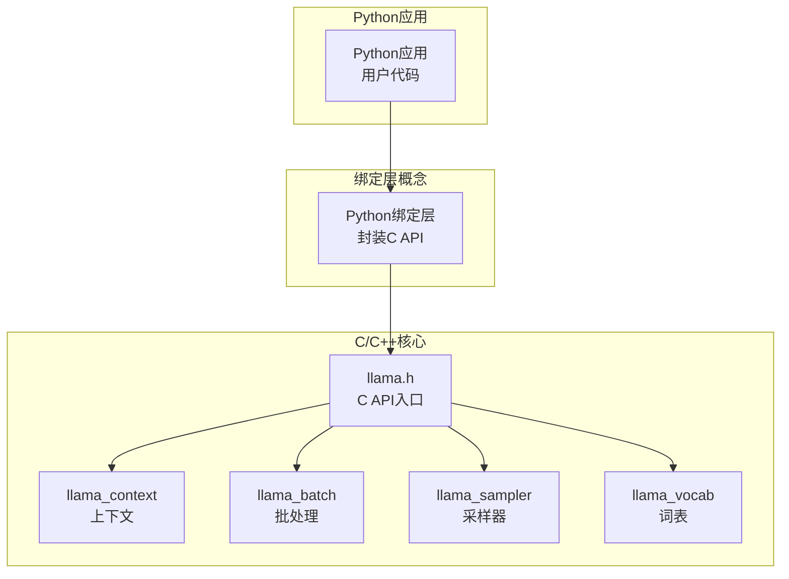
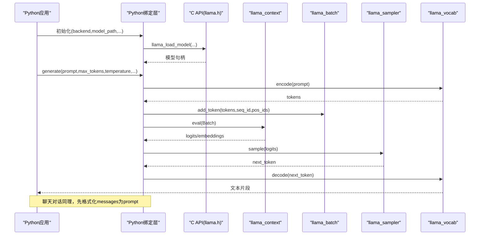
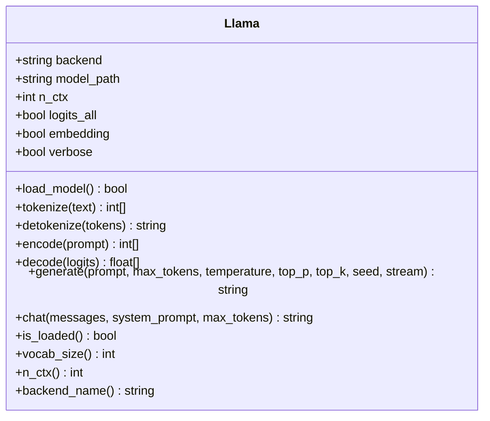
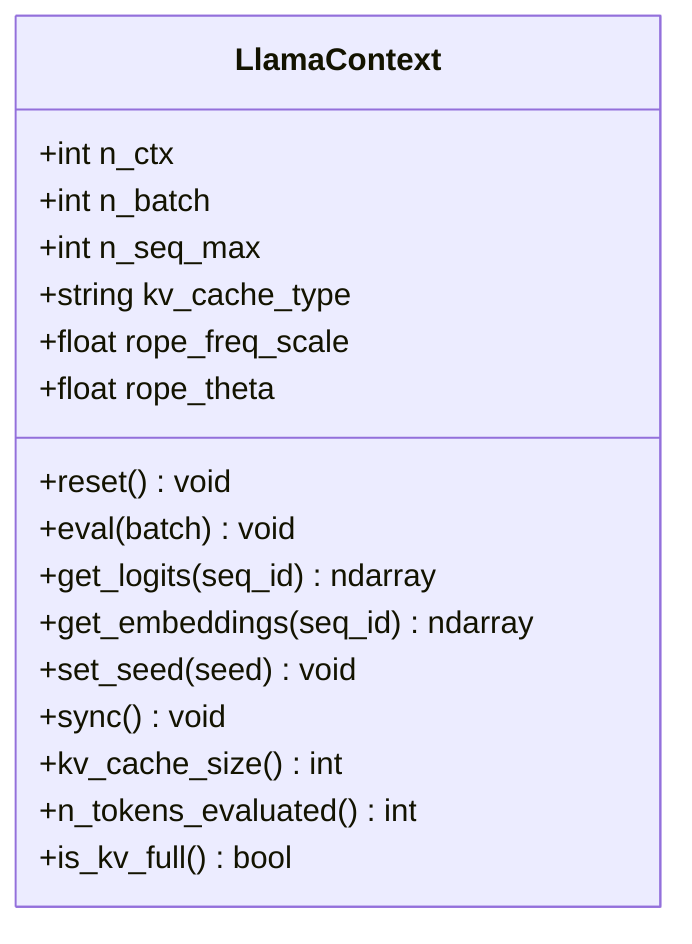
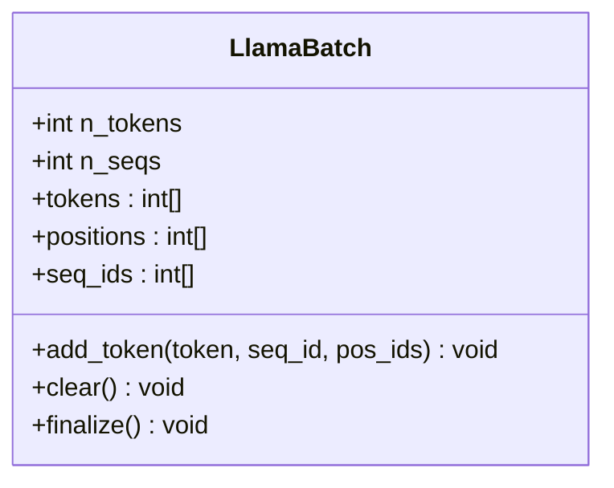
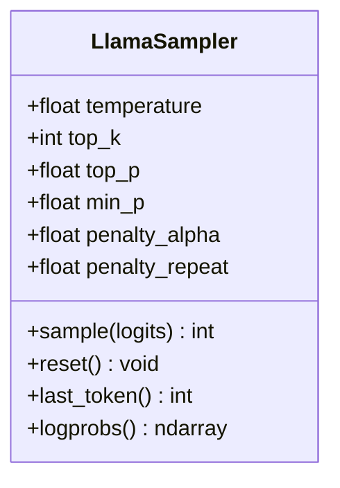
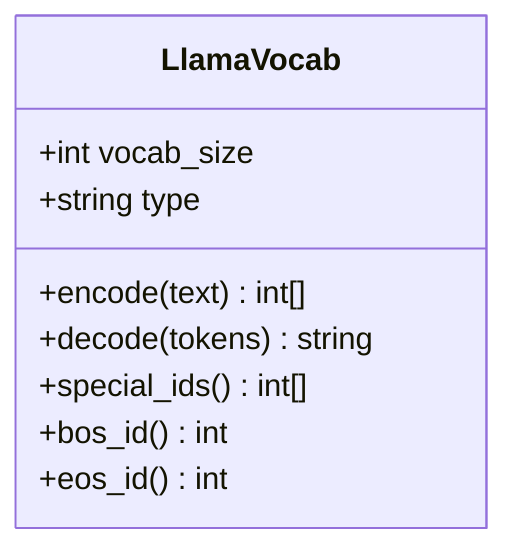
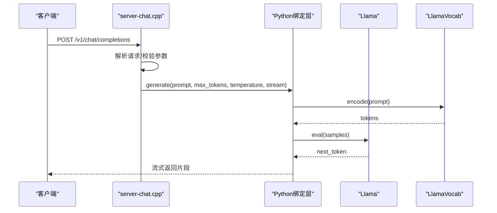
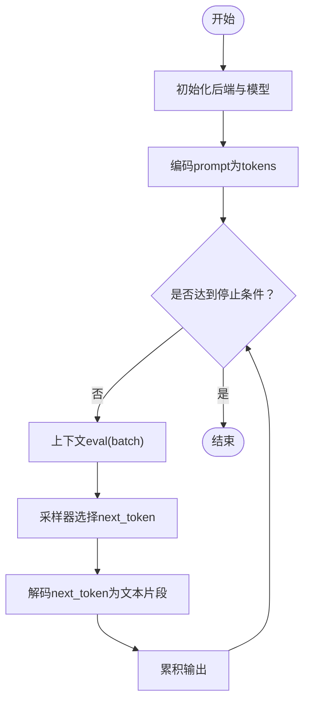
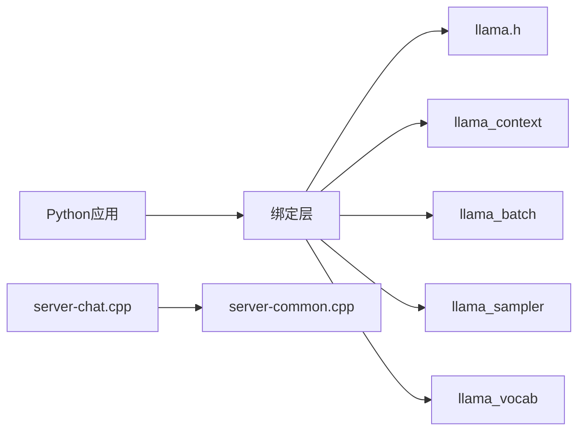

# Python绑定API

<cite>
**本文引用的文件**   
- [include/llama.h](file://include/llama.h)
- [src/llama-context.cpp](file://src/llama-context.cpp)
- [src/llama-context.h](file://src/llama-context.h)
- [src/llama-batch.cpp](file://src/llama-batch.cpp)
- [src/llama-batch.h](file://src/llama-batch.h)
- [src/llama-sampler.cpp](file://src/llama-sampler.cpp)
- [src/llama-sampler.h](file://src/llama-sampler.h)
- [src/llama-vocab.cpp](file://src/llama-vocab.cpp)
- [src/llama-vocab.h](file://src/llama-vocab.h)
- [tools/server/server-chat.cpp](file://tools/server/server-chat.cpp)
- [tools/server/server-common.cpp](file://tools/server/server-common.cpp)
- [examples/llama-eval/llama-eval.py](file://examples/llama-eval/llama-eval.py)
- [pyproject.toml](file://pyproject.toml)
</cite>

## 目录
1. [简介](#简介)
2. [项目结构](#项目结构)
3. [核心组件](#核心组件)
4. [架构总览](#架构总览)
5. [详细组件分析](#详细组件分析)
6. [依赖关系分析](#依赖关系分析)
7. [性能考虑](#性能考虑)
8. [故障排查指南](#故障排查指南)
9. [结论](#结论)
10. [附录](#附录)

## 简介
本文件为 llama.cpp 的 Python 绑定 API 文档。由于仓库未包含独立的 Python 绑定实现，Python 侧通常通过 C/C++ 扩展或第三方绑定库（例如 llama-cpp-python）调用底层 C API。本文以仓库中的 C API、上下文与批处理实现、采样器、词表以及服务端聊天示例为依据，给出 Python 绑定的概念性接口设计、使用流程、错误处理与调试建议，并明确与 C API 的对应关系，帮助读者在 Python 中完成“导入模块—初始化后端—加载模型—执行推理”的完整流程。

## 项目结构
- C/C++ 核心库位于 include/ 与 src/ 目录，提供模型加载、上下文管理、批处理、采样、词表等能力。
- tools/server/ 提供了基于 C API 的聊天与服务端逻辑示例，可作为 Python 绑定的参考流程。
- examples/llama-eval/llama-eval.py 展示了 Python 脚本如何与评估工具链协作（非直接绑定）。
- pyproject.toml 描述了脚本与工具的依赖，不包含 Python 绑定包本身。

图表来源
- [include/llama.h:1-200](file://include/llama.h#L1-L200)
- [src/llama-context.h:1-200](file://src/llama-context.h#L1-L200)
- [src/llama-batch.h:1-200](file://src/llama-batch.h#L1-L200)
- [src/llama-sampler.h:1-200](file://src/llama-sampler.h#L1-L200)
- [src/llama-vocab.h:1-200](file://src/llama-vocab.h#L1-L200)

章节来源
- [include/llama.h:1-200](file://include/llama.h#L1-L200)
- [pyproject.toml:1-70](file://pyproject.toml#L1-L70)

## 核心组件
以下为 Python 绑定应暴露的核心类与方法（概念性设计），均映射到底层 C API：

- Llama（模型与后端）
  - 构造函数：backend, model_path, n_ctx, n_gpu_layers, logits_all, embedding, verbose 等
  - 方法：load_model(), tokenize(text), detokenize(tokens), encode(prompt), decode(logits), generate(prompt, max_tokens, temperature, top_p, top_k, seed, stream=False), chat(messages, system_prompt=None, max_tokens=...)
  - 属性：is_loaded, vocab_size, n_ctx, backend_name

- LlamaContext（推理上下文）
  - 构造函数：n_ctx, n_batch, n_seq_max, kv_cache_type, rope_freq_scale, rope_theta
  - 方法：reset(), eval(batch), get_logits(seq_id), get_embeddings(seq_id), set_seed(seed), sync()
  - 属性：kv_cache_size, n_tokens_evaluated, is_kv_full

- LlamaBatch（批处理）
  - 构造函数：n_tokens, n_seqs
  - 方法：add_token(token, seq_id, pos_ids), clear(), finalize()
  - 属性：tokens[], positions[], seq_ids[]

- LlamaSampler（采样器）
  - 构造函数：temperature, top_k, top_p, min_p, penalty_alpha, penalty_repeat
  - 方法：sample(logits), reset()
  - 属性：last_token, logprobs

- LlamaVocab（词表）
  - 方法：encode(text), decode(tokens), special_ids(), bos_id(), eos_id()
  - 属性：vocab_size, type

章节来源
- [include/llama.h:1-200](file://include/llama.h#L1-L200)
- [src/llama-context.h:1-200](file://src/llama-context.h#L1-L200)
- [src/llama-batch.h:1-200](file://src/llama-batch.h#L1-L200)
- [src/llama-sampler.h:1-200](file://src/llama-sampler.h#L1-L200)
- [src/llama-vocab.h:1-200](file://src/llama-vocab.h#L1-L200)

## 架构总览
下图展示从 Python 到 C/C++ 核心的典型调用序列，包括文本生成与聊天对话两种场景。

图表来源
- [include/llama.h:1-200](file://include/llama.h#L1-L200)
- [src/llama-context.cpp:1-200](file://src/llama-context.cpp#L1-L200)
- [src/llama-batch.cpp:1-200](file://src/llama-batch.cpp#L1-L200)
- [src/llama-sampler.cpp:1-200](file://src/llama-sampler.cpp#L1-L200)
- [src/llama-vocab.cpp:1-200](file://src/llama-vocab.cpp#L1-L200)

## 详细组件分析

### 组件A：Llama（模型与后端）
- 职责：负责后端选择、模型加载、高层推理接口（generate/chat）、与词表和采样器的协调。
- 关键行为：
  - 初始化后端：根据 backend 参数选择 CPU/GPU/Metal/CUDA/HIP/Vulkan/SYCL/OpenCL/WebGPU/ZenDNN/CANN 等。
  - 加载模型：读取 GGUF 权重，构建模型图，分配显存/内存。
  - 推理：将 prompt 编码为 tokens，构造 batch，调用上下文 eval，采样得到下一个 token，循环直到达到停止条件。
- 与 C API 对应：
  - llama_load_model / llama_free_model
  - llama_decode / llama_get_logits / llama_get_embeddings
  - llama_sampler_* / llama_vocab_*

图表来源
- [include/llama.h:1-200](file://include/llama.h#L1-L200)

章节来源
- [include/llama.h:1-200](file://include/llama.h#L1-L200)

### 组件B：LlamaContext（推理上下文）
- 职责：维护 KV Cache、批次评估、序列状态、随机种子同步。
- 关键行为：
  - reset：清空 KV Cache 与统计信息。
  - eval：对给定 batch 进行前向计算，更新 KV Cache。
  - get_logits/get_embeddings：提取输出向量。
  - set_seed：设置采样随机种子。
- 与 C API 对应：
  - llama_new_context_with_params
  - llama_kv_cache_clear / llama_kv_cache_size
  - llama_decode / llama_get_logits / llama_get_embeddings
  - llama_set_rng_seed

图表来源
- [src/llama-context.h:1-200](file://src/llama-context.h#L1-L200)
- [src/llama-context.cpp:1-200](file://src/llama-context.cpp#L1-L200)

章节来源
- [src/llama-context.h:1-200](file://src/llama-context.h#L1-L200)
- [src/llama-context.cpp:1-200](file://src/llama-context.cpp#L1-L200)

### 组件C：LlamaBatch（批处理）
- 职责：组装待评估的 token 序列、位置索引与序列 ID。
- 关键行为：
  - add_token：追加 token 到指定序列与位置。
  - clear：清空批次。
  - finalize：准备提交给上下文评估。
- 与 C API 对应：
  - llama_batch_init / llama_batch_add_token / llama_batch_clear / llama_batch_finalize

图表来源
- [src/llama-batch.h:1-200](file://src/llama-batch.h#L1-L200)
- [src/llama-batch.cpp:1-200](file://src/llama-batch.cpp#L1-L200)

章节来源
- [src/llama-batch.h:1-200](file://src/llama-batch.h#L1-L200)
- [src/llama-batch.cpp:1-200](file://src/llama-batch.cpp#L1-L200)

### 组件D：LlamaSampler（采样器）
- 职责：根据 logits 与采样参数选择下一个 token。
- 关键行为：
  - sample：应用温度、top-k、top-p、min-p、重复惩罚等策略。
  - reset：重置内部状态。
- 与 C API 对应：
  - llama_sampler_init_* / llama_sampler_sample / llama_sampler_reset

图表来源
- [src/llama-sampler.h:1-200](file://src/llama-sampler.h#L1-L200)
- [src/llama-sampler.cpp:1-200](file://src/llama-sampler.cpp#L1-L200)

章节来源
- [src/llama-sampler.h:1-200](file://src/llama-sampler.h#L1-L200)
- [src/llama-sampler.cpp:1-200](file://src/llama-sampler.cpp#L1-L200)

### 组件E：LlamaVocab（词表）
- 职责：文本与 token 之间的编解码、特殊标记处理。
- 关键行为：
  - encode：文本转 token 列表。
  - decode：token 列表转文本。
  - special_ids/bos_id/eos_id：获取特殊标记 ID。
- 与 C API 对应：
  - llama_vocab_*

图表来源
- [src/llama-vocab.h:1-200](file://src/llama-vocab.h#L1-L200)
- [src/llama-vocab.cpp:1-200](file://src/llama-vocab.cpp#L1-L200)

章节来源
- [src/llama-vocab.h:1-200](file://src/llama-vocab.h#L1-L200)
- [src/llama-vocab.cpp:1-200](file://src/llama-vocab.cpp#L1-L200)

### 组件F：聊天对话流程（服务端参考）
- 职责：将多轮消息转换为 prompt，调用 Llama.generate 流式返回。
- 关键点：
  - 使用模板将 messages 与 system_prompt 拼接为 prompt。
  - 支持流式输出（stream=True）以提升交互体验。
  - 错误时回退为非流式模式。

图表来源
- [tools/server/server-chat.cpp:1-200](file://tools/server/server-chat.cpp#L1-L200)
- [tools/server/server-common.cpp:1-200](file://tools/server/server-common.cpp#L1-L200)

章节来源
- [tools/server/server-chat.cpp:1-200](file://tools/server/server-chat.cpp#L1-L200)
- [tools/server/server-common.cpp:1-200](file://tools/server/server-common.cpp#L1-L200)

### 复杂逻辑流程图：文本生成算法

图表来源
- [include/llama.h:1-200](file://include/llama.h#L1-L200)
- [src/llama-context.cpp:1-200](file://src/llama-context.cpp#L1-L200)
- [src/llama-sampler.cpp:1-200](file://src/llama-sampler.cpp#L1-L200)

## 依赖关系分析
- Python 绑定层依赖 C API（llama.h）提供的模型加载、上下文、批处理、采样与词表接口。
- 服务端聊天示例依赖 server-common 的参数解析与通用逻辑。
- 评估脚本（llama-eval.py）作为 Python 工具，不直接依赖绑定层，但可类比其流程。

图表来源
- [include/llama.h:1-200](file://include/llama.h#L1-L200)
- [tools/server/server-chat.cpp:1-200](file://tools/server/server-chat.cpp#L1-L200)
- [tools/server/server-common.cpp:1-200](file://tools/server/server-common.cpp#L1-L200)

章节来源
- [include/llama.h:1-200](file://include/llama.h#L1-L200)
- [tools/server/server-chat.cpp:1-200](file://tools/server/server-chat.cpp#L1-L200)
- [tools/server/server-common.cpp:1-200](file://tools/server/server-common.cpp#L1-L200)

## 性能考虑
- 后端选择：优先启用 GPU/Metal/CUDA/HIP/Vulkan/SYCL/OpenCL/WebGPU/ZenDNN/CANN 等加速后端；CPU 作为回退。
- 批大小与上下文长度：增大 n_batch 与合理设置 n_ctx 可提升吞吐，但需平衡显存占用。
- KV Cache 类型：选择合适的 kv_cache_type（如 DSV4/DSA/ISWA）以优化长上下文性能。
- 采样参数：temperature、top_p、top_k 影响生成质量与速度；重复惩罚可减少冗余。
- 流式输出：stream=True 可降低首字延迟，提高交互体验。
- 量化与精度：GGUF 量化模型可显著降低内存与提升速度，同时保持可接受的质量。

[本节为通用指导，无需特定文件引用]

## 故障排查指南
- 常见异常类型（概念性）：
  - BackendInitError：后端初始化失败（设备不可用、驱动缺失、权限不足）。
  - ModelLoadError：模型加载失败（路径错误、格式不支持、内存不足）。
  - ContextError：上下文创建失败（n_ctx过大、KV Cache 类型不支持）。
  - BatchError：批处理错误（token 越界、seq_id 冲突）。
  - SamplerError：采样器配置错误（temperature<=0、top_p>1）。
  - VocabError：词表错误（编码/解码失败、特殊标记缺失）。
  - StreamError：流式输出中断（网络断开、服务端关闭）。
- 调试建议：
  - 开启 verbose 日志，查看后端选择与模型加载过程。
  - 检查 n_ctx、n_batch、kv_cache_type 是否与硬件匹配。
  - 验证 prompt 编码结果与 stop 条件是否正确。
  - 对于聊天对话，确认模板与 messages 格式是否符合预期。
  - 使用最小化示例复现问题，逐步增加复杂度定位。

章节来源
- [include/llama.h:1-200](file://include/llama.h#L1-L200)
- [src/llama-context.cpp:1-200](file://src/llama-context.cpp#L1-L200)
- [src/llama-batch.cpp:1-200](file://src/llama-batch.cpp#L1-L200)
- [src/llama-sampler.cpp:1-200](file://src/llama-sampler.cpp#L1-L200)
- [src/llama-vocab.cpp:1-200](file://src/llama-vocab.cpp#L1-L200)

## 结论
本文基于 llama.cpp 的 C API 与核心实现，构建了 Python 绑定的概念性接口与使用流程，涵盖模型加载、上下文管理、批处理、采样与词表操作，并提供文本生成、聊天对话与批量推理的典型用法。尽管仓库未包含独立 Python 绑定实现，上述设计与 C API 的对应关系可为实际绑定开发与应用集成提供清晰蓝图。

[本节为总结性内容，无需特定文件引用]

## 附录
- 安装与依赖：参考 pyproject.toml 与 docs/build.md 了解构建与依赖要求。
- 示例脚本：examples/llama-eval/llama-eval.py 可作为 Python 工具链参考。
- 服务端聊天：tools/server/server-chat.cpp 与 server-common.cpp 提供聊天流程参考。

章节来源
- [pyproject.toml:1-70](file://pyproject.toml#L1-L70)
- [examples/llama-eval/llama-eval.py:1-200](file://examples/llama-eval/llama-eval.py#L1-L200)
- [tools/server/server-chat.cpp:1-200](file://tools/server/server-chat.cpp#L1-L200)
- [tools/server/server-common.cpp:1-200](file://tools/server/server-common.cpp#L1-L200)