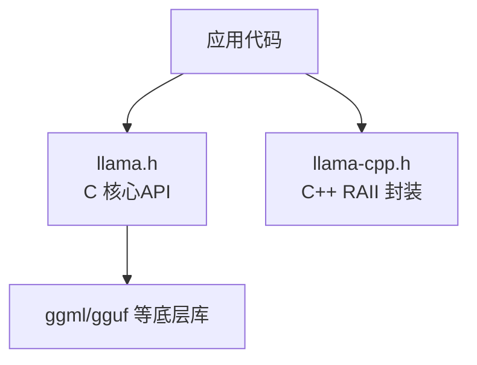
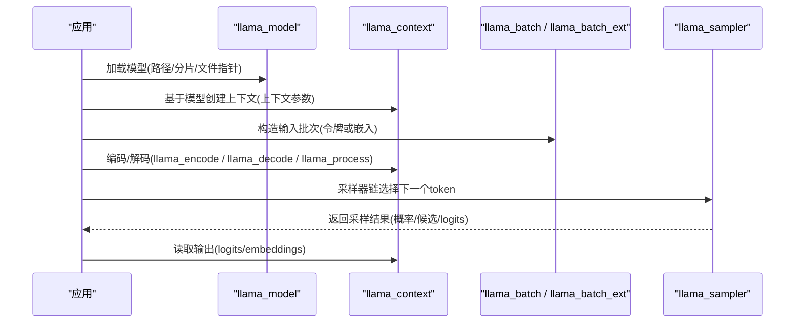
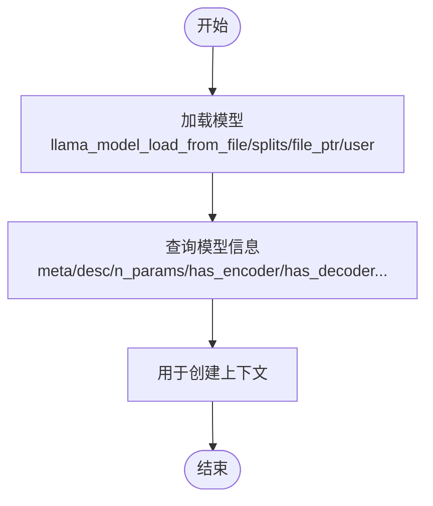
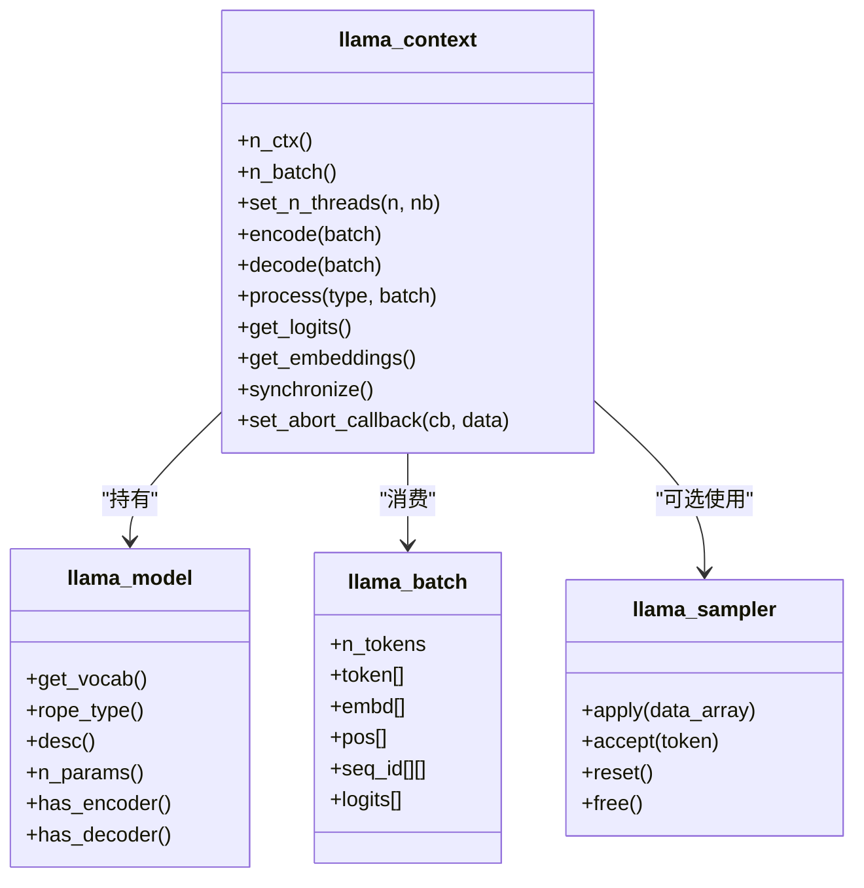
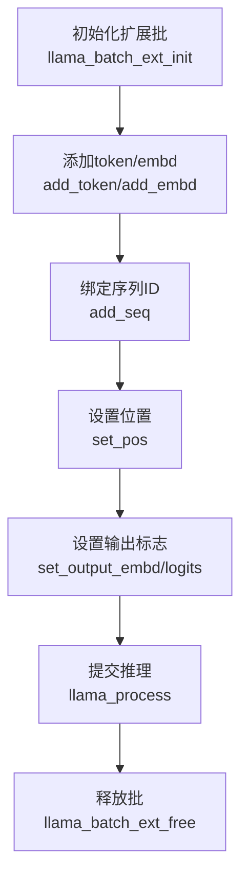
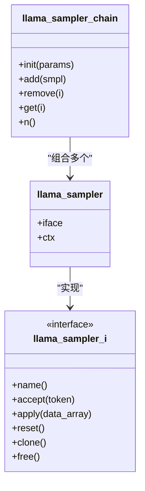
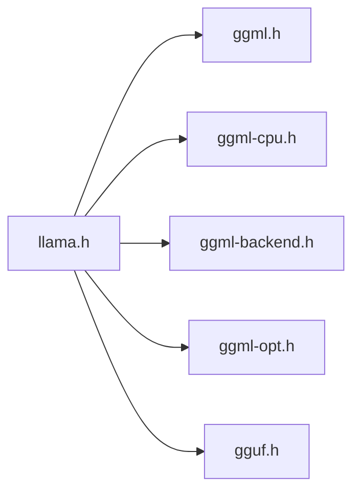

# 核心API参考

<cite>
**本文引用的文件**   
- [include/llama.h](file://include/llama.h)
- [include/llama-cpp.h](file://include/llama-cpp.h)
</cite>

## 目录
1. [简介](#简介)
2. [项目结构](#项目结构)
3. [核心组件](#核心组件)
4. [架构总览](#架构总览)
5. [详细组件分析](#详细组件分析)
6. [依赖关系分析](#依赖关系分析)
7. [性能与内存管理](#性能与内存管理)
8. [故障排查指南](#故障排查指南)
9. [结论](#结论)
10. [附录：函数速查表](#附录函数速查表)

## 简介
本参考文档面向 llama.cpp 的核心C API，系统性梳理公共接口、数据结构、枚举与常量，覆盖模型加载、上下文管理、推理执行、结果处理、采样器链、会话状态、LoRA适配器、批处理等关键能力。同时给出初始化流程、错误处理与最佳实践建议，帮助读者快速构建稳定高效的推理应用。

## 项目结构
- C 核心头文件位于 include/llama.h，定义所有对外暴露的公共类型、枚举、结构与函数。
- C++ 智能指针封装位于 include/llama-cpp.h，提供 RAII 包装以简化资源管理。
- 其他模块（如 ggml、gguf）通过头文件被包含，但不在本参考范围内。

图表来源
- [include/llama.h:1-10](file://include/llama.h#L1-L10)
- [include/llama-cpp.h:1-36](file://include/llama-cpp.h#L1-L36)

章节来源
- [include/llama.h:1-10](file://include/llama.h#L1-L10)
- [include/llama-cpp.h:1-36](file://include/llama-cpp.h#L1-L36)

## 核心组件
- 模型与上下文
  - 模型对象：llama_model
  - 上下文对象：llama_context
  - 词表对象：llama_vocab
  - 采样器对象：llama_sampler
- 批处理
  - 基础批：llama_batch
  - 扩展批：llama_batch_ext
- 配置参数
  - 模型加载参数：llama_model_params
  - 上下文参数：llama_context_params
  - 量化参数：llama_model_quantize_params
  - 采样器链参数：llama_sampler_chain_params
- 工具与辅助
  - LoRA 适配器：llama_adapter_lora
  - 聊天消息：llama_chat_message
  - 进度回调：llama_progress_callback
  - 日志偏置：llama_logit_bias

章节来源
- [include/llama.h:61-69](file://include/llama.h#L61-L69)
- [include/llama.h:231-273](file://include/llama.h#L231-L273)
- [include/llama.h:302-428](file://include/llama.h#L302-L428)
- [include/llama.h:441-476](file://include/llama.h#L441-L476)
- [include/llama.h:689-747](file://include/llama.h#L689-L747)

## 架构总览
下图展示从模型加载到推理执行的典型调用序列，体现模型、上下文、批处理与采样器的协作关系。

图表来源
- [include/llama.h:522-541](file://include/llama.h#L522-L541)
- [include/llama.h:552-562](file://include/llama.h#L552-L562)
- [include/llama.h:965-1008](file://include/llama.h#L965-L1008)
- [include/llama.h:1091-1094](file://include/llama.h#L1091-L1094)
- [include/llama.h:1134-1168](file://include/llama.h#L1134-L1168)
- [include/llama.h:1472-1599](file://include/llama.h#L1472-L1599)

## 详细组件分析

### 模型加载与管理
- 加载入口
  - 从文件加载：llama_model_load_from_file
  - 从文件指针加载：llama_model_load_from_file_ptr
  - 从多分片加载：llama_model_load_from_splits
  - 从用户自定义元数据加载：llama_model_init_from_user
- 保存与释放
  - 保存到文件：llama_model_save_to_file
  - 释放模型：llama_model_free
- 查询信息
  - 描述、参数量、大小、编码器/解码器存在性、是否循环/混合/扩散模型等
  - 元数据访问：llama_model_meta_* 系列函数
  - 词表与RoPE类型：llama_model_get_vocab, llama_model_rope_type

图表来源
- [include/llama.h:522-541](file://include/llama.h#L522-L541)
- [include/llama.h:543-550](file://include/llama.h#L543-L550)
- [include/llama.h:596-677](file://include/llama.h#L596-L677)
- [include/llama.h:623-648](file://include/llama.h#L623-L648)

章节来源
- [include/llama.h:522-550](file://include/llama.h#L522-L550)
- [include/llama.h:596-677](file://include/llama.h#L596-L677)
- [include/llama.h:623-648](file://include/llama.h#L623-L648)

### 上下文管理与推理执行
- 上下文创建与销毁
  - 基于模型创建：llama_init_from_model
  - 释放上下文：llama_free
- 线程与后端
  - 设置线程数：llama_set_n_threads
  - 获取线程数：llama_n_threads / llama_n_threads_batch
  - 附加/分离线程池：llama_attach_threadpool / llama_detach_threadpool
- 推理入口
  - 编码器：llama_encode
  - 解码器：llama_decode
  - 统一处理：llama_process（支持编码器/解码器）
- 结果读取
  - logits：llama_get_logits / llama_get_logits_ith
  - embeddings：llama_get_embeddings / llama_get_embeddings_ith / llama_get_embeddings_seq
- 同步与中止
  - 等待计算完成：llama_synchronize
  - 设置中止回调：llama_set_abort_callback

图表来源
- [include/llama.h:552-562](file://include/llama.h#L552-L562)
- [include/llama.h:1096-1132](file://include/llama.h#L1096-L1132)
- [include/llama.h:965-1008](file://include/llama.h#L965-L1008)
- [include/llama.h:1134-1168](file://include/llama.h#L1134-L1168)
- [include/llama.h:264-273](file://include/llama.h#L264-L273)
- [include/llama.h:1427-1447](file://include/llama.h#L1427-L1447)

章节来源
- [include/llama.h:552-562](file://include/llama.h#L552-L562)
- [include/llama.h:965-1008](file://include/llama.h#L965-L1008)
- [include/llama.h:1091-1132](file://include/llama.h#L1091-L1132)
- [include/llama.h:1134-1168](file://include/llama.h#L1134-L1168)

### 批处理（基础与扩展）
- 基础批
  - 构造：llama_batch_init / llama_batch_get_one
  - 释放：llama_batch_free
- 扩展批
  - 生命周期：llama_batch_ext_init / llama_batch_ext_free / llama_batch_ext_clear
  - 添加条目：llama_batch_ext_add / add_token / add_embd
  - 序列关联：llama_batch_ext_add_seq
  - 位置与输出控制：llama_batch_ext_set_pos / set_output_embd / set_output_logits
  - 状态嵌入（MTP/Qwen3 VL）：llama_batch_ext_set_embd_state

图表来源
- [include/llama.h:965-982](file://include/llama.h#L965-L982)
- [include/llama.h:1014-1094](file://include/llama.h#L1014-L1094)

章节来源
- [include/llama.h:965-982](file://include/llama.h#L965-L982)
- [include/llama.h:1014-1094](file://include/llama.h#L1014-L1094)

### 采样器链与采样策略
- 采样器接口
  - 创建与释放：llama_sampler_init / llama_sampler_free
  - 行为：apply / accept / reset / clone / copy
- 采样器链
  - 初始化：llama_sampler_chain_init
  - 增删改查：llama_sampler_chain_add / remove / get / n
- 内置采样器
  - 贪心：llama_sampler_init_greedy
  - 随机分布：llama_sampler_init_dist
  - Top-K / Top-P / Min-P / Typical / Temperature / Temp-Ext / XTC / Top-n-sigma
  - Mirostat 1.0/2.0
  - GBNF语法约束：llama_sampler_init_grammar / _lazy_patterns
  - 惩罚与DRY：llama_sampler_init_penalties / llama_sampler_init_dry
  - Adaptive-p：llama_sampler_init_adaptive_p

图表来源
- [include/llama.h:1374-1447](file://include/llama.h#L1374-L1447)
- [include/llama.h:1449-1599](file://include/llama.h#L1449-L1599)

章节来源
- [include/llama.h:1374-1447](file://include/llama.h#L1374-L1447)
- [include/llama.h:1449-1599](file://include/llama.h#L1449-L1599)

### 词表与文本编解码
- 词表查询
  - 文本映射：llama_vocab_get_text
  - 分数与属性：llama_vocab_get_score / llama_vocab_get_attr
  - 特殊标记：bos/eos/eot/sep/nl/pad/mask/fim_*
  - 控制与结束判断：llama_vocab_is_control / is_eog
- 编解码
  - 文本到token：llama_tokenize
  - token到piece：llama_token_to_piece
  - token到文本：llama_detokenize
- 聊天模板
  - 应用模板：llama_chat_apply_template
  - 内置模板列表：llama_chat_builtin_templates

章节来源
- [include/llama.h:1203-1237](file://include/llama.h#L1203-L1237)
- [include/llama.h:1277-1312](file://include/llama.h#L1277-L1312)
- [include/llama.h:1328-1337](file://include/llama.h#L1328-L1337)

### 会话与状态持久化
- 全局状态
  - 获取大小：llama_state_get_size
  - 读写数据：llama_state_get_data / llama_state_set_data
  - 会话文件：llama_state_load_file / llama_state_save_file
- 序列级状态
  - 获取大小/数据：llama_state_seq_get_size / llama_state_seq_get_data
  - 设置数据：llama_state_seq_set_data
  - 文件存取：llama_state_seq_load_file / llama_state_seq_save_file
  - 扩展标志：LLAMA_STATE_SEQ_FLAGS_*

章节来源
- [include/llama.h:827-953](file://include/llama.h#L827-L953)

### LoRA 适配器与控制向量
- 加载与释放
  - 从文件：llama_adapter_lora_init
  - 从文件指针：llama_adapter_lora_init_from_file_ptr
  - 释放：llama_adapter_lora_free
- 元数据访问
  - 键值对：llama_adapter_meta_val_str / meta_key_by_index / meta_val_str_by_index / meta_count
- 上下文绑定
  - 设置适配器：llama_set_adapters_lora
  - 控制向量：llama_set_adapter_cvec

章节来源
- [include/llama.h:689-747](file://include/llama.h#L689-L747)

### 内存与KV缓存操作
- 清理与范围操作
  - 清空：llama_memory_clear
  - 删除区间：llama_memory_seq_rm
  - 复制区间：llama_memory_seq_cp
  - 保留指定序列：llama_memory_seq_keep
  - 相对位移：llama_memory_seq_add
  - 位置缩放：llama_memory_seq_div
  - 边界查询：llama_memory_seq_pos_min / pos_max
  - 移位支持：llama_memory_can_shift

章节来源
- [include/llama.h:753-821](file://include/llama.h#L753-L821)

### 枚举与常量
- 词汇表类型：enum llama_vocab_type
- RoPE类型：enum llama_rope_type
- Token类型与属性：enum llama_token_type / enum llama_token_attr
- 模型数据类型：enum llama_ftype
- RoPE缩放类型：enum llama_rope_scaling_type
- Pooling类型：enum llama_pooling_type
- 注意力类型：enum llama_attention_type
- Flash Attention类型：enum llama_flash_attn_type
- 分割模式：enum llama_split_mode
- 加载模式：enum llama_load_mode
- 惰性加载模式：enum llama_lazy_mode
- 上下文类型：enum llama_context_type
- 过程类型：enum llama_process_type
- KV覆盖类型：enum llama_model_kv_override_type
- 采样元数据键：enum llama_model_meta_key
- 会话标志：LLAMA_STATE_SEQ_FLAGS_*

章节来源
- [include/llama.h:72-228](file://include/llama.h#L72-L228)
- [include/llama.h:275-313](file://include/llama.h#L275-L313)
- [include/llama.h:282-295](file://include/llama.h#L282-L295)
- [include/llama.h:922-934](file://include/llama.h#L922-L934)

## 依赖关系分析
- 头文件依赖
  - llama.h 依赖 ggml、ggml-cpu、ggml-backend、ggml-opt、gguf
- 运行时依赖
  - 后端设备（CPU/GPU/NPU等）由 ggml 后端注册与调度
  - 采样器链可结合后端采样接口（实验特性）

图表来源
- [include/llama.h:1-8](file://include/llama.h#L1-L8)

章节来源
- [include/llama.h:1-8](file://include/llama.h#L1-L8)

## 性能与内存管理
- 线程与批尺寸
  - 合理设置 n_threads / n_threads_batch 与 n_batch / n_ubatch 以平衡吞吐与延迟
- 后端优化
  - 启用Flash Attention、offload KQV、op_offload等上下文参数以提升性能
- 内存管理
  - 使用 llama_memory_* 进行细粒度KV缓存管理
  - 使用会话持久化减少重复初始化开销
- 资源释放
  - 遵循“谁创建谁释放”原则，避免悬挂指针与内存泄漏
  - C++侧建议使用 llama-cpp.h 提供的智能指针封装

章节来源
- [include/llama.h:366-428](file://include/llama.h#L366-L428)
- [include/llama.h:753-821](file://include/llama.h#L753-L821)
- [include/llama.h:827-953](file://include/llama.h#L827-L953)
- [include/llama-cpp.h:11-35](file://include/llama-cpp.h#L11-L35)

## 故障排查指南
- 常见错误码（llama_decode）
  - 0：成功
  - 1：未找到KV槽（减小批次或增大上下文）
  - 2：中止（已处理的ubatches仍留在上下文中）
  - -1：无效输入批次
  - < -1：致命错误（已处理的ubatches仍留在上下文中）
- 调试建议
  - 检查批次合法性（token/embd/pos/seq_id）
  - 使用 llama_memory_seq_pos_min/max 检查上下文状态
  - 通过 llama_set_abort_callback 中断长时间运行任务
  - 使用 llama_synchronize 确保结果就绪后再读取

章节来源
- [include/llama.h:994-1008](file://include/llama.h#L994-L1008)
- [include/llama.h:1126-1132](file://include/llama.h#L1126-L1132)

## 结论
llama.cpp 的核心API围绕模型、上下文、批处理与采样器展开，提供了完整的模型加载、推理执行、结果读取与状态持久化能力。通过合理的参数配置与内存管理，可在多种硬件后端上获得稳定且高性能的推理体验。建议在工程中采用 C++ RAII 封装以减少资源管理负担，并严格遵循错误码与状态检查以保证健壮性。

## 附录：函数速查表
- 版本与后端
  - llama_version / llama_backend_init / llama_backend_free / llama_numa_init
  - llama_supports_mmap / llama_supports_mlock / llama_supports_gpu_offload / llama_supports_rpc
- 模型
  - llama_model_load_from_file / llama_model_load_from_file_ptr / llama_model_load_from_splits / llama_model_init_from_user
  - llama_model_save_to_file / llama_model_free
  - llama_model_get_vocab / llama_model_rope_type / llama_model_desc / llama_model_n_params / llama_model_size
  - llama_model_has_encoder / llama_model_has_decoder / llama_model_decoder_start_token
  - llama_model_is_recurrent / llama_model_is_hybrid / llama_model_is_diffusion
  - llama_model_meta_val_str / llama_model_meta_count / llama_model_meta_key_by_index / llama_model_meta_val_str_by_index
- 上下文
  - llama_init_from_model / llama_free
  - llama_n_ctx / llama_n_ctx_seq / llama_n_batch / llama_n_ubatch / llama_n_seq_max / llama_n_rs_seq
  - llama_set_n_threads / llama_n_threads / llama_n_threads_batch
  - llama_set_embeddings / llama_set_causal_attn / llama_get_causal_attn
  - llama_set_abort_callback / llama_synchronize
  - llama_get_logits / llama_get_logits_ith / llama_get_embeddings / llama_get_embeddings_ith / llama_get_embeddings_seq
- 批处理
  - llama_batch_get_one / llama_batch_init / llama_batch_free
  - llama_encode / llama_decode / llama_process
  - llama_batch_ext_init / llama_batch_ext_free / llama_batch_ext_clear
  - llama_batch_ext_add / llama_batch_ext_add_token / llama_batch_ext_add_embd
  - llama_batch_ext_add_seq / llama_batch_ext_set_embd_token / llama_batch_ext_set_embd_state
  - llama_batch_ext_set_output_embd / llama_batch_ext_set_output_logits / llama_batch_ext_set_pos
- 采样器
  - llama_sampler_init / llama_sampler_free / llama_sampler_name / llama_sampler_accept / llama_sampler_apply / llama_sampler_reset / llama_sampler_clone / llama_sampler_copy
  - llama_sampler_chain_init / llama_sampler_chain_add / llama_sampler_chain_remove / llama_sampler_chain_get / llama_sampler_chain_n
  - llama_sampler_init_greedy / llama_sampler_init_dist / llama_sampler_init_top_k / llama_sampler_init_top_p / llama_sampler_init_min_p
  - llama_sampler_init_typical / llama_sampler_init_temp / llama_sampler_init_temp_ext / llama_sampler_init_xtc / llama_sampler_init_top_n_sigma
  - llama_sampler_init_mirostat / llama_sampler_init_mirostat_v2
  - llama_sampler_init_grammar / llama_sampler_init_grammar_lazy_patterns
  - llama_sampler_init_penalties / llama_sampler_init_dry / llama_sampler_init_adaptive_p
- 词表与文本
  - llama_vocab_get_text / llama_vocab_get_score / llama_vocab_get_attr
  - llama_vocab_is_eog / llama_vocab_is_control
  - llama_vocab_bos / llama_vocab_eos / llama_vocab_eot / llama_vocab_sep / llama_vocab_nl / llama_vocab_pad / llama_vocab_mask
  - llama_vocab_get_add_bos / llama_vocab_get_add_eos / llama_vocab_get_add_sep
  - llama_tokenize / llama_token_to_piece / llama_detokenize
  - llama_chat_apply_template / llama_chat_builtin_templates
- 会话与状态
  - llama_state_get_size / llama_state_get_data / llama_state_set_data
  - llama_state_load_file / llama_state_save_file
  - llama_state_seq_get_size / llama_state_seq_get_data / llama_state_seq_set_data
  - llama_state_seq_load_file / llama_state_seq_save_file
- LoRA 与控制向量
  - llama_adapter_lora_init / llama_adapter_lora_init_from_file_ptr / llama_adapter_lora_free
  - llama_adapter_meta_val_str / llama_adapter_meta_count / llama_adapter_meta_key_by_index / llama_adapter_meta_val_str_by_index
  - llama_set_adapters_lora / llama_set_adapter_cvec
- 内存
  - llama_memory_clear / llama_memory_seq_rm / llama_memory_seq_cp / llama_memory_seq_keep
  - llama_memory_seq_add / llama_memory_seq_div / llama_memory_seq_pos_min / llama_memory_seq_pos_max / llama_memory_can_shift

章节来源
- [include/llama.h:478-504](file://include/llama.h#L478-L504)
- [include/llama.h:522-550](file://include/llama.h#L522-L550)
- [include/llama.h:552-562](file://include/llama.h#L552-L562)
- [include/llama.h:564-677](file://include/llama.h#L564-L677)
- [include/llama.h:689-747](file://include/llama.h#L689-L747)
- [include/llama.h:753-821](file://include/llama.h#L753-L821)
- [include/llama.h:827-953](file://include/llama.h#L827-L953)
- [include/llama.h:965-1094](file://include/llama.h#L965-L1094)
- [include/llama.h:1096-1168](file://include/llama.h#L1096-L1168)
- [include/llama.h:1203-1337](file://include/llama.h#L1203-L1337)
- [include/llama.h:1374-1599](file://include/llama.h#L1374-L1599)