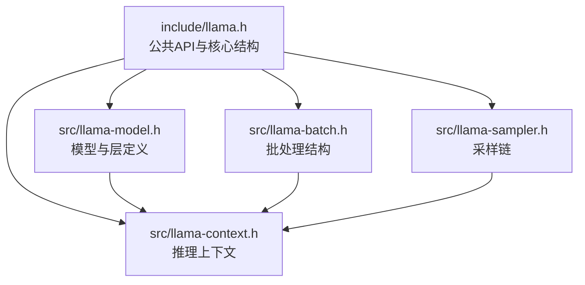
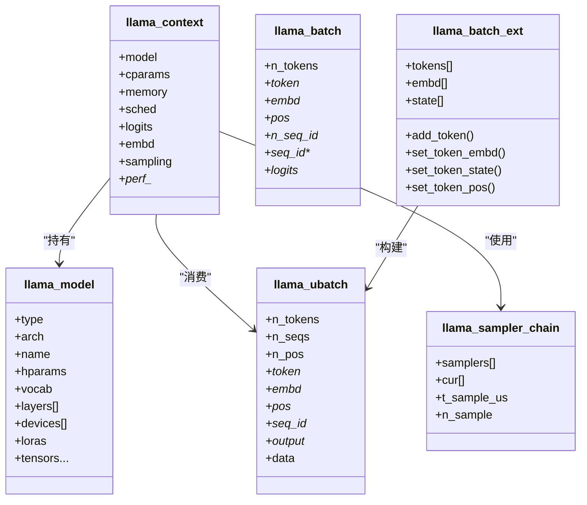
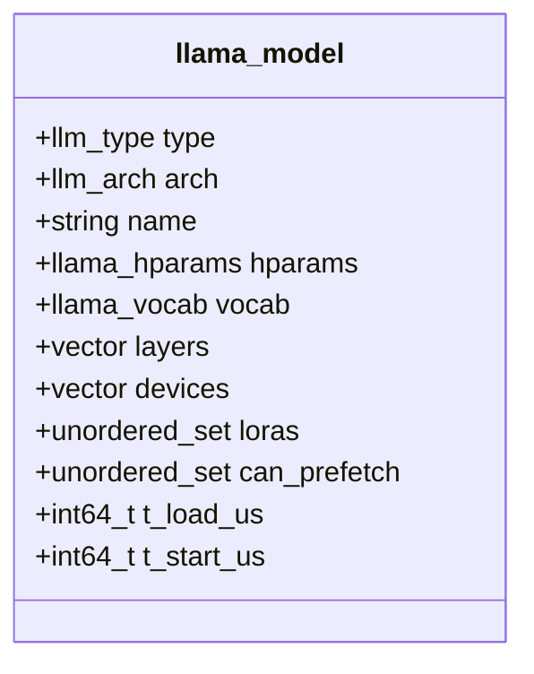
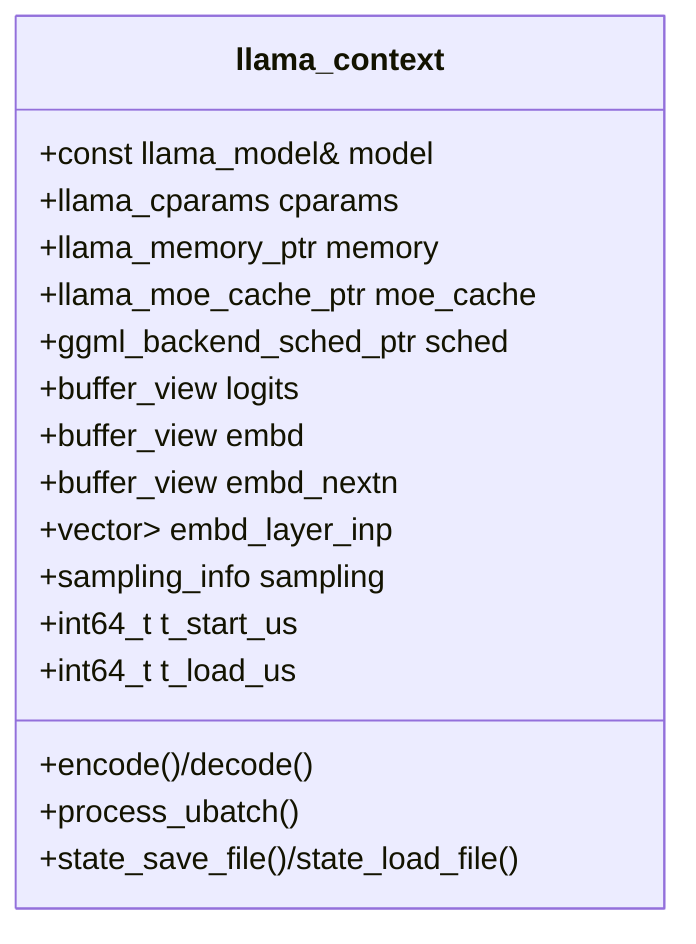
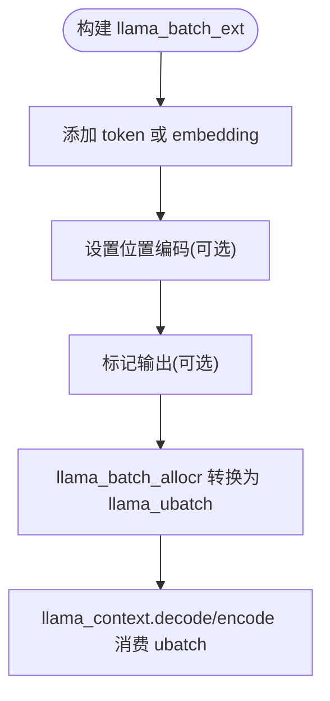
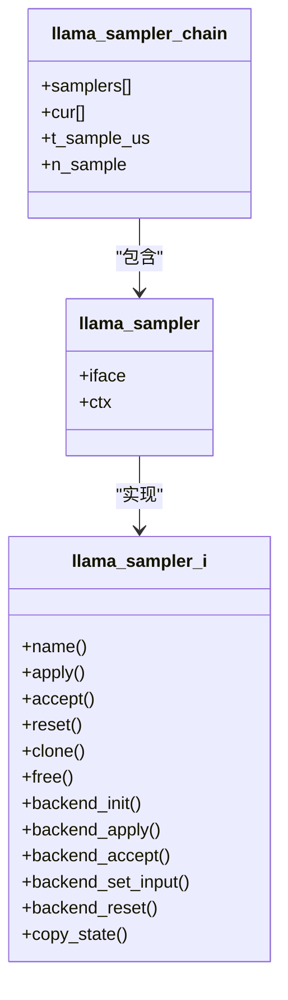
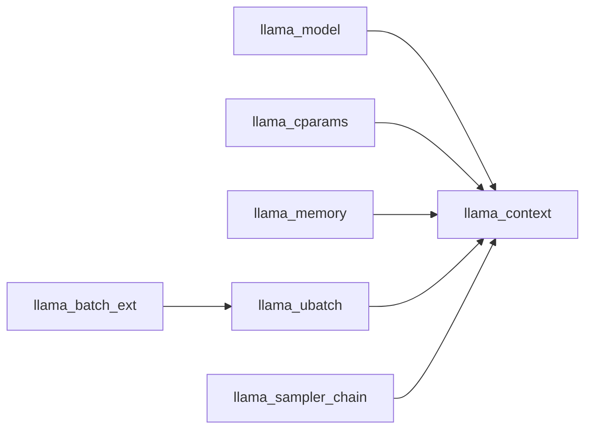

# 核心数据结构

<cite>
**本文引用的文件**   
- [llama.h](file://include/llama.h)
- [llama-model.h](file://src/llama-model.h)
- [llama-context.h](file://src/llama-context.h)
- [llama-batch.h](file://src/llama-batch.h)
- [llama-sampler.h](file://src/llama-sampler.h)
</cite>

## 目录
1. [引言](#引言)
2. [项目结构](#项目结构)
3. [核心组件总览](#核心组件总览)
4. [架构概览](#架构概览)
5. [详细组件分析](#详细组件分析)
6. [依赖关系分析](#依赖关系分析)
7. [性能与内存布局](#性能与内存布局)
8. [初始化与生命周期最佳实践](#初始化与生命周期最佳实践)
9. [常见问题排查](#常见问题排查)
10. [结论](#结论)

## 引言
本文件面向 llama.cpp 的核心数据结构，系统性梳理并解释以下关键对象：
- 模型对象：llama_model（含层、权重张量、设备信息）
- 推理上下文：llama_context（调度器、KV缓存、输出缓冲、采样状态）
- 批输入：llama_batch（C API）、llama_ubatch / llama_batch_ext（内部高效批）
- 采样器：llama_sampler / llama_sampler_chain（采样链与后端接口）

同时覆盖枚举类型（如 llama_ftype、llama_rope_type 等）的完整说明，以及数据结构的字段含义、默认值、对齐要求、内存布局与性能考量。

## 项目结构
围绕核心数据结构的相关头文件分布如下：
- include/llama.h：对外 C API 与核心公共结构体定义（模型参数、上下文参数、批、采样器等）
- src/llama-model.h：模型内部实现结构（层、权重张量、设备、精度策略等）
- src/llama-context.h：推理上下文内部实现（调度器、图、采样、状态保存/加载、性能统计）
- src/llama-batch.h：内部批处理结构（llama_ubatch、llama_batch_ext、分配器）
- src/llama-sampler.h：采样链结构与后端采样辅助

图表来源
- [llama.h:264-273](file://include/llama.h#L264-L273)
- [llama-model.h:679-799](file://src/llama-model.h#L679-L799)
- [llama-context.h:45-150](file://src/llama-context.h#L45-L150)
- [llama-batch.h:17-83](file://src/llama-batch.h#L17-L83)
- [llama-sampler.h:12-36](file://src/llama-sampler.h#L12-L36)

章节来源
- [llama.h:264-273](file://include/llama.h#L264-L273)
- [llama-model.h:679-799](file://src/llama-model.h#L679-L799)
- [llama-context.h:45-150](file://src/llama-context.h#L45-L150)
- [llama-batch.h:17-83](file://src/llama-batch.h#L17-L83)
- [llama-sampler.h:12-36](file://src/llama-sampler.h#L12-L36)

## 核心组件总览
- llama_model：封装模型元数据、词表、层级结构、权重张量、设备列表、LoRA 适配器等。
- llama_context：封装推理期运行时状态，包括 KV 缓存、计算图调度、输出缓冲区、采样配置、性能统计等。
- llama_batch / llama_ubatch / llama_batch_ext：描述一次或一批 token/embedding 输入，支持混合输入、位置编码、序列分组、输出标记等。
- llama_sampler / llama_sampler_chain：采样器抽象与链式组合，支持 CPU/GPU 后端采样接口。

章节来源
- [llama.h:320-428](file://include/llama.h#L320-L428)
- [llama-model.h:679-799](file://src/llama-model.h#L679-L799)
- [llama-context.h:45-150](file://src/llama-context.h#L45-L150)
- [llama-batch.h:17-83](file://src/llama-batch.h#L17-L83)
- [llama-sampler.h:12-36](file://src/llama-sampler.h#L12-L36)

## 架构概览
下图展示核心对象之间的关系与主要职责：

图表来源
- [llama-model.h:679-799](file://src/llama-model.h#L679-L799)
- [llama-context.h:45-150](file://src/llama-context.h#L45-L150)
- [llama.h:264-273](file://include/llama.h#L264-L273)
- [llama-batch.h:17-83](file://src/llama-batch.h#L17-L83)
- [llama-sampler.h:12-36](file://src/llama-sampler.h#L12-L36)

## 详细组件分析

### 模型对象 llama_model
- 作用：承载模型静态信息与权重张量集合，包含架构、超参、词表、层级、设备映射、LoRA 适配器集合等。
- 关键字段要点：
  - type/arch/name/hparams/vocab：模型类型、架构、名称、超参、词表。
  - layers：按层组织的权重张量集合，涵盖注意力、FFN、MoE、归一化、偏置、缩放因子等。
  - devices：使用的后端设备列表。
  - loras：关联的 LoRA 适配器集合。
  - can_prefetch：可预取张量集合（受 TENSOR_READ_LAZY 控制）。
  - t_load_us/t_start_us：加载耗时与开始时间统计。
- 设计要点：
  - 通过 ggml_tensor* 指针直接引用底层张量，避免额外拷贝。
  - 大量可选字段用于兼容不同模型变体（如 MoE、Vision、Mamba/RWKV 等）。

图表来源
- [llama-model.h:679-799](file://src/llama-model.h#L679-L799)

章节来源
- [llama-model.h:679-799](file://src/llama-model.h#L679-L799)

### 推理上下文 llama_context
- 作用：推理期的运行时容器，管理 KV 缓存、计算图、采样、输出缓冲、线程池、性能统计、状态持久化等。
- 关键字段要点：
  - model/cparams：只读模型与上下文参数。
  - memory/moe_cache：KV 缓存与专家缓存。
  - sched：后端调度器，负责图执行与资源分配。
  - logits/embd/embd_nextn/embd_layer_inp：输出缓冲区（logits、嵌入、下一层隐藏态、层输入嵌入）。
  - sampling：采样相关状态（每个序列的采样器、候选、概率、logits 计数等）。
  - perf_*：性能计时与统计。
- 生命周期：
  - 构造时初始化调度器与计算缓冲；析构时释放资源。
  - 提供 encode/decode、process_ubatch、状态保存/加载等方法。

图表来源
- [llama-context.h:45-150](file://src/llama-context.h#L45-L150)
- [llama-context.h:300-447](file://src/llama-context.h#L300-L447)

章节来源
- [llama-context.h:45-150](file://src/llama-context.h#L45-L150)
- [llama-context.h:300-447](file://src/llama-context.h#L300-L447)

### 批输入：llama_batch / llama_ubatch / llama_batch_ext
- llama_batch（C API）：
  - n_tokens：批次 token 数量。
  - token/embd：token ID 数组或 embedding 行向量（二选一）。
  - pos：位置编码（可为空，由解码器自动跟踪）。
  - n_seq_id/seq_id：每 token 所属序列 ID 的数量与指针数组。
  - logits：是否输出该 token 的 logits。
- llama_ubatch（内部高效批）：
  - 支持混合输入（token 与 embedding 混用），多位置（M-RoPE），序列去重与索引映射。
  - data 成员为所有权存储，便于统一管理与复用。
- llama_batch_ext（扩展批）：
  - 面向测试与高级用法，提供 add/set 系列方法，支持 state 嵌入（如 MTP 目标模型隐藏态）。
  - 内部维护 tokens/embd/state 向量与决策顺序等。

图表来源
- [llama-batch.h:17-83](file://src/llama-batch.h#L17-L83)
- [llama-batch.h:97-151](file://src/llama-batch.h#L97-L151)
- [llama-batch.h:154-261](file://src/llama-batch.h#L154-L261)

章节来源
- [llama.h:264-273](file://include/llama.h#L264-L273)
- [llama-batch.h:17-83](file://src/llama-batch.h#L17-L83)
- [llama-batch.h:97-151](file://src/llama-batch.h#L97-L151)
- [llama-batch.h:154-261](file://src/llama-batch.h#L154-L261)

### 采样器：llama_sampler / llama_sampler_chain
- llama_sampler_i：采样器接口，包含 apply/accept/reset/clone/free 及后端采样钩子（backend_init/backend_apply/backend_accept 等）。
- llama_sampler：接口指针与上下文对象的轻量包装。
- llama_sampler_chain：采样链，串联多个采样器，维护当前候选集 cur 与计时统计。
- 用途：在 decode 后对 logits 进行过滤/重加权/选择，最终得到下一个 token。

图表来源
- [llama.h:1374-1431](file://include/llama.h#L1374-L1431)
- [llama-sampler.h:12-36](file://src/llama-sampler.h#L12-L36)

章节来源
- [llama.h:1374-1431](file://include/llama.h#L1374-L1431)
- [llama-sampler.h:12-36](file://src/llama-sampler.h#L12-L36)

## 依赖关系分析
- llama_context 依赖 llama_model（读取模型结构与超参）、llama_cparams（上下文参数）、llama_memory（KV 缓存抽象）、llama_moe_cache（专家缓存）。
- llama_batch_ext 通过 llama_batch_allocr 转换为内部 llama_ubatch，供 llama_context 消费。
- llama_sampler_chain 与 llama_context 的 sampling 状态协作，决定每次生成的 token。

图表来源
- [llama-context.h:45-150](file://src/llama-context.h#L45-L150)
- [llama-batch.h:154-261](file://src/llama-batch.h#L154-L261)
- [llama-sampler.h:12-36](file://src/llama-sampler.h#L12-L36)

章节来源
- [llama-context.h:45-150](file://src/llama-context.h#L45-L150)
- [llama-batch.h:154-261](file://src/llama-batch.h#L154-L261)
- [llama-sampler.h:12-36](file://src/llama-sampler.h#L12-L36)

## 性能与内存布局
- 对齐与布局：
  - llama_ubatch.b_equal_seqs 使用 int32_t 而非 bool，以避免地址检查器告警并确保对齐。
  - llama_context_params 将布尔字段集中放置，避免按值复制时的错位问题。
- 内存优化：
  - llama_batch_allocr 复用内部向量以减少重复分配。
  - llama_context 重用 llm_graph_result 实例，减少图重建开销。
  - llama_context.mem_storage 缓存每序列的设备端内存副本，加速状态保存/加载。
- 性能指标：
  - llama_context 暴露 perf_get_data/perf_reset 以获取和重置性能统计（如 t_p_eval_us、t_eval_us、n_queued_tokens 等）。
- 并发与线程：
  - 可通过 llama_attach_threadpool 附加线程池，分别用于生成与批量处理。

章节来源
- [llama-batch.h:17-83](file://src/llama-batch.h#L17-L83)
- [llama.h:366-428](file://include/llama.h#L366-L428)
- [llama-context.h:395-447](file://src/llama-context.h#L395-L447)

## 初始化与生命周期最佳实践
- 模型加载：
  - 使用 llama_model_load_from_file/splits 加载 GGUF 模型，传入 llama_model_params（设备、分片模式、懒加载、回调等）。
  - 如需仅加载词表，设置 params.vocab_only=true。
- 上下文创建：
  - 使用 llama_init_from_model 创建 llama_context，传入 llama_context_params（上下文大小、批大小、线程数、RoPE 缩放、KV 数据类型等）。
  - 若需提取嵌入，设置 params.embeddings=true；若需启用 SWA 全尺寸缓存，设置 params.swa_full=true。
- 批处理：
  - 推荐使用 llama_batch_ext 构建输入，调用 set_token_embd/set_token_state/set_token_pos 等接口，最后通过 llama_process 或 llama_decode 消费。
  - 对于旧 API，可使用 llama_batch_init/llama_batch_free 管理 llama_batch。
- 采样器：
  - 使用 llama_sampler_chain_init 创建采样链，依次添加 top-k/top-p/temp/greedy/dist 等采样器，并以分布采样器结尾。
  - 可将采样链配置到 llama_context_params.samplers 中以绑定到特定序列。
- 生命周期：
  - 先 free 采样器链中的采样器（若未加入链则不手动释放），再 free 上下文，最后 free 模型。
  - 会话状态：使用 llama_state_save_file/llama_state_load_file 持久化/恢复上下文状态。

章节来源
- [llama.h:517-562](file://include/llama.h#L517-L562)
- [llama.h:965-1008](file://include/llama.h#L965-L1008)
- [llama.h:1022-1094](file://include/llama.h#L1022-L1094)
- [llama.h:1340-1472](file://include/llama.h#L1340-L1472)

## 常见问题排查
- KV 槽不足：
  - llama_decode 返回 1 表示无法找到 KV 槽，建议减小 batch 或增大上下文大小。
- 非法输入：
  - llama_decode 返回 -1 表示批次无效，检查 token/embd/pos/seq_id 一致性。
- 中止与错误恢复：
  - 致命错误或中止时，已处理的 ubatch 会保留在上下文内存中；应通过 llama_memory_seq_pos_min/llama_memory_seq_pos_max 查询实际位置范围。
- 采样器链：
  - 确保链末尾是最终选择 token 的采样器（如 greedy/dist），否则可能无输出。

章节来源
- [llama.h:994-1008](file://include/llama.h#L994-L1008)
- [llama.h:805-818](file://include/llama.h#L805-L818)
- [llama.h:1340-1472](file://include/llama.h#L1340-L1472)

## 结论
本文系统梳理了 llama.cpp 的核心数据结构及其关系，覆盖了模型、上下文、批输入与采样器的关键实现细节，并结合代码给出了内存布局、对齐要求、性能优化与生命周期管理的最佳实践。理解这些结构有助于正确配置与调优推理流程，并在复杂场景（如 MoE、Vision、MTP、SWA）下稳定运行。