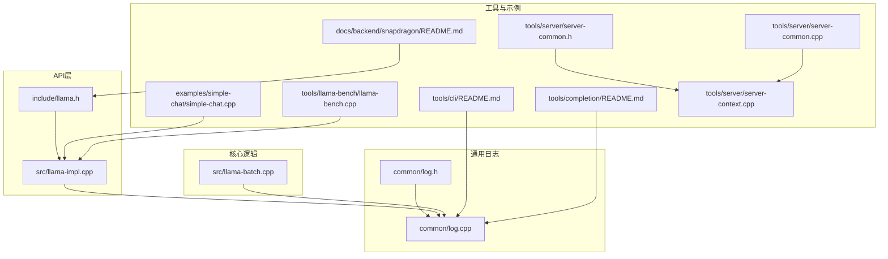
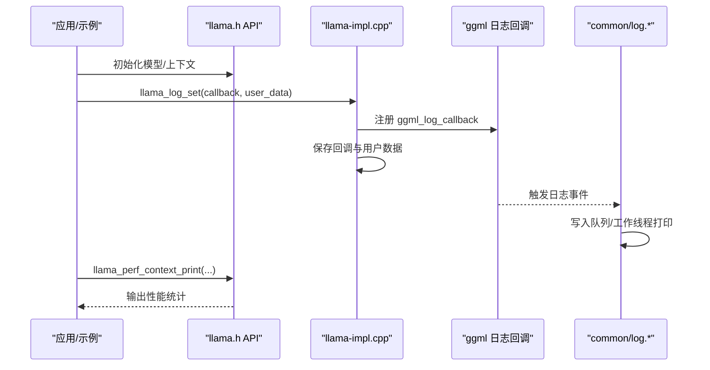
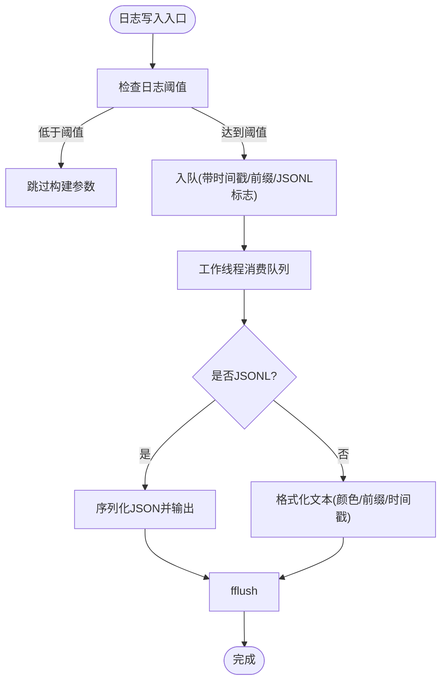
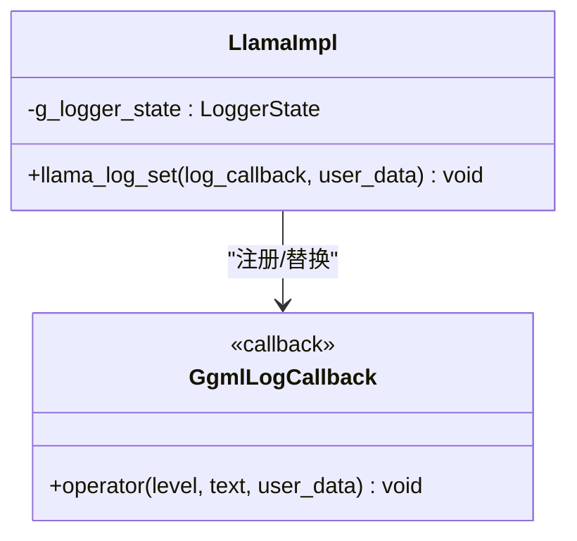
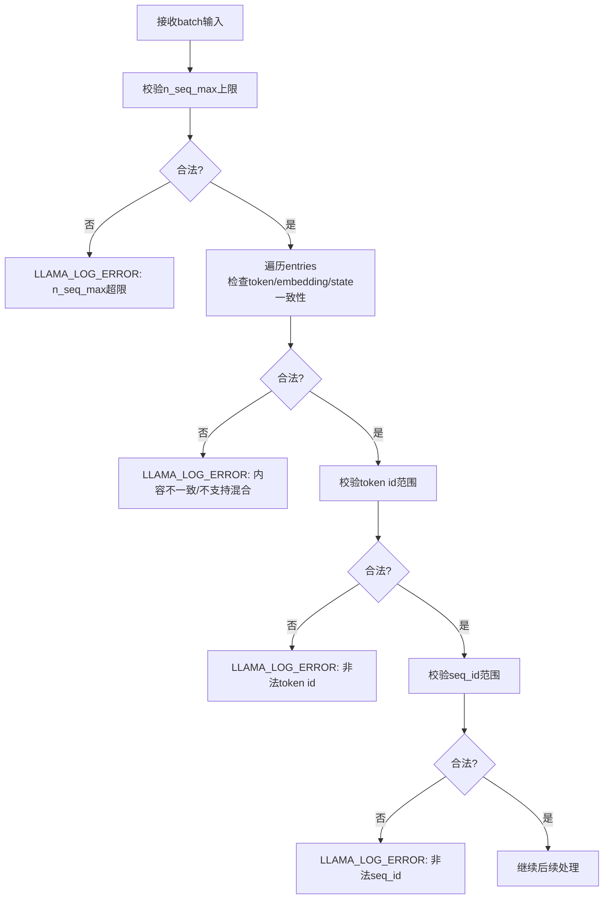
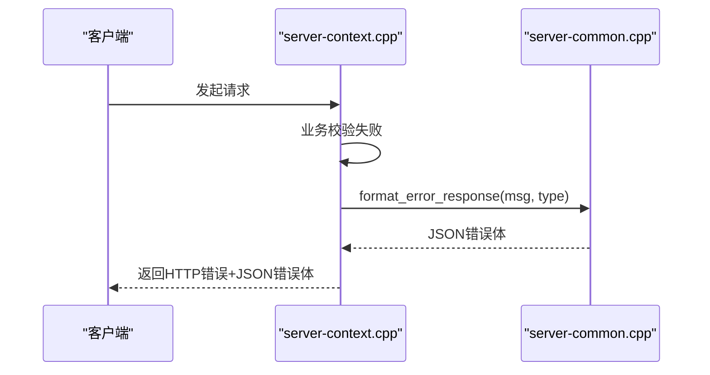
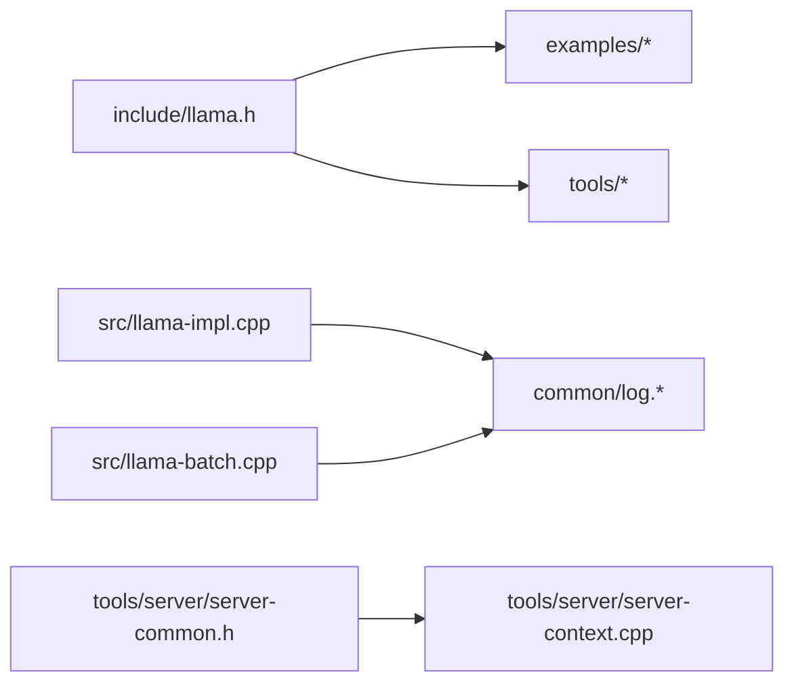
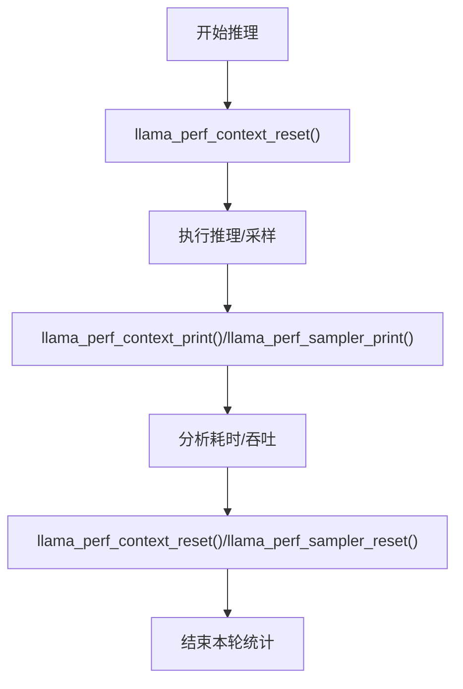

# 错误处理与调试

<cite>
**本文引用的文件**   
- [common/log.h](file://common/log.h)
- [common/log.cpp](file://common/log.cpp)
- [include/llama.h](file://include/llama.h)
- [src/llama-impl.cpp](file://src/llama-impl.cpp)
- [src/llama-batch.cpp](file://src/llama-batch.cpp)
- [examples/simple-chat/simple-chat.cpp](file://examples/simple-chat/simple-chat.cpp)
- [tools/cli/README.md](file://tools/cli/README.md)
- [tools/completion/README.md](file://tools/completion/README.md)
- [tools/server/server-common.h](file://tools/server/server-common.h)
- [tools/server/server-common.cpp](file://tools/server/server-common.cpp)
- [tools/server/server-context.cpp](file://tools/server/server-context.cpp)
- [tools/llama-bench/llama-bench.cpp](file://tools/llama-bench/llama-bench.cpp)
- [tools/llama-bench/README.md](file://tools/llama-bench/README.md)
- [docs/backend/snapdragon/README.md](file://docs/backend/snapdragon/README.md)
</cite>

## 目录
1. [简介](#简介)
2. [项目结构](#项目结构)
3. [核心组件](#核心组件)
4. [架构总览](#架构总览)
5. [详细组件分析](#详细组件分析)
6. [依赖关系分析](#依赖关系分析)
7. [性能考量](#性能考量)
8. [故障排查指南](#故障排查指南)
9. [结论](#结论)
10. [附录](#附录)

## 简介
本文件聚焦于 llama.cpp 的错误处理与调试能力，系统性梳理日志系统、错误类型与异常处理、常见错误的诊断与修复、以及性能监控与调试工具的使用。文档面向不同技术背景的读者，既提供高层概览，也深入到具体源码位置，帮助快速定位问题并优化运行表现。

## 项目结构
围绕“错误处理与调试”的关键代码分布在以下模块：
- 通用日志子系统：common/log.h, common/log.cpp
- 顶层 C API（含性能统计接口）：include/llama.h
- 日志回调桥接：src/llama-impl.cpp
- 批处理输入校验与错误日志：src/llama-batch.cpp
- 示例应用中的日志回调设置：examples/simple-chat/simple-chat.cpp
- CLI/Completion 工具的日志参数说明：tools/cli/README.md, tools/completion/README.md
- 服务端错误响应封装与发送：tools/server/server-common.h, server-common.cpp, server-context.cpp
- 基准测试工具对日志的开关控制：tools/llama-bench/llama-bench.cpp
- 性能统计输出样例：docs/backend/snapdragon/README.md

**图示来源** 
- [common/log.h:1-149](file://common/log.h#L1-L149)
- [common/log.cpp:1-567](file://common/log.cpp#L1-L567)
- [include/llama.h:1700-1746](file://include/llama.h#L1700-L1746)
- [src/llama-impl.cpp:55-59](file://src/llama-impl.cpp#L55-L59)
- [src/llama-batch.cpp:1-200](file://src/llama-batch.cpp#L1-L200)
- [examples/simple-chat/simple-chat.cpp:72-110](file://examples/simple-chat/simple-chat.cpp#L72-L110)
- [tools/cli/README.md:89-97](file://tools/cli/README.md#L89-L97)
- [tools/completion/README.md:172-180](file://tools/completion/README.md#L172-L180)
- [tools/server/server-common.h:58-95](file://tools/server/server-common.h#L58-L95)
- [tools/server/server-common.cpp:36-36](file://tools/server/server-common.cpp#L36-L36)
- [tools/server/server-context.cpp:2165-2173](file://tools/server/server-context.cpp#L2165-L2173)
- [tools/llama-bench/llama-bench.cpp:2284-2288](file://tools/llama-bench/llama-bench.cpp#L2284-L2288)
- [docs/backend/snapdragon/README.md:156-182](file://docs/backend/snapdragon/README.md#L156-L182)

**章节来源**
- [common/log.h:1-149](file://common/log.h#L1-L149)
- [common/log.cpp:1-567](file://common/log.cpp#L1-L567)
- [include/llama.h:1700-1746](file://include/llama.h#L1700-L1746)
- [src/llama-impl.cpp:55-59](file://src/llama-impl.cpp#L55-L59)
- [src/llama-batch.cpp:1-200](file://src/llama-batch.cpp#L1-L200)
- [examples/simple-chat/simple-chat.cpp:72-110](file://examples/simple-chat/simple-chat.cpp#L72-L110)
- [tools/cli/README.md:89-97](file://tools/cli/README.md#L89-L97)
- [tools/completion/README.md:172-180](file://tools/completion/README.md#L172-L180)
- [tools/server/server-common.h:58-95](file://tools/server/server-common.h#L58-L95)
- [tools/server/server-common.cpp:36-36](file://tools/server/server-common.cpp#L36-L36)
- [tools/server/server-context.cpp:2165-2173](file://tools/server/server-context.cpp#L2165-L2173)
- [tools/llama-bench/llama-bench.cpp:2284-2288](file://tools/llama-bench/llama-bench.cpp#L2284-L2288)
- [docs/backend/snapdragon/README.md:156-182](file://docs/backend/snapdragon/README.md#L156-L182)

## 核心组件
- 通用日志子系统（common/log.*）
  - 提供线程安全的日志队列、工作线程打印、颜色/前缀/时间戳控制、JSONL 输出、默认回调桥接到 ggml 日志级别。
  - 关键宏：LOG_INF/LOG_WRN/LOG_ERR/LOG_DBG 等；JSON 日志宏 LOG_JSON。
- 顶层 API（include/llama.h）
  - 暴露性能统计函数：llama_perf_context_print / llama_perf_sampler_print / reset 等。
- 日志回调桥接（src/llama-impl.cpp）
  - 将 ggml_log_callback 与内部日志状态绑定，支持用户自定义回调。
- 批处理校验（src/llama-batch.cpp）
  - 对 batch 输入进行严格校验，失败时通过 LLAMA_LOG_ERROR 输出结构化错误信息。
- 示例与工具
  - examples/simple-chat：演示如何设置自定义日志回调以仅输出错误。
  - tools/cli/README.md 与 tools/completion/README.md：统一描述 --log-* 系列参数。
  - tools/server/*：定义错误类型枚举与 JSON 错误响应封装，并在上下文中发送错误。
  - tools/llama-bench：在基准测试中可关闭日志以减少干扰。

**章节来源**
- [common/log.h:24-38](file://common/log.h#L24-L38)
- [common/log.h:102-149](file://common/log.h#L102-L149)
- [common/log.cpp:17-35](file://common/log.cpp#L17-L35)
- [common/log.cpp:67-76](file://common/log.cpp#L67-L76)
- [common/log.cpp:460-479](file://common/log.cpp#L460-L479)
- [include/llama.h:1700-1706](file://include/llama.h#L1700-L1706)
- [src/llama-impl.cpp:55-59](file://src/llama-impl.cpp#L55-L59)
- [src/llama-batch.cpp:43-92](file://src/llama-batch.cpp#L43-L92)
- [examples/simple-chat/simple-chat.cpp:72-77](file://examples/simple-chat/simple-chat.cpp#L72-L77)
- [tools/cli/README.md:89-97](file://tools/cli/README.md#L89-L97)
- [tools/completion/README.md:172-180](file://tools/completion/README.md#L172-L180)
- [tools/server/server-common.h:58-95](file://tools/server/server-common.h#L58-L95)
- [tools/server/server-common.cpp:36-36](file://tools/server/server-common.cpp#L36-L36)
- [tools/server/server-context.cpp:2165-2173](file://tools/server/server-context.cpp#L2165-L2173)
- [tools/llama-bench/llama-bench.cpp:2284-2288](file://tools/llama-bench/llama-bench.cpp#L2284-L2288)

## 架构总览
下图展示从上层应用到日志子系统与 ggml 日志回调的调用链，以及性能统计 API 的位置。

**图示来源** 
- [include/llama.h:1700-1706](file://include/llama.h#L1700-L1706)
- [src/llama-impl.cpp:55-59](file://src/llama-impl.cpp#L55-L59)
- [common/log.cpp:561-566](file://common/log.cpp#L561-L566)

## 详细组件分析

### 日志子系统（common/log.*）
- 设计要点
  - 使用环形队列与工作线程异步打印，避免阻塞主流程。
  - 支持 stdout/stderr 双通道、颜色、前缀、时间戳、JSONL 输出。
  - 提供默认回调 common_log_default_callback，将 ggml 日志级别映射到内部阈值。
- 关键配置
  - 阈值控制：common_log_set_verbosity_thold / common_log_get_verbosity_thold。
  - JSONL：common_log_set_jsonl / common_log_get_jsonl。
  - 输出目标：common_log_set_file / common_log_set_stdo。
  - 外观：common_log_set_colors / common_log_set_prefix / common_log_set_timestamps。
  - 刷新：common_log_flush。
- 宏与用法
  - LOG_INF/LOG_WRN/LOG_ERR/LOG_DBG 等宏根据阈值决定是否计算参数。
  - LOG_JSON(type, data) 仅在启用 JSONL 时输出结构化日志。

**图示来源** 
- [common/log.cpp:17-35](file://common/log.cpp#L17-L35)
- [common/log.cpp:91-158](file://common/log.cpp#L91-L158)
- [common/log.cpp:239-333](file://common/log.cpp#L239-L333)
- [common/log.cpp:335-389](file://common/log.cpp#L335-L389)
- [common/log.cpp:548-566](file://common/log.cpp#L548-L566)

**章节来源**
- [common/log.h:24-38](file://common/log.h#L24-L38)
- [common/log.h:40-52](file://common/log.h#L40-L52)
- [common/log.h:68-149](file://common/log.h#L68-L149)
- [common/log.cpp:17-35](file://common/log.cpp#L17-L35)
- [common/log.cpp:67-76](file://common/log.cpp#L67-L76)
- [common/log.cpp:91-158](file://common/log.cpp#L91-L158)
- [common/log.cpp:239-333](file://common/log.cpp#L239-L333)
- [common/log.cpp:335-389](file://common/log.cpp#L335-L389)
- [common/log.cpp:460-479](file://common/log.cpp#L460-L479)
- [common/log.cpp:548-566](file://common/log.cpp#L548-L566)

### 日志回调桥接（src/llama-impl.cpp）
- 作用
  - 将 ggml_log_callback 与内部日志状态绑定，允许用户替换默认回调。
- 关键点
  - llama_log_set 会同时更新 ggml 回调与内部 g_logger_state。

**图示来源** 
- [src/llama-impl.cpp:55-59](file://src/llama-impl.cpp#L55-L59)

**章节来源**
- [src/llama-impl.cpp:55-59](file://src/llama-impl.cpp#L55-L59)

### 批处理输入校验与错误日志（src/llama-batch.cpp）
- 校验项
  - n_seq_max 上限检查。
  - 每个 entry 必须包含 token id 或 embedding，且同一 batch 内 state 标记一致。
  - 不允许混合“既有 token 又有 embedding”与其他类型的条目。
  - 若模型/上下文不支持混合 token/embedding 的 batch，则报错。
  - token id 范围校验、seq_id 范围校验。
- 错误输出
  - 使用 LLAMA_LOG_ERROR 输出结构化错误信息，便于定位。

**图示来源** 
- [src/llama-batch.cpp:43-92](file://src/llama-batch.cpp#L43-L92)
- [src/llama-batch.cpp:115-121](file://src/llama-batch.cpp#L115-L121)
- [src/llama-batch.cpp:187-192](file://src/llama-batch.cpp#L187-L192)

**章节来源**
- [src/llama-batch.cpp:43-92](file://src/llama-batch.cpp#L43-L92)
- [src/llama-batch.cpp:115-121](file://src/llama-batch.cpp#L115-L121)
- [src/llama-batch.cpp:187-192](file://src/llama-batch.cpp#L187-L192)

### 示例应用中的日志回调设置（examples/simple-chat/simple-chat.cpp）
- 行为
  - 通过 llama_log_set 设置回调，仅当级别 >= ERROR 时输出到 stderr。
- 用途
  - 简化控制台输出，便于在生产环境中只关注错误。

**章节来源**
- [examples/simple-chat/simple-chat.cpp:72-77](file://examples/simple-chat/simple-chat.cpp#L72-L77)

### 命令行工具的日志参数（tools/cli/README.md, tools/completion/README.md）
- 常用参数
  - --log-disable：禁用日志。
  - --log-file：将日志写入文件。
  - --log-jsonl / --no-log-jsonl：以 JSONL 格式输出到 stdout，同时禁用彩色日志。
  - --log-colors [on|off|auto]：控制颜色输出。
  - --verbose / --log-verbose：将阈值设为最高（输出所有消息）。
  - --log-prefix / --no-log-prefix：控制是否显示前缀。
  - --log-timestamps / --no-log-timestamps：控制是否显示时间戳。
  - --log-verbosity N：设置阈值（0-5），高于阈值的消息将被忽略。
- 环境变量
  - 多数参数对应 LLAMA_ARG_* 环境变量，便于容器化部署。

**章节来源**
- [tools/cli/README.md:89-97](file://tools/cli/README.md#L89-L97)
- [tools/completion/README.md:172-180](file://tools/completion/README.md#L172-L180)

### 服务端错误处理（tools/server/*）
- 错误类型
  - 定义 error_type 枚举，用于区分服务器端错误类别。
- 错误响应封装
  - format_error_response(message, type) 生成标准 JSON 错误响应。
- 错误发送
  - send_error(task/slot/id, message, type, ...) 向客户端发送错误。

**图示来源** 
- [tools/server/server-common.h:58-95](file://tools/server/server-common.h#L58-L95)
- [tools/server/server-common.cpp:36-36](file://tools/server/server-common.cpp#L36-L36)
- [tools/server/server-context.cpp:2165-2173](file://tools/server/server-context.cpp#L2165-L2173)

**章节来源**
- [tools/server/server-common.h:58-95](file://tools/server/server-common.h#L58-L95)
- [tools/server/server-common.cpp:36-36](file://tools/server/server-common.cpp#L36-L36)
- [tools/server/server-context.cpp:2165-2173](file://tools/server/server-context.cpp#L2165-L2173)

### 基准测试工具对日志的控制（tools/llama-bench/llama-bench.cpp）
- 行为
  - 在非 verbose 模式下，通过 llama_log_set(llama_null_log_callback, NULL) 关闭日志，减少基准测试噪声。

**章节来源**
- [tools/llama-bench/llama-bench.cpp:2284-2288](file://tools/llama-bench/llama-bench.cpp#L2284-L2288)

## 依赖关系分析
- 耦合关系
  - llama.h 暴露性能统计 API，供示例与工具调用。
  - llama-impl.cpp 桥接 ggml 日志回调至 common/log.*。
  - common/log.* 被各层广泛使用（core、tools、examples）。
  - server-* 模块独立实现 HTTP 层的错误响应与发送。
- 外部依赖
  - ggml 日志级别（enum ggml_log_level）作为日志系统的输入。
- 潜在循环
  - 未见直接循环依赖；日志子系统为单向依赖方。

**图示来源** 
- [include/llama.h:1700-1706](file://include/llama.h#L1700-L1706)
- [src/llama-impl.cpp:55-59](file://src/llama-impl.cpp#L55-L59)
- [src/llama-batch.cpp:43-92](file://src/llama-batch.cpp#L43-L92)
- [tools/server/server-common.h:58-95](file://tools/server/server-common.h#L58-L95)
- [tools/server/server-context.cpp:2165-2173](file://tools/server/server-context.cpp#L2165-L2173)

**章节来源**
- [include/llama.h:1700-1706](file://include/llama.h#L1700-L1706)
- [src/llama-impl.cpp:55-59](file://src/llama-impl.cpp#L55-L59)
- [src/llama-batch.cpp:43-92](file://src/llama-batch.cpp#L43-L92)
- [tools/server/server-common.h:58-95](file://tools/server/server-common.h#L58-L95)
- [tools/server/server-context.cpp:2165-2173](file://tools/server/server-context.cpp#L2165-L2173)

## 性能考量
- 性能统计 API
  - llama_perf_context_print：打印上下文相关计时（加载、prompt eval、eval、total 等）。
  - llama_perf_sampler_print：打印采样器计时。
  - llama_perf_context_reset / llama_perf_sampler_reset：重置统计。
- 典型输出
  - docs/backend/snapdragon/README.md 展示了 prompt eval time、eval time、total time 等指标。
- 建议
  - 在开发阶段开启 --perf 并定期调用 print/reset 以观察热点。
  - 在基准测试中关闭日志以减少 IO 开销（见 llama-bench）。

**图示来源** 
- [include/llama.h:1700-1706](file://include/llama.h#L1700-L1706)
- [docs/backend/snapdragon/README.md:156-182](file://docs/backend/snapdragon/README.md#L156-L182)

**章节来源**
- [include/llama.h:1700-1706](file://include/llama.h#L1700-L1706)
- [docs/backend/snapdragon/README.md:156-182](file://docs/backend/snapdragon/README.md#L156-L182)
- [tools/llama-bench/llama-bench.cpp:2284-2288](file://tools/llama-bench/llama-bench.cpp#L2284-L2288)

## 故障排查指南
- 常见问题与定位
  - 批处理输入不合法
    - 现象：LLAMA_LOG_ERROR 提示 n_seq_max 超限、entry 缺少 token/embedding、state 不一致、混合类型不被支持、token/seq_id 越界。
    - 处理：检查构造 batch 的参数，确保 token id 与 seq_id 在有效范围内，保持 state 标记一致，避免混合类型。
  - 日志过多影响性能
    - 现象：大量日志导致 IO 阻塞。
    - 处理：使用 --log-disable 或 --log-verbosity 降低阈值；在基准测试中关闭日志。
  - 服务端错误未正确返回
    - 现象：客户端收到非标准错误。
    - 处理：确认使用 format_error_response 与 send_error 返回标准 JSON 错误体。
- 诊断步骤
  - 启用详细日志：--log-verbose 或 --log-jsonl，结合 --log-prefix/--log-timestamps 精确定位时间点。
  - 查看批处理错误：优先检查 batch 构造逻辑与模型/上下文能力。
  - 性能瓶颈：使用 llama_perf_context_print 与 llama_perf_sampler_print 分析热点。
- 预防措施
  - 在应用启动时设置合适的日志阈值与输出目标。
  - 对输入进行前置校验，避免进入核心路径后再报错。
  - 在服务端统一错误响应格式，便于客户端解析与告警。

**章节来源**
- [src/llama-batch.cpp:43-92](file://src/llama-batch.cpp#L43-L92)
- [src/llama-batch.cpp:115-121](file://src/llama-batch.cpp#L115-L121)
- [src/llama-batch.cpp:187-192](file://src/llama-batch.cpp#L187-L192)
- [tools/cli/README.md:89-97](file://tools/cli/README.md#L89-L97)
- [tools/completion/README.md:172-180](file://tools/completion/README.md#L172-L180)
- [tools/server/server-common.cpp:36-36](file://tools/server/server-common.cpp#L36-L36)
- [tools/server/server-context.cpp:2165-2173](file://tools/server/server-context.cpp#L2165-L2173)

## 结论
llama.cpp 提供了完善的日志系统与错误处理机制：通过 common/log.* 实现高性能、可配置的日志输出；通过 llama.h 暴露性能统计 API；通过 server-* 模块标准化服务端错误响应。结合 CLI/Completion 工具的日志参数与示例应用的回调设置，开发者可以灵活地控制日志级别与输出格式，快速定位问题并进行性能调优。建议在开发与生产环境分别配置不同的日志策略，并在基准测试中关闭日志以减少干扰。

## 附录
- 参考命令与参数
  - CLI/Completion 日志参数详见 tools/cli/README.md 与 tools/completion/README.md。
  - 性能统计输出样例见 docs/backend/snapdragon/README.md。

**章节来源**
- [tools/cli/README.md:89-97](file://tools/cli/README.md#L89-L97)
- [tools/completion/README.md:172-180](file://tools/completion/README.md#L172-L180)
- [docs/backend/snapdragon/README.md:156-182](file://docs/backend/snapdragon/README.md#L156-L182)