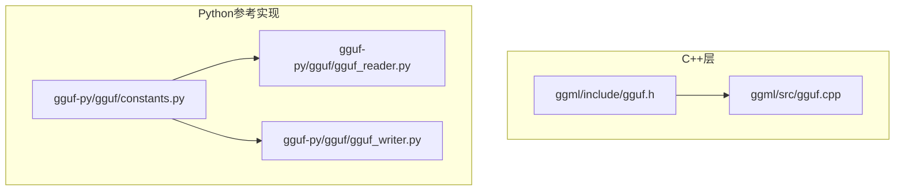
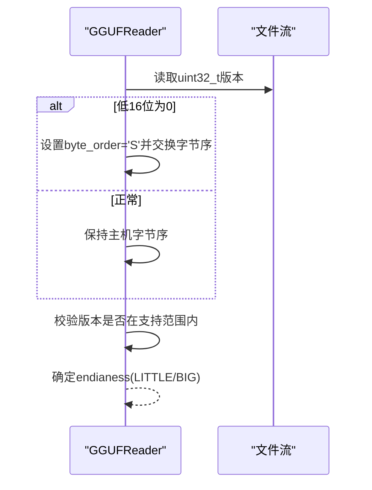
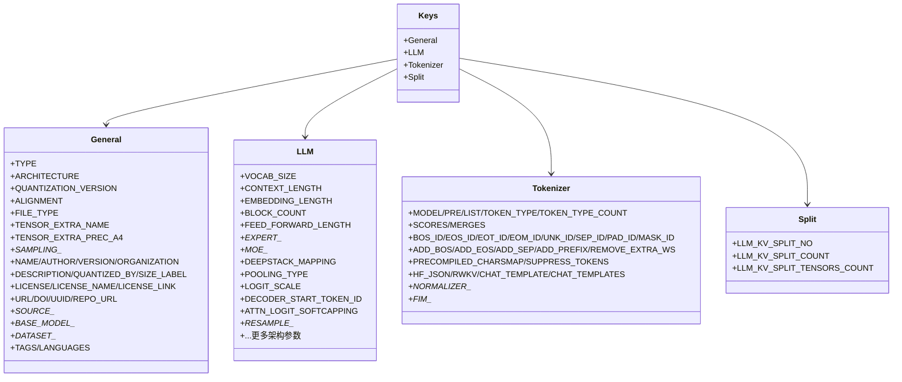
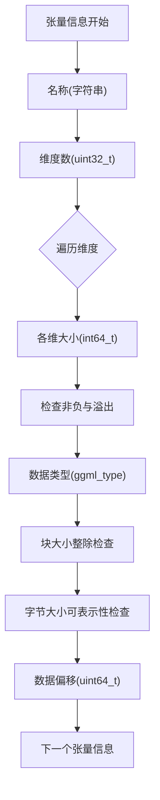
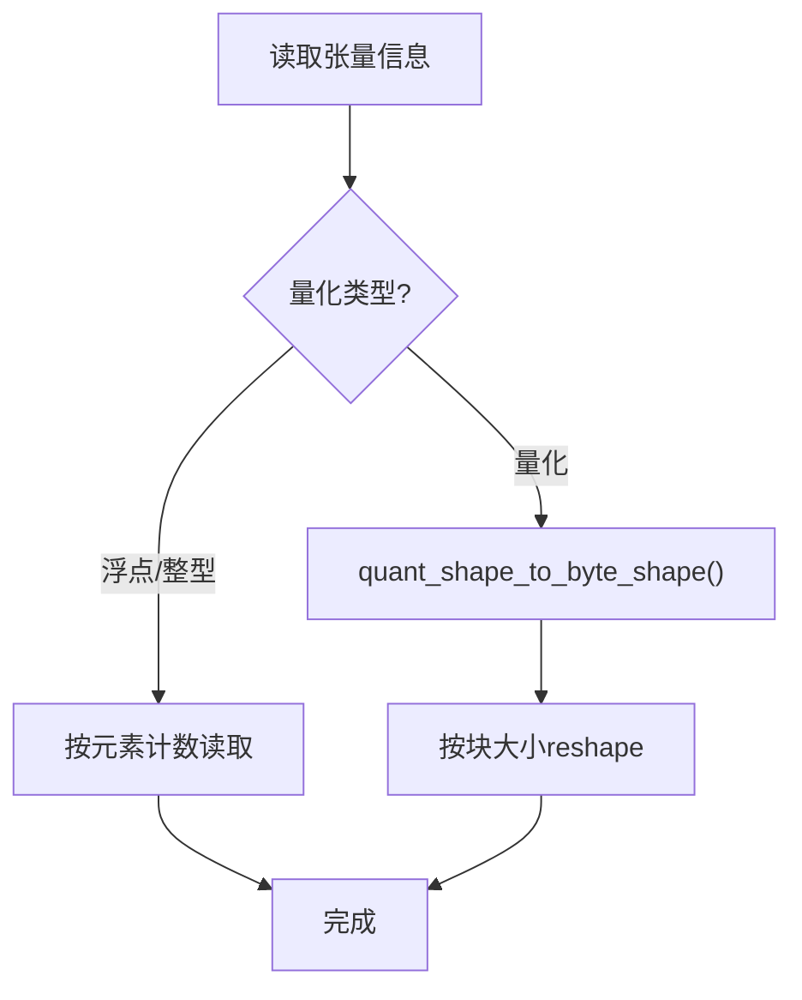
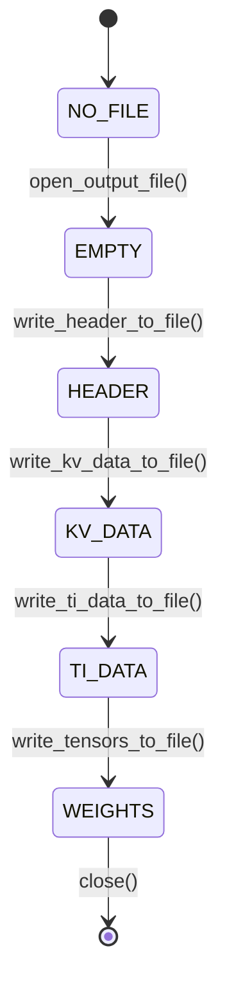
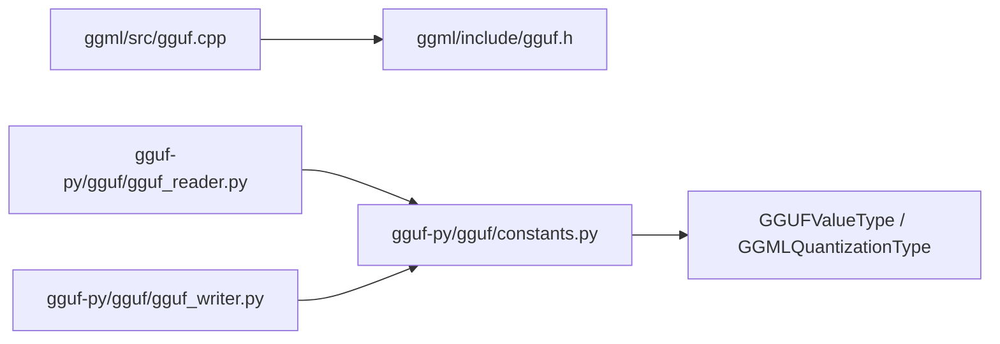
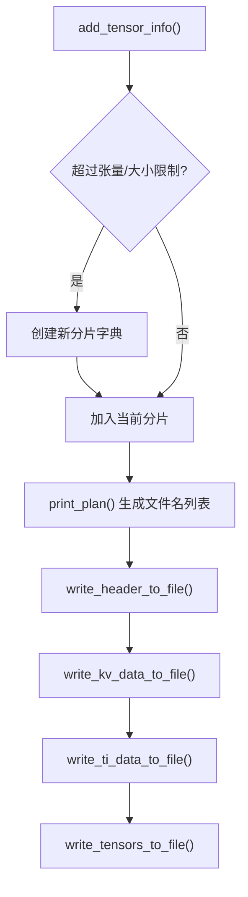
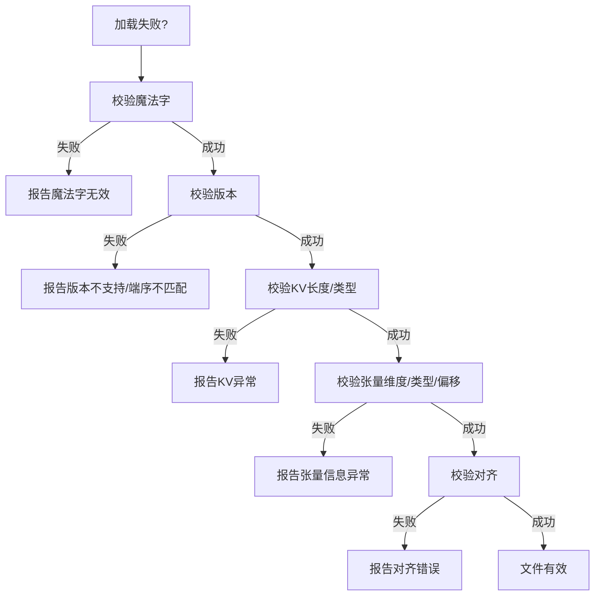
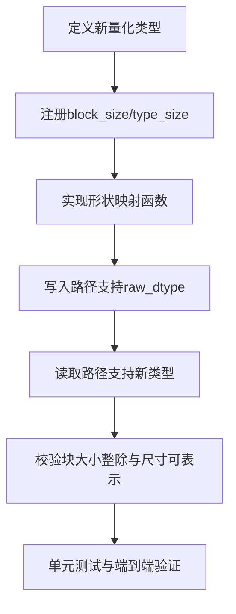

# GGUF格式规范

<cite>
**本文引用的文件**   
- [gguf.h](file://ggml/include/gguf.h)
- [gguf.cpp](file://ggml/src/gguf.cpp)
- [constants.py](file://gguf-py/gguf/constants.py)
- [gguf_reader.py](file://gguf-py/gguf/gguf_reader.py)
- [gguf_writer.py](file://gguf-py/gguf/gguf_writer.py)
</cite>

## 目录
1. [简介](#简介)
2. [项目结构](#项目结构)
3. [核心组件](#核心组件)
4. [架构总览](#架构总览)
5. [详细组件分析](#详细组件分析)
6. [依赖关系分析](#依赖关系分析)
7. [性能与分片策略](#性能与分片策略)
8. [故障诊断与验证工具](#故障诊断与验证工具)
9. [结论](#结论)
10. [附录：自定义量化实现指南](#附录自定义量化实现指南)

## 简介
本文件为GGUF（GPT-Generated Unified Format）文件格式的完整技术文档，基于仓库中的C++实现与Python参考实现进行系统化梳理。内容涵盖：
- 字节序与版本兼容性
- 文件头、元数据（KV）与张量信息结构
- 张量存储格式与量化类型支持
- 模型权重组织方式、分片与大文件处理机制
- 验证工具使用与错误诊断技巧
- 自定义量化格式的扩展方法与最佳实践

## 项目结构
GGUF相关代码主要分布在以下位置：
- C++接口与实现：ggml/include/gguf.h、ggml/src/gguf.cpp
- Python参考实现：gguf-py/gguf/constants.py、gguf-py/gguf/gguf_reader.py、gguf-py/gguf/gguf_writer.py



**图表来源**
- [gguf.h:1-34](file://ggml/include/gguf.h#L1-L34)
- [gguf.cpp:460-522](file://ggml/src/gguf.cpp#L460-L522)
- [constants.py:10-14](file://gguf-py/gguf/constants.py#L10-L14)
- [gguf_reader.py:137-194](file://gguf-py/gguf/gguf_reader.py#L137-L194)
- [gguf_writer.py:87-112](file://gguf-py/gguf/gguf_writer.py#L87-L112)

**章节来源**
- [gguf.h:1-34](file://ggml/include/gguf.h#L1-L34)
- [gguf.cpp:460-522](file://ggml/src/gguf.cpp#L460-L522)
- [constants.py:10-14](file://gguf-py/gguf/constants.py#L10-L14)
- [gguf_reader.py:137-194](file://gguf-py/gguf/gguf_reader.py#L137-L194)
- [gguf_writer.py:87-112](file://gguf-py/gguf/gguf_writer.py#L87-L112)

## 核心组件
- 文件头与常量定义：魔法字、版本号、默认对齐等
- 元数据（KV）系统：键名空间、值类型、数组支持
- 张量信息表：名称、维度、数据类型、偏移
- 张量数据区：按对齐填充的二进制块
- 读写器：C++ gguf_context与Python GGUFReader/GGUFWriter

**章节来源**
- [gguf.h:1-34](file://ggml/include/gguf.h#L1-L34)
- [gguf.cpp:219-230](file://ggml/src/gguf.cpp#L219-L230)
- [constants.py:10-14](file://gguf-py/gguf/constants.py#L10-L14)
- [gguf_reader.py:116-194](file://gguf-py/gguf/gguf_reader.py#L116-L194)
- [gguf_writer.py:66-112](file://gguf-py/gguf/gguf_writer.py#L66-L112)

## 架构总览
GGUF文件的物理布局如下：
1. 文件头：魔法字“GGUF”、版本、张量数量、KV对数量
2. KV元数据段：键（字符串）、值类型、值或数组元素
3. 张量信息段：每个张量的名称、维度数、各维大小、数据类型、数据偏移
4. 张量数据段：按对齐边界排列的二进制数据块

```mermaid
flowchart TD
Start(["文件起始"]) --> Magic["魔法字 'GGUF' (4字节)"]
Magic --> Version["版本 (uint32_t)"]
Version --> Ntensors["张量数量 (int64_t)"]
Ntensors --> Nkv["KV对数量 (int64_t)"]
Nkv --> KVLoop{"遍历KV对"}
KVLoop --> |键(字符串)| KVType["值类型(gguf_type)"]
KVType --> IsArray{"是否数组?"}
IsArray --> |是| ArrMeta["数组元素类型+长度"] --> ArrData["数组元素二进制"]
IsArray --> |否| ScalarData["标量二进制"]
ArrData --> NextKV["下一个KV"]
ScalarData --> NextKV
NextKV --> TISection["张量信息段"]
TISection --> TensorInfo{"遍历张量"}
TensorInfo --> Name["名称(字符串)"] --> NDims["维度数(uint32_t)"] --> Dims["各维大小(int64_t)"] --> Dtype["数据类型(ggml_type)"] --> Offset["数据偏移(uint64_t)"] --> NextTI["下一个张量"]
NextTI --> DataSection["张量数据段(对齐)"]
DataSection --> End(["文件结束"])
```

**图表来源**
- [gguf.h:1-34](file://ggml/include/gguf.h#L1-L34)
- [gguf.cpp:460-522](file://ggml/src/gguf.cpp#L460-L522)
- [gguf.cpp:639-788](file://ggml/src/gguf.cpp#L639-L788)

**章节来源**
- [gguf.h:1-34](file://ggml/include/gguf.h#L1-L34)
- [gguf.cpp:460-522](file://ggml/src/gguf.cpp#L460-L522)
- [gguf.cpp:639-788](file://ggml/src/gguf.cpp#L639-L788)

## 详细组件分析

### 字节序与版本兼容性
- 字节序检测：读取版本字段时若低16位为0，则判定为相反字节序并交换；否则按主机字节序解析
- 版本范围：当前软件仅支持到指定版本，旧版v1不再支持，超出版本会报错
- Python侧同样通过判断低16位是否为0来切换字节序，并记录主机/目标端序



**图表来源**
- [gguf.cpp:499-522](file://ggml/src/gguf.cpp#L499-L522)
- [gguf_reader.py:146-167](file://gguf-py/gguf/gguf_reader.py#L146-L167)

**章节来源**
- [gguf.cpp:499-522](file://ggml/src/gguf.cpp#L499-L522)
- [gguf_reader.py:146-167](file://gguf-py/gguf/gguf_reader.py#L146-L167)

### 文件头结构
- 固定顺序：魔法字、版本、张量数量、KV对数量
- 所有枚举以int32_t存储，布尔以int8_t存储
- 字符串序列化：长度(uint64_t)+无终止符的UTF-8字节序列

**章节来源**
- [gguf.h:1-34](file://ggml/include/gguf.h#L1-L34)
- [gguf.cpp:460-522](file://ggml/src/gguf.cpp#L460-L522)

### 元数据（KV）定义与键名空间
- 值类型：u8/i8/u16/i16/u32/i32/f32/bool/str/arr/u64/i64/f64
- 数组类型：先写元素类型，再写元素数量，再写元素二进制
- 键名空间：包含general.*、{arch}.*、tokenizer.*、split.*等分类
- 特殊键：general.alignment用于覆盖默认对齐



**图表来源**
- [constants.py:21-106](file://gguf-py/gguf/constants.py#L21-L106)
- [constants.py:108-177](file://gguf-py/gguf/constants.py#L108-L177)
- [constants.py:338-381](file://gguf-py/gguf/constants.py#L338-L381)
- [constants.py:285-289](file://gguf-py/gguf/constants.py#L285-L289)

**章节来源**
- [constants.py:21-106](file://gguf-py/gguf/constants.py#L21-L106)
- [constants.py:108-177](file://gguf-py/gguf/constants.py#L108-L177)
- [constants.py:338-381](file://gguf-py/gguf/constants.py#L338-L381)
- [constants.py:285-289](file://gguf-py/gguf/constants.py#L285-L289)

### 张量信息结构与存储格式
- 张量信息项：名称、维度数、各维大小、数据类型、数据偏移
- 数据类型：ggml_type枚举，支持多种量化类型；行元素数必须为块大小的整数倍
- 数据偏移：从数据段起始位置的字节偏移，需满足对齐要求
- 维度限制：最大维度数为GGML_MAX_DIMS



**图表来源**
- [gguf.cpp:639-788](file://ggml/src/gguf.cpp#L639-L788)

**章节来源**
- [gguf.cpp:639-788](file://ggml/src/gguf.cpp#L639-L788)

### 张量数据区与对齐
- 数据段起始位置：在张量信息之后按alignment对齐
- 每个张量数据后追加填充字节以满足对齐
- 默认对齐为32字节，可通过general.alignment覆盖

**章节来源**
- [gguf.h:29-30](file://ggml/include/gguf.h#L29-L30)
- [gguf.cpp:780-788](file://ggml/src/gguf.cpp#L780-L788)
- [gguf_writer.py:331-333](file://gguf-py/gguf/gguf_writer.py#L331-L333)

### 量化类型与形状映射
- Python侧将量化类型映射到字节形状，以便正确reshape张量数据
- 非量化类型（如F16/F32/F64/I8/I16/I32/I64）直接按元素计数读取
- 量化类型按块大小计算字节数，并使用quant_shape_to_byte_shape转换



**图表来源**
- [gguf_reader.py:335-390](file://gguf-py/gguf/gguf_reader.py#L335-L390)

**章节来源**
- [gguf_reader.py:335-390](file://gguf-py/gguf/gguf_reader.py#L335-L390)

### 写入流程与状态机
- 写入状态：NO_FILE -> EMPTY -> HEADER -> KV_DATA -> TI_DATA -> WEIGHTS
- 写入步骤：写头部、写KV、写张量信息、写张量数据（含对齐填充）
- 支持临时文件与进度条输出



**图表来源**
- [gguf_writer.py:57-64](file://gguf-py/gguf/gguf_writer.py#L57-L64)
- [gguf_writer.py:215-276](file://gguf-py/gguf/gguf_writer.py#L215-L276)
- [gguf_writer.py:443-493](file://gguf-py/gguf/gguf_writer.py#L443-L493)

**章节来源**
- [gguf_writer.py:57-64](file://gguf-py/gguf/gguf_writer.py#L57-L64)
- [gguf_writer.py:215-276](file://gguf-py/gguf/gguf_writer.py#L215-L276)
- [gguf_writer.py:443-493](file://gguf-py/gguf/gguf_writer.py#L443-L493)

## 依赖关系分析
- C++实现提供底层IO、类型映射、校验逻辑
- Python实现提供高层API、分片、元数据管理、量化形状映射
- 常量定义在constants.py中集中管理，供读写两端共享



**图表来源**
- [gguf.cpp:1-10](file://ggml/src/gguf.cpp#L1-L10)
- [gguf.h:34-68](file://ggml/include/gguf.h#L34-L68)
- [constants.py:520-525](file://gguf-py/gguf/constants.py#L520-L525)

**章节来源**
- [gguf.cpp:1-10](file://ggml/src/gguf.cpp#L1-L10)
- [gguf.h:34-68](file://ggml/include/gguf.h#L34-L68)
- [constants.py:520-525](file://gguf-py/gguf/constants.py#L520-L525)

## 性能与分片策略
- 分片条件：按张量数量或文件大小阈值触发新分片
- 分片命名：{stem}-{i:05d}-of-{total:05d}.gguf
- 小分片优先：small_first_shard可将较小分片置于前部
- 临时文件：use_temp_file启用内存滚动临时文件以减少峰值内存



**图表来源**
- [gguf_writer.py:335-378](file://gguf-py/gguf/gguf_writer.py#L335-L378)
- [gguf_writer.py:165-200](file://gguf-py/gguf/gguf_writer.py#L165-L200)
- [gguf_writer.py:215-276](file://gguf-py/gguf/gguf_writer.py#L215-L276)
- [gguf_writer.py:443-493](file://gguf-py/gguf/gguf_writer.py#L443-L493)

**章节来源**
- [gguf_writer.py:165-200](file://gguf-py/gguf/gguf_writer.py#L165-L200)
- [gguf_writer.py:335-378](file://gguf-py/gguf/gguf_writer.py#L335-L378)
- [gguf_writer.py:443-493](file://gguf-py/gguf/gguf_writer.py#L443-L493)

## 故障诊断与验证工具
常见错误与定位方法：
- 魔法字无效：检查文件头前4字节是否为“GGUF”
- 版本不兼容：确认版本在支持范围内，避免跨端序误读
- 字符串长度超限：检查KV字符串长度是否超过上限
- 数组元素超限：检查数组长度是否超过上限
- 维度非法或溢出：检查维度数与元素总数是否合理
- 块大小不整除：检查张量第一维是否为块大小的整数倍
- 对齐错误：检查general.alignment是否为2的幂且非零



**图表来源**
- [gguf_reader.py:141-194](file://gguf-py/gguf/gguf_reader.py#L141-L194)
- [gguf.cpp:460-522](file://ggml/src/gguf.cpp#L460-L522)
- [gguf.cpp:639-788](file://ggml/src/gguf.cpp#L639-L788)

**章节来源**
- [gguf_reader.py:141-194](file://gguf-py/gguf/gguf_reader.py#L141-L194)
- [gguf.cpp:460-522](file://ggml/src/gguf.cpp#L460-L522)
- [gguf.cpp:639-788](file://ggml/src/gguf.cpp#L639-L788)

## 结论
GGUF格式通过明确的文件头、可扩展的KV元数据、严格的张量信息与对齐的数据段，提供了高效、可移植的模型权重存储方案。其字节序自动检测、版本兼容性与丰富的量化类型支持，使其在多平台与多后端环境中具备良好适应性。结合Python参考实现的读写API与分片能力，用户可构建高性能的模型加载与转换流水线。

## 附录：自定义量化实现指南
- 新增量化类型需在ggml_type枚举中扩展，并在类型大小与块大小映射中补充
- Python侧需在GGML_QUANT_SIZES中注册新类型的block_size与type_size
- 形状映射：实现quant_shape_from_byte_shape与quant_shape_to_byte_shape以支持双向转换
- 写入路径：在add_tensor_info中允许raw_dtype为新类型，并确保tensor.nbytes与dtype一致
- 读取路径：在_build_tensors中为新类型添加item_count与item_type分支，必要时调用quant_shape_to_byte_shape



**图表来源**
- [gguf_writer.py:335-378](file://gguf-py/gguf/gguf_writer.py#L335-L378)
- [gguf_reader.py:335-390](file://gguf-py/gguf/gguf_reader.py#L335-L390)
- [gguf.cpp:725-754](file://ggml/src/gguf.cpp#L725-L754)

**章节来源**
- [gguf_writer.py:335-378](file://gguf-py/gguf/gguf_writer.py#L335-L378)
- [gguf_reader.py:335-390](file://gguf-py/gguf/gguf_reader.py#L335-L390)
- [gguf.cpp:725-754](file://ggml/src/gguf.cpp#L725-L754)