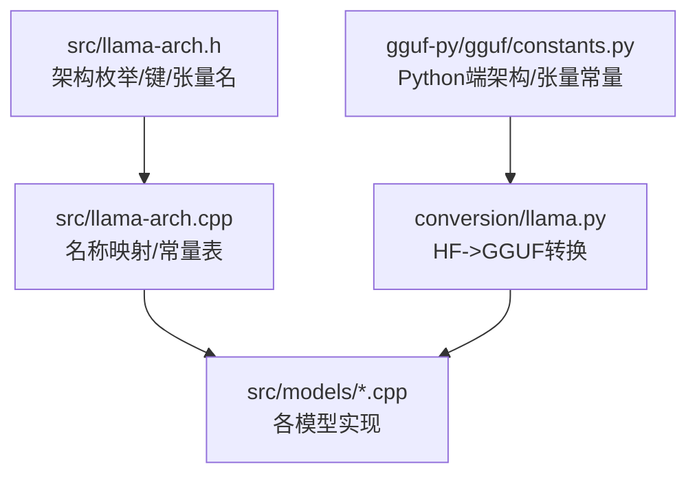
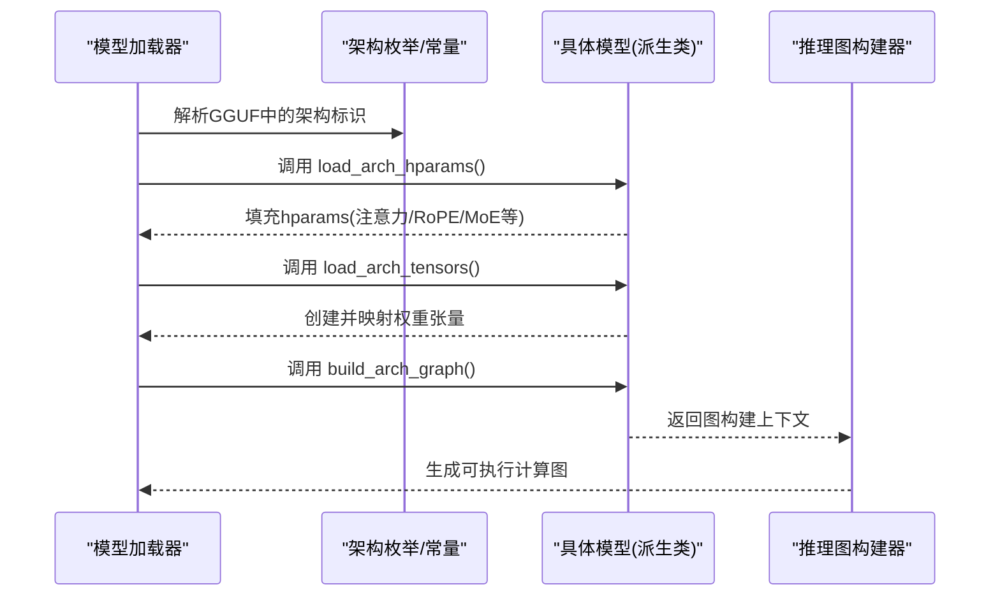
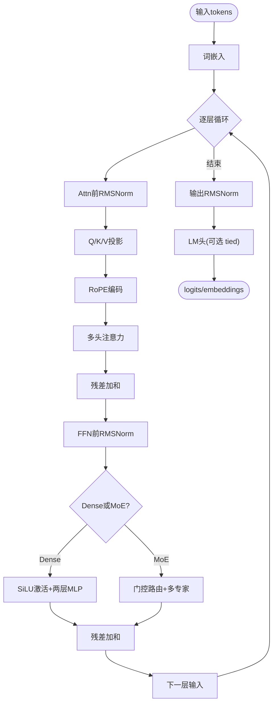
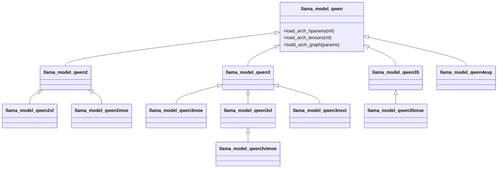
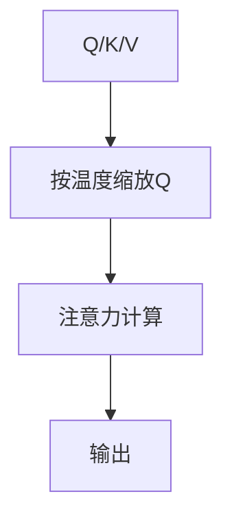
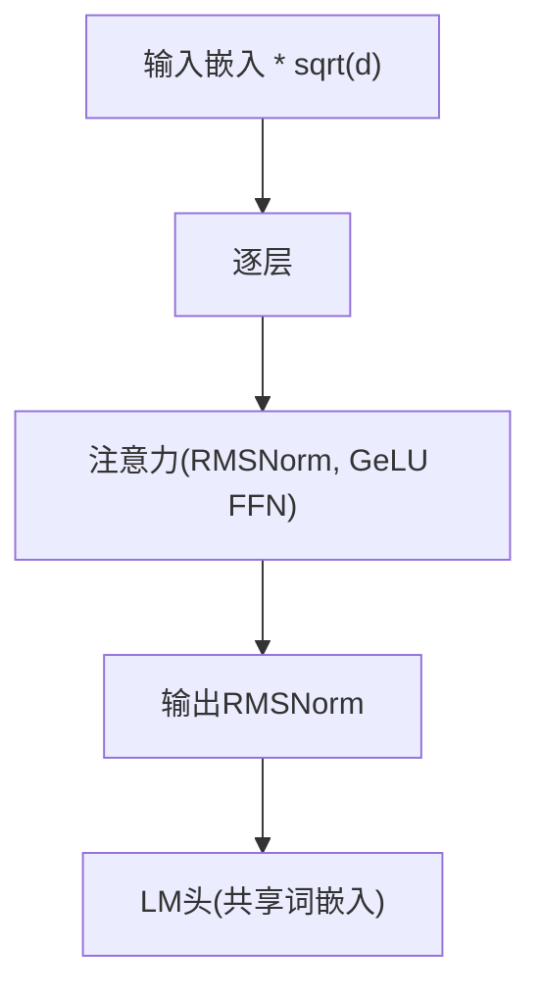
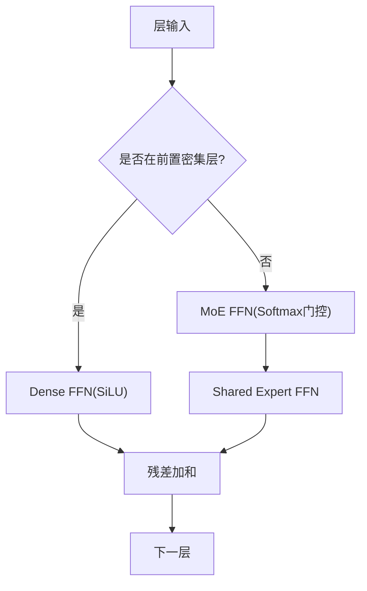
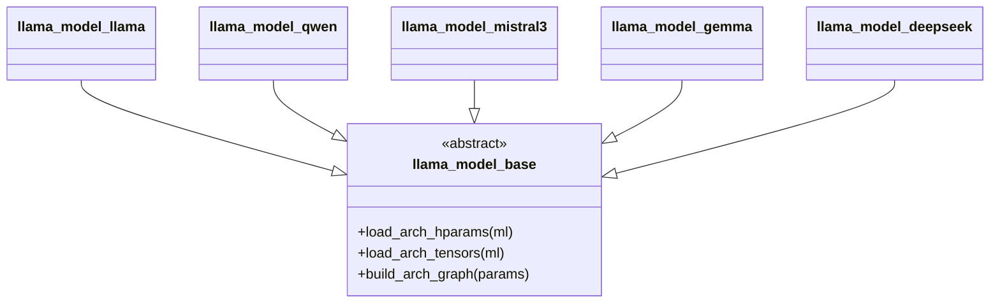
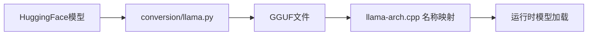

# 支持的模型架构

<cite>
**本文引用的文件**   
- [llama-arch.h](file://src/llama-arch.h)
- [llama-arch.cpp](file://src/llama-arch.cpp)
- [models.h](file://src/models/models.h)
- [llama.cpp](file://src/models/llama.cpp)
- [qwen.cpp](file://src/models/qwen.cpp)
- [mistral3.cpp](file://src/models/mistral3.cpp)
- [gemma.cpp](file://src/models/gemma.cpp)
- [deepseek.cpp](file://src/models/deepseek.cpp)
- [constants.py](file://gguf-py/gguf/constants.py)
- [llama.py](file://conversion/llama.py)
</cite>

## 目录
1. [简介](#简介)
2. [项目结构](#项目结构)
3. [核心组件](#核心组件)
4. [架构总览](#架构总览)
5. [详细组件分析](#详细组件分析)
6. [依赖关系分析](#依赖关系分析)
7. [性能与优化要点](#性能与优化要点)
8. [故障排查指南](#故障排查指南)
9. [结论](#结论)
10. [附录：模型族与特性速查](#附录模型族与特性速查)

## 简介
本文件系统性梳理 llama.cpp 已实现的模型架构，覆盖 LLaMA 系列、Qwen 系列、Mistral 系列、Gemma 系列、DeepSeek 等主流架构。文档从架构枚举、参数键值、张量命名、继承关系、注意力变体与 MoE 分支、以及推理图构建流程等方面展开，帮助读者快速理解各模型的实现差异、支持状态与使用建议，并提供新模型兼容与迁移指南。

## 项目结构
- 架构枚举与常量定义集中在 C++ 头文件与实现文件中，统一维护模型族、KV 键名与张量命名规范。
- 具体模型实现位于 src/models 下，每个模型一个源文件，提供加载超参、加载权重、构建推理图的接口。
- Python 侧的 gguf constants 与 conversion 脚本负责将 HuggingFace/其他格式映射到内部架构标识与张量名。

**图示来源**
- [llama-arch.h:13-172](file://src/llama-arch.h#L13-L172)
- [llama-arch.cpp:8-166](file://src/llama-arch.cpp#L8-L166)
- [constants.py:1346-1406](file://gguf-py/gguf/constants.py#L1346-L1406)
- [llama.py:17-47](file://conversion/llama.py#L17-L47)

**章节来源**
- [llama-arch.h:13-172](file://src/llama-arch.h#L13-L172)
- [llama-arch.cpp:8-166](file://src/llama-arch.cpp#L8-L166)
- [constants.py:1346-1406](file://gguf-py/gguf/constants.py#L1346-L1406)
- [llama.py:17-47](file://conversion/llama.py#L17-L47)

## 核心组件
- 架构枚举 llm_arch：集中声明所有受支持的模型族（LLaMA、Qwen、Mistral、Gemma、DeepSeek 等）。
- KV 键集合 LLM_KV：定义 GGUF 中用于描述模型结构的键名（如注意力头数、RMSNorm eps、RoPE 缩放、MoE 专家数等）。
- 张量命名 LLM_TN/LLM_TENSOR_*：为不同模型族的权重张量提供统一命名规则，便于加载器解析。
- 模型基类与派生类：所有模型继承自统一的基类，提供 load_arch_hparams/load_arch_tensors/build_arch_graph 三件套。

**章节来源**
- [llama-arch.h:13-172](file://src/llama-arch.h#L13-L172)
- [llama-arch.h:174-467](file://src/llama-arch.h#L174-L467)
- [llama-arch.h:469-771](file://src/llama-arch.h#L469-L771)
- [models.h:147-172](file://src/models/models.h#L147-L172)

## 架构总览
下图展示模型加载与推理图构建的统一流程，体现“架构枚举 -> 参数读取 -> 权重张量加载 -> 图构建”的标准路径。

**图示来源**
- [llama-arch.cpp:8-166](file://src/llama-arch.cpp#L8-L166)
- [models.h:147-172](file://src/models/models.h#L147-L172)

## 详细组件分析

### LLaMA 系列（含 LLaMA/LLaMA4/Embed）
- 技术特点
  - 标准 Decoder-only Transformer，支持 RMSNorm、多头注意力、可选 GQA、RoPE 扩展（LongRope/YARN）、可选 K/Q 归一化（LLaMA4）。
  - 支持 Dense FFN 与 MoE FFN 两种分支；输出头可与词嵌入共享（tied embeddings）。
- 关键参数与变体
  - 注意力缩放 f_attention_scale、RMSNorm eps、RoPE 频率/缩放、K/Q 归一化开关 use_kq_norm。
  - MoE 相关：n_expert/n_expert_used/expert_weights_scale、共享专家分支（Granite MoE）。
- 图构建要点
  - 先 norm -> QKV -> RoPE -> Attn -> 残差 -> FFN(MoE或Dense) -> 残差 -> 下一层。
  - 最后一层可选择抽取特定位置向量用于 embedding 任务。

**图示来源**
- [llama.cpp:94-249](file://src/models/llama.cpp#L94-L249)

**章节来源**
- [llama.cpp:3-92](file://src/models/llama.cpp#L3-L92)
- [llama.cpp:94-249](file://src/models/llama.cpp#L94-L249)
- [llama-arch.h:13-172](file://src/llama-arch.h#L13-L172)

### Qwen 系列（Qwen/Qwen2/Qwen2VL/Qwen2MoE/Qwen3/Qwen3MoE/Qwen3VL/Qwen3VLMOE/Qwen3Next/Qwen35/Qwen35MoE/Qwen4Exp）
- 技术特点
  - 基础 Qwen 使用合并的 QKV 权重与 SiLU 激活；Qwen2 引入更通用的配置与优化；Qwen2VL 支持视觉模态；Qwen3 系列进一步扩展能力（含决策头、MoE、VL、TTS 等变体）。
- 关键参数与变体
  - QKV 合并权重 wqkv/wqkv_b；FFN 采用 gate/up/down 三段式；部分变体包含视觉编码器与跨模态对齐模块。
- 图构建要点
  - 与 LLaMA 类似，但注意 RoPE 模式（neox mode）与不同的缩放策略。

**图示来源**
- [models.h:475-671](file://src/models/models.h#L475-L671)

**章节来源**
- [qwen.cpp:1-139](file://src/models/qwen.cpp#L1-L139)
- [models.h:475-671](file://src/models/models.h#L475-L671)

### Mistral 系列（Mistral3/Mistral4）
- 技术特点
  - 在 LLaMA 基础上引入注意力温度缩放（temperature scale/floor），支持 YARN 长上下文扩展。
- 关键参数与变体
  - attention.temperature_scale、rope.scaling.yarn_log_multiplier/yarn_beta_fast/yarn_beta_slow。
- 图构建要点
  - 在 Q 上应用注意力温度缩放后再进行注意力计算。

**图示来源**
- [mistral3.cpp:93-234](file://src/models/mistral3.cpp#L93-L234)

**章节来源**
- [mistral3.cpp:1-234](file://src/models/mistral3.cpp#L1-L234)

### Gemma 系列（Gemma/Gemma2/Gemma3/Gemma3N/Gemma4/Embedding）
- 技术特点
  - 使用 RMSNorm 与 GeLU 激活；对输入嵌入进行缩放；Gemma3 引入滑动窗口注意力（SWA）与最终 logit softcapping。
- 关键参数与变体
  - swa_type、final_logit_softcapping、attention.scale 自适应选择。
- 图构建要点
  - 输入嵌入乘以 sqrt(d)，Q 缩放后进入注意力；输出头与词嵌入共享。

**图示来源**
- [gemma.cpp:1-138](file://src/models/gemma.cpp#L1-L138)
- [gemma3.cpp:1-35](file://src/models/gemma3.cpp#L1-L35)

**章节来源**
- [gemma.cpp:1-138](file://src/models/gemma.cpp#L1-L138)
- [gemma3.cpp:1-35](file://src/models/gemma3.cpp#L1-L35)

### DeepSeek 系列（DeepSeek/DeepSeek2/DeepSeek2OCR/DeepSeek32/DeepSeek4）
- 技术特点
  - 前若干层为 Dense FFN，后续切换至 MoE FFN，并包含共享专家分支（shared expert）。
- 关键参数与变体
  - leading_dense_block_count、expert_shared_count、expert_weights_scale。
- 图构建要点
  - 根据层索引选择 Dense 或 MoE 分支；MoE 输出与 shared expert 输出相加。

**图示来源**
- [deepseek.cpp:1-193](file://src/models/deepseek.cpp#L1-L193)

**章节来源**
- [deepseek.cpp:1-193](file://src/models/deepseek.cpp#L1-L193)

### 架构继承与共同接口
- 所有模型均继承自统一基类，实现三件套方法：
  - load_arch_hparams：从 GGUF 读取模型结构参数。
  - load_arch_tensors：创建并映射权重张量。
  - build_arch_graph：构建推理图上下文，封装逐层计算逻辑。
- 通过统一的 KV 与张量命名体系，保证不同模型族的可插拔性。

**图示来源**
- [models.h:147-172](file://src/models/models.h#L147-L172)

**章节来源**
- [models.h:147-172](file://src/models/models.h#L147-L172)

## 依赖关系分析
- 架构枚举与名称映射：C++ 侧通过 map 将内部枚举映射为字符串名，供日志、调试与外部工具使用。
- GGUF 常量：Python 侧 constants.py 维护与 C++ 一致的架构与张量常量，确保转换链路一致。
- 转换脚本：conversion/llama.py 将 HF 模型类注册到内部架构，并在转换时写入正确的 model_arch 与张量名。

**图示来源**
- [llama.py:17-47](file://conversion/llama.py#L17-L47)
- [llama-arch.cpp:8-166](file://src/llama-arch.cpp#L8-L166)

**章节来源**
- [llama-arch.cpp:8-166](file://src/llama-arch.cpp#L8-L166)
- [constants.py:1346-1406](file://gguf-py/gguf/constants.py#L1346-L1406)
- [llama.py:17-47](file://conversion/llama.py#L17-L47)

## 性能与优化要点
- 注意力优化
  - 支持 GQA（分组查询注意力）以减少 KV 存储与计算开销。
  - RoPE 扩展（LongRope/YARN）提升长上下文能力。
  - 注意力温度缩放（Mistral3）改善长序列稳定性。
- FFN 优化
  - MoE 路由减少每步计算量；共享专家提升吞吐。
  - SwiGLU/SiLU 激活在不同模型族中适配。
- 量化与后端
  - 通过 ggml 后端（CPU/CUDA/Metal 等）与量化类型选择，平衡精度与速度。
- 实践建议
  - 长文本优先启用 YARN/LongRope 与温度缩放。
  - 大模型优先使用 MoE 与 GQA 以降低显存占用。
  - 针对部署平台选择合适的量化类型与后端算子融合。

[本节为通用指导，不直接分析具体文件]

## 故障排查指南
- 架构识别失败
  - 检查 GGUF 中的 general.architecture 字段是否与 C++ 名称映射一致。
  - 确认 Python 侧 constants.py 与 C++ 侧名称映射同步。
- 张量缺失或形状不匹配
  - 核对 LLM_TENSOR_* 命名与模型实现中的 create_tensor 调用是否一致。
  - 对于 tied embeddings，确认 output 未提供时是否回退到 token_embd。
- 长上下文异常
  - 检查 rope.scaling.type 与 yarn 相关参数是否正确设置。
  - 验证注意力温度缩放参数是否有效且非零。
- MoE 路由异常
  - 确认 n_expert 与 n_expert_used 大于 0，且 expert_weights_scale 合理。
  - 检查 shared expert 分支是否存在且形状匹配。

**章节来源**
- [llama-arch.cpp:8-166](file://src/llama-arch.cpp#L8-L166)
- [llama.cpp:34-92](file://src/models/llama.cpp#L34-L92)
- [mistral3.cpp:3-27](file://src/models/mistral3.cpp#L3-L27)
- [deepseek.cpp:17-68](file://src/models/deepseek.cpp#L17-L68)

## 结论
llama.cpp 通过统一的架构枚举、KV 键与张量命名体系，实现了多种主流模型族的稳定支持与灵活扩展。LLaMA、Qwen、Mistral、Gemma、DeepSeek 等模型在注意力机制、RoPE 扩展、MoE 路由与温度缩放等方面各有特色。开发者可基于现有基类与接口快速接入新模型，并通过 GGUF 常量与转换脚本保持端到端一致性。

[本节为总结，不直接分析具体文件]

## 附录：模型族与特性速查
- LLaMA 系列
  - 支持：RMSNorm、GQA、RoPE(LongRope/YARN)、K/Q 归一化(LLaMA4)、MoE FFN、tied embeddings。
- Qwen 系列
  - 支持：QKV 合并、SwiGLU/SiLU、VL 多模态、MoE、决策头、TTS 变体。
- Mistral 系列
  - 支持：注意力温度缩放、YARN 长上下文。
- Gemma 系列
  - 支持：RMSNorm、GeLU、SWA、logit softcapping、tied embeddings。
- DeepSeek 系列
  - 支持：前置 Dense 层 + 后续 MoE、共享专家分支。

[本节为概览，不直接分析具体文件]