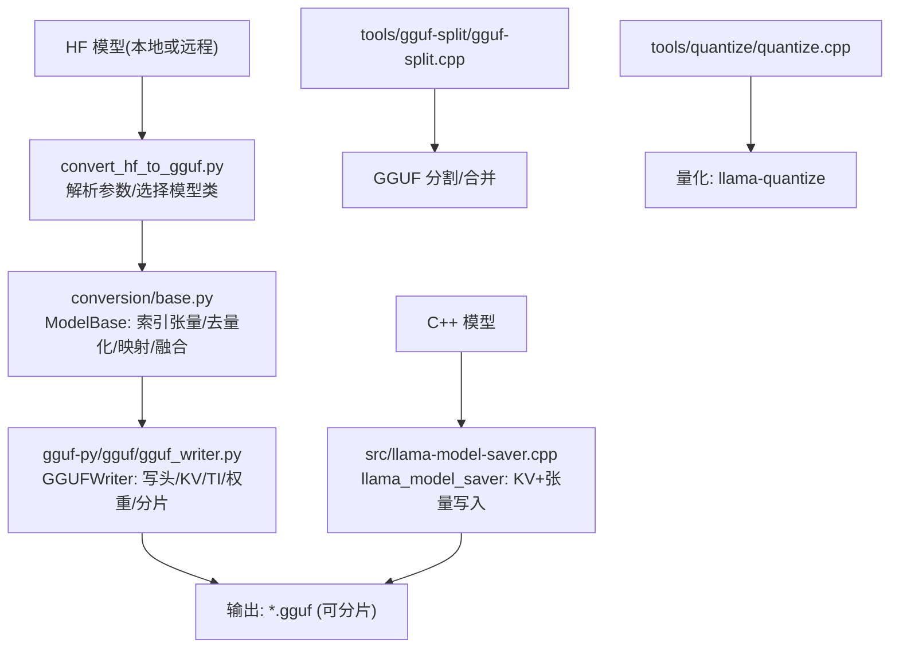
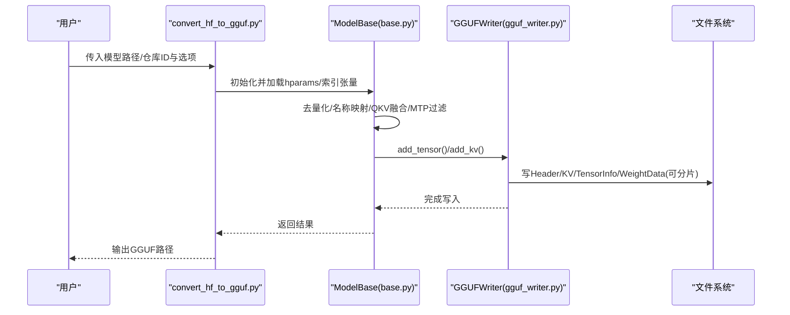
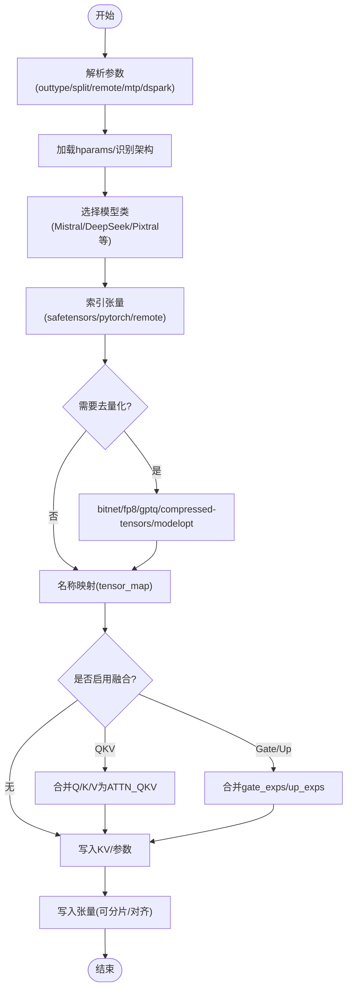
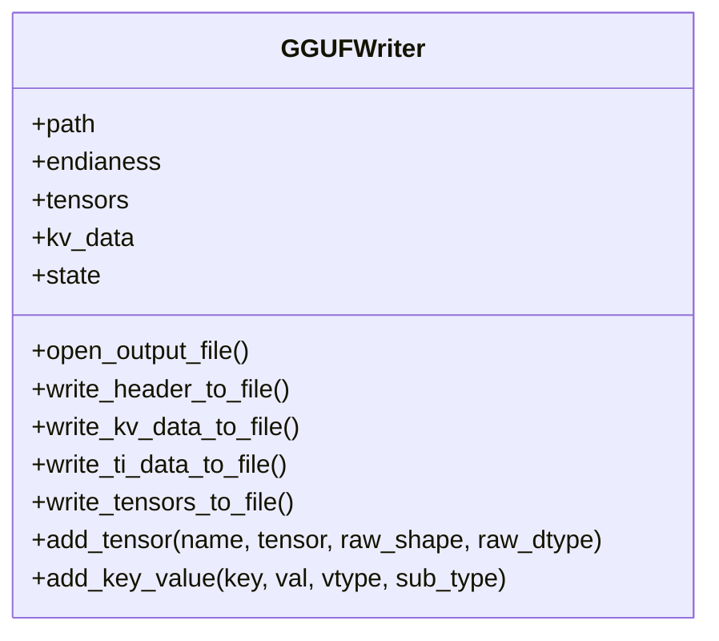
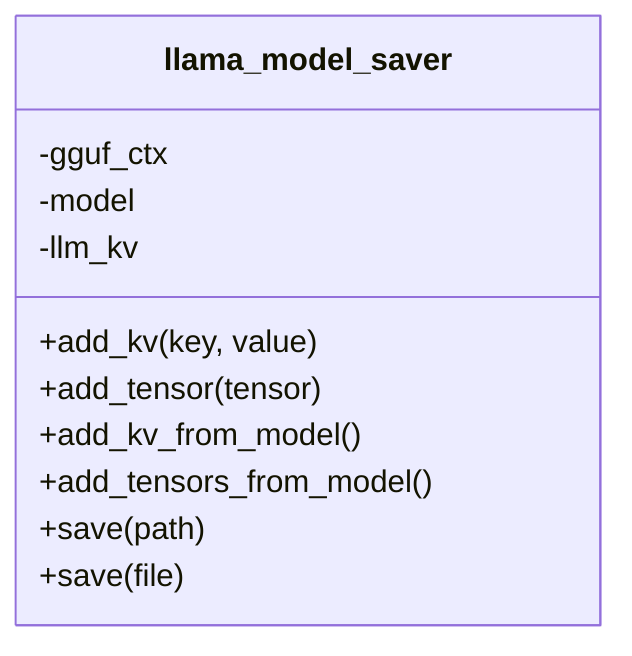
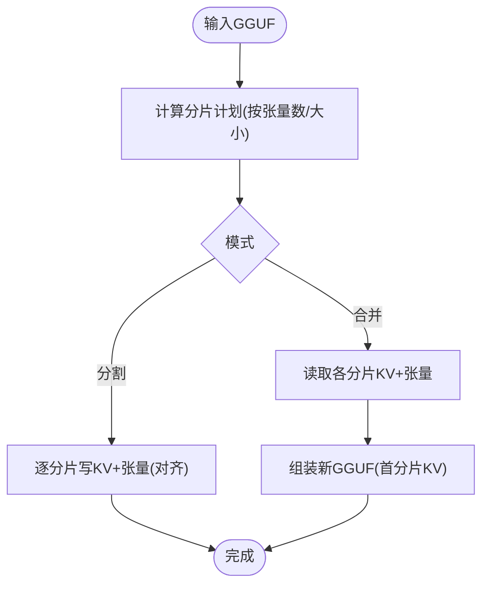
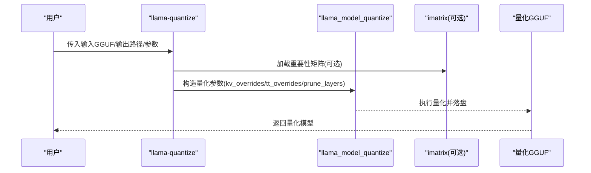
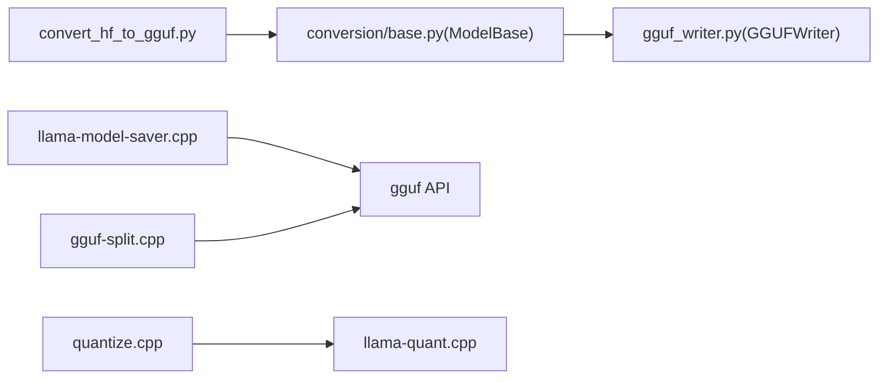

# 模型保存与转换

<cite>
**本文引用的文件**   
- [convert_hf_to_gguf.py](file://convert_hf_to_gguf.py)
- [conversion/base.py](file://conversion/base.py)
- [gguf-py/gguf/gguf_writer.py](file://gguf-py/gguf/gguf_writer.py)
- [src/llama-model-saver.h](file://src/llama-model-saver.h)
- [src/llama-model-saver.cpp](file://src/llama-model-saver.cpp)
- [tools/gguf-split/gguf-split.cpp](file://tools/gguf-split/gguf-split.cpp)
- [include/llama.h](file://include/llama.h)
- [src/llama-quant.cpp](file://src/llama-quant.cpp)
- [tools/quantize/quantize.cpp](file://tools/quantize/quantize.cpp)
</cite>

## 目录
1. [简介](#简介)
2. [项目结构](#项目结构)
3. [核心组件](#核心组件)
4. [架构总览](#架构总览)
5. [详细组件分析](#详细组件分析)
6. [依赖关系分析](#依赖关系分析)
7. [性能考量](#性能考量)
8. [故障排除指南](#故障排除指南)
9. [结论](#结论)

## 简介
本文件系统性梳理 llama.cpp 的模型保存与转换能力，重点覆盖：
- 从 HuggingFace 格式到 GGUF 的完整转换流程（权重映射、参数对齐、精度保持）
- GGUF 写入器与 C++ 保存器的序列化机制（元数据、张量布局、分片策略）
- 量化算法选择、精度损失评估与质量验证路径
- 模型分割、合并与优化（QKV 融合、Gate/Up 融合、MTP/DSpark 导出等）
- 批量转换脚本使用指南与常见问题排查

## 项目结构
围绕“模型保存与转换”的关键代码分布在以下位置：
- Python 侧 HF→GGUF 转换入口与通用基类
- gguf-py 库中的 GGUF 写入器（含分片、对齐、元数据）
- C++ 侧模型保存器（将内存模型持久化为 GGUF）
- 工具链：GGUF 分割/合并、量化命令行工具

图示来源
- [convert_hf_to_gguf.py:48-176](file://convert_hf_to_gguf.py#L48-L176)
- [conversion/base.py:124-200](file://conversion/base.py#L124-L200)
- [gguf-py/gguf/gguf_writer.py:87-112](file://gguf-py/gguf/gguf_writer.py#L87-L112)
- [src/llama-model-saver.cpp:31-43](file://src/llama-model-saver.cpp#L31-L43)
- [tools/gguf-split/gguf-split.cpp:29-51](file://tools/gguf-split/gguf-split.cpp#L29-L51)
- [tools/quantize/quantize.cpp:395-420](file://tools/quantize/quantize.cpp#L395-L420)

章节来源
- [convert_hf_to_gguf.py:48-176](file://convert_hf_to_gguf.py#L48-L176)
- [conversion/base.py:124-200](file://conversion/base.py#L124-L200)
- [gguf-py/gguf/gguf_writer.py:87-112](file://gguf-py/gguf/gguf_writer.py#L87-L112)
- [src/llama-model-saver.cpp:31-43](file://src/llama-model-saver.cpp#L31-L43)
- [tools/gguf-split/gguf-split.cpp:29-51](file://tools/gguf-split/gguf-split.cpp#L29-L51)
- [tools/quantize/quantize.cpp:395-420](file://tools/quantize/quantize.cpp#L395-L420)

## 核心组件
- convert_hf_to_gguf.py：HF→GGUF 转换入口，负责参数解析、模型类选择、调用 ModelBase 进行张量处理与写入。
- conversion/base.py：ModelBase 提供统一的 HF 权重索引、去量化、名称映射、QKV/Gate-Up 融合、MTP/DSpark 导出控制等。
- gguf_writer.py：GGUFWriter 实现 GGUF 文件格式写入，支持多分片、字节序、对齐、元数据与张量信息写入。
- llama-model-saver.*：C++ 侧将运行时模型对象序列化为 GGUF，统一写入 KV 与张量。
- tools/gguf-split/gguf-split.cpp：对已有 GGUF 进行按张量数或大小分割，或将分片合并为单文件。
- tools/quantize/quantize.cpp + include/llama.h：量化 CLI 与量化参数定义，驱动底层量化逻辑。

章节来源
- [convert_hf_to_gguf.py:48-176](file://convert_hf_to_gguf.py#L48-L176)
- [conversion/base.py:124-200](file://conversion/base.py#L124-L200)
- [gguf-py/gguf/gguf_writer.py:87-112](file://gguf-py/gguf/gguf_writer.py#L87-L112)
- [src/llama-model-saver.h:12-45](file://src/llama-model-saver.h#L12-L45)
- [src/llama-model-saver.cpp:147-469](file://src/llama-model-saver.cpp#L147-L469)
- [tools/gguf-split/gguf-split.cpp:29-51](file://tools/gguf-split/gguf-split.cpp#L29-L51)
- [tools/quantize/quantize.cpp:395-420](file://tools/quantize/quantize.cpp#L395-L420)
- [include/llama.h:453-458](file://include/llama.h#L453-L458)

## 架构总览
下图展示从 HF 到 GGUF 的主要数据流与关键模块交互。

图示来源
- [convert_hf_to_gguf.py:179-308](file://convert_hf_to_gguf.py#L179-L308)
- [conversion/base.py:219-308](file://conversion/base.py#L219-L308)
- [gguf-py/gguf/gguf_writer.py:215-276](file://gguf-py/gguf/gguf_writer.py#L215-L276)

## 详细组件分析

### HF→GGUF 转换流程（权重映射、参数对齐、精度保持）
- 入口与参数
  - 支持 --outtype 指定输出精度（f32/f16/bf16/q8_0/tq1_0/tq2_0/auto），自动推断优先保留更高保真度。
  - 支持 --split-max-tensors/--split-max-size 控制分片；--no-lazy 关闭惰性读取；--remote 直接读取 safetensors 远程权重。
- 模型类选择与配置
  - 根据 hparams 与架构识别选择具体模型类（如 Mistral、DeepSeek-V4 DSpark、Pixtral mmproj 等）。
  - 支持 MTP/DSpark 独立导出与 NextN 张量剔除。
- 权重索引与去量化
  - ModelBase.index_tensors 支持 safetensors/pytorch 两种后端，支持远程 lazy 加载。
  - dequant_model 支持 bitnet/fp8/gptq/compressed-tensors/modelopt 等多种量化格式的在线反量化，必要时标记 FP8 已反量化集合。
- 名称映射与参数对齐
  - 通过 tensor_map.get_name 将 HF 权重名映射到 GGUF 标准命名；支持 .weight/.bias 后缀尝试。
  - set_gguf_parameters 系列方法写入注意力头数、RoPE、MoE 专家维度等关键 KV。
- 精度保持与融合
  - 可选 fuse_qkv 将 Q/K/V 合并为 ATTN_QKV；fuse_gate_up_exps 将 MoE gate_exps/up_exps 合并。
  - 对 FP8 权重可选择以 Q8_0 存储而非 BF16/F16（--fp8-as-q8）。

图示来源
- [convert_hf_to_gguf.py:48-176](file://convert_hf_to_gguf.py#L48-L176)
- [convert_hf_to_gguf.py:179-308](file://convert_hf_to_gguf.py#L179-L308)
- [conversion/base.py:219-308](file://conversion/base.py#L219-L308)
- [conversion/base.py:326-581](file://conversion/base.py#L326-L581)
- [conversion/base.py:599-625](file://conversion/base.py#L599-L625)
- [conversion/base.py:627-663](file://conversion/base.py#L627-L663)

章节来源
- [convert_hf_to_gguf.py:48-176](file://convert_hf_to_gguf.py#L48-L176)
- [convert_hf_to_gguf.py:179-308](file://convert_hf_to_gguf.py#L179-L308)
- [conversion/base.py:219-308](file://conversion/base.py#L219-L308)
- [conversion/base.py:326-581](file://conversion/base.py#L326-L581)
- [conversion/base.py:599-625](file://conversion/base.py#L599-L625)
- [conversion/base.py:627-663](file://conversion/base.py#L627-L663)

### GGUF 写入器与分片策略（gguf_writer.py）
- 状态机与写入阶段
  - WriterState: NO_FILE → EMPTY → HEADER → KV_DATA → TI_DATA → WEIGHTS
  - write_header_to_file/write_kv_data_to_file/write_ti_data_to_file/write_tensors_to_file 严格顺序推进。
- 分片与对齐
  - split_max_tensors/split_max_size 触发切分；small_first_shard 可将小分片置前。
  - data_alignment=GGUF_DEFAULT_ALIGNMENT，所有张量尾部按对齐填充零。
- 字节序与类型
  - endianess 支持 BIG/LITTLE；tensor_endianess 与 writer 不一致时进行 byteswap。
- 元数据与张量信息
  - add_key_value/add_* 系列写入 KV；add_tensor_info 记录形状/类型/偏移；write_tensor_data 写出权重数据。

图示来源
- [gguf-py/gguf/gguf_writer.py:57-112](file://gguf-py/gguf/gguf_writer.py#L57-L112)
- [gguf-py/gguf/gguf_writer.py:215-276](file://gguf-py/gguf/gguf_writer.py#L215-L276)
- [gguf-py/gguf/gguf_writer.py:335-440](file://gguf-py/gguf/gguf_writer.py#L335-L440)

章节来源
- [gguf-py/gguf/gguf_writer.py:57-112](file://gguf-py/gguf/gguf_writer.py#L57-L112)
- [gguf-py/gguf/gguf_writer.py:215-276](file://gguf-py/gguf/gguf_writer.py#L215-L276)
- [gguf-py/gguf/gguf_writer.py:335-440](file://gguf-py/gguf/gguf_writer.py#L335-L440)

### C++ 模型保存器（llama-model-saver）
- 职责
  - 将运行时的 llama_model 对象（含 hparams/vocab/layers）序列化为 GGUF。
  - 统一写入 KV（架构、上下文长度、注意力参数、RoPE、MoE、SSM、Tokenizer 等）与张量。
- 设计要点
  - 支持 per-layer 数组 KV（如 head_count_arr），若全层相同则折叠为标量。
  - add_tensors_from_model 遍历层结构，避免重复保存别名张量。
  - save/save(FILE*) 最终调用 gguf_write_to_file* 落盘。

图示来源
- [src/llama-model-saver.h:12-45](file://src/llama-model-saver.h#L12-L45)
- [src/llama-model-saver.cpp:147-469](file://src/llama-model-saver.cpp#L147-L469)
- [src/llama-model-saver.cpp:471-525](file://src/llama-model-saver.cpp#L471-L525)

章节来源
- [src/llama-model-saver.h:12-45](file://src/llama-model-saver.h#L12-L45)
- [src/llama-model-saver.cpp:147-469](file://src/llama-model-saver.cpp#L147-L469)
- [src/llama-model-saver.cpp:471-525](file://src/llama-model-saver.cpp#L471-L525)

### GGUF 分割与合并（tools/gguf-split）
- 功能
  - 按张量数量(--split-max-tensors)或文件大小(--split-max-size N(M|G))分割 GGUF。
  - 合并多个分片为一个 GGUF，支持 --delete-splits 在合并后删除分片。
- 行为
  - 仅首分片包含 KV 元数据；每个分片设置 LLM_KV_SPLIT_NO/COUNT/TENSORS_COUNT。
  - 写入时对张量数据按 GGUF_DEFAULT_ALIGNMENT 对齐填充。

图示来源
- [tools/gguf-split/gguf-split.cpp:29-51](file://tools/gguf-split/gguf-split.cpp#L29-L51)
- [tools/gguf-split/gguf-split.cpp:216-279](file://tools/gguf-split/gguf-split.cpp#L216-L279)
- [tools/gguf-split/gguf-split.cpp:369-405](file://tools/gguf-split/gguf-split.cpp#L369-L405)
- [tools/gguf-split/gguf-split.cpp:407-591](file://tools/gguf-split/gguf-split.cpp#L407-L591)

章节来源
- [tools/gguf-split/gguf-split.cpp:29-51](file://tools/gguf-split/gguf-split.cpp#L29-L51)
- [tools/gguf-split/gguf-split.cpp:216-279](file://tools/gguf-split/gguf-split.cpp#L216-L279)
- [tools/gguf-split/gguf-split.cpp:369-405](file://tools/gguf-split/gguf-split.cpp#L369-L405)
- [tools/gguf-split/gguf-split.cpp:407-591](file://tools/gguf-split/gguf-split.cpp#L407-L591)

### 量化：算法选择、精度损失评估与质量验证
- 量化入口
  - tools/quantize/quantize.cpp 提供命令行接口，构建 llama_model_quantize_params，支持 imatrix、KV 覆盖、张量类型覆盖、剪枝层等。
  - src/llama-quant.cpp 暴露 llama_model_quantize 与相关辅助函数。
- 算法与策略
  - 支持多种量化类型（由上层配置决定），结合重要性矩阵(imatrix)提升低比特精度。
  - 可通过 kv_overrides 注入额外元数据（如 imatrix chunk 计数）。
- 精度评估与验证
  - tests/test-quantize-stats.cpp 用于统计量化前后层张量类型与规模，确保源模型为浮点型且层包含正确。
  - 建议配合 perplexity/eval 工具对比量化前后生成质量。

图示来源
- [tools/quantize/quantize.cpp:395-557](file://tools/quantize/quantize.cpp#L395-L557)
- [src/llama-quant.cpp:1426-1463](file://src/llama-quant.cpp#L1426-L1463)
- [include/llama.h:453-458](file://include/llama.h#L453-L458)

章节来源
- [tools/quantize/quantize.cpp:395-557](file://tools/quantize/quantize.cpp#L395-L557)
- [src/llama-quant.cpp:1426-1463](file://src/llama-quant.cpp#L1426-L1463)
- [include/llama.h:453-458](file://include/llama.h#L453-L458)

## 依赖关系分析
- Python 转换链路
  - convert_hf_to_gguf.py 依赖 conversion.base.ModelBase 与 gguf.GGUFWriter。
  - ModelBase 依赖 transformers.AutoConfig、safetensors 与 torch；gguf_writer 依赖 numpy 与 gguf constants。
- C++ 保存链路
  - llama_model_saver 依赖 gguf API 与 llama 内部结构（hparams/vocab/layers）。
- 工具链
  - gguf-split 依赖 gguf 读写 API；quantize 依赖 llama quantization API。

图示来源
- [convert_hf_to_gguf.py:18-27](file://convert_hf_to_gguf.py#L18-L27)
- [conversion/base.py:18-29](file://conversion/base.py#L18-L29)
- [gguf-py/gguf/gguf_writer.py:19-34](file://gguf-py/gguf/gguf_writer.py#L19-L34)
- [src/llama-model-saver.cpp:1-10](file://src/llama-model-saver.cpp#L1-L10)
- [tools/gguf-split/gguf-split.cpp:1-8](file://tools/gguf-split/gguf-split.cpp#L1-L8)
- [tools/quantize/quantize.cpp:395-420](file://tools/quantize/quantize.cpp#L395-L420)
- [src/llama-quant.cpp:1426-1463](file://src/llama-quant.cpp#L1426-L1463)

## 性能考量
- 惰性读取与临时文件
  - ModelBase.lazy 与 use_temp_file 降低大模型转换时的峰值内存占用；GGUFWriter.use_temp_file 将张量数据先写入临时文件再拷贝。
- 分片策略
  - 合理设置 split_max_tensors/split_max_size，避免单文件过大导致 IO 瓶颈；small_first_shard 有利于快速校验头部。
- 对齐与字节序
  - 统一 GGUF_DEFAULT_ALIGNMENT 保证跨平台加载效率；端序不匹配时进行 byteswap。
- 融合与压缩
  - QKV 融合减少算子数量；Gate/Up 融合降低 MoE 权重碎片；FP8 转 Q8_0 可减少体积。

[本节为通用指导，无需特定文件引用]

## 故障排除指南
- 无法识别模型架构
  - 现象：打印“模型架构不支持”。
  - 排查：确认 hparams 与 config.json 一致；必要时更新 convert_hf_to_gguf_update.py 或拉取最新 HF 权重。
- 权重缺失或不完整
  - 现象：报错“Missing or incomplete model files”。
  - 排查：检查 safetensors 索引与实际文件一致性；远程模式需设置 HF_TOKEN。
- 分片失败或空分片
  - 现象：某个分片张量为 0。
  - 排查：调整 split_max_tensors/split_max_size，确保每分片至少一个张量。
- 量化后质量下降明显
  - 排查：使用 imatrix 重新训练重要性矩阵；检查源模型是否为纯浮点；对比 perplexity/eval 指标。
- GGUF 读取异常
  - 排查：确认 endianness 与对齐；检查 KV 元数据完整性（LLM_KV_SPLIT_COUNT/TENSORS_COUNT）。

章节来源
- [convert_hf_to_gguf.py:245-263](file://convert_hf_to_gguf.py#L245-L263)
- [conversion/base.py:294-308](file://conversion/base.py#L294-L308)
- [tools/gguf-split/gguf-split.cpp:226-246](file://tools/gguf-split/gguf-split.cpp#L226-L246)
- [tools/quantize/quantize.cpp:529-557](file://tools/quantize/quantize.cpp#L529-L557)

## 结论
- HF→GGUF 转换通过 ModelBase 统一抽象，支持多后端、多量化格式在线反量化与多种融合优化，配合 GGUFWriter 的分片与对齐机制，形成稳定高效的序列化管线。
- C++ 侧 llama_model_saver 提供从运行时模型到 GGUF 的直接保存能力，便于工具链复用。
- 量化流程结合 imatrix 与灵活的 KV/张量覆盖，可在体积与精度之间取得平衡；建议配合评测工具进行质量验证。
- 对于大规模模型，推荐结合分片与融合策略，并在批处理中采用 dry-run 预检与日志分级，提升稳定性与可观测性。