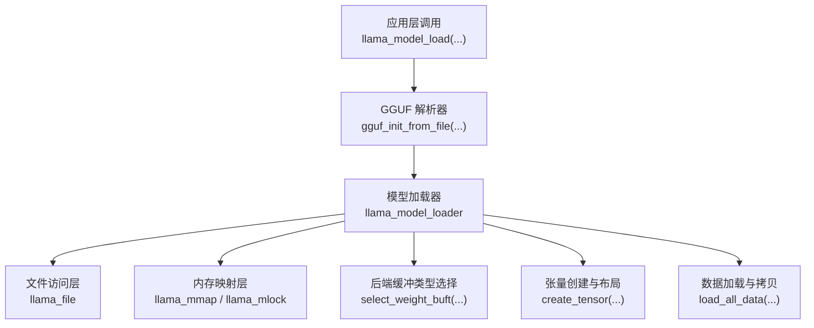
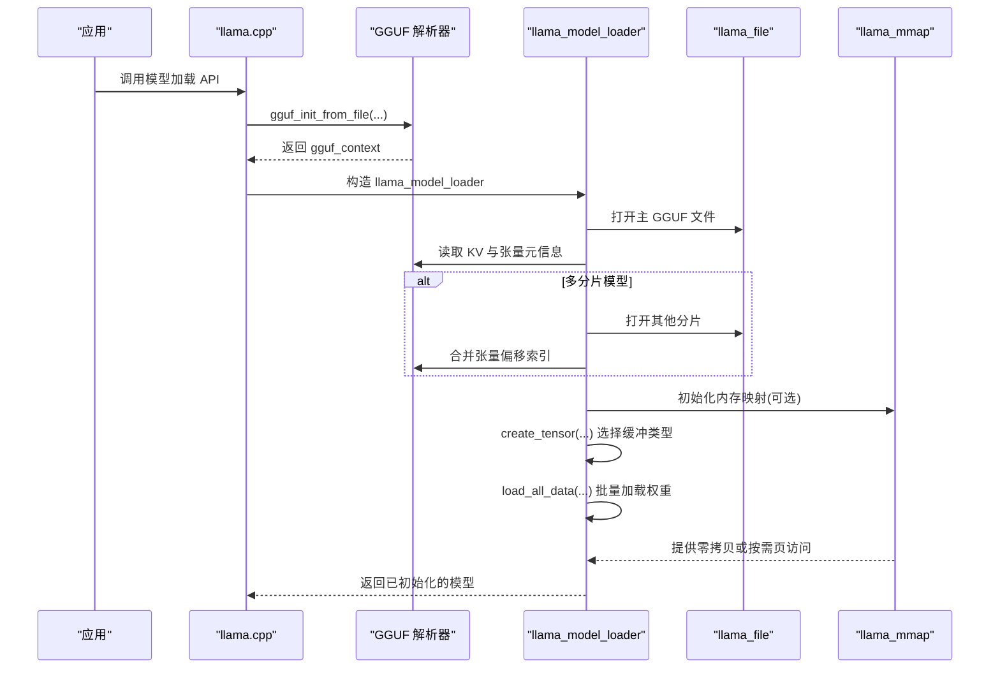
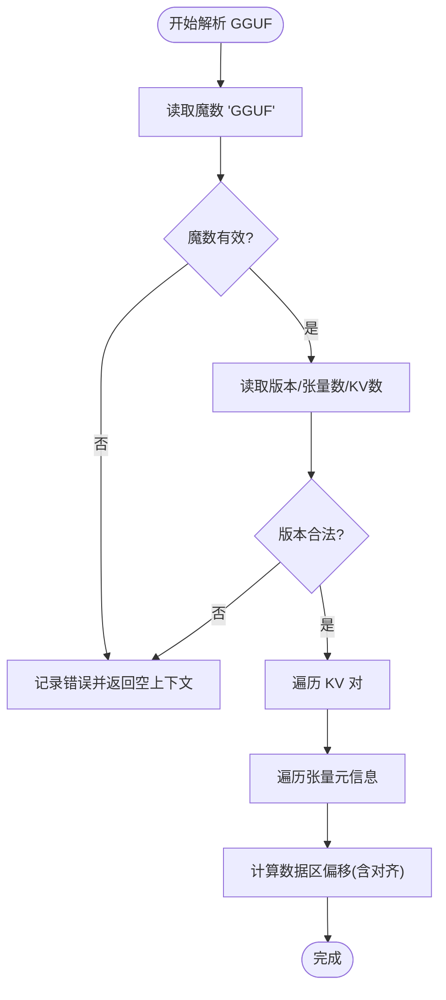
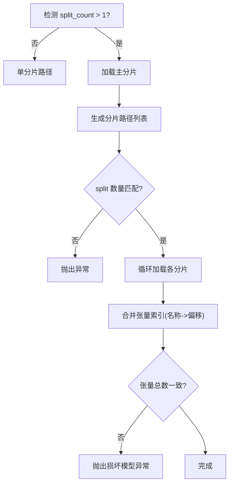
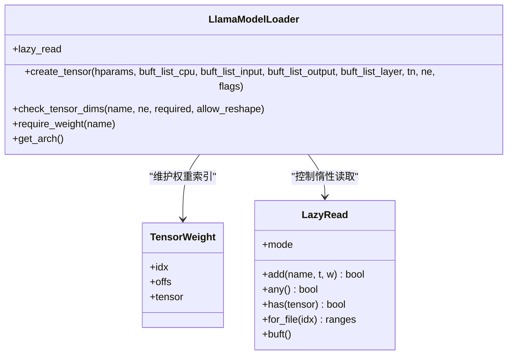
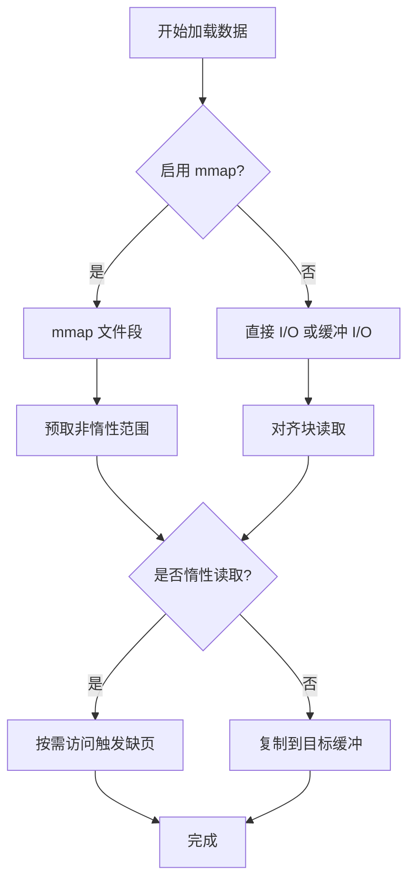
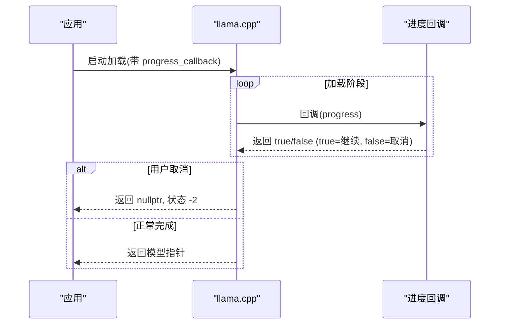
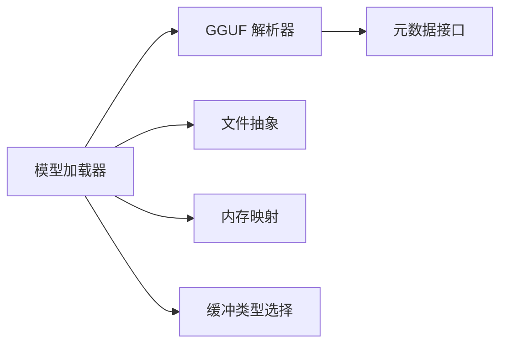

# 模型加载机制

<cite>
**本文引用的文件**   
- [llama-model-loader.h](file://src/llama-model-loader.h)
- [llama-model-loader.cpp](file://src/llama-model-loader.cpp)
- [llama-mmap.h](file://src/llama-mmap.h)
- [llama-mmap.cpp](file://src/llama-mmap.cpp)
- [gguf.h](file://ggml/include/gguf.h)
- [gguf.cpp](file://ggml/src/gguf.cpp)
- [llama.cpp](file://src/llama.cpp)
</cite>

## 目录
1. [引言](#引言)
2. [项目结构](#项目结构)
3. [核心组件](#核心组件)
4. [架构总览](#架构总览)
5. [详细组件分析](#详细组件分析)
6. [依赖关系分析](#依赖关系分析)
7. [性能考量](#性能考量)
8. [故障排查指南](#故障排查指南)
9. [结论](#结论)
10. [附录：自定义加载器与调优建议](#附录自定义加载器与调优建议)

## 引言
本技术文档聚焦于 llama.cpp 的模型加载子系统，系统性解释 GGUF 模型文件的解析流程、元数据提取、张量权重加载、内存映射（mmap）机制、参数初始化与类型校验、大模型分片加载策略、错误处理与进度监控、以及取消机制。目标是帮助开发者深入理解加载链路并据此进行扩展与优化。

## 项目结构
模型加载相关代码主要分布在以下模块：
- GGUF 格式定义与解析接口：ggml/include/gguf.h、ggml/src/gguf.cpp
- 模型加载器：src/llama-model-loader.h、src/llama-model-loader.cpp
- 文件与内存映射抽象：src/llama-mmap.h、src/llama-mmap.cpp
- 高层入口与进度回调：src/llama.cpp

图表来源
- [llama.cpp:412-445](file://src/llama.cpp#L412-L445)
- [gguf.h:1-212](file://ggml/include/gguf.h#L1-L212)
- [llama-model-loader.h:30-273](file://src/llama-model-loader.h#L30-L273)
- [llama-mmap.h:20-93](file://src/llama-mmap.h#L20-L93)

章节来源
- [llama.cpp:412-445](file://src/llama.cpp#L412-L445)
- [gguf.h:1-212](file://ggml/include/gguf.h#L1-L212)
- [llama-model-loader.h:30-273](file://src/llama-model-loader.h#L30-L273)
- [llama-mmap.h:20-93](file://src/llama-mmap.h#L20-L93)

## 核心组件
- GGUF 上下文与元数据接口：提供版本、对齐、KV 对、张量信息等读取能力。
- 模型加载器：负责从 GGUF 构建权重索引、推断量化类型、管理分片、创建张量、选择后端缓冲类型、执行数据加载。
- 文件与 I/O 抽象：统一跨平台文件读写，支持直接 I/O（O_DIRECT）与对齐块读取。
- 内存映射与预取：在 POSIX/Windows 上实现 mmap/madvise/PrefetchVirtualMemory，支持按需解映射与页面预取。
- 进度与取消：通过回调函数上报进度，并在需要时中断加载。

章节来源
- [gguf.h:1-212](file://ggml/include/gguf.h#L1-L212)
- [llama-model-loader.h:30-273](file://src/llama-model-loader.h#L30-L273)
- [llama-mmap.h:20-93](file://src/llama-mmap.h#L20-L93)

## 架构总览
下图展示从高层 API 到 GGUF 解析、再到模型加载器的完整调用链，以及 I/O 与内存映射的协作方式。

图表来源
- [llama.cpp:412-445](file://src/llama.cpp#L412-L445)
- [llama-model-loader.cpp:533-838](file://src/llama-model-loader.cpp#L533-L838)
- [gguf.cpp:463-497](file://ggml/src/gguf.cpp#L463-L497)
- [llama-mmap.cpp:478-686](file://src/llama-mmap.cpp#L478-L686)

## 详细组件分析

### GGUF 文件格式与解析
- 文件头包含魔数“GGUF”、版本号、张量数量、KV 对数量等。
- KV 对支持多种基础类型与数组类型；字符串以长度+字节序列序列化。
- 张量元信息包括名称、维度、数据类型、数据偏移；数据区按对齐要求排列。
- 解析器会验证魔数与版本，失败则返回空上下文并记录错误日志。

图表来源
- [gguf.h:1-212](file://ggml/include/gguf.h#L1-L212)
- [gguf.cpp:463-497](file://ggml/src/gguf.cpp#L463-L497)

章节来源
- [gguf.h:1-212](file://ggml/include/gguf.h#L1-L212)
- [gguf.cpp:463-497](file://ggml/src/gguf.cpp#L463-L497)

### 模型加载器：元数据提取与类型推断
- 加载器从 GGUF 上下文读取架构名、KV 配置，构建统一的权重索引表。
- 根据张量类型分布推断量化类型（ftype），并可被显式覆盖。
- 支持 KV 覆盖（kv_overrides），允许运行时替换部分元数据。
- 打印元数据摘要与类型统计，便于调试。

关键点
- 使用模板化 KV 读取工具类，保证类型安全与一致性。
- 支持标量与数组两种形式读取，并提供边界检查与类型校验。

章节来源
- [llama-model-loader.cpp:108-273](file://src/llama-model-loader.cpp#L108-L273)
- [llama-model-loader.cpp:275-531](file://src/llama-model-loader.cpp#L275-L531)
- [llama-model-loader.cpp:721-828](file://src/llama-model-loader.cpp#L721-L828)

### 分片加载与张量索引
- 当模型为多分片 GGUF 时，加载器首先加载主分片，再按 split_no 顺序加载其余分片。
- 每个分片维护独立的 ggml_context，但加载器统一聚合所有张量的名称与偏移，形成全局权重索引。
- 校验 split count 与 idx 一致性，防止损坏或不完整的模型。

图表来源
- [llama-model-loader.cpp:596-675](file://src/llama-model-loader.cpp#L596-L675)

章节来源
- [llama-model-loader.cpp:533-675](file://src/llama-model-loader.cpp#L533-L675)

### 张量创建、类型转换与形状校验
- create_tensor 根据模型拓扑与操作语义选择合适的后端缓冲类型（CPU/GPU）。
- 针对 bias 后缀与 LoRA 路由张量，自动推导其参与的操作（ADD/ADD_ID/MUL_MAT_ID）。
- check_tensor_dims 支持严格形状匹配或仅元素总数匹配（allow_reshape）。
- 若张量标记为 TENSOR_SKIP 或 TENSOR_NOT_REQUIRED，将跳过分配与加载。

图表来源
- [llama-model-loader.h:30-116](file://src/llama-model-loader.h#L30-L116)
- [llama-model-loader.cpp:881-925](file://src/llama-model-loader.cpp#L881-L925)
- [llama-model-loader.cpp:1081-1115](file://src/llama-model-loader.cpp#L1081-L1115)
- [llama-model-loader.cpp:1117-1200](file://src/llama-model-loader.cpp#L1117-L1200)

章节来源
- [llama-model-loader.h:30-116](file://src/llama-model-loader.h#L30-L116)
- [llama-model-loader.cpp:881-925](file://src/llama-model-loader.cpp#L881-L925)
- [llama-model-loader.cpp:1081-1115](file://src/llama-model-loader.cpp#L1081-L1115)
- [llama-model-loader.cpp:1117-1200](file://src/llama-model-loader.cpp#L1117-L1200)

### 后端缓冲类型选择与设备适配
- select_weight_buft 遍历候选缓冲类型，通过构造最小算子图测试设备是否支持该张量在该缓冲上的运算。
- 支持多种算子场景：GET_ROWS、MUL_MAT、MUL_MAT_ID、ADD/ADD_ID、ROPE、SSM_CONV/SCAN、RWKV_WKV6、IM2COL、SCALE 等。
- 若不支持，回退到其他缓冲类型或 CPU。

章节来源
- [llama-model-loader.cpp:927-1079](file://src/llama-model-loader.cpp#L927-L1079)

### 数据加载与内存映射
- load_all_data 负责将权重数据从磁盘加载到目标缓冲，支持：
  - 内存映射（mmap）：零拷贝访问，按需缺页触发。
  - 直接 I/O（O_DIRECT）：绕过内核页缓存，减少复制开销，需对齐。
  - 预取（prefetch）：提前拉取后续页，降低首字延迟。
  - 锁定（mlock/VirtualLock）：避免换页，提升稳定性（受系统限制）。
- lazy_read 模式：对超大张量启用惰性读取，仅在访问行时触发缺页，显著降低峰值内存占用。

图表来源
- [llama-mmap.cpp:478-686](file://src/llama-mmap.cpp#L478-L686)
- [llama-mmap.cpp:837-915](file://src/llama-mmap.cpp#L837-L915)
- [llama-model-loader.cpp:1089-1115](file://src/llama-model-loader.cpp#L1089-L1115)

章节来源
- [llama-mmap.h:20-93](file://src/llama-mmap.h#L20-L93)
- [llama-mmap.cpp:478-686](file://src/llama-mmap.cpp#L478-L686)
- [llama-mmap.cpp:837-915](file://src/llama-mmap.cpp#L837-L915)
- [llama-model-loader.cpp:1089-1115](file://src/llama-model-loader.cpp#L1089-L1115)

### 进度监控与取消机制
- 高层 API 默认设置进度回调，输出百分比与点号提示。
- 加载过程中可通过回调返回值指示取消；当状态码为 -2 时表示用户取消。
- 服务器端 UI 也暴露了取消下载的接口，用于前端交互。

图表来源
- [llama.cpp:412-445](file://src/llama.cpp#L412-L445)

章节来源
- [llama.cpp:412-445](file://src/llama.cpp#L412-L445)

## 依赖关系分析
- GGUF 解析器依赖底层文件读取与类型系统，提供稳定的元数据接口。
- 模型加载器依赖 GGUF 上下文、文件抽象、内存映射与后端缓冲类型系统。
- 文件抽象屏蔽平台差异，支持 O_DIRECT、对齐读取、错误处理。
- 内存映射层封装 POSIX/Windows 的差异，提供统一 API。

图表来源
- [gguf.h:1-212](file://ggml/include/gguf.h#L1-L212)
- [llama-model-loader.h:30-273](file://src/llama-model-loader.h#L30-L273)
- [llama-mmap.h:20-93](file://src/llama-mmap.h#L20-L93)

章节来源
- [gguf.h:1-212](file://ggml/include/gguf.h#L1-L212)
- [llama-model-loader.h:30-273](file://src/llama-model-loader.h#L30-L273)
- [llama-mmap.h:20-93](file://src/llama-mmap.h#L20-L93)

## 性能考量
- 内存映射（mmap）：
  - 优势：零拷贝、按需缺页、减少内存占用峰值；配合 madvise(PREFETCH) 可改善首字延迟。
  - 注意：需要数据区对齐；某些平台不支持或受限。
- 直接 I/O（O_DIRECT）：
  - 优势：绕过内核页缓存，避免双重拷贝；适合 NVMe 等高吞吐存储。
  - 注意：需对齐缓冲区与偏移；失败时自动回退到缓冲 I/O。
- 预取与锁定：
  - 预取：提前拉取后续页，降低首次访问抖动。
  - 锁定：避免换页抖动，提高稳定性；受系统资源限制（RLIMIT_MEMLOCK）。
- 惰性读取：
  - 对超大张量启用惰性读取，仅在访问行时触发缺页，显著降低内存压力。
- 后端缓冲类型选择：
  - 基于算子支持性动态选择最优缓冲类型，避免不必要的拷贝与转置。

[本节为通用性能讨论，不直接分析具体文件]

## 故障排查指南
常见问题与定位要点：
- GGUF 魔数或版本错误：
  - 现象：解析器返回空上下文并记录错误日志。
  - 排查：确认文件是否为有效 GGUF，版本是否在支持范围内。
- 分片数量或索引不一致：
  - 现象：抛出无效分片计数或非法 split idx 异常。
  - 排查：核对 split_no 与 split_count，确保主分片优先加载。
- 张量形状不匹配：
  - 现象：check_tensor_dims 抛出形状错误。
  - 排查：确认模型拓扑与期望形状一致，必要时启用 allow_reshape。
- 张量数据越界：
  - 现象：构造权重时检测到 offs + size 超出文件大小。
  - 排查：模型可能损坏或不完整，重新下载或修复。
- mmap 不可用或对齐失败：
  - 现象：警告 mmap 不受支持或数据区未对齐。
  - 排查：切换为普通加载模式，或调整 GGUF 生成参数。
- 进度回调取消：
  - 现象：加载返回 nullptr，状态码 -2。
  - 排查：检查上层是否主动取消，或回调逻辑是否正确。

章节来源
- [gguf.cpp:463-497](file://ggml/src/gguf.cpp#L463-L497)
- [llama-model-loader.cpp:596-675](file://src/llama-model-loader.cpp#L596-L675)
- [llama-model-loader.cpp:881-925](file://src/llama-model-loader.cpp#L881-L925)
- [llama-model-loader.h:38-48](file://src/llama-model-loader.h#L38-L48)
- [llama.cpp:412-445](file://src/llama.cpp#L412-L445)

## 结论
llama.cpp 的模型加载子系统围绕 GGUF 格式展开，通过严格的头部校验、健壮的元数据提取、灵活的张量索引与形状校验、以及高效的内存映射与 I/O 抽象，实现了高性能与大模型的稳定加载。结合进度回调与取消机制，系统在易用性与可控性之间取得良好平衡。对于大规模模型，分片加载与惰性读取进一步降低了内存压力，提升了可扩展性。

[本节为总结性内容，不直接分析具体文件]

## 附录：自定义加载器与调优建议
- 自定义加载器开发要点：
  - 复用 GGUF 元数据接口，避免重复解析。
  - 在 create_tensor 中注入自定义缓冲类型选择策略，适配新设备或后端。
  - 利用 lazy_read 模式控制惰性读取范围，平衡内存与延迟。
  - 在 load_all_data 中集成进度回调与取消逻辑，确保用户体验。
- 性能调优技巧：
  - 启用 mmap 与预取，降低首字延迟与抖动。
  - 在 NVMe 环境下启用直接 I/O，减少复制开销。
  - 合理设置 mlock 上限，避免频繁换页。
  - 对超大张量启用惰性读取，降低峰值内存。
  - 根据算子特性选择最优缓冲类型，避免不必要的数据移动。

[本节为通用指导，不直接分析具体文件]