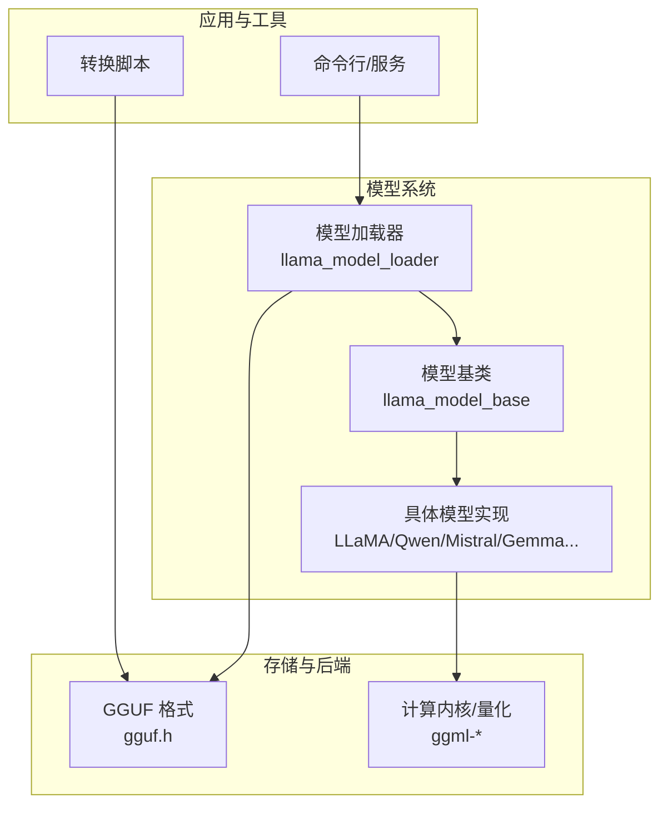
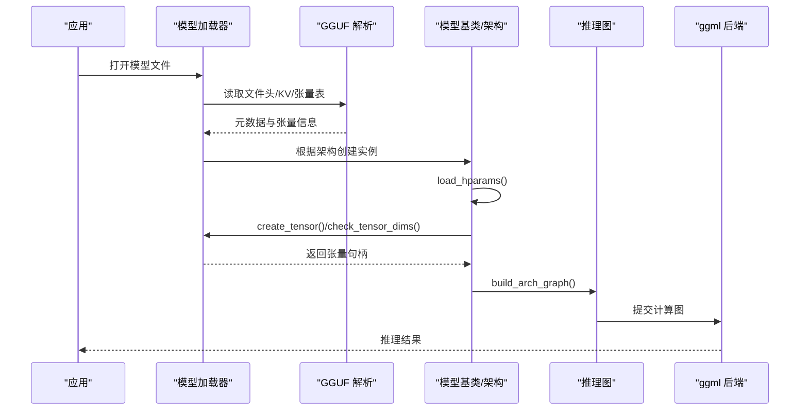
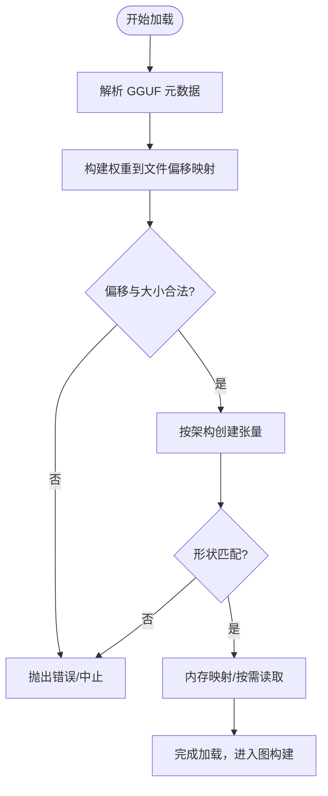
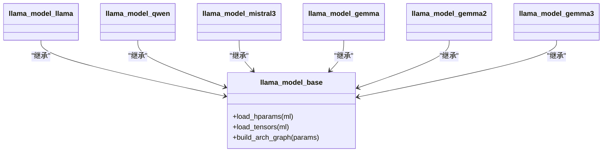
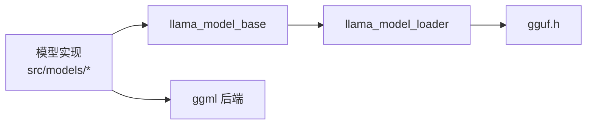

# 模型系统

<cite>
**本文引用的文件**   
- [README.md](file://README.md)
- [gguf.h](file://ggml/include/gguf.h)
- [llama-model-loader.h](file://src/llama-model-loader.h)
- [llama-model-loader.cpp](file://src/llama-model-loader.cpp)
- [llama-model.h](file://src/llama-model.h)
- [llama-model.cpp](file://src/llama-model.cpp)
- [models.h](file://src/models/models.h)
- [llama.cpp（Llama）](file://src/models/llama.cpp)
- [qwen.cpp（Qwen）](file://src/models/qwen.cpp)
- [mistral3.cpp（Mistral3）](file://src/models/mistral3.cpp)
- [gemma.cpp（Gemma）](file://src/models/gemma.cpp)
- [gemma2.cpp（Gemma2）](file://src/models/gemma2.cpp)
- [gemma3.cpp（Gemma3）](file://src/models/gemma3.cpp)
- [constants.py（GGUF Python 常量）](file://gguf-py/gguf/constants.py)
- [SKILL.md（新增模型指南）](file://skills/add-new-model/SKILL.md)
- [autoparser.md（自动解析器文档）](file://docs/autoparser.md)
- [quantize README.md（量化说明）](file://tools/quantize/README.md)
</cite>

## 目录
1. [简介](#简介)
2. [项目结构](#项目结构)
3. [核心组件](#核心组件)
4. [架构总览](#架构总览)
5. [详细组件分析](#详细组件分析)
6. [依赖关系分析](#依赖关系分析)
7. [性能与优化](#性能与优化)
8. [故障排查](#故障排查)
9. [结论](#结论)
10. [附录](#附录)

## 简介
本文件系统性梳理 llama.cpp 的模型系统，覆盖主流模型架构（LLaMA、Qwen、Mistral、Gemma 等）、GGUF 格式规范与元数据、模型加载器（权重解析、内存映射、参数校验）、保存与转换机制、自定义模型适配流程，以及性能优化与量化策略选择。目标是帮助开发者快速理解并扩展模型支持，同时提供可操作的优化与排错建议。

## 项目结构
- 模型实现位于 src/models/*.cpp，每个文件对应一种或一类模型架构，负责：
  - 从 GGUF 元数据中读取超参
  - 声明并创建张量（含可选偏置、RoPE 因子、MoE 门控等）
  - 构建推理图（注意力、FFN/MoE、归一化、输出头）
- 通用加载与内存管理由 src/llama-model-loader.* 与 ggml 层提供
- GGUF 二进制格式定义在 ggml/include/gguf.h；Python 侧常量与映射在 gguf-py/gguf/constants.py
- 新增模型工作流见 skills/add-new-model/SKILL.md

图表来源
- [llama-model-loader.h:30-184](file://src/llama-model-loader.h#L30-L184)
- [llama-model.h:903-920](file://src/llama-model.h#L903-L920)
- [gguf.h:1-34](file://ggml/include/gguf.h#L1-L34)

章节来源
- [README.md:60-96](file://README.md#L60-L96)

## 核心组件
- GGUF 格式与元数据
  - 文件头包含魔数、版本、张量数量、KV 对数量
  - KV 对用于描述模型架构、维度、缩放、RMSNorm 精度等
  - 张量表记录名称、形状、数据类型、偏移，尾部为对齐的数据块
- 模型加载器
  - 解析 GGUF 元数据，建立权重到文件的映射
  - 支持内存映射（mmap）与按需读取（lazy read）
  - 提供张量创建、尺寸校验、范围映射、进度回调等能力
- 模型基类与架构实现
  - 基类定义统一接口：load_hparams/load_tensors/build_arch_graph
  - 各架构子类实现自身张量布局与图构建逻辑

章节来源
- [gguf.h:1-34](file://ggml/include/gguf.h#L1-L34)
- [llama-model-loader.h:30-184](file://src/llama-model-loader.h#L30-L184)
- [llama-model.h:903-920](file://src/llama-model.h#L903-L920)

## 架构总览
下图展示从 GGUF 文件到推理图的端到端流程：加载器解析元数据与张量表，按架构创建张量并构建图，最终交由 ggml 后端执行。

图表来源
- [llama-model-loader.h:221-267](file://src/llama-model-loader.h#L221-L267)
- [llama-model.h:912-920](file://src/llama-model.h#L912-L920)
- [llama-model.cpp:347-359](file://src/llama-model.cpp#L347-L359)

## 详细组件分析

### GGUF 格式规范与模型文件结构
- 文件结构要点
  - 魔数“GGUF”、版本号、张量数、KV 对数
  - KV 对：键名、值类型、数组元素类型与长度、二进制值
  - 张量表：名称、维度、数据类型、数据偏移
  - 数据块：按 alignment 对齐的二进制数据
- 关键元数据键（示例）
  - 词汇表大小、注意力 RMSNorm eps、滑动窗口大小、Rope 频率基/缩放、最终 logit softcap 等
- Python 常量与架构映射
  - constants.py 维护模型架构枚举到字符串的映射，便于转换与识别

章节来源
- [gguf.h:1-34](file://ggml/include/gguf.h#L1-L34)
- [constants.py:1375-1406](file://gguf-py/gguf/constants.py#L1375-L1406)

### 模型加载器：权重解析、内存映射与参数验证
- 权重解析
  - 通过 gguf_context 查找张量索引与偏移，构造 llama_tensor_weight
  - 校验偏移与文件大小边界，防止损坏或不完整模型
- 内存映射与懒加载
  - 支持 use_mmap 与 lazy read，减少初始内存占用
  - 按上下文收集已映射范围，避免无关数据驻留
- 参数与张量校验
  - check_tensor_dims 确保形状一致，必要时允许 reshape
  - done_getting_tensors 完成张量收集后进入图构建阶段

图表来源
- [llama-model-loader.h:30-116](file://src/llama-model-loader.h#L30-L116)
- [llama-model-loader.cpp:1491-1521](file://src/llama-model-loader.cpp#L1491-L1521)

章节来源
- [llama-model-loader.h:30-184](file://src/llama-model-loader.h#L30-L184)
- [llama-model-loader.cpp:1491-1521](file://src/llama-model-loader.cpp#L1491-L1521)

### 模型架构实现：LLaMA / Qwen / Mistral / Gemma
- LLaMA
  - 支持标准注意力与 MoE FFN，可选 RoPE 长/短因子
  - 输出头可与词嵌入共享（TENSOR_DUPLICATED）
- Qwen
  - 使用合并 QKV 权重与偏置，FFN 采用 SiLU 并行分支
- Mistral3
  - 支持注意力温度缩放与 YARN 扩展 RoPE 参数
- Gemma/Gemma2/Gemma3
  - Gemma2/3 引入滑动窗口注意力与软截断
  - Gemma 系列对输入嵌入进行缩放，并在不同规模下调整注意力缩放系数

图表来源
- [llama-model.h:903-920](file://src/llama-model.h#L903-L920)
- [llama.cpp（Llama）:3-96](file://src/models/llama.cpp#L3-L96)
- [qwen.cpp（Qwen）:3-41](file://src/models/qwen.cpp#L3-L41)
- [mistral3.cpp（Mistral3）:3-91](file://src/models/mistral3.cpp#L3-L91)
- [gemma.cpp（Gemma）:3-39](file://src/models/gemma.cpp#L3-L39)
- [gemma2.cpp（Gemma2）:3-28](file://src/models/gemma2.cpp#L3-L28)
- [gemma3.cpp（Gemma3）:3-32](file://src/models/gemma3.cpp#L3-L32)

章节来源
- [llama.cpp（Llama）:3-96](file://src/models/llama.cpp#L3-L96)
- [qwen.cpp（Qwen）:3-41](file://src/models/qwen.cpp#L3-L41)
- [mistral3.cpp（Mistral3）:3-91](file://src/models/mistral3.cpp#L3-L91)
- [gemma.cpp（Gemma）:3-39](file://src/models/gemma.cpp#L3-L39)
- [gemma2.cpp（Gemma2）:3-28](file://src/models/gemma2.cpp#L3-L28)
- [gemma3.cpp（Gemma3）:3-32](file://src/models/gemma3.cpp#L3-L32)

### 模型保存与转换机制
- 转换入口
  - Python 脚本将 HF 权重转换为 GGUF，注册新模型的转换类、常量映射与张量映射
- GGUF 写入
  - 通过 gguf_writer 写入 KV 元数据与张量表，最后写入对齐的数据块
- 一致性校验
  - 建议在转换后进行 logits 对比、困惑度评估与多后端验证

章节来源
- [SKILL.md:33-55](file://skills/add-new-model/SKILL.md#L33-L55)

### 自定义模型支持开发指南
- 步骤概览
  - 确定参考架构与差异点
  - 编写转换脚本（constants.py、tensor_mapping.py）
  - 实现 C++ 模型类（load_hparams/load_tensors/build_arch_graph）
  - 可选：添加聊天模板或输出解析器
- 注意事项
  - 优先复用现有架构基类，避免重复代码
  - 非标准特性（如特殊 RoPE、MoE 路由）需先讨论再实现
  - 多模态编码器若需要新基础设施，应拆分为独立 PR

章节来源
- [SKILL.md:1-32](file://skills/add-new-model/SKILL.md#L1-L32)
- [SKILL.md:55-91](file://skills/add-new-model/SKILL.md#L55-L91)
- [autoparser.md:520-526](file://docs/autoparser.md#L520-L526)

## 依赖关系分析
- 组件耦合
  - 模型实现依赖 llama_model_base 的统一接口
  - 加载器依赖 gguf 解析与 ggml 张量/后端抽象
- 外部依赖
  - ggml 后端（CPU/GPU/Vulkan/SYCL/OpenVINO 等）
  - Python 工具链（gguf-py）

图表来源
- [llama-model.h:903-920](file://src/llama-model.h#L903-L920)
- [llama-model-loader.h:30-184](file://src/llama-model-loader.h#L30-L184)
- [gguf.h:1-34](file://ggml/include/gguf.h#L1-L34)

章节来源
- [llama-model.cpp:347-359](file://src/llama-model.cpp#L347-L359)

## 性能与优化
- 量化策略
  - 支持多种整数量化（1.5/2/3/4/5/6/8-bit），可在 tools/quantize 中选择混合或纯量化
  - 可通过重要性矩阵（imatrix）与张量级类型控制提升质量
- 后端优化
  - CPU：AVX/AVX2/AVX512/AMX/RVV/ZVFH 等指令集
  - GPU：CUDA/HIP/MUSA/Vulkan/SYCL/OpenCL/WebGPU
  - OpenVINO：融合路径（如 MOE 压缩算子）在 GPU 上默认启用
- 运行时优化
  - 使用内存映射与懒加载降低峰值内存
  - 合理设置 KV cache 类型与批大小，测试量化 KV 路径

章节来源
- [README.md:65-96](file://README.md#L65-L96)
- [tools/quantize/README.md:53-67](file://tools/quantize/README.md#L53-L67)

## 故障排查
- 常见加载错误
  - 张量不在文件范围内：检查模型是否损坏或不完整
  - 不支持的架构：确认 GGUF 元数据中的架构标识与加载器支持列表
- 调试建议
  - 打印映射范围与已用 mmap 区间，定位未命中或冗余映射
  - 逐步关闭后端优化（如 OpenVINO MOE 融合）以隔离问题

章节来源
- [llama-model-loader.h:38-48](file://src/llama-model-loader.h#L38-L48)
- [llama-model.cpp:347-359](file://src/llama-model.cpp#L347-L359)

## 结论
llama.cpp 的模型系统以 GGUF 为统一载体，通过统一的加载器与模型基类，将多样化架构（LLaMA/Qwen/Mistral/Gemma 等）接入同一推理框架。借助灵活的量化与多后端支持，系统在资源受限环境下仍能提供高性能推理。对于新模型，遵循标准化流程可实现低成本的适配与验证。

## 附录
- 快速上手
  - 安装与运行示例见仓库根 README
- 相关文档
  - 构建、Docker、多 GPU、性能调优等详见 docs/ 目录

章节来源
- [README.md:20-45](file://README.md#L20-L45)