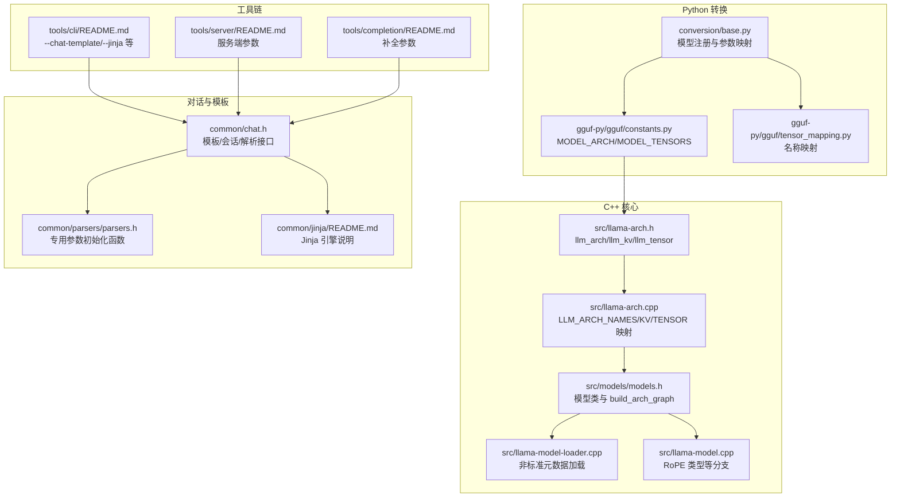
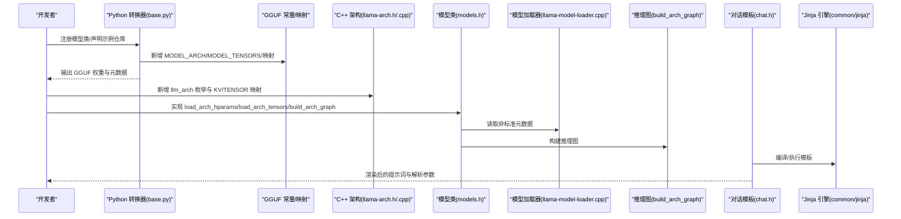
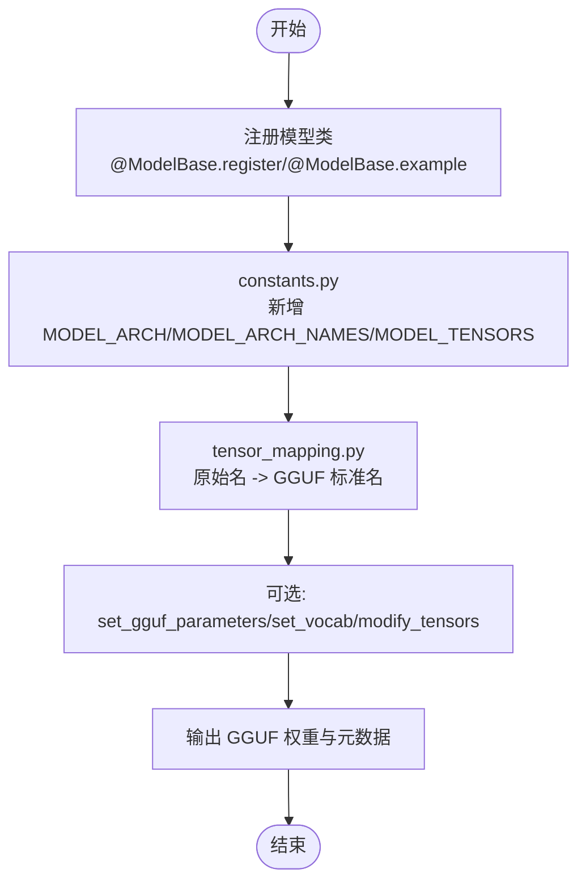
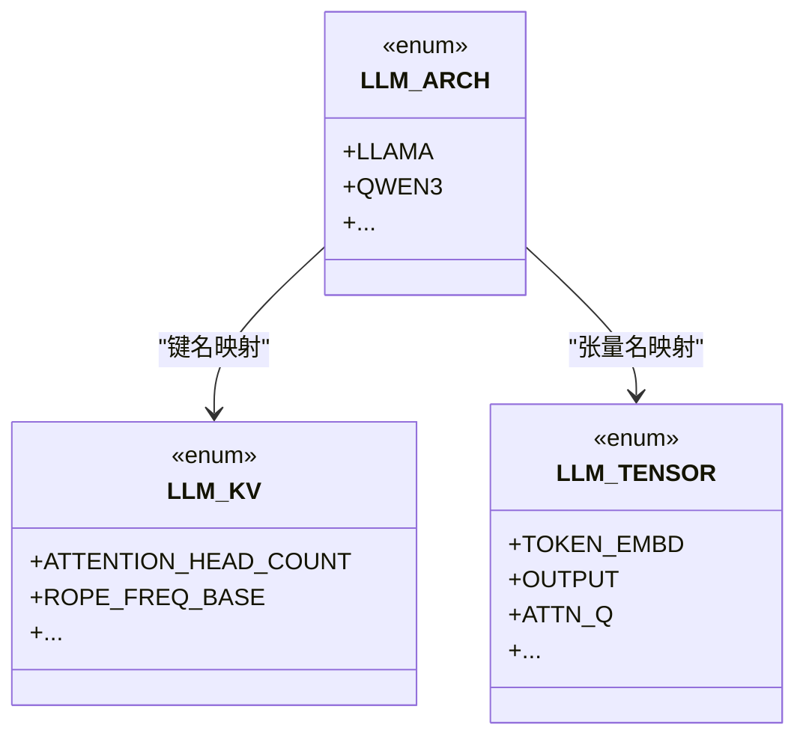
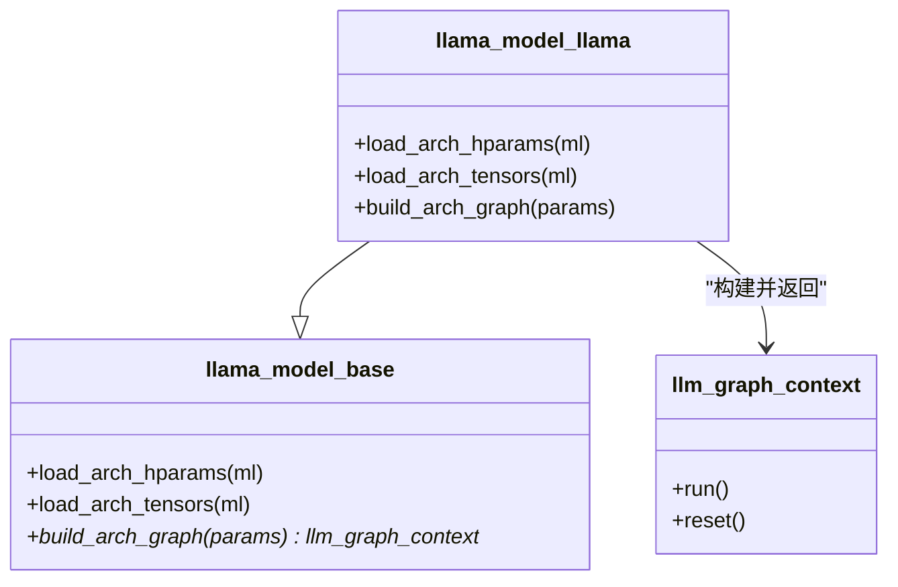
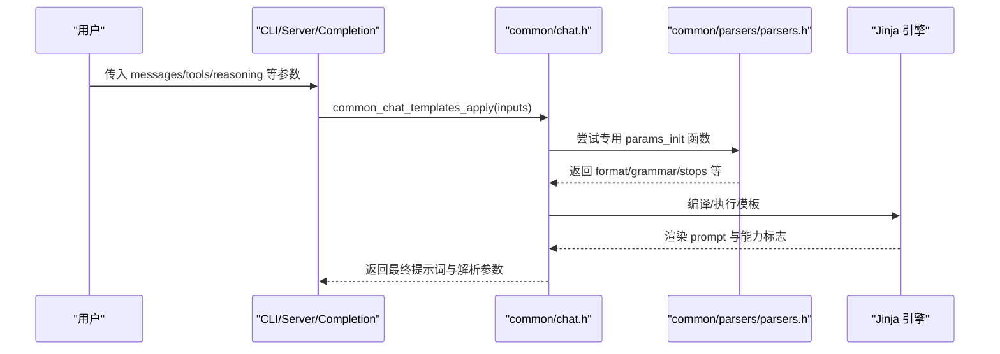
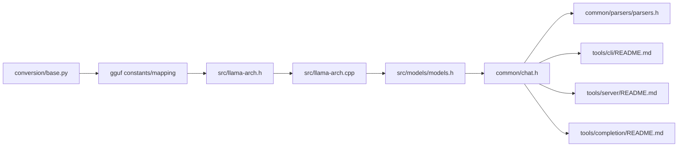

# 自定义模型支持

<cite>
**本文引用的文件**   
- [HOWTO-add-model.md](file://docs/development/HOWTO-add-model.md)
- [llama-arch.h](file://src/llama-arch.h)
- [llama-arch.cpp](file://src/llama-arch.cpp)
- [models.h](file://src/models/models.h)
- [chat.h](file://common/chat.h)
- [parsers.h](file://common/parsers/parsers.h)
- [arg.cpp](file://common/arg.cpp)
- [README.md（CLI）](file://tools/cli/README.md)
- [README.md（Server）](file://tools/server/README.md)
- [README.md（Completion）](file://tools/completion/README.md)
- [function-calling.md](file://docs/function-calling.md)
- [autoparser.md](file://docs/autoparser.md)
- [base.py](file://conversion/base.py)
- [jinja README.md](file://common/jinja/README.md)
</cite>

## 目录
1. [引言](#引言)
2. [项目结构](#项目结构)
3. [核心组件](#核心组件)
4. [架构总览](#架构总览)
5. [详细组件分析](#详细组件分析)
6. [依赖关系分析](#依赖关系分析)
7. [性能考虑](#性能考虑)
8. [故障排查指南](#故障排查指南)
9. [结论](#结论)
10. [附录](#附录)

## 引言
本指南面向希望在 llama.cpp 中为新模型架构添加支持的开发者，覆盖从权重转换、GGUF 规范、C++ 架构注册、推理图构建、对话模板与 Jinja 引擎、到解析器开发与测试验证的完整流程。文档同时提供调试技巧、常见问题与社区贡献建议，帮助你在保证兼容性的前提下高效完成集成。

## 项目结构
围绕“新模型支持”的关键路径涉及以下模块：
- Python 侧权重转换与 GGUF 元数据定义
- C++ 侧架构枚举、KV/张量命名映射、模型加载与推理图构建
- 对话模板系统（Jinja + 专用解析器）
- CLI/Server/Completion 等工具链的参数与行为

图示来源
- [base.py:1475-1532](file://conversion/base.py#L1475-L1532)
- [llama-arch.h:13-172](file://src/llama-arch.h#L13-L172)
- [llama-arch.cpp:8-167](file://src/llama-arch.cpp#L8-L167)
- [models.h:147-158](file://src/models/models.h#L147-L158)
- [chat.h:59-87](file://common/chat.h#L59-L87)
- [parsers.h:50-85](file://common/parsers/parsers.h#L50-L85)
- [README.md（CLI）:174-183](file://tools/cli/README.md#L174-L183)
- [README.md（Server）:232-241](file://tools/server/README.md#L232-L241)
- [README.md（Completion）:252-260](file://tools/completion/README.md#L252-L260)

章节来源
- [HOWTO-add-model.md:19-128](file://docs/development/HOWTO-add-model.md#L19-L128)
- [llama-arch.h:13-172](file://src/llama-arch.h#L13-L172)
- [llama-arch.cpp:8-167](file://src/llama-arch.cpp#L8-L167)
- [models.h:147-158](file://src/models/models.h#L147-L158)
- [chat.h:59-87](file://common/chat.h#L59-L87)
- [parsers.h:50-85](file://common/parsers/parsers.h#L50-L85)
- [README.md（CLI）:174-183](file://tools/cli/README.md#L174-L183)
- [README.md（Server）:232-241](file://tools/server/README.md#L232-L241)
- [README.md（Completion）:252-260](file://tools/completion/README.md#L252-L260)

## 核心组件
- Python 转换层
  - 通过 ModelBase.register 将 HF 模型类与 GGUF 架构关联，并声明示例仓库用于 CI 测试。
  - 在 constants.py 中新增 MODEL_ARCH、MODEL_ARCH_NAMES、MODEL_TENSORS。
  - 在 tensor_mapping.py 中将原模型张量名映射到标准化 GGUF 名称。
- C++ 架构与张量
  - 在 llama-arch.h 中新增 llm_arch 枚举值，并在 llama-arch.cpp 中维护 LLM_ARCH_NAMES、LLM_KV_NAMES、LLM_TENSOR_NAMES/INFOS。
  - 在 llama-model-loader.cpp 中处理非标准元数据；在 llama-model.cpp 中为 RoPE 等操作增加架构分支。
- 推理图构建
  - 继承 llama_model_base，实现 load_arch_hparams/load_arch_tensors/build_arch_graph，并在 llama_model_mapping 中注册。
- 对话模板与解析
  - common/chat.h 提供模板、会话、消息、解析器等数据结构与 API。
  - common/parsers/parsers.h 提供针对特定模型的 common_chat_params_init_* 函数，用于生成专用解析参数。
  - common/jinja 提供 C++ 实现的 Jinja 引擎，支持安全输入标记、最小化类型集与错误溯源。

章节来源
- [base.py:1475-1532](file://conversion/base.py#L1475-L1532)
- [llama-arch.h:13-172](file://src/llama-arch.h#L13-L172)
- [llama-arch.cpp:8-167](file://src/llama-arch.cpp#L8-L167)
- [models.h:147-158](file://src/models/models.h#L147-L158)
- [chat.h:59-87](file://common/chat.h#L59-L87)
- [parsers.h:50-85](file://common/parsers/parsers.h#L50-L85)
- [jinja README.md:1-29](file://common/jinja/README.md#L1-L29)

## 架构总览
下图展示从 Python 转换到 C++ 推理图构建与对话模板渲染的整体流程。

图示来源
- [base.py:1475-1532](file://conversion/base.py#L1475-L1532)
- [llama-arch.h:13-172](file://src/llama-arch.h#L13-L172)
- [llama-arch.cpp:8-167](file://src/llama-arch.cpp#L8-L167)
- [models.h:147-158](file://src/models/models.h#L147-L158)
- [chat.h:59-87](file://common/chat.h#L59-L87)
- [jinja README.md:1-29](file://common/jinja/README.md#L1-L29)

## 详细组件分析

### 权重转换与 GGUF 规范
- 在 conversion/base.py 中通过装饰器注册模型类，并指定 example 仓库以支持自动化测试。
- 在 gguf-py/gguf/constants.py 中新增架构枚举、人类可读名称与张量列表。
- 在 gguf-py/gguf/tensor_mapping.py 中建立原始张量名到 GGUF 标准名的映射，使用 {bid} 占位符表示重复层索引。
- 若需要修改张量布局或配置，可重写 set_gguf_parameters/set_vocab/modify_tensors 等方法。

图示来源
- [base.py:1475-1532](file://conversion/base.py#L1475-L1532)

章节来源
- [HOWTO-add-model.md:19-110](file://docs/development/HOWTO-add-model.md#L19-L110)
- [base.py:1475-1532](file://conversion/base.py#L1475-L1532)

### C++ 架构注册与张量/KV 映射
- 在 src/llama-arch.h 中新增 llm_arch 枚举项，确保与 GGUF 架构字符串一致且稳定。
- 在 src/llama-arch.cpp 中维护 LLM_ARCH_NAMES、LLM_KV_NAMES、LLM_TENSOR_NAMES/INFOS，保证加载与后端算子选择正确。
- 在 llama-model-loader.cpp 中处理非标准元数据；在 llama-model.cpp 中为 RoPE 等特性增加架构分支。

图示来源
- [llama-arch.h:13-172](file://src/llama-arch.h#L13-L172)
- [llama-arch.cpp:8-167](file://src/llama-arch.cpp#L8-L167)

章节来源
- [HOWTO-add-model.md:101-128](file://docs/development/HOWTO-add-model.md#L101-L128)
- [llama-arch.h:13-172](file://src/llama-arch.h#L13-L172)
- [llama-arch.cpp:8-167](file://src/llama-arch.cpp#L8-L167)

### 推理图构建与模型类
- 新建 struct 继承自 llama_model_base，实现：
  - load_arch_hparams：加载架构超参
  - load_arch_tensors：加载权重张量
  - build_arch_graph：构建 ggml 计算图，返回 llm_graph_context
- 在 llama_model_mapping 中注册你的架构，以便按架构名实例化对应模型类。

图示来源
- [models.h:147-158](file://src/models/models.h#L147-L158)

章节来源
- [HOWTO-add-model.md:114-128](file://docs/development/HOWTO-add-model.md#L114-L128)
- [models.h:147-158](file://src/models/models.h#L147-L158)

### 对话模板与多轮对话
- common/chat.h 定义了模板、会话、消息、解析器相关的数据结构与 API，支持：
  - 模板编译与执行（基于 Jinja）
  - 多轮消息历史与增量解析
  - 工具调用、思维标签、语法约束等能力
- common/parsers/parsers.h 提供 per-model 的 common_chat_params_init_* 函数，用于根据模板与输入生成专用解析参数（如格式、触发器、停止符等）。
- CLI/Server/Completion 均暴露 --chat-template/--chat-template-file/--jinja 等参数，允许用户覆盖模板或启用 Jinja 引擎。

图示来源
- [chat.h:59-87](file://common/chat.h#L59-L87)
- [parsers.h:50-85](file://common/parsers/parsers.h#L50-L85)
- [README.md（CLI）:174-183](file://tools/cli/README.md#L174-L183)
- [README.md（Server）:232-241](file://tools/server/README.md#L232-L241)
- [README.md（Completion）:252-260](file://tools/completion/README.md#L252-L260)

章节来源
- [chat.h:59-87](file://common/chat.h#L59-L87)
- [parsers.h:50-85](file://common/parsers/parsers.h#L50-L85)
- [README.md（CLI）:174-183](file://tools/cli/README.md#L174-L183)
- [README.md（Server）:232-241](file://tools/server/README.md#L232-L241)
- [README.md（Completion）:252-260](file://tools/completion/README.md#L252-L260)

### Jinja 模板引擎
- common/jinja 提供 C++ 实现的 Jinja 引擎，具备：
  - 输入标记（防止特殊 token 注入）
  - 解耦 JSON 库（仅做类型转换）
  - 最小化基础类型与内置函数
  - 详细的错误溯源日志
- 架构由 lexer/parser/runtime/value 组成，便于扩展内置函数与进行单元测试。

章节来源
- [jinja README.md:1-29](file://common/jinja/README.md#L1-L29)

### 模型解析器开发规范
- 当模板具有专用处理逻辑时，优先在 common/parsers/parsers.h 中实现 common_chat_params_init_* 函数，返回 format、grammar、generation_prompt、thinking tags、additional_stops 等。
- 若无专用处理器，则走差分自动解析（autoparser），但需确保模板能被通用解析器识别。
- 参考 autoparser.md 中的已测试模板清单，了解不同格式（JSON_NATIVE、TAG_WITH_TAGGED、Reasoning 等）的处理方式。

章节来源
- [parsers.h:50-85](file://common/parsers/parsers.h#L50-L85)
- [autoparser.md:479-518](file://docs/autoparser.md#L479-L518)

## 依赖关系分析
- Python 转换层依赖 gguf-py 的常量与映射表，决定 GGUF 文件的架构与张量命名。
- C++ 架构层依赖 llama-arch.h/.cpp 提供的枚举与映射，驱动模型加载与后端算子选择。
- 推理图构建依赖 models.h 中定义的模型类与图上下文。
- 对话模板依赖 chat.h 与 parsers.h，并通过 CLI/Server/Completion 的参数暴露给用户。

图示来源
- [base.py:1475-1532](file://conversion/base.py#L1475-L1532)
- [llama-arch.h:13-172](file://src/llama-arch.h#L13-L172)
- [llama-arch.cpp:8-167](file://src/llama-arch.cpp#L8-L167)
- [models.h:147-158](file://src/models/models.h#L147-L158)
- [chat.h:59-87](file://common/chat.h#L59-L87)
- [parsers.h:50-85](file://common/parsers/parsers.h#L50-L85)
- [README.md（CLI）:174-183](file://tools/cli/README.md#L174-L183)
- [README.md（Server）:232-241](file://tools/server/README.md#L232-L241)
- [README.md（Completion）:252-260](file://tools/completion/README.md#L252-L260)

## 性能考虑
- 尽量在转换阶段完成张量变换（如 norm(1+weight)、置换/分块），避免在推理图中引入额外算子。
- 合理使用 ggml_rope_ext，减少 sin/cos 矩阵内存占用，并与其它算子融合。
- 对部分头旋转（nope 部分）采用单算子优化策略，避免视图拼接带来的开销。
- 对于常量缩放（weight*scale），通常保留在推理时应用，以保持数值稳定性与量化友好性。

章节来源
- [HOWTO-add-model.md:159-197](file://docs/development/HOWTO-add-model.md#L159-L197)

## 故障排查指南
- 架构未识别
  - 检查是否在 llama-arch.h 中新增 llm_arch 枚举，并在 llama-arch.cpp 中补充 LLM_ARCH_NAMES。
  - 确认 GGUF 文件中的 general.architecture 与 C++ 侧一致。
- 张量缺失或名称不匹配
  - 核对 constants.py 与 tensor_mapping.py 是否包含该架构所需张量与映射。
  - 检查 C++ 侧 LLM_TENSOR_NAMES/INFOS 是否覆盖所有必要张量。
- 推理图构建失败
  - 确认 build_arch_graph 已实现并在 llama_model_mapping 中注册。
  - 使用 examples/eval-callback 或 mtmd-debug（多模态）辅助调试。
- 对话模板异常
  - 使用 --jinja 与 --chat-template/--chat-template-file 切换模板源。
  - 参考 function-calling.md 与 autoparser.md 中的模板清单与已知问题。
- 工具链参数无效
  - 检查 CLI/Server/Completion 的 --chat-template/--jinja 等参数是否正确传递。

章节来源
- [HOWTO-add-model.md:101-128](file://docs/development/HOWTO-add-model.md#L101-L128)
- [function-calling.md:287-326](file://docs/function-calling.md#L287-L326)
- [autoparser.md:479-518](file://docs/autoparser.md#L479-L518)
- [README.md（CLI）:174-183](file://tools/cli/README.md#L174-L183)
- [README.md（Server）:232-241](file://tools/server/README.md#L232-L241)
- [README.md（Completion）:252-260](file://tools/completion/README.md#L252-L260)

## 结论
为新模型架构添加支持需要贯穿 Python 转换、GGUF 规范、C++ 架构注册、推理图构建与对话模板的全链路。遵循现有命名约定与映射规范，优先在转换阶段完成张量变换，利用 ggml_rope_ext 与专用解析器提升性能与兼容性。借助 CLI/Server/Completion 的参数与调试工具，可快速定位问题并完成验证。

## 附录
- 社区贡献流程要点
  - 保持变更最小化与自包含，复用现有基础设施。
  - 确保 CLI、completion、imatrix、quantize、server 等工具链与新架构兼容。
  - 如需新增公共 API，添加到 llama-ext.h。
  - 决策模型等特殊用例可在 server-decision.cpp 中硬编码元数据，避免膨胀 GGUF。

章节来源
- [HOWTO-add-model.md:142-157](file://docs/development/HOWTO-add-model.md#L142-L157)