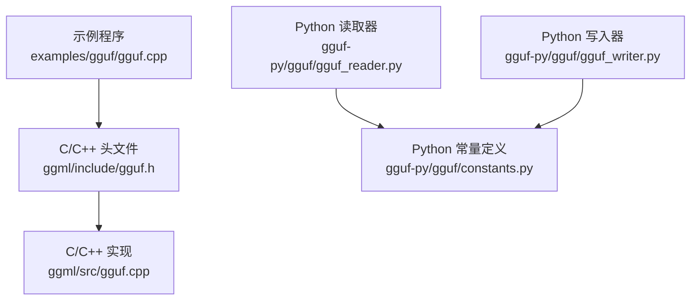
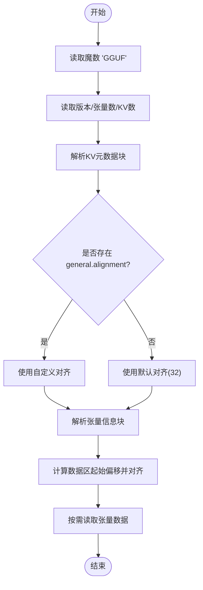
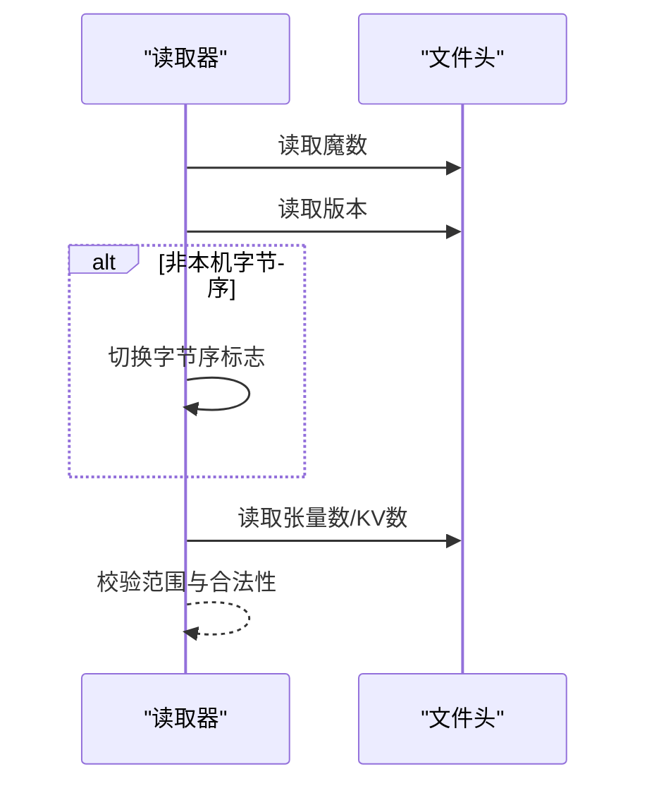
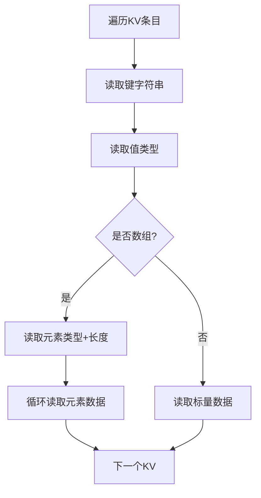
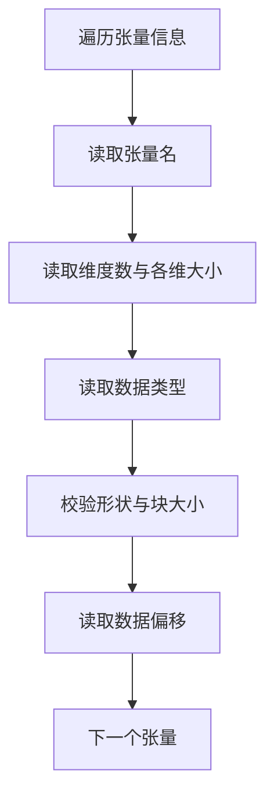
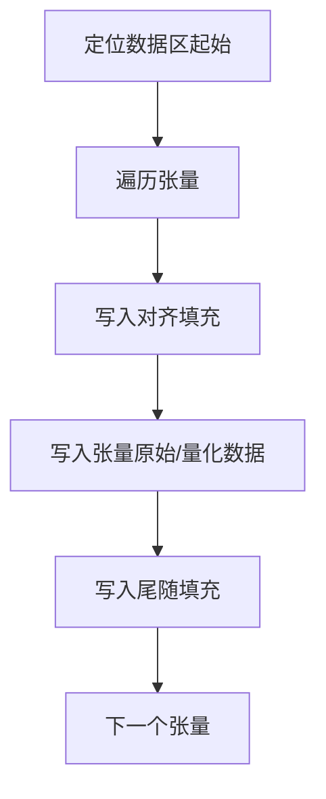
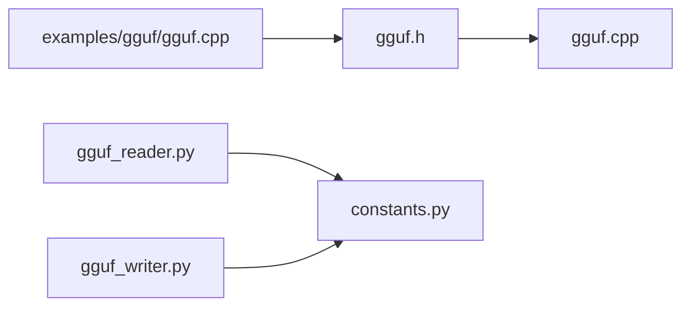
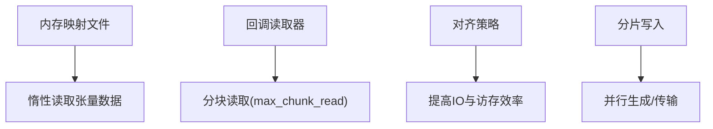

# GGUF格式规范

<cite>
**本文引用的文件**   
- [gguf.h](file://ggml/include/gguf.h)
- [gguf.cpp](file://ggml/src/gguf.cpp)
- [gguf_reader.py](file://gguf-py/gguf/gguf_reader.py)
- [gguf_writer.py](file://gguf-py/gguf/gguf_writer.py)
- [constants.py](file://gguf-py/gguf/constants.py)
- [gguf.cpp（示例）](file://examples/gguf/gguf.cpp)
</cite>

## 目录
1. [简介](#简介)
2. [项目结构](#项目结构)
3. [核心组件](#核心组件)
4. [架构总览](#架构总览)
5. [详细组件分析](#详细组件分析)
6. [依赖关系分析](#依赖关系分析)
7. [性能与内存优化](#性能与内存优化)
8. [故障排查指南](#故障排查指南)
9. [结论](#结论)
10. [附录：读写示例与验证工具](#附录读写示例与验证工具)

## 简介
本规范文档面向GGUF文件格式，系统性阐述其二进制结构、元数据键值对、张量信息、张量数据布局与对齐规则，并说明版本兼容性与字节序处理。同时给出C/C++与Python的读写路径、常见数据类型（含量化类型）存储方式、模型架构标识符与分词器配置约定，以及流式加载与内存映射优化的实现要点。

## 项目结构
仓库中与GGUF相关的核心代码分布在以下位置：
- C/C++接口与实现：ggml/include/gguf.h、ggml/src/gguf.cpp
- Python库：gguf-py/gguf/gguf_reader.py、gguf-py/gguf/gguf_writer.py、gguf-py/gguf/constants.py
- 示例程序：examples/gguf/gguf.cpp

**图表来源**
- [gguf.h:1-34](file://ggml/include/gguf.h#L1-L34)
- [gguf.cpp:460-520](file://ggml/src/gguf.cpp#L460-L520)
- [gguf_reader.py:116-194](file://gguf-py/gguf/gguf_reader.py#L116-L194)
- [gguf_writer.py:215-276](file://gguf-py/gguf/gguf_writer.py#L215-L276)
- [constants.py:10-14](file://gguf-py/gguf/constants.py#L10-L14)

**章节来源**
- [gguf.h:1-34](file://ggml/include/gguf.h#L1-L34)
- [gguf.cpp:460-520](file://ggml/src/gguf.cpp#L460-L520)
- [gguf_reader.py:116-194](file://gguf-py/gguf/gguf_reader.py#L116-L194)
- [gguf_writer.py:215-276](file://gguf-py/gguf/gguf_writer.py#L215-L276)
- [constants.py:10-14](file://gguf-py/gguf/constants.py#L10-L14)

## 核心组件
- 文件头与全局参数
  - Magic、版本、张量数量、KV数量
  - 对齐策略：优先使用general.alignment，否则默认32字节
- 元数据块（KV pairs）
  - 键为字符串；值为标量或数组；枚举以int32存储；布尔以int8存储
- 张量信息块（Tensor info）
  - 名称、维度数、各维大小、数据类型、数据偏移
- 张量数据块（Data blob）
  - 按对齐边界连续存放；支持多种量化类型

**章节来源**
- [gguf.h:1-34](file://ggml/include/gguf.h#L1-L34)
- [gguf.cpp:460-520](file://ggml/src/gguf.cpp#L460-L520)
- [gguf.cpp:639-780](file://ggml/src/gguf.cpp#L639-L780)

## 架构总览
下图展示GGUF文件的逻辑结构与解析流程：

**图表来源**
- [gguf.cpp:460-520](file://ggml/src/gguf.cpp#L460-L520)
- [gguf.cpp:622-637](file://ggml/src/gguf.cpp#L622-L637)
- [gguf.cpp:639-780](file://ggml/src/gguf.cpp#L639-L780)

## 详细组件分析

### 文件头与版本兼容性
- 魔数：固定4字节“GGUF”
- 版本：uint32_t；当前实现支持到特定版本，拒绝未知或过低版本
- 张量数量与KV数量：int64_t
- 字节序检测：通过版本号低位判断是否为反向字节序，必要时进行交换

**图表来源**
- [gguf.cpp:460-520](file://ggml/src/gguf.cpp#L460-L520)

**章节来源**
- [gguf.h:41-46](file://ggml/include/gguf.h#L41-L46)
- [gguf.cpp:460-520](file://ggml/src/gguf.cpp#L460-L520)

### 元数据块（KV pairs）
- 键：UTF-8字符串，长度前缀为uint64_t
- 值类型：gguf_type枚举（u8/i8/u16/i16/u32/i32/f32/bool/str/arr/u64/i64/f64）
- 数组：先写元素类型与长度，再顺序写出每个元素的二进制表示
- 特殊键：general.alignment（uint32_t），用于覆盖默认对齐

**图表来源**
- [gguf.cpp:552-637](file://ggml/src/gguf.cpp#L552-L637)

**章节来源**
- [gguf.cpp:552-637](file://ggml/src/gguf.cpp#L552-L637)

### 张量信息块（Tensor info）
- 字段顺序：名称(string)、维度数(uint32_t)、各维大小(int64_t)、数据类型(ggml_type)、数据偏移(uint64_t)
- 维度上限：GGML_MAX_DIMS
- 形状与块大小一致性检查：每行元素数必须能被块大小整除
- 偏移计算：基于已写入数据的累计偏移，并在数据区前做对齐填充

**图表来源**
- [gguf.cpp:639-780](file://ggml/src/gguf.cpp#L639-L780)

**章节来源**
- [gguf.cpp:639-780](file://ggml/src/gguf.cpp#L639-L780)

### 张量数据块（Data blob）
- 数据区起始位置：在KV与张量信息之后，按alignment对齐
- 每个张量的数据按其在info中声明的偏移顺序写入
- 量化类型：F16/F32/F64/I8/I16/I32/I64及各类压缩量化（如Q4_K等）
- 量化形状转换：对于压缩量化，需将逻辑形状转换为字节形状后再写入

**图表来源**
- [gguf.cpp:780-800](file://ggml/src/gguf.cpp#L780-L800)
- [gguf_writer.py:411-489](file://gguf-py/gguf/gguf_writer.py#L411-L489)

**章节来源**
- [gguf.cpp:780-800](file://ggml/src/gguf.cpp#L780-L800)
- [gguf_writer.py:411-489](file://gguf-py/gguf/gguf_writer.py#L411-L489)

### 数据类型与编码方式
- KV元数据中的基础类型：u8/i8/u16/i16/u32/i32/f32/bool/str/arr/u64/i64/f64
- 布尔值统一以int8存储
- 枚举值统一以int32存储
- 字符串采用长度前缀+无终止符的UTF-8字节序列
- 张量数据类型：ggml_type（包含浮点、整型与多种量化类型）
- 量化类型的字节形状转换由Python侧quants模块提供（例如Q4_K等）

**章节来源**
- [gguf.h:52-68](file://ggml/include/gguf.h#L52-L68)
- [gguf.cpp:94-126](file://ggml/src/gguf.cpp#L94-L126)
- [gguf_reader.py:351-389](file://gguf-py/gguf/gguf_reader.py#L351-L389)

### 模型架构标识符与分词器配置
- 模型架构标识符：general.architecture（字符串），Python端在写入时自动设置
- 常用LLM元数据键：vocab_size、context_length、embedding_length、block_count等，均以{arch}.xxx形式命名
- 分词器配置：tokenizer.ggml.model、tokenizer.ggml.tokens、tokenizer.ggml.merges、tokenizer.chat_template等
- 采样推荐参数：general.sampling.*系列键

**章节来源**
- [constants.py:21-106](file://gguf-py/gguf/constants.py#L21-L106)
- [constants.py:108-177](file://gguf-py/gguf/constants.py#L108-L177)
- [constants.py:338-381](file://gguf-py/gguf/constants.py#L338-L381)
- [gguf_writer.py:506-523](file://gguf-py/gguf/gguf_writer.py#L506-L523)

### 版本兼容性与向后兼容策略
- 读取器仅支持特定版本列表（例如[2, 当前版本]），拒绝不支持的版本
- 若版本号低位为0，可能表示字节序相反，读取器会切换字节序标志
- 旧版本v1不再支持，要求使用更新版本
- general.alignment允许用户自定义对齐，但必须为非零且为2的幂

**章节来源**
- [gguf_reader.py:41-164](file://gguf-py/gguf/gguf_reader.py#L41-L164)
- [gguf.cpp:493-520](file://ggml/src/gguf.cpp#L493-L520)
- [gguf.cpp:622-637](file://ggml/src/gguf.cpp#L622-L637)

## 依赖关系分析
- gguf.h定义了对外API与数据结构，gguf.cpp实现具体读写逻辑
- Python读取器/写入器分别实现跨语言访问，依赖constants.py中的常量与枚举
- 示例程序演示了C/C++侧的完整读写流程

**图表来源**
- [gguf.h:1-34](file://ggml/include/gguf.h#L1-L34)
- [gguf.cpp:1-5](file://ggml/src/gguf.cpp#L1-L5)
- [gguf_reader.py:24-33](file://gguf-py/gguf/gguf_reader.py#L24-L33)
- [gguf_writer.py:19-34](file://gguf-py/gguf/gguf_writer.py#L19-L34)
- [gguf.cpp（示例）:1-3](file://examples/gguf/gguf.cpp#L1-L3)

**章节来源**
- [gguf.h:1-34](file://ggml/include/gguf.h#L1-L34)
- [gguf.cpp:1-5](file://ggml/src/gguf.cpp#L1-L5)
- [gguf_reader.py:24-33](file://gguf-py/gguf/gguf_reader.py#L24-L33)
- [gguf_writer.py:19-34](file://gguf-py/gguf/gguf_writer.py#L19-L34)
- [gguf.cpp（示例）:1-3](file://examples/gguf/gguf.cpp#L1-L3)

## 性能与内存优化
- 内存映射：Python读取器使用numpy.memmap直接映射文件，避免全量加载
- 流式加载：C/C++侧支持回调读取器，可限制单次最大读取块大小，适合网络流或大文件
- 对齐优化：通过general.alignment控制数据区对齐，减少I/O碎片并提升访存效率
- 分片写入：Python写入器支持split_max_tensors/split_max_size，便于多分片并行生成

**图表来源**
- [gguf_reader.py:137-194](file://gguf-py/gguf/gguf_reader.py#L137-L194)
- [gguf.h:87-88](file://ggml/include/gguf.h#L87-L88)
- [gguf_writer.py:87-112](file://gguf-py/gguf/gguf_writer.py#L87-L112)

**章节来源**
- [gguf_reader.py:137-194](file://gguf-py/gguf/gguf_reader.py#L137-L194)
- [gguf.h:87-88](file://ggml/include/gguf.h#L87-L88)
- [gguf_writer.py:87-112](file://gguf-py/gguf/gguf_writer.py#L87-L112)

## 故障排查指南
- 魔数不匹配：确认文件是否为GGUF格式
- 版本不支持：升级软件或转换工具以生成兼容版本
- 重复键或重复张量名：检查写入逻辑，确保唯一性
- 对齐错误：确认general.alignment为非零且为2的幂
- 形状与块大小不一致：检查张量数据类型与维度设置
- 字符串超长或越界：检查字符串长度与剩余文件大小

**章节来源**
- [gguf.cpp:466-487](file://ggml/src/gguf.cpp#L466-L487)
- [gguf.cpp:493-520](file://ggml/src/gguf.cpp#L493-L520)
- [gguf.cpp:552-637](file://ggml/src/gguf.cpp#L552-L637)
- [gguf.cpp:639-780](file://ggml/src/gguf.cpp#L639-L780)
- [gguf_reader.py:141-194](file://gguf-py/gguf/gguf_reader.py#L141-L194)

## 结论
GGUF格式以简洁的二进制结构承载模型权重与元数据，通过严格的对齐与类型系统保证高效读写。C/C++与Python双栈实现提供了跨语言的读写能力，结合内存映射与流式加载机制，满足大规模模型的快速加载与灵活处理需求。遵循本规范可实现稳定、可移植的GGUF文件生成与消费。

## 附录：读写示例与验证工具

### C/C++读写示例
- 写入：创建上下文、设置KV、添加张量、调用写入函数
- 读取：从文件初始化上下文、遍历KV与张量信息、按需读取数据

参考路径：
- [gguf.cpp（示例）:22-84](file://examples/gguf/gguf.cpp#L22-L84)
- [gguf.cpp（示例）:87-148](file://examples/gguf/gguf.cpp#L87-L148)
- [gguf.cpp（示例）:151-241](file://examples/gguf/gguf.cpp#L151-L241)

**章节来源**
- [gguf.cpp（示例）:22-84](file://examples/gguf/gguf.cpp#L22-L84)
- [gguf.cpp（示例）:87-148](file://examples/gguf/gguf.cpp#L87-L148)
- [gguf.cpp（示例）:151-241](file://examples/gguf/gguf.cpp#L151-L241)

### Python读写示例
- 读取：使用GGUFReader打开文件，访问fields与tensors
- 写入：使用GGUFWriter设置架构与KV，添加张量信息并写入数据

参考路径：
- [gguf_reader.py:116-194](file://gguf-py/gguf/gguf_reader.py#L116-L194)
- [gguf_writer.py:215-276](file://gguf-py/gguf/gguf_writer.py#L215-L276)
- [gguf_writer.py:335-489](file://gguf-py/gguf/gguf_writer.py#L335-L489)

**章节来源**
- [gguf_reader.py:116-194](file://gguf-py/gguf/gguf_reader.py#L116-L194)
- [gguf_writer.py:215-276](file://gguf-py/gguf/gguf_writer.py#L215-L276)
- [gguf_writer.py:335-489](file://gguf-py/gguf/gguf_writer.py#L335-L489)

### 验证工具使用方法
- 使用C/C++示例程序进行基本读写校验
- 使用Python读取器进行字段与张量数据校验
- 关注版本、对齐、形状与量化类型的一致性

参考路径：
- [gguf.cpp（示例）:243-273](file://examples/gguf/gguf.cpp#L243-L273)
- [gguf_reader.py:137-194](file://gguf-py/gguf/gguf_reader.py#L137-L194)

**章节来源**
- [gguf.cpp（示例）:243-273](file://examples/gguf/gguf.cpp#L243-L273)
- [gguf_reader.py:137-194](file://gguf-py/gguf/gguf_reader.py#L137-L194)