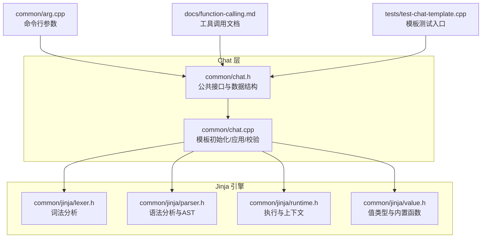
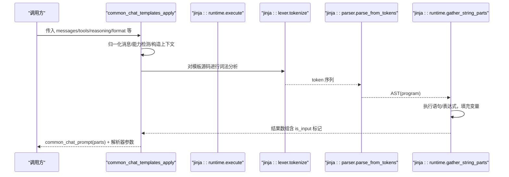
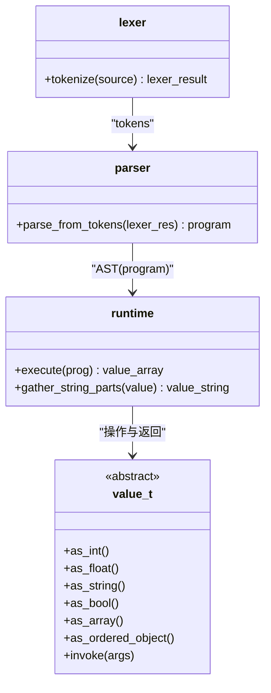
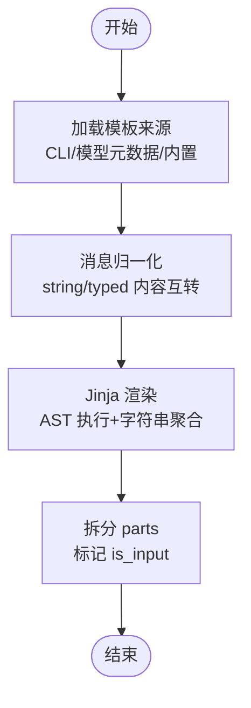
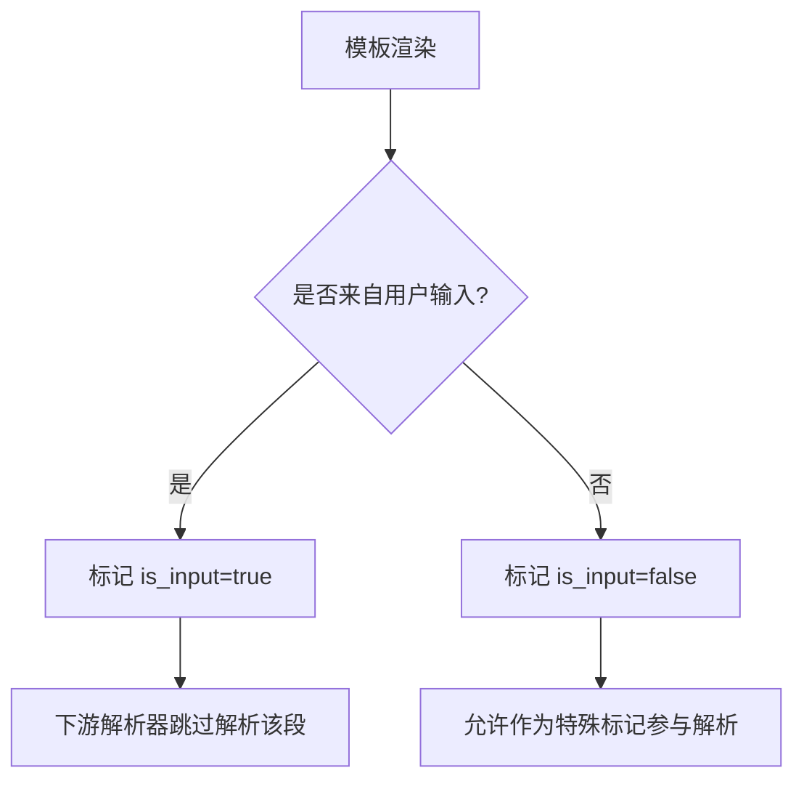
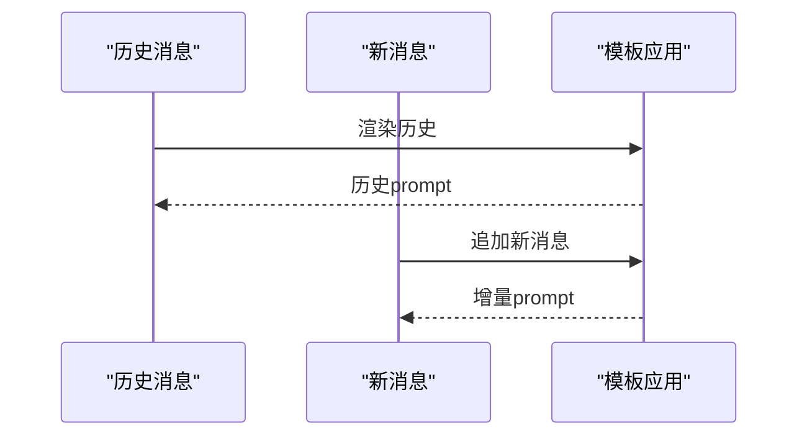
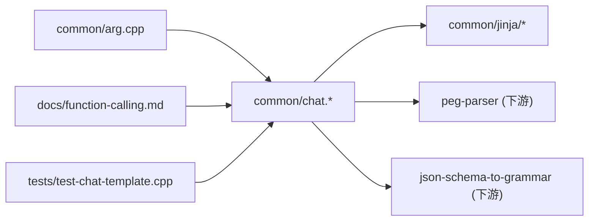

# Chat模板转换

<cite>
**本文引用的文件**   
- [chat.h](file://common/chat.h)
- [chat.cpp](file://common/chat.cpp)
- [lexer.h](file://common/jinja/lexer.h)
- [parser.h](file://common/jinja/parser.h)
- [runtime.h](file://common/jinja/runtime.h)
- [value.h](file://common/jinja/value.h)
- [README.md](file://common/jinja/README.md)
- [arg.cpp](file://common/arg.cpp)
- [test-chat-template.cpp](file://tests/test-chat-template.cpp)
- [function-calling.md](file://docs/function-calling.md)
</cite>

## 目录
1. [简介](#简介)
2. [项目结构](#项目结构)
3. [核心组件](#核心组件)
4. [架构总览](#架构总览)
5. [详细组件分析](#详细组件分析)
6. [依赖关系分析](#依赖关系分析)
7. [性能考量](#性能考量)
8. [故障排查指南](#故障排查指南)
9. [结论](#结论)
10. [附录](#附录)

## 简介
本文件系统化说明 llama.cpp 中“Chat 模板转换”的实现与使用，重点覆盖：
- Jinja 模板到 llama.cpp 内部格式的转换流程（词法解析、语法解析、变量替换、特殊标记处理）
- 不同模型家族（Llama、Mistral、Qwen 等）的 Chat 模板规范与适配要点
- 对话历史、系统提示与用户输入的格式化策略
- 自定义 Chat 模板的开发与测试方法
- 模板兼容性检查与错误恢复机制
- 常见问题诊断与优化建议

## 项目结构
围绕 Chat 模板转换的关键代码位于 common/chat.* 与 common/jinja/*。Jinja 引擎提供独立的词法、语法与运行时实现；Chat 层负责将消息、工具定义、推理标签等上下文渲染为最终 prompt，并输出供下游解析器使用的结构化信息。

**图表来源**
- [chat.h:59-87](file://common/chat.h#L59-L87)
- [chat.cpp:729-800](file://common/chat.cpp#L729-L800)
- [lexer.h:13-47](file://common/jinja/lexer.h#L13-L47)
- [parser.h:12-19](file://common/jinja/parser.h#L12-L19)
- [runtime.h:741-779](file://common/jinja/runtime.h#L741-L779)
- [value.h:106-172](file://common/jinja/value.h#L106-L172)
- [arg.cpp:3776-3801](file://common/arg.cpp#L3776-L3801)
- [function-calling.md:283-335](file://docs/function-calling.md#L283-L335)
- [test-chat-template.cpp:30-61](file://tests/test-chat-template.cpp#L30-L61)

**章节来源**
- [chat.h:59-87](file://common/chat.h#L59-L87)
- [chat.cpp:729-800](file://common/chat.cpp#L729-L800)
- [lexer.h:13-47](file://common/jinja/lexer.h#L13-L47)
- [parser.h:12-19](file://common/jinja/parser.h#L12-L19)
- [runtime.h:741-779](file://common/jinja/runtime.h#L741-L779)
- [value.h:106-172](file://common/jinja/value.h#L106-L172)
- [arg.cpp:3776-3801](file://common/arg.cpp#L3776-L3801)
- [function-calling.md:283-335](file://docs/function-calling.md#L283-L335)
- [test-chat-template.cpp:30-61](file://tests/test-chat-template.cpp#L30-L61)

## 核心组件
- common_chat_template：封装已编译的 Jinja 程序、BOS/EOS 标记、源模板文本及能力集（caps）。
- common_chat_templates：管理默认与 tool_use 两套模板，支持从模型元数据或命令行注入。
- common_chat_msg / common_chat_prompt：消息结构与渲染后的 prompt 分段（区分模板生成部分与用户输入部分）。
- jinja::lexer/parser/runtime/value：完整的 C++ 版 Jinja 引擎，提供安全输入标记、AST 执行与类型系统。

关键职责划分：
- chat.* 负责高层编排：模板选择、消息归一化、工具/推理能力探测、差异分析、PEG 解析器联动。
- jinja/* 负责底层实现：词法→语法→执行，以及字符串来源标记（is_input）以防范模板注入。

**章节来源**
- [chat.h:59-87](file://common/chat.h#L59-L87)
- [chat.h:89-137](file://common/chat.h#L89-L137)
- [chat.h:256-312](file://common/chat.h#L256-L312)
- [README.md:1-29](file://common/jinja/README.md#L1-L29)

## 架构总览
下图展示一次典型“应用 Chat 模板”的调用链：从上层传入消息与工具定义，经 Chat 层准备上下文，交由 Jinja 引擎渲染，最后产出带来源标记的分段文本，供后续解析器使用。

**图表来源**
- [chat.cpp:729-800](file://common/chat.cpp#L729-L800)
- [lexer.h:147-150](file://common/jinja/lexer.h#L147-L150)
- [parser.h:12-19](file://common/jinja/parser.h#L12-L19)
- [runtime.h:741-779](file://common/jinja/runtime.h#L741-L779)

## 详细组件分析

### 1) Jinja 引擎：词法、语法与执行
- 词法分析（lexer）：将模板源码切分为 token，支持控制块 {{ }}/、注释、运算符等。
- 语法分析（parser）：将 token 流解析为 AST（program/if/for/set/macro/call/filter 等节点）。
- 运行时（runtime）：遍历 AST 执行，维护 context 作用域，计算表达式、调用内置函数，聚合字符串片段。
- 值类型（value）：统一抽象 int/float/string/array/object/tuple/none/undefined/function，并提供哈希与比较语义。

**图表来源**
- [lexer.h:13-47](file://common/jinja/lexer.h#L13-L47)
- [parser.h:12-19](file://common/jinja/parser.h#L12-L19)
- [runtime.h:741-779](file://common/jinja/runtime.h#L741-L779)
- [value.h:106-172](file://common/jinja/value.h#L106-L172)

**章节来源**
- [lexer.h:13-47](file://common/jinja/lexer.h#L13-L47)
- [parser.h:12-19](file://common/jinja/parser.h#L12-L19)
- [runtime.h:741-779](file://common/jinja/runtime.h#L741-L779)
- [value.h:106-172](file://common/jinja/value.h#L106-L172)

### 2) Chat 层：模板初始化与应用
- 模板来源优先级：显式 --chat-template/--chat-template-file > 模型元数据中的 chat_template/tool_use > 内置 chatml。
- 能力探测：通过 caps 字段判断是否支持 tools/tool_calls/system role/并行工具调用/推理保留等。
- 消息归一化：根据 supports_string_content/supports_typed_content 自动在字符串与 typed array 之间转换。
- 输出结构：common_chat_prompt.parts 包含 text 与 is_input 标记，便于下游区分“模板生成的特殊标记”和“用户输入”。

**图表来源**
- [chat.cpp:729-800](file://common/chat.cpp#L729-L800)
- [README.md:31-89](file://common/jinja/README.md#L31-L89)

**章节来源**
- [chat.cpp:729-800](file://common/chat.cpp#L729-L800)
- [README.md:31-89](file://common/jinja/README.md#L31-L89)

### 3) 变量替换与特殊标记处理
- 变量替换：context 中注入 messages/tools/add_generation_prompt/bos_token/eos_token 等，模板可自由访问。
- 特殊标记防护：通过 is_input 标记区分“模板生成的特殊标记”与“用户输入”，避免恶意注入绕过解析器。
- 兼容补丁：针对特定模板的错误分支进行临时修复（如 channel/final 条件、tool_calls 空值分支），保证稳定运行。

**图表来源**
- [README.md:31-89](file://common/jinja/README.md#L31-L89)
- [chat.cpp:760-781](file://common/chat.cpp#L760-L781)

**章节来源**
- [README.md:31-89](file://common/jinja/README.md#L31-L89)
- [chat.cpp:760-781](file://common/chat.cpp#L760-L781)

### 4) 不同模型家族的 Chat 模板规范与转换规则
- Llama 系列：通常采用 im_start/im_end 风格分隔符，配合 system/user/assistant 角色；可通过内置模板或模型元数据注入。
- Mistral 系列：强调 function/tool 调用格式，需启用 tool_use 模板；注意 id 生成与工具参数 schema。
- Qwen 系列：支持 reasoning/thinking 模式，模板可能包含 think 标签与推理预算控制；需要 enable_thinking 与 reasoning_format 协同。
- 通用规则：
  - 若模板声明 supports_typed_content=true，则 content 应为数组（text/media_marker 等）；否则为字符串。
  - 若模板声明 supports_tools/tool_calls=true，则需在 inputs.tools 中提供工具定义，并在模板中按约定拼接。

实践建议：
- 优先使用模型自带的 chat_template/tool_use；若无，再回退到 chatml 或自定义模板。
- 对工具调用，确保 tools 的 parameters 为合法 JSON Schema，以便生成阶段约束输出。

**章节来源**
- [function-calling.md:283-335](file://docs/function-calling.md#L283-L335)
- [chat.h:256-312](file://common/chat.h#L256-L312)

### 5) 对话历史、系统提示与用户输入的格式化
- 历史消息：past_msg 先渲染一次，再以增量方式追加 new_msg，避免重复计算。
- 系统提示：由 system 角色消息注入；某些模板会将其置于开头或单独段落。
- 用户输入：保持 is_input 标记，防止被当作模板指令解析。
- 推理内容：当 enable_thinking=true 且模板支持时，推理过程可被提取至 reasoning_content，同时保留思考标签。

**图表来源**
- [chat.cpp:636-664](file://common/chat.cpp#L636-L664)

**章节来源**
- [chat.cpp:636-664](file://common/chat.cpp#L636-L664)

### 6) 自定义 Chat 模板的开发与测试
- 开发步骤：
  1) 明确模型家族与期望的输出格式（是否支持 tools、thinking、typed content）。
  2) 编写 Jinja 模板，遵循上述能力位（supports_*）约定。
  3) 通过 --chat-template/--chat-template-file 指定模板。
  4) 使用 test-chat-template 工具验证渲染结果与边界情况。
- 测试要点：
  - 有无 tools 场景对比
  - add_generation_prompt 开关
  - enable_thinking 开启/关闭
  - string/typed content 两种形态
  - BOS/EOS 与特殊标记注入防护

**章节来源**
- [test-chat-template.cpp:30-61](file://tests/test-chat-template.cpp#L30-L61)
- [arg.cpp:3776-3801](file://common/arg.cpp#L3776-L3801)

### 7) 模板兼容性检查与错误恢复
- 兼容性检查：common_chat_verify_template 尝试用最小用例渲染模板，捕获异常并返回成功/失败。
- 错误恢复：
  - 对已知问题模板进行临时补丁（例如禁用不兼容的条件分支）。
  - 当 vocab 缺少 bos/eos 对应 token 时给出警告，避免静默失败。
  - 对 unsupported content part type 进行日志告警并忽略。

**章节来源**
- [chat.cpp:610-634](file://common/chat.cpp#L610-L634)
- [chat.cpp:787-800](file://common/chat.cpp#L787-L800)
- [chat.cpp:156-234](file://common/chat.cpp#L156-L234)

### 8) 常见模板问题的诊断与优化建议
- 症状：渲染后特殊标记被当作用户输入导致解析失败
  - 原因：模板动态拼接了来自用户的特殊标记
  - 解决：避免在模板中直接拼接用户输入到特殊标记；改用固定模板片段+用户纯文本
- 症状：tools 调用参数为空或非法
  - 原因：tools.parameters 非合法 JSON Schema
  - 解决：校验并修正 JSON Schema；必要时在模板中对空参做默认处理
- 症状：thinking 模式未生效
  - 原因：模板不支持 enable_thinking 或 reasoning_format 配置不匹配
  - 解决：确认模板 capabilities；调整 reasoning-format 与 enable_thinking

[本节为通用指导，无需具体文件引用]

## 依赖关系分析
- Chat 层依赖 Jinja 引擎完成模板渲染；同时与 PEG 解析器、JSON Schema 到 Grammar 转换器协作，形成“模板→prompt→结构化解析”的流水线。
- 外部依赖：命令行参数（arg.cpp）、服务器文档（function-calling.md）与测试套件（test-chat-template.cpp）。

**图表来源**
- [arg.cpp:3776-3801](file://common/arg.cpp#L3776-L3801)
- [function-calling.md:283-335](file://docs/function-calling.md#L283-L335)
- [test-chat-template.cpp:30-61](file://tests/test-chat-template.cpp#L30-L61)
- [chat.cpp:1-18](file://common/chat.cpp#L1-L18)

**章节来源**
- [arg.cpp:3776-3801](file://common/arg.cpp#L3776-L3801)
- [function-calling.md:283-335](file://docs/function-calling.md#L283-L335)
- [test-chat-template.cpp:30-61](file://tests/test-chat-template.cpp#L30-L61)
- [chat.cpp:1-18](file://common/chat.cpp#L1-L18)

## 性能考量
- 模板渲染开销：Jinja 引擎在首次编译 AST 后复用，多次渲染成本较低；应避免频繁重建模板对象。
- 字符串聚合：runtime.gather_string_parts 会合并相邻同类型片段，减少内存分配。
- 输入标记传播：is_input 标记在 join/split 等操作中按规则传播，避免不必要的复制。
- 工具与推理：启用 tools 与 thinking 会增加模板复杂度，建议在不需要时关闭以减少渲染路径。

[本节为通用指导，无需具体文件引用]

## 故障排查指南
- 模板校验失败
  - 现象：common_chat_verify_template 返回 false
  - 排查：检查模板语法、变量名、条件分支；查看日志中的异常位置
- 特殊标记注入
  - 现象：用户输入中包含类似 <|im_start|> 的片段导致解析异常
  - 排查：确认 is_input 标记是否正确传递；避免在模板中拼接用户输入到特殊标记
- 工具调用异常
  - 现象：工具名称或参数不一致、id 缺失
  - 排查：检查 tools 定义与模板拼接逻辑；必要时启用随机 id 生成
- BOS/EOS 缺失
  - 现象：vocab 缺少 bos/eos token，模板无法正常工作
  - 排查：检查模型词表与模板变量映射；必要时提供 override

**章节来源**
- [chat.cpp:610-634](file://common/chat.cpp#L610-L634)
- [README.md:31-89](file://common/jinja/README.md#L31-L89)
- [chat.cpp:787-800](file://common/chat.cpp#L787-L800)

## 结论
llama.cpp 的 Chat 模板转换通过自研 Jinja 引擎与 Chat 层协作，实现了安全、可扩展且多模型家族友好的模板渲染方案。其核心优势包括：
- 安全的输入标记（is_input）防止模板注入
- 清晰的能力位（caps）驱动模板行为
- 灵活的模板来源与兼容补丁机制
- 与 PEG 解析器、JSON Schema 到 Grammar 的无缝衔接

在实际使用中，建议优先采用模型自带模板，按需启用 tools 与 thinking，并通过测试套件验证模板正确性。

[本节为总结性内容，无需具体文件引用]

## 附录
- 常用命令参数
  - --chat-template / --chat-template-file：指定 Jinja 模板或模板文件
  - --reasoning-format / --reasoning：控制思考标签与推理内容输出
  - --skip-chat-parsing：强制纯 content 解析器，跳过结构化解析

**章节来源**
- [arg.cpp:3776-3801](file://common/arg.cpp#L3776-L3801)