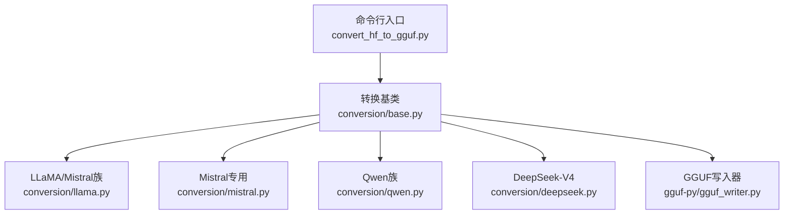
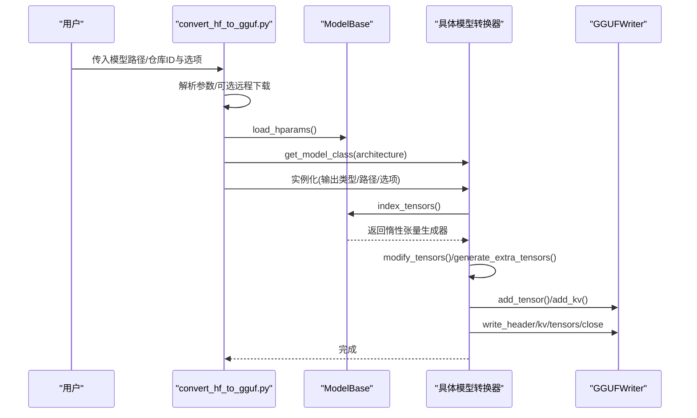
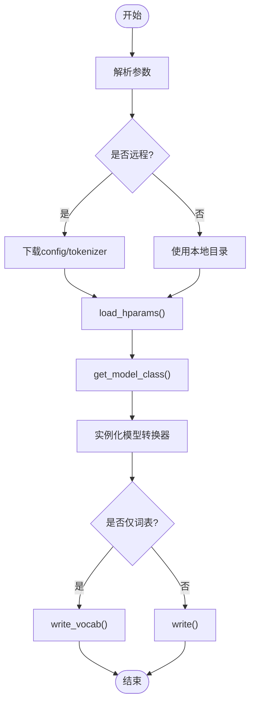
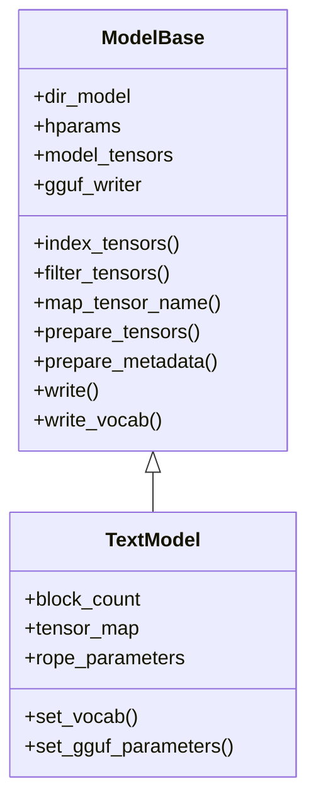
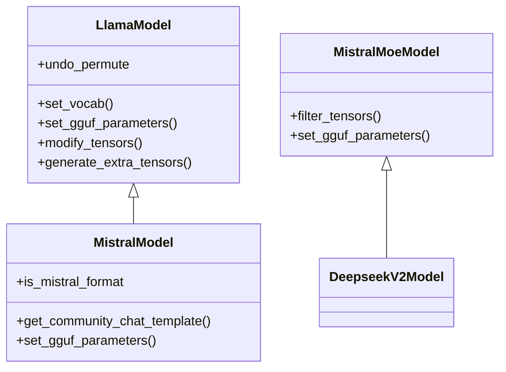
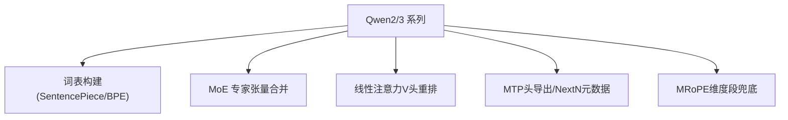
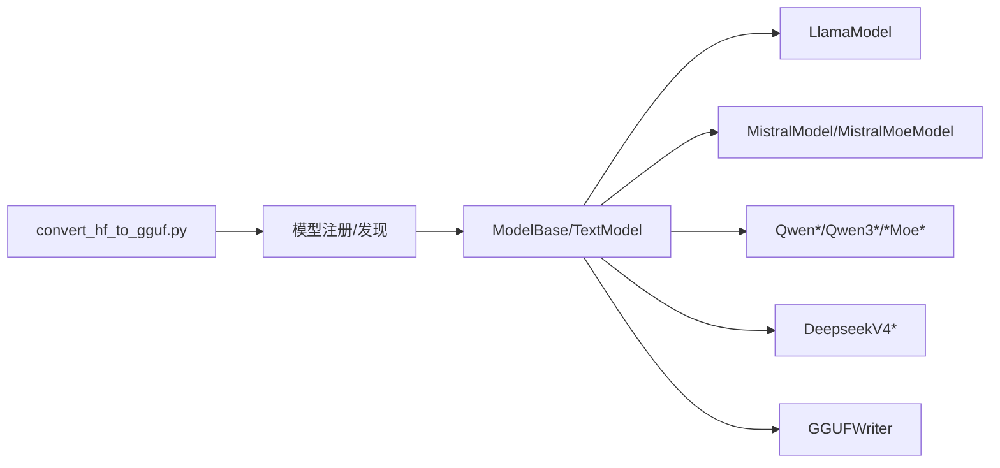

# HF模型转换

<cite>
**本文引用的文件**   
- [convert_hf_to_gguf.py](file://convert_hf_to_gguf.py)
- [base.py](file://conversion/base.py)
- [llama.py](file://conversion/llama.py)
- [mistral.py](file://conversion/mistral.py)
- [qwen.py](file://conversion/qwen.py)
- [deepseek.py](file://conversion/deepseek.py)
</cite>

## 目录
1. [简介](#简介)
2. [项目结构](#项目结构)
3. [核心组件](#核心组件)
4. [架构总览](#架构总览)
5. [详细组件分析](#详细组件分析)
6. [依赖关系分析](#依赖关系分析)
7. [性能与内存特性](#性能与内存特性)
8. [故障诊断与排错](#故障诊断与排错)
9. [结论](#结论)
10. [附录：自定义转换器开发指南](#附录自定义转换器开发指南)

## 简介
本文件系统性梳理 Hugging Face 到 GGUF 的模型转换流程，覆盖以下关键点：
- HF 模型结构的解析：配置文件、权重文件（safetensors/pytorch_model.bin）、分词器提取。
- 多架构权重映射与张量重命名策略：LLaMA、Mistral、Qwen、DeepSeek-V4 等。
- Chat 模板自动检测与注入逻辑。
- 参数完整性校验与错误处理机制。
- 自定义模型转换器的扩展方法（基类使用、重写点）。
- 常见问题诊断与解决方案。

## 项目结构
转换入口脚本位于仓库根目录，核心转换逻辑在 conversion 包中，按模型家族拆分实现；GGUF 写入由 gguf-py 提供。

**图表来源**
- [convert_hf_to_gguf.py:17-27](file://convert_hf_to_gguf.py#L17-L27)
- [base.py:80-178](file://conversion/base.py#L80-L178)

**章节来源**
- [convert_hf_to_gguf.py:17-27](file://convert_hf_to_gguf.py#L17-L27)
- [base.py:80-178](file://conversion/base.py#L80-L178)

## 核心组件
- 命令行入口：负责参数解析、远程下载、模型架构选择、实例化具体转换器并执行导出。
- 转换基类 ModelBase：统一加载配置、索引权重、过滤/映射张量、量化与重打包、写 GGUF 元数据与张量。
- 模型族转换器：LLaMA/Mistral/Qwen/DeepSeek 等，分别实现 set_vocab、set_gguf_parameters、modify_tensors 等钩子。
- GGUF 写入：通过 gguf.GGUFWriter 将张量与 KV 元数据持久化。

**章节来源**
- [convert_hf_to_gguf.py:48-176](file://convert_hf_to_gguf.py#L48-L176)
- [base.py:80-178](file://conversion/base.py#L80-L178)

## 架构总览
HF→GGUF 的整体流程如下：

**图表来源**
- [convert_hf_to_gguf.py:179-308](file://convert_hf_to_gguf.py#L179-L308)
- [base.py:219-308](file://conversion/base.py#L219-L308)
- [base.py:1129-1341](file://conversion/base.py#L1129-L1341)

## 详细组件分析

### 命令行入口 convert_hf_to_gguf.py
- 参数支持：仅导出词表、输出格式、大端序、临时文件、拆分、远程模式、Mistral 社区模板开关、MoE 融合、FP8→Q8_0、QKV 融合、目标模型目录（用于 EAGLE/DFlash 等草稿模型）等。
- 主要流程：
  - 若 --remote，则仅下载 config/tokenizer 等必要文件。
  - 根据是否 Mistral 格式与 mmproj/mtp/dspark 等标志选择具体模型类。
  - 实例化模型转换器后调用 write_vocab() 或 write()。

**图表来源**
- [convert_hf_to_gguf.py:48-176](file://convert_hf_to_gguf.py#L48-L176)
- [convert_hf_to_gguf.py:179-308](file://convert_hf_to_gguf.py#L179-L308)

**章节来源**
- [convert_hf_to_gguf.py:48-176](file://convert_hf_to_gguf.py#L48-L176)
- [convert_hf_to_gguf.py:179-308](file://convert_hf_to_gguf.py#L179-L308)

### 转换基类 ModelBase（conversion/base.py）
- 配置加载：优先 AutoConfig，失败回退 config.json；对部分模型做字段归一化（如 text_config/lm_config/thinker_config/language_config/lfm）。
- 权重索引：支持 safetensors 与 pytorch_model.bin，支持 index.json 校验一致性；支持远程懒加载。
- 张量过滤与映射：统一前缀清理、语言模型包装层剥离、名称映射至 GGUF 标准名。
- 量化与重打包：
  - 支持 BitNet、FP8、GPTQ、Compressed-Tensors、NVFP4、MXFP4 等格式的解码/重打包。
  - NVFP4/MXFP4 直接以原生块格式写入 GGUF，减少中间内存。
- 张量融合：
  - gate_exps + up_exps → gate_up_exps（MoE）。
  - q/k/v → qkv（注意力头融合）。
- 元数据与参数写入：上下文长度、RoPE 缩放、专家路由函数、MoE 参数、文件类型等。
- 完整性校验：
  - weight_map 与分片文件的一致性检查。
  - QKV 融合缓冲未消费报错。
  - 未知 BPE pre-tokenizer 哈希时抛出异常并提示更新脚本。

**图表来源**
- [base.py:80-178](file://conversion/base.py#L80-L178)
- [base.py:1509-1525](file://conversion/base.py#L1509-L1525)

**章节来源**
- [base.py:1436-1473](file://conversion/base.py#L1436-L1473)
- [base.py:219-308](file://conversion/base.py#L219-L308)
- [base.py:583-625](file://conversion/base.py#L583-L625)
- [base.py:841-903](file://conversion/base.py#L841-L903)
- [base.py:1129-1341](file://conversion/base.py#L1129-L1341)
- [base.py:1353-1405](file://conversion/base.py#L1353-L1405)
- [base.py:1798-2141](file://conversion/base.py#L1798-L2141)

### LLaMA/Mistral 族（conversion/llama.py, conversion/mistral.py）
- LLaMA 族：
  - 注册多个 HF 架构别名（LLaMAForCausalLM、MistralForCausalLM、MixtralForCausalLM、VLlama3ForCausalLM、LlavaForConditionalGeneration 等）。
  - 特殊处理 SmolVLM、Eagle3 草稿模型（需 target-model-dir），包括 d2t 整数张量、target_layers/target_hidden_size 等元数据写入。
  - RoPE 频率因子生成（llama3 rope_type）。
  - MoE 专家张量合并（block_sparse_moe.experts.*）。
- Mistral 专用：
  - is_mistral_format=True，兼容旧版 LLAMA 架构。
  - 社区 Chat 模板自动检测：基于 tokenizer version/type 选择内置 jinja 模板。
  - YARN/RoPE 缩放、attn_temperature_scale 等参数写入。
  - Mistral MoE 到 DeepSeek-V2 的参数映射复用。

**图表来源**
- [llama.py:17-33](file://conversion/llama.py#L17-L33)
- [llama.py:106-163](file://conversion/llama.py#L106-L163)
- [llama.py:175-181](file://conversion/llama.py#L175-L181)
- [llama.py:232-296](file://conversion/llama.py#L232-L296)
- [llama.py:298-326](file://conversion/llama.py#L298-L326)
- [mistral.py:24-40](file://conversion/mistral.py#L24-L40)
- [mistral.py:53-90](file://conversion/mistral.py#L53-L90)
- [mistral.py:92-112](file://conversion/mistral.py#L92-L112)
- [mistral.py:113-203](file://conversion/mistral.py#L113-L203)

**章节来源**
- [llama.py:17-33](file://conversion/llama.py#L17-L33)
- [llama.py:106-163](file://conversion/llama.py#L106-L163)
- [llama.py:175-181](file://conversion/llama.py#L175-L181)
- [llama.py:232-296](file://conversion/llama.py#L232-L296)
- [llama.py:298-326](file://conversion/llama.py#L298-L326)
- [mistral.py:24-40](file://conversion/mistral.py#L24-L40)
- [mistral.py:53-90](file://conversion/mistral.py#L53-L90)
- [mistral.py:92-112](file://conversion/mistral.py#L92-L112)
- [mistral.py:113-203](file://conversion/mistral.py#L113-L203)

### Qwen 族（conversion/qwen.py）
- Qwen/Qwen2/Qwen2Moe/Qwen3/Qwen3Moe/Qwen3Next/Qwen3_5TextModel/Qwen3_5MoeTextModel 等。
- 关键能力：
  - SentencePiece/GPT-2 BPE 词表构建。
  - Qwen2Moe 专家张量维度对齐与合并。
  - Qwen3 reranker 特殊输出头抽取（yes/no）。
  - Qwen3Next/Qwen3_5 线性注意力 V 头重排（grouped→tiled）适配 ggml broadcast。
  - MTP（多 token 预测）头导出：调整 block_count、nextn 元数据、权重重映射。
  - MRoPE 维度段默认值兜底。

**图表来源**
- [qwen.py:17-47](file://conversion/qwen.py#L17-L47)
- [qwen.py:49-75](file://conversion/qwen.py#L49-L75)
- [qwen.py:77-158](file://conversion/qwen.py#L77-L158)
- [qwen.py:160-257](file://conversion/qwen.py#L160-L257)
- [qwen.py:278-369](file://conversion/qwen.py#L278-L369)
- [qwen.py:371-436](file://conversion/qwen.py#L371-L436)
- [qwen.py:454-646](file://conversion/qwen.py#L454-L646)
- [qwen.py:649-683](file://conversion/qwen.py#L649-L683)

**章节来源**
- [qwen.py:17-47](file://conversion/qwen.py#L17-L47)
- [qwen.py:49-75](file://conversion/qwen.py#L49-L75)
- [qwen.py:77-158](file://conversion/qwen.py#L77-L158)
- [qwen.py:160-257](file://conversion/qwen.py#L160-L257)
- [qwen.py:278-369](file://conversion/qwen.py#L278-L369)
- [qwen.py:371-436](file://conversion/qwen.py#L371-L436)
- [qwen.py:454-646](file://conversion/qwen.py#L454-L646)
- [qwen.py:649-683](file://conversion/qwen.py#L649-L683)

### DeepSeek-V4（conversion/deepseek.py）
- 默认注入 chat 模板（区分 0731 版本）。
- 记录主层数与 nextn 层数，供后续导出逻辑使用。
- 与 base 的 NVFP4/MXFP4 路径协同，支持高效写入。

**章节来源**
- [deepseek.py:555-576](file://conversion/deepseek.py#L555-L576)

## 依赖关系分析
- 入口脚本依赖 conversion 包的模型注册与发现机制。
- 各模型族继承自 ModelBase/TextModel，覆写关键方法。
- GGUF 写入统一通过 gguf.GGUFWriter，保证格式一致性与可扩展性。

**图表来源**
- [convert_hf_to_gguf.py:17-27](file://convert_hf_to_gguf.py#L17-L27)
- [base.py:1475-1506](file://conversion/base.py#L1475-L1506)

**章节来源**
- [convert_hf_to_gguf.py:17-27](file://convert_hf_to_gguf.py#L17-L27)
- [base.py:1475-1506](file://conversion/base.py#L1475-L1506)

## 性能与内存特性
- 惰性张量加载：默认 lazy=True（尤其 remote 模式），避免一次性载入全部权重。
- 分片与临时文件：支持 split_max_tensors/split_max_size/use_temp_file，缓解内存压力。
- 张量融合：QKV 融合、gate_up_exps 融合可减少 I/O 与计算开销。
- 原生量化格式：NVFP4/MXFP4 直接以块格式写入，降低中间表示内存占用。
- 自动 outtype 推断：当 GUESSED 时根据首个张量 dtype 启发式设置 f16/bf16。

**章节来源**
- [base.py:124-178](file://conversion/base.py#L124-L178)
- [base.py:1129-1341](file://conversion/base.py#L1129-L1341)
- [base.py:841-903](file://conversion/base.py#L841-L903)

## 故障诊断与排错
- 权重文件不一致：weight_map 与实际分片不匹配或缺失文件会抛出 ValueError，列出缺失/多余张量与对应分片。
- QKV 融合未完成：缓冲未消费将报错，检查 fuse_qkv 与模型是否具备完整 Q/K/V 张量。
- BPE pre-tokenizer 未识别：哈希不匹配将抛 NotImplementedError，需更新 convert_hf_to_gguf_update.py 或拉取最新上游模型。
- Mistral 社区模板不支持：tokenizer version/type 未知时报错，可加 --disable-mistral-community-chat-template 绕过。
- 远程模式限制：仅下载 config/tokenizer，如需 safetensors 需开启 sentence-transformers dense modules 相关选项。
- 草稿模型缺少目标模型目录：EAGLE-3/DFlash 需要 --target-model-dir 提供 tokenizer 与目标模型元信息。

**章节来源**
- [base.py:294-308](file://conversion/base.py#L294-L308)
- [base.py:1343-1348](file://conversion/base.py#L1343-L1348)
- [base.py:2122-2135](file://conversion/base.py#L2122-L2135)
- [mistral.py:53-90](file://conversion/mistral.py#L53-L90)
- [convert_hf_to_gguf.py:192-206](file://convert_hf_to_gguf.py#L192-L206)
- [llama.py:59-63](file://conversion/llama.py#L59-L63)
- [qwen.py:751-756](file://conversion/qwen.py#L751-L756)

## 结论
该转换体系以 ModelBase 为核心，通过统一的配置加载、权重索引、张量映射与量化重打包流程，支撑多种 HF 架构到 GGUF 的高保真转换。不同模型族通过覆写关键方法实现差异化处理，同时保持整体流程一致性与可扩展性。结合惰性加载、分片与原生量化格式，兼顾了准确性与性能。

## 附录：自定义转换器开发指南
- 注册新模型：
  - 在 conversion 下新建模块，继承 TextModel 或 LlamaModel 等现有基类。
  - 使用 @ModelBase.register("YourHFArchitecture") 注册 HF 架构名。
  - 可选 @ModelBase.example(...) 添加示例仓库以便文档展示。
- 必须覆写的方法：
  - set_vocab()：定义词表加载逻辑（SentencePiece/GPT-2 BPE/HF Tokenizer 等）。
  - set_gguf_parameters()：写入模型参数（上下文长度、RoPE、MoE、注意力变体等）。
  - modify_tensors()：按需进行张量变换、拆分/合并、维度转置、特殊张量处理。
  - generate_extra_tensors()：可选，生成额外张量（如 RoPE 频率因子）。
- 常用工具：
  - find_hparam()：安全读取 hparams 中的键。
  - map_tensor_name()/format_tensor_name()：与 GGUF 标准名映射。
  - prepare_qkv_fusion()/fuse_gate_up_exps：启用张量融合。
  - dequant_model()/repack_*：处理各种量化格式。
- 调试建议：
  - 使用 --verbose 查看日志。
  - 先跑 vocab-only 验证词表正确性。
  - 对比原始与转换后的 logits（参考 examples/model-conversion）。

**章节来源**
- [base.py:1475-1506](file://conversion/base.py#L1475-L1506)
- [base.py:1509-1525](file://conversion/base.py#L1509-L1525)
- [base.py:1605-1719](file://conversion/base.py#L1605-L1719)
- [base.py:841-903](file://conversion/base.py#L841-L903)
- [base.py:1129-1341](file://conversion/base.py#L1129-L1341)