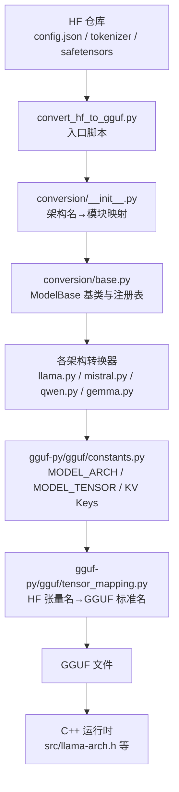
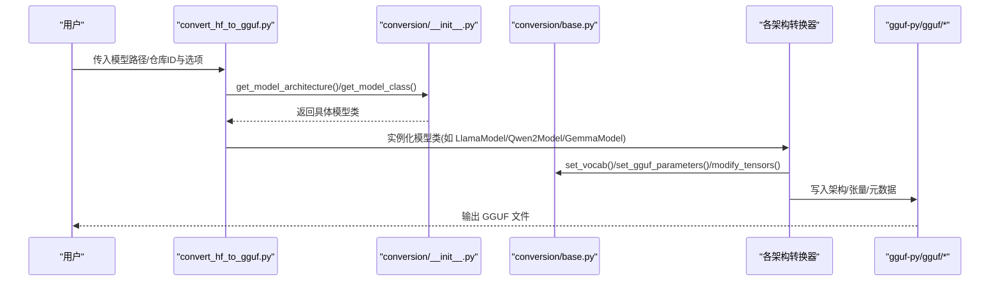
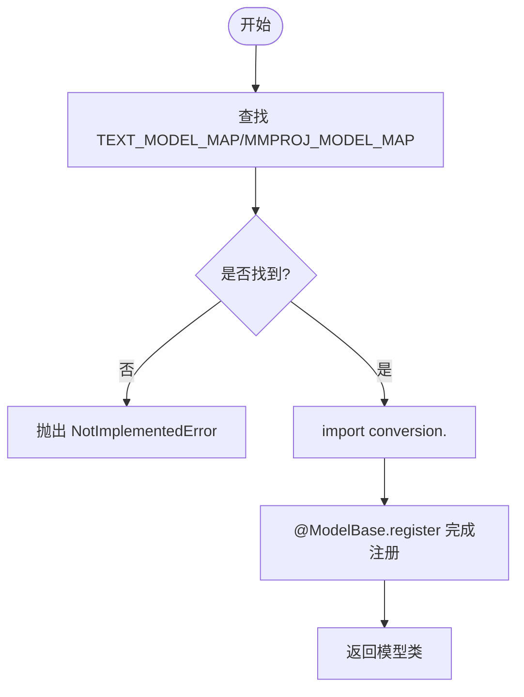
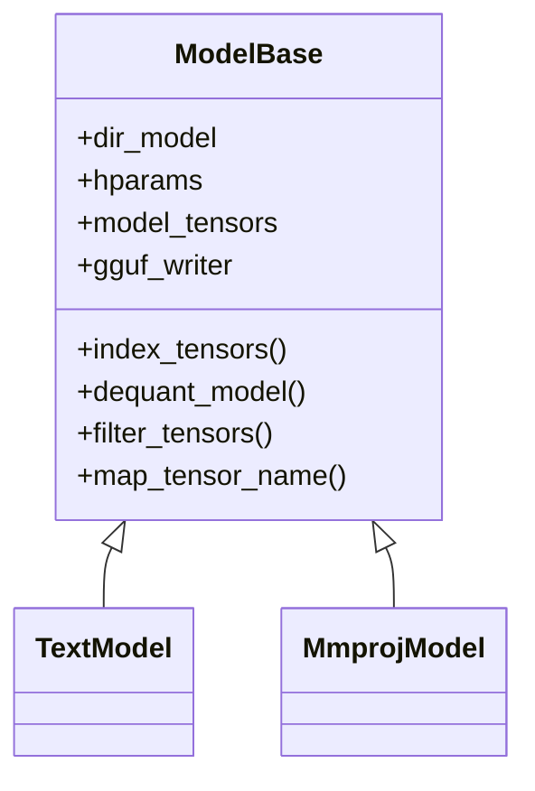
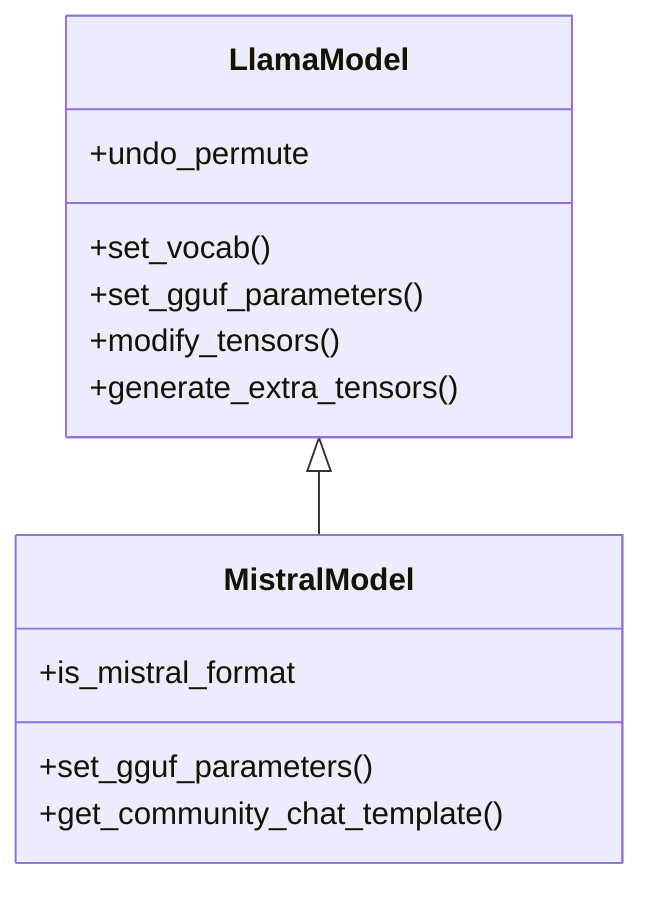
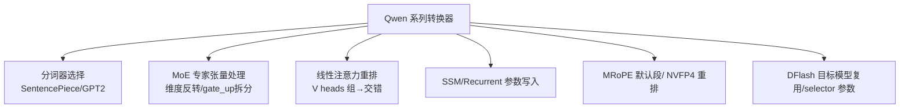
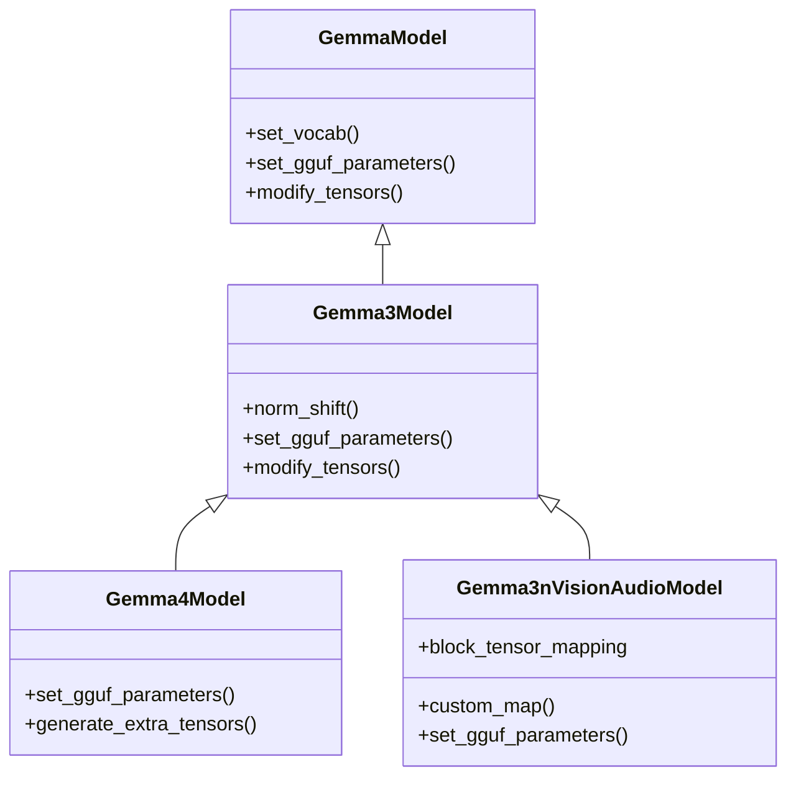
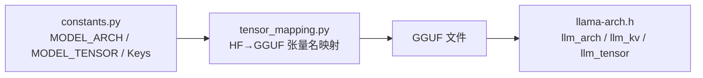
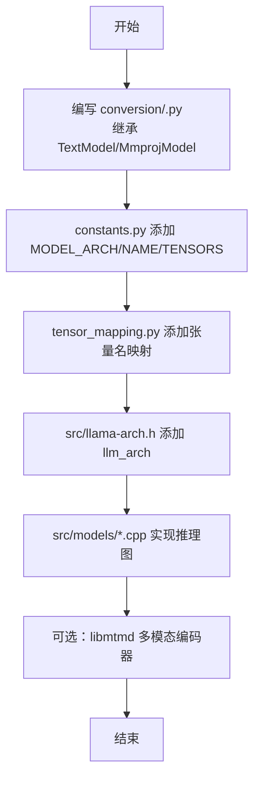
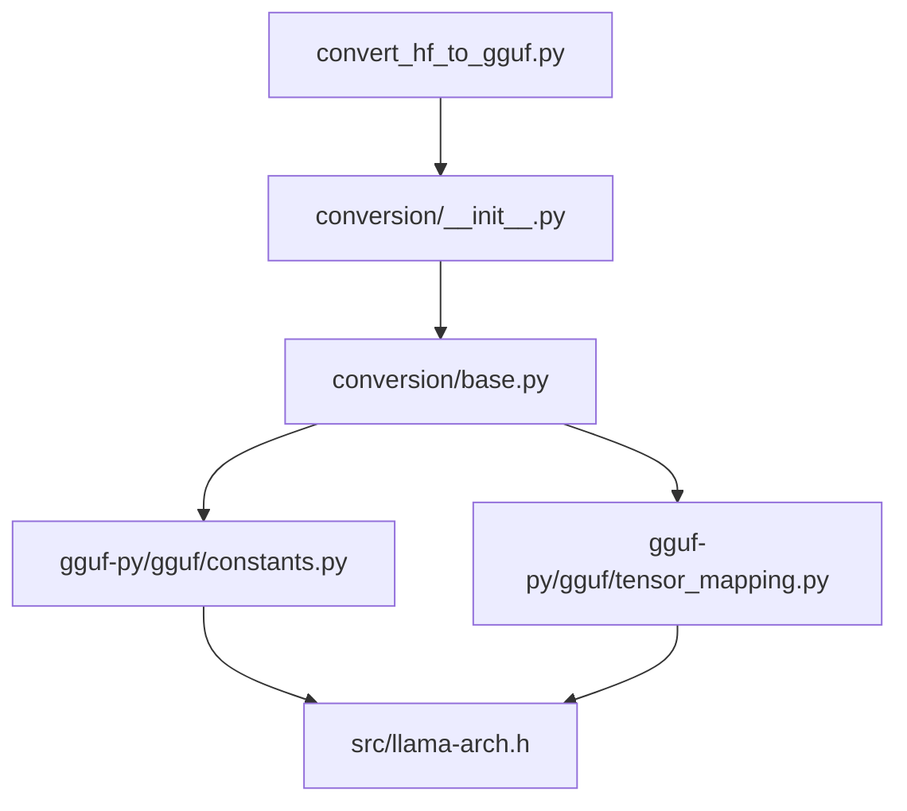

# 支持的模型架构

<cite>
**本文引用的文件**   
- [README.md](file://README.md)
- [convert_hf_to_gguf.py](file://convert_hf_to_gguf.py)
- [conversion/__init__.py](file://conversion/__init__.py)
- [conversion/base.py](file://conversion/base.py)
- [conversion/llama.py](file://conversion/llama.py)
- [conversion/mistral.py](file://conversion/mistral.py)
- [conversion/qwen.py](file://conversion/qwen.py)
- [conversion/gemma.py](file://conversion/gemma.py)
- [gguf-py/gguf/constants.py](file://gguf-py/gguf/constants.py)
- [gguf-py/gguf/tensor_mapping.py](file://gguf-py/gguf/tensor_mapping.py)
- [src/llama-arch.h](file://src/llama-arch.h)
- [docs/development/HOWTO-add-model.md](file://docs/development/HOWTO-add-model.md)
</cite>

## 目录
1. [简介](#简介)
2. [项目结构](#项目结构)
3. [核心组件](#核心组件)
4. [架构总览](#架构总览)
5. [详细组件分析](#详细组件分析)
6. [依赖关系分析](#依赖关系分析)
7. [性能与优化](#性能与优化)
8. [故障诊断指南](#故障诊断指南)
9. [结论](#结论)
10. [附录](#附录)

## 简介
本文件系统性说明 llama.cpp 对 HuggingFace 模型架构的识别、转换与加载机制，覆盖 LLaMA、Mistral、Qwen、Gemma 等主流架构。重点包括：
- 自动检测与动态注册机制
- 配置文件解析规则与参数映射
- 权重命名约定与张量映射策略
- GGUF 常量与 C++ 侧架构枚举的对应关系
- 新增架构的完整流程与最佳实践
- 常见问题的定位与解决方案

## 项目结构
本项目在“Python 转换层 + GGUF 规范 + C++ 运行时”三层协同工作：
- Python 转换层：负责从 HF 仓库读取配置、Tokenizer 与权重，按架构规则转换为 GGUF
- GGUF 规范：定义模型架构、张量名称、KV 元数据键等
- C++ 运行时：根据 GGUF 中的架构标识加载并构建推理图

图示来源
- [convert_hf_to_gguf.py:178-308](file://convert_hf_to_gguf.py#L178-L308)
- [conversion/__init__.py:19-305](file://conversion/__init__.py#L19-L305)
- [conversion/base.py:80-200](file://conversion/base.py#L80-L200)
- [gguf-py/gguf/constants.py:527-685](file://gguf-py/gguf/constants.py#L527-L685)
- [gguf-py/gguf/tensor_mapping.py:8-185](file://gguf-py/gguf/tensor_mapping.py#L8-L185)
- [src/llama-arch.h:13-171](file://src/llama-arch.h#L13-L171)

章节来源
- [README.md:60-118](file://README.md#L60-L118)

## 核心组件
- convert_hf_to_gguf.py：命令行入口，解析参数，选择模型类，调用写入器生成 GGUF
- conversion/__init__.py：维护 HF 架构名到转换模块的映射，支持懒加载与打印已注册模型
- conversion/base.py：提供 ModelBase/TextModel/MmprojModel 基类、HParams 加载、张量索引、去量化、GGUF 写入封装
- gguf-py/gguf/constants.py：集中定义 MODEL_ARCH、MODEL_TENSOR、TENSOR_NAMES、KV Keys 等
- gguf-py/gguf/tensor_mapping.py：维护不同架构的张量名映射（含块级 {bid} 模板）
- src/llama-arch.h：C++ 侧 llm_arch 枚举与 KV/Tensor 枚举，与 GGUF 常量保持同步

章节来源
- [convert_hf_to_gguf.py:48-176](file://convert_hf_to_gguf.py#L48-L176)
- [conversion/__init__.py:19-305](file://conversion/__init__.py#L19-L305)
- [conversion/base.py:80-200](file://conversion/base.py#L80-L200)
- [gguf-py/gguf/constants.py:527-685](file://gguf-py/gguf/constants.py#L527-L685)
- [gguf-py/gguf/tensor_mapping.py:8-185](file://gguf-py/gguf/tensor_mapping.py#L8-L185)
- [src/llama-arch.h:13-171](file://src/llama-arch.h#L13-L171)

## 架构总览
下图展示从 HF 到 GGUF 的关键流程，以及各架构转换器如何参与。

图示来源
- [convert_hf_to_gguf.py:178-308](file://convert_hf_to_gguf.py#L178-L308)
- [conversion/__init__.py:394-423](file://conversion/__init__.py#L394-L423)
- [conversion/base.py:124-200](file://conversion/base.py#L124-L200)

## 详细组件分析

### 架构自动检测与动态注册
- 架构名到模块映射：TEXT_MODEL_MAP 与 MMPROJ_MODEL_MAP 将 HF 的 ForCausalLM/ForConditionalGeneration 等类名映射到 conversion 下的模块名
- 懒加载：load_all_models() 按需 import 对应模块以触发 @ModelBase.register 装饰器完成注册
- 动态获取：get_model_class(name, mmproj=False) 通过映射表找到模块并返回注册的类

图示来源
- [conversion/__init__.py:19-305](file://conversion/__init__.py#L19-L305)
- [conversion/__init__.py:394-423](file://conversion/__init__.py#L394-L423)

章节来源
- [conversion/__init__.py:19-305](file://conversion/__init__.py#L19-L305)
- [conversion/__init__.py:394-423](file://conversion/__init__.py#L394-L423)

### 基类与通用处理（ModelBase/TextModel/MmprojModel）
- HParams 加载：ModelBase.load_hparams 兼容多种 config 布局，支持 Mistral 格式
- 张量索引：index_tensors 支持本地/远程 safetensors 与 PyTorch bin，惰性加载
- 去量化：dequant_model 支持 bitnet/fp8/gptq/compressed-tensors/modelopt 等多种量化格式
- GGUF 写入：统一通过 gguf.GGUFWriter 写入架构、张量、KV 元数据

图示来源
- [conversion/base.py:80-200](file://conversion/base.py#L80-L200)
- [conversion/base.py:219-308](file://conversion/base.py#L219-L308)
- [conversion/base.py:326-581](file://conversion/base.py#L326-L581)

章节来源
- [conversion/base.py:80-200](file://conversion/base.py#L80-L200)
- [conversion/base.py:219-308](file://conversion/base.py#L219-L308)
- [conversion/base.py:326-581](file://conversion/base.py#L326-L581)

### LLaMA/Mistral 系列
- LLaMA 族（LLaMA、Mistral、Mixtral、VLlama3、Voxtral、Eagle3 等）统一由 LlamaModel 处理
  - 特殊逻辑：Eagle3 草稿模型的自动检测、target model 配置注入、RoPE 频率因子生成
  - Q/K 头置换 undo_permute 适配不同实现
  - MoE 专家张量聚合与合并
- Mistral 专用：
  - is_mistral_format=True，兼容旧版 LLAMA 架构
  - 社区聊天模板自动匹配（基于 mistral-common）
  - YARN RoPE 缩放与温度系数写入

图示来源
- [conversion/llama.py:17-36](file://conversion/llama.py#L17-L36)
- [conversion/llama.py:37-104](file://conversion/llama.py#L37-L104)
- [conversion/llama.py:106-195](file://conversion/llama.py#L106-L195)
- [conversion/llama.py:232-360](file://conversion/llama.py#L232-L360)
- [conversion/mistral.py:24-51](file://conversion/mistral.py#L24-L51)
- [conversion/mistral.py:92-111](file://conversion/mistral.py#L92-L111)

章节来源
- [conversion/llama.py:17-36](file://conversion/llama.py#L17-L36)
- [conversion/llama.py:37-104](file://conversion/llama.py#L37-L104)
- [conversion/llama.py:106-195](file://conversion/llama.py#L106-L195)
- [conversion/llama.py:232-360](file://conversion/llama.py#L232-L360)
- [conversion/mistral.py:24-51](file://conversion/mistral.py#L24-L51)
- [conversion/mistral.py:92-111](file://conversion/mistral.py#L92-L111)

### Qwen 系列
- Qwen/Qwen2/Qwen2-MoE/Qwen3/Qwen3-MoE/Qwen3-Next/Qwen3.5/Qwen3.5-MoE/DFlash 等
- 关键特性：
  - Qwen2/3 文本模型使用 SentencePiece 或 GPT2 分词
  - Qwen2-MoE/Qwen3-MoE：专家张量维度反转与 gate_up 拆分
  - Qwen3-Next：线性注意力 V 头重排、SSM 参数写入、Recurrent 层标记
  - Qwen3.5：MRoPE 默认段划分、NVFP4 权重重排
  - DFlash：目标模型 tokenizer 复用、RoPE partial rotary factor、selector 参数写入

图示来源
- [conversion/qwen.py:17-75](file://conversion/qwen.py#L17-L75)
- [conversion/qwen.py:77-158](file://conversion/qwen.py#L77-L158)
- [conversion/qwen.py:160-257](file://conversion/qwen.py#L160-L257)
- [conversion/qwen.py:278-394](file://conversion/qwen.py#L278-L394)
- [conversion/qwen.py:454-646](file://conversion/qwen.py#L454-L646)
- [conversion/qwen.py:649-700](file://conversion/qwen.py#L649-L700)
- [conversion/qwen.py:746-800](file://conversion/qwen.py#L746-L800)

章节来源
- [conversion/qwen.py:17-75](file://conversion/qwen.py#L17-L75)
- [conversion/qwen.py:77-158](file://conversion/qwen.py#L77-L158)
- [conversion/qwen.py:160-257](file://conversion/qwen.py#L160-L257)
- [conversion/qwen.py:278-394](file://conversion/qwen.py#L278-L394)
- [conversion/qwen.py:454-646](file://conversion/qwen.py#L454-L646)
- [conversion/qwen.py:649-700](file://conversion/qwen.py#L649-L700)
- [conversion/qwen.py:746-800](file://conversion/qwen.py#L746-L800)

### Gemma 系列
- Gemma/Gemma2/Gemma3/Gemma3n/Gemma4 等
- 关键特性：
  - 特殊 token 与 add_space_prefix 控制
  - RMSNorm 值偏移（+1）处理
  - Gemma3：滑动窗口、final_logit_softcapping、per-layer embedding
  - Gemma3n：视觉/音频编码器、MobileNetV5 双索引映射、altup 投影矩阵堆叠
  - Gemma4：KV shared layers、SWA/Full 层 head_dim 差异、proportional RoPE 频率因子

图示来源
- [conversion/gemma.py:17-70](file://conversion/gemma.py#L17-L70)
- [conversion/gemma.py:73-123](file://conversion/gemma.py#L73-L123)
- [conversion/gemma.py:125-181](file://conversion/gemma.py#L125-L181)
- [conversion/gemma.py:259-312](file://conversion/gemma.py#L259-L312)
- [conversion/gemma.py:365-483](file://conversion/gemma.py#L365-L483)
- [conversion/gemma.py:486-629](file://conversion/gemma.py#L486-L629)
- [conversion/gemma.py:632-740](file://conversion/gemma.py#L632-L740)

章节来源
- [conversion/gemma.py:17-70](file://conversion/gemma.py#L17-L70)
- [conversion/gemma.py:73-123](file://conversion/gemma.py#L73-L123)
- [conversion/gemma.py:125-181](file://conversion/gemma.py#L125-L181)
- [conversion/gemma.py:259-312](file://conversion/gemma.py#L259-L312)
- [conversion/gemma.py:365-483](file://conversion/gemma.py#L365-L483)
- [conversion/gemma.py:486-629](file://conversion/gemma.py#L486-L629)
- [conversion/gemma.py:632-740](file://conversion/gemma.py#L632-L740)

### GGUF 常量与 C++ 侧枚举
- gguf-py/gguf/constants.py：定义 MODEL_ARCH、MODEL_TENSOR、TENSOR_NAMES、Keys.* 等
- src/llama-arch.h：C++ 侧 llm_arch、llm_kv、llm_tensor 枚举，需与 GGUF 常量保持一致

图示来源
- [gguf-py/gguf/constants.py:527-685](file://gguf-py/gguf/constants.py#L527-L685)
- [gguf-py/gguf/tensor_mapping.py:8-185](file://gguf-py/gguf/tensor_mapping.py#L8-L185)
- [src/llama-arch.h:13-171](file://src/llama-arch.h#L13-L171)

章节来源
- [gguf-py/gguf/constants.py:527-685](file://gguf-py/gguf/constants.py#L527-L685)
- [gguf-py/gguf/tensor_mapping.py:8-185](file://gguf-py/gguf/tensor_mapping.py#L8-L185)
- [src/llama-arch.h:13-171](file://src/llama-arch.h#L13-L171)

### 新增模型架构流程
参考 HOWTO-add-model.md，新增架构的标准步骤：
1. 编写转换脚本：在 conversion/<name>.py 中继承 TextModel/MmprojModel，使用 @ModelBase.register 注册 HF 架构名
2. 定义 GGUF 常量：在 constants.py 中添加 MODEL_ARCH、MODEL_ARCH_NAMES、MODEL_TENSORS
3. 张量名映射：在 tensor_mapping.py 中补充 block_mappings_cfg 或 mappings_cfg
4. C++ 侧注册：在 src/llama-arch.h 添加 llm_arch，并在相关 switch/迭代处补齐
5. 推理图实现：在 src/models/*.cpp 实现 build_arch_graph，并在 llama_model_mapping 中注册
6. 可选：多模态编码器（libmtmd）

图示来源
- [docs/development/HOWTO-add-model.md:19-128](file://docs/development/HOWTO-add-model.md#L19-L128)

章节来源
- [docs/development/HOWTO-add-model.md:19-128](file://docs/development/HOWTO-add-model.md#L19-L128)

## 依赖关系分析
- 转换入口依赖 architecture 解析与模型类动态导入
- 各架构转换器依赖 base 提供的通用能力（分词、参数写入、张量修改）
- GGUF 常量与 tensor_mapping 为所有架构共享
- C++ 运行时依赖 GGUF 中写入的架构与张量信息

图示来源
- [convert_hf_to_gguf.py:178-308](file://convert_hf_to_gguf.py#L178-L308)
- [conversion/__init__.py:394-423](file://conversion/__init__.py#L394-L423)
- [conversion/base.py:124-200](file://conversion/base.py#L124-L200)
- [gguf-py/gguf/constants.py:527-685](file://gguf-py/gguf/constants.py#L527-L685)
- [gguf-py/gguf/tensor_mapping.py:8-185](file://gguf-py/gguf/tensor_mapping.py#L8-L185)
- [src/llama-arch.h:13-171](file://src/llama-arch.h#L13-L171)

## 性能与优化
- 优先在转换阶段进行张量变换（如 Hadamard 折叠、Q/K 置换、gate_up 拆分），减少运行时开销
- 合理使用 ggml_rope_ext，避免显式 sin/cos 矩阵，降低内存占用
- 选择性应用 RoPE（部分 head 旋转）可通过 n_dims/n_offs 优化
- 对 FP8/NVFP4 等量化格式，尽量在转换期解量化或重排，提升量化质量与数值稳定性

章节来源
- [docs/development/HOWTO-add-model.md:159-197](file://docs/development/HOWTO-add-model.md#L159-L197)

## 故障诊断指南
- 架构不支持：当 get_model_class 找不到映射时抛出异常，检查 TEXT_MODEL_MAP/MMPROJ_MODEL_MAP 是否包含该 HF 架构名
- 张量缺失或不匹配：index_tensors 会校验 weight_map 与实际文件一致性，若缺失会报错
- 量化格式不支持：dequant_model 遇到未知 quant_method 会抛出不支持异常，需扩展支持或预处理
- Mistral 社区模板错误：tokenizer 版本不匹配时提示禁用社区模板或使用官方 mistral-common

章节来源
- [conversion/__init__.py:415-423](file://conversion/__init__.py#L415-L423)
- [conversion/base.py:294-308](file://conversion/base.py#L294-L308)
- [conversion/base.py:571-574](file://conversion/base.py#L571-L574)
- [conversion/mistral.py:53-90](file://conversion/mistral.py#L53-L90)

## 结论
llama.cpp 通过“Python 转换层 + GGUF 规范 + C++ 运行时”的分层设计，实现了广泛的 HF 模型架构支持。其核心在于：
- 清晰的架构注册与动态加载机制
- 统一的张量命名与映射体系
- 灵活的参数与元数据处理
- 可扩展的新架构接入流程

遵循本文档的流程与实践，可高效地为新架构提供支持，并确保与现有生态的良好兼容。

## 附录
- 常用命令：
  - 列出支持的模型：python convert_hf_to_gguf.py --print-supported-models
  - 转换本地目录：python convert_hf_to_gguf.py /path/to/model_dir
  - 转换远程仓库：python convert_hf_to_gguf.py --remote user/repo-id
- 关键参数：
  - --outtype：输出数据类型（f32/f16/bf16/q8_0/auto）
  - --fuse-qkv：合并 Q/K/V 权重
  - --fuse-gate-up-exps：合并 gate/up 专家权重
  - --mmproj/--mtp/--dspark：导出多模态投影/多token预测/DeepSeek-V4 DSpark 草稿

章节来源
- [convert_hf_to_gguf.py:48-176](file://convert_hf_to_gguf.py#L48-L176)
- [convert_hf_to_gguf.py:178-308](file://convert_hf_to_gguf.py#L178-L308)