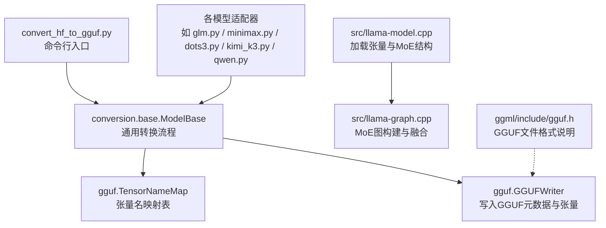
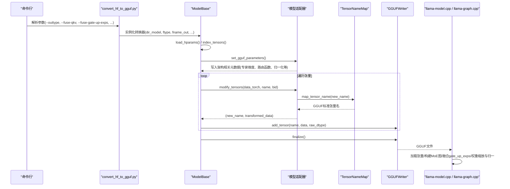
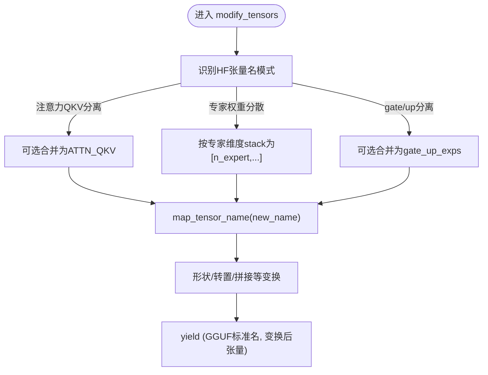
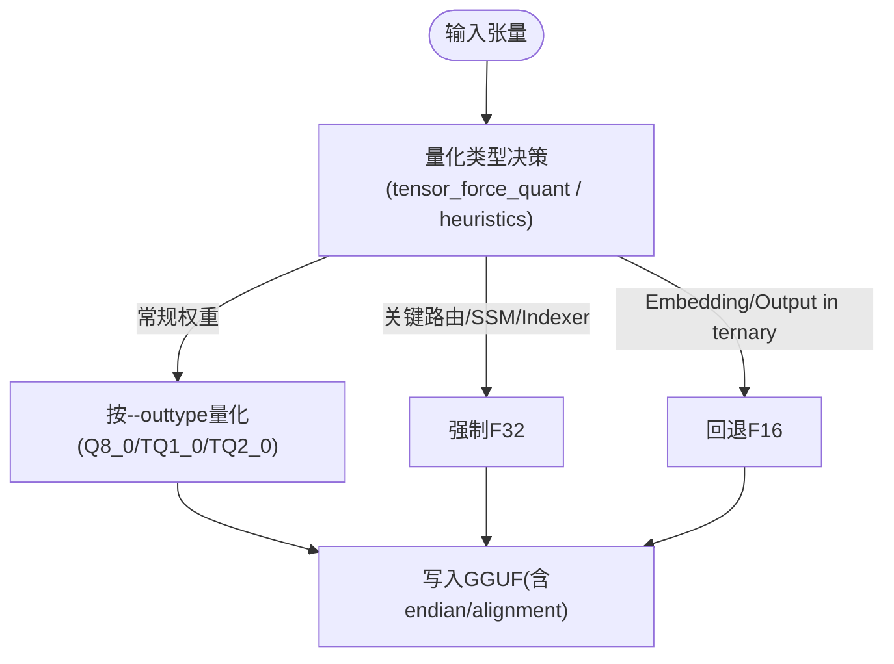
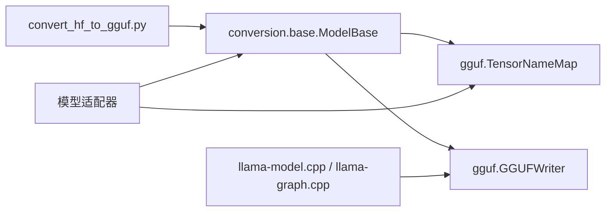

# 权重映射策略

<cite>
**本文引用的文件**   
- [convert_hf_to_gguf.py](file://convert_hf_to_gguf.py)
- [base.py](file://conversion/base.py)
- [tensor_mapping.py](file://gguf-py/gguf/tensor_mapping.py)
- [llama-model.cpp](file://src/llama-model.cpp)
- [llama-graph.cpp](file://src/llama-graph.cpp)
- [glm.py](file://conversion/glm.py)
- [minimax.py](file://conversion/minimax.py)
- [dots3.py](file://conversion/dots3.py)
- [kimi_k3.py](file://conversion/kimi_k3.py)
- [qwen.py](file://conversion/qwen.py)
- [gguf.h](file://ggml/include/gguf.h)
- [README.md](file://tools/quantize/README.md)
</cite>

## 目录
1. [简介](#简介)
2. [项目结构](#项目结构)
3. [核心组件](#核心组件)
4. [架构总览](#架构总览)
5. [详细组件分析](#详细组件分析)
6. [依赖关系分析](#依赖关系分析)
7. [性能与量化考量](#性能与量化考量)
8. [故障排查指南](#故障排查指南)
9. [结论](#结论)
10. [附录](#附录)

## 简介
本文件系统化梳理从 HuggingFace 模型到 GGUF 格式的权重映射策略，覆盖张量重命名、形状变换、数据类型映射；详解不同模型架构中注意力层、前馈网络、归一化层的权重对应关系；文档化 MoE 专家权重的处理与多头注意力的重组；介绍量化过程中的压缩算法与精度保持策略；并提供自定义权重映射的实现指南、调试技巧以及完整性验证与错误检测方法。

## 项目结构
权重转换入口位于顶层脚本，核心逻辑由 conversion 包中的基类与各模型适配器实现，GGUF 的张量名规范集中在 gguf-py 的 tensor_mapping.py 中，运行时加载与 MoE 执行路径在 C++ 源码中定义。



**图表来源**
- [convert_hf_to_gguf.py:179-308](file://convert_hf_to_gguf.py#L179-L308)
- [base.py:124-200](file://conversion/base.py#L124-L200)
- [tensor_mapping.py:8-185](file://gguf-py/gguf/tensor_mapping.py#L8-L185)
- [llama-model.cpp:1741-1750](file://src/llama-model.cpp#L1741-L1750)
- [llama-graph.cpp:2272-2307](file://src/llama-graph.cpp#L2272-L2307)
- [gguf.h:1-34](file://ggml/include/gguf.h#L1-L34)

**章节来源**
- [convert_hf_to_gguf.py:179-308](file://convert_hf_to_gguf.py#L179-L308)
- [base.py:124-200](file://conversion/base.py#L124-L200)

## 核心组件
- 转换入口：解析参数、选择模型类、实例化转换器并调用 write/write_vocab。
- 通用转换器 ModelBase：负责加载配置、索引张量、设置 GGUF Writer、类型推断、分片与端序、元数据写入、张量过滤与修改、量化决策等。
- 张量映射表 TensorNameMap：集中维护 HF 张量名到 GGUF 标准张量名的映射规则（含块级模板）。
- 模型适配器：针对特定架构（GLM、Minimax、Dots3、Kimi-K3、Qwen2-MoE 等）重写 set_gguf_parameters、modify_tensors、filter_tensors、tensor_force_quant 等方法，完成架构特定的形状变换、合并/拆分、路由参数写入与量化强制。
- 运行时加载与执行：C++ 侧根据 GGUF 元数据构建模型结构与 MoE 计算图，支持 gate_up_exps 融合、权重缩放与归一、专家缓存与多后端优化。

**章节来源**
- [convert_hf_to_gguf.py:179-308](file://convert_hf_to_gguf.py#L179-L308)
- [base.py:124-200](file://conversion/base.py#L124-L200)
- [tensor_mapping.py:8-185](file://gguf-py/gguf/tensor_mapping.py#L8-L185)

## 架构总览
下图展示从 HF 到 GGUF 的端到端流程，包括参数解析、模型类选择、张量索引与映射、GGUF 写入，以及运行时的加载与 MoE 执行路径。



**图表来源**
- [convert_hf_to_gguf.py:179-308](file://convert_hf_to_gguf.py#L179-L308)
- [base.py:124-200](file://conversion/base.py#L124-L200)
- [tensor_mapping.py:8-185](file://gguf-py/gguf/tensor_mapping.py#L8-L185)
- [llama-graph.cpp:2272-2307](file://src/llama-graph.cpp#L2272-L2307)

## 详细组件分析

### 张量重命名与形状变换
- 全局映射：TensorNameMap.mappings_cfg 和 block_mappings_cfg 提供大量 HF 张量名到 GGUF 标准张量名的映射，包含 token embedding、输出头、各类归一化、注意力 Q/K/V/O、FFN up/gate/down、MoE gate/experts 等。
- 块级模板：使用 {bid} 占位符匹配层号，适配不同模型的命名差异。
- 形状变换：适配器在 modify_tensors 中按架构需求对张量进行 reshape/transpose/stack/concat 等操作，例如将分散的专家权重堆叠为 [n_expert, ...] 或合并 gate/up 为 gate_up。



**图表来源**
- [tensor_mapping.py:187-742](file://gguf-py/gguf/tensor_mapping.py#L187-L742)
- [base.py:124-200](file://conversion/base.py#L124-L200)

**章节来源**
- [tensor_mapping.py:187-742](file://gguf-py/gguf/tensor_mapping.py#L187-L742)

### 注意力层、前馈网络、归一化层映射
- 注意力层：
  - 输入归一化：ATTN_NORM（如 model.layers.{bid}.input_layernorm 等）。
  - Q/K/V：ATTN_Q / ATTN_K / ATTN_V，或合并为 ATTN_QKV。
  - 输出投影：ATTN_OUT。
  - 可选 Q/K 归一化：ATTN_Q_NORM / ATTN_K_NORM。
  - 旋转位置编码：ATTN_ROT_EMBD。
- 前馈网络：
  - 归一化：FFN_NORM（或 FFN_PRE_NORM / FFN_POST_NORM 变体）。
  - 门控/上采样/下采样：FFN_GATE / FFN_UP / FFN_DOWN。
  - MoE 扩展：FFN_GATE_INP、FFN_GATE_EXP / FFN_UP_EXP / FFN_DOWN_EXP、共享专家 FFN_GATE_SHEXP / FFN_UP_SHEXP / FFN_DOWN_SHEXP。
- 归一化层：
  - 输出归一化：OUTPUT_NORM。
  - 其他变体：ATTN_OUT_NORM、ATTN_POST_NORM、FFN_POST_NORM 等。

这些映射覆盖了 LLaMA、Bloom、Falcon、MPT、Qwen、DeepSeek、GLM、T5、RWKV 等多种架构。

**章节来源**
- [tensor_mapping.py:187-742](file://gguf-py/gguf/tensor_mapping.py#L187-L742)

### MoE 专家权重处理与多头注意力重组
- 专家权重堆叠：
  - GLM：收集每个专家的 down_proj/gate_proj/up_proj，按专家维度 stack 成单个张量。
  - Minimax：类似地合并 block_sparse_moe.experts.w1/w2/w3。
  - Dots3：视觉 MoE 专家 fc1/fc2/fc3 堆叠。
- 路由与偏置：
  - 写入 expert_feed_forward_length、expert_shared_count、routed_scaling_factor、norm_topk_prob、gating_func 等元数据。
  - 某些模型需要 FP32 路由权重以保证数值稳定性（如 Dots3 的 ffn_gate_inp/exp_probs_b）。
- 多头注意力重组：
  - 通过 --fuse-qkv 将分离的 Q/K/V 合并为单一 ATTEN_QKV 张量，减少 I/O 与提升算子效率。
  - Gate/Up 合并：通过 --fuse-gate-up-exps 将 gate_exps 与 up_exps 合并为 gate_up_exps，便于 mul_mat_id 与后续 split 视图。

```mermaid
classDiagram
class GLM_MoE {
+set_gguf_parameters()
+modify_tensors(data_torch, name, bid)
-_experts : list[dict]
}
class Minimax_MoE {
+set_gguf_parameters()
+modify_tensors(data_torch, name, bid)
-_experts_cache : dict
}
class Dots3_MoE {
+set_gguf_parameters()
+modify_tensors(data_torch, name, bid)
-_vis_experts : dict
}
GLM_MoE --> "stack experts by dim=0" : "down/gate/up"
Minimax_MoE --> "stack experts by dim=0" : "w1/w2/w3"
Dots3_MoE --> "stack experts by dim=0" : "fc1/fc2/fc3"
```

**图表来源**
- [glm.py:508-538](file://conversion/glm.py#L508-L538)
- [minimax.py:128-159](file://conversion/minimax.py#L128-L159)
- [dots3.py:289-323](file://conversion/dots3.py#L289-L323)

**章节来源**
- [glm.py:508-538](file://conversion/glm.py#L508-L538)
- [minimax.py:128-159](file://conversion/minimax.py#L128-L159)
- [dots3.py:289-323](file://conversion/dots3.py#L289-L323)
- [kimi_k3.py:208-227](file://conversion/kimi_k3.py#L208-L227)
- [qwen.py:77-91](file://conversion/qwen.py#L77-L91)

### 量化过程中的权重压缩与精度保持
- 输出类型映射：
  - convert_hf_to_gguf.py 将 --outtype 映射到 gguf.LlamaFileType（f32/f16/bf16/q8_0/tq1_0/tq2_0/auto）。
  - ModelBase 在自动模式下根据首个张量 dtype 启发式推断 MOSTLY_BF16/MOSTLY_F16。
- 张量级量化决策：
  - base.py 中对部分关键张量强制 F32（如 SSM conv、indexer proj），并对 token_embd/output 等在 ternary 模式下回退为 F16。
  - 适配器可覆写 tensor_force_quant 以强制特定张量为 F32/F16（如 Dots3 的路由权重、Conv 权重）。
- GGUF 格式与字节序：
  - gguf.h 描述 GGUF 文件结构（魔数、版本、张量数量、KV 对、张量元数据与二进制 blob）。
  - 工具支持大端/小端转换（gguf_convert_endian.py）。
- 量化选项与重要性矩阵：
  - tools/quantize/README.md 提供 --pure、--imatrix、--include-weights/--exclude-weights、--output-tensor-type、--token-embedding-type 等高级选项，用于控制混合量化与精度保留。



**图表来源**
- [convert_hf_to_gguf.py:212-220](file://convert_hf_to_gguf.py#L212-L220)
- [base.py:179-200](file://conversion/base.py#L179-L200)
- [base.py:1272-1303](file://conversion/base.py#L1272-L1303)
- [gguf.h:1-34](file://ggml/include/gguf.h#L1-L34)
- [README.md:53-67](file://tools/quantize/README.md#L53-L67)

**章节来源**
- [convert_hf_to_gguf.py:212-220](file://convert_hf_to_gguf.py#L212-L220)
- [base.py:179-200](file://conversion/base.py#L179-L200)
- [base.py:1272-1303](file://conversion/base.py#L1272-L1303)
- [gguf.h:1-34](file://ggml/include/gguf.h#L1-L34)
- [README.md:53-67](file://tools/quantize/README.md#L53-L67)

### 自定义权重映射实现指南
- 继承 ModelBase 或 TextModel/MmprojModel，注册模型架构并实现：
  - set_gguf_parameters：写入架构相关元数据（专家维度、路由函数、归一化 eps、激活函数等）。
  - modify_tensors：对张量进行名称映射、形状变换、合并/拆分、堆叠专家等。
  - filter_tensors：选择性跳过不需要导出的张量（如多模态投影、视频分支等）。
  - tensor_force_quant：对关键张量强制高精度（F32/F16）。
- 使用 TensorNameMap 提供的映射键（MODEL_TENSOR.*）确保输出符合 GGUF 标准。
- 利用 --fuse-qkv 与 --fuse-gate-up-exps 开关简化下游算子。

**章节来源**
- [base.py:124-200](file://conversion/base.py#L124-L200)
- [tensor_mapping.py:8-185](file://gguf-py/gguf/tensor_mapping.py#L8-L185)
- [convert_hf_to_gguf.py:151-163](file://convert_hf_to_gguf.py#L151-L163)

### 调试技巧
- 启用 --verbose 打印详细日志，定位张量名不匹配或形状异常。
- 使用 --dry-run 仅输出分片计划，不写入文件，检查 split_max_tensors/split_max_size。
- 对于远程仓库，使用 --remote 下载 config/tokenizer，必要时添加 sentence-transformers dense modules。
- 对 MoE 模型，确认专家数量与权重是否全部被 stack，避免 leftover 报错（参考 Dots3 的 prepare_tensors 校验）。
- 对路由权重，优先使用 F32 以避免 near-tied expert scores 导致的数值不稳定。

**章节来源**
- [convert_hf_to_gguf.py:187-190](file://convert_hf_to_gguf.py#L187-L190)
- [convert_hf_to_gguf.py:222-225](file://convert_hf_to_gguf.py#L222-L225)
- [convert_hf_to_gguf.py:192-206](file://convert_hf_to_gguf.py#L192-L206)
- [dots3.py:310-316](file://conversion/dots3.py#L310-L316)
- [dots3.py:317-323](file://conversion/dots3.py#L317-L323)

### 权重完整性验证与错误检测
- 张量存在性与形状校验：
  - 在适配器 prepare_tensors 中检查未处理的专家权重残留，抛出 ValueError。
  - 测试用例中可对 token_embd.weight 等关键张量的 shape 与维度断言。
- GGUF 元数据一致性：
  - 确保写入的专家维度、路由函数、归一化参数与模型实际结构一致。
- 运行时加载校验：
  - llama-model.cpp 在加载时按需创建可选张量（如专家权重 scale），缺失则标记为 NOT_REQUIRED。
- 常见错误：
  - 专家权重未完全收集导致 stack 失败。
  - 路由权重量化为低精度导致选择偏差。
  - Q/K/V 未正确合并导致注意力计算错误。

**章节来源**
- [dots3.py:310-316](file://conversion/dots3.py#L310-L316)
- [tests/test-gguf-model-data.cpp:71-91](file://tests/test-gguf-model-data.cpp#L71-L91)
- [llama-model.cpp:1741-1750](file://src/llama-model.cpp#L1741-L1750)

## 依赖关系分析
- 模块耦合：
  - convert_hf_to_gguf.py 依赖 conversion.base 与 gguf 库。
  - 各模型适配器依赖 TensorNameMap 与 GGUFWriter。
  - 运行时依赖 GGUF 元数据与张量布局（如 MUL_MAT_ID 的专家权重维度）。
- 外部依赖：
  - torch、numpy、transformers.AutoConfig。
  - 可选 mistral-common（Mistral 格式）。
- 潜在循环依赖：
  - 无直接循环；适配器通过基类与映射表解耦。



**图表来源**
- [convert_hf_to_gguf.py:179-308](file://convert_hf_to_gguf.py#L179-L308)
- [base.py:124-200](file://conversion/base.py#L124-L200)
- [tensor_mapping.py:8-185](file://gguf-py/gguf/tensor_mapping.py#L8-L185)
- [llama-model.cpp:1741-1750](file://src/llama-model.cpp#L1741-L1750)
- [llama-graph.cpp:2272-2307](file://src/llama-graph.cpp#L2272-L2307)

**章节来源**
- [convert_hf_to_gguf.py:179-308](file://convert_hf_to_gguf.py#L179-L308)
- [base.py:124-200](file://conversion/base.py#L124-L200)

## 性能与量化考量
- 合并策略：
  - --fuse-qkv 减少注意力 I/O 与算子次数。
  - --fuse-gate-up-exps 降低 MulMatID 的重复读取与内存占用。
- 量化选择：
  - 自动模式基于首张量 dtype 推断输出类型。
  - 关键路由/SSM/Indexer 权重强制 F32 保证数值稳定。
  - Ternary 模式下 Embedding/Output 回退 F16 以保持质量。
- 后端优化：
  - OpenVINO/CUDA 等后端对 MUL_MAT_ID 与 MoE 加权求和进行融合与向量化优化。

**章节来源**
- [convert_hf_to_gguf.py:151-163](file://convert_hf_to_gguf.py#L151-L163)
- [base.py:179-200](file://conversion/base.py#L179-L200)
- [base.py:1272-1303](file://conversion/base.py#L1272-L1303)
- [llama-graph.cpp:2272-2307](file://src/llama-graph.cpp#L2272-L2307)

## 故障排查指南
- 张量名不匹配：
  - 检查 TensorNameMap 是否包含目标 HF 张量名；必要时在适配器中临时修正 new_name。
- 形状不一致：
  - 在 modify_tensors 中打印张量形状，确认 reshape/stack/concat 是否符合预期。
- 专家权重缺失：
  - 确认 n_experts 与实际权重数量一致；检查 prepare_tensors 的 leftover 校验。
- 路由不稳定：
  - 将 ffn_gate_inp/exp_probs_b 强制为 F32；检查 norm_topk_prob/routed_scaling_factor 是否正确写入。
- 量化质量下降：
  - 使用 --imatrix 与 --include-weights/--exclude-weights 调整重要性矩阵；考虑 --output-tensor-type 与 --token-embedding-type。

**章节来源**
- [tensor_mapping.py:187-742](file://gguf-py/gguf/tensor_mapping.py#L187-L742)
- [dots3.py:310-323](file://conversion/dots3.py#L310-L323)
- [README.md:53-67](file://tools/quantize/README.md#L53-L67)

## 结论
本文件系统梳理了 HF 到 GGUF 的权重映射策略，涵盖张量重命名、形状变换、数据类型映射，以及注意力、FFN、归一化层的对应关系；详细说明了 MoE 专家权重的堆叠与路由参数的写入，以及多头注意力的合并优化；介绍了量化压缩与精度保持策略，并提供了自定义映射的实现指南、调试技巧与完整性验证方法。遵循上述规范可实现高保真、高性能的模型转换与部署。

## 附录
- 常用参数速查：
  - --outtype：f32/f16/bf16/q8_0/tq1_0/tq2_0/auto
  - --fuse-qkv：合并 Q/K/V
  - --fuse-gate-up-exps：合并 gate_exps/up_exps
  - --remote：远程读取 safetensors
  - --mmproj：导出多模态投影
  - --mtp/--no-mtp/--dspark：多令牌预测/DSpark 草稿导出

**章节来源**
- [convert_hf_to_gguf.py:48-163](file://convert_hf_to_gguf.py#L48-L163)