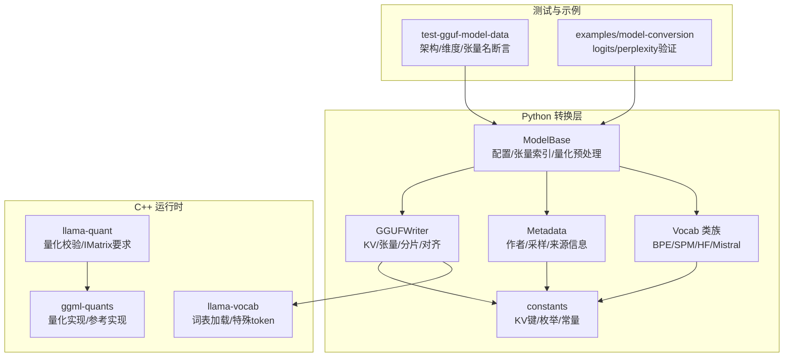
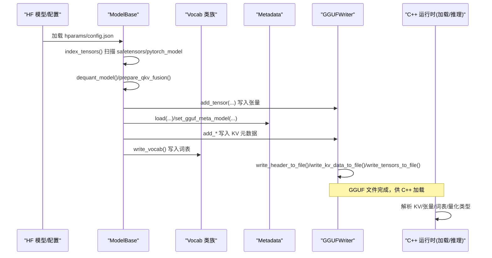
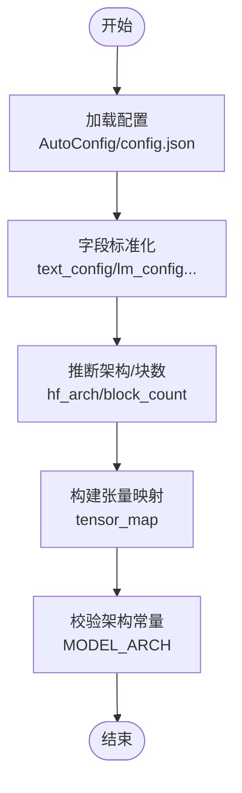
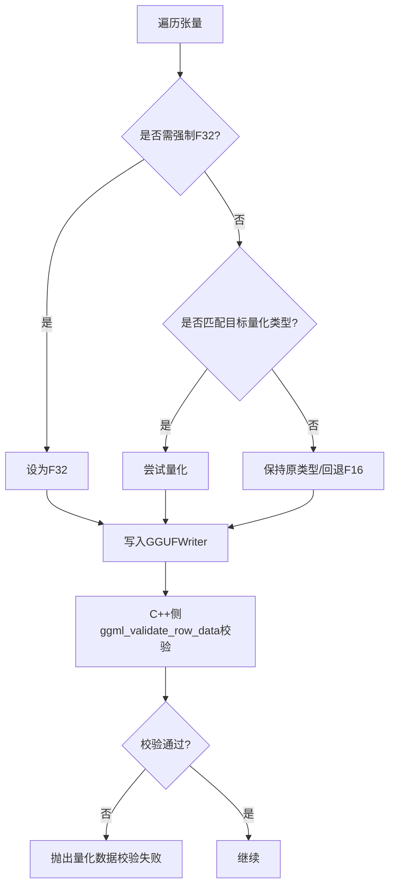
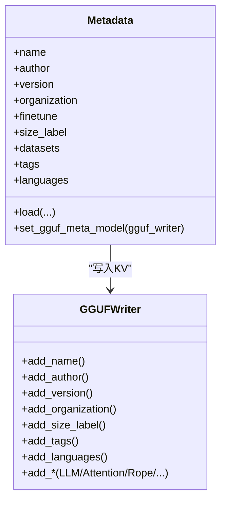
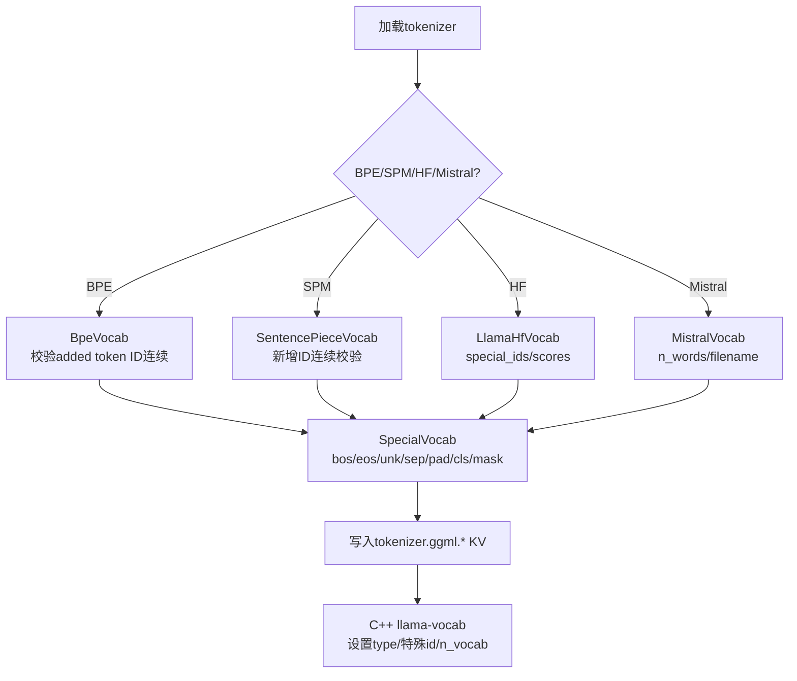
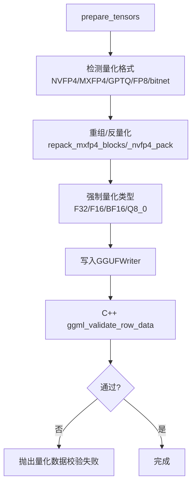
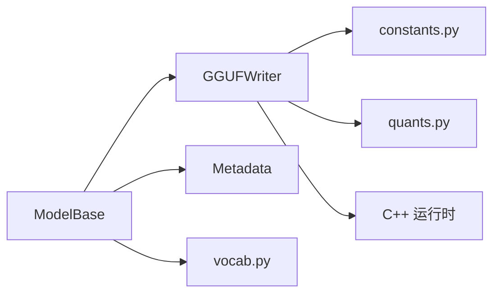

# 模型验证检查

<cite>
**本文引用的文件**   
- [conversion/base.py](file://conversion/base.py)
- [gguf-py/gguf/vocab.py](file://gguf-py/gguf/vocab.py)
- [gguf-py/gguf/metadata.py](file://gguf-py/gguf/metadata.py)
- [gguf-py/gguf/gguf_writer.py](file://gguf-py/gguf/gguf_writer.py)
- [gguf-py/gguf/constants.py](file://gguf-py/gguf/constants.py)
- [src/llama-vocab.cpp](file://src/llama-vocab.cpp)
- [src/llama-quant.cpp](file://src/llama-quant.cpp)
- [ggml/src/ggml-quants.c](file://ggml/src/ggml-quants.c)
- [tests/test-gguf-model-data.cpp](file://tests/test-gguf-model-data.cpp)
- [tools/mtmd/models/mimo-audio.cpp](file://tools/mtmd/models/mimo-audio.cpp)
- [tools/mtmd/mtmd-helper-gen.cpp](file://tools/mtmd/mtmd-helper-gen.cpp)
- [examples/model-conversion/README.md](file://examples/model-conversion/README.md)
- [skills/add-new-model/SKILL.md](file://skills/add-new-model/SKILL.md)
</cite>

## 目录
1. [引言](#引言)
2. [项目结构](#项目结构)
3. [核心组件](#核心组件)
4. [架构总览](#架构总览)
5. [详细组件分析](#详细组件分析)
6. [依赖关系分析](#依赖关系分析)
7. [性能与数值稳定性](#性能与数值稳定性)
8. [故障诊断与修复](#故障诊断与修复)
9. [批量验证与自动化脚本](#批量验证与自动化脚本)
10. [结论](#结论)

## 引言
本文件系统化梳理 llama.cpp 在“模型转换到 GGUF”过程中的完整性验证机制，覆盖配置参数校验、权重维度一致性、元数据完整性、词汇表大小与特殊 token 处理、量化参数合理性及数值稳定性检查，并给出日志记录与错误报告方式、常见失败诊断与修复建议，以及批量验证与自动化脚本的使用方法。目标是帮助开发者与使用者在引入新模型或修改现有转换流程时，快速定位问题并确保输出 GGUF 的可靠性与可复现性。

## 项目结构
围绕模型验证的关键代码分布在以下模块：
- Python 转换层（HF→GGUF）：负责读取 HF 配置、索引张量、映射名称、处理量化格式、写入 GGUF 元数据与张量。
- GGUF 库（Python）：定义常量、KV 键、写入器、分片策略、对齐与类型系统。
- C++ 运行时加载与推理：负责解析 GGUF KV、构建词表、执行量化与推理。
- 测试与示例：提供模型元数据断言、logits 对比、perplexity 评估等验证手段。

图表来源
- [conversion/base.py:124-200](file://conversion/base.py#L124-L200)
- [gguf-py/gguf/gguf_writer.py:87-112](file://gguf-py/gguf/gguf_writer.py#L87-L112)
- [gguf-py/gguf/constants.py:21-106](file://gguf-py/gguf/constants.py#L21-L106)
- [src/llama-vocab.cpp:2073-2108](file://src/llama-vocab.cpp#L2073-L2108)
- [src/llama-quant.cpp:837-884](file://src/llama-quant.cpp#L837-L884)
- [tests/test-gguf-model-data.cpp:38-91](file://tests/test-gguf-model-data.cpp#L38-L91)

章节来源
- [conversion/base.py:124-200](file://conversion/base.py#L124-L200)
- [gguf-py/gguf/gguf_writer.py:87-112](file://gguf-py/gguf/gguf_writer.py#L87-L112)
- [gguf-py/gguf/constants.py:21-106](file://gguf-py/gguf/constants.py#L21-L106)
- [src/llama-vocab.cpp:2073-2108](file://src/llama-vocab.cpp#L2073-L2108)
- [tests/test-gguf-model-data.cpp:38-91](file://tests/test-gguf-model-data.cpp#L38-L91)

## 核心组件
- ModelBase（Python）：统一入口，负责加载配置、索引张量、过滤/映射名称、处理 NVFP4/MXFP4/GPTQ/FP8 等量化格式、准备 Q/K/V 融合、生成额外张量、决定量化类型、写入 GGUF。
- GGUFWriter（Python）：管理 GGUF 文件头、KV 数据、张量信息、分片、对齐、字节序、进度与 dry-run。
- Metadata（Python）：从 README/frontmatter、config.json、generation_config.json 与覆盖文件抽取作者/采样/数据集/许可证等元数据，并写入 GGUF。
- Vocab 类族（Python）：支持 BPE、SentencePiece、HuggingFace tokenizer、Mistral tokenizer，负责词表大小、新增 token、特殊 token、合并规则与 chat template。
- C++ 侧（llama-vocab/llama-quant/ggml-quants）：加载 GGUF KV、初始化词表、校验量化数据、执行量化/反量化与点积运算。

章节来源
- [conversion/base.py:124-200](file://conversion/base.py#L124-L200)
- [gguf-py/gguf/gguf_writer.py:87-112](file://gguf-py/gguf/gguf_writer.py#L87-L112)
- [gguf-py/gguf/metadata.py:60-146](file://gguf-py/gguf/metadata.py#L60-L146)
- [gguf-py/gguf/vocab.py:413-560](file://gguf-py/gguf/vocab.py#L413-L560)
- [src/llama-vocab.cpp:2073-2108](file://src/llama-vocab.cpp#L2073-L2108)
- [src/llama-quant.cpp:837-884](file://src/llama-quant.cpp#L837-L884)

## 架构总览
下图展示从 HF 模型到 GGUF 的转换与验证关键路径，包括配置读取、张量索引、量化预处理、元数据写入、词表写入与最终文件落盘。

图表来源
- [conversion/base.py:219-308](file://conversion/base.py#L219-L308)
- [conversion/base.py:1129-1341](file://conversion/base.py#L1129-L1341)
- [gguf-py/gguf/gguf_writer.py:215-253](file://gguf-py/gguf/gguf_writer.py#L215-L253)
- [gguf-py/gguf/gguf_writer.py:443-493](file://gguf-py/gguf/gguf_writer.py#L443-L493)

## 详细组件分析

### 配置参数检查与架构一致性
- 配置加载：优先通过 transformers AutoConfig，回退到 config.json；对多模态/特定架构进行字段重命名（如 text_config/lm_config/thinker_config/language_config）。
- 架构识别：TextModel 根据 hparams 推断 hf_arch，设置 block_count 与 tensor_map，确保后续张量映射正确。
- 架构常量：constants.MODEL_ARCH 枚举所有支持的架构，用于 writer.add_architecture 与 KV 键模板。

图表来源
- [conversion/base.py:1436-1473](file://conversion/base.py#L1436-L1473)
- [conversion/base.py:1509-1525](file://conversion/base.py#L1509-L1525)
- [gguf-py/gguf/constants.py:527-684](file://gguf-py/gguf/constants.py#L527-L684)

章节来源
- [conversion/base.py:1436-1473](file://conversion/base.py#L1436-L1473)
- [conversion/base.py:1509-1525](file://conversion/base.py#L1509-L1525)
- [gguf-py/gguf/constants.py:527-684](file://gguf-py/gguf/constants.py#L527-L684)

### 权重维度验证与张量完整性
- 张量索引与缺失检测：index_tensors 比较 weight_map 与实际文件中的张量名集合，若不一致抛出 ValueError，提示缺失/多余张量与对应文件。
- 维度与形状：prepare_tensors 中按张量名匹配强制 F32/F16/BF16/Q8_0 等量化类型；对某些张量（如位置嵌入、归一化、SSM 卷积等）强制 F32。
- 运行时断言：C++ 侧 ggml_validate_row_data 对量化数据进行行级有效性检查，失败则抛异常。

图表来源
- [conversion/base.py:1221-1341](file://conversion/base.py#L1221-L1341)
- [src/llama-quant.cpp:837-854](file://src/llama-quant.cpp#L837-L854)

章节来源
- [conversion/base.py:219-308](file://conversion/base.py#L219-L308)
- [conversion/base.py:1221-1341](file://conversion/base.py#L1221-L1341)
- [src/llama-quant.cpp:837-854](file://src/llama-quant.cpp#L837-L854)

### 元数据完整性测试
- Metadata 从 README frontmatter、config.json、generation_config.json 与覆盖文件抽取采样参数、作者、版本、组织、许可证、基础模型、数据集、标签、语言等，并通过 set_gguf_meta_model 写入 GGUF。
- GGUFWriter 提供大量 add_* 方法写入 KV，包含 general.* 与 {arch}.* 系列键。
- 测试用例断言架构、层数、embedding/head 数量、张量计数与关键张量名存在性。

图表来源
- [gguf-py/gguf/metadata.py:60-146](file://gguf-py/gguf/metadata.py#L60-L146)
- [gguf-py/gguf/metadata.py:606-732](file://gguf-py/gguf/metadata.py#L606-L732)
- [gguf-py/gguf/gguf_writer.py:506-800](file://gguf-py/gguf/gguf_writer.py#L506-L800)
- [tests/test-gguf-model-data.cpp:38-91](file://tests/test-gguf-model-data.cpp#L38-L91)

章节来源
- [gguf-py/gguf/metadata.py:60-146](file://gguf-py/gguf/metadata.py#L60-L146)
- [gguf-py/gguf/metadata.py:606-732](file://gguf-py/gguf/metadata.py#L606-L732)
- [gguf-py/gguf/gguf_writer.py:506-800](file://gguf-py/gguf/gguf_writer.py#L506-L800)
- [tests/test-gguf-model-data.cpp:38-91](file://tests/test-gguf-model-data.cpp#L38-L91)

### 词汇表大小验证与特殊 token 处理
- Python 侧：
  - BpeVocab/SentencePieceVocab/LlamaHfVocab/MistralVocab 分别处理不同 tokenizer，计算 vocab_size_base、added_tokens、special_ids，并校验新增 token ID 连续性。
  - SpecialVocab 从 tokenizer.json/config.json 提取 bos/eos/unk/sep/pad/cls/mask 等 special token 及其 id，并写入 GGUF。
- C++ 侧：
  - llama-vocab 根据 tokenizer_model 设置 LLAMA_VOCAB_TYPE_NONE/SPM/WPM 等，并默认特殊 token id（如 llama 的 bos=1, eos=2, unk=0），同时可从 KV 读取 n_vocab。

图表来源
- [gguf-py/gguf/vocab.py:413-560](file://gguf-py/gguf/vocab.py#L413-L560)
- [gguf-py/gguf/vocab.py:563-683](file://gguf-py/gguf/vocab.py#L563-L683)
- [gguf-py/gguf/vocab.py:720-783](file://gguf-py/gguf/vocab.py#L720-L783)
- [src/llama-vocab.cpp:2073-2108](file://src/llama-vocab.cpp#L2073-L2108)

章节来源
- [gguf-py/gguf/vocab.py:413-560](file://gguf-py/gguf/vocab.py#L413-L560)
- [gguf-py/gguf/vocab.py:563-683](file://gguf-py/gguf/vocab.py#L563-L683)
- [gguf-py/gguf/vocab.py:720-783](file://gguf-py/gguf/vocab.py#L720-L783)
- [src/llama-vocab.cpp:2073-2108](file://src/llama-vocab.cpp#L2073-L2108)

### 量化参数的合理性检查与数值稳定性
- Python 侧：
  - prepare_tensors 检测 NVFP4/MXFP4/GPTQ/FP8/bitnet/compressed-tensors 等量化格式，必要时反量化或重组布局（如 repack_mxfp4_blocks/_nvfp4_pack）。
  - 对部分张量强制 F32/F16/BF16/Q8_0，避免不兼容量化导致精度损失或性能退化。
- C++ 侧：
  - llama-quant 使用 ggml_validate_row_data 对量化数据进行行级校验，失败抛异常。
  - ggml-quants 提供多种量化参考实现（如 q8_0_ref），保证确定性。

图表来源
- [conversion/base.py:1129-1211](file://conversion/base.py#L1129-L1211)
- [conversion/base.py:917-1018](file://conversion/base.py#L917-L1018)
- [src/llama-quant.cpp:837-854](file://src/llama-quant.cpp#L837-L854)
- [ggml/src/ggml-quants.c:276-281](file://ggml/src/ggml-quants.c#L276-L281)

章节来源
- [conversion/base.py:1129-1211](file://conversion/base.py#L1129-L1211)
- [conversion/base.py:917-1018](file://conversion/base.py#L917-L1018)
- [src/llama-quant.cpp:837-854](file://src/llama-quant.cpp#L837-L854)
- [ggml/src/ggml-quants.c:276-281](file://ggml/src/ggml-quants.c#L276-L281)

### 转换日志记录与错误报告
- Python 侧：
  - logging.getLogger("hf-to-gguf") 与 logger.warning/info 记录配置加载、张量映射、量化类型、分片计划、写入进度等。
  - GGUFWriter.print_plan 打印分片文件名与张量数量/总大小；write_tensors_to_file 支持 tqdm 进度条。
- C++ 侧：
  - LOG_ERR/LOG_WARN 等宏输出音频辅助工具的错误信息（如缺失特殊 token、无 token embedding）。

章节来源
- [conversion/base.py:55-56](file://conversion/base.py#L55-L56)
- [conversion/base.py:1339-1341](file://conversion/base.py#L1339-L1341)
- [gguf-py/gguf/gguf_writer.py:186-200](file://gguf-py/gguf/gguf_writer.py#L186-L200)
- [gguf-py/gguf/gguf_writer.py:443-493](file://gguf-py/gguf/gguf_writer.py#L443-L493)
- [tools/mtmd/mtmd-helper-gen.cpp:690-715](file://tools/mtmd/mtmd-helper-gen.cpp#L690-L715)

## 依赖关系分析
- ModelBase 依赖 gguf.GGUFWriter、gguf.Metadata、gguf.vocab 与 constants。
- GGUFWriter 依赖 constants（KV 键、枚举、常量）与 quants（量化形状转换）。
- C++ 运行时依赖 GGUF 解析与 ggml 量化内核。

图表来源
- [conversion/base.py:124-200](file://conversion/base.py#L124-L200)
- [gguf-py/gguf/gguf_writer.py:87-112](file://gguf-py/gguf/gguf_writer.py#L87-L112)
- [gguf-py/gguf/constants.py:21-106](file://gguf-py/gguf/constants.py#L21-L106)

章节来源
- [conversion/base.py:124-200](file://conversion/base.py#L124-L200)
- [gguf-py/gguf/gguf_writer.py:87-112](file://gguf-py/gguf/gguf_writer.py#L87-L112)
- [gguf-py/gguf/constants.py:21-106](file://gguf-py/gguf/constants.py#L21-L106)

## 性能与数值稳定性
- 量化类型选择：对 token embedding/output 等高频查找表建议使用更高精度（如 Q8_0）以减少解码阶段反量化开销；对某些张量强制 F32 以保证数值稳定。
- 分片与对齐：GGUFWriter 支持 split_max_tensors/split_max_size 与 data_alignment，避免单文件过大与内存压力。
- 进度与 Dry-run：print_plan 与 write_tensors_to_file(progress=True) 便于监控；dry_run 仅打印计划不写文件。

章节来源
- [conversion/base.py:1247-1341](file://conversion/base.py#L1247-L1341)
- [gguf-py/gguf/gguf_writer.py:165-200](file://gguf-py/gguf/gguf_writer.py#L165-L200)
- [gguf-py/gguf/gguf_writer.py:443-493](file://gguf-py/gguf/gguf_writer.py#L443-L493)

## 故障诊断与修复
- 配置/架构不一致：
  - 现象：张量映射失败或 KV 键缺失。
  - 排查：确认 AutoConfig 成功加载，字段已标准化；检查 MODEL_ARCH 是否包含该架构。
  - 修复：补充字段重命名逻辑或注册新架构。
- 张量缺失/多余：
  - 现象：index_tensors 抛出 ValueError，提示 missing/extra tensors。
  - 排查：核对 weight_map 与实际文件；检查 safetensors/pytorch_model 分片是否完整。
  - 修复：补齐缺失文件或修正 weight_map。
- 词汇表越界/ID 不连续：
  - 现象：BpeVocab/SentencePieceVocab 抛出 ValueError，新增 token ID 不连续或超出范围。
  - 排查：检查 added_tokens.json 与 tokenizer.json；确认 vocab_size 与 max(token_id)。
  - 修复：修正 added_tokens 或调整 vocab_size。
- 量化数据校验失败：
  - 现象：ggml_validate_row_data 失败，抛出“quantized data validation failed”。
  - 排查：检查量化类型与张量形状；确认 IMatrix 需求（某些 IQx/IQ2 需要 imatrix）。
  - 修复：调整量化类型或提供 imatrix；对不支持的量化回退 F16。
- 特殊 token 缺失：
  - 现象：mtmd_helper_gen_audio 报错缺少 <|audio_bos|> 或无 token embeddings。
  - 排查：检查 tokenizer 配置与 GGUF 中 tokenizer.ggml.* KV；确认 llama_model_get_tok_embd 返回非零。
  - 修复：补全特殊 token 或重新转换词表。

章节来源
- [conversion/base.py:219-308](file://conversion/base.py#L219-L308)
- [gguf-py/gguf/vocab.py:454-467](file://gguf-py/gguf/vocab.py#L454-L467)
- [gguf-py/gguf/vocab.py:512-524](file://gguf-py/gguf/vocab.py#L512-L524)
- [src/llama-quant.cpp:837-884](file://src/llama-quant.cpp#L837-L884)
- [tools/mtmd/mtmd-helper-gen.cpp:690-715](file://tools/mtmd/mtmd-helper-gen.cpp#L690-L715)

## 批量验证与自动化脚本
- Logits 验证：
  - 使用 examples/model-conversion 提供的 make 目标运行原始模型与转换模型的 logits 对比，支持 SentenceTransformer 场景。
- Perplexity 评估：
  - 简单 perplexity：使用 wikitext 数据集直接评估。
  - 完整 perplexity：先生成 logits 数据集，再用量化模型评估 KL divergence。
- 新模型验证清单：
  - 转换为 GGUF 后检查/运行原始与转换张量。
  - 先验证同家族旧版本仍通过 logits 验证，再验证新版本。
  - 量化（含 QAT）后再次验证。
  - 在 tools/cli/completion/imatrix/quantize/server 做基本 sanity check。
  - CPU 后端先行，其他后端（CUDA/Metal）作为后续 PR。

章节来源
- [examples/model-conversion/README.md:238-250](file://examples/model-conversion/README.md#L238-L250)
- [examples/model-conversion/README.md:314-334](file://examples/model-conversion/README.md#L314-L334)
- [skills/add-new-model/SKILL.md:81-91](file://skills/add-new-model/SKILL.md#L81-L91)

## 结论
llama.cpp 的模型验证检查贯穿“配置—张量—元数据—词表—量化—落盘—加载”的全链路。Python 转换层提供丰富的校验与日志，GGUF 库确保 KV/张量的规范与一致性，C++ 运行时进一步保障量化数据的合法性与推理稳定性。通过单元测试、logits 对比与 perplexity 评估，结合批量脚本与验证清单，可有效降低引入新模型或修改转换流程的风险，提升 GGUF 的可信度与可维护性。