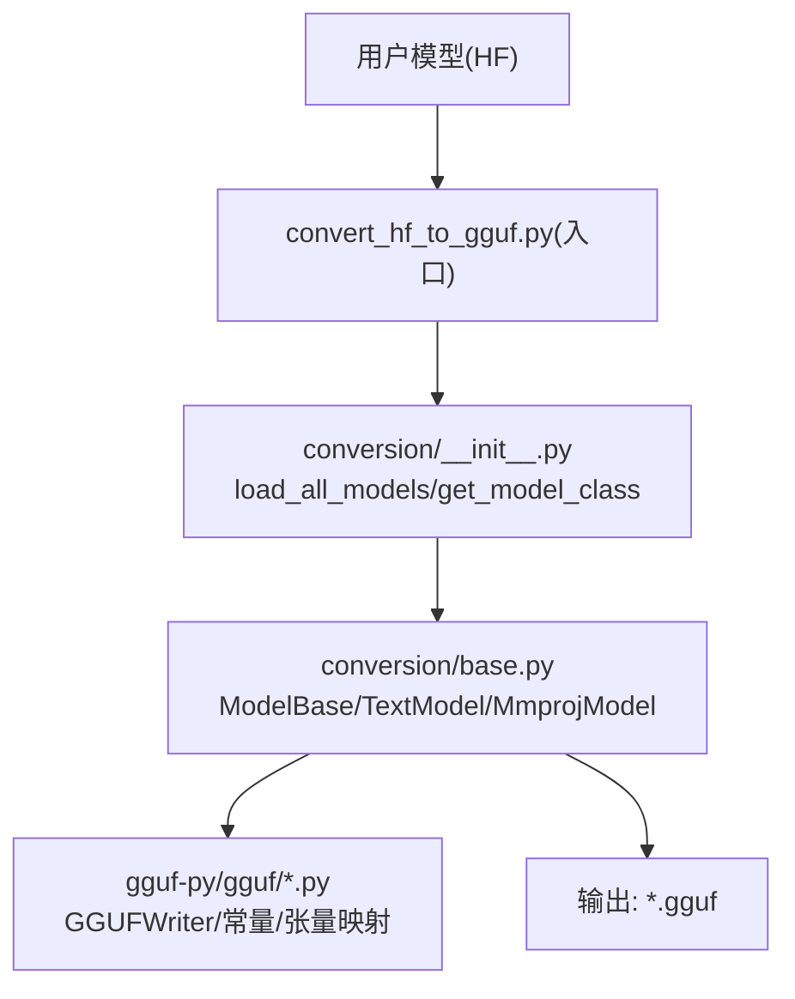
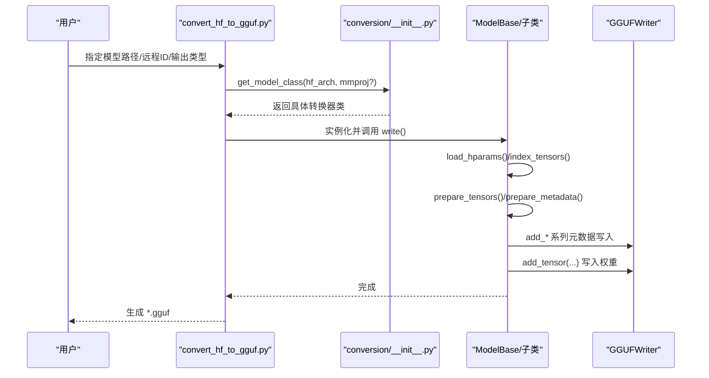
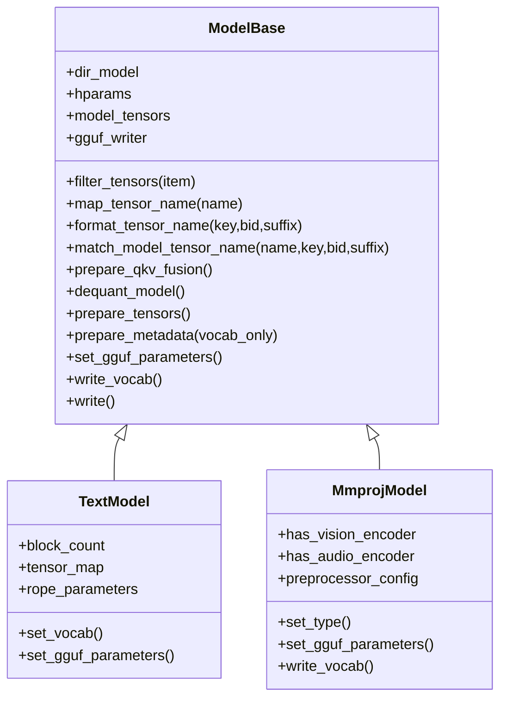
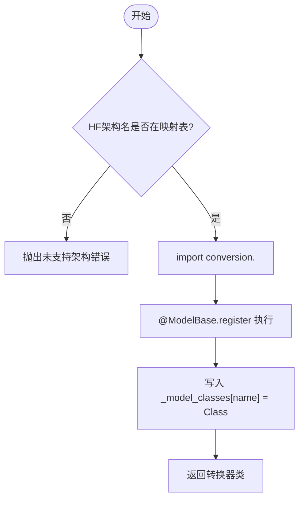
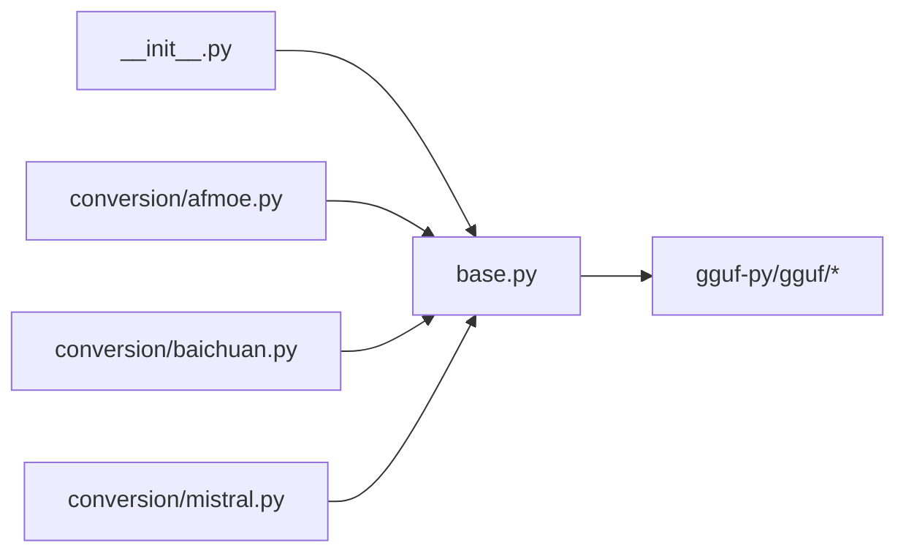

# 自定义转换器开发

<cite>
**本文引用的文件**   
- [conversion/base.py](file://conversion/base.py)
- [conversion/__init__.py](file://conversion/__init__.py)
- [docs/development/HOWTO-add-model.md](file://docs/development/HOWTO-add-model.md)
- [examples/model-conversion/README.md](file://examples/model-conversion/README.md)
</cite>

## 目录
1. [引言](#引言)
2. [项目结构](#项目结构)
3. [核心组件](#核心组件)
4. [架构总览](#架构总览)
5. [详细组件分析](#详细组件分析)
6. [依赖关系分析](#依赖关系分析)
7. [性能与内存优化](#性能与内存优化)
8. [测试与验证](#测试与验证)
9. [常见问题与排错](#常见问题与排错)
10. [代码审查与贡献流程](#代码审查与贡献流程)
11. [结论](#结论)

## 引言
本文面向希望为 llama.cpp 添加新模型架构的开发者，系统性讲解 Python 侧权重转换框架（基于 `ModelBase`）的设计与使用方式，包括：
- 继承 ModelBase 的必需重写点与可选扩展点
- 新模型注册流程与配置文件规范
- 权重映射函数的实现模式与最佳实践
- 测试与验证方法
- 性能优化技巧与内存管理注意事项
- 完整的开发示例与常见问题解决方案
- 代码审查与贡献流程建议

## 项目结构
本仓库中与“自定义转换器”直接相关的核心位置如下：
- conversion/base.py：定义 ModelBase、TextModel、MmprojModel 等基类与通用转换逻辑
- conversion/__init__.py：维护 HF 架构名到具体转换模块的映射，负责动态加载各模型转换器
- docs/development/HOWTO-add-model.md：官方新增模型的步骤说明
- examples/model-conversion/README.md：模型转换与验证的实用脚本说明

**图表来源**
- [conversion/__init__.py:394-423](file://conversion/__init__.py#L394-L423)
- [conversion/base.py:80-200](file://conversion/base.py#L80-L200)

**章节来源**
- [conversion/base.py:80-200](file://conversion/base.py#L80-L200)
- [conversion/__init__.py:19-434](file://conversion/__init__.py#L19-L434)
- [docs/development/HOWTO-add-model.md:1-214](file://docs/development/HOWTO-add-model.md#L1-L214)
- [examples/model-conversion/README.md:41-348](file://examples/model-conversion/README.md#L41-L348)

## 核心组件
- ModelBase：所有转换器的抽象基类，提供配置加载、张量索引、量化、写入 GGUF 等通用能力
- TextModel：文本模型的基类，封装了上下文长度、注意力头数、RoPE 等常见参数写入
- MmprojModel：多模态投影器（视觉/音频）的基类，处理视觉/音频编码器相关参数与预处理配置
- conversion/__init__.py：HF 架构名到转换模块的动态映射表与懒加载机制

关键职责划分：
- 配置加载与校验：ModelBase.load_hparams / find_hparam
- 张量发现与过滤：index_tensors / filter_tensors
- 名称映射：map_tensor_name / format_tensor_name / match_model_tensor_name
- 张量变换与融合：modify_tensors / prepare_qkv_fusion
- 元数据写入：prepare_metadata / set_gguf_parameters / write_vocab
- 最终写出：write

**章节来源**
- [conversion/base.py:80-200](file://conversion/base.py#L80-L200)
- [conversion/base.py:1509-1708](file://conversion/base.py#L1509-L1708)
- [conversion/base.py:2785-2961](file://conversion/base.py#L2785-L2961)
- [conversion/__init__.py:19-434](file://conversion/__init__.py#L19-L434)

## 架构总览
下图展示了从 HF 模型到 GGUF 的端到端流程，以及 ModelBase 在其中的关键节点。

**图表来源**
- [conversion/__init__.py:394-423](file://conversion/__init__.py#L394-L423)
- [conversion/base.py:1396-1405](file://conversion/base.py#L1396-L1405)

## 详细组件分析

### ModelBase 基类
- 设计要点
  - 通过 classmethod register 将子类按 HF 架构名注册到内部字典
  - 统一处理 safetensors/pytorch 分片、远程 HuggingFace 模型、lazy tensor
  - 支持多种量化格式（FP8、NVFP4、MXFP4、GPTQ、compressed-tensors 等）
  - 提供 Q/K/V 融合、Gate/Up 专家融合等转换期优化
  - 统一的 GGUF 元数据与张量写入流程

- 必须重写的接口
  - set_gguf_parameters：子类需写入自身特有的模型参数
  - write_vocab：文本模型需要实现词表写入（或复用 _set_vocab_gpt2/_set_vocab_mistral）

- 常用扩展点
  - filter_tensors：过滤不需要导出的张量或做前缀清理
  - modify_tensors：对张量进行形状/数值变换、融合、转置等
  - generate_extra_tensors：生成额外张量（如 rope_freqs）
  - tensor_force_quant：强制某些张量的量化类型
  - prepare_qkv_fusion：启用 QKV 融合时识别可融合层

- 关键流程
  - index_tensors：扫描本地或远程权重，构建 name -> lazy generator 的映射
  - prepare_tensors：检测 NVFP4/MXFP4，执行 dequant_model，准备 QKV 融合，遍历张量并量化写入
  - prepare_metadata：汇总参数、设置 GGUF 类型、写入量化版本、Hadamarad 契约等
  - write：串联上述步骤并写出 GGUF

**图表来源**
- [conversion/base.py:80-200](file://conversion/base.py#L80-L200)
- [conversion/base.py:841-914](file://conversion/base.py#L841-L914)
- [conversion/base.py:1129-1405](file://conversion/base.py#L1129-L1405)
- [conversion/base.py:1509-1708](file://conversion/base.py#L1509-L1708)
- [conversion/base.py:2785-2961](file://conversion/base.py#L2785-L2961)

**章节来源**
- [conversion/base.py:80-200](file://conversion/base.py#L80-L200)
- [conversion/base.py:841-914](file://conversion/base.py#L841-L914)
- [conversion/base.py:1129-1405](file://conversion/base.py#L1129-L1405)
- [conversion/base.py:1396-1405](file://conversion/base.py#L1396-L1405)

### TextModel 文本模型基类
- 主要职责
  - 解析文本模型常见超参（层数、隐藏维、FFN 维、注意力头数、KV 头数、RoPE 缩放等）
  - 默认使用 GPT2 词表（可通过覆盖 set_vocab 切换为 Mistral 等）
  - 根据 hparams 填充 GGUF 元数据（context_length、embedding_length、head_count、rope_scaling 等）

- 典型重写点
  - set_vocab：若使用特殊 tokenizer，请在此处实现
  - set_gguf_parameters：追加模型特有参数（例如 sliding_window、final_logit_softcapping 等）
  - modify_tensors：对特定张量做变换（如 RoPE 置换还原、归一化偏移折叠等）

**章节来源**
- [conversion/base.py:1509-1708](file://conversion/base.py#L1509-L1708)

### MmprojModel 多模态投影器基类
- 主要职责
  - 解析视觉/音频编码器配置，合并 preprocessor_config/processor_config
  - 写入视觉/音频相关 GGUF 元数据（图像尺寸、patch_size、嵌入维、块数、头数、均值方差等）
  - 禁止写词表（write_vocab 抛出异常）

- 典型重写点
  - set_gguf_parameters：补充视觉/音频特有参数
  - tensor_force_quant：对 patch_embd/patch_merger 等张量强制精度

**章节来源**
- [conversion/base.py:2785-2961](file://conversion/base.py#L2785-L2961)

### 注册与加载机制
- 注册
  - 每个模型转换器模块通过 @ModelBase.register("HF架构名") 装饰器将类注册到全局字典
  - 同时可使用 @ModelBase.example("user/model") 标注用于测试的示例模型（非必填）

- 加载
  - conversion/__init__.py 维护 TEXT_MODEL_MAP 与 MMPROJ_MODEL_MAP，将 HF 架构名映射到模块名
  - load_all_models 会按需 import 对应模块以触发装饰器注册
  - get_model_class 根据 HF 架构名动态导入模块并返回具体转换器类

**图表来源**
- [conversion/__init__.py:394-423](file://conversion/__init__.py#L394-L423)
- [conversion/base.py:1475-1500](file://conversion/base.py#L1475-L1500)

**章节来源**
- [conversion/__init__.py:19-434](file://conversion/__init__.py#L19-L434)
- [conversion/base.py:1475-1500](file://conversion/base.py#L1475-L1500)

### 权重映射函数与命名规范
- 标准流程
  - 在 gguf-py/gguf/constants.py 中声明 MODEL_ARCH、MODEL_TENSORS、TENSOR_NAMES
  - 在 gguf-py/gguf/tensor_mapping.py 中将原始张量名映射到标准化 GGUF 名（支持 {bid} 占位符）
  - 转换器子类通过 map_tensor_name 获取标准化名，再通过 format_tensor_name 构造带后缀的名称

- 命名约定
  - 张量名必须以 .weight 或 .bias 结尾
  - 重复层使用 {bid} 表示层号，例如 blk.{bid}.attn_norm

- 最佳实践
  - 优先复用已有 GGUF 张量名，避免引入新命名
  - 对于复杂变换，尽量在 convert 阶段完成（减少推理图复杂度）

**章节来源**
- [docs/development/HOWTO-add-model.md:48-99](file://docs/development/HOWTO-add-model.md#L48-L99)
- [conversion/base.py:599-625](file://conversion/base.py#L599-L625)

### 配置文件的编写规范
- 常规 HF 模型
  - 使用 config.json 或 transformers.AutoConfig 自动推断
  - 若缺少 config.json，可注册自定义 hparams loader（register_hparams_loader）

- Mistral 原生格式
  - 读取 params.json，并按 is_mistral_format 分支处理

- 多模态模型
  - 优先读取 preprocessor_config.json 与 processor_config.json，合并到 preprocessor_config
  - vision_config/audio_config 分别提取视觉/音频编码器参数

**章节来源**
- [conversion/base.py:1418-1473](file://conversion/base.py#L1418-L1473)
- [conversion/base.py:2840-2870](file://conversion/base.py#L2840-L2870)

### 完整开发示例（从零到一）
以下流程综合官方 HOWTO 与本仓库现有实现：

1. 创建转换器模块
   - 新建 conversion/<your_model>.py
   - 定义类继承 TextModel 或 MmprojModel，并设置 model_arch
   - 使用 @ModelBase.register("YourHFArchName") 注册
   - 根据需要重写 set_vocab、set_gguf_parameters、modify_tensors

2. 更新映射表
   - 在 conversion/__init__.py 的 TEXT_MODEL_MAP 或 MMPROJ_MODEL_MAP 中添加映射

3. 定义 GGUF 常量与映射
   - 在 gguf-py/gguf/constants.py 添加 MODEL_ARCH、MODEL_ARCH_NAMES、MODEL_TENSORS
   - 在 gguf-py/gguf/tensor_mapping.py 添加原始名到 GGUF 名的映射

4. 在 C++ 侧注册架构
   - 在 src/llama-arch.h 添加 llm_arch 枚举值
   - 在 src/llama-arch.cpp 添加名称映射与必要信息
   - 在 src/llama-model.cpp 中实现 build_arch_graph 并注册到 llama_model_mapping

5. 验证
   - 使用 examples/model-conversion/README.md 中的脚本进行转换与验证
   - 运行 CLI、completion、imatrix、quantize、server 等工具检查兼容性

**章节来源**
- [docs/development/HOWTO-add-model.md:1-214](file://docs/development/HOWTO-add-model.md#L1-L214)
- [examples/model-conversion/README.md:41-348](file://examples/model-conversion/README.md#L41-L348)

## 依赖关系分析
- 外部依赖
  - torch、numpy、transformers.AutoConfig
  - gguf-py（GGUFWriter、LazyTensor、quants、utility 等）
  - mistral-common（可选，用于 Mistral 格式 tokenizer）

- 内部依赖
  - conversion/__init__.py 负责模块懒加载与架构名映射
  - base.py 依赖 gguf.* 进行元数据与张量写入
  - 各模型转换器模块通过装饰器向 base.py 的全局字典注册

**图表来源**
- [conversion/base.py:1-30](file://conversion/base.py#L1-L30)
- [conversion/__init__.py:1-16](file://conversion/__init__.py#L1-L16)

**章节来源**
- [conversion/base.py:1-30](file://conversion/base.py#L1-L30)
- [conversion/__init__.py:1-16](file://conversion/__init__.py#L1-L16)

## 性能与内存优化
- 延迟加载与惰性张量
  - LazyTorchTensor 与 LazyChunkedTensor 避免一次性加载全部权重
  - index_tensors 在 lazy=True 时返回生成器而非立即物化张量

- 转换期优化
  - Q/K/V 融合：prepare_qkv_fusion + modify_tensors 将 Q、K、V 拼接为 ATTN_QKV
  - Gate/Up 专家融合：fuse_gate_up_exps 将 gate_exps 与 up_exps 合并
  - Hadamard 折叠：add_hadamard_metadata 记录运行时所需的 Hadamard 契约

- 量化策略
  - 自动推断 ftype（BF16/F16/Q8_0/TQ1_0/TQ2_0/NVFP4/MXFP4）
  - tensor_force_quant 可强制特定张量类型（如 1D 张量、norm.weight 强制 F32）
  - dequant_model 支持 bitnet、fp8、gptq、compressed-tensors、modelopt 等多种反量化路径

- 内存管理
  - NVFP4 专家张量采用流式合并与 flush，避免一次性持有所有专家
  - 已处理的 scale/input_scale 等辅助张量会被移除，防止重复占用

**章节来源**
- [conversion/base.py:627-663](file://conversion/base.py#L627-L663)
- [conversion/base.py:841-914](file://conversion/base.py#L841-L914)
- [conversion/base.py:916-1030](file://conversion/base.py#L916-L1030)
- [conversion/base.py:1031-1127](file://conversion/base.py#L1031-L1127)
- [conversion/base.py:1129-1405](file://conversion/base.py#L1129-L1405)

## 测试与验证
- 转换脚本与工具链
  - examples/model-conversion/README.md 提供了下载、检查、运行原模型、转换、困惑度评估等目标
  - 推荐先运行原模型作为基准，再对比转换后模型的输出与 perplexity

- 单元测试与回归
  - 建议在新增模型后，至少用 tiny/random 权重跑通一次转换与推理
  - 对涉及 modify_tensors 的模型，应增加张量形状/数值断言用例

- 多后端验证
  - 确保在 CPU、CUDA、Metal 等主要后端上均可正常加载与推理
  - 使用 tools/cli、tools/completion、tools/imatrix、tools/quantize、tools/server 进行交叉验证

**章节来源**
- [examples/model-conversion/README.md:41-348](file://examples/model-conversion/README.md#L41-L348)
- [docs/development/HOWTO-add-model.md:12-18](file://docs/development/HOWTO-add-model.md#L12-L18)

## 常见问题与排错
- 未找到 HF 架构名
  - 确认已在 conversion/__init__.py 的映射表中添加
  - 确认转换器模块使用了 @ModelBase.register("YourHFArchName")

- 张量名无法映射
  - 检查 gguf-py/gguf/tensor_mapping.py 是否包含该张量名的映射规则
  - 注意 .weight/.bias 后缀要求

- 量化失败或数值不稳定
  - 检查 tensor_force_quant 是否正确设置
  - 对 norm.weight、1D 张量等强制 F32
  - 考虑将常数缩放放在推理期应用，避免折叠进权重影响量化

- 多模态模型报错
  - 确认 has_vision_encoder/has_audio_encoder 至少一个为真
  - 检查 preprocessor_config/processor_config 是否被正确读取

**章节来源**
- [conversion/__init__.py:394-423](file://conversion/__init__.py#L394-L423)
- [conversion/base.py:599-625](file://conversion/base.py#L599-L625)
- [conversion/base.py:1247-1341](file://conversion/base.py#L1247-L1341)
- [conversion/base.py:2936-2938](file://conversion/base.py#L2936-L2938)

## 代码审查与贡献流程
- 最小变更原则
  - 优先复用现有基础设施，避免引入不必要的 API 或 CLI
  - 将模型特定的逻辑尽量收敛在转换期，保持推理图简洁

- 提交前自检清单
  - 是否添加了 HF 架构名映射
  - 是否实现了 set_gguf_parameters/write_vocab（或合理复用）
  - 是否更新了 GGUF 常量与张量映射
  - 是否在 C++ 侧注册了架构并实现 build_arch_graph
  - 是否在 CLI/completion/imatrix/quantize/server 上进行了基本验证

- 文档与示例
  - 在 docs/development/HOWTO-add-model.md 风格下补充必要的说明
  - 如有必要，在 examples/model-conversion/README.md 中添加针对新模型的指引

**章节来源**
- [docs/development/HOWTO-add-model.md:159-198](file://docs/development/HOWTO-add-model.md#L159-L198)
- [examples/model-conversion/README.md:41-348](file://examples/model-conversion/README.md#L41-L348)

## 结论
通过遵循本文档的架构与流程，你可以高效地为 llama.cpp 添加新的模型架构：
- 在 Python 侧通过继承 ModelBase/TextModel/MmprojModel 完成权重转换与 GGUF 元数据写入
- 在 C++ 侧完成架构注册与推理图实现
- 借助现有的量化、融合与惰性加载机制，获得良好的性能与内存表现
- 通过完善的测试与工具链验证，确保新模型在多后端上的稳定性与一致性