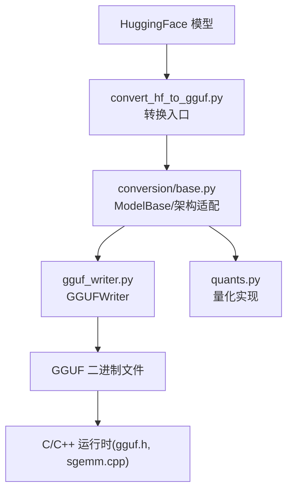
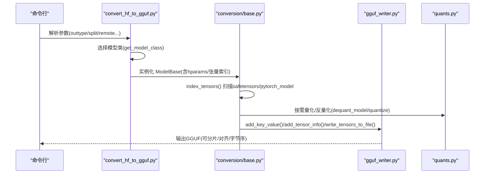
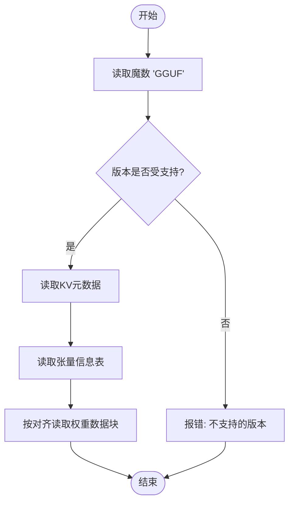
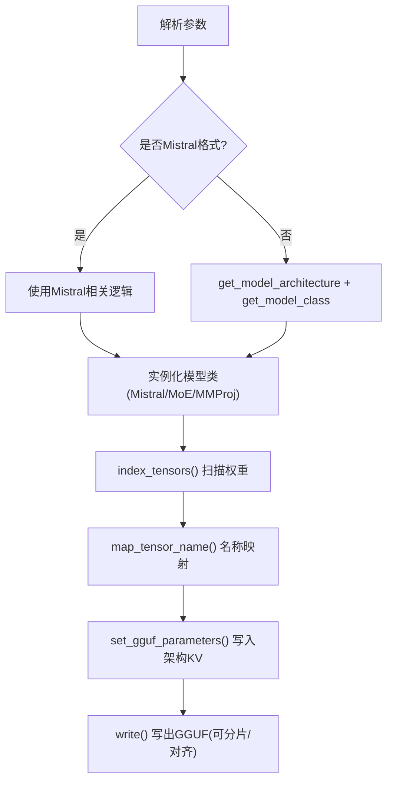
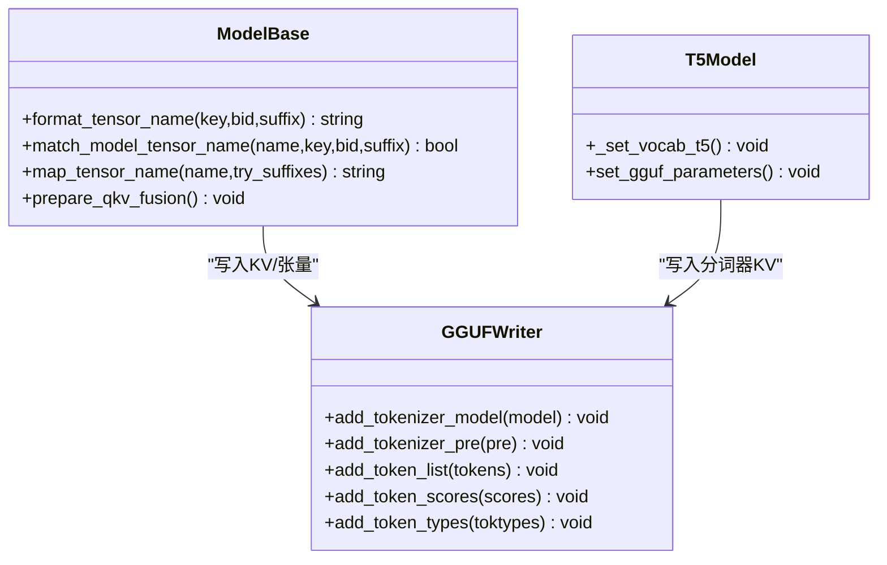
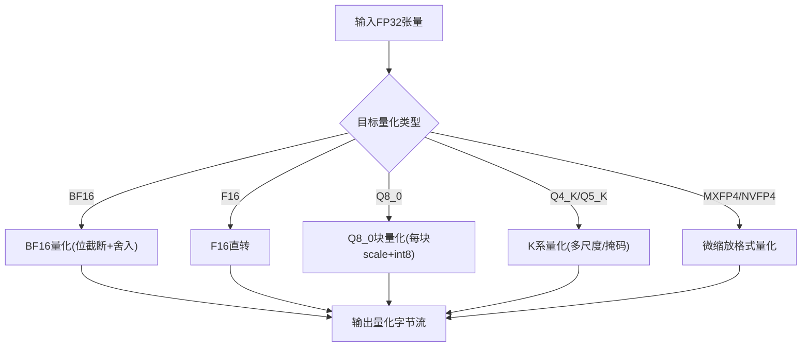
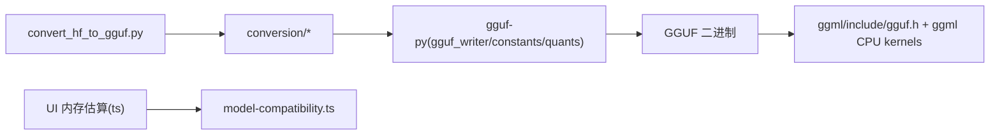
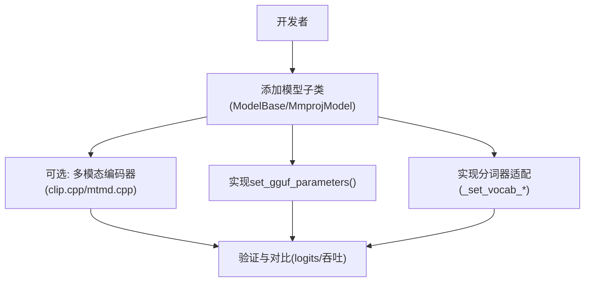

# 模型转换

<cite>
**本文引用的文件**   
- [README.md](file://README.md)
- [gguf.h](file://ggml/include/gguf.h)
- [constants.py](file://gguf-py/gguf/constants.py)
- [gguf_writer.py](file://gguf-py/gguf/gguf_writer.py)
- [quants.py](file://gguf-py/gguf/quants.py)
- [convert_hf_to_gguf.py](file://convert_hf_to_gguf.py)
- [base.py](file://conversion/base.py)
- [t5.py](file://conversion/t5.py)
- [minimax.py](file://conversion/minimax.py)
- [granite.py](file://conversion/granite.py)
- [gguf-model-data.cpp](file://tests/gguf-model-data.cpp)
- [sgemm.cpp](file://ggml/src/ggml-cpu/llamafile/sgemm.cpp)
- [model-compatibility.constants.ts](file://tools/ui/src/lib/constants/model-compatibility.constants.ts)
- [model-compatibility.ts](file://tools/ui/src/lib/utils/model-compatibility.ts)
- [HOWTO-add-model.md](file://docs/development/HOWTO-add-model.md)
</cite>

## 目录
1. [简介](#简介)
2. [项目结构](#项目结构)
3. [核心组件](#核心组件)
4. [架构总览](#架构总览)
5. [详细组件分析](#详细组件分析)
6. [依赖关系分析](#依赖关系分析)
7. [性能与量化权衡](#性能与量化权衡)
8. [故障排查指南](#故障排查指南)
9. [结论](#结论)
10. [附录：自定义格式与脚本开发指南](#附录自定义格式与脚本开发指南)

## 简介
本文件系统性梳理 llama.cpp 的模型转换体系，重点覆盖：
- GGUF 文件格式规范与版本兼容性（张量存储、元数据键、对齐与分片）
- HuggingFace 到 GGUF 的转换流程（权重映射、分词器适配、配置参数转换）
- 量化技术原理与实现（INT8/Q8_0、FP16、BF16 等精度优缺点）
- 模型优化最佳实践（文件大小与性能的权衡）
- 自定义模型格式支持与转换脚本开发指南

## 项目结构
围绕“HF→GGUF”的转换链路，仓库关键位置如下：
- 转换入口：convert_hf_to_gguf.py
- 模型基类与架构适配：conversion/base.py 与各架构子模块（如 t5.py、minimax.py、granite.py）
- GGUF 写入与常量定义：gguf-py/gguf/gguf_writer.py、gguf-py/gguf/constants.py
- GGUF 量化实现：gguf-py/gguf/quants.py
- C/C++ 侧 GGUF 头文件与解析测试：ggml/include/gguf.h、tests/gguf-model-data.cpp
- CPU 后端对 BF16/F16/Q8_0 的加速路径：ggml/src/ggml-cpu/llamafile/sgemm.cpp
- UI 内存估算与兼容性：tools/ui/src/lib/constants/model-compatibility.constants.ts、tools/ui/src/lib/utils/model-compatibility.ts
- 新增模型文档：docs/development/HOWTO-add-model.md

**图示来源**
- [convert_hf_to_gguf.py:179-308](file://convert_hf_to_gguf.py#L179-L308)
- [base.py:124-200](file://conversion/base.py#L124-L200)
- [gguf_writer.py:87-112](file://gguf-py/gguf/gguf_writer.py#L87-L112)
- [quants.py:57-76](file://gguf-py/gguf/quants.py#L57-L76)
- [gguf.h:1-34](file://ggml/include/gguf.h#L1-L34)
- [sgemm.cpp:3984-4167](file://ggml/src/ggml-cpu/llamafile/sgemm.cpp#L3984-L4167)

**章节来源**
- [README.md:60-74](file://README.md#L60-L74)

## 核心组件
- GGUFWriter：负责写入 GGUF 头部、KV 元数据、张量信息与权重数据，支持分片、对齐、字节序控制。
- constants.py：集中定义 GGUF 常量、元数据键 Keys.*、模型架构枚举 MODEL_ARCH、张量名映射 TENSOR_NAMES/MODEL_TENSORS。
- quants.py：提供多种量化类型（Q4/K、Q8_0、TQ1/TQ2、MXFP4、NVFP4、BF16、F16 等）的量化/反量化实现。
- conversion/base.py：统一加载 HF 权重、索引张量、名称映射、可选融合（QKV、gate/up exps）、处理预训练量化格式（GPTQ、FP8、BitNet 等）。
- convert_hf_to_gguf.py：命令行入口，解析参数、选择模型类、调用 ModelBase 完成导出。

**章节来源**
- [gguf_writer.py:87-112](file://gguf-py/gguf/gguf_writer.py#L87-L112)
- [constants.py:10-31](file://gguf-py/gguf/constants.py#L10-L31)
- [quants.py:57-76](file://gguf-py/gguf/quants.py#L57-L76)
- [base.py:124-200](file://conversion/base.py#L124-L200)
- [convert_hf_to_gguf.py:48-176](file://convert_hf_to_gguf.py#L48-L176)

## 架构总览
下图展示从 HF 模型到 GGUF 文件的端到端流程，包括参数解析、模型类选择、权重索引、量化与写入。

**图示来源**
- [convert_hf_to_gguf.py:179-308](file://convert_hf_to_gguf.py#L179-L308)
- [base.py:219-308](file://conversion/base.py#L219-L308)
- [gguf_writer.py:215-276](file://gguf-py/gguf/gguf_writer.py#L215-L276)
- [quants.py:57-76](file://gguf-py/gguf/quants.py#L57-L76)

## 详细组件分析

### GGUF 文件格式与版本兼容
- 文件头：魔数“GGUF”(4B)、版本(uint32)、张量数量(int64)、KV 对数量(int64)。
- KV 段：键为字符串，值为标量或数组；支持 general.*、{arch}.*、tokenizer.* 等命名空间。
- 张量信息段：每个张量包含名称、维度、数据类型、偏移；权重数据按 alignment 对齐。
- 版本：当前默认 GGUF_VERSION=3；Python 读取器支持多版本并自动检测字节序。

**图示来源**
- [gguf.h:1-34](file://ggml/include/gguf.h#L1-L34)
- [gguf_reader.py:146-167](file://gguf-py/gguf/gguf_reader.py#L146-L167)

**章节来源**
- [gguf.h:1-34](file://ggml/include/gguf.h#L1-L34)
- [constants.py:10-31](file://gguf-py/gguf/constants.py#L10-L31)
- [gguf-model-data.cpp:224-273](file://tests/gguf-model-data.cpp#L224-L273)

### HF 到 GGUF 转换流程
- 参数解析：outtype(f32/f16/bf16/q8_0/tq1_0/tq2_0/auto)、split_max_tensors/size、bigendian、remote、mmproj/mtp/dspark 等。
- 模型类选择：根据 hparams 推断架构，或显式指定 Mistral 格式；支持视觉 mmproj 与 MTP/DSPARK 特殊导出。
- 权重索引：优先 safetensors，其次 pytorch_model.bin；支持远程懒加载与本地 mmap。
- 名称映射：通过 tensor_map 将 HF 张量名映射到 GGUF 标准名；支持 QKV 融合、MoE gate/up exps 合并。
- 元数据写入：写入 general.*、{arch}.*、tokenizer.* 等键；不同架构在 set_gguf_parameters 中补充特定键。

**图示来源**
- [convert_hf_to_gguf.py:48-176](file://convert_hf_to_gguf.py#L48-L176)
- [convert_hf_to_gguf.py:179-308](file://convert_hf_to_gguf.py#L179-L308)
- [base.py:219-308](file://conversion/base.py#L219-L308)

**章节来源**
- [convert_hf_to_gguf.py:48-176](file://convert_hf_to_gguf.py#L48-L176)
- [convert_hf_to_gguf.py:179-308](file://convert_hf_to_gguf.py#L179-L308)
- [base.py:219-308](file://conversion/base.py#L219-L308)

### 权重映射与分词器适配
- 权重映射：
  - base.py 提供 format_tensor_name/match_model_tensor_name/map_tensor_name，结合 gguf.TENSOR_NAMES/MODEL_TENSORS 进行标准化。
  - 支持 QKV 融合 prepare_qkv_fusion 与 MoE gate_up_exps 合并 fuse_gate_up_exps。
- 分词器适配：
  - 各架构子类在 _set_vocab_* 中写入 tokenizer.ggml.* 系列键；例如 T5 设置 model/pre/list/scores/types 等。
  - Mistral 系列可使用 mistral-common 以保障 tokenization 正确性。

**图示来源**
- [base.py:599-625](file://conversion/base.py#L599-L625)
- [base.py:627-663](file://conversion/base.py#L627-L663)
- [t5.py:246-273](file://conversion/t5.py#L246-L273)
- [gguf_writer.py:695-702](file://gguf-py/gguf/gguf_writer.py#L695-L702)

**章节来源**
- [base.py:599-663](file://conversion/base.py#L599-L663)
- [t5.py:246-273](file://conversion/t5.py#L246-L273)

### 配置参数转换（KV 元数据）
- 通用键：general.type/architecture/alignment/file_type 等。
- 架构键：{arch}.vocab_size/context_length/embedding_length/block_count/head_count/key_length/value_length/rope.* 等。
- 分词器键：tokenizer.ggml.model/pre/list/scores/token_type/bos/eos/...。
- 适配器/专家/注意力扩展键：adapters.*、expert_*、attention.* 等。

示例（T5/Minimax/Granite）：
- T5：context_length、embedding_length、feed_forward_length、block_count、head_count、key/value_length、layer_norm_eps、relative_attn_buckets_count、layer_norm_rms_epsilon、file_type。
- Minimax：expert_feed_forward_length、rope_dimension_count。
- Granite：expert_used_count、adapters.count/lora_rank/token_ids_activate/substitute、router_gain。

**章节来源**
- [t5.py:259-273](file://conversion/t5.py#L259-L273)
- [minimax.py:128-159](file://conversion/minimax.py#L128-L159)
- [granite.py:250-276](file://conversion/granite.py#L250-L276)
- [constants.py:108-177](file://gguf-py/gguf/constants.py#L108-L177)
- [constants.py:338-381](file://gguf-py/gguf/constants.py#L338-L381)

### 量化技术原理与实现
- 量化类型：
  - 浮点：F32、F16、BF16（BF16 通过位截断+舍入实现）。
  - 整型/混合：Q4_0/Q4_1/Q5_0/Q5_1/Q8_0、Q2_K/Q3_K/Q4_K/Q5_K/Q6_K、TQ1_0/TQ2_0、MXFP4、NVFP4、IQ2_* 等。
- 块大小与类型尺寸：由 GGML_QUANT_SIZES 定义，量化/反量化基于块操作，保证行尾对齐。
- 运行期加速：CPU 后端针对 BF16/F16/Q8_0 提供向量化路径（AVX/NEON/MMA 等）。

**图示来源**
- [quants.py:57-76](file://gguf-py/gguf/quants.py#L57-L76)
- [quants.py:205-218](file://gguf-py/gguf/quants.py#L205-L218)
- [quants.py:379-403](file://gguf-py/gguf/quants.py#L379-L403)
- [quants.py:476-523](file://gguf-py/gguf/quants.py#L476-L523)
- [quants.py:657-705](file://gguf-py/gguf/quants.py#L657-L705)
- [sgemm.cpp:3984-4167](file://ggml/src/ggml-cpu/llamafile/sgemm.cpp#L3984-L4167)

**章节来源**
- [quants.py:57-76](file://gguf-py/gguf/quants.py#L57-L76)
- [quants.py:205-218](file://gguf-py/gguf/quants.py#L205-L218)
- [quants.py:379-403](file://gguf-py/gguf/quants.py#L379-L403)
- [quants.py:476-523](file://gguf-py/gguf/quants.py#L476-L523)
- [quants.py:657-705](file://gguf-py/gguf/quants.py#L657-L705)
- [sgemm.cpp:3984-4167](file://ggml/src/ggml-cpu/llamafile/sgemm.cpp#L3984-L4167)

### 模型优化最佳实践
- outtype 选择：
  - f16/bf16：质量高、体积较大；bf16 在部分硬件上具备更好数值稳定性。
  - q8_0：体积显著减小，推理速度提升明显，适合大多数场景。
  - tq1_0/tq2_0：极低比特三元量化，极致压缩但解码开销大。
- 分片策略：split_max_tensors/split_max_size 控制单文件大小，便于内存受限环境加载。
- 对齐与字节序：alignment 默认 32；bigendian 用于大端设备。
- 权重融合：fuse-qkv 减少张量数量，降低 IO 与调度开销；fuse-gate-up-exps 合并 MoE 权重。
- 预训练量化格式处理：dequant_model 支持 BitNet/GPTQ/FP8/compressed-tensors 等格式的在线反量化。

**章节来源**
- [convert_hf_to_gguf.py:55-62](file://convert_hf_to_gguf.py#L55-L62)
- [convert_hf_to_gguf.py:88-103](file://convert_hf_to_gguf.py#L88-L103)
- [convert_hf_to_gguf.py:151-163](file://convert_hf_to_gguf.py#L151-L163)
- [base.py:326-581](file://conversion/base.py#L326-L581)
- [gguf_writer.py:87-112](file://gguf-py/gguf/gguf_writer.py#L87-L112)

## 依赖关系分析
- 转换入口依赖 conversion 包中的模型类；模型类依赖 gguf-py 的 Writer/Constants/Quants。
- C/C++ 运行时依赖 gguf.h 定义的格式与 ggml 后端的量化内核。
- UI 层使用独立的内存估算常量与算法，辅助用户选择合适的量化与设备预算。

**图示来源**
- [convert_hf_to_gguf.py:179-308](file://convert_hf_to_gguf.py#L179-L308)
- [gguf_writer.py:87-112](file://gguf-py/gguf/gguf_writer.py#L87-L112)
- [gguf.h:1-34](file://ggml/include/gguf.h#L1-L34)
- [model-compatibility.constants.ts:1-32](file://tools/ui/src/lib/constants/model-compatibility.constants.ts#L1-L32)
- [model-compatibility.ts:1-37](file://tools/ui/src/lib/utils/model-compatibility.ts#L1-L37)

**章节来源**
- [convert_hf_to_gguf.py:179-308](file://convert_hf_to_gguf.py#L179-L308)
- [gguf.h:1-34](file://ggml/include/gguf.h#L1-L34)
- [model-compatibility.constants.ts:1-32](file://tools/ui/src/lib/constants/model-compatibility.constants.ts#L1-L32)
- [model-compatibility.ts:1-37](file://tools/ui/src/lib/utils/model-compatibility.ts#L1-L37)

## 性能与量化权衡
- 精度与体积：
  - F32/F16/BF16：高精度，体积大；BF16 在某些平台更稳定。
  - Q8_0：高性价比，广泛推荐；嵌入/输出层建议用 Q8_0 以获得更好吞吐。
  - Q4_K/Q5_K/Q6_K：平衡压缩与质量；K 系列采用多尺度缩放与掩码。
  - TQ1_0/TQ2_0：极端压缩，解码成本高，适合离线或带宽受限场景。
  - MXFP4/NVFP4：微缩放格式，面向新一代硬件优化。
- 运行期加速：
  - CPU 后端对 BF16/F16/Q8_0 提供 AVX/NEON/MMA 路径，显著提升吞吐。
- 内存预算估算：
  - UI 层以固定比例与固定开销估算最小可用内存档位，帮助用户选择合适量化。

**章节来源**
- [quants.py:57-76](file://gguf-py/gguf/quants.py#L57-L76)
- [quants.py:379-403](file://gguf-py/gguf/quants.py#L379-L403)
- [quants.py:476-523](file://gguf-py/gguf/quants.py#L476-L523)
- [quants.py:657-705](file://gguf-py/gguf/quants.py#L657-L705)
- [sgemm.cpp:3984-4167](file://ggml/src/ggml-cpu/llamafile/sgemm.cpp#L3984-L4167)
- [model-compatibility.constants.ts:1-32](file://tools/ui/src/lib/constants/model-compatibility.constants.ts#L1-L32)
- [model-compatibility.ts:1-37](file://tools/ui/src/lib/utils/model-compatibility.ts#L1-L37)

## 故障排查指南
- 版本不兼容：
  - Python 读取器会检查 GGUF 版本，若不受支持则抛出异常；确保写入端使用 GGUF_VERSION=3。
- 字节序问题：
  - 读取器会根据魔数字节序判断并切换 endianess；必要时使用 --bigendian 输出。
- 分片失败：
  - 当模型无法满足 split_max_tensors/split_max_size 要求时，不会执行分片；检查参数与模型规模。
- 缺失张量/索引不一致：
  - index_tensors 会校验 weight_map 与实际分片一致性，缺失或不匹配会抛出错误。
- 量化失败回退：
  - 量化失败时会记录警告并回退至 F16；检查张量形状是否满足 block_size 对齐。

**章节来源**
- [gguf_reader.py:146-167](file://gguf-py/gguf/gguf_reader.py#L146-L167)
- [gguf-model-data.cpp:224-273](file://tests/gguf-model-data.cpp#L224-L273)
- [convert_hf_to_gguf.py:222-225](file://convert_hf_to_gguf.py#L222-L225)
- [base.py:294-308](file://conversion/base.py#L294-L308)
- [base.py:1326-1341](file://conversion/base.py#L1326-L1341)

## 结论
llama.cpp 的模型转换系统以 GGUF 为核心，提供了从 HF 到 GGUF 的完整流水线：统一的权重索引与名称映射、丰富的元数据键、灵活的量化方案与高效的写入器。通过合理的 outtype 选择、分片与对齐策略，以及 QKV 与 MoE 权重融合，可在文件大小与推理性能之间取得良好平衡。对于新模型，遵循现有架构适配模式即可快速接入。

## 附录：自定义格式与脚本开发指南
- 新增模型步骤（文本/多模态）：
  - 在 conversion/ 下添加模型子类，继承 ModelBase 或 MmprojModel，实现必要的 set_gguf_parameters/_set_vocab_* 等方法。
  - 如需多模态编码器，需在 libmtmd/clip.cpp 中添加编码器定义，并在 mtmd.cpp 中实现预处理与图构建。
- 转换脚本开发要点：
  - 保持脚本模型无关，仅通过 ModelBase 与 gguf_writer 接口工作。
  - 避免新增全局开关，尽量通过模型类属性或配置传递参数。
  - 如需调试推理图，可使用 examples/eval-callback。

**图示来源**
- [HOWTO-add-model.md:122-133](file://docs/development/HOWTO-add-model.md#L122-L133)

**章节来源**
- [HOWTO-add-model.md:122-133](file://docs/development/HOWTO-add-model.md#L122-L133)