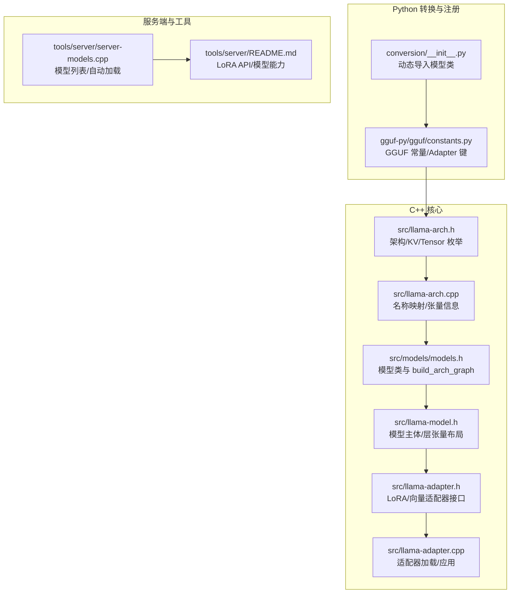
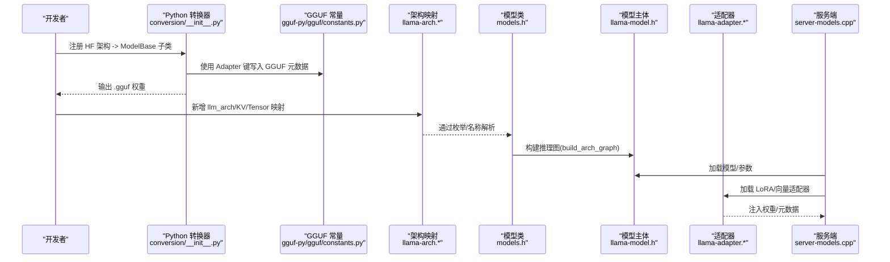
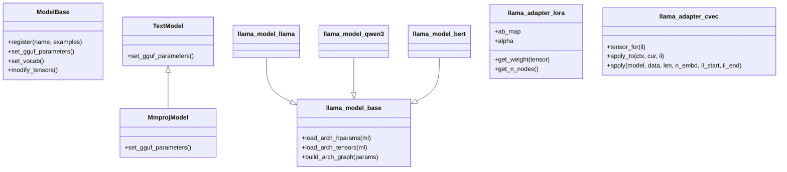
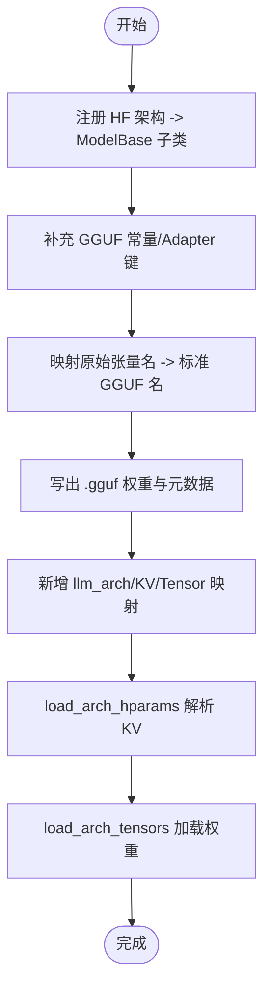
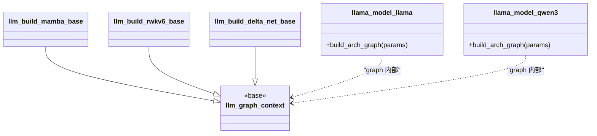
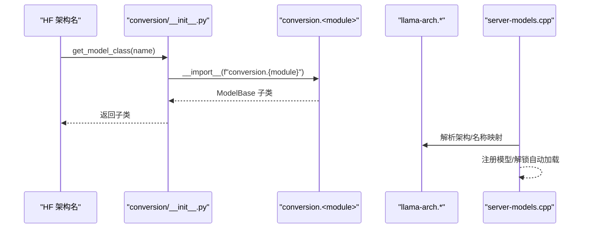
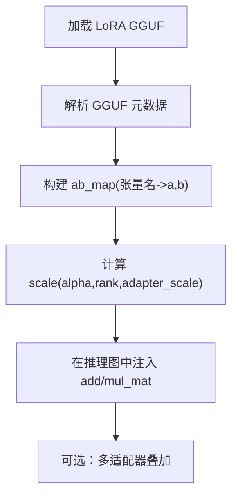
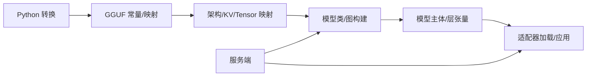

# 自定义模型支持

<cite>
**本文引用的文件**   
- [HOWTO-add-model.md](file://docs/development/HOWTO-add-model.md)
- [models.h](file://src/models/models.h)
- [llama-arch.h](file://src/llama-arch.h)
- [llama-arch.cpp](file://src/llama-arch.cpp)
- [llama-model.h](file://src/llama-model.h)
- [llama-adapter.h](file://src/llama-adapter.h)
- [llama-adapter.cpp](file://src/llama-adapter.cpp)
- [__init__.py](file://conversion/__init__.py)
- [constants.py](file://gguf-py/gguf/constants.py)
- [server-models.cpp](file://tools/server/server-models.cpp)
- [README.md（服务器）](file://tools/server/README.md)
</cite>

## 目录
1. [简介](#简介)
2. [项目结构](#项目结构)
3. [核心组件](#核心组件)
4. [架构总览](#架构总览)
5. [详细组件分析](#详细组件分析)
6. [依赖关系分析](#依赖关系分析)
7. [性能与优化建议](#性能与优化建议)
8. [测试与验证指南](#测试与验证指南)
9. [发布与版本管理最佳实践](#发布与版本管理最佳实践)
10. [故障排查](#故障排查)
11. [结论](#结论)

## 简介
本指南面向需要在 llama.cpp 中为新模型添加支持的开发者，系统阐述从权重转换、GGUF 规范适配、C++ 推理图实现到注册与动态加载的完整流程。文档覆盖：
- 模型适配器架构设计（基础抽象类与接口）
- 权重加载、配置解析与推理逻辑实现要点
- 模型注册机制与动态加载系统
- 测试框架与验证方法（单元/集成）
- 基准测试与对比分析方法
- 发布流程与版本管理最佳实践
- 与现有模型系统的集成点与扩展机制

## 项目结构
围绕“新模型支持”的关键目录与文件：
- Python 侧转换与注册
  - conversion/__init__.py：按 HF 架构名动态导入并返回对应 ModelBase 子类
  - gguf-py/gguf/constants.py：GGUF 常量（含 Adapter 元数据键）
- C++ 侧架构与推理
  - src/llama-arch.h/.cpp：架构枚举、KV/Tensor 名称映射、张量信息
  - src/models/models.h：各模型类定义与图构建入口
  - src/llama-model.h：模型主体结构与层张量布局
  - src/llama-adapter.h/.cpp：LoRA/向量适配器加载与应用
- 服务端与工具链
  - tools/server/server-models.cpp：模型列表与自动加载
  - tools/server/README.md：LoRA 适配器 API 与模型能力暴露

图表来源
- [__init__.py:415-433](file://conversion/__init__.py#L415-L433)
- [constants.py:382-399](file://gguf-py/gguf/constants.py#L382-L399)
- [llama-arch.h:13-172](file://src/llama-arch.h#L13-L172)
- [llama-arch.cpp:8-167](file://src/llama-arch.cpp#L8-L167)
- [models.h:147-158](file://src/models/models.h#L147-L158)
- [llama-model.h:679-790](file://src/llama-model.h#L679-L790)
- [llama-adapter.h:63-91](file://src/llama-adapter.h#L63-L91)
- [llama-adapter.cpp:151-161](file://src/llama-adapter.cpp#L151-L161)
- [server-models.cpp:851-877](file://tools/server/server-models.cpp#L851-L877)
- [README.md（服务器）:1212-1265](file://tools/server/README.md#L1212-L1265)

章节来源
- [HOWTO-add-model.md:1-214](file://docs/development/HOWTO-add-model.md#L1-L214)

## 核心组件
- 架构枚举与命名映射
  - llama-arch.h：定义 llm_arch 枚举，集中所有模型架构标识
  - llama-arch.cpp：维护 LLM_ARCH_NAMES、LLM_KV_NAMES、LLM_TENSOR_NAMES、LLM_TENSOR_INFOS 等映射表
- 模型类与图构建
  - models.h：每个模型一个类，继承自 llama_model_base，提供 load_arch_hparams/load_arch_tensors/build_arch_graph
- 模型主体与层张量
  - llama-model.h：llama_model 聚合 hparams/vocab/层张量/设备信息等；llama_layer 统一描述注意力/FFN/MoE/SSM/RWKV 等张量
- 适配器（LoRA/向量）
  - llama-adapter.h/.cpp：LoRA 权重映射、缩放、上下文/缓冲管理；向量适配器逐层应用
- Python 转换与注册
  - conversion/__init__.py：根据 HF 架构名动态导入对应 ModelBase 子类
  - gguf-py/gguf/constants.py：Adapter 相关 GGUF 键（type/alpha/task_name/prompt_prefix/alora_invocation_tokens）

章节来源
- [llama-arch.h:13-172](file://src/llama-arch.h#L13-L172)
- [llama-arch.cpp:8-167](file://src/llama-arch.cpp#L8-L167)
- [models.h:147-158](file://src/models/models.h#L147-L158)
- [llama-model.h:679-790](file://src/llama-model.h#L679-L790)
- [llama-adapter.h:63-91](file://src/llama-adapter.h#L63-L91)
- [llama-adapter.cpp:151-161](file://src/llama-adapter.cpp#L151-L161)
- [__init__.py:415-433](file://conversion/__init__.py#L415-L433)
- [constants.py:382-399](file://gguf-py/gguf/constants.py#L382-L399)

## 架构总览
下图展示从 Python 转换到 C++ 推理的端到端路径，以及 LoRA 适配器的注入点。

图表来源
- [__init__.py:415-433](file://conversion/__init__.py#L415-L433)
- [constants.py:382-399](file://gguf-py/gguf/constants.py#L382-L399)
- [llama-arch.h:13-172](file://src/llama-arch.h#L13-L172)
- [llama-arch.cpp:8-167](file://src/llama-arch.cpp#L8-L167)
- [models.h:147-158](file://src/models/models.h#L147-L158)
- [llama-model.h:679-790](file://src/llama-model.h#L679-L790)
- [llama-adapter.cpp:151-161](file://src/llama-adapter.cpp#L151-L161)
- [server-models.cpp:851-877](file://tools/server/server-models.cpp#L851-L877)

## 详细组件分析

### 模型适配器架构（基础抽象类与接口）
- Python 侧
  - ModelBase 派生类用于声明 HF 架构名、示例仓库、GGUF 参数与词表映射
  - 通过 @ModelBase.register 将架构名与模块绑定，运行时由 get_model_class 动态导入
- C++ 侧
  - llama_model_base 派生类负责：
    - load_arch_hparams：读取 GGUF 中的架构特定 KV
    - load_arch_tensors：按标准 tensor 名加载权重
    - build_arch_graph：构建 ggml 计算图
  - llama_adapter_lora：以张量名为键映射 a/b 权重，支持 alpha/rank/scale 计算与多适配器叠加
  - llama_adapter_cvec：逐层向量适配器，apply_to 在图中注入变换

图表来源
- [__init__.py:415-433](file://conversion/__init__.py#L415-L433)
- [models.h:147-158](file://src/models/models.h#L147-L158)
- [llama-adapter.h:17-40](file://src/llama-adapter.h#L17-L40)
- [llama-adapter.h:63-91](file://src/llama-adapter.h#L63-L91)

章节来源
- [HOWTO-add-model.md:19-100](file://docs/development/HOWTO-add-model.md#L19-L100)
- [__init__.py:415-433](file://conversion/__init__.py#L415-L433)
- [llama-adapter.h:17-40](file://src/llama-adapter.h#L17-L40)
- [llama-adapter.h:63-91](file://src/llama-adapter.h#L63-L91)

### 权重加载与配置解析
- Python 转换阶段
  - 在 conversion 下为模型创建 TextModel/MmprojModel 子类，使用 @ModelBase.register 注册
  - 在 gguf-py/gguf/constants.py 中补充 GGUF 常量（如 Adapter 键）
  - 如需自定义张量名映射，修改 tensor_mapping.py（参考 HOWTO）
- C++ 加载阶段
  - llama-arch.h/.cpp：新增架构枚举与 KV/Tensor 名称映射
  - llama-model-loader：非标准元数据可在构造函数中处理
  - llama-model.cpp：RoPE 类型等需加入架构分支

图表来源
- [HOWTO-add-model.md:19-100](file://docs/development/HOWTO-add-model.md#L19-L100)
- [constants.py:382-399](file://gguf-py/gguf/constants.py#L382-L399)
- [llama-arch.h:13-172](file://src/llama-arch.h#L13-L172)
- [llama-arch.cpp:8-167](file://src/llama-arch.cpp#L8-L167)

章节来源
- [HOWTO-add-model.md:19-100](file://docs/development/HOWTO-add-model.md#L19-L100)
- [constants.py:382-399](file://gguf-py/gguf/constants.py#L382-L399)

### 推理逻辑与图构建
- 在 models.h 中为模型定义类与内部 graph 结构，实现 build_arch_graph
- 复用通用基类（如 mamba/rwkv/delta-net 等）减少重复代码
- 注意后端算子支持差异，必要时在后端单独 PR 补充

图表来源
- [models.h:24-141](file://src/models/models.h#L24-L141)
- [models.h:147-158](file://src/models/models.h#L147-L158)
- [models.h:579-596](file://src/models/models.h#L579-L596)

章节来源
- [HOWTO-add-model.md:114-125](file://docs/development/HOWTO-add-model.md#L114-L125)
- [models.h:24-141](file://src/models/models.h#L24-L141)
- [models.h:147-158](file://src/models/models.h#L147-L158)
- [models.h:579-596](file://src/models/models.h#L579-L596)

### 模型注册机制与动态加载
- Python 侧
  - get_model_class(name, mmproj=False) 根据 HF 架构名动态导入模块并返回 ModelBase 子类
- C++ 侧
  - llama-arch.h/.cpp 维护架构枚举与名称映射，供加载器识别
  - server-models.cpp 在服务端首次启动时批量注册模型并解锁自动加载

图表来源
- [__init__.py:415-433](file://conversion/__init__.py#L415-L433)
- [llama-arch.h:13-172](file://src/llama-arch.h#L13-L172)
- [llama-arch.cpp:8-167](file://src/llama-arch.cpp#L8-L167)
- [server-models.cpp:851-877](file://tools/server/server-models.cpp#L851-L877)

章节来源
- [__init__.py:415-433](file://conversion/__init__.py#L415-L433)
- [server-models.cpp:851-877](file://tools/server/server-models.cpp#L851-L877)

### LoRA/向量适配器加载与应用
- LoRA 适配器
  - llama_adapter_lora：以张量名为键存储 a/b 权重，支持 alpha/rank/scale 计算，统计节点数
  - llama_adapter_lora_init_from_file_ptr：从 GGUF 文件初始化适配器，校验元数据
- 向量适配器
  - llama_adapter_cvec：按层索引获取张量，apply_to 在图中注入变换，apply 批量应用

图表来源
- [llama-adapter.cpp:151-161](file://src/llama-adapter.cpp#L151-L161)
- [llama-adapter.cpp:432-462](file://src/llama-adapter.cpp#L432-L462)
- [llama-adapter.h:63-91](file://src/llama-adapter.h#L63-L91)

章节来源
- [llama-adapter.h:63-91](file://src/llama-adapter.h#L63-L91)
- [llama-adapter.cpp:151-161](file://src/llama-adapter.cpp#L151-L161)
- [llama-adapter.cpp:432-462](file://src/llama-adapter.cpp#L432-L462)

### 多模态编码器（可选）
- 若模型支持多模态输入，需在 libmtmd 中添加编码器定义与预处理
- 可复用已有实现（如 siglip/pixtral/qwen），仅追加模型特定的投影器
- 调试可使用 llama-mtmd-debug

章节来源
- [HOWTO-add-model.md:126-140](file://docs/development/HOWTO-add-model.md#L126-L140)

## 依赖关系分析
- Python 转换依赖 GGUF 常量与映射
- C++ 推理依赖架构枚举/KV/Tensor 映射
- 服务端依赖模型注册与自动加载机制
- 适配器依赖 GGUF 元数据与张量名约定

图表来源
- [__init__.py:415-433](file://conversion/__init__.py#L415-L433)
- [constants.py:382-399](file://gguf-py/gguf/constants.py#L382-L399)
- [llama-arch.h:13-172](file://src/llama-arch.h#L13-L172)
- [llama-arch.cpp:8-167](file://src/llama-arch.cpp#L8-L167)
- [models.h:147-158](file://src/models/models.h#L147-L158)
- [llama-model.h:679-790](file://src/llama-model.h#L679-L790)
- [llama-adapter.cpp:151-161](file://src/llama-adapter.cpp#L151-L161)
- [server-models.cpp:851-877](file://tools/server/server-models.cpp#L851-L877)

章节来源
- [llama-arch.h:13-172](file://src/llama-arch.h#L13-L172)
- [llama-arch.cpp:8-167](file://src/llama-arch.cpp#L8-L167)
- [models.h:147-158](file://src/models/models.h#L147-L158)
- [llama-model.h:679-790](file://src/llama-model.h#L679-L790)
- [llama-adapter.cpp:151-161](file://src/llama-adapter.cpp#L151-L161)
- [server-models.cpp:851-877](file://tools/server/server-models.cpp#L851-L877)

## 性能与优化建议
- 优先在转换期进行张量常数变换（如 norm(1+weight)、置换/分块），避免在推理图中引入额外算子
- 合理使用 ggml_rope_ext，减少显存占用并融合算子
- 对部分头旋转场景，采用单次 RoPE 操作配合偏移，避免视图+拼接的低效组合
- 量化与数值稳定性：对于 weight*scale 形式的常数缩放，建议在推理时应用而非折叠进权重，以保持数值稳定与量化友好

章节来源
- [HOWTO-add-model.md:159-198](file://docs/development/HOWTO-add-model.md#L159-L198)

## 测试与验证指南
- 单元测试
  - 针对架构枚举/KV/Tensor 映射的正确性，确保新增项在 LLM_ARCH_NAMES、LLM_KV_NAMES、LLM_TENSOR_NAMES、LLM_TENSOR_INFOS 中一致
  - 验证 RoPE 类型分支与其他架构开关处是否已更新
- 集成测试
  - 使用 CLI/completion/imatrix/quantize/server 等工具对新架构进行端到端验证
  - 借助 eval-callback 调试推理图
- 多模态调试
  - 使用 llama-mtmd-debug 验证预处理与编码器

章节来源
- [HOWTO-add-model.md:101-125](file://docs/development/HOWTO-add-model.md#L101-L125)
- [HOWTO-add-model.md:126-140](file://docs/development/HOWTO-add-model.md#L126-L140)

## 发布与版本管理最佳实践
- GGUF 架构字符串命名需谨慎，避免后续重命名破坏社区既有文件
- 保持变更最小化与自包含，尽量复用现有基础设施
- 服务端 LoRA 适配器 API 与模型能力暴露遵循 README 约定，便于客户端集成

章节来源
- [HOWTO-add-model.md:48-52](file://docs/development/HOWTO-add-model.md#L48-L52)
- [HOWTO-add-model.md:142-157](file://docs/development/HOWTO-add-model.md#L142-L157)
- [README.md（服务器）:1212-1265](file://tools/server/README.md#L1212-L1265)

## 故障排查
- 常见 CI 失败原因
  - 遗漏在 llama-arch.cpp 或 llama-model-saver.cpp 等处对新增架构的分支处理
  - KV/Tensor 名称不一致或未在映射表中登记
- 适配器加载失败
  - 检查 GGUF 元数据键是否符合 Adapter 规范
  - 确认张量名与模型权重匹配
- 推理图异常
  - 使用 eval-callback 定位图构建问题
  - 检查后端算子支持情况

章节来源
- [HOWTO-add-model.md:101-125](file://docs/development/HOWTO-add-model.md#L101-L125)
- [llama-adapter.cpp:151-161](file://src/llama-adapter.cpp#L151-L161)

## 结论
为新模型添加支持需要贯穿 Python 转换、GGUF 规范、C++ 架构映射与推理图构建的全链路工作。遵循本文档的步骤与最佳实践，结合测试与性能优化建议，可高效、稳健地扩展 llama.cpp 的模型生态。