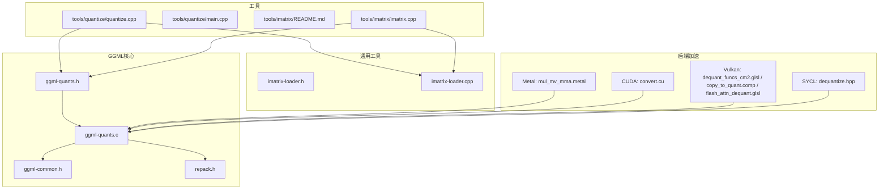
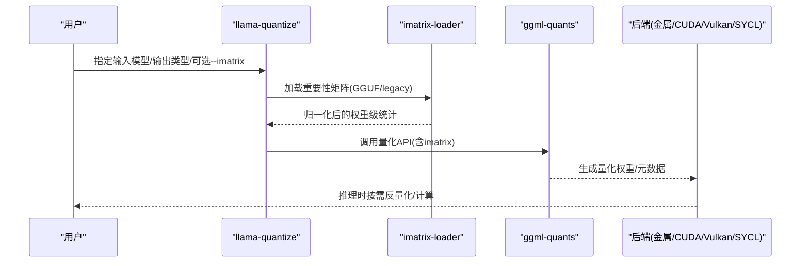
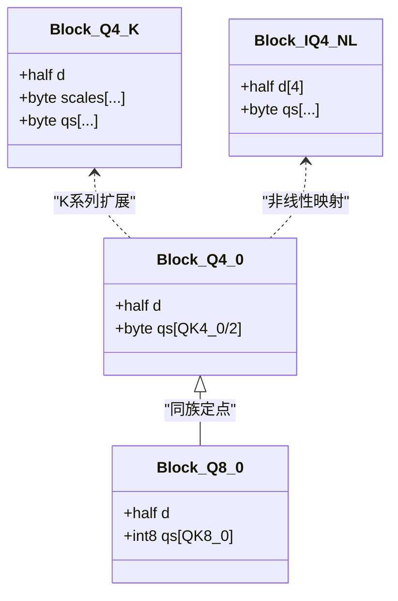
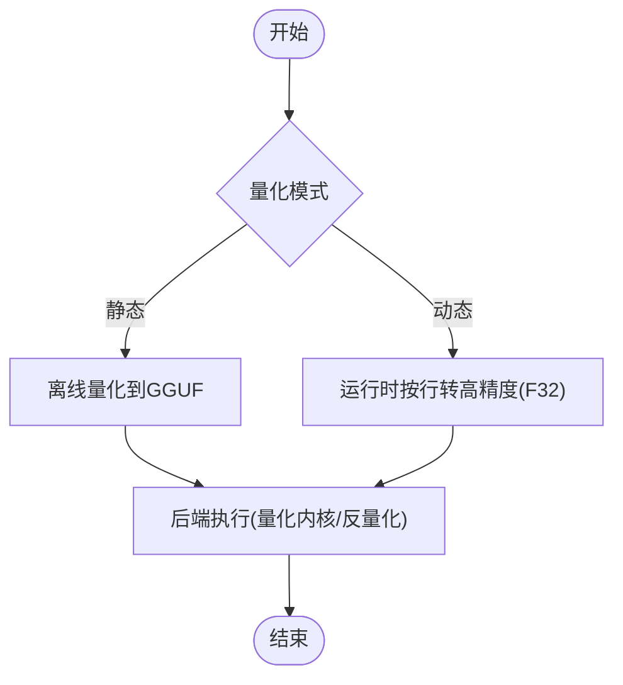
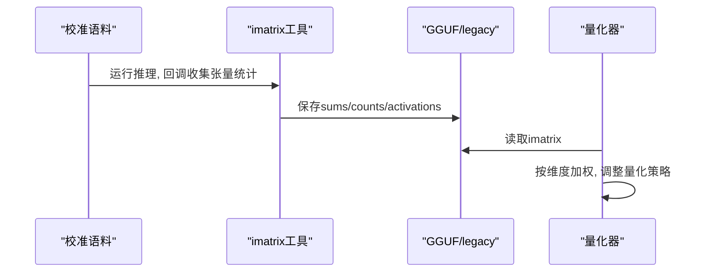
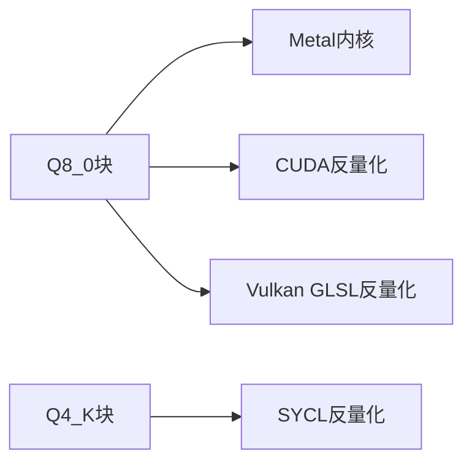
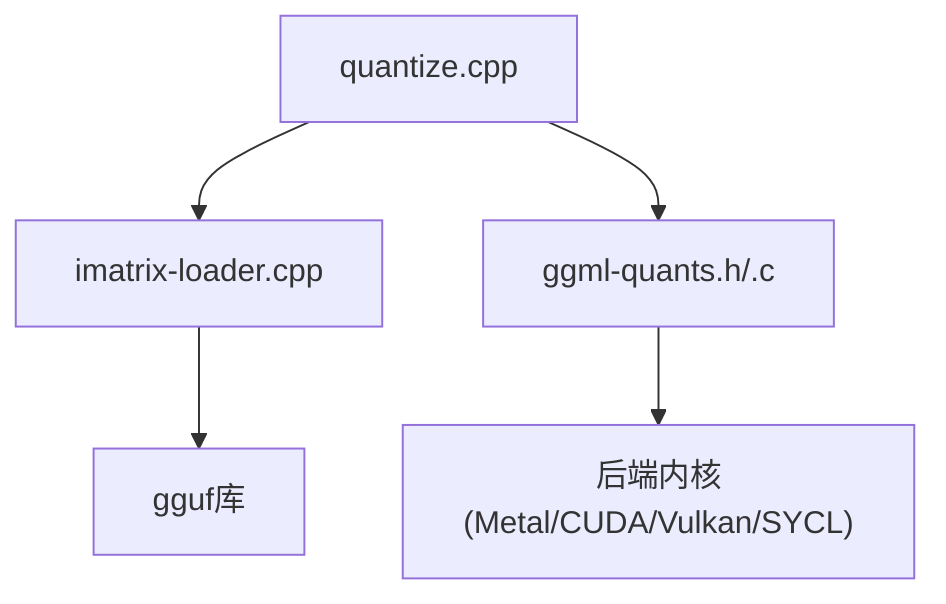

# 量化与优化

<cite>
**本文引用的文件**   
- [ggml-quants.h](file://ggml/src/ggml-quants.h)
- [ggml-quants.c](file://ggml/src/ggml-quants.c)
- [imatrix-loader.h](file://common/imatrix-loader.h)
- [imatrix-loader.cpp](file://common/imatrix-loader.cpp)
- [quantize.cpp](file://tools/quantize/quantize.cpp)
- [main.cpp（量化入口）](file://tools/quantize/main.cpp)
- [README.md（imatrix工具）](file://tools/imatrix/README.md)
- [imatrix.cpp](file://tools/imatrix/imatrix.cpp)
- [repack.h](file://ggml/src/ggml-cpu/repack.h)
- [ggml-common.h](file://ggml/src/ggml-common.h)
- [mul_mv_mma.metal](file://ggml/src/ggml-metal/kernels/mul_mv_mma.metal)
- [convert.cu](file://ggml/src/ggml-cuda/convert.cu)
- [dequantize.hpp](file://ggml/src/ggml-sycl/dequantize.hpp)
- [vulkan-shaders/copy_to_quant.comp](file://ggml/src/ggml-vulkan/vulkan-shaders/copy_to_quant.comp)
- [vulkan-shaders/dequant_funcs_cm2.glsl](file://ggml/src/ggml-vulkan/vulkan-shaders/dequant_funcs_cm2.glsl)
- [flash_attn_dequant.glsl](file://ggml/src/ggml-vulkan/flash_attn_dequant.glsl)
- [quantize/README.md](file://tools/quantize/README.md)
</cite>

## 目录
1. [简介](#简介)
2. [项目结构](#项目结构)
3. [核心组件](#核心组件)
4. [架构总览](#架构总览)
5. [详细组件分析](#详细组件分析)
6. [依赖关系分析](#依赖关系分析)
7. [性能考量](#性能考量)
8. [故障排查指南](#故障排查指南)
9. [结论](#结论)
10. [附录](#附录)

## 简介
本技术文档围绕模型量化与优化，系统阐述以下主题：
- 多种量化算法的数学基础与实现细节：INT8、FP16、BF16、Q4_K、Q8_0等
- 动态量化与静态量化的区别与应用场景
- imatrix工具的使用：统计信息收集、量化参数调优与精度评估
- 量化对推理速度与内存占用的影响
- 量化质量评估工具与基准测试方法
- 不同硬件平台的量化最佳实践与性能调优建议

## 项目结构
仓库中与量化相关的核心代码分布在以下位置：
- ggml层：统一的量化/反量化接口与参考实现
- common层：重要性矩阵（imatrix）加载与元数据定义
- tools/quantize：量化命令行工具与参数解析
- tools/imatrix：重要性矩阵采集与合并工具
- 各后端（CPU/GPU/Metal/Vulkan/SYCL/OpenVINO/ZenDNN等）：针对特定格式的加速内核与反量化路径

图表来源
- [ggml-quants.h:1-116](file://ggml/src/ggml-quants.h#L1-L116)
- [ggml-quants.c:1-800](file://ggml/src/ggml-quants.c#L1-L800)
- [imatrix-loader.h:1-31](file://common/imatrix-loader.h#L1-L31)
- [imatrix-loader.cpp:1-191](file://common/imatrix-loader.cpp#L1-L191)
- [quantize.cpp:1-669](file://tools/quantize/quantize.cpp#L1-L669)
- [main.cpp（量化入口）:1-6](file://tools/quantize/main.cpp#L1-L6)
- [mul_mv_mma.metal:133-167](file://ggml/src/ggml-metal/kernels/mul_mv_mma.metal#L133-L167)
- [convert.cu:334-369](file://ggml/src/ggml-cuda/convert.cu#L334-L369)
- [dequantize.hpp:1176-1212](file://ggml/src/ggml-sycl/dequantize.hpp#L1176-L1212)
- [vulkan-shaders/dequant_funcs_cm2.glsl:239-275](file://ggml/src/ggml-vulkan/vulkan-shaders/dequant_funcs_cm2.glsl#L239-L275)
- [vulkan-shaders/copy_to_quant.comp:107-150](file://ggml/src/ggml-vulkan/vulkan-shaders/copy_to_quant.comp#L107-L150)
- [flash_attn_dequant.glsl:101-119](file://ggml/src/ggml-vulkan/flash_attn_dequant.glsl#L101-L119)

章节来源
- [ggml-quants.h:1-116](file://ggml/src/ggml-quants.h#L1-L116)
- [ggml-quants.c:1-800](file://ggml/src/ggml-quants.c#L1-L800)
- [imatrix-loader.h:1-31](file://common/imatrix-loader.h#L1-L31)
- [imatrix-loader.cpp:1-191](file://common/imatrix-loader.cpp#L1-L191)
- [quantize.cpp:1-669](file://tools/quantize/quantize.cpp#L1-L669)
- [main.cpp（量化入口）:1-6](file://tools/quantize/main.cpp#L1-L6)

## 核心组件
- 量化/反量化接口与参考实现：提供q1_0/q2_0/q4_0/q4_1/q5_0/q5_1/q8_0以及K系列（q2_K..q8_K）、IQ/TQ/NVFP4/MXFP4等类型的量化与反量化函数。
- 重要性矩阵（imatrix）：用于激活感知量化（AWQ），在量化时按张量维度加权分配精度或缩放。
- 量化命令行工具：支持选择目标类型（Q4_K、Q8_0、F16、BF16等）、选择性张量类型覆盖、层剪枝、KV覆盖、dry-run估算大小等。
- imatrix采集工具：基于校准语料统计张量激活的一阶/二阶矩与计数，支持多数据集合并、分块保存、可视化统计。

章节来源
- [ggml-quants.h:16-106](file://ggml/src/ggml-quants.h#L16-L106)
- [imatrix-loader.h:8-28](file://common/imatrix-loader.h#L8-L28)
- [quantize.cpp:21-75](file://tools/quantize/quantize.cpp#L21-L75)
- [README.md（imatrix工具）:79-102](file://tools/imatrix/README.md#L79-L102)

## 架构总览
量化管线由“数据采集→重要性矩阵→量化器→后端执行”构成。

图表来源
- [quantize.cpp:183-303](file://tools/quantize/quantize.cpp#L183-L303)
- [imatrix-loader.cpp:82-191](file://common/imatrix-loader.cpp#L82-L191)
- [ggml-quants.h:78-106](file://ggml/src/ggml-quants.h#L78-L106)

## 详细组件分析

### 量化算法与数据结构
- 定点量化（Qx_y）：以块为单位存储scale/min与量化值，常见有Q4_0/Q4_1/Q5_0/Q5_1/Q8_0等。
- K系列混合精度（Q2_K..Q8_K）：超块+子块尺度，兼顾压缩率与精度。
- IQ/TQ/NVFP4/MXFP4：面向低比特与非线性映射的格式，适配移动端/异构设备。
- 反量化：从量化块恢复浮点值，供GPU/CPU内核进行乘加运算。

图表来源
- [ggml-quants.c:112-148](file://ggml/src/ggml-quants.c#L112-L148)
- [ggml-quants.c:275-299](file://ggml/src/ggml-quants.c#L275-L299)
- [repack.h:71-143](file://ggml/src/ggml-cpu/repack.h#L71-L143)
- [ggml-common.h:370-402](file://ggml/src/ggml-common.h#L370-L402)

章节来源
- [ggml-quants.h:16-106](file://ggml/src/ggml-quants.h#L16-L106)
- [ggml-quants.c:112-299](file://ggml/src/ggml-quants.c#L112-L299)
- [repack.h:71-143](file://ggml/src/ggml-cpu/repack.h#L71-L143)
- [ggml-common.h:370-402](file://ggml/src/ggml-common.h#L370-L402)

### 动态量化与静态量化
- 静态量化（离线）：将权重预先量化为GGUF中的低比特格式，推理时按需反量化或直接使用量化内核。适用于部署阶段固定权重的场景。
- 动态量化（运行时）：某些后端在算子内部将行向量动态转换为更高精度（如F32）再参与计算，以减少量化误差或满足后端要求（例如ZenDNN）。

图表来源
- [quantize.cpp:121-180](file://tools/quantize/quantize.cpp#L121-L180)
- [quantize.cpp:395-669](file://tools/quantize/quantize.cpp#L395-L669)

章节来源
- [quantize.cpp:121-180](file://tools/quantize/quantize.cpp#L121-L180)
- [quantize.cpp:395-669](file://tools/quantize/quantize.cpp#L395-L669)

### imatrix工具：统计信息收集与量化参数调优
- 采集流程：对校准语料运行推理，记录张量输入的sum/in_sum2/counts，并可选择activations以计算能量/熵等指标。
- 合并与导出：支持多数据集合并、分块保存、历史快照；导出为GGUF或legacy格式。
- 量化集成：量化器读取imatrix并按张量维度加权，提升关键张量的量化精度。

图表来源
- [imatrix-loader.h:8-28](file://common/imatrix-loader.h#L8-L28)
- [imatrix-loader.cpp:82-191](file://common/imatrix-loader.cpp#L82-L191)
- [quantize.cpp:183-303](file://tools/quantize/quantize.cpp#L183-L303)
- [README.md（imatrix工具）:79-102](file://tools/imatrix/README.md#L79-L102)

章节来源
- [imatrix-loader.h:8-28](file://common/imatrix-loader.h#L8-L28)
- [imatrix-loader.cpp:82-191](file://common/imatrix-loader.cpp#L82-L191)
- [quantize.cpp:183-303](file://tools/quantize/quantize.cpp#L183-L303)
- [README.md（imatrix工具）:79-102](file://tools/imatrix/README.md#L79-L102)

### 量化质量评估与基准测试
- 质量评估：通过perplexity、逐张量统计（均值/方差/偏度/峰度/H范数/能量）衡量量化损失；结合imatrix识别高贡献张量。
- 基准测试：针对不同比特（IQ3_XS/IQ4_NL/Q4_K_S等）对比prompt处理吞吐与文本生成吞吐，辅助选型。

章节来源
- [README.md（imatrix工具）:89-102](file://tools/imatrix/README.md#L89-L102)
- [quantize/README.md:150-163](file://tools/quantize/README.md#L150-L163)

### 后端加速与反量化路径
- Metal：针对Q8_0等格式的内核，利用SIMD/并行lane进行高效乘加。
- CUDA：模板化反量化路径，批量启动kernel完成块级反量化。
- Vulkan：GLSL着色器实现Q8_0/TQ1_0等反量化宏，支持Flash Attention路径。
- SYCL：K系列反量化内核，局部共享内存优化。

图表来源
- [mul_mv_mma.metal:147-167](file://ggml/src/ggml-metal/kernels/mul_mv_mma.metal#L147-L167)
- [convert.cu:334-369](file://ggml/src/ggml-cuda/convert.cu#L334-L369)
- [vulkan-shaders/dequant_funcs_cm2.glsl:239-275](file://ggml/src/ggml-vulkan/vulkan-shaders/dequant_funcs_cm2.glsl#L239-L275)
- [flash_attn_dequant.glsl:101-119](file://ggml/src/ggml-vulkan/flash_attn_dequant.glsl#L101-L119)
- [dequantize.hpp:1176-1212](file://ggml/src/ggml-sycl/dequantize.hpp#L1176-L1212)

章节来源
- [mul_mv_mma.metal:147-167](file://ggml/src/ggml-metal/kernels/mul_mv_mma.metal#L147-L167)
- [convert.cu:334-369](file://ggml/src/ggml-cuda/convert.cu#L334-L369)
- [vulkan-shaders/dequant_funcs_cm2.glsl:239-275](file://ggml/src/ggml-vulkan/vulkan-shaders/dequant_funcs_cm2.glsl#L239-L275)
- [flash_attn_dequant.glsl:101-119](file://ggml/src/ggml-vulkan/flash_attn_dequant.glsl#L101-L119)
- [dequantize.hpp:1176-1212](file://ggml/src/ggml-sycl/dequantize.hpp#L1176-L1212)

## 依赖关系分析
- 量化器依赖imatrix加载器以获取张量级统计；imatrix加载器依赖GGUF库解析元数据与张量。
- 量化器调用ggml-quants提供的量化API，并将结果写入GGUF；后端根据数据类型选择对应内核。
- 工具链耦合度较低，便于替换imatrix源或扩展新的量化类型。

图表来源
- [quantize.cpp:183-303](file://tools/quantize/quantize.cpp#L183-L303)
- [imatrix-loader.cpp:82-191](file://common/imatrix-loader.cpp#L82-L191)
- [ggml-quants.h:16-106](file://ggml/src/ggml-quants.h#L16-L106)

章节来源
- [quantize.cpp:183-303](file://tools/quantize/quantize.cpp#L183-L303)
- [imatrix-loader.cpp:82-191](file://common/imatrix-loader.cpp#L82-L191)
- [ggml-quants.h:16-106](file://ggml/src/ggml-quants.h#L16-L106)

## 性能考量
- 推理速度：更低比特（如IQ3_XS、Q4_K_S）通常带来更高的prompt处理吞吐与生成吞吐，但需权衡精度损失。
- 内存占用：量化直接减少权重体积，降低显存/内存压力，有利于更大上下文与批处理。
- 后端差异：不同后端对特定量化格式的支持与优化程度不同，应优先选择原生支持的格式以获得最佳性能。

章节来源
- [quantize/README.md:150-163](file://tools/quantize/README.md#L150-L163)

## 故障排查指南
- imatrix加载失败：检查GGUF元数据是否完整（datasets/chunk_count/chunk_size/n_layer_nextn），或回退到legacy格式。
- 量化参数错误：确认--tensor-type/--output-tensor-type/--token-embedding-type等参数合法；避免同时使用--include-weights与--exclude-weights。
- 后端兼容问题：若后端要求运行时F32（如ZenDNN动态量化路径），请确保输入行保持F32或遵循后端文档。

章节来源
- [imatrix-loader.cpp:82-191](file://common/imatrix-loader.cpp#L82-L191)
- [quantize.cpp:121-180](file://tools/quantize/quantize.cpp#L121-L180)
- [quantize.cpp:395-669](file://tools/quantize/quantize.cpp#L395-L669)

## 结论
- 本项目提供了完整的量化生态：从算法定义、工具链到多后端加速。
- 通过imatrix驱动的激活感知量化，可在有限比特下获得更优的精度-性能平衡。
- 建议依据目标平台与业务需求选择合适的量化格式，并结合基准测试与统计指标持续迭代优化。

## 附录
- 常用命令示例（量化）：
  - 仅估算大小：llama-quantize --dry-run model-f32.gguf Q4_K
  - 使用imatrix：llama-quantize --imatrix imatrix.gguf model-f32.gguf Q4_K_M
- 常用命令示例（imatrix）：
  - 采集并保存：./llama-imatrix -m ggml-model-f16.gguf -f calibration-data.txt --chunk 5 --output-frequency 20 --save-frequency 50 --parse-special
  - 合并与展示：./llama-imatrix -m ggml-model-f16.gguf --in-file imatrix.gguf --show-statistics

章节来源
- [quantize.cpp:121-180](file://tools/quantize/quantize.cpp#L121-L180)
- [README.md（imatrix工具）:79-102](file://tools/imatrix/README.md#L79-L102)