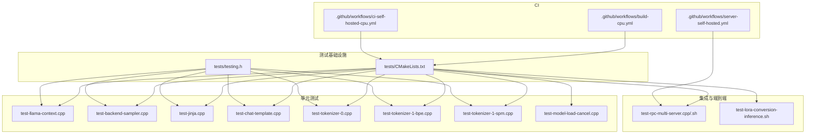
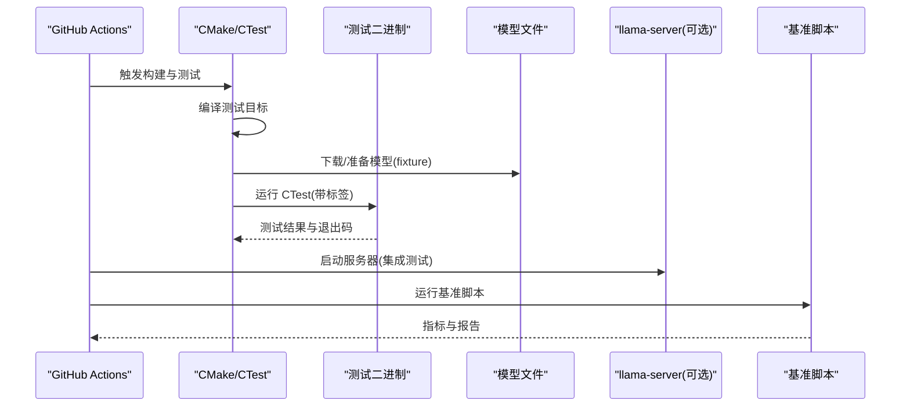
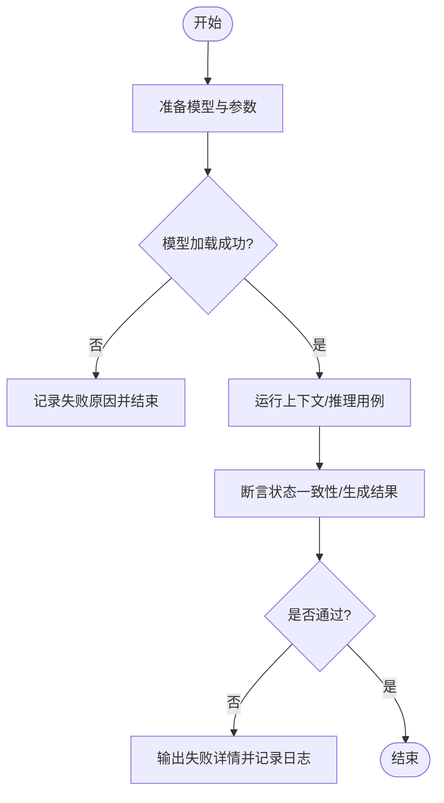
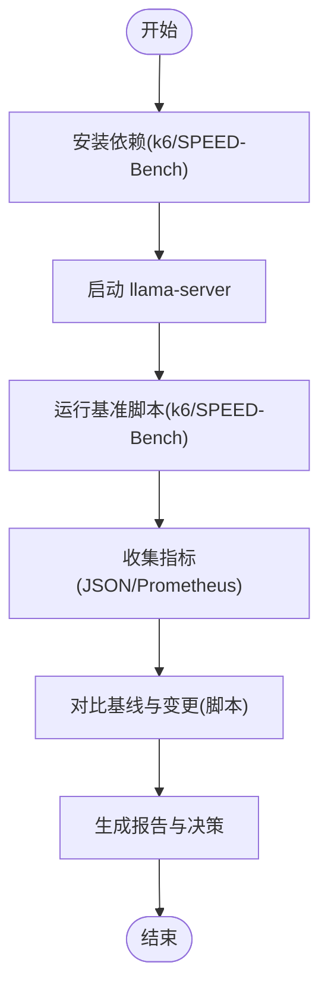
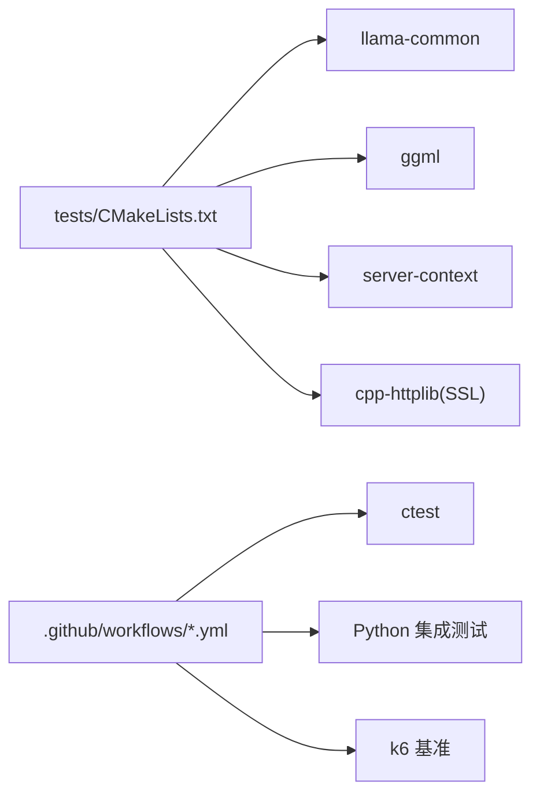

# 测试与质量保证

<cite>
**本文引用的文件**   
- [tests/CMakeLists.txt](file://tests/CMakeLists.txt)
- [tests/testing.h](file://tests/testing.h)
- [tests/test-llama-context.cpp](file://tests/test-llama-context.cpp)
- [tests/test-backend-sampler.cpp](file://tests/test-backend-sampler.cpp)
- [tests/test-chat-template.cpp](file://tests/test-chat-template.cpp)
- [tests/test-jinja.cpp](file://tests/test-jinja.cpp)
- [tests/test-tokenizer-0.cpp](file://tests/test-tokenizer-0.cpp)
- [tests/test-tokenizer-1-bpe.cpp](file://tests/test-tokenizer-1-bpe.cpp)
- [tests/test-tokenizer-1-spm.cpp](file://tests/test-tokenizer-1-spm.cpp)
- [tests/test-model-load-cancel.cpp](file://tests/test-model-load-cancel.cpp)
- [tests/test-rpc-multi-server.cpp](file://tests/test-rpc-multi-server.cpp)
- [tests/test-rpc-multi-server.sh](file://tests/test-rpc-multi-server.sh)
- [tests/test-lora-conversion-inference.sh](file://tests/test-lora-conversion-inference.sh)
- [scripts/compare-llama-bench.py](file://scripts/compare-llama-bench.py)
- [tools/server/bench/speed-bench/README.md](file://tools/server/bench/speed-bench/README.md)
- [tools/server/bench/README.md](file://tools/server/bench/README.md)
- [.github/workflows/build-cpu.yml](file://.github/workflows/build-cpu.yml)
- [.github/workflows/ci-self-hosted-cpu.yml](file://.github/workflows/ci-self-hosted-cpu.yml)
- [.github/workflows/server-self-hosted.yml](file://.github/workflows/server-self-hosted.yml)
</cite>

## 目录
1. [简介](#简介)
2. [项目结构](#项目结构)
3. [核心组件](#核心组件)
4. [架构总览](#架构总览)
5. [详细组件分析](#详细组件分析)
6. [依赖关系分析](#依赖关系分析)
7. [性能考量](#性能考量)
8. [故障排查指南](#故障排查指南)
9. [结论](#结论)
10. [附录](#附录)

## 简介
本文件面向 llama.cpp 的测试与质量保证体系，覆盖单元测试框架、集成与端到端测试策略、持续集成配置、性能基准流程以及代码审查与质量门禁建议。文档以仓库现有实现为依据，重点说明：
- 如何使用内置轻量测试框架编写用例、组织断言与基准；
- 如何构建和运行 CTest 测试集，包括模型加载、推理准确性与线程安全等场景；
- 如何通过 GitHub Actions 自动化构建、测试与回归检测；
- 如何利用现有工具进行服务器性能基准与结果对比；
- 如何在日常开发中建立可落地的质量门禁与审查清单。

## 项目结构
llama.cpp 的测试主要位于 tests 目录，通过 CMake 统一注册为 CTest 测试目标，并在 CI 中按标签执行。关键要点：
- tests/CMakeLists.txt 提供统一的测试构建与注册宏，支持链接不同库（如 llama-common、ggml、server-context）；
- 测试使用自定义轻量测试框架 testing.h，提供 test、bench、assert_true、assert_equal 等能力；
- 针对 tokenizer、grammar、chat template、上下文状态、后端算子、RPC 多服务、模型加载取消等场景均有对应测试；
- CI 通过 .github/workflows/*.yml 触发构建与 ctest 执行，部分工作流还包含 Python 集成测试与服务器基准。

**图表来源**
- [tests/CMakeLists.txt:1-381](file://tests/CMakeLists.txt#L1-L381)
- [tests/testing.h:1-274](file://tests/testing.h#L1-L274)
- [.github/workflows/build-cpu.yml:1-245](file://.github/workflows/build-cpu.yml#L1-L245)
- [.github/workflows/ci-self-hosted-cpu.yml:1-117](file://.github/workflows/ci-self-hosted-cpu.yml#L1-L117)
- [.github/workflows/server-self-hosted.yml:59-97](file://.github/workflows/server-self-hosted.yml#L59-L97)

**章节来源**
- [tests/CMakeLists.txt:1-381](file://tests/CMakeLists.txt#L1-L381)
- [tests/testing.h:1-274](file://tests/testing.h#L1-L274)
- [.github/workflows/build-cpu.yml:1-245](file://.github/workflows/build-cpu.yml#L1-L245)

## 核心组件
本节聚焦测试基础设施与常用测试模式。

### 轻量测试框架 testing.h
testing.h 提供了最小化的测试运行时，适合在 C++ 项目中快速编写单测与微基准：
- 用例组织：通过 testing::test(name, f) 或 testing::test(f) 定义用例；
- 过滤与跳过：支持 set_filter 正则过滤、skip(reason) 跳过用例；
- 断言：assert_true(cond)、assert_equal(expected, actual)；
- 基准：bench(name, f, iterations) 输出平均耗时与吞吐；
- 统计与退出码：summary() 汇总测试数、断言数、失败数、异常数、跳过数，并返回非零退出码表示失败。

典型用法路径参考：
- 断言与基准示例：[tests/test-jinja.cpp:620-680](file://tests/test-jinja.cpp#L620-L680)

**章节来源**
- [tests/testing.h:1-274](file://tests/testing.h#L1-L274)
- [tests/test-jinja.cpp:620-680](file://tests/test-jinja.cpp#L620-L680)

### CMake 测试构建与注册
tests/CMakeLists.txt 定义了以下关键宏：
- llama_build(source): 编译单个测试源文件为目标；
- llama_test(target): 将已有目标注册为 CTest 测试；
- llama_test_cmd(target): 将外部命令注册为 CTest 测试；
- llama_build_and_test(source): 编译并注册为 CTest 测试；
- 支持 NAME、LABEL、WORKING_DIRECTORY、ARGS、LINK 等参数；
- 大量测试通过 LABEL main/python/model 分组，便于 CI 选择性执行。

常见模式：
- 对多个词表运行同一测试程序：先 llama_build(test-tokenizer-0.cpp)，再多次 llama_test(...) 传入不同模型路径；
- 需要内部头文件的测试：LINK ggml 或 llama；
- 需要服务端上下文的测试：LINK server-context 并设置 include 目录；
- 下载模型作为 fixture：add_test + set_tests_properties(FIXTURES_SETUP/FIXTURES_REQUIRED)。

**章节来源**
- [tests/CMakeLists.txt:1-381](file://tests/CMakeLists.txt#L1-L381)

## 架构总览
下图展示从 CI 到测试执行的端到端流程，包括构建、下载模型、运行 CTest、Python 集成测试与服务器基准。

**图表来源**
- [.github/workflows/build-cpu.yml:107-133](file://.github/workflows/build-cpu.yml#L107-L133)
- [tests/CMakeLists.txt:286-299](file://tests/CMakeLists.txt#L286-L299)
- [.github/workflows/server-self-hosted.yml:59-97](file://.github/workflows/server-self-hosted.yml#L59-L97)

## 详细组件分析

### 单元测试框架使用方法
- 编写用例：使用 testing::test(name, f) 包裹逻辑，内部调用 assert_true/assert_equal；
- 过滤与跳过：set_filter("regex") 仅运行匹配的用例；skip("reason") 标记跳过；
- 基准测试：bench(name, f, iterations) 输出平均耗时与吞吐，适合验证性能不回归；
- 断言语法：assert_true(msg, cond) 与 assert_equal(msg, expected, actual) 会在失败时打印期望与实际值；
- 组合测试：可在一个测试文件中组织多个 test(...) 与 bench(...)，由 testing::summary() 汇总。

参考路径：
- 断言与基准示例：[tests/test-jinja.cpp:620-680](file://tests/test-jinja.cpp#L620-L680)

**章节来源**
- [tests/testing.h:1-274](file://tests/testing.h#L1-L274)
- [tests/test-jinja.cpp:620-680](file://tests/test-jinja.cpp#L620-L680)

### 模拟对象与依赖注入
当前测试未引入第三方 Mock 框架，而是通过以下方式管理依赖：
- 通过命令行参数传递模型路径，避免硬编码；
- 使用 fixtures（FIXTURES_SETUP/FIXTURES_REQUIRED）在 CTest 层准备模型数据；
- 对需要服务端上下文的测试，通过 LINK server-context 与 include 目录注入；
- 对后端采样器测试，通过构造 test_context 与 llama_sampler_seq_config 控制行为。

参考路径：
- 后端采样器测试上下文构造：[tests/test-backend-sampler.cpp:75-107](file://tests/test-backend-sampler.cpp#L75-L107)
- 服务端上下文注入：[tests/CMakeLists.txt:190-196](file://tests/CMakeLists.txt#L190-L196)

**章节来源**
- [tests/test-backend-sampler.cpp:75-107](file://tests/test-backend-sampler.cpp#L75-L107)
- [tests/CMakeLists.txt:190-196](file://tests/CMakeLists.txt#L190-L196)

### 集成测试与端到端测试策略
- 模型加载测试：
  - 通过 llama_build_and_test(test-model-load-cancel.cpp) 验证模型加载取消行为；
  - 使用 FIXTURES_SETUP/FIXTURES_REQUIRED 确保模型已下载；
  - 参考：[tests/CMakeLists.txt:319-321](file://tests/CMakeLists.txt#L319-L321), [tests/CMakeLists.txt:286-299](file://tests/CMakeLists.txt#L286-L299)
- 推理准确性验证：
  - 使用真实模型运行上下文状态测试，校验 KV/RS 状态保存、加载、复制、回滚；
  - 参考：[tests/CMakeLists.txt:242-252](file://tests/CMakeLists.txt#L242-L252), [tests/test-llama-context.cpp:1-200](file://tests/test-llama-context.cpp#L1-L200)
- 性能回归检测：
  - 使用 testing::bench 或专用基准脚本（见“性能考量”）记录吞吐与时延；
  - 在 CI 中通过 ctest 标签与超时限制保障稳定性；
  - 参考：[tests/CMakeLists.txt:128-133](file://tests/CMakeLists.txt#L128-L133)

**图表来源**
- [tests/test-llama-context.cpp:117-173](file://tests/test-llama-context.cpp#L117-L173)
- [tests/CMakeLists.txt:242-252](file://tests/CMakeLists.txt#L242-L252)

**章节来源**
- [tests/CMakeLists.txt:242-252](file://tests/CMakeLists.txt#L242-L252)
- [tests/CMakeLists.txt:286-299](file://tests/CMakeLists.txt#L286-L299)
- [tests/test-llama-context.cpp:1-200](file://tests/test-llama-context.cpp#L1-L200)

### 持续集成配置
- CPU 构建与测试：
  - 在 Ubuntu/Windows 矩阵上构建，启用 RPC、OpenBLAS 等选项；
  - 使用 ctest -L 'main|python' --verbose --timeout 900 执行测试；
  - 参考：[.github/workflows/build-cpu.yml:107-133](file://.github/workflows/build-cpu.yml#L107-L133), [.github/workflows/build-cpu.yml:216-221](file://.github/workflows/build-cpu.yml#L216-L221)
- 自托管高性能 CPU 测试：
  - 通过 ci/run.sh 执行高并发与额外测试；
  - 参考：[.github/workflows/ci-self-hosted-cpu.yml:56-60](file://.github/workflows/ci-self-hosted-cpu.yml#L56-L60), [.github/workflows/ci-self-hosted-cpu.yml:95-102](file://.github/workflows/ci-self-hosted-cpu.yml#L95-L102)
- 服务器集成测试：
  - 安装 Python 依赖，运行 tools/server/tests 下的 tests.sh；
  - 支持 LLAMA_ARG_BACKEND_SAMPLING 与 GGML_METAL_DEVICES 环境变量；
  - 参考：[.github/workflows/server-self-hosted.yml:65-97](file://.github/workflows/server-self-hosted.yml#L65-L97)

**章节来源**
- [.github/workflows/build-cpu.yml:107-133](file://.github/workflows/build-cpu.yml#L107-L133)
- [.github/workflows/build-cpu.yml:216-221](file://.github/workflows/build-cpu.yml#L216-L221)
- [.github/workflows/ci-self-hosted-cpu.yml:56-60](file://.github/workflows/ci-self-hosted-cpu.yml#L56-L60)
- [.github/workflows/ci-self-hosted-cpu.yml:95-102](file://.github/workflows/ci-self-hosted-cpu.yml#L95-L102)
- [.github/workflows/server-self-hosted.yml:65-97](file://.github/workflows/server-self-hosted.yml#L65-L97)

### 性能基准测试标准流程
- 服务器基准（k6）：
  - 安装 k6 与 SSE 扩展；
  - 启动 llama-server，运行 k6 脚本，收集吞吐与时延；
  - 可通过 scripts/compare-llama-bench.py 对比不同版本或配置的指标；
  - 参考：[tools/server/bench/README.md:1-120](file://tools/server/bench/README.md#L1-L120), [scripts/compare-llama-bench.py:902-932](file://scripts/compare-llama-bench.py#L902-L932)
- SPEED-Bench：
  - 通过 tools/server/bench/speed-bench 评估草稿模型、n-gram、MTP、EAGLE3 等方案；
  - 支持分类别吞吐、延迟与接受率指标，并提供 baseline vs speculative 对比；
  - 参考：[tools/server/bench/speed-bench/README.md:1-118](file://tools/server/bench/speed-bench/README.md#L1-L118)

**图表来源**
- [tools/server/bench/README.md:1-120](file://tools/server/bench/README.md#L1-L120)
- [tools/server/bench/speed-bench/README.md:1-118](file://tools/server/bench/speed-bench/README.md#L1-L118)
- [scripts/compare-llama-bench.py:902-932](file://scripts/compare-llama-bench.py#L902-L932)

**章节来源**
- [tools/server/bench/README.md:1-120](file://tools/server/bench/README.md#L1-L120)
- [tools/server/bench/speed-bench/README.md:1-118](file://tools/server/bench/speed-bench/README.md#L1-L118)
- [scripts/compare-llama-bench.py:902-932](file://scripts/compare-llama-bench.py#L902-L932)

### 代码审查清单与质量门禁建议
- 代码风格与静态检查：
  - 使用 clang-format、clang-tidy、flake8、pyright 等工具；
  - 在 PR 中强制通过 style 检查（参考仓库中的 code-style.yml 与 Python lint/type-check workflows）。
- 测试覆盖率与门禁：
  - 建议在 CI 中加入覆盖率统计（例如 gcov/lcov），设定最低覆盖率阈值；
  - 对关键模块（tokenizer、grammar、context、backend ops）要求新增单测；
- 回归检测：
  - 对性能基准（k6/SPEED-Bench）设置阈值告警；
  - 对推理准确性（上下文状态、KV/RS）设置断言失败即阻断合并。
- 发布前检查：
  - 运行完整测试集（main/python/model 标签）；
  - 验证模型下载与加载流程；
  - 检查 API ABI 兼容性（参考 scripts/check-apiabi-compat.sh）。

[本节为通用建议，不直接分析具体文件]

## 依赖关系分析
测试与构建之间的依赖关系如下：
- tests/CMakeLists.txt 依赖 llama-common、ggml、server-context 等目标；
- 部分测试需要 cpp-httplib 的 SSL 支持以获取远程模型元数据；
- CI 工作流依赖 GitHub Actions 环境、Python 包、k6 等外部工具。

**图表来源**
- [tests/CMakeLists.txt:190-196](file://tests/CMakeLists.txt#L190-L196)
- [tests/CMakeLists.txt:343-360](file://tests/CMakeLists.txt#L343-L360)
- [.github/workflows/server-self-hosted.yml:65-97](file://.github/workflows/server-self-hosted.yml#L65-L97)

**章节来源**
- [tests/CMakeLists.txt:190-196](file://tests/CMakeLists.txt#L190-L196)
- [tests/CMakeLists.txt:343-360](file://tests/CMakeLists.txt#L343-L360)
- [.github/workflows/server-self-hosted.yml:65-97](file://.github/workflows/server-self-hosted.yml#L65-L97)

## 性能考量
- 测试性能：
  - 使用 testing::bench 进行微基准，关注平均耗时与吞吐；
  - 对慢测试（如 double-float）可选择性禁用或在 CI 中单独运行；
- 服务器性能：
  - 使用 k6 与 SPEED-Bench 评估吞吐、延迟与草稿接受率；
  - 通过 compare-llama-bench.py 对比不同版本或配置的性能差异；
- 资源与环境：
  - 在 CI 中设置 GGML_NLOOP、GGML_N_THREADS、LLAMA_ARG_LOG_* 等环境变量以稳定测试；
  - 在高并发场景下注意 ubatch/batch/ctx-size 的配置一致性。

[本节提供一般性指导，不直接分析具体文件]

## 故障排查指南
- 模型加载失败：
  - 检查模型路径与哈希是否正确；
  - 确认 FIXTURES_SETUP/FIXTURES_REQUIRED 是否生效；
  - 参考：[tests/CMakeLists.txt:286-299](file://tests/CMakeLists.txt#L286-L299)
- 上下文状态不一致：
  - 查看 test-llama-context 的输出与日志；
  - 确认 GGML_SCHED_DEBUG_REALLOC=1 是否开启；
  - 参考：[tests/CMakeLists.txt:248-252](file://tests/CMakeLists.txt#L248-L252), [tests/test-llama-context.cpp:117-173](file://tests/test-llama-context.cpp#L117-L173)
- 服务器集成测试失败：
  - 检查 Python 依赖与 venv 激活；
  - 确认 LLAMA_ARG_BACKEND_SAMPLING 与 GGML_METAL_DEVICES 环境变量；
  - 参考：[.github/workflows/server-self-hosted.yml:65-97](file://.github/workflows/server-self-hosted.yml#L65-L97)
- 性能回归：
  - 对比 k6/SPEED-Bench 的 JSON 报告；
  - 使用 compare-llama-bench.py 计算速度提升/下降；
  - 参考：[tools/server/bench/speed-bench/README.md:76-118](file://tools/server/bench/speed-bench/README.md#L76-L118), [scripts/compare-llama-bench.py:902-932](file://scripts/compare-llama-bench.py#L902-L932)

**章节来源**
- [tests/CMakeLists.txt:248-252](file://tests/CMakeLists.txt#L248-L252)
- [tests/CMakeLists.txt:286-299](file://tests/CMakeLists.txt#L286-L299)
- [tests/test-llama-context.cpp:117-173](file://tests/test-llama-context.cpp#L117-L173)
- [.github/workflows/server-self-hosted.yml:65-97](file://.github/workflows/server-self-hosted.yml#L65-L97)
- [tools/server/bench/speed-bench/README.md:76-118](file://tools/server/bench/speed-bench/README.md#L76-L118)
- [scripts/compare-llama-bench.py:902-932](file://scripts/compare-llama-bench.py#L902-L932)

## 结论
llama.cpp 的测试与质量保证体系以轻量测试框架与 CMake/CTest 为核心，结合 GitHub Actions 实现跨平台自动化构建与测试。通过模型加载、上下文状态、推理准确性、线程安全与服务器集成测试，覆盖了从底层算子到上层服务的多维度质量保障。性能基准方面，k6 与 SPEED-Bench 提供了标准化的吞吐与延迟评估方法，配合 compare-llama-bench.py 可实现回归检测。建议在 CI 中引入覆盖率统计与性能阈值门禁，并在代码审查中强化测试覆盖与回归预防。

[本节为总结性内容，不直接分析具体文件]

## 附录
- 常用测试命令：
  - 构建并运行所有 main 标签测试：ctest -L main --verbose --timeout 900；
  - 运行 Python 标签测试：ctest -L python --verbose --timeout 900；
  - 运行模型相关测试：ctest -L model --verbose --timeout 900。
- 参考路径：
  - 测试构建与注册：[tests/CMakeLists.txt:1-381](file://tests/CMakeLists.txt#L1-L381)
  - 轻量测试框架：[tests/testing.h:1-274](file://tests/testing.h#L1-L274)
  - 上下文状态测试：[tests/test-llama-context.cpp:1-200](file://tests/test-llama-context.cpp#L1-L200)
  - 后端采样器测试：[tests/test-backend-sampler.cpp:75-107](file://tests/test-backend-sampler.cpp#L75-L107)
  - 服务器基准：[tools/server/bench/README.md:1-120](file://tools/server/bench/README.md#L1-L120)
  - SPEED-Bench：[tools/server/bench/speed-bench/README.md:1-118](file://tools/server/bench/speed-bench/README.md#L1-L118)
  - CI 工作流：[.github/workflows/build-cpu.yml:107-133](file://.github/workflows/build-cpu.yml#L107-L133), [.github/workflows/server-self-hosted.yml:65-97](file://.github/workflows/server-self-hosted.yml#L65-L97)

[本节为补充信息，不直接分析具体文件]