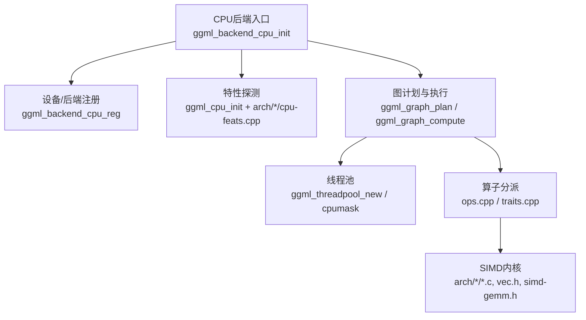
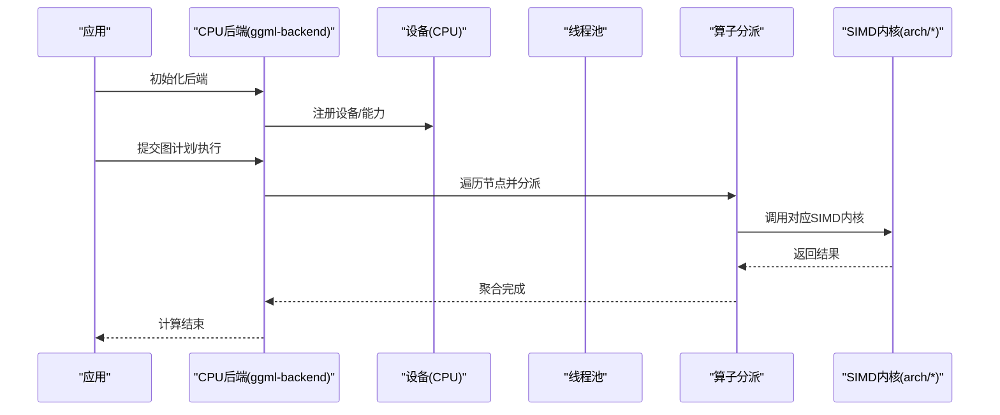
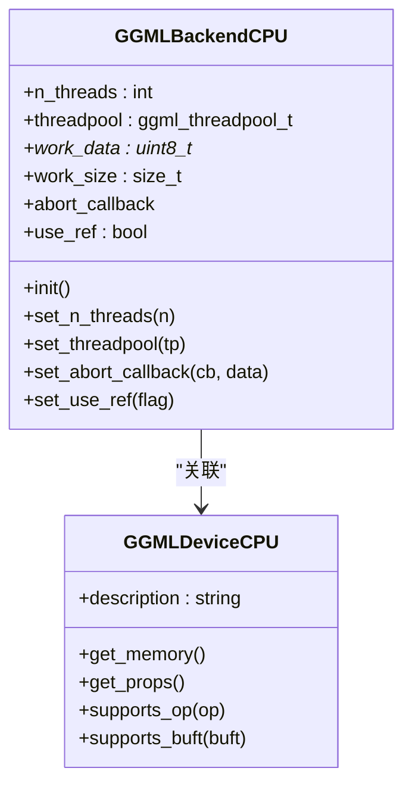
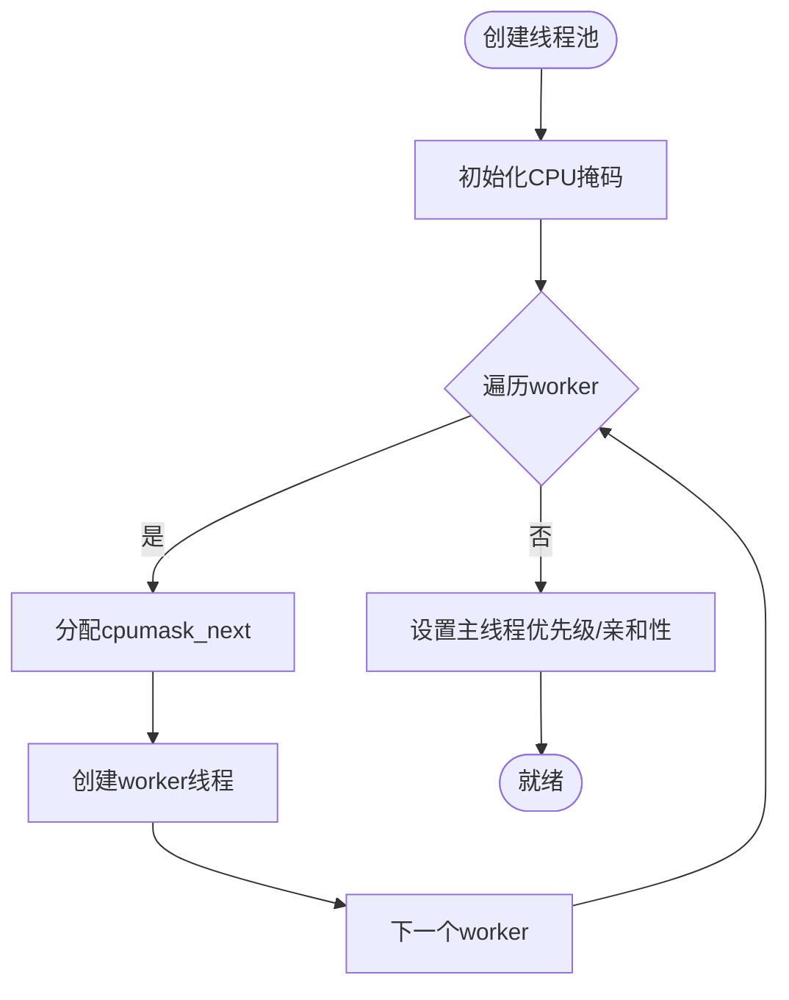
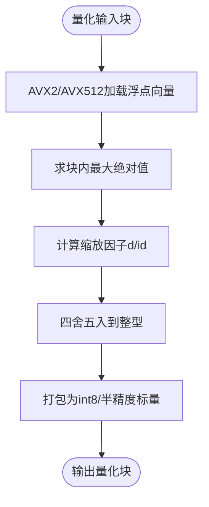
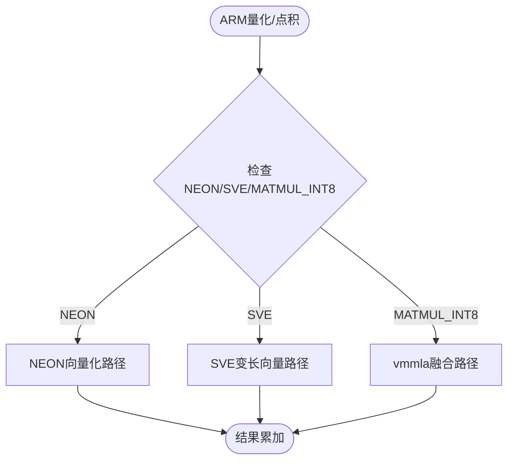
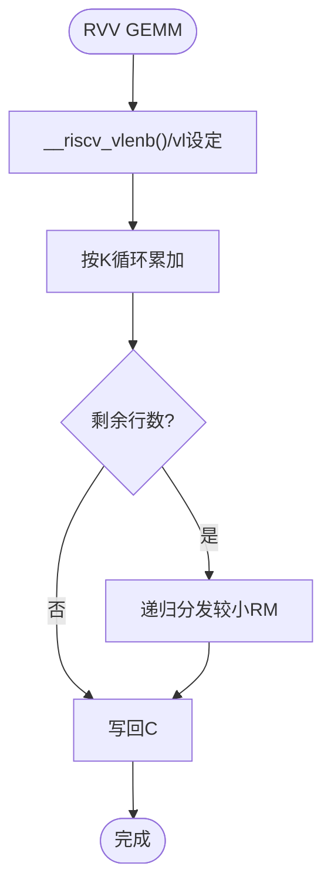
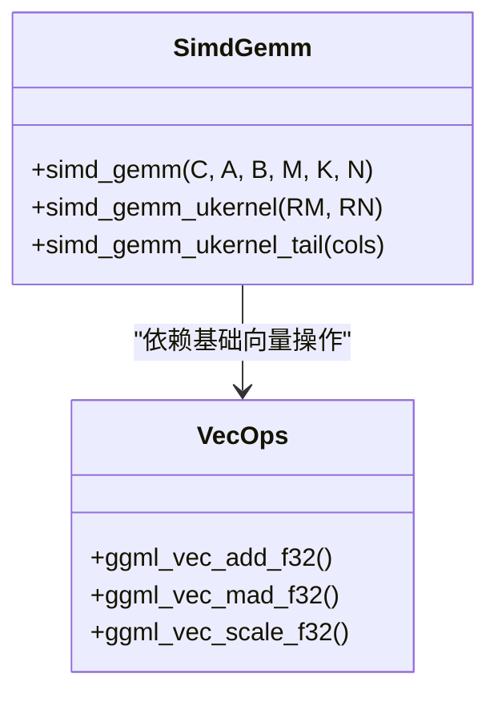
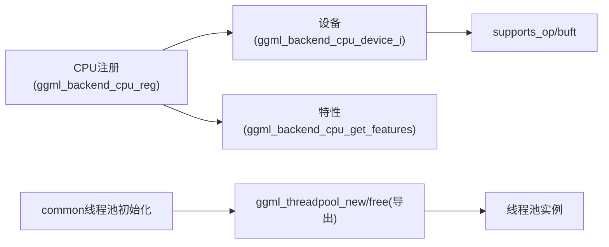

# CPU后端

<cite>
**本文引用的文件**   
- [ggml-cpu.cpp](file://ggml/src/ggml-cpu/ggml-cpu.cpp)
- [cpu-feats.cpp（x86）](file://ggml/src/ggml-cpu/arch/x86/cpu-feats.cpp)
- [cpu-feats.cpp（ARM）](file://ggml/src/ggml-cpu/arch/arm/cpu-feats.cpp)
- [cpu-feats.cpp（RISC-V）](file://ggml/src/ggml-cpu/arch/riscv/cpu-feats.cpp)
- [quants.c（x86）](file://ggml/src/ggml-cpu/arch/x86/quants.c)
- [quants.c（ARM）](file://ggml/src/ggml-cpu/arch/arm/quants.c)
- [vec.h](file://ggml/src/ggml-cpu/vec.h)
- [simd-gemm.h](file://ggml/src/ggml-cpu/simd-gemm.h)
- [ggml-cpu.c](file://ggml/src/ggml-cpu/ggml-cpu.c)
- [common.cpp](file://common/common.cpp)
</cite>

## 目录
1. [简介](#简介)
2. [项目结构](#项目结构)
3. [核心组件](#核心组件)
4. [架构总览](#架构总览)
5. [详细组件分析](#详细组件分析)
6. [依赖关系分析](#依赖关系分析)
7. [性能考量](#性能考量)
8. [故障排查指南](#故障排查指南)
9. [结论](#结论)
10. [附录](#附录)

## 简介
本文件面向llama.cpp的CPU后端，系统性阐述其SIMD指令集优化（AVX2、AVX512、NEON、SVE、RVV等）、多线程并行计算架构（任务调度、负载均衡、内存同步）、内存对齐与缓存优化策略，以及不同CPU架构（x86、ARM、RISC-V）的特定实现。同时给出配置参数、基准测试方法与调优建议，并总结常见性能瓶颈及解决方案。

## 项目结构
CPU后端位于ggml子系统的ggml-cpu目录中，围绕“设备/后端注册、运行时特性探测、量化内核、向量算子、GEMM微内核、线程池”等模块组织：
- 后端与设备注册：提供CPU后端生命周期、能力查询、图计划与执行接口
- 架构特性探测：x86/ARM/RISC-V分别通过cpuid/hwprobe检测可用SIMD扩展
- 量化与点积内核：按架构分支实现高效量化与低精度点积
- 向量算子与GEMM：通用向量运算与矩阵乘微内核
- 线程池与亲和性：统一线程池创建、CPU亲和性分配与优先级设置

图表来源
- [ggml-cpu.cpp:217-247](file://ggml/src/ggml-cpu/ggml-cpu.cpp#L217-L247)
- [ggml-cpu.cpp:512-717](file://ggml/src/ggml-cpu/ggml-cpu.cpp#L512-L717)
- [ggml-cpu.c:3348-3385](file://ggml/src/ggml-cpu/ggml-cpu.c#L3348-L3385)

章节来源
- [ggml-cpu.cpp:217-247](file://ggml/src/ggml-cpu/ggml-cpu.cpp#L217-L247)
- [ggml-cpu.cpp:512-717](file://ggml/src/ggml-cpu/ggml-cpu.cpp#L512-L717)
- [ggml-cpu.c:3348-3385](file://ggml/src/ggml-cpu/ggml-cpu.c#L3348-L3385)

## 核心组件
- CPU后端上下文与API
  - 后端初始化、线程数设置、线程池注入、中止回调、参考实现开关
  - 图计划创建与执行：复用工作缓冲区，支持异步回调
- 设备与能力查询
  - 设备描述、内存信息、能力位（mmap、host buffer等）
  - 动态暴露特性列表（SSE3/AVX/AVX2/AVX512/AMX_INT8/NEON/SVE/RVV等）
- 架构特性探测
  - x86：cpuid枚举SSE/AVX/AVX2/AVX512/VNNI/AMX等
  - ARM：基于运行时特征（DOTPROD/F16/SVE/MATMUL_INT8/SME）
  - RISC-V：hwprobe检测RVV
- SIMD内核
  - 量化与点积：按架构分支实现q8_0/q8_1/q4_0等路径
  - 向量算子：add/mad/scale等，含SVE/RVV特化
  - GEMM微内核：按寄存器宽度选择RM/RN分块
- 线程池与亲和性
  - 统一线程池创建、CPU掩码分配、主线程优先级与亲和性设置

章节来源
- [ggml-cpu.cpp:97-247](file://ggml/src/ggml-cpu/ggml-cpu.cpp#L97-L247)
- [ggml-cpu.cpp:287-410](file://ggml/src/ggml-cpu/ggml-cpu.cpp#L287-L410)
- [ggml-cpu.cpp:541-656](file://ggml/src/ggml-cpu/ggml-cpu.cpp#L541-L656)
- [cpu-feats.cpp（x86）:16-192](file://ggml/src/ggml-cpu/arch/x86/cpu-feats.cpp#L16-L192)
- [cpu-feats.cpp（ARM）:6-39](file://ggml/src/ggml-cpu/arch/arm/cpu-feats.cpp#L6-L39)
- [cpu-feats.cpp（RISC-V）:8-36](file://ggml/src/ggml-cpu/arch/riscv/cpu-feats.cpp#L8-L36)

## 架构总览
CPU后端以“后端/设备/算子/内核/线程池”分层组织，上层通过统一的backend接口提交计算图，后端负责规划、调度与执行，底层根据运行时特性选择最优SIMD路径。

图表来源
- [ggml-cpu.cpp:217-247](file://ggml/src/ggml-cpu/ggml-cpu.cpp#L217-L247)
- [ggml-cpu.cpp:130-191](file://ggml/src/ggml-cpu/ggml-cpu.cpp#L130-L191)
- [ggml-cpu.cpp:541-656](file://ggml/src/ggml-cpu/ggml-cpu.cpp#L541-L656)

## 详细组件分析

### 1) 后端与设备管理
- 后端初始化
  - 初始化CPU特性探测，创建后端上下文，默认线程数与空线程池
  - 提供设置线程数、注入线程池、中止回调、是否使用参考实现的接口
- 设备能力
  - 设备名称/描述、内存总量/剩余、类型、能力位（mmap、host buffer）
  - 动态特性列表：SSE3/SSSE3/AVX/AVX_VNNI/AVX2/F16C/FMA/BMI2/AVX512系列/AMX_INT8/NEON/ARM_FMA/FP16_VA/MATMUL_INT8/SVE/DOTPROD/SVE_CNT/SME/RISCV_V/RVV_VLEN/VSX/VXE/WASM_SIMD/LLAMAFILE/ACCELERATE/CPU_HBM/OPENMP/KLEIDIAI/REPACK

图表来源
- [ggml-cpu.cpp:97-110](file://ggml/src/ggml-cpu/ggml-cpu.cpp#L97-L110)
- [ggml-cpu.cpp:217-285](file://ggml/src/ggml-cpu/ggml-cpu.cpp#L217-L285)
- [ggml-cpu.cpp:287-410](file://ggml/src/ggml-cpu/ggml-cpu.cpp#L287-L410)

章节来源
- [ggml-cpu.cpp:217-285](file://ggml/src/ggml-cpu/ggml-cpu.cpp#L217-L285)
- [ggml-cpu.cpp:287-410](file://ggml/src/ggml-cpu/ggml-cpu.cpp#L287-L410)

### 2) 多线程并行计算架构
- 线程池创建与亲和性
  - 非OpenMP路径下，为每个worker分配CPU掩码，主线程最后放置；必要时设置优先级与亲和性
- 任务调度
  - 后端在图计划阶段传入线程数与线程池，执行时由底层图计算框架进行任务划分与调度
- 负载均衡
  - 通过cpumask_next轮转分配，避免热点核过载
- 内存同步
  - 后端未暴露异步事件；通过图计划与工作缓冲区的生命周期管理保证一致性

图表来源
- [ggml-cpu.c:3348-3385](file://ggml/src/ggml-cpu/ggml-cpu.c#L3348-L3385)

章节来源
- [ggml-cpu.c:3348-3385](file://ggml/src/ggml-cpu/ggml-cpu.c#L3348-L3385)

### 3) SIMD指令集优化与内核实现

#### 3.1 x86（AVX2/AVX512/AMX_INT8）
- 特性探测
  - 通过cpuid读取FMA/AVX/AVX2/AVX512F/CD/VL/DQ/BW/VBMI/VNNI/BF16/AMX_INT8等标志位，并按编译期宏评分
- 量化与点积
  - q8_0/q8_1量化：批量加载、绝对值最大值归一、舍入、打包int8
  - 点积路径：利用dpbusd_avx/dpbssd_avx或maddubs/madd_epi16组合，减少访存与算术开销
  - AVX512路径：masked load/store与mask3_fmadd提升尾部处理效率
- AMX_INT8
  - 后端注册额外buffer类型，并在特性列表中暴露AMX_INT8

图表来源
- [quants.c（x86）:302-398](file://ggml/src/ggml-cpu/arch/x86/quants.c#L302-L398)
- [quants.c（x86）:400-502](file://ggml/src/ggml-cpu/arch/x86/quants.c#L400-L502)

章节来源
- [cpu-feats.cpp（x86）:263-325](file://ggml/src/ggml-cpu/arch/x86/cpu-feats.cpp#L263-L325)
- [quants.c（x86）:302-502](file://ggml/src/ggml-cpu/arch/x86/quants.c#L302-L502)

#### 3.2 ARM（NEON/SVE/MATMUL_INT8/SME）
- 特性探测
  - 基于运行时特征af.has_dotprod/fp16/sve/i8mm/sve2/sme评分
- 量化与点积
  - NEON路径：vabs/vmax/vmul/vcvt/vqtbl1等指令链，结合预置表加速符号展开
  - SVE路径：按vector length分支（128/256/512），使用svdot/svmla等变长向量指令
  - MATMUL_INT8：当nrc=2时，使用vmmla一次融合多路数据，提高吞吐
- SVE/F16扩展
  - vec.h中对SVE的FMA扩宽与sum归约有专门实现

图表来源
- [cpu-feats.cpp（ARM）:6-39](file://ggml/src/ggml-cpu/arch/arm/cpu-feats.cpp#L6-L39)
- [quants.c（ARM）:41-136](file://ggml/src/ggml-cpu/arch/arm/quants.c#L41-L136)
- [quants.c（ARM）:297-588](file://ggml/src/ggml-cpu/arch/arm/quants.c#L297-L588)
- [vec.h:17-44](file://ggml/src/ggml-cpu/vec.h#L17-L44)

章节来源
- [cpu-feats.cpp（ARM）:6-39](file://ggml/src/ggml-cpu/arch/arm/cpu-feats.cpp#L6-L39)
- [quants.c（ARM）:41-136](file://ggml/src/ggml-cpu/arch/arm/quants.c#L41-L136)
- [quants.c（ARM）:297-588](file://ggml/src/ggml-cpu/arch/arm/quants.c#L297-L588)
- [vec.h:17-44](file://ggml/src/ggml-cpu/vec.h#L17-L44)

#### 3.3 RISC-V（RVV）
- 特性探测
  - 通过hwprobe检测RISCV_HWPROBE_IMA_V，启用RVV路径
- GEMM微内核
  - RVV专用micro-kernel，按vl长度循环，支持最多7行累加器（LMUL=4）
  - 尾部分支递归分发，适配任意M/N尺寸

图表来源
- [cpu-feats.cpp（RISC-V）:8-36](file://ggml/src/ggml-cpu/arch/riscv/cpu-feats.cpp#L8-L36)
- [simd-gemm.h:152-241](file://ggml/src/ggml-cpu/simd-gemm.h#L152-L241)

章节来源
- [cpu-feats.cpp（RISC-V）:8-36](file://ggml/src/ggml-cpu/arch/riscv/cpu-feats.cpp#L8-L36)
- [simd-gemm.h:152-241](file://ggml/src/ggml-cpu/simd-gemm.h#L152-L241)

### 4) 向量算子与GEMM微内核
- 向量算子
  - add/mad/scale等函数对SVE/RVV/GGML_SIMD均有分支实现，包含循环展开与边界处理
- GEMM微内核
  - 针对AVX512/AVX2/AVX/NEON选择RM/RN分块大小，最大化寄存器利用率
  - tail处理针对不同ISA采用masked load/store或标量回退

图表来源
- [simd-gemm.h:1-151](file://ggml/src/ggml-cpu/simd-gemm.h#L1-L151)
- [vec.h:89-102](file://ggml/src/ggml-cpu/vec.h#L89-L102)
- [vec.h:319-437](file://ggml/src/ggml-cpu/vec.h#L319-L437)
- [vec.h:702-767](file://ggml/src/ggml-cpu/vec.h#L702-L767)

章节来源
- [simd-gemm.h:1-151](file://ggml/src/ggml-cpu/simd-gemm.h#L1-L151)
- [vec.h:89-102](file://ggml/src/ggml-cpu/vec.h#L89-L102)
- [vec.h:319-437](file://ggml/src/ggml-cpu/vec.h#L319-L437)
- [vec.h:702-767](file://ggml/src/ggml-cpu/vec.h#L702-L767)

### 5) 内存对齐与缓存优化
- 对齐与访问模式
  - 量化与点积内核尽量顺序访问、批量加载，减少cache miss
  - AVX512路径使用masked load/store处理尾部，避免越界访问
- 工作缓冲区复用
  - 后端在执行前计算所需工作区大小，若不足则扩容，避免重复分配
- NUMA与亲和性
  - 线程池为每个worker分配cpumask，有助于NUMA本地访问

章节来源
- [ggml-cpu.cpp:170-191](file://ggml/src/ggml-cpu/ggml-cpu.cpp#L170-L191)
- [ggml-cpu.c:3348-3385](file://ggml/src/ggml-cpu/ggml-cpu.c#L3348-L3385)

### 6) 不同CPU架构的特定优化
- x86
  - 深度利用AVX2/AVX512/VNNI/AMX_INT8，量化与点积路径高度优化
- ARM
  - NEON+MATMUL_INT8融合路径，SVE变长向量，SME扩展
- RISC-V
  - RVV micro-kernel，按vl自适应分块

章节来源
- [cpu-feats.cpp（x86）:263-325](file://ggml/src/ggml-cpu/arch/x86/cpu-feats.cpp#L263-L325)
- [cpu-feats.cpp（ARM）:6-39](file://ggml/src/ggml-cpu/arch/arm/cpu-feats.cpp#L6-L39)
- [cpu-feats.cpp（RISC-V）:8-36](file://ggml/src/ggml-cpu/arch/riscv/cpu-feats.cpp#L8-L36)

## 依赖关系分析
- 后端与设备
  - ggml_backend_cpu_reg -> ggml_backend_cpu_device_i -> ggml_backend_cpu_buffer_type
- 特性探测
  - ggml_backend_cpu_get_features -> ggml_cpu_has_* (x86/ARM/RISC-V)
- 线程池
  - common层通过后端导出函数获取ggml_threadpool_new/free，并创建独立batch与普通线程池
- 算子分派
  - 后端设备supports_op判断具体算子支持情况，结合extra buffer types路由

图表来源
- [ggml-cpu.cpp:512-717](file://ggml/src/ggml-cpu/ggml-cpu.cpp#L512-L717)
- [common.cpp:1783-1810](file://common/common.cpp#L1783-L1810)

章节来源
- [ggml-cpu.cpp:512-717](file://ggml/src/ggml-cpu/ggml-cpu.cpp#L512-L717)
- [common.cpp:1783-1810](file://common/common.cpp#L1783-L1810)

## 性能考量
- 指令集选择
  - 优先启用AVX2/AVX512/VNNI/AMX_INT8（x86），NEON+MATMUL_INT8+SVE（ARM），RVV（RISC-V）
- 线程数与亲和性
  - 合理设置n_threads，配合cpumask避免跨NUMA访问
- 量化格式
  - 选择与硬件点积匹配的量化格式（如q8_0/q8_1/q4_0），充分利用INT8/INT4路径
- GEMM分块
  - RM/RN按ISA调整，确保寄存器饱和与访存局部性
- 工作区复用
  - 避免频繁分配，降低GC/系统调用开销

[本节为通用指导，不直接分析具体文件]

## 故障排查指南
- 首次运行慢
  - 后端初始化会触发特性探测，首次调用可能较慢，属正常现象
- 性能不达预期
  - 检查是否启用了目标SIMD扩展（特性列表）
  - 确认线程池已正确创建且cpumask有效
  - 核对量化格式是否与硬件点积匹配
- 崩溃或错误
  - 检查工作区分配失败（work_size不足）
  - 检查线程池创建失败（n_threads不合法）

章节来源
- [ggml-cpu.cpp:217-247](file://ggml/src/ggml-cpu/ggml-cpu.cpp#L217-L247)
- [ggml-cpu.cpp:170-191](file://ggml/src/ggml-cpu/ggml-cpu.cpp#L170-L191)
- [common.cpp:1783-1810](file://common/common.cpp#L1783-L1810)

## 结论
llama.cpp的CPU后端通过精细的架构特性探测、丰富的SIMD内核与统一的线程池机制，在多架构上实现了高效的推理计算。针对x86/ARM/RISC-V的不同能力，后端自动选择最优路径，并通过量化、GEMM微内核与亲和性策略最大化吞吐。实践中应关注指令集启用、线程与亲和性配置、量化格式匹配与GEMM分块调优，以获得最佳性能。

## 附录

### A. 配置参数与用法要点
- 后端线程数
  - 通过后端API设置n_threads，或使用common层从cpuparams构造线程池参数
- 线程池注入
  - 可通过后端API注入自定义线程池，或在common层自动创建
- 参考实现开关
  - 可启用use_ref以回退到参考实现用于验证

章节来源
- [ggml-cpu.cpp:253-285](file://ggml/src/ggml-cpu/ggml-cpu.cpp#L253-L285)
- [common.cpp:1783-1810](file://common/common.cpp#L1783-L1810)

### B. 基准测试方法建议
- 单模型吞吐/延迟
  - 固定批大小与序列长度，统计首token延迟与tokens/s
- 多核扩展性
  - 逐步增加n_threads，观察线性度与NUMA影响
- 指令集对比
  - 关闭/开启特定SIMD扩展（编译选项），比较性能差异
- 量化格式对比
  - 对比q8_0/q8_1/q4_0等不同量化格式的吞吐与精度损失

[本节为通用指导，不直接分析具体文件]